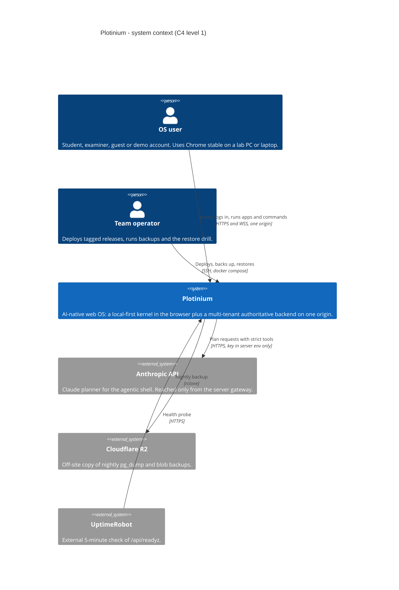
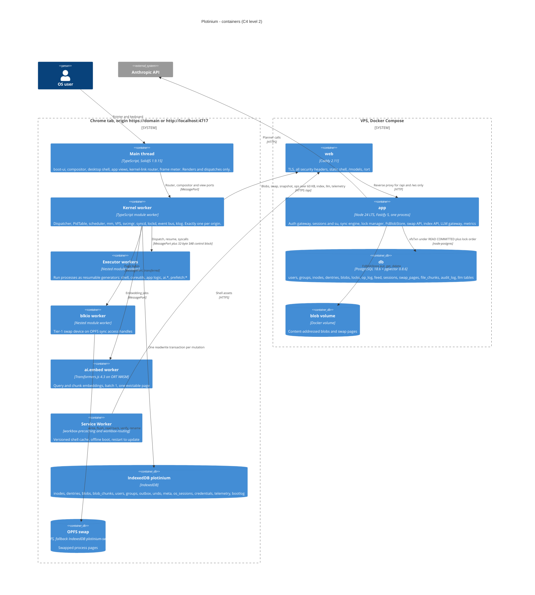
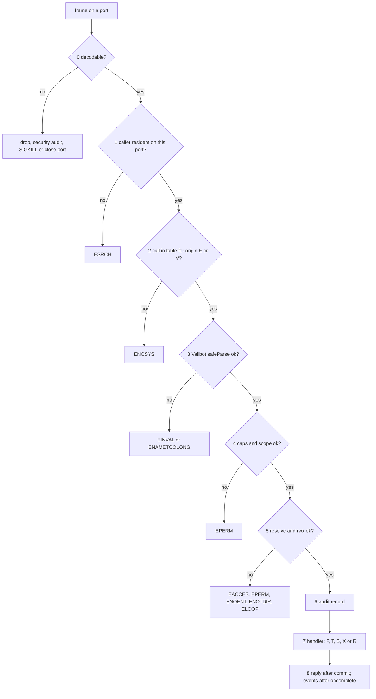
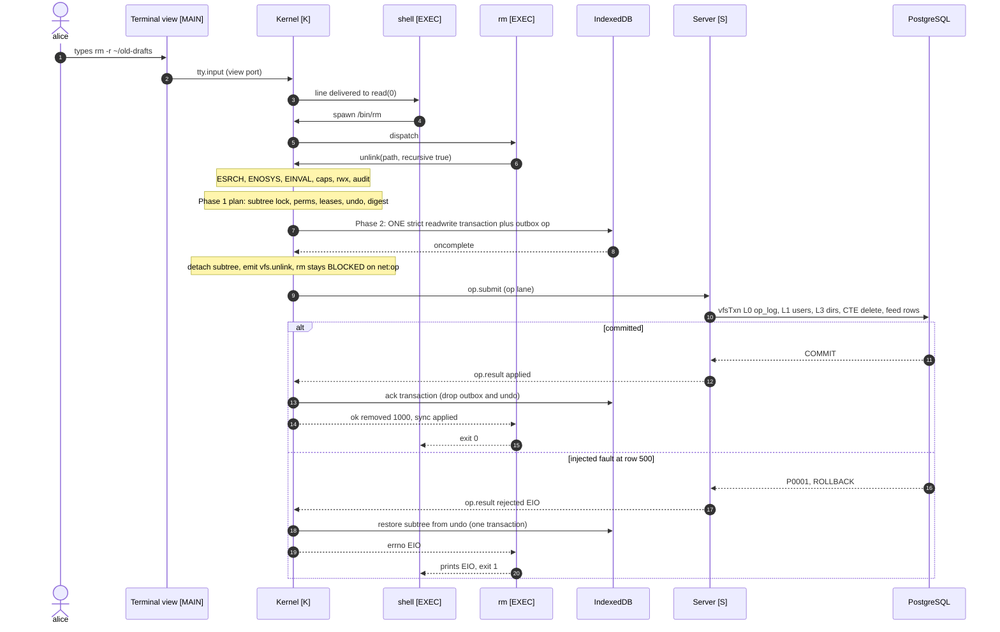
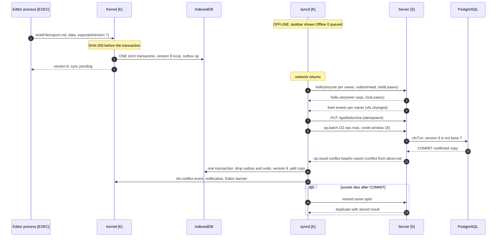
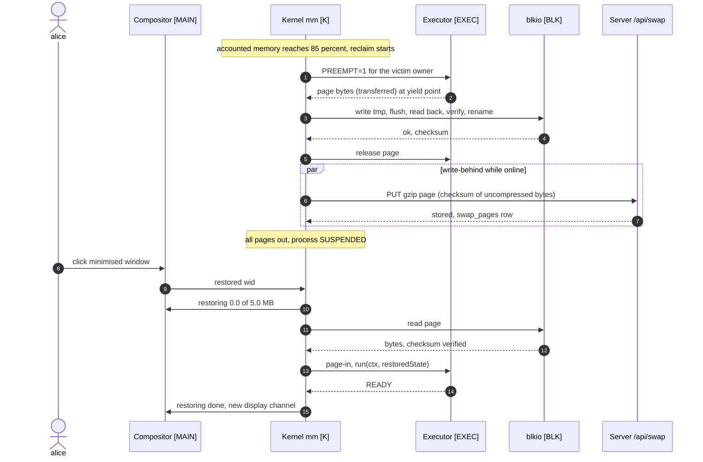
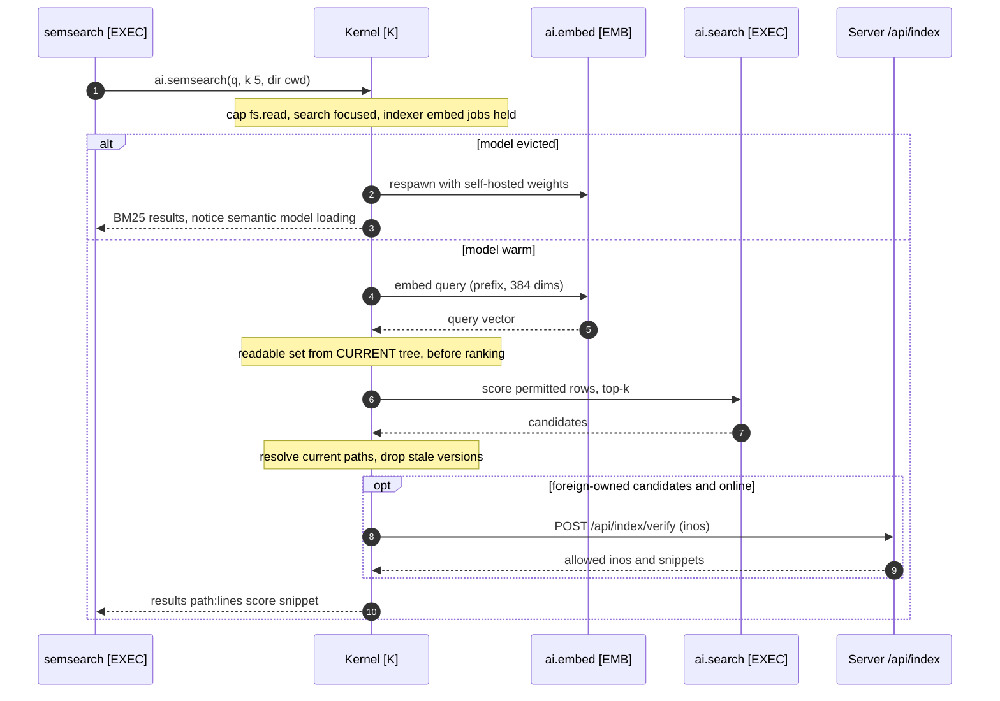
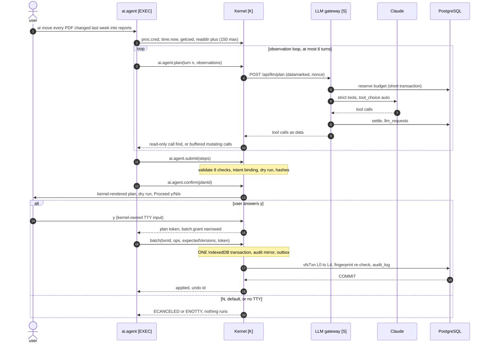
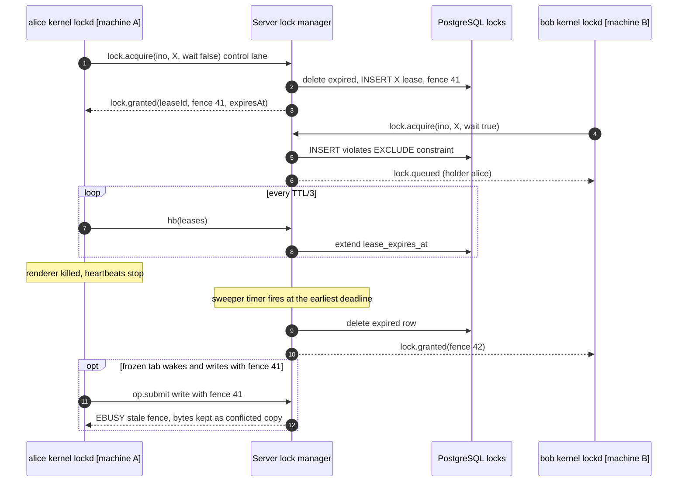

# Architecture

**Status:** v0.1 of the document, 2026-09-25, written from the specs and checked against the code on disk. Lead editor: R1 Kernel. Reviewer: R5 QA/DevOps.
**Built from (normative):** [specs/01-architecture/architecture.md](specs/01-architecture/architecture.md) and [specs/01-architecture/syscall-abi.md](specs/01-architecture/syscall-abi.md). If this summary and a spec disagree, the spec wins (spec index §3.3).

Spec §15.2 requires this document to contain the diagrams, the module boundaries, the system-call protocol, the data flows, and the two decisions the team would reverse with hindsight. Numbers from the AI-run pilot carry the label _(pilot figure — re-measure on the lab machine)_.

**Contents:** [0 Implementation status](#0-implementation-status) · [1 Context](#1-system-context-c4-level-1) · [2 Containers](#2-containers-c4-level-2) · [3 Layers](#3-layers) · [4 The three boundaries](#4-the-three-mandatory-boundaries) · [5 Threads](#5-threads-and-workers) · [6 Module boundaries](#6-module-boundaries) · [7 One origin](#7-one-origin-one-header-set) · [8 System-call protocol](#8-the-system-call-protocol) · [9 Data flows](#9-data-flows) · [10 The benchmarks](#10-how-the-design-answers-the-two-benchmarks-spec-7) · [11 AI in every layer](#11-ai-in-every-layer) · [12 Authority](#12-who-is-authoritative-for-what) · [13 Invariants](#13-cross-cutting-invariants) · [14 Two decisions we would reverse](#14-two-decisions-we-would-reverse)

---

## 0. Implementation status

What exists in the repository on 2026-09-25, component by component, so the diagrams below are read against reality.

| Component (diagram name)                                                  | Package / path                                  | State                                                                                                                 |
| ------------------------------------------------------------------------- | ----------------------------------------------- | --------------------------------------------------------------------------------------------------------------------- |
| Syscall ABI, errnos, events, WS protocol v1                               | `protocol/src/`                                 | implemented and tested (119 calls, 25 errnos, 22 capabilities, frame fixtures, ABI digest)                            |
| Team data structures                                                      | `dsa/src/*`                                     | interfaces, tests and benchmarks shipped; implementations pending by their owners (`IMPLEMENTED = false`, spec §10.2) |
| Kernel worker: dispatcher, PidTable, scheduler, mm, event bus, klog, host | `kernel/src/`                                   | not written (AI hook interfaces and the sys-client type only)                                                         |
| VFS: path, perm, tree, quota, ops, store, fsck, fault                     | `vfs/src/`                                      | implemented and tested against an IndexedDB test double; the tree uses a test double until `dsa/tree` lands           |
| `syncd`, `lockd` (clients)                                                | `vfs/src/sync`, `vfs/src/locks`                 | not written (READMEs)                                                                                                 |
| Service manager and the 18 manifests                                      | `services/`                                     | not written                                                                                                           |
| Compositor, boot-ui, desktop shell, frame meter                           | `wm/src/`                                       | not written; design tokens and UI primitives exist in `ui/`                                                           |
| Shell, coreutils, TTY                                                     | `apps/shell`, `apps/coreutils`, `apps/terminal` | implemented and tested against a fake system-call layer                                                               |
| AI: indexer, search, agent, predictor, eval                               | `ai/src/`, `ai/eval/`                           | libraries implemented and tested; not wired to a kernel; no weights, no LLM adapter                                   |
| Server: gateway, rate limiter, `vfsTxn`, FsBlobStore, health              | `server/src/`                                   | implemented and tested; sync, locks, swap, index, LLM, telemetry and admin routes answer `501 ENOSYS`                 |
| Database                                                                  | `db/`                                           | 6 migrations, 17 tables, probes, benchmark queries, seed                                                              |
| `web` (Caddy), `app`, `db` containers                                     | `Dockerfile`, `compose*.yaml`, `Caddyfile`      | the three-service stack starts healthy; `web` serves a placeholder until `web/` is built                              |

---

## 1. System context (C4 level 1)

Two human actors and three external systems. Everything else runs either in the user's Chrome or on one VPS.



- **Spec: MUST, §12.6.** API keys never appear in the client bundle or the repository; every model call goes through our backend with per-user rate limits. The only arrow to Anthropic starts at the server.
- Embeddings (subsystem A) and the predictor (subsystem C) run in the browser, so neither needs an external system; model weights and the ONNX runtime are self-hosted under `/models` and `/ort`.

## 2. Containers (C4 level 2)



- The kernel worker is the **only** code that opens IndexedDB `plotinium` and the only code that owns the WebSocket (C2).
- Caddy serves the static shell and sets every security header; Fastify serves only `/api/*` and `/ws`. There is no Redis, no LISTEN/NOTIFY and no second Node process: broadcasts happen in-process after COMMIT (C9).
- The deployment view (three Compose services, two networks, five volumes) is in [specs/14-devops/deployment-and-ci.md §3.1](specs/14-devops/deployment-and-ci.md); the kernel and server component diagrams (C4 level 3) are in [architecture.md §3.3](specs/01-architecture/architecture.md).

## 3. Layers

| #   | Layer                                      | Where it runs                                                              | What lives there                                                                                                                                                                                         | Primary owner                         |
| --- | ------------------------------------------ | -------------------------------------------------------------------------- | -------------------------------------------------------------------------------------------------------------------------------------------------------------------------------------------------------- | ------------------------------------- |
| 1   | **User space**                             | views on the main thread; all app logic on executors                       | boot-ui, login, desktop and taskbar, app views (Terminal, Files, Editor, Task Manager, Settings), the shell, coreutils, `ai`, `semsearch`, `predict`, demo programs (`burn`, `memhog`)                   | R3, R2, R1, R4                        |
| 2   | **System-call interface**                  | MessagePorts between user space and the kernel                             | `protocol/` schemas, dispatcher, capability check, rwx check, audit hook, event bus                                                                                                                      | R1 (R2 and R4 co-approve `protocol/`) |
| 3   | **Kernel**                                 | the kernel worker, exactly one per origin                                  | process table (`dsa/hashtable`), scheduler (`dsa/heap`), executors and run tokens, memory manager and LRU pager (`dsa/lru`), VFS, service manager (`dsa/dag`), `syncd`, `lockd`, klog (`dsa/ringbuffer`) | R1, R2, R5                            |
| 4   | **Client execution and local persistence** | executors, blkio, ai.embed, the Service Worker; IndexedDB, OPFS, Cache API | process programs, tier-1 swap, the ONNX runtime, the versioned shell cache                                                                                                                               | R1, R2, R4, R5                        |
| 5   | **Transport**                              | one origin: WSS `/ws` and HTTPS `/api/*`                                   | protocol v1 (op lane and control lane); bulk bytes over HTTPS                                                                                                                                            | R5 (client), R2 (server)              |
| 6   | **Backend**                                | Caddy, one Node 24 process, PostgreSQL 18.6 + pgvector 0.8.6, blob volume  | auth and rate limits, sync engine, lock manager, blob and swap store, index API, LLM gateway, metrics                                                                                                    | R2, R1, R4, R5                        |

**Spec note (§8, p. 22).** "The architecture below is a reference, not a prescription." Figure 8.1 draws the kernel on the main thread; Plotinium moves it to a dedicated worker, as the three boundaries allow, and boundary 2 is the reason: a main-thread kernel measured a syscall p95 of 9.4 ms under 10 ms of UI work per frame, against 0.13–0.17 ms from a worker _(pilot figure — re-measure on the lab machine)_.
TODO(team): replace pilot figures with your own lab measurements.

## 4. The three mandatory boundaries

**Spec: MUST, §8.** "Your architecture must keep three boundaries."

| Boundary                                         | Rule (spec)                                                                                                  | Mechanism (Plotinium design)                                                                                                                                                                                                                                                                                                                                                                                                                                                                             | CI proof                                                                                                                                                                                                               |
| ------------------------------------------------ | ------------------------------------------------------------------------------------------------------------ | -------------------------------------------------------------------------------------------------------------------------------------------------------------------------------------------------------------------------------------------------------------------------------------------------------------------------------------------------------------------------------------------------------------------------------------------------------------------------------------------------------- | ---------------------------------------------------------------------------------------------------------------------------------------------------------------------------------------------------------------------- |
| **B1: syscall-only**                             | Applications, built-in ones included, reach OS resources only through the system-call interface              | an app receives only `{sys, pid, wid}`; the executor runtime replaces storage, thread, network and timer globals with throwing accessors before app code loads; after POST the main thread shadows `indexedDB`, `caches`, `navigator.storage.getDirectory` and `Worker` (ARC-07); ESLint keeps `apps/*` to `protocol/` and the sys client; caller identity comes from the port, never from message fields (C3); the kernel checks rwx on every call and the server re-checks with the same `vfs/perm.ts` | SYS-01 bypass suite (8 cases from an executor and from a view); built-chunk scan of `web/dist`; lint fixtures that must fail                                                                                           |
| **B2: the main thread renders and dispatches**   | Computation runs on workers; the kernel's main-thread work is small and bounded                              | only the compositor, boot-ui, the kernel-link router and the frame meter run on the main thread (C2); kernel events are coalesced into at most one batch per frame; payloads are paginated or transferred; the compositor is the sole writer of geometry and z-index (C11)                                                                                                                                                                                                                               | nightly on the lab-spec runner: WM-03 drag and PROC-05 load with 10 windows, p95 frame ≤ 16.7 ms from Chrome-trace frame durations and zero LoAF > 50 ms from our scripts (C13); ARC-04: ≤ 4 ms of OS script per frame |
| **B3: local-first client, authoritative server** | The client runs offline from local state; the backend is authoritative for multi-user data, locks and quotas | every user-visible mutation is ONE IndexedDB readwrite transaction across every affected store, including quota, undo and the outbox op (C4); no network call on the boot critical path (C17, ARC-08); the server re-checks permissions, owns `op_log`, the per-owner `feed`, S/X leases with fencing tokens and the quota rows (C6, C7); a server rejection reverts the local change from `undo`                                                                                                        | OFF-01 server-kill offline gate; OFF-02 exactly-once property test; VFS-09 crash-expiry test; VFS-06 quota race; VFS-10 per-owner resume test                                                                          |

## 5. Threads and workers

| Thread         | Count                                                                                                                            | Runs                                                                                                                                            | Why it exists                                                                                                                                                                            |
| -------------- | -------------------------------------------------------------------------------------------------------------------------------- | ----------------------------------------------------------------------------------------------------------------------------------------------- | ---------------------------------------------------------------------------------------------------------------------------------------------------------------------------------------- |
| Main           | 1                                                                                                                                | boot-ui (inlined, framework-free), `wm/compositor`, desktop and app views (Solid), kernel-link router, frame meter                              | rendering and input; the router makes the Window-only calls (`storage.persist()`, Service Worker registration, `measureUserAgentSpecificMemory()`); budget ≤ 4 ms of OS script per frame |
| Kernel worker  | exactly 1 per origin (Web Lock `plotinium:kernel` + fencing epoch in IndexedDB `meta`)                                           | all kernel state, IndexedDB `plotinium`, the WebSocket, `syncd` and `lockd`                                                                     | syscall latency independent of UI load; OPFS sync handles, `Atomics.wait` and nested workers exist only in dedicated workers                                                             |
| Executors      | up to 8 isolation executors; at most `RUN_TOKENS = clamp(hwc − 2 − (embedActive ? ortThreads : 0), 1, 6)` slices running at once | processes as resumable generators: shell, coreutils, app logic, `ai.search`, `ai.indexer`, `ai.predictor`, `ai.agent`, `prefetch:*`, `complete` | isolation (different uids, and agent vs user, never share a realm) is separated from concurrency (run tokens)                                                                            |
| blkio          | 1                                                                                                                                | the OPFS swap device (fallback IndexedDB `plotinium-swap`)                                                                                      | a 5 MB write-flush-read-verify blocks 15–58 ms _(pilot figure — re-measure on the lab machine)_ and must not stall syscalls                                                              |
| ai.embed       | 0 or 1                                                                                                                           | Transformers.js on ORT WASM, batch 1, ≤ 512 tokens                                                                                              | accounted as one evictable page of about 100 MiB _(pilot figure — re-measure on the lab machine)_; eviction is `worker.terminate()`                                                      |
| Service Worker | 1, after `desktop-interactive` + idle                                                                                            | versioned shell cache; `/api/*` and `/ws` network-only                                                                                          | offline boot (BOOT-09) and restart-to-update (OFF-05) without slowing the cold boot                                                                                                      |

There are no other special workers: `syncd` and `lockd` are kernel services with pids, and every AI job is an ordinary process visible in `ps`. Payloads over 64 KB between threads are transferred, file reads return `ArrayBuffer`, and kernel-to-view pages hold at most 1,000 entries.

## 6. Module boundaries

**Spec §15.1:** subsystem boundaries are visible in the directory structure. One pnpm workspace, one package per subsystem:

| Package          | npm name                             | Contents                                                                                                                                 |
| ---------------- | ------------------------------------ | ---------------------------------------------------------------------------------------------------------------------------------------- |
| `protocol/`      | `@plotinium/protocol`                | Valibot schemas (syscalls, errnos, events, WS v1 frames, agent tools), well-known inode UUIDs (C5), `ABI_VERSION`. Pure: no DOM, no Node |
| `dsa/`           | `@plotinium/dsa`                     | the team's structures (C16), each with tests and a benchmark and an `IMPLEMENTED` flag                                                   |
| `kernel/`        | `@plotinium/kernel`                  | `core/` (proc, sched, mm, ipc, hooks, klog), `host/`, `runtime/` (executor), `blkio/`                                                    |
| `vfs/`           | `@plotinium/vfs`                     | `path.ts`, `perm.ts` (isomorphic), tree, quota, ops, store, fsck, fault; `sync/`, `locks/`                                               |
| `services/`      | `@plotinium/services`                | the 18 manifests (C17) and the service manager                                                                                           |
| `wm/`, `ui/`     | `@plotinium/wm`, `@plotinium/ui`     | framework-free compositor and boot-ui, Solid desktop, tokens, frame meter; UI primitives                                                 |
| `apps/`          | –                                    | built-in apps: a Solid view plus an executor process each                                                                                |
| `ai/`            | `@plotinium/ai`                      | embed, indexer, search, agent, predictor, eval                                                                                           |
| `server/`, `db/` | `@plotinium/server`, `@plotinium/db` | one Node process of Fastify plugins; migrations, seed, bench, probes                                                                     |
| `web/`           | `@plotinium/web`                     | Vite root, `index.html`, `sw.ts`                                                                                                         |

**Import rules (ARC-01, C14)**, enforced by ESLint with `--max-warnings 0` ([`tools/eslint-rules/boundaries.js`](tools/eslint-rules/boundaries.js) and the local rules):

```text
protocol/            <- imported by every package; imports nothing but valibot
dsa/                 <- kernel, vfs, wm, ai, server, services; imports only protocol types
vfs/perm.ts, path.ts <- kernel AND server (isomorphic, pure: one permission matrix for both sides)
kernel/core          imports no self, document, Worker or indexedDB (host bindings live in kernel/host)
wm/compositor        imports no Solid
apps/*               -> protocol + the sys client ONLY (never kernel/, vfs/, wm/, ai/, server/, dsa/)
ai/*                 -> protocol, dsa, kernel hook interfaces (the kernel ships no-op hooks)
server/              -> protocol, dsa, vfs/perm.ts, vfs/path.ts, db generated types
docs/evidence/pilot  -> imported by nothing; excluded from build, lint and coverage (C16)
```

Every rule has a fixture under [`tools/eslint-rules/fixtures/`](tools/eslint-rules/fixtures/) that must fail the lint, and a test that proves it does: `apps-imports-kernel-internals`, `apps-relative-import-into-vfs`, `apps-uses-indexeddb`, `apps-uses-navigator-storage`, `ai-imports-vfs`, `kernel-imports-ai`, `kernel-core-uses-self`, `compositor-imports-solid`, `dsa-source-uses-process`, `dsa-test-imports-npm-structure`, `dsa-value-import-from-protocol`, `protocol-imports-node`, `server-imports-vfs-root`, `vfs-perm-uses-indexeddb`, `web-imports-server`, `pilot-import`, plus the local rules `no-await-in-idb-builder`, `no-yieldless-loop-in-generator` and `no-html-sinks`. Changes to `protocol/` need R1, R2 and R4, because they change the ABI for every consumer.

## 7. One origin, one header set

The browser sees exactly one origin: `https://<domain>` in production and `http://localhost:4717` for the examiner bring-up (`PLOTINIUM_PORT` overrides the port). Caddy owns static files and **all** security headers; Fastify serves only `/api/*` and `/ws` (C9, C10).

| Header                                | Value                                                                                                                                                                                                                                   | Why                                                                                         |
| ------------------------------------- | --------------------------------------------------------------------------------------------------------------------------------------------------------------------------------------------------------------------------------------- | ------------------------------------------------------------------------------------------- |
| `Cross-Origin-Opener-Policy`          | `same-origin`                                                                                                                                                                                                                           | cross-origin isolation                                                                      |
| `Cross-Origin-Embedder-Policy`        | `require-corp`                                                                                                                                                                                                                          | SharedArrayBuffer control blocks, 2-thread ORT, `measureUserAgentSpecificMemory()` (MEM-01) |
| `Cross-Origin-Resource-Policy`        | `same-origin`                                                                                                                                                                                                                           | everything is self-hosted                                                                   |
| `Content-Security-Policy`             | `default-src 'self'; script-src 'self' 'wasm-unsafe-eval'; worker-src 'self' blob:; connect-src 'self'; object-src 'none'; base-uri 'none'; frame-ancestors 'none'; form-action 'none'` plus the build-time hash of every inline script | no `unsafe-eval`, no `unsafe-inline`                                                        |
| `Content-Security-Policy-Report-Only` | `require-trusted-types-for 'script'`                                                                                                                                                                                                    | Solid's compiled templates use `innerHTML` on `<template>`                                  |
| `Strict-Transport-Security`           | production only                                                                                                                                                                                                                         | –                                                                                           |
| `Cache-Control`                       | `no-cache` on `/`, `index.html`, `sw.js`, `version.json`, `boot-manifest.json`; `immutable` on `/assets`, `/models`, `/ort`                                                                                                             | versioned shell (OFF-05)                                                                    |

Checked on the local stack on 2026-09-25: `curl -sI http://localhost:4717/` returns COOP, COEP, CORP, the CSP above, the Trusted Types report-only policy and `X-Content-Type-Options: nosniff`. The session cookie is `__Host-plt_sid` in production and `plt_sid` on `http://localhost`, always HttpOnly, SameSite=Strict, Path=/.

## 8. The system-call protocol

Owned by [syscall-abi.md](specs/01-architecture/syscall-abi.md); implemented in [`protocol/src/`](protocol/src/) (`sys/envelope.ts`, `sys/names.ts`, `sys/registry.ts`, `errno.ts`, `caps.ts`, `abi.ts`).

### 8.1 Envelope and transport

**Spec: MUST, §9.6.** "Calls travel as messages (`postMessage` or `MessageChannel`) in the form `{id, call, args}`, and replies come back as `{id, ok, value | errno}`. The kernel checks permissions for every call."

```ts
// protocol/src/sys/envelope.ts (Valibot strict objects; the TypeScript types are their outputs)
type SysReq = { id: number; call: CallName; args: unknown };
type SysOk<T> = { id: number; ok: true; value: T };
type SysErr = { id: number; ok: false; errno: Errno; msg?: string; detail?: ErrDetail };
```

- Calls travel over MessagePorts with structured clone; binary data is always an `ArrayBuffer` and anything over 64 KB is transferred (ABI-13). A request id is a uint32, strictly increasing per `(port, pid)`, answered exactly once.
- Only two channels carry syscalls: the **executor control port** (origin E: one frame is both the syscall and the end of the time slice) and the **view port** (origin V: bound to `(pid, wid)` at `window.create`, restricted to non-mutating calls — "views read, processes write"). The display channel, the compositor port and the router port never carry syscalls.
- **Identity by port (C3, ABI-02).** The caller is a pure function of the port the frame arrived on and the kernel's own dispatch state. A `pid`, `uid` or `wid` inside `args` is either rejected by the strict schema or treated as the _target_ (for example `kill({pid})`), never as the caller. Processes with different `(uid, class)` never share an executor, so a compromised realm can only act as processes that already hold the same rights.

### 8.2 Dispatcher order

The order is part of the contract: a request that fails several checks always gets the errno of the **first** failing stage, and stages 1–5 have no side effects apart from audit records.



**Call classes.** Every call has exactly one: **F** fast (in memory, reply in the same task), **T** one IndexedDB readwrite transaction (caller BLOCKED until `oncomplete`), **B** blocking on an event (pipe, lock, timer, child, TTY, memory reservation, network, LLM), **X** bulk two-phase (a pre-emptible plan that yields every 2 ms, then ONE non-pre-emptive transaction; online, it also waits for the server's `op.result` for up to `SYNC_WAIT_MS`), **R** read-only scan (chunked, paginated). A B or R call interrupted by a caught signal completes with `ECANCELED` (there is no `EINTR`); T calls are atomic.

### 8.3 The call catalogue

119 calls in 12 groups, each registered in `protocol/src/sys/registry.ts` with its argument and result schemas, class, origin, capabilities, audit level and errnos; a conformance test compares the registry with the spec's tables (ABI-11).

| Group                     | Calls | Examples                                                                                                                                                                       |
| ------------------------- | ----- | ------------------------------------------------------------------------------------------------------------------------------------------------------------------------------ |
| Processes and job control | 16    | `spawn`, `exit`, `wait`, `kill`, `proc.cred`, `chdir`, `nice`, `setpgid`, `sig.action`, `proc.list`                                                                            |
| Files                     | 30    | `open`, `read`, `write`, `writeFile`, `stat`, `readdir`, `mkdir`, `unlink`, `rename`, `symlink`, `link`, `chmod`, `chown`, `copy`, `find`, `grep`, `du`, `lsof`, `batch`       |
| Descriptors and pipes     | 4     | `pipe`, `dup`, `dup2`, `isatty`                                                                                                                                                |
| TTY                       | 7     | `tty.open`, `tty.input`, `tty.resize`, `tty.getattr`, `tcsetpgrp`                                                                                                              |
| Windows and notifications | 6     | `window.create`, `window.focus`, `window.requestAttention`, `notify.post`                                                                                                      |
| Memory                    | 9     | `mem.alloc`, `mem.declare`, `mem.free`, `mem.stat`, `mem.prefetch`, `mem.hint`, `mmap`                                                                                         |
| Time                      | 3     | `time.now`, `sleep`, `uptime`                                                                                                                                                  |
| Locks                     | 3     | `lock.acquire`, `lock.release`, `lock.status`                                                                                                                                  |
| Network and sync          | 2     | `net.status`, `sync.flush`                                                                                                                                                     |
| Events                    | 2     | `sys.subscribe`, `sys.events`                                                                                                                                                  |
| AI                        | 20    | `ai.semsearch`, `ai.index.put`, `ai.agent.plan`, `ai.agent.submit`, `ai.agent.confirm`, `ai.undo`, `ai.predict`, `ai.telemetry.read` (all answer `ENOSYS` in the AI-off build) |
| System and administration | 17    | `uname`, `bootlog`, `dmesg`, `svc.status`, `sysctl.get`, `shutdown`, `reboot`, `su`, `auth.login`, `fsck`, `debug.inject`, `debug.delay`                                       |

**Capabilities (ABI-06).** 22 named rights checked at stage 4 **in addition to** rwx: `fs.read`, `fs.write`, `fs.scope` (a prefix list), `proc`, `kill.other`, `window`, `tty`, `lock`, `mem`, `mm.speculative`, `mm.hint`, `ai.index`, `ai.search`, `ai.plan`, `batch.grant`, `ai.telemetry`, `ai.predict`, `privacy`, `auth.session`, `sys.admin`, `debug.fault`, `net.sync`. They come from each program's root-owned manifest (`/bin/<name>.json`, `/system/services/<name>.json`) at `spawn` and can only shrink.

### 8.4 Errnos

**Spec: MUST, §9.3** fixes twelve file-system errnos; C3 allows thirteen more and nothing else on the wire. Codes are the Linux x86-64 values; the two AI errnos use the Plotinium range 1000–1099.

| Errno        | Code | Source    | Returned when                                                                                              |
| ------------ | ---- | --------- | ---------------------------------------------------------------------------------------------------------- |
| EPERM        | 1    | spec      | owner-or-root operation, capability or scope check failed                                                  |
| ENOENT       | 2    | spec      | a path component does not exist                                                                            |
| ESRCH        | 3    | Plotinium | caller not resident on the port; no such target process                                                    |
| EIO          | 5    | Plotinium | storage failure or injected fault; the operation was rolled back                                           |
| EBADF        | 9    | Plotinium | fd not open or not open for this mode                                                                      |
| EAGAIN       | 11   | Plotinium | retryable: stale plan, retries exhausted, executors exhausted, rate limit, offline for an online-only call |
| EACCES       | 13   | spec      | an rwx check failed                                                                                        |
| EBUSY        | 16   | spec      | locked by another session, stale fence, `lock_timeout`, subtree busy                                       |
| EEXIST       | 17   | spec      | the target name exists                                                                                     |
| EXDEV        | 18   | Plotinium | rename or link across a mount point                                                                        |
| ENOTDIR      | 20   | spec      | a directory was expected                                                                                   |
| EISDIR       | 21   | spec      | a file operation on a directory                                                                            |
| EINVAL       | 22   | spec      | schema failure; a directory moved into its own subtree                                                     |
| EMFILE       | 24   | Plotinium | the fd table is full (1,024)                                                                               |
| ENOTTY       | 25   | Plotinium | TTY call on a non-TTY; destructive agent plan without an interactive TTY                                   |
| EPIPE        | 32   | Plotinium | write to a pipe with no reader                                                                             |
| ENAMETOOLONG | 36   | spec      | name > 255 bytes or path > 4,096 bytes                                                                     |
| ENOSYS       | 38   | Plotinium | unknown call, call not available on this origin, `ai.*` in the AI-off build                                |
| ENOTEMPTY    | 39   | spec      | `rmdir` on a non-empty directory                                                                           |
| ELOOP        | 40   | spec      | more than 40 symlink hops                                                                                  |
| ETIMEDOUT    | 110  | Plotinium | a caller-supplied `timeoutMs` expired                                                                      |
| EDQUOT       | 122  | spec      | byte or inode quota exceeded, or device storage full; nothing written                                      |
| ECANCELED    | 125  | Plotinium | interrupted by a caught signal; confirmation declined; server transaction cancelled by a kill              |
| EAIUNAVAIL   | 1001 | Plotinium | LLM gateway offline, rate-limited, over budget, no key, upstream failed                                    |
| EAIREFUSED   | 1002 | Plotinium | the model refused                                                                                          |

Not errors: a content write on a stale version **succeeds** with `conflict.keptAs` (VFS-10); `sync: 'pending'` means committed locally and queued.

### 8.5 Events, ABI version and the network protocol

- **Event bus.** Topics with per-topic sequence numbers, delivered only after `oncomplete`, filtered by the receiver's permissions at send time, and coalesced into at most one batch per animation frame for views.
- **ABI versioning.** `ABI_VERSION = 1` plus a digest of the canonical JSON description of every call (`protocol/src/abi.ts`). Executors and views send `hello {abi, digest}`; a mismatch closes the port with `abi-mismatch`.
- **WebSocket protocol v1** ([offline-and-sync.md](specs/06-sync/offline-and-sync.md), `protocol/src/ws/`): JSON text frames `{v: 1, t, id, body}` of at most 64 KB; ops over 60 KB go to `POST /api/ops/{opId}`. Client frames: `hello`, `op.submit`, `op.batch` (≤ 32 ops, credit window 16), `ack`, `hb`, `lock.acquire`, `lock.release`, `proc.signal`, `resume`, `watch`, `unwatch`, `bye`. Server frames: `hello.ok`, `op.result`, `vfs.changed`, `lock.granted`, `lock.denied`, `lock.queued`, `lock.released`, `lock.expired`, `hb.ack`, `throttle`, `snapshot.required`, `resume.done`, `proc.signal`, `error`, `bye`. Leases have a 30 s TTL (15 s demo profile) and a heartbeat every TTL/3.

---

## 9. Data flows

Six end-to-end walk-throughs, condensed from [architecture.md §5](specs/01-architecture/architecture.md) (the numbered steps there are normative). Tags: [MAIN] main thread, [K] kernel worker, [EXEC] executor, [S] Node server, [PG] PostgreSQL.

### 9.1 Walk-through 1: `rm -r ~/old-drafts`, with a fault-injected failure (spec §8.1, DB-02)

1. The Terminal view feeds keystrokes to the kernel TTY; the shell (on an executor) parses `rm -r ~/old-drafts` and calls `spawn('/bin/rm')`.
2. `rm` calls `yield* ctx.sys.unlink(path, {recursive: true})`. The dispatcher checks resident, table, schema, capability `fs.write`, then x on every ancestor and w+x on `/home/alice`.
3. **Phase 1 (pre-emptible, read-only):** load the subtree in chunks, take a subtree intent lock, check w+x on every directory and the sticky rule, check leases, build the post-order plan, the undo record, the quota delta and the subtree digest (SHA-256 over sorted `ino:version`).
4. **Phase 2:** ONE strict readwrite transaction over `inodes, dentries, blobs, users, undo, outbox, meta` (fencing epoch checked first); the AI index tombstones are added inside it through the `FsSemanticSearch.txnHook` seam. The in-memory tree changes only after `oncomplete`.
5. Online, `rm` stays BLOCKED on `net:op:<opId>` while `syncd` sends `op.submit`. The server re-derives the uid and runs `vfsTxn`: L0 `op_log` insert, L1 `users` rows, L3 directory inodes, a permission and digest re-check, a set-based recursive-CTE delete, `file_chunks` by `ON DELETE CASCADE`, one `feed` row per affected owner, COMMIT, then the broadcast.
6. **Fault variant:** as root on the local/defence profile, `debug inject --target server rm 500`. The GUC-gated trigger raises `P0001` at the 500th inode row; the whole server transaction rolls back and the deterministic rejection is stored in `op_log`; the client restores the subtree from `undo` in one transaction; `rm` prints `Input/output error (injected fault; rolled back)` and exits 1. `fsck --checksum`, the orphan probes and `quota` equal their before-values on both sides.



The local phase for 1,000 nodes measured p95 57–102 ms _(pilot figure — re-measure on the lab machine)_.

### 9.2 Walk-through 2: offline edit, reconnect and replay (OFF-01..04, VFS-10)

1. The network drops: `syncd` goes OFFLINE and the taskbar shows "Offline · 0 queued"; `lockd` arbitrates between local processes only.
2. Saving `report.md` hashes the content **before** the transaction, then ONE strict transaction writes the blob chunks, the new local version, quota, undo and the outbox op `{opId (UUIDv7), cseq, lamport, base: {ino: 7}}`; the reply is `{version: 8, sync: 'pending'}`.
3. On reconnect: `hello {resume per owner, outboxHead, heldLeases}` → `hello.ok`; the server streams `feed` rows per owner; missing blobs are uploaded first (idempotent `PUT /api/blobs/{sha}`); the outbox replays in `cseq` order in batches of ≤ 32 with a credit window of 16, throttled but never disconnected.
4. Bob changed the file meanwhile (version 9 ≠ base 7): the server keeps alice's bytes as `report (conflict from alice, <date>).md` and answers `conflict, keptAs`; nothing is silently overwritten. A resend after a lost `op.result` returns the stored result (`duplicate`): exactly once.



### 9.3 Walk-through 3: page-out, page-in and restore in a new session (MEM-02..07)

Admission is reservation-based: `mem.alloc`, `mem.declare` and page-in reserve budget first and BLOCK until reclaim (which starts at 85%) frees space, so accounted memory never exceeds the budget (C13). Victims: speculative pages, then minimised windows' processes, then LRU order; pinned pages are skipped. A dirty page is serialised by a deterministic codec at the next yield point, transferred to the kernel, written by blkio (`.tmp`, flush, read back, verify SHA-256, rename), and only then released; online it is also gzip-uploaded to `/api/swap` (write-behind). Page-in shows "Restoring… n / m MB" with real byte progress and is verified byte for byte (MEM-03). A new browser session restores windows from the remote swap pages by `owner_uid` (MEM-04). Budgets: 5 MB page-in p95 ≤ 300 ms local and ≤ 2 s remote; local measured 35–56 ms _(pilot figure — re-measure on the lab machine)_.



### 9.4 Walk-through 4: `semsearch "how does LRU eviction work"` (RAG-01..06)

The query is embedded in the `ai.embed` worker (384 dimensions); the **readable set** for the caller (r on the file and x on every ancestor, from the _current_ tree) is computed **before** ranking; `ai.search` scores permitted rows exactly in 1,024-row Float32Array segments and keeps the top k with the team heap; chunks whose inode version is stale are dropped; results from files the caller does not own are re-verified with `POST /api/index/verify` online and hidden offline; output is `path:lines score snippet` as text nodes. If the model is evicted, BM25 answers first with the notice "semantic model loading" (RAG-06). A `vfs.write` event re-indexes a 50 KB file within 30 s (RAG-02).



### 9.5 Walk-through 5: `ai` with the observation loop and a destructive confirmation (AGT-01..09)

The agent runs as the invoking uid (from a root shell it drops to the real login uid) on its own executor with `fs.read`, `fs.scope = {cwd, $HOME}` and `ai.plan`. Names are datamarked with a per-request nonce; **file contents never reach the planner**. Read-only tool calls (`find`, `stat`, `readdir`, `grep` names or counts, `du`, `wc`) run as exactly one syscall each; mutating tool calls are buffered into one plan (≤ 6 turns). `ai.agent.submit` re-parses, resolves, checks capabilities, rwx, quota and intent binding, and dry-runs on a read snapshot. The kernel alone decides confirmation (delete, overwrite, chmod/chown, > 20 inodes), renders the plan on the TTY and reads the answer only from kernel-owned TTY input (default N; piped input → ENOTTY). On `y` an HMAC plan token narrows `batch.grant` to the confirmed `(op, ino)` set; `batch` runs ONE local transaction and one server `vfsTxn` with the dry-run fingerprint re-checked (EAGAIN `stale-plan` if anything changed), audited per syscall. `kill` mid-plan cancels the server transaction (`pg_cancel_backend`) and reverts (AGT-09).



### 9.6 Walk-through 6: two users contend for a lock, then the holder crashes (VFS-09, VFS-10)

Alice opens `/home/shared/plan.md` read-write and `lockd` acquires an X lease on the control lane; the server inserts a `locks` row with a fence from a sequence, and `EXCLUDE USING gist (ino WITH =, mode WITH <>)` makes S and X incompatible. Bob's request gets `lock.denied EBUSY (holder alice@lab-pc-3)` (or `lock.queued` with `wait: true`) and his Editor opens read-only. Heartbeats every TTL/3 renew the lease; pongs never do. When alice's renderer is killed, the server sweeper (one timer on the earliest deadline of a `dsa/heap`) expires the lease within TTL + 0.5 s and grants bob a new fence. A frozen tab that wakes and writes with the old fence gets EBUSY and its bytes are kept as a conflicted copy.



TODO(team): replace pilot figures with your own lab measurements (the figures in §9.1 and §9.3).

---

## 10. How the design answers the two benchmarks (spec §7)

| Benchmark limitation                  | Structural answer                                                                                                                                                                                                                                                                                      | Proven live at                                                                                                   | Flow     |
| ------------------------------------- | ------------------------------------------------------------------------------------------------------------------------------------------------------------------------------------------------------------------------------------------------------------------------------------------------------ | ---------------------------------------------------------------------------------------------------------------- | -------- |
| **Puter: centralised cloud coupling** | local-first IndexedDB VFS; every mutation is one local transaction plus one durable outbox op with a UUIDv7 idempotency key, `cseq` and a Lamport counter; no network on the boot critical path; server dedup on `op_log` gives exactly once                                                           | P3: kill the server, reboot offline, use every core app, reconnect: 0 lost, 0 duplicated ops (OFF-01/02)         | 9.2      |
| **Puter: superficial AI layer**       | AI jobs are processes with pids, priorities and pages; the agent acts only through typed syscalls and one `batch`; the index lives next to the inode table (`file_chunks` FK `ON DELETE CASCADE`); the predictor feeds residency hints; the litmus build removes `ai/` and everything else still works | P4: litmus build side by side; `ps` during indexing; kill the agent mid-plan                                     | 9.4, 9.5 |
| **daedalOS: memory bloat**            | 256 MB accounted budget with reservation admission; our own LRU (`dsa/lru`); two-tier swap (OPFS in blkio, then the server, write-behind); byte-identical page-in                                                                                                                                      | P3: 2× budget workload; paging visible in Task Manager, `vmstat` and `free`; restored state matches its checksum | 9.3      |
| **daedalOS: no orchestration**        | multi-tenant server: quota rows locked in the write's transaction (L1), S/X leases with fencing tokens, versioned sync with conflicted copies, a resume feed per affected owner                                                                                                                        | P3: two users on two machines contend for one file; the lease expires after a crash                              | 9.6      |

## 11. AI in every layer

**Spec: MUST, §3.2:** every AI subsystem shows all four AI-native properties. Plotinium builds all three (C12); the named tests are in [AI.md](AI.md).

| Property                               | A. RAG semantic search                                                                                           | B. Agentic shell                                                                                              | C. Predictive pre-fetch                                                                                          |
| -------------------------------------- | ---------------------------------------------------------------------------------------------------------------- | ------------------------------------------------------------------------------------------------------------- | ---------------------------------------------------------------------------------------------------------------- |
| **Sees the system through the kernel** | `ai.indexer` subscribes to `vfs.*` events and reads files with `read` as the uid                                 | envelope from `proc.cred`, `time.now`, `getcwd`, `readdir`; each observation is exactly one read-only syscall | launch, focus and close telemetry from `proc.spawn` and `wm.*` events, read with `ai.telemetry.read`             |
| **Acts through typed syscalls**        | `ai.index.put` / `ai.index.drop` (capability `ai.index`), `ai.semsearch`                                         | plans are data: `ai.agent.submit`, `ai.agent.confirm`, then ONE `batch`; never `eval`, never a shell string   | `mem.prefetch` and read-only `open` under `mm.speculative`; `ai.predict.publish`                                 |
| **Scheduled by the system**            | `ai.indexer` at priority 32, nice +10, 50% duty cycle while the user is active; `ai.embed` is one evictable page | `ai.agent` at priority 20 on its own executor; BLOCKED on `net:llm`, `tty:confirm`; killable mid-plan         | `prefetch:*` at priority 39, only when idle ≥ 2 s, confident and memory is free; speculative pages evicted first |
| **Informs the system**                 | hits warm the inode cache and give residency hints; the indexer's queue orders background work                   | the confirmed plan's directories stay resident; touched files jump the indexer queue                          | top-1 prediction gives an LRU residency hint; stage-6 boot pre-fetch; predictions reorder the indexer            |

Kernel seams (C12): `kernel/core/hooks` exposes `SchedulerHints`, `ShellNL` and `FsSemanticSearch` with no-op defaults; `ai/` registers real ones at service start. With `__AI__=false` and server `AI=0` (the litmus build) the registrations are tree-shaken and every `ai.*` call answers `ENOSYS`.

## 12. Who is authoritative for what

| State                                     | Authoritative copy                                     | Local copy                                                   | Reconciliation                                                            |
| ----------------------------------------- | ------------------------------------------------------ | ------------------------------------------------------------ | ------------------------------------------------------------------------- |
| File tree, inode metadata, shared content | PostgreSQL `inodes`, `dentries`, `blobs` + FsBlobStore | IndexedDB (one database per device; the kernel enforces rwx) | outbox replay, per-owner feed resume, snapshot past the retention horizon |
| Quotas                                    | `users` rows locked FOR UPDATE (L1)                    | `users` store, checked in the same local transaction         | server EDQUOT rejects; the client reverts from `undo`                     |
| Locks and leases                          | `locks` table, fencing tokens                          | `lockd` lease table; offline: local advisory locks only      | heartbeat at TTL/3; stale fence → EBUSY                                   |
| Process state                             | the owning executor                                    | OPFS or `plotinium-swap` (tier 1); `swap_pages` (tier 2)     | checksum verified on every page-in                                        |
| Session layout                            | `os_sessions` (server)                                 | IndexedDB `os_sessions`                                      | last writer wins per `os_session_id`                                      |
| Vector index                              | pgvector `file_chunks`                                 | client Float32Array segments (pageable)                      | `GET /api/index/pull`; online verification of foreign-owned results       |
| Telemetry                                 | IndexedDB ring per uid                                 | –                                                            | opt-in `POST /api/telemetry` only                                         |
| Audit                                     | `audit_log` (INSERT/SELECT only for the app role)      | local audit mirror in the same transaction as agent ops      | outbox                                                                    |

## 13. Cross-cutting invariants

| ID     | Invariant                                                                                                                                        | Enforced by                                                                                    |
| ------ | ------------------------------------------------------------------------------------------------------------------------------------------------ | ---------------------------------------------------------------------------------------------- |
| INV-A1 | At most one kernel can commit to IndexedDB `plotinium` for an origin at any time                                                                 | Web Lock `plotinium:kernel` plus the fencing epoch checked inside every readwrite transaction  |
| INV-A2 | Every user-visible mutation is exactly one readwrite transaction across every affected store; the in-memory tree changes only after `oncomplete` | the `vfs/store` transaction builder; lint `no-await-in-idb-builder`; the fault-injection suite |
| INV-A3 | Caller identity is a function of the port only                                                                                                   | the dispatcher; SYS-01 bypass case B5                                                          |
| INV-A4 | The server applies each `opId` at most once, and every accepted op writes one feed row per affected owner in the same transaction                | L0 `op_log` insert; `feed` rows under each owner's L1 lock                                     |
| INV-A5 | A lease is renewed only by an application heartbeat or an acknowledged op, never by a pong                                                       | `lockd` and the server lock manager                                                            |
| INV-A6 | No main-thread code other than the router opens storage, spawns workers or talks to the server once POST has ended                               | ARC-07 shadows; lint; the built-chunk scan                                                     |
| INV-A7 | No boot-critical service waits on the network                                                                                                    | the manifests (C17); ARC-08 test                                                               |
| INV-A8 | The planner never receives file contents; model output is only parsed as data                                                                    | the `ai.agent.plan` handler; AGT-01/06 tests                                                   |

Performance budgets for every flow above (frame time, boot, syscall round trip, page-in, lease expiry, retrieval, Q1–Q5, bring-up) are listed once in [TESTING.md §5](TESTING.md#5-performance-budgets) and enforced from `tests/performance/budgets.json`.

## 14. Two decisions we would reverse

**Spec §15.2:** this document names the two decisions the team would reverse with hindsight. The team decides them **with data in Week 16**; until then this is the running list of candidates, each with the evidence that will decide it and a reversal trigger defended in [STACK_DECISION.md](STACK_DECISION.md). The fragile records (a small weight change flips the ranking) are the most likely final two.

| #   | Decision as frozen                                        | Would reverse to                                  | Evidence to collect / trigger                                                                                | Record           | Status |
| --- | --------------------------------------------------------- | ------------------------------------------------- | ------------------------------------------------------------------------------------------------------------ | ---------------- | ------ |
| R-1 | SolidJS 1.9.15 (provisional)                              | React 19.3 + Compiler 1.0 with per-window stores  | the Week-2 S1b skills kata; reactivity bugs per phase; Solid runtime > 2 ms per frame on the lab machine     | D1 (fragile)     | open   |
| R-2 | exact client vector scan plus pgvector                    | server-only search                                | `ai.embed` resident above 120 MiB; client segment memory at 10k and 100k chunks; the `index.put` sync effort | D8 (fragile), D9 | open   |
| R-3 | raw WebSocket protocol v1                                 | SSE + POST adapter, then Socket.IO                | `wss://` fails in more than 1 of 20 attempts on the campus network                                           | D4 (fragile)     | open   |
| R-4 | per-op IndexedDB metadata                                 | SQLite-WASM (`opfs-sahpool`)                      | a 1,000-node bulk op above 500 ms end to end on the lab machine                                              | D7               | open   |
| R-5 | kernel in a dedicated worker                              | kernel on the main thread (swap one host adapter) | two-hop window syscalls; compositor-mirror bug count                                                         | D2b              | open   |
| R-6 | READ COMMITTED plus the L0–L4 lock order                  | SERIALIZABLE with retries                         | lock-order bugs; the 40P01 rate in the torture suite (> 1%)                                                  | D5               | open   |
| R-7 | hand-rolled opaque sessions                               | Better Auth                                       | the auth security suite by Week 5                                                                            | D13              | open   |
| R-8 | generator program model, checkpoints only at yield points | explicit state machines per app                   | apps that could not be made checkpointable; MEM-03 failures                                                  | D2b              | open   |
| R-9 | FsBlobStore                                               | Garage behind the same `BlobStore` interface      | blob GC or durability incidents; a restore drill finding a missing blob                                      | D12              | open   |

In Week 16 this section is replaced by the two decisions the team actually reverses, each with the measurement that convinced it and what it would cost to change now.
