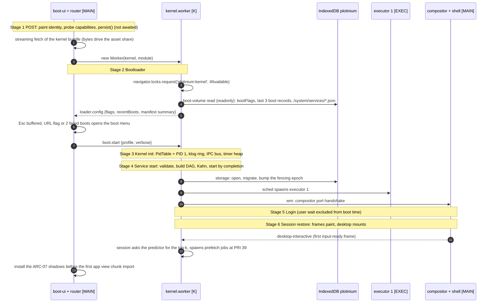
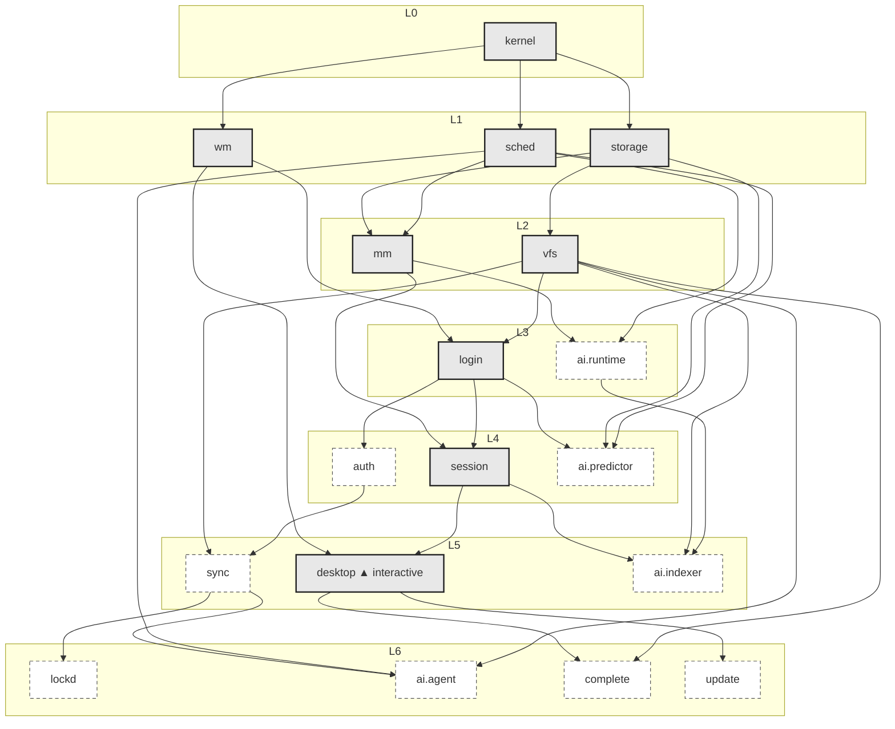

# Boot

**Status:** 2026-09-25. The boot design is specified in full; the pieces that exist in code are the DAG interface and its tests (`dsa/src/dag`, implementation pending by R5), the boot budgets in `tests/performance/budgets.json`, the boot e2e specs in `tests/e2e/` (`boot-progress`, `boot-menu`, `boot-to-session-restore`, `offline-boot`) and the performance harness in `tests/performance/boot/`. The kernel, the service manager, the 18 manifests and the boot-ui are not written yet, so no boot has been measured. Owner: R5 QA/DevOps (orchestration). Co-owner: R3 WM/UI (boot screens). Reviewer: R3.
**Built from (normative):** [specs/02-boot/boot-and-services.md](specs/02-boot/boot-and-services.md). If this document and the spec disagree, the spec wins.

Spec §15.2 requires the boot stages, the service DAG, the critical and degradable services, the boot-time budget and the measured critical path.

TODO(team): replace pilot figures with your own lab measurements (§4, and the measured critical path in §4.3 from the first lab run).

## 1. Boot stages

**Spec: MUST (§6.3, Figure 6.2):** six stages; stages 3 and 4 are driven by the service DAG; stage 5 works offline (BOOT-09).



| Stage                 | Thread                                                                         | Work                                                                                                                                                                                                                                                                                                                              | On screen                                                   | If it fails                                                                                                                         |
| --------------------- | ------------------------------------------------------------------------------ | --------------------------------------------------------------------------------------------------------------------------------------------------------------------------------------------------------------------------------------------------------------------------------------------------------------------------------- | ----------------------------------------------------------- | ----------------------------------------------------------------------------------------------------------------------------------- |
| **1 POST**            | main, inlined framework-free boot-ui                                           | paint the logo, name, `version · build` from inlined HTML before any script runs (BOOT-01); buffer Esc and V; probe capabilities; `navigator.storage.persist()` **never awaited**; background `/version.json` identity check; streaming fetch of the kernel bundle                                                                | identity, progress bar at its true value, "checking system" | **Unsupported screen** listing each missing required capability with a fix (for example "Open http://localhost:4717, not a LAN IP") |
| **2 Bootloader**      | main + kernel                                                                  | start the kernel worker; take Web Lock `plotinium:kernel` (a second tab gets the takeover screen); one read-only boot-volume transaction (boot flags, the last 3 boot records, the manifests); choose the profile                                                                                                                 | the boot menu when requested                                | fall back to **Safe mode** with a `WARN` line                                                                                       |
| **3 Kernel init**     | kernel                                                                         | the process table (PidTable, `dsa/hashtable`) with PID 1 `init`; the klog ring (`dsa/ringbuffer`, 8,192 entries); the IPC event bus; the timer heap (`dsa/heap`); the syscall table; the no-op AI hooks                                                                                                                           | progress; verbose lines                                     | **kernel-panic screen** with diagnostics and `[R] recovery console [S] safe mode [D] dump diagnostics`                              |
| **4 Service start**   | kernel (+ main for `wm` and `desktop`; executors for executor-hosted services) | load and validate the manifests, build the DAG, run Kahn, **reject cycles**, start services as their requirements complete; log `svc: 18 manifests (volume) · 30 edges · acyclic · 7 levels`                                                                                                                                      | the current service line and `Service start · n of 9`       | critical service: **recovery screen** (§3); non-critical: DEGRADED and retried with back-off                                        |
| **5 Login**           | kernel `login` service + main login view                                       | exactly one of: cached session, online password login, offline PBKDF2 verifier, guest or demo (BOOT-14); the time a human spends typing is `userWaitMs`, excluded from boot time                                                                                                                                                  | the login screen                                            | server unreachable: offer the offline verifier and Guest                                                                            |
| **6 Session restore** | kernel `session` + main compositor and `desktop`                               | restore the `os_session` layout: window frames with geometry, state and z-order paint at once; app processes respawn and their chunks load only **after** desktop-interactive; the first input-ready frame of the desktop is the **`desktop-interactive`** mark; then boot timings go to `bootlog` and the stage-6 pre-fetch runs | the desktop                                                 | an unreadable layout is kept as `<id>.recovery-<bootId>` and a clean session starts                                                 |

**Capabilities probed at POST.** Required (unsupported screen when missing): secure context, module and nested workers, IndexedDB, Web Locks, `crypto.subtle`. Degradable (a `WARN` line and a `bootlog` note): cross-origin isolation (pre-emption falls back to messages, ORT single thread), OPFS sync access handles (swap on IndexedDB), Service Worker (no offline boot), persistent storage, `CompressionStream`, `measureUserAgentSpecificMemory`.

**Truthful progress (BOOT-02).** The bar is computed from real work only, never from time: `P = α · Pa + (1 − α) · Ps`, where `Pa` is bytes of the boot assets actually loaded (decoded sizes from the build's `boot-manifest.json`), `Ps` is the weight of the services in the target's ancestor closure that have completed (Σw = 25 for the desktop: kernel 3, sched 1, storage 4, wm 2, mm 2, vfs 5, login 2, session 3, desktop 3), and α = 10/35. P is monotone, reaches exactly 1 at desktop-interactive (asserted by the e2e test), and degraded services never hold it back. Warm boots are cache-bound, so throttling the network changes only cold boots: the BOOT-02 demonstration disables the cache and bypasses the Service Worker together with throttling.

**Boot modes (BOOT-05, BOOT-06).** Hold **Esc**, run `reboot --menu`, or tick Settings → System → "Show boot menu on next boot" to get the boot menu (after two failed boots it opens by itself with Safe preselected). Normal (all 18 services from `/system/services`), **Safe** (the built-in manifests, no AI services, no app autostart, default theme), **Recovery** (only `kernel, sched, storage, wm, vfs`, `vfs` read-only, the recovery console instead of login: fsck, fsck --repair of the local mirror, clear local cache after exporting the outbox, reset session, restore default manifests, boot log, diagnostics), and **Verbose** (the log view from the start; V toggles it). Every log line is `[ssss.mmm] subsystem: message`, with `WARN`, `DEGRADED`, `FAIL` and `KERNEL PANIC` as text so colour is never the only signal.

**Shutdown and restart (BOOT-12).** `shutdown -r now`, `reboot`: stop admission, checkpoint every checkpointable process, SIGTERM the rest (2 s grace, then SIGKILL), flush dirty pages, save the session layout with strict durability (and to the server when online), stop services in **reverse topological order** on the reversed DAG (`lockd` sends `bye`, `sync` flushes the outbox for up to 3 s, `storage` closes IndexedDB last), release the kernel lock, activate a waiting Service Worker (OFF-05), then reload. Correctness never depends on `pagehide`: every mutation is already committed with strict durability.

## 2. The service DAG

**Spec (§6.4):** each system service declares its dependencies in a manifest. Source of truth: `services/manifests/*.json` (compiled into the kernel as the built-in set and seeded into `/system/services/`, root-owned). The 18 services of C17:

| Service        | Requires                 | Critical | Weight | Timeout (ms)              | Runs in               | "Started" means                                                                                             |
| -------------- | ------------------------ | -------- | ------ | ------------------------- | --------------------- | ----------------------------------------------------------------------------------------------------------- |
| `kernel`       | –                        | yes      | 3      | 1000                      | kernel                | PID 1, PidTable, IPC bus, klog ring and timer heap exist (its timeout is enforced by the router's watchdog) |
| `sched`        | kernel                   | yes      | 1      | 500                       | kernel                | ready heap and aging tick armed; executor #1 alive                                                          |
| `storage`      | kernel                   | yes      | 4      | 3000                      | kernel                | IndexedDB open at this build's version, migrations applied, fencing epoch bumped, boot record created       |
| `wm`           | kernel                   | yes      | 2      | 1000                      | main + kernel         | compositor attached; port handshake done                                                                    |
| `mm`           | sched, storage           | yes      | 2      | 2000                      | kernel + blkio        | budget loaded; LRU ready; swap device probed; `*.tmp` sweep done                                            |
| `vfs`          | storage                  | yes      | 5      | 3000                      | kernel                | `/`, `/home/<last user>` and cwd loaded lazily; quick invariants checked                                    |
| `login`        | vfs, wm                  | yes      | 2      | 2000 (user wait excluded) | kernel + login view   | session uid established                                                                                     |
| `session`      | login, mm                | yes      | 3      | 2000                      | kernel                | layout restored                                                                                             |
| `desktop`      | session, wm              | yes      | 3      | 3000                      | main                  | shell mounted; first input-ready frame gives `desktop-interactive`                                          |
| `auth`         | login                    | no       | 1      | 4000                      | kernel                | server session validated; `/version.json` identity checked                                                  |
| `sync`         | auth, vfs                | no       | 2      | 4000                      | kernel                | WebSocket live, else DEGRADED "offline, n queued"                                                           |
| `lockd`        | sync                     | no       | 1      | 2000                      | kernel                | lease table ready, else DEGRADED "local advisory locks only"                                                |
| `ai.runtime`   | sched, mm                | no       | 1      | 4000                      | kernel + executor     | the AI syscall table and seams registered; `ai.search` spawned (no network, no weights)                     |
| `ai.indexer`   | ai.runtime, vfs, session | no       | 3      | 4000                      | executor              | process spawned; pending count reported                                                                     |
| `ai.predictor` | sched, storage, login    | no       | 1      | 2000                      | executor              | Markov counts loaded from the telemetry ring                                                                |
| `ai.agent`     | vfs, sched, sync         | no       | 1      | 2000                      | kernel registry       | registered; health probe after interactive                                                                  |
| `complete`     | vfs, desktop             | no       | 1      | 10000                     | executor              | trie process running with the `cmd:`, `flag:` and `hist:` namespaces                                        |
| `update`       | desktop                  | no       | 1      | 10000                     | main + Service Worker | Service Worker registered after interactive plus idle (OFF-05)                                              |

**18 manifests, 30 edges, acyclic, 7 levels (L0–L6).** Level = the longest path from `kernel`. The expected **critical path is kernel → storage → vfs → login → session → desktop**. Solid boxes are critical; dashed boxes are degradable.



**Completion-driven start.** Kahn's algorithm runs as a cursor: each service starts the moment its last requirement completes (not level by level), with every timeout on the kernel's timer heap. No service uses `setTimeout` directly; a static check allows only two timers (the boot-menu countdown and the router's stall watchdog). The same `dsa/dag` resolves **application start-up dependencies** from `/bin/<app>.json` at `spawn`.

**A cycle halts the boot (BOOT-04).** If Kahn outputs fewer than 18 nodes, every remaining node has a remaining predecessor; walking the smallest-named predecessor must revisit a node, and that stretch is a cycle, printed in dependency direction and rotated to its smallest name:

```text
[    0.060] svc: 18 manifests (volume) · 31 edges
[    0.060] svc: KERNEL PANIC: dependency cycle detected: auth → sync → lockd → auth
            boot halted. [R] recovery console   [S] safe mode   [D] dump diagnostics
```

The examiner test: as root, `svcctl require auth lockd --force` (or add `"lockd"` to `/system/services/auth.json` in the Editor), `reboot`; the panic names the cycle; `R` → Recovery console → `M` (restore default manifests) → `N` (reboot normal) → desktop. Safe and Recovery use the built-in manifests, so they always boot past an edited cycle. The DAG's cycle reporting is already covered by gated tests (`BOOT-04 a 2-cycle and a 3-cycle are reported with real edges, rotated to the smallest name and closed`, `BOOT-04 adding a random back edge always raises CycleError whose consecutive pairs are real edges`), and the shipped graph by `DSA-DAG-03 the shipped 18 service manifests have 30 edges, 7 levels and a desktop closure of 9 services with weight 25`.

## 3. Critical and degradable services

- **Critical** (`kernel, sched, storage, wm, mm, vfs, login, session, desktop`): a failure or timeout halts the boot on the **recovery screen** (BOOT-08), drawn by the framework-free boot-ui so it works even when the UI chunk is what failed:

  ```text
  Plotinium could not start
  storage failed: IndexedDB plotinium is at version 99; this build expects 7
  [T] Retry storage   [S] Safe mode   [R] Recovery console   [D] Diagnostics
  [C] Reset local cache and re-sync (exports the outbox first)          ← storage only
  ```

  Every critical service has a finite timeout and the router's watchdog covers the kernel itself, so no failure can end in a blank page or an endless spinner; there is no spinner anywhere in boot-ui.

- **Degradable** (`auth, sync, lockd, ai.runtime, ai.indexer, ai.predictor, ai.agent, complete, update`): a failure makes the service DEGRADED or FAILED and it is retried with back-off (network-dependent services retry immediately on the `online` event); the boot continues (BOOT-07). A service may start degraded on purpose (for example `sync` offline). `lockd` and `ai.agent` start degraded when their dependency is degraded (local advisory locks; `ai` reports `EAIUNAVAIL`). Each transition is an event: the taskbar tray shows a badge per degraded service ("sync · offline · 3 queued · retry in 4 s"), and the Task Manager's Services tab and `svcctl status` list state, reason, attempts and next retry (OFF-04).
- **No network on the critical path (ARC-08).** `auth`, `sync`, `lockd`, `ai.*`, `complete` and `update` are non-critical, so the system boots to the desktop with the server killed or the network blocked (BOOT-09).

## 4. Budget and measured critical path

### 4.1 Budgets (BOOT-10, C13)

| Budget                                               | Target                                                                                            | Measured by                                  | Runs                                 |
| ---------------------------------------------------- | ------------------------------------------------------------------------------------------------- | -------------------------------------------- | ------------------------------------ |
| Warm boot to desktop-interactive                     | p95 of 20 runs ≤ **1.5 s** (warn 1.2 s)                                                           | boot harness, lab-spec runner, Chrome stable | nightly, release                     |
| Cold boot (empty HTTP and SW caches, IndexedDB kept) | p95 of 20 ≤ **3.0 s** (warn 2.5 s)                                                                | boot harness                                 | nightly, release                     |
| Cold-first boot (fresh profile, local stack)         | ≤ 3.0 s; production reported                                                                      | boot harness                                 | nightly (local), weekly (production) |
| Boot-critical main-thread JavaScript                 | ≤ **60 KB gzip** (warn 55)                                                                        | bundle-budget gate                           | every PR                             |
| Kernel worker bundle                                 | ≤ 100 KB gzip until re-baselined at W7                                                            | bundle-budget gate                           | every PR                             |
| Large assets before interactive                      | 0 requests to `/models`, `/ort`, the transformers, xterm or CodeMirror chunks, or app view chunks | Resource Timing assertion in the boot test   | every PR, nightly                    |
| DAG build + validation (18 manifests)                | ≤ 1 ms                                                                                            | services benchmark                           | every PR                             |

Boot time is `desktop-interactive − t0 − userWaitMs`. Loaded only **after** desktop-interactive: Service Worker registration, xterm and CodeMirror, Transformers.js, `/ort`, `/models`, restored app view chunks, trie `path:` indexing, `ai.embed`, executors beyond #1 and the stage-6 pre-fetch.

### 4.2 Planned segment budget

| Segment                                      | Warm target                 | Cold target                 | Notes                                                                                                     |
| -------------------------------------------- | --------------------------- | --------------------------- | --------------------------------------------------------------------------------------------------------- |
| HTML + inlined boot-ui + tokens              | 20 ms                       | 150 ms                      | inlined boot-ui SHOULD stay ≤ 16 KB gzip                                                                  |
| POST + bootloader decision                   | 20 ms                       | 20 ms                       | `persist()` and `/version.json` are not awaited                                                           |
| Kernel bundle fetch + eval, boot-volume read | 40 ms                       | 350 ms                      | –                                                                                                         |
| kernel → storage → vfs                       | 150 ms                      | 170 ms                      | lazy mount p95 ≤ 15 ms vs 118–242 ms for a full 10k scan _(pilot figure — re-measure on the lab machine)_ |
| login (cached session)                       | 20 ms                       | 20 ms                       | human wait excluded                                                                                       |
| session + desktop mount                      | 200 ms                      | 250 ms                      | the Solid runtime measured 7.3 KB gzip _(pilot figure — re-measure on the lab machine)_                   |
| **Total**                                    | **≈ 0.45 s** (budget 1.5 s) | **≈ 0.95 s** (budget 3.0 s) | the nightly lab test fails the build over budget                                                          |

### 4.3 The measured critical path (BOOT-11)

`bootlog --critical-path` walks back from `desktop` along the requirement that finished last (the arg-max predecessor): under completion-driven start, `end(desktop)` equals the sum of the durations along that chain, so it is the longest path through the DAG weighted by measured durations, and a service off the chain can be shortened by up to its slack without changing the boot time. **Measured result:** _none yet_ — the kernel and service manager are not written. From the first lab run this section holds the latest release's output, which will look like this illustrative sample (not a measurement):

```text
alice@plotinium:~$ bootlog --critical-path
boot #37 · normal · warm · 0.731 s to desktop-interactive (user wait 0.000 s excluded)
stage  post        0.000 → 0.012    12 ms
stage  loader      0.012 → 0.058    46 ms   kernel image 104 KB (cache)
svc    kernel      0.058 → 0.060     2 ms
svc    storage     0.060 → 0.122    62 ms   gated by kernel
svc    vfs         0.122 → 0.212    90 ms   gated by storage
svc    login       0.212 → 0.341   129 ms   gated by vfs      (wm done 0.083, slack 129 ms)
svc    session     0.341 → 0.402    61 ms   gated by login    (mm done 0.130, slack 211 ms)
svc    desktop     0.402 → 0.731   329 ms   gated by session  (wm done 0.083, slack 319 ms)
off the path: sync degraded (offline, 3 queued, attempt 2), lockd degraded (requires sync)
```

Each boot writes a record to IndexedDB `bootlog` (the last 20 are kept: profile, warm/cold, per-stage and per-service start and end, user wait, degraded services, outcome), which `bootlog`, `bootlog --list` and `bootlog --json` read.
