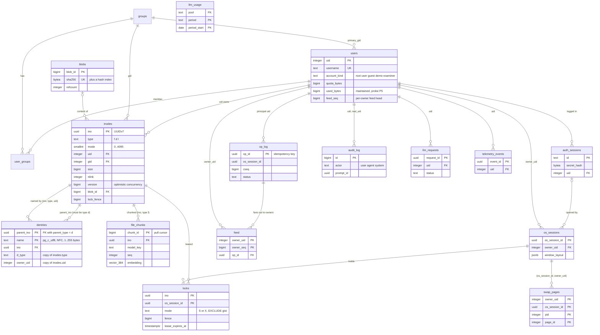
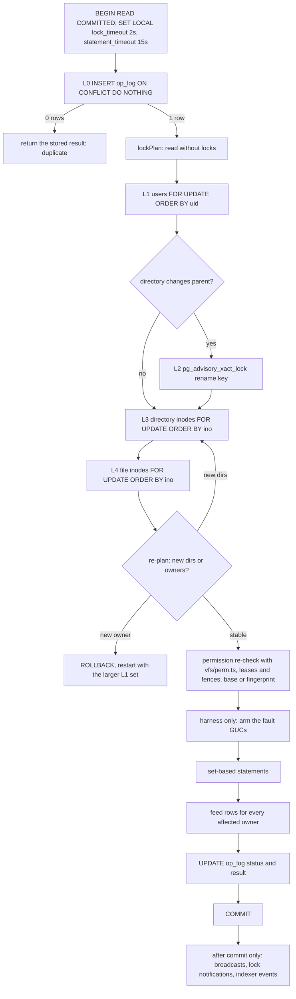

# Database

**Status:** 2026-09-25. The schema is implemented as six dbmate migrations (17 tables) with down scripts, the committed `db/schema.sql`, integrity probes, benchmark queries and a deterministic seed; the server's `vfsTxn` implements the transaction design. The benchmark table in §6.4 is still the pilot's and is replaced by the team's lab run. Owner: R2 VFS/DB. Reviewer: R5 QA/DevOps.
**Built from (normative):** [specs/09-database/database.md](specs/09-database/database.md) (and the DB record D5/D6 in [STACK_DECISION.md](STACK_DECISION.md)). If this document and the spec disagree, the spec wins.

Spec §15.2 requires the ERD, the tree representation, the transaction design, the isolation level, the indexes, and benchmark results with query plans (DB-01 … DB-05, §11).

TODO(team): replace pilot figures with your own lab measurements (every _(pilot figure)_ below, and the whole of §6.4).

## 1. Engine, roles and where the code is

- **PostgreSQL 18.6 + pgvector 0.8.6**, image `pgvector/pgvector:0.8.6-pg18-trixie` pinned by digest (the `db` target of the [`Dockerfile`](Dockerfile)), volume at `/var/lib/postgresql`, `initdb --locale-provider=builtin --builtin-locale=C.UTF-8`, `random_page_cost = 1.1`, `jit = off`, `pg_stat_statements` and `auto_explain` (settings in [`compose.yaml`](compose.yaml)).
- **Query layer:** Kysely 0.29.6 on node-postgres, hot paths in hand-written `sql`, types from kysely-codegen (`server/src/db/types.gen.ts`). **Migrations:** dbmate 2.36.0, plain SQL with `-- migrate:up` and `-- migrate:down`, applied by the `app` entrypoint (`dbmate --wait --no-dump-schema up`) before the server starts.
- **Two roles.** `plotinium_owner` (the bootstrap superuser: owns every object; used only by dbmate, the seed, backups and the bench harness) and `plotinium_app` (the running server: DML only as granted, `audit_log` INSERT and SELECT only, `op_log` without DELETE, no TRUNCATE, no DDL). Both passwords are generated at first start into the `dbsecrets` volume; nobody handles them (C10).
- **No row-level security on VFS tables.** Unix permissions depend on the path (x on every ancestor), which a per-row policy cannot express without an ancestor walk per row. Permissions are enforced by the shared `vfs/perm.ts` in the kernel and **re-checked by the server inside the transaction after the locks**; role privileges are defence in depth.

| What                                   | Where                                                                                                                                                                                            |
| -------------------------------------- | ------------------------------------------------------------------------------------------------------------------------------------------------------------------------------------------------ |
| Migrations (6, all "expand" kind)      | [`db/migrations/`](db/migrations/): `…100000_extensions_and_helpers`, `…100100_identity`, `…100200_vfs_core`, `…100300_system_tree`, `…100400_sync_locks_swap_audit`, `…100500_ai_llm_telemetry` |
| Committed schema dump                  | [`db/schema.sql`](db/schema.sql) (CI diffs it after the round trip)                                                                                                                              |
| Round trip (DB-01)                     | [`db/scripts/migrate-roundtrip.sh`](db/scripts/migrate-roundtrip.sh): up, N rollbacks, empty-schema check, up, dump diff, newest down/up                                                         |
| Integrity probes P1–P9                 | [`db/probes/integrity.sql`](db/probes/integrity.sql)                                                                                                                                             |
| Benchmark queries and toggles          | [`db/bench/`](db/bench/): `q1.sql` … `q5.sql`, `qb.sql`, `explain.sql`, `perf-indexes.{up,down}.sql`                                                                                             |
| Seed (≥ 50 users, 10k and 100k inodes) | [`db/seed/`](db/seed/) (mulberry32, seed 42)                                                                                                                                                     |
| The only mutating transaction          | [`server/src/vfs/tx.ts`](server/src/vfs/tx.ts) (`vfsTxn`), [`retry.ts`](server/src/vfs/retry.ts), [`steps.ts`](server/src/vfs/steps.ts)                                                          |
| SQLSTATE → errno                       | [`server/src/db/errors.ts`](server/src/db/errors.ts)                                                                                                                                             |

## 2. ERD and normalisation

Key columns only; the complete columns are in the migrations. `llm_usage` has no foreign key (its key is a budget pool name).

**Normal form.** Every table has one subject and one key, and every non-key attribute depends on the whole key and nothing else: the schema is in 3NF, and the multi-column keys (`dentries`, `user_groups`, `locks`, `feed`, `swap_pages`, `llm_usage`) have no partial dependency, so they are BCNF too. The central decision is that **names live on edges, not on nodes**: `inodes` holds what a file _is_, `dentries` where it _appears_. That makes hard links possible (spec §11.1) and a move a one-row update.

**Deliberate redundancy, each copy guarded by the database or a probe.**

| Redundant column                  | Why                                                              | What stops it drifting                                                               |
| --------------------------------- | ---------------------------------------------------------------- | ------------------------------------------------------------------------------------ |
| `dentries.d_type`                 | keeps recursive walks index-only on `dentries_pkey`              | composite FK `(ino, d_type, owner_uid) → inodes (ino, type, uid)`                    |
| `dentries.owner_uid`              | Q3 "prefix search across one user's files" without a join        | the same FK, `ON UPDATE CASCADE` (a `chown` rewrites the copy in the same statement) |
| `dentries.parent_type`            | constant `'d'`, so the FK can say "a parent must be a directory" | CHECK `dentries_parent_is_dir`                                                       |
| `users.used_bytes`, `used_inodes` | §11.3 rule 2 needs a lockable quota row                          | updated in the same statement as the change; CHECK against the quota; probe P5       |
| `blobs.refcount`                  | blob GC must not scan `inodes`                                   | same statement; probe P6                                                             |
| `inodes.nlink`                    | `stat` shows it                                                  | same transaction; probe P4                                                           |
| `users.feed_seq`                  | gap-free per-owner feed numbering                                | incremented under the L1 lock; probe P8                                              |
| `inodes.lock_fence`               | high-water mark of X grants                                      | written only by the lease grant                                                      |

`op_log.args/base/effects/result`, `audit_log.args/result`, `os_sessions.window_layout` and `telemetry_events.context` are `jsonb` on purpose: immutable journal entries or opaque documents owned by one component, never updated in place and never joined on an inner field.

**Deviations from the §11.1 reference schema** (the spec calls it "a reference"): `locks` keyed `(ino, os_session_id)` with an exclusion constraint (shared locks need several holders); `sessions` split into `auth_sessions` (revocable cookie) and `os_sessions` (desktop layout, which must outlive the login); `swap_pages` keyed by owner for MEM-04; `ino` is a UUIDv7, not an integer, because clients create inodes offline (C5); `op_log` gains `cseq`, `lamport`, `base`, `effects`, `status`, `errno`, `result`; new tables `feed` (per-owner resume), `llm_requests` and `llm_usage` (§12.6).

## 3. Tree representation

**Spec §11.2:** "Choose a representation, justify it against your workload, and prove that your bulk operations stay atomic." **Decision: an adjacency list** (`dentries.parent_ino`) with names on a separate table.

| Representation              | Move a 1,000-node directory           | Read a subtree / resolve a path                                                                                                           | Verdict                                                                              |
| --------------------------- | ------------------------------------- | ----------------------------------------------------------------------------------------------------------------------------------------- | ------------------------------------------------------------------------------------ |
| **Adjacency list (chosen)** | 1 dentry row + 2 parent rows          | recursive CTE on `dentries_pkey`: Q1 0.22 ms, Q5 ≈ 3.3 ms per 1,000 nodes at 100k inodes _(pilot figure — re-measure on the lab machine)_ | moves and renames trivially atomic; hard links free; every read target met           |
| Materialised path           | rewrite every descendant (1,000 rows) | fast prefix scan                                                                                                                          | `ltree` labels allow only `[A-Za-z0-9_-]`; one path per hard link                    |
| Closure table               | delete + insert ≈ 9,000 rows          | simple join                                                                                                                               | ≈ 1.4 M closure rows for a 99k seed _(pilot figure — re-measure on the lab machine)_ |
| Nested sets                 | renumber large ranges                 | very fast range scan                                                                                                                      | every create renumbers                                                               |

Rules that make it a correct Unix tree:

1. `/` is the only inode without a name; its UUID and those of `/bin`, `/system`, `/system/services`, `/system/log`, `/system/branding`, `/root`, `/home`, `/tmp` and `/mnt` are fixed in `protocol/` and used by both client `mkfs` and the server's `system_tree` migration (C5). `/home/<user>` is created only on the server.
2. **No directory hard links:** `dentries_dir_one_parent` (UNIQUE on `ino` WHERE `d_type = 'd'`) gives every directory exactly one name, so `..` is one index lookup and ancestor walks are paths, not graphs.
3. A directory's `nlink` is 2 + its child directories; a file's is its number of names.
4. Names are `text COLLATE pg_c_utf8`, NFC-normalised, 1–255 bytes, no `/`, not `.` or `..`; `pg_c_utf8` sorts by code point (so `ls` order matches `LC_ALL=C ls`) and `lower()` uses Unicode case mapping, so Q3 finds `Ärger_*` for the prefix `ärg` (under `COLLATE "C"` the same search found 1 of 1,668 such files _(pilot figure — re-measure on the lab machine)_).
5. Path length (4,096 bytes) and symlink loops (ELOOP after 40 hops) are enforced by the resolver in `vfs/src/path.ts`; no path is stored anywhere.

## 4. Transactions and isolation

### 4.1 Spec §11.3's seven rules

| Rule                                                | Mechanism                                                                                                                                                                   |
| --------------------------------------------------- | --------------------------------------------------------------------------------------------------------------------------------------------------------------------------- |
| 1. One transaction per user-visible operation       | every server mutation runs inside exactly one `vfsTxn()`; an agent plan is one `batch` op, so one `vfsTxn` (AGT-05)                                                         |
| 2. Quota checked inside the transaction, row locked | L1 locks the `users` rows of every affected owner `FOR UPDATE` in uid order; the CHECK `users_quota_bytes_ok` / `users_quota_inodes_ok` makes over-quota a `23514` → EDQUOT |
| 3. Invariants before commit; unique names by index  | `dentries_pkey` (EEXIST), the acyclicity trigger (EINVAL), every CHECK and FK                                                                                               |
| 4. Any error rolls back, one clear errno            | `toErrno()` maps SQLSTATE and constraint name (§5); deterministic rejections are recorded in `op_log` afterwards, so a resend gets the same errno                           |
| 5. The client mirror is atomic                      | one IndexedDB readwrite transaction per op (`vfs/src/store`); online, bulk ops wait for the server's result so an injected server fault prints EIO synchronously            |
| 6. Retries are safe                                 | L0 inserts the client's `op_id` first; a duplicate returns the stored result; automatic retries re-run the whole transaction including L0                                   |
| 7. Isolation declared and justified                 | READ COMMITTED + explicit locks (§4.2)                                                                                                                                      |

### 4.2 Isolation level: READ COMMITTED with explicit locks

**Declaration (DB-03).** Every VFS mutation runs at **READ COMMITTED with explicit row locks in the canonical order L0–L4**, `SET LOCAL lock_timeout = '2s'` (→ EBUSY) and `statement_timeout = '15s'`, and is retried up to 5 times with full jitter on `40001`, `40P01`, `55P03` and a changed lock set. Read-only queries run as single statements; multi-statement reads that must agree (fsck probes, the backup manifest) run in one `REPEATABLE READ READ ONLY` transaction.

**Why READ COMMITTED is safe for tree operations.**

1. FK, UNIQUE and CHECK constraints hold at every isolation level: orphans, duplicate names, a file used as a parent and over-quota rows are impossible regardless of interleaving.
2. The only tree invariant constraints cannot express is **acyclicity**, and only a cross-parent directory move can break it. Such moves are serialised system-wide by one transaction-scoped advisory lock (Linux's `s_vfs_rename_mutex` analogue), taken by the application at L2 **and** by the `dentries_acyclic` trigger itself; after the lock is granted, the trigger's ancestor walk runs in a new statement, which under READ COMMITTED sees every move committed while it waited. Of two racing moves A→B and B→A, the second always fails with EINVAL.
3. Every other conflict is on a specific row locked explicitly in a fixed order; after a lock wait READ COMMITTED re-reads the latest committed row, so no update is lost.
4. Quota cannot be lost: the row is locked at L1 and changed with `used = used + delta` in the same transaction.

**Why not SERIALIZABLE** (all _(pilot figure — re-measure on the lab machine)_):

| Configuration                                                             | Result                                                                                                     |
| ------------------------------------------------------------------------- | ---------------------------------------------------------------------------------------------------------- |
| READ COMMITTED, **no** rename lock, 2 clients cross-moving 40 directories | tree corrupted: 40 directories detached into a cycle                                                       |
| READ COMMITTED + rename lock                                              | 0 corruption, 0 retries; p95 10.6 ms (2 clients), 101 ms (8 adversarial)                                   |
| Trigger alone, application lock omitted                                   | the second mover waited on the advisory lock, then failed with `PTC01`                                     |
| SERIALIZABLE + retry, 2 / 8 clients                                       | 0 corruption, but 389 retries per 2,000 moves (2 clients) and 2,348 per 2,400 with 24 give-ups (8 clients) |
| SERIALIZABLE, 12-user mixed workload on a fresh database                  | 82–116% retries, 12–18% give-ups (relation-level SIREAD locks on small tables)                             |
| SERIALIZABLE, 10 writers + 2 workers doing a 300-node `cp -r`             | 91–97% of `cp -r` attempts aborted                                                                         |
| READ COMMITTED + the lock protocol, same workloads                        | 0 retries, 0 quota drift, 0 orphans                                                                        |

**What we give up.** Correctness depends on the lock protocol being followed. That risk is contained by one `lockPlan()`/`vfsTxn()` path for every mutation, the database-level acyclicity trigger, and an interleaving property test with the reachability probe. **Reversal trigger:** a probe violation that one added lock cannot fix within a sprint, or more than 1% of mutating syscalls hitting `40P01` in the 12-user workload → SERIALIZABLE with set-based statements.

### 4.3 The canonical lock order

| Step   | Lock                                                                                   | SQL                                                                   | Taken by                                                                |
| ------ | -------------------------------------------------------------------------------------- | --------------------------------------------------------------------- | ----------------------------------------------------------------------- |
| **L0** | idempotency: the `op_log` row                                                          | `INSERT INTO op_log … ON CONFLICT (op_id) DO NOTHING RETURNING op_id` | every op                                                                |
| **L1** | `users` rows of the actor and every affected owner (quota and per-owner feed sequence) | `SELECT … FROM users WHERE uid = ANY($1) ORDER BY uid FOR UPDATE`     | every op                                                                |
| **L2** | the rename lock                                                                        | `SELECT pg_advisory_xact_lock(plt_rename_lock_key())`                 | only when a directory changes parent                                    |
| **L3** | directory inodes whose entries change, and every directory of a walked subtree         | `… WHERE ino = ANY($1) ORDER BY ino FOR UPDATE`                       | every op that changes entries; `rm -r`, `cp -r`, `chmod -R`, `chown -R` |
| **L4** | file and symlink inodes (content CAS; subtree members)                                 | `… ORDER BY ino FOR UPDATE`                                           | writes and subtree ops                                                  |

**Plan, lock, re-plan.** Subtree ops plan without locks, take L1–L4, then collect the subtree again under the locks; directories that appeared are locked too (this converges within the subtree depth), and a new owner restarts the attempt with a larger L1 set (`LockSetChanged`, counted against the retry budget). Two transactions that follow the order wait in one direction per level and cannot deadlock on these locks; the residual cases resolve as `40P01` → retry. All mutations of one owner serialise on that owner's `users` row, which the gap-free per-owner feed requires anyway.

### 4.4 Bulk operations and fault injection (DB-02)

Bulk operations are **set-based**: each phase is one SQL statement on a recursive CTE over `dentries_pkey`, with the quota and blob-refcount updates in the same statement (`rm -r` of 1,000 nodes as per-node statements took 366 ms, set-based 33 ms _(pilot figure — re-measure on the lab machine)_). `rm -r` removes `file_chunks` and `locks` by `ON DELETE CASCADE`; `cp -r` shares content by blob refcount; `mv` is one dentry UPDATE (always an UPDATE, so the acyclicity trigger fires); a batch rename with swaps runs in two phases through temporary names; `chmod -R` applies symbolic `X` semantics; `chown -R` moves quota between owners in the same statement. Each op also writes one `feed` row per affected owner and its `op_log` result in the same transaction. A structural op carries the client's subtree digest and an agent batch its dry-run fingerprint; a mismatch is EAGAIN (`stale-base` / `stale-plan`) with no side effects.

**Fault injection** (spec §11.3 box): a `BEFORE INSERT OR UPDATE OR DELETE … FOR EACH ROW` trigger on `inodes` and `dentries` ships in every build and is inert unless the transaction sets `plotinium.fault_after = N` (and `plotinium.fault_on`); node op N+1 then raises `P0001` with hint `plotinium.fault`, the whole transaction rolls back, and the server answers EIO. The GUCs can only be set through the root-only, audited, one-shot harness, which exists only with `FAULT_INJECTION=1` — never in production, where the server refuses to start with it. The test matrix injects at nodes 1, 500, 999, 1,000 and the last, and once past the end (which must commit normally), for `rm -r`, `cp -r`, `mv`, batch rename, `chmod -R`, `chown -R` and the agent batch; after each, the tree checksum equals its before-value, probes P1–P9 are empty and the quota is unchanged ([TESTING.md §6](TESTING.md#6-fault-injection-design-db-02-db-03)). The inert trigger cost 2.4 ms of a 37.3 ms `rm -r` over 1,000 nodes _(pilot figure — re-measure on the lab machine)_.

### 4.5 Versions, fences and conflicted copies

`inodes.version` is the optimistic-concurrency counter, bumped by every change clients mirror. A content write locks the inode (L4), refuses a live foreign X lease (EBUSY) and a stale fence (the bytes become a conflicted copy and the status is `conflict` with EBUSY), and on `version <> expectedVersion` creates a sibling `name (conflict from <user>, <YYYY-MM-DD>).ext` owned by and charged to the writer: nothing is silently overwritten (VFS-10). Blobs are uploaded and verified **before** the transaction, so it never waits on I/O outside PostgreSQL.

## 5. Constraints and their errnos (DB-04)

Every constraint has a stable name, and `server/src/db/errors.ts` maps the SQLSTATE plus the constraint name to one errno of the closed set:

| Constraint or SQLSTATE                                                                                                  | Enforces                                                                                          | Errno                                     |
| ----------------------------------------------------------------------------------------------------------------------- | ------------------------------------------------------------------------------------------------- | ----------------------------------------- |
| `dentries_pkey` (`23505`)                                                                                               | one name per directory                                                                            | EEXIST                                    |
| `dentries_parent_fk` (`23503`)                                                                                          | the parent exists and is a directory / a directory with entries cannot be deleted                 | ENOENT / ENOTEMPTY                        |
| `dentries_child_fk`                                                                                                     | the name's type and owner copies match the inode                                                  | ENOENT (EIO if it trips on delete: a bug) |
| `dentries_dir_one_parent`                                                                                               | no directory hard links                                                                           | EPERM (`directory`)                       |
| `dentries_name_len`, `inodes_symlink_target_len`                                                                        | 1–255 bytes; target length                                                                        | ENAMETOOLONG                              |
| `dentries_name_chars`, `dentries_name_nfc`, `dentries_parent_is_dir`                                                    | no `/`, not `.`/`..`, NFC                                                                         | EINVAL                                    |
| `dentries_acyclic` (`PTC01`, trigger)                                                                                   | a directory cannot move into its own subtree                                                      | EINVAL                                    |
| `inodes_type_valid`, `inodes_mode_range`, `inodes_symlink_iff_target`, `inodes_blob_only_files`, `inodes_dir_size_zero` | type ∈ {f, d, l}; mode 0..4095; a symlink has a target iff it is a symlink; content only on files | EINVAL                                    |
| `users_quota_bytes_ok`, `users_quota_inodes_ok` (`23514`)                                                               | `used ≤ quota` for non-root                                                                       | EDQUOT                                    |
| `locks_sx_excl` (`23P01`, `EXCLUDE USING gist (ino WITH =, mode WITH <>)`), `locks_one_writer`, `locks_pkey`            | S and X are incompatible; one writer                                                              | EBUSY (`lease`)                           |
| `swap_pages_session_fk`                                                                                                 | a page belongs to its owner's OS session                                                          | EACCES                                    |
| `P0001` with hint `plotinium.fault`                                                                                     | the injected fault                                                                                | EIO (`injected`)                          |
| `55P03`                                                                                                                 | `lock_timeout`                                                                                    | EBUSY (`lock-timeout`)                    |
| `40001`, `40P01` after 5 attempts                                                                                       | serialisation failure, deadlock                                                                   | EAGAIN (`retry-exhausted`)                |
| `57014`                                                                                                                 | statement cancelled: a `kill` (AGT-09) or the statement timeout                                   | ECANCELED (`killed`) / ETIMEDOUT          |

A constraint mapped to "bug" (for example `op_log_pkey`, which L0's `ON CONFLICT` makes unreachable) is reported as EIO and logged loudly. As `plotinium_app`, `UPDATE audit_log`, `DELETE FROM audit_log`, `DELETE FROM op_log`, `TRUNCATE inodes` and `CREATE TABLE` all fail with `42501`.

## 6. Indexes and benchmarks

### 6.1 Index list

| Index                                                                         | Table       | Definition                                             | Purpose                                                                                                           | Toggled for DB-05 "before"                                                 |
| ----------------------------------------------------------------------------- | ----------- | ------------------------------------------------------ | ----------------------------------------------------------------------------------------------------------------- | -------------------------------------------------------------------------- |
| `dentries_pkey`                                                               | dentries    | `PRIMARY KEY (parent_ino, name) INCLUDE (ino, d_type)` | unique names (EEXIST); every path step (Q1); listings in name order (Q2); index-only subtree walks (Q5, bulk ops) | yes (§11.4 "unique B-tree on dentries(parent_ino, name)")                  |
| `dentries_dir_one_parent`                                                     | dentries    | `UNIQUE (ino) WHERE d_type = 'd'`                      | no directory hard links; `..`; ancestor walks                                                                     | yes                                                                        |
| `dentries_ino`                                                                | dentries    | `(ino)`                                                | file → names (hard links, citations, Q4 names)                                                                    | yes                                                                        |
| `dentries_owner_lname`                                                        | dentries    | `(owner_uid, lower(name) text_pattern_ops)`            | Q3 prefix search within one user's names, in index order                                                          | yes (§11.4 "B-tree on the lower-cased name with a pattern operator class") |
| `inodes_pkey`, `inodes_ino_type_key`, `inodes_ino_type_uid_key`               | inodes      | `(ino)`, `(ino, type)`, `(ino, type, uid)`             | lookups; FK targets for "parent is a directory" and the owner copy                                                | –                                                                          |
| `inodes_uid_mtime`                                                            | inodes      | `(uid, modified_at DESC)`                              | Q4 "my recent files", quota reports, P5                                                                           | yes (§11.4 "index on inodes(uid, modified_at)")                            |
| `blobs_sha256_key` / `blobs_sha256_hash`                                      | blobs       | UNIQUE B-tree / `USING hash (sha256)`                  | integrity / de-duplication lookup (Qb)                                                                            | hash index toggled (§11.4 "hash index on blobs(sha256)")                   |
| `blobs_gc`                                                                    | blobs       | `(zero_since) WHERE refcount = 0`                      | GC sweep                                                                                                          | –                                                                          |
| `op_log_pkey`, `op_log_session_cseq_key`, `op_log_applied_brin`               | op_log      | –                                                      | L0 idempotency; one op per lane slot; retention scan                                                              | –                                                                          |
| `feed_pkey`, `feed_owner_op_key`                                              | feed        | `(owner_uid, owner_seq)`                               | resume range scan per owner                                                                                       | –                                                                          |
| `locks_pkey`, `locks_sx_excl` (gist), `locks_one_writer`, `locks_expiry_brin` | locks       | –                                                      | lease identity; S/X compatibility; one writer; expiry sweep                                                       | –                                                                          |
| `file_chunks_ino_model_seq_key`, `file_chunks_content_hash` (hash)            | file_chunks | –                                                      | one chunk per slot and cascade lookup; skip-unchanged lookups                                                     | –                                                                          |
| `file_chunks_hnsw` (optional)                                                 | file_chunks | `USING hnsw (embedding vector_ip_ops)`                 | ANN only if exact search misses RAG-05                                                                            | –                                                                          |

The identity, session, swap, audit, LLM and telemetry tables have the keys and secondary indexes listed in [database.md §4.13](specs/09-database/database.md).

### 6.2 The five metadata queries (DB-05)

| Query | What                                                 | SQL                                                                     |
| ----- | ---------------------------------------------------- | ----------------------------------------------------------------------- |
| Q1    | resolve a path of depth 8                            | [`db/bench/q1.sql`](db/bench/q1.sql): recursive walk on `dentries_pkey` |
| Q2    | list a 500-entry directory sorted by name            | [`q2.sql`](db/bench/q2.sql)                                             |
| Q3    | prefix search across one user's names                | [`q3.sql`](db/bench/q3.sql): `ORDER BY … USING ~<~`, so no Sort         |
| Q4    | a user's files changed in the last 7 days, newest 50 | [`q4.sql`](db/bench/q4.sql)                                             |
| Q5    | total size of a 1,000-node subtree (`du`)            | [`q5.sql`](db/bench/q5.sql)                                             |
| Qb    | blob de-duplication lookup                           | [`qb.sql`](db/bench/qb.sql)                                             |

### 6.3 Benchmark protocol

**Spec §11.4:** "a reproducible seed script (at least 50 users, with a realistic spread of directory depths), p50 and p95 over 1,000 runs before and after indexing, and query plans (EXPLAIN ANALYZE or equivalent) proving that the indexes are used."

1. **Database** `plotinium_bench`, freshly seeded with the `bench10k` or `bench100k` profile (≥ 50 users). _Before:_ `perf-indexes.down.sql` then `ANALYZE`. _After:_ `perf-indexes.up.sql` then `VACUUM (ANALYZE)` (a fresh table analysed without vacuum flipped Q5 to a Seq Scan + Hash Join at 14.0 ms vs an Index Only Scan at 1.24 ms after `VACUUM (ANALYZE)` _(pilot figure — re-measure on the lab machine)_; the seed therefore ends with it). The toggle scripts refuse to run on any other database.
2. **Parameters:** 1,000 draws per query from the fixture pools (mulberry32 seed 4242), 100 warm-up runs, 1,000 timed runs through the real Kysely code path, nearest-rank p50/p95/p99, median of 3 repeats; server-side figures from `pg_stat_statements` reported next to them.
3. **Plans:** `EXPLAIN (ANALYZE, BUFFERS)` in both states, committed to `docs/evidence/db/plans/<state>/`.
4. **Gates:** p95 ≤ 10 ms for every query in the _after_ state, at 10k on PRs touching `db/` or `server/src/db/`, and at 100k nightly on the lab-spec runner; plan assertions (index names present, no Seq Scan on `dentries`) run on a freshly migrated and seeded database.

### 6.4 Results

TODO(team): replace pilot figures with your own lab measurements. The table below is the pilot run at 99,370 inodes and 61 users on PostgreSQL 18.6 capped at 2 vCPU / 1 GB, and the verification run's plans at 100k inodes; the team's lab-spec run replaces it, with links to the committed plans.

| Query                         | p50 / p95 after indexing | p50 / p95 before indexing | Plan after indexing                                                                                           |
| ----------------------------- | ------------------------ | ------------------------- | ------------------------------------------------------------------------------------------------------------- |
| Q1 resolve depth 8            | 0.16 / 0.22 ms           | 65 / 83 ms                | recursive union with an Index Only Scan on `dentries_pkey` (Heap Fetches 0) per level                         |
| Q2 list 500 entries           | 1.05 / 1.62 ms           | 6.4 / 8.7 ms              | Index Only Scan on `dentries_pkey` (already in name order, no Sort) + Nested Loop on `inodes_pkey`            |
| Q3 prefix in one user's names | 0.29 / 0.37 ms           | 5.1 / 5.6 ms              | Index Scan on `dentries_owner_lname` with `~>=~` / `~<~` bounds, no Sort                                      |
| Q4 recent files of one user   | 0.16 / 0.20 ms           | 7.0 / 8.5 ms              | Index Scan on `inodes_uid_mtime` + LIMIT 50 + `dentries_ino` per row                                          |
| Q5 `du` of a subtree          | 1.70 / 1.87 ms           | 91 / 245 ms               | recursive union, Index Only Scan on `dentries_pkey` + Nested Loop on `inodes_pkey` (≈ 3.3 ms per 1,000 nodes) |

All figures in this table: _pilot figure — re-measure on the lab machine_. Q5 grows linearly with the subtree and is closest to the budget; if its p95 exceeds 10 ms at 100k on the lab machine, first `PRIMARY KEY (ino) INCLUDE (size)` for an index-only sum, then a transactional per-directory size cache for large directories — never a maintained aggregate on every ancestor, which would make `/` a hot row.

## 7. Integrity probes and the canonical checksum

[`db/probes/integrity.sql`](db/probes/integrity.sql) holds nine probes; each must return **zero rows**. They run in one `REPEATABLE READ READ ONLY` transaction after every DB-02 and DB-03 test, in the restore drill, and behind `fsck --server`.

| Probe          | Checks                                                             | Why it can fail even with constraints                      |
| -------------- | ------------------------------------------------------------------ | ---------------------------------------------------------- |
| P1 orphans     | an inode other than `/` with no name                               | an insert without its dentry, a delete that left the inode |
| P2 parentless  | a dentry whose parent is missing                                   | cannot (FK); the probe proves it on camera                 |
| P3 unreachable | an inode not reachable from `/`                                    | detached cycles; P1 and P2 cannot see them                 |
| P4 nlink       | names per file; 2 + child directories per directory                | a missed ±1                                                |
| P5 quota drift | `used_*` equal the owned inodes                                    | a missed delta                                             |
| P6 refcount    | `blobs.refcount` equals the referencing inodes                     | a missed increment                                         |
| P7 blob size   | a file's size equals its blob's                                    | half an update                                             |
| P8 feed        | per owner, the feed count matches `feed_seq` and seqs are in range | a feed row written without the L1 lock                     |
| P9 pending     | no committed `op_log` row left `pending`                           | an op that committed without finishing its journal         |

**Canonical tree checksum** `plt_tree_checksum(root)`: one line per node (`parent|nameHex|ino|type|modeOctal|uid|gid|size|nlink|version|blobShaHex|targetHex`), ordered by parent then name bytes, hashed with SHA-256; timestamps are excluded so the same function in `protocol/` gives an equal value on the client, which is what the VFS-10 convergence test compares. `fsck --checksum <path>` uses it with a subtree root.

## 8. Migrations, backup and restore (DB-01)

- **Migrations with rollback.** Six plain-SQL dbmate files, each with an up and a hand-written down script, all of kind "expand" (additive), so the previous release can run on the newer schema and **no down migration is ever run on production** (rollback is the previous tag). CI runs the round trip on every PR: up, N rollbacks, an empty-schema assertion, up, an explicit `dbmate dump` compared with `db/schema.sql`, then down/up of the newest migration, and `kysely-codegen --verify`.
- **Backup.** `ops/backup.sh` (nightly at 21:00 UTC and before every deploy): in one `REPEATABLE READ READ ONLY` transaction it exports a snapshot, computes the tree checksum, counts, schema version and blob list, runs `pg_dump -Fc --snapshot=<id>` inside the `db` container (so the dump and the manifest describe the same snapshot while users keep writing), and `rclone copy` (never `sync`) of the dump, manifest and blobs to Cloudflare R2; 7 daily + 4 weekly. RPO 24 h.
- **Restore.** `ops/restore.sh <manifest>`: stop `app`, verify the dump's SHA-256, recreate the database, `pg_restore -j 2 --exit-on-error`, copy missing blobs, verify checksum, probes and blobs, `VACUUM (ANALYZE)`, start `app`. RTO target ≤ 10 min. A 99k-inode dump with vectors took 11.5 s (43 MB) and its restore 3.2 s _(pilot figure — re-measure on the lab machine)_.
- **Drill.** `ops/restore-drill.sh` restores the newest backup into a scratch database weekly and before every gate; a failure blocks the next tag. The operational steps are in [ops/RUNBOOK.md §7–§8](ops/RUNBOOK.md#7-backups-to-cloudflare-r2-with-rclone).
