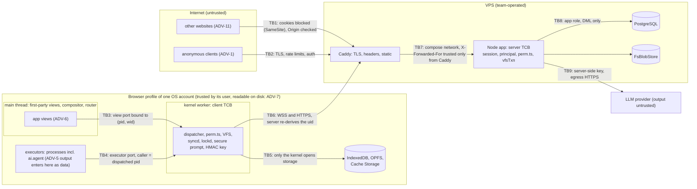

# Security

**Status:** 2026-09-25. The auth gateway (opaque sessions, Argon2id, `su` grants, guests, CSRF checks), the header set and CSP served by Caddy, the permission matrix in `vfs/src/perm.ts`, the production start-up guards, the agent's validation, confirmation predicate and plan token, and secret scanning in CI are implemented and tested; the kernel-side isolation (executor shadowing, the view-port rules), the WebSocket, search and swap authorisation are specified but not written. Owner: R2 VFS/DB. Reviewers: R4 AI (agent trust boundary), R5 QA/DevOps (auth sessions, headers, secrets).
**Built from (normative):** [specs/12-security/security-model.md](specs/12-security/security-model.md). If this document and the spec disagree, the spec wins.

Spec §15.2 requires the threat model, the permission model, the agent trust boundary, the prompt-injection defences and secret handling. **Report a suspected vulnerability privately** to the team (contacts in [TEAM_CONTRACT.md](TEAM_CONTRACT.md)), never in a public issue (§10).

## 1. Scope, objectives and non-goals

**Objectives.**

1. A user can read and change only what the UNIX permission model allows, on every path into the system: syscalls, sync, snapshots, blobs, swap, search and the agent.
2. A logged-in session can be ended at once, and nothing a client sends can widen its authority.
3. The model can propose, never decide (spec §3.4: "The model is an untrusted user-space process: it proposes, and the kernel decides").
4. No secret reaches the repository, the client bundle, a log or a test fixture; a leak is revoked quickly and recorded (§10).
5. The deployment adds no attack surface for its demo features (fault injection, debug routes, examiner accounts).

**Assumptions.** The browser and the operating-system account running it are trusted by their user; the VPS operator (the team) is trusted; Anthropic processes the prompts we send, which contain file **names**, never file contents; TLS is terminated by Caddy on the same host as the app.

**Non-goals, stated honestly.** Protecting local data from someone who controls the browser profile or the OS account (§5.3); defending against malicious browser extensions; running untrusted third-party apps (v1 runs first-party code only); high availability; encryption at rest beyond what the hosting provider and R2 do.

## 2. Threat model

**Assets.** A-1 user files and metadata (PostgreSQL, the blob store, each device's IndexedDB mirror) · A-2 credentials (Argon2id hashes; PBKDF2 verifiers on devices) · A-3 sessions · A-4 `su` grants and root · A-5 the LLM API key and budget · A-6 process memory (swap pages) · A-7 the search index · A-8 the audit trail · A-9 telemetry · A-10 infrastructure secrets (SSH deploy key, R2 credentials, TLS keys, database passwords) · A-11 build and release integrity · A-12 availability at the gates.

**Adversaries.** ADV-1 an anonymous internet attacker · ADV-2 another authenticated user (a modified client, any API call or frame) · ADV-3 a guest or the public demo account · ADV-4 malicious file content or names (including the examiners' injection fixture) · ADV-5 the LLM itself · ADV-6 a buggy or compromised first-party app · ADV-7 someone with the device (a stolen laptop, the next user of a lab PC) · ADV-8 a network attacker · ADV-9 a supply-chain attacker · ADV-10 team mistakes (a committed secret, a logged token, a shipped debug route) · ADV-11 a malicious website open in the same browser.

| ID   | Threat                                                                    | Adv.  | Mitigations                                                                                                                                                                                           | Verified by                                                                                                                                |
| ---- | ------------------------------------------------------------------------- | ----- | ----------------------------------------------------------------------------------------------------------------------------------------------------------------------------------------------------- | ------------------------------------------------------------------------------------------------------------------------------------------ |
| T-01 | CSRF on a state-changing route                                            | 11    | `SameSite=Strict` cookie; `Sec-Fetch-Site: same-origin` or an allowlisted `Origin` on every non-GET; JSON or octet-stream bodies only                                                                 | `SRV-06 a cross-site POST is refused with 403 EACCES csrf before the handler runs` (passes)                                                |
| T-02 | Cross-site WebSocket hijacking                                            | 11    | exact Origin allowlist and cookie check before the upgrade                                                                                                                                            | `SEC-04 a cross-origin or Origin-less WebSocket upgrade is refused before the upgrade`                                                     |
| T-03 | XSS through file names, file content or model output                      | 4, 5  | CSP `script-src 'self' 'wasm-unsafe-eval'` without `unsafe-inline`/`unsafe-eval`; content and model output rendered as text nodes; lint `no-html-sinks`; `HttpOnly` cookie; Trusted Types report-only | CSP-violation e2e; lint fixtures (pass)                                                                                                    |
| T-04 | Session fixation                                                          | 1, 11 | a new id at every login; a session presented with the login is revoked                                                                                                                                | `SRV-08 the session id changes at every login and a pre-set cookie value is never accepted` (passes)                                       |
| T-05 | Online guessing, credential stuffing                                      | 1     | Argon2id; token buckets per IP and per (username, IP); a hashing semaphore; delays, never lockout                                                                                                     | `SRV-09 the login-user class delays but never locks an account` (passes)                                                                   |
| T-06 | User enumeration                                                          | 1     | one generic error; a real Argon2id verification for unknown, root, guest and disabled accounts; no public user list                                                                                   | `SEC-06 unknown, root, guest, disabled and locked accounts get the same 401 as a wrong password after a real Argon2 verification` (passes) |
| T-07 | Offline guessing against a device's verifiers                             | 7     | PBKDF2-SHA256 600,000 iterations, per-uid salt; no verifier for root; 30-day expiry; invalidated by a password change                                                                                 | verifier tests                                                                                                                             |
| T-08 | Plain-text passwords at rest                                              | 7, 10 | Argon2id on the server, a PBKDF2 verifier on devices, password bytes zeroed after use                                                                                                                 | `OFF-03 a hash is a PHC Argon2id string with the OWASP parameters and never contains the password` (passes); the canary e2e                |
| T-09 | Horizontal escalation: bob reads or changes alice's files through the API | 2     | the server re-derives the principal and re-checks rwx with the shared `vfs/perm.ts` on every op; snapshot rows, feed entries and blob reads filtered by current permissions                           | the perm truth table on kernel and server                                                                                                  |
| T-10 | Vertical escalation with a forged principal, pid or uid                   | 2, 6  | uid from the session only; a principal only with a live `su` grant; caller identity from the port, never a message field                                                                              | `SRV-19 an X-Plotinium-Principal header without a live grant is refused with 403 EACCES principal` (passes); ABI identity tests            |
| T-11 | An app reaches storage without syscalls                                   | 6     | executor shadowing; main-thread shadowing after POST; lint rules; the built-chunk scan (§4.4)                                                                                                         | SYS-01 bypass suite; lint fixtures (pass)                                                                                                  |
| T-12 | Prompt injection makes the agent call a tool the user did not ask for     | 4, 5  | the planner never sees contents; datamarked names with a nonce; intent binding; strict typed tools; kernel validation, dry run and confirmation (§7)                                                  | INJ-20 at architecture level (passes); model runs pending                                                                                  |
| T-13 | A destructive model proposal runs without consent                         | 5     | the kernel-computed confirmation predicate; kernel-owned TTY input; default N; HMAC token bound to the plan and dry-run hashes; refused without a TTY                                                 | `AGT-03 both over-20-inode cases need confirmation, and every destructive case does too` (passes)                                          |
| T-14 | The agent acts as root                                                    | 5, 2  | an agent spawned from a root shell drops to the real login uid; root only per plan through the secure prompt                                                                                          | `AGT-04` tests                                                                                                                             |
| T-15 | Search leaks snippets of unreadable files                                 | 2     | readable set from the current tree before ranking; no permissions copied into the index; foreign results verified online and hidden offline                                                           | `RAG-03 rows of unreadable files are never scored (the filter runs before ranking)` (passes); `rag-leak`                                   |
| T-16 | Index poisoning                                                           | 2     | `index.put` needs w on the file and each chunk's text must equal the blob slice                                                                                                                       | index put tests                                                                                                                            |
| T-17 | LLM API key leak                                                          | 9, 10 | key only in a VPS file; never in CI, the client, the repository, logs or cassettes; gitleaks; the runbook (§6)                                                                                        | gitleaks; the release bundle scan                                                                                                          |
| T-18 | Denial of wallet through guest or demo accounts                           | 1, 3  | per-uid and pool budgets, monthly and semester caps, LLM rate limits, guest creation limits                                                                                                           | budget tests                                                                                                                               |
| T-19 | Lock hoarding                                                             | 2     | leases need w (X) or r (S), at most 256 per session, expire without heartbeats, released on revocation                                                                                                | lease tests                                                                                                                                |
| T-20 | Replaying an op or colliding with another user's op id                    | 2     | ops run only as the authenticated principal; dedup by `opId`; a stored op of another uid returns EINVAL without revealing it                                                                          | dedup tests                                                                                                                                |
| T-21 | Fault injection or debug routes on production                             | 1, 2  | the routes exist only with `FAULT_INJECTION=1`, which production refuses; root-only, one-shot, session-scoped, audited                                                                                | `SEC-09`, `SEC-12` tests                                                                                                                   |
| T-22 | Resource exhaustion                                                       | 1, 2  | 64 KB WebSocket frames; per-connection frame buckets; close 4508 for slow consumers; body limits                                                                                                      | limiter tests (pass)                                                                                                                       |
| T-23 | Blob existence oracle                                                     | 2     | `HEAD` answers 200 only for readable content; dedup only after a full upload                                                                                                                          | `SEC-17` tests                                                                                                                             |
| T-24 | Reading another user's process memory through remote swap                 | 2     | swap routes authorise by the page owner only, even for root; composite FK                                                                                                                             | `SEC-17` tests                                                                                                                             |
| T-25 | Supply-chain compromise                                                   | 9     | lockfile and exact pins, digest-pinned images, SHA-pinned Actions, licence and audit scans (§9)                                                                                                       | CI jobs                                                                                                                                    |
| T-26 | Credentials in the repository, README or compose file                     | 10    | first-start generation, printed once in the app log; production credentials on paper; CI grep; production start guards                                                                                | `OPS-03 compose.yaml, compose.prod.yaml and .env.example contain no password or token values` (passes)                                     |
| T-27 | Hard links used to pin another user's quota                               | 2     | protected hard links: a non-root caller must own the file or have r and w on it                                                                                                                       | VFS link tests (pass)                                                                                                                      |
| T-28 | Clickjacking                                                              | 11    | `frame-ancestors 'none'`                                                                                                                                                                              | header test                                                                                                                                |
| T-29 | Cross-origin side channels (Spectre class)                                | 11    | COOP, COEP `require-corp`, CORP; everything self-hosted                                                                                                                                               | `crossOriginIsolated` test                                                                                                                 |
| T-30 | The examiner's local stack reachable from the campus LAN over HTTP        | 1     | Caddy publishes on `127.0.0.1` only; credentials generated per bring-up                                                                                                                               | `SEC-20` bring-up check                                                                                                                    |
| T-31 | Reading the browser profile of a shared or stolen machine                 | 7     | stated residual risk (§5.3); separate profiles; logout and reset; no root verifier; verifier expiry                                                                                                   | document review; storage inspection                                                                                                        |
| T-32 | Secrets or personal data in logs                                          | 10    | pino redaction; no file contents, prompts or tokens in logs                                                                                                                                           | `SRV-15 log lines never contain the session token or the password` (passes)                                                                |
| T-33 | The application altering the audit trail                                  | 6, 10 | `audit_log` is INSERT and SELECT only for `plotinium_app`                                                                                                                                             | grants test                                                                                                                                |
| T-34 | Network tampering or TLS stripping                                        | 8     | HTTPS only in production with HSTS; `__Host-` cookie prefix; same-origin WSS                                                                                                                          | `SRV-02 a production origin uses the __Host- cookie prefix` (passes); header test                                                          |
| T-35 | A stale second tab writing after a takeover                               | 6     | one kernel per origin (Web Lock), a fencing epoch in every IndexedDB transaction                                                                                                                      | two-tab e2e                                                                                                                                |

## 3. Trust boundaries



| ID  | Boundary                 | Rule                                                                                                                                                                 |
| --- | ------------------------ | -------------------------------------------------------------------------------------------------------------------------------------------------------------------- |
| TB1 | Other sites → our origin | refused by `SameSite=Strict`, `Sec-Fetch-Site`, the Origin allowlist, `frame-ancestors 'none'`, COOP                                                                 |
| TB2 | Internet → Caddy         | TLS in production; rate limits; authentication per route                                                                                                             |
| TB3 | Views → kernel           | view port bound to `(pid, wid)` at `window.create`; views read, processes write                                                                                      |
| TB4 | Executors → kernel       | caller identity from the port and the dispatched pid; dispatcher order ESRCH → ENOSYS → EINVAL → capability → rwx → audit                                            |
| TB5 | Kernel → storage         | only the kernel (and its blkio worker) opens IndexedDB and OPFS; the Service Worker touches only Cache Storage, which holds only the versioned shell and model files |
| TB6 | Kernel → server          | the server trusts nothing from the client: principal from the session and grants, rwx re-checked, quotas and leases enforced in the transaction                      |
| TB7 | Caddy → app              | only Caddy reaches the app port; the client IP comes from `X-Forwarded-For` only when the peer is Caddy (`TRUST_PROXY_CIDRS`)                                        |
| TB8 | App → database           | role `plotinium_app` with DML only; `audit_log` insert and read only; the database port is never published                                                           |
| TB9 | App ↔ LLM provider       | the key stays on the server; the reply is parsed as data and validated by the kernel before anything runs                                                            |

## 4. Permission model

### 4.1 Identities

| Range or name    | uid         | Purpose and rules                                                                                                                                    |
| ---------------- | ----------- | ---------------------------------------------------------------------------------------------------------------------------------------------------- |
| `root`           | 0           | superuser; no login at the greeter, reachable only through `su` (online, with the root password); never has an offline verifier; quotas do not apply |
| reserved         | 1–999       | unused in v1: kernel threads and special processes are uid 0, class `system`; AI processes that act for a user run **as that user**                  |
| regular accounts | 1000–59999  | people: `demo`, `alice`, `bob` (group `team`), `examiner1…N` (group `examiners`, own LLM pool); `/home/<user>` mode 0700                             |
| online guests    | 60000–60999 | `POST /api/auth/guest`; `/home/guest-XXXX` 0700; 20 MB / 500 inodes; 2-hour session; cannot `su`, and nobody can `su` to a guest                     |
| offline guest    | 65534       | local only, home `/tmp/guest`, never synced, gone after reboot; no agent, no `su`                                                                    |

A process's credentials (uid, gid, supplementary groups, real uid) live in its PCB and are inherited by children; nothing in a syscall's arguments can change them.

### 4.2 Rules

**Spec: MUST, §9.3, VFS-04:** read, write and execute for owner, group and others; on directories r lists, w creates and removes entries, x allows traversal; root bypasses read and write checks; `chmod` accepts octal and symbolic modes; `chown` is root-only; the default umask is 022; the sticky bit on `/tmp` means only a file's owner can delete it.

One permission function, defined once in the isomorphic [`vfs/src/perm.ts`](vfs/src/perm.ts) and imported unchanged by the kernel and the server:

```ts
export const R = 4,
  W = 2,
  X = 1;
export function may(cred: Cred, n: PermSubject, want: number): boolean {
  if (cred.uid === 0) {
    // Root bypasses r and w. x is granted on directories, and on files only if SOME x bit is set.
    return (want & X) === 0 || n.type === 'd' || (n.mode & 0o111) !== 0;
  }
  const shift = cred.uid === n.uid ? 6 : cred.groups.includes(n.gid) ? 3 : 0;
  return ((n.mode >> shift) & 7 & want) === want;
}
```

Only one class applies (an owner gets only the owner bits). The operation rules — w and x on the parent to create or unlink; w and x on both parents to rename; the sticky rule; `chmod` by the owner or root; `chown` by root only; protected hard links — are the matrix of [virtual-file-system.md §3.6](specs/04-vfs/virtual-file-system.md), tested by `vfs/tests/perm.test.ts`.

### 4.3 Where the rules are enforced

| Path into the data                | Enforcement point                                                                                   |
| --------------------------------- | --------------------------------------------------------------------------------------------------- |
| Syscalls from processes and views | the kernel dispatcher, stage 5, with the PCB's credentials                                          |
| Replicated ops                    | the server's `vfsTxn` with the server-derived principal and the same `vfs/perm.ts`, after the locks |
| Snapshots                         | row visibility: r on the parent and x on every ancestor                                             |
| Live and resumed feed entries     | filtered by the receiver's current permissions; redacted when nothing is visible                    |
| Blob reads                        | r on the inode whose current blob it is                                                             |
| Search                            | the readable set from the current tree before ranking; server verification of foreign results       |
| Leases                            | S needs r, X needs w                                                                                |
| Database constraints              | quotas, names, modes, types, acyclicity (defence in depth, DB-04)                                   |

One truth table (3 users × 9 modes × 8 operations) runs against the kernel and against the server; any difference fails CI.

### 4.4 `su`, elevation and client isolation

- `su [user]` opens the **compositor-owned secure prompt**: the password is typed into a kernel-rendered field no application can read, drive or overlay. Online, the server verifies it and sets a **15-minute grant** on the auth session; the server accepts ops as the target uid only while the grant is live, and when it expires elevated processes get SIGHUP and their queued ops wait for a new grant. Offline, `su` works only to a non-root user with a verifier on this device; `su` to root offline is impossible.
- **Client isolation (SYS-01).** Executors shadow `indexedDB`, `caches`, `navigator.storage`, `Worker`, `importScripts`, network and timer globals before program code loads; after POST the main thread shadows `indexedDB`, `caches`, `navigator.storage.getDirectory` and `Worker` before any app view chunk loads; ESLint and a built-chunk scan forbid apps from naming storage globals, `contentWindow`, `contentDocument` or `window.open`. **Residual risk:** main-thread shadowing is defence in depth only (same-realm script could reach an `about:blank` iframe's globals), which is why v1 runs first-party code only; a future third-party app would run in a sandboxed iframe without `allow-same-origin`.

## 5. Authentication, sessions and offline login

### 5.1 Sessions (implemented in [`server/src/gateway/`](server/src/gateway/))

| Property                                   | Mechanism                                                                                                                                                         |
| ------------------------------------------ | ----------------------------------------------------------------------------------------------------------------------------------------------------------------- |
| Unguessable, useless if the database leaks | `<id>.<secret>`: a 160-bit id and a 256-bit secret from the CSPRNG; only SHA-256 of the secret is stored; `timingSafeEqual`                                       |
| Never leaked through scripts, URLs or logs | cookie only, `HttpOnly`; pino redacts `cookie` and `set-cookie`                                                                                                   |
| Cross-site use blocked                     | `SameSite=Strict`; `Sec-Fetch-Site`/`Origin` on every non-GET; exact Origin allowlist before WebSocket upgrades                                                   |
| Host binding                               | `__Host-plt_sid` on HTTPS (`Secure`, `Path=/`, no `Domain`); `plt_sid` on `http://localhost` (the `__Host-` prefix needs a secure origin)                         |
| Bounded lifetime                           | 10-day sliding expiry (written at most once an hour), 30-day absolute cap; guests 2 hours                                                                         |
| Fast revocation                            | logout, password change, disabled account or the admin CLI revoke the session in the database; its sockets close with 4401 within 1 s and its leases are released |
| Password storage                           | Argon2id m = 19456 KiB, t = 2, p = 1, 16-byte salt, PHC string, optional pepper; at most 2 hashes at once; a known-answer self-test at start-up                   |
| No enumeration, no lockout                 | one generic error and a real verification for unknown accounts; token buckets delay, never lock                                                                   |

The OWASP ASVS session-management checklist is ticked at each gate (§8).

### 5.2 Offline login (OFF-03)

**Spec: MUST, §9.5:** "Offline login never stores plain-text passwords. Use a salted verifier or a platform authenticator." A verifier is created only after a successful **online** login, never for uid 0 or a guest: the kernel derives `dk = PBKDF2-HMAC-SHA256(password, salt, 600,000 iterations, 256 bits)` with WebCrypto off the boot critical path, stores `SHA-256(dk)` in the `credentials` store with strict durability, and zeroes the password bytes. Offline, it re-derives and compares in constant time; after 5 failures it backs off `2^n × 30 s` (a user-experience gate, which someone with devtools can bypass). It expires after 30 days without an online login and on a password change. An offline session cannot do anything server-authoritative: its ops wait in the outbox ("Sign in to sync"), no agent, no `su` to root, local locks only. PBKDF2 at 600k cost 78.4 ms in Chrome _(pilot figure — re-measure on the lab machine; budget ≤ 500 ms)_.

TODO(team): replace pilot figures with your own lab measurements.

### 5.3 What a stolen laptop (or the next user of a lab PC) yields

**Data at rest in the browser profile is readable by anyone who controls that OS account, as on UNIX with physical access.** One IndexedDB database per device holds every mirrored user's data; the kernel enforces rwx while it runs, but the files on disk are not encrypted. Offline login is an access gate, not disk encryption.

| On the device                                                                            | Readable with the profile on disk?                                                                                                              | Mitigation                                                                                                                       |
| ---------------------------------------------------------------------------------------- | ----------------------------------------------------------------------------------------------------------------------------------------------- | -------------------------------------------------------------------------------------------------------------------------------- |
| IndexedDB `plotinium`: inodes, dentries, blob chunks of every user who used this profile | yes                                                                                                                                             | a separate browser profile per person on shared PCs; Settings → Storage → "Reset local storage" (exports unsynced changes first) |
| Offline verifiers                                                                        | yes (offline guessing; weak passwords fall)                                                                                                     | 600k iterations, per-uid salt, 30-day expiry, no root verifier, generated strong passwords for seeded accounts                   |
| The session cookie                                                                       | depends on the OS keyring; usable by anyone who opens the browser as that account                                                               | logout; a password change revokes all sessions                                                                                   |
| Outbox, undo, swap, telemetry                                                            | yes                                                                                                                                             | reset local storage; the boot sweep removes unreferenced swap; Settings → Privacy → Clear                                        |
| Cache Storage                                                                            | only the versioned shell and model files                                                                                                        | –                                                                                                                                |
| **Not present**                                                                          | plain-text passwords, a root verifier, server password hashes, the LLM key, database or infrastructure credentials, other users' session tokens | –                                                                                                                                |

**Server and transit.** PostgreSQL and blob volumes are stored unencrypted by the application on the VPS disk (root on the VPS needs key-only SSH through a firewall allowing 22, 80 and 443); backups go over TLS to Cloudflare R2, which encrypts them at rest; swap pages are never backed up. Production is HTTPS and WSS only with HSTS; the local examiner stack is plain HTTP on the loopback interface, a secure context that never leaves the machine.

## 6. Secret handling

**Spec: MUST, §18:** "API keys, database credentials and tokens do not belong in the repository or the client bundle. A leaked key must be revoked at once and reported in SECURITY.md." **§12.6:** keys stay on the server.

| Secret                                 | Lives in                                                                                                                   | Readable by                               | Rotation                                   |
| -------------------------------------- | -------------------------------------------------------------------------------------------------------------------------- | ----------------------------------------- | ------------------------------------------ |
| Anthropic API key (production)         | `/srv/plotinium/secrets/anthropic_api_key` on the VPS (0400, uid 1000) → Compose secret → `ANTHROPIC_API_KEY_FILE`         | the app process                           | on suspicion; end of semester              |
| Anthropic API key (evaluation)         | GitHub environment `llm-eval`, a separate key with a provider-side spend cap                                               | the release evaluation job after approval | per semester                               |
| Database passwords (owner, app)        | generated at first start into the `dbsecrets` volume on every stack, production included; nobody handles them              | `db`; `app` read-only                     | a rotation script (TODO R5)                |
| User passwords                         | Argon2id hashes only; first-start passwords printed once in `docker compose logs app`                                      | –                                         | `cli reset-password` (TODO in backend-api) |
| Production root and examiner passwords | printed once at the first production start, copied **on paper**, sealed                                                    | examiners at the gate                     | right after each gate                      |
| Session tokens                         | the browser's cookie store; SHA-256 of the secret in `auth_sessions`                                                       | the user's browser                        | 10-day sliding, 30-day absolute            |
| SSH deploy key, known hosts            | GitHub environment `production` (`VPS_SSH_KEY`, `VPS_KNOWN_HOSTS`, `VPS_HOST`, `VPS_USER`), approval-gated                 | the deploy job                            | per semester; when a member leaves         |
| R2 backup credentials                  | `/srv/plotinium/secrets/rclone.conf` (0600) on the host, never in a container; a separate read-only token for the CI drill | `ops/backup.sh`                           | per semester                               |
| TLS private keys                       | Caddy's `caddy_data` volume                                                                                                | Caddy                                     | automatic (ACME)                           |
| Kernel HMAC key for plan confirmation  | kernel worker memory only                                                                                                  | the kernel                                | every boot                                 |

**Rules, and where each is enforced.**

- `.env` and `compose.override.yaml` are gitignored; [`.env.example`](.env.example) lists variable **names** only; `compose.yaml` and the README contain no secret values — checked by `OPS-03 compose.yaml, compose.prod.yaml and .env.example contain no password or token values` (passes today).
- In production the server refuses to start with a missing secret, one shorter than 32 bytes, a known development value, an inline key, or `FAULT_INJECTION=1` (implemented in `server/src/config.ts`).
- **gitleaks** runs on every pull request over every commit ([`ci.yml`](.github/workflows/ci.yml)); the release pipeline also scans the built web shell for secrets and for `sk-ant-` / `ANTHROPIC_API_KEY` ([`release.yml`](.github/workflows/release.yml)); cassettes are scanned once they exist.
- CI never holds the production LLM key: it replays recorded responses, the recorder stores request bodies only (never headers) and refuses to write a key; ESLint forbids importing `@anthropic-ai/sdk` outside `server/`; the CSP's `connect-src 'self'` keeps the browser from calling a provider directly.

**Leaked-key runbook** (full steps in [ops/RUNBOOK.md §10](ops/RUNBOOK.md#10-leaked-key-procedure)). Owner: R4 for the LLM key, R5 for every other secret.

| Step | Within | Action                                                                                                                                                         |
| ---- | ------ | -------------------------------------------------------------------------------------------------------------------------------------------------------------- |
| 1    | T+0    | declare the incident in the team channel; name the owner; stop sharing the leaking artifact                                                                    |
| 2    | 15 min | **revoke first** at the provider (Anthropic console), before anything else                                                                                     |
| 3    | 30 min | a new key with a provider-side spend limit into the VPS secret file (0400); recreate `app`; check `/api/readyz`                                                |
| 4    | 2 h    | compare the provider's usage for the leak window with `llm_requests`; calls we did not make are abuse                                                          |
| 5    | 24 h   | remove the value where it leaked (branch, artifact, image, log); `main`'s history is **not** rewritten — the key is already dead and force pushes are disabled |
| 6    | 24 h   | add a row to the incident log (§10)                                                                                                                            |
| 7    | 1 week | a retrospective: a detection rule, test or process change so it cannot recur                                                                                   |

Other secrets follow the same steps with step 2 replaced by `ALTER ROLE` (database), revoking all sessions, deleting the key from `authorized_keys` (SSH), rolling the Cloudflare token (R2) or deleting the certificate (TLS). The runbook is rehearsed with a dummy key before the P4 gate (SEC-18).

## 7. The agent trust boundary and prompt-injection defences

**Spec: MUST, §3.4:** "The model is an untrusted user-space process: it proposes, and the kernel decides." The mechanisms are specified in [agentic-shell.md](specs/10-ai/agentic-shell.md) and implemented in [`ai/src/agent/`](ai/src/agent/); [AI.md §6](AI.md#6-safety-controls) has the per-subsystem table.

| §3.4 principle         | Plotinium mechanism                                                                                                                                                                                                                                                                                                                                                                                                                              |
| ---------------------- | ------------------------------------------------------------------------------------------------------------------------------------------------------------------------------------------------------------------------------------------------------------------------------------------------------------------------------------------------------------------------------------------------------------------------------------------------ |
| **Least privilege**    | the agent runs as the invoking uid (the real login uid when started from a root shell, AGT-04); capabilities narrowed to `fs.scope = {cwd, $HOME}`; `/system` and `/bin` give EPERM unless root confirms a per-plan elevation through the secure prompt; `batch.grant` covers only the confirmed `(op, ino)` set                                                                                                                                 |
| **Plan before acting** | the model returns a structured plan through strict tools; the kernel re-parses it with Valibot, resolves every path as the uid, checks capabilities, rwx and quota, and dry-runs it on a read snapshot, printing the blast radius                                                                                                                                                                                                                |
| **Confirmation**       | the kernel alone decides (any delete, overwrite, `chmod`/`chown`, or more than 20 inodes); the prompt is rendered by the kernel, default N; the answer is read **only from kernel-owned TTY input**, so `yes \| ai …` or a non-interactive caller cannot confirm, and destructive plans are refused without a TTY (ENOTTY); the grant is a one-shot HMAC token bound to the plan and dry-run hashes, valid 120 s                                 |
| **Atomicity**          | one `batch`: one IndexedDB transaction and one server `vfsTxn`, with the dry-run fingerprint re-checked (EAGAIN `stale-plan` if anything changed); a kill rolls both back (AGT-09)                                                                                                                                                                                                                                                               |
| **Content is data**    | the planner **never sees file contents**; names are JSON-escaped with control, bidi, zero-width and tag characters escaped, inside `<untrusted>` blocks marked with a per-request nonce; each step must quote a verbatim span of the user's request (intent binding); content-dependent tasks use a quarantined, tool-less extraction call whose values can only fill name slots; model output is parsed only as data and the CSP forbids `eval` |
| **Auditability**       | every agent syscall is written to `audit_log` in the same transaction as its effect, with the prompt, plan, confirmation and outcome; rejected and killed plans are recorded after the rollback; `ai log` reads the local mirror offline                                                                                                                                                                                                         |
| **Graceful absence**   | offline, rate-limited, over budget, no key or a provider failure → EAIUNAVAIL with a clear message; a refusal → EAIREFUSED; the rest of the OS keeps working                                                                                                                                                                                                                                                                                     |

**Defence in depth against injection.** Eleven layers — no ambient authority, content separation, datamarking, intent binding, argument grounding, kernel validation as the uid, kernel-decided confirmation, recoverability, retrieval safety, safe rendering (control characters and ESC escaped on the TTY, so a file name cannot inject terminal escape sequences) and bounded loops — each INJ-20 technique must be stopped by at least two ([AI.md §6](AI.md#6-safety-controls)). **Result today, without a model:** every INJ-20 attack plan, run through the kernel pipeline as if a compromised model had proposed it, executes zero unrequested operations with an informed user and zero destructive ones with a blind-yes user (`AGT-06 INJ-20 executed-unrequested steps are zero with an informed user`, passes).

**Search (RAG-03).** The readable set is computed from the current tree before ranking; no copy of owner, group or mode is kept in the index; results from files the searcher does not own are verified with the server online and hidden offline; devices store no text of other users' files; `index.put` requires w on the file and text equal to the blob slice.

**Privacy of prompts.** Prompts contain the user's request, kernel context (uid, cwd, time) and datamarked file **names**, never file contents. Settings → Privacy says so.

## 8. Security tests

The security test list is [security-model.md §8](specs/12-security/security-model.md). State on 2026-09-25:

| Area                                                                                                                                                                      | Tests                                                                                                     | State                                                                                      |
| ------------------------------------------------------------------------------------------------------------------------------------------------------------------------- | --------------------------------------------------------------------------------------------------------- | ------------------------------------------------------------------------------------------ |
| Sessions, CSRF, fixation, enumeration, no lockout, cookie attributes, principal header, `su` grants, guests, log redaction                                                | `server/src/gateway/*.test.ts` (`SRV-06`, `SRV-08`, `SRV-09`, `SRV-19`, `SEC-06`, `BOOT-14`, `SRV-15`, …) | pass; the database-backed variants (`auth.int.test.ts`) run with a PostgreSQL URL          |
| Argon2id parameters and the hashing semaphore                                                                                                                             | `server/src/gateway/argon2.test.ts`                                                                       | pass                                                                                       |
| No credential in committed deployment files                                                                                                                               | `server/src/deploy.test.ts` (`OPS-03`)                                                                    | pass                                                                                       |
| Permission matrix                                                                                                                                                         | `vfs/tests/perm.test.ts`                                                                                  | pass (kernel side); the server-side run of the same truth table comes with the sync engine |
| Readable-set filtering before ranking, BM25 filtering                                                                                                                     | `ai/tests/rag.*.test.ts` (`RAG-03`)                                                                       | pass                                                                                       |
| Agent confirmation and INJ-20 at architecture level                                                                                                                       | `ai/tests/eval.fixtures.test.ts`, `ai/tests/agent.*.test.ts` (`AGT-03`, `AGT-06`)                         | pass                                                                                       |
| Lint rules: HTML sinks, storage globals in apps, boundary imports                                                                                                         | `tools/eslint-rules/*.test.ts` with failing fixtures                                                      | pass                                                                                       |
| Secret scanning                                                                                                                                                           | gitleaks in `ci.yml`; the release shell scan in `release.yml`                                             | on every PR / tag                                                                          |
| SYS-01 bypass suite, canary password, cross-origin WebSocket, revocation under 1 s, `rag-leak`, headers on every response class, `crossOriginIsolated` online and offline | browser, e2e and integration projects                                                                     | written with the kernel, the sync engine and the web shell                                 |
| Leaked-key drill (SEC-18)                                                                                                                                                 | manual, before P4                                                                                         | not yet                                                                                    |

**OWASP ASVS session checklist** (ticked at each gate): tokens generated by a CSPRNG with ≥ 128 bits of entropy ☑; tokens only in `HttpOnly`, `Secure` (HTTPS), `SameSite=Strict` cookies ☑; a new token at login ☑; logout and password change invalidate sessions ☑; absolute and idle timeouts ☑; no tokens in URLs or logs ☑; re-authentication before a sensitive action (`su` through the secure prompt) — server ☑, client prompt pending.

## 9. Headers, supply chain, audit and administrative surfaces

- **Headers** (Caddy sets all of them, on every response; Fastify sets none): COOP `same-origin`, COEP `require-corp`, CORP `same-origin`, `Content-Security-Policy: default-src 'self'; script-src 'self' 'wasm-unsafe-eval'; worker-src 'self' blob:; connect-src 'self'; object-src 'none'; base-uri 'none'; frame-ancestors 'none'; form-action 'none'` plus the build-time SHA-256 of every inline script, Trusted Types report-only, `X-Content-Type-Options: nosniff`, `Referrer-Policy: no-referrer`, a restrictive `Permissions-Policy`, and HSTS in production only. Checked on the local stack on 2026-09-25 ([ARCHITECTURE.md §7](ARCHITECTURE.md#7-one-origin-one-header-set)).
- **Supply chain.** Exact pins and a committed lockfile, `--frozen-lockfile` everywhere, install scripts blocked unless allowlisted; base images pinned by digest (and mirrored to GHCR for the examiner path); model weights and ORT files pinned by SHA-256; every third-party GitHub Action pinned to a full commit SHA with least-privilege `permissions`; the deploy job in an approval-gated environment; the lab runner never runs pull requests; every dependency and asset with its licence in [THIRD_PARTY.md](THIRD_PARTY.md); no package stands in for a mandatory data structure.
- **Audit and privacy.** Security events (`su`, `chown`, cross-uid `kill`, `debug.*`, fsck repair, shutdown, `auth.*` including failures, telemetry changes, lock breaks, identity mismatches) and every agent syscall are audited; `audit_log` is INSERT/SELECT only for the app role (this protects it from application bugs, not from a database superuser). Retention: audit and LLM records for the semester; opt-in telemetry 180 days; swap pages 30 days. Logs carry no file contents, chunk text, prompts, passwords, tokens or keys.
- **Administrative surfaces.** Fault injection exists only with `FAULT_INJECTION=1` (never production), is root-only, one-shot, session-scoped and audited; `/api/admin/probes` is root-only and read-only; `/metrics` is on an internal listener Caddy never routes; the operator CLI needs shell access to the host; there is no admin web UI. The recovery console runs without login, like UNIX single-user mode with physical access, and can only check or repair the local mirror, clear local state after exporting the outbox, and reset the local session.
- **Host.** Ubuntu 24.04 with unattended security upgrades, key-only SSH for a `deploy` user with no sudo, the Hetzner Cloud Firewall (22, 80, 443 tcp and 443 udp; Docker-published ports bypass UFW, so the cloud firewall is authoritative) — provisioned from [ops/cloud-init.yaml](ops/cloud-init.yaml).

## 10. Reporting a problem and the incident log

Report a suspected vulnerability privately to the team (contacts in [TEAM_CONTRACT.md](TEAM_CONTRACT.md)), not in a public issue. A leaked key is revoked at once, rotated and redeployed, then recorded here within 24 hours (spec §18; §6).

| Date | Secret      | Where it leaked | How detected | Revoked at | Rotated and redeployed | Impact | Fix and follow-up | Recorded by |
| ---- | ----------- | --------------- | ------------ | ---------- | ---------------------- | ------ | ----------------- | ----------- |
| –    | none so far | –               | –            | –          | –                      | –      | –                 | –           |
