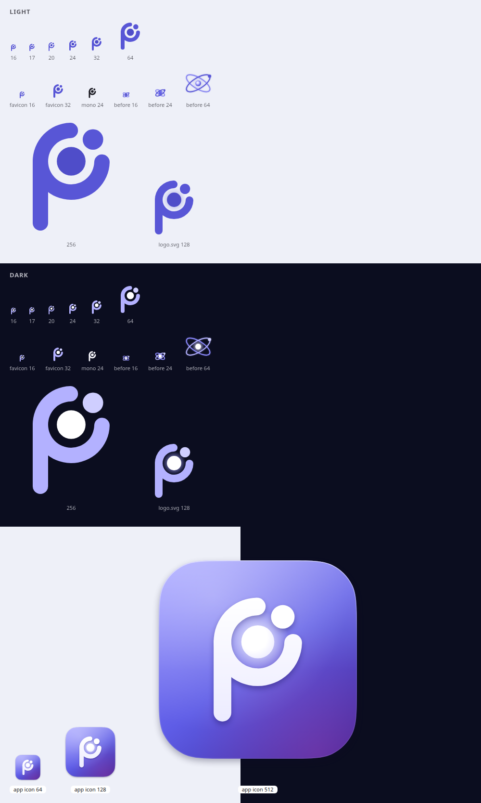

# Plotinium logo: decision record (2026-09-27)

**Decision: the "Bohr P".** An electron shell around a dense nucleus, open at 1:30 where the one electron sits; the shell grows a stem on its left, so the atom is also the P of Plotinium. It replaces the two-orbit "luminous atom", which turned into a blurry smudge at the 16 to 20 px sizes where it is seen most (the menu bar, the favicon, the login corner).

The 4x zoom of the small sizes, pixel for pixel, is [contact-sheet-zoom.png](contact-sheet-zoom.png). Both sheets are rendered in Chrome at one device pixel per CSS pixel by [contact-sheet.mjs](contact-sheet.mjs).

## 1. The problem

The old mark had two thin ellipses (stroke 1.5 on a 24 grid, so 1 px at 16 px) crossing at ±32°, a glowing nucleus and a 1.2-unit electron. At 16 to 20 px the orbits crossed in four places within a few pixels, anti-aliasing merged them, and the result read as a violet smudge (see "before 16" and "before 24" on the contact sheet). The menu bar also adds a 3 px glow, which blurred it further. A thicker version of the same drawing was tried (exploration board 03, "A1" to "A4"). It stayed legible, but at 16 px it became a heavy four-lobed blob.

## 2. The exploration

Google Stitch was asked for the brand board five times; no call produced a screen that could be read back (the full record is in [stitch/README.md](stitch/README.md)). The concepts were therefore drawn by hand on the 24-unit grid and rendered in Chrome at their real sizes. Each board shows every mark at 16, 20, 24, 32 and 64 px on light and dark, and on the violet app tile at 32 and 64 px.

| Board                                           | Concepts                                                                                                                                                                                                                                                                                               | Verdict                                                                                                                                                                                                                                                                   |
| ----------------------------------------------- | ------------------------------------------------------------------------------------------------------------------------------------------------------------------------------------------------------------------------------------------------------------------------------------------------------ | ------------------------------------------------------------------------------------------------------------------------------------------------------------------------------------------------------------------------------------------------------------------------- |
| [01](exploration/01-first-eight-concepts.png)   | c1 nucleus in one tilted orbit; c2 geometric P with a nucleus; c3 plotted point on an open ring (the identity spec's concept); c4 nucleus, open orbit and electron; c5 hexagonal crystal core; c6 dense core with one orbit in front; c7 nucleus with an open orbit; c8 P whose bowl is a tilted orbit | c1, c4, c7 and c8 read as an **eye** below 24 px (a dot inside a tilted oval). c2 on a violet square reads as a **parking sign**. c3 is almost the **Ionic** framework logo. c5 reads as a **hex nut**. c6 reads as **Saturn** and is a blob at 16 px.                    |
| [02](exploration/02-second-round.png)           | c9 p-orbital lobes; c11 two bold orbits; c16 P drawn by a hook and a point; c18 steep 3D orbit; c19 nucleus at the focus of an orbit; c20 dense planet; c21 ring P with a nucleus                                                                                                                      | c9 reads as a pill or a link icon; c18 and c20 as a planet; c19 is unique at 64 px but an eye at 16 px. c11 and c21 go forward.                                                                                                                                           |
| [03](exploration/03-bold-atom-vs-ring-p.png)    | bold two-orbit atoms (A1 to A4) against ring P (P1 to P3)                                                                                                                                                                                                                                              | The bold atoms are legible but clumpy and generic. The ring P is the cleanest silhouette at 16 px, but alone it is the capstone spec's Figure 6.1 mark (a ring with a centred dot) with a stem, and close to existing ring-and-stem "p" app marks. It needs the electron. |
| [04](exploration/04-bohr-p-shell-ends-128.png)  | the Bohr P at 128 px: round shell ends, a concave cut around the electron, a closed shell with a bead, a plain closed shell                                                                                                                                                                            | Round ends with clear space around the electron look the most finished; the concave cut looks like a bite; a bead on a closed shell looks like a lump.                                                                                                                    |
| [05](exploration/05-electron-angle-128.png)     | electron at 1 o'clock, 1:30, 2 o'clock and 2:30                                                                                                                                                                                                                                                        | At 1 o'clock the mark looks like a smiling face; at 2 o'clock and later it looks like Pac-Man. **1:30 (-45°)** keeps the P's shoulder whole and balances the stem diagonally.                                                                                             |
| [06](exploration/06-nucleus-size-and-16px.png)  | nucleus radius 2.25, 2.6 and 3; the 16 px simplifications (no nucleus, no electron)                                                                                                                                                                                                                    | Without the nucleus the mark loses its meaning; without the electron it is the Figure 6.1 ring with a stem. A **2.8** nucleus reads as dense without closing the gaps.                                                                                                    |
| [07](exploration/07-final-geometry-hinting.png) | the final geometry: master, 20 px and 24 px hinting, the 16 px favicon                                                                                                                                                                                                                                 | Chosen.                                                                                                                                                                                                                                                                   |

## 3. Why the Bohr P

| Criterion                                                                | Result                                                                                                                                                                                                                                                                                                                                               |
| ------------------------------------------------------------------------ | ---------------------------------------------------------------------------------------------------------------------------------------------------------------------------------------------------------------------------------------------------------------------------------------------------------------------------------------------------- |
| Silhouette at 16 px: at most 2 shapes, stroke at least 2 px, no hairline | The outline is two shapes: the P body (shell and stem, one connected shape) and the electron. The nucleus sits inside the bowl, in the counter, so it adds no outline. Shell and stem are 3 units wide, which is 2 px at 16 px. The smallest shape is the electron at 2.7 px across. There is no stroke at all, only fills (see §4).                 |
| Recognisable at 16 px                                                    | On the zoom sheet the 16 px mark reads as a "p" with a bright core and a dot, in both themes. The old mark at 16 px does not read as anything.                                                                                                                                                                                                       |
| Uniqueness                                                               | It is a letter and an atom at once: the P of Plotinium, the nucleus and electron shell of element 94, and the identity spec's "plotted point on an orbit" (the electron in the shell's gap). Concepts that resembled an existing mark or a common symbol (Ionic, a parking sign, Saturn, a ring-and-stem "p", a hex nut, an eye) were dropped in §2. |
| Family with the violet accent #5E5CE6 / #5856D6                          | Light: shell and stem `--pl-logo-orbit-a` #5856D6, nucleus `--pl-logo-core` #4F4DC9. Dark: #B3B1FF, a white nucleus and a #CFCEFF electron. The app icon keeps the existing violet gradient #8E8CFF → #5E5CE6 → #3B2A9E.                                                                                                                             |
| Mono and both themes                                                     | `glyph-mono.svg` is the same four shapes in `currentColor`; inline, the pl-logo-* classes follow the tokens in both themes.                                                                                                                                                                                                                          |
| No hazard or weapons imagery                                             | A ring, a disc, a dot and a bar. No trefoil, no triangle, no cloud, and no green or yellow.                                                                                                                                                                                                                                                          |

It also keeps what the boot screen needs. The electron and the shell's gap turn one step round the nucleus per real boot event (`--plb-tick`, 12° a step, stopped under reduced motion), and the nucleus flashes when a service starts, as the old nucleus did.

## 4. Construction

The mark is four filled shapes on a 24-unit grid, drawn by hand. [mark-geometry.mjs](mark-geometry.mjs) only computes the exact arc end points; it prints the path data that `ui/src/icons/atom-logo.ts` stores.

| Shape    | Geometry (24-unit grid)                                                                           |
| -------- | ------------------------------------------------------------------------------------------------- |
| stem     | x 4.5 to 7.5, y 9 to 22.5, round at both ends (the top end hides under the shell)                 |
| shell    | ring round (12, 9), outer radius 7.5, inner 4.5 (3 wide), round ends, open 93° round the electron |
| nucleus  | disc r 2.8 at (12, 9), 1.7 clear of the shell                                                     |
| electron | disc r 2 on the shell's centre line (radius 6) at -45°, 1.25 clear of each shell end              |

- **Fills, not strokes.** Settings → About had a rule that thinned the old mark's strokes to 0.55 units (`AboutPane.module.css .atom :is(ellipse, path)`). A filled mark cannot be thinned by any stylesheet.
- **Pixel hinting.** In the master drawing every edge falls on a multiple of 1.5 units, so it lands on whole pixels at 16, 32 and 48 px. `atomLogoFor(size)` switches to a drawing hinted for 20 px (2.4-unit shell, edges on multiples of 1.2) at multiples of 20, and to one hinted for 24 px (the master moved half a unit) at other multiples of 24. The favicon is redrawn on its own 16-unit grid: a 2 px shell and stem, a 3.5 px nucleus, a 2.6 px electron and at least 1 px between shapes.
- **App icon.** An 824-unit continuous-corner tile on the 1024 canvas (the macOS icon grid), the violet gradient with a magenta bloom, a top gloss, a specular rim, and a soft drop shadow. The white mark (scaled 24.5x) has its own soft violet shadow, a slightly shaded body, a glow in the shell and the brightest shape at the centre: the nucleus.
- **Maskable icon.** The same field full-bleed, and the mark scaled 21x so its farthest point (the stem's round end) is about 259 units from the centre, inside the 409.6-unit safe circle.

## 5. Where it is used

- Every inline use goes through `AtomLogo` (`ui/src/icons`): the menu bar's system menu, the login corner, Settings → About, Search, the agent confirmation sheet, the update and shutdown dialogs, and Files' semantic search.
- The boot splash, boot menu, panic, recovery and unsupported-browser screens use `logoSvg` (`ui/src/boot/logo.ts`). The build inlines the splash into `index.html`, so the first paint shows the new mark with no script. The CSP hashes are recomputed by the build.
- The identity kit ([docs/identity](../../identity/)) holds the kit files: `glyph.svg`, `glyph-mono.svg`, `logo.svg`, `logo-mono.svg`, `favicon.svg`, `app-icon.svg`, `maskable-icon.svg`, `lockup.svg` and the unchanged `wordmark.svg`. They are copied into `web/public` and `web/public/branding` by [build-identity.mjs](build-identity.mjs), and the PNGs are re-rendered by `docs/identity/render-png.mjs`.
- The Stitch design systems (dark `assets/10121591451242352758`, light `assets/3690503530025860907`) describe the new mark in their `designMd`.

## 6. Follow-ups for other owners

These are outside this change's files:

- `specs/05-wm/visual-language-macos.md` §3.6.2 and `specs/00-product/identity-and-branding.md` §3.6 still describe the two-orbit atom and the "plotted point" ring. The spec owner should replace them with §4 above. The identity spec's point diameter (50/160 units) is larger than this electron (4/24 units, the same as 26.7/160), which was chosen for balance with the nucleus.
- `ui/src/shell/menubar/MenuBar.tsx` draws the mark at 17 px, where no drawing can sit on whole pixels, and `MenuBar.module.css .atom` adds a 3 px glow. At 16 px with no glow (or a 1 px glow) the menu-bar mark would be sharper.
- `ui/src/apps/settings/panes/AboutPane.module.css .atom :is(ellipse, path) { stroke-width: 0.55 }` still matches the mark's two paths but has no effect, because the mark has no stroke. It can be removed.
