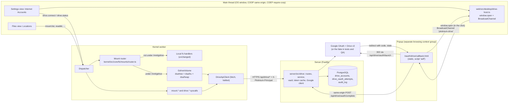

# RFC 0001: Google Drive as a mounted volume

| Field          | Value                                                                                                                                                                                                                                                                                                                                                                                                                           |
| -------------- | ------------------------------------------------------------------------------------------------------------------------------------------------------------------------------------------------------------------------------------------------------------------------------------------------------------------------------------------------------------------------------------------------------------------------------- |
| Title          | Google Drive™ as a per-user mounted volume at `/mnt/gdrive`: server-side OAuth 2.0 (authorization code + PKCE) in a popup, a remote-volume layer in the kernel, Files, Terminal and Editor support, and opt-in AI access                                                                                                                                                                                                        |
| Status         | **Approved with cuts** (ARB, 2026-09-30): P1-thin only, as defined in §13.0; P1b needs its own ARB approval; P2 is blocked on a follow-up design; P3 is deferred. Every review finding and its decision is in §17. The build plan is [PLAN.md](PLAN.md).                                                                                                                                                                        |
| Authors        | design-gdrive (Wave 3 design track; AI-assisted, to be disclosed in `AI_USAGE.md` by the lead)                                                                                                                                                                                                                                                                                                                                  |
| Reviewers      | Critic 1 and critic 2 (design track); the ARB; subsystem owners R1 (kernel, ABI), R2 (VFS, database), R3 (Files, Settings, primitives), R4 (agent, RAG), R5 (server config, Caddy, CI, security)                                                                                                                                                                                                                                |
| Date           | 2026-09-30                                                                                                                                                                                                                                                                                                                                                                                                                      |
| Builders       | `gdrive-server`, `gdrive-kernel`, `gdrive-ui` (Workflow B), in parallel after the step-0 contract PR by `platform` ([PLAN.md](PLAN.md) §3), which replaces the hour-0 contract of the draft                                                                                                                                                                                                                                     |
| Research input | [docs/research/google-drive-integration.md](../research/google-drive-integration.md) (research-gdrive, 2026-09-30). Labels [F] fact, [P] probe, [I] inference and [S] spike are used as in that report.                                                                                                                                                                                                                         |
| Evidence       | [docs/design/wave3/design-gdrive/](../design/wave3/design-gdrive/): baseline screenshots (Files, both themes, 0 CSP violations) and spike S2 (`spike-s2-callback.json`, `spike-s2-callback.mjs`), measured on the QA copy at :4718 on 2026-09-30                                                                                                                                                                                |
| Related        | [RFC 0002](0002-agent-provenance-undo-and-isolation.md) (effect class `external`, provenance), [RFC 0003](0003-semantic-smart-folders-and-context-search.md) (uses this RFC's mount seam for `/mnt/smart`), [RFC 0004](0004-predictive-file-cache-and-hoarding.md) (file-access tap and hoard advisor), [RFC 0006](0006-leases-fencing-and-glass-legibility.md) (flag registry question, Drive wallpapers). Contracts in §5.11. |

Requirement IDs proposed here use the new prefix `GDRV-` (§16). Existing IDs touched: VFS-02 (`/mnt` is a MAY), VFS-04, VFS-10, SYS-01, SEC-01, SRV-02, SRV-15, AGT-03, AGT-06, RAG-03, OFF-04, ABI-05, ABI-10, ABI-11.

---

## 1. Summary

The user asked for Google Drive "in their profile, kind of like an SSD". This RFC makes that literal and keeps the operating system honest about what a cloud disk is.

**ARB outcome (2026-09-30).** The design is approved, but only a thinner first phase is built in Workflow B (§13.0):

- **P1-thin (approved, built now):**
  - connect and disconnect;
  - `readdir` and `stat`;
  - whole-file `open(r)` and `read` up to 8 MiB;
  - `writeFile` up to 5 MiB with a base check that keeps a conflicted copy;
  - `mkdir`, rename inside the volume, and trash;
  - `copy` across the boundary for single files, and EXDEV moves;
  - `df`, and the Files and Settings surfaces;
  - the hermetic fake Google.
- **P1b (designed here, separate ARB approval):** descriptor writes committed at `close`, with a device-local failure store instead of `~/lost+found` (§5.2.4); Workspace exports; `.Trash`; ranged reads; the changes poller; content caching in RFC 0004's shared cache; Eject.
- **P2 (agent access to Drive):** blocked until a follow-up RFC designs confirmation at observation time.
- **P3:** deferred.

The review changes are applied in place and marked "ARB" with the finding id. The most important ones:

- the Service Worker must never serve `/oauth/*` (S-0001-01);
- secrets live outside the checkout, with one Cloud project per instance (S-0001-02, S-0001-04);
- `/revoke` is called only for a grant stored for the requesting uid (S-0001-04);
- an OIDC `nonce` backs up PKCE (S-0001-06);
- pending revocations persist across restarts (S-0001-07);
- userland walkers stay on one file system (GDRV-21);
- remote descriptors live in a kernel-side table (0001-M2);
- memory is charged to the reading process (0001-M3);
- agents and system processes cannot see `/mnt/gdrive` in Wave 3 (S-0001-13).

- **Connect.** A signed-in personal user connects their own Google account in **Settings > Internet Accounts**. The OS opens a popup. Our server runs the OAuth 2.0 authorization-code flow with PKCE (S256) and a session-bound, single-use `state`. A static, same-origin callback page finishes the link with a same-origin `POST` and reports back on a `BroadcastChannel`. The OS window never navigates away and stays cross-origin isolated. No token ever reaches the browser. Spike S2 on the QA copy confirmed each step of this under our real headers (§2.6).
- **Mount.** The account's `Plotinium` folder in Google Drive appears as a volume at **`/mnt/gdrive`**, in the connecting user's namespace only. It shows in the Files sidebar under Locations with a capacity bar (an Eject action is P1b). `ls`, `cat`, `cp`, `mv`, `rm`, `mkdir`, `touch` and `df` work on it in P1-thin; shell redirection into the volume and `mount`/`umount` are P1b. The Editor opens and saves files there.
- **Semantics.** In P1-thin, writes go straight through to Google in one call (the Editor's save, `cp`, Files). In P1b, descriptor writes are committed at `close`, as in AFS. A write whose base changed underneath becomes a conflicted copy, as for local files (VFS-10). `rm` moves items to the Google Drive trash and never deletes them. Google Docs, Sheets and Slides are hidden in P1-thin; P1b shows them as read-only Markdown, CSV and text exports. Offline, loaded folders stay listable and writes fail fast; offline reading of cached files is P1b.
- **Least privilege.** Scopes are `openid` + `drive.file` only (non-sensitive, no CASA). Refresh tokens are sealed with AES-256-GCM under a key from a `*_FILE` secret. Drive data never reaches the LLM or the search index. In Wave 3 the agent and system processes cannot see `/mnt/gdrive` at all (ARB, S-0001-13); any agent access needs a separate, approved design (P2).
- **Testable without Google.** A hermetic fake Google (OAuth + the Drive v3 subset we use) runs in unit, integration and E2E tests and on the QA copy. CI never calls Google.
- **Off by default.** The server flag `GDRIVE=auto` enables the feature only when the Google client and the token key are configured.

The kernel does not grow a second file system. It gains a small **mount router** that sends path calls under `/mnt/gdrive` to a remote-volume driver and leaves every other path on today's code path, byte for byte (§5.3). The driver reuses `dsa/tree`, `dsa/lru` and the conflicted-copy namer. Remote descriptors live in a kernel-side table that shares fd numbers with the process's `fdTable` (ARB, 0001-M2).

P1-thin is about 5 hours per builder, with the cut line in §14. P1b, P2 and P3 are separately approvable.

## 2. Context and problem: what exists today

All references are to the working tree on 2026-09-30. Line numbers in files that the polish wave is still editing (for example `kernel/src/core/io/index.ts`) may drift; the symbol name is given with each.

### 2.1 The capstone spec allows exactly this, and nothing implements it

- The capstone spec's tree lists `mnt/  optional mount points (shared or cloud)` and says "/mnt is may" (spec §9.3, p27).
- Our VFS spec builds `/mnt` as an empty directory and puts mounts out of scope for v1: "Mount points other than `/tmp` (`/mnt` is a _May_) are not implemented in v1: `/mnt` exists as an empty directory" (`specs/04-vfs/virtual-file-system.md:59`, row at `:238`).
- The ABI already anticipates `/mnt` mounts: EXDEV is "`rename` or `link` across a mount point (`/mnt/*`)" (`specs/01-architecture/syscall-abi.md:511`), and "`rename` across a mount point under `/mnt` returns EXDEV; `mv` then uses `copy` plus `unlink`" (`:674`). No code returns it for `/mnt`: the only file systems are `root` and `tmp` (`protocol/src/vfs.ts:13-16`), and `coreutils mv` has no EXDEV fallback (`apps/coreutils/cmd/mv.ts:42`).
- The spec also requires: "Keys stay on the server. API keys never appear in the client bundle or the repository. Every model call goes through your backend" (§12.6, p41), and "Secrets never go in the repository … A leaked key must be revoked at once and reported in SECURITY.md" (Section 18, p50). Third-party code needs a licence and `THIRD_PARTY.md` (Section 18). This design adds no dependency.

### 2.2 The kernel file system is one synced tree plus tmpfs

- `KernelFs` owns one store, one in-memory `VfsTree` over `dsa/tree`, one open-file table and a three-phase mutation discipline: plan, one IndexedDB transaction, then tree and events (`kernel/src/core/fs/kfs.ts:1-24`, `mutateLocked` at `:496-545`). `mount()` mounts `/` only (`:314-375`); `MountOptions` has no mount table (`:150-169`).
- File-system calls are registered once the `vfs` service has mounted (`kernel/src/core/io/vfs.ts:179-188`, `registerFsSyscalls` in `kernel/src/core/fs/syscalls.ts:77-186`). Each call has a stage-5 `authorize` and a `handle`.
- `HandlerRegistry.register` simply replaces the entry for a name (`kernel/src/core/ipc/handlers.ts:33-51`). This is the seam our router uses: it can wrap a registered call without editing it.
- `chdir` goes through the `resolveDir` seam, which resolves on the local tree only (`kernel/src/core/proc/syscalls.ts:202-212`; the seam is installed in `kernel/src/core/io/index.ts:988-996`, `hooks.resolveDir`).
- Descriptors live in one device-wide `OpenFileTable`; the PCB's `fdTable` is shared with pipes and TTYs; per-description kernel state is `DescState` (`kernel/src/core/fs/fds.ts:1-35`). `dup`, `dup2`, `spawn` inheritance, `lsof` and the kill path all run over this one table (`:43-150`). The shell opens redirection targets itself and passes the fds to `spawn` (`apps/shell/redir.ts:1-5`, `prepareFds` at `:62`).
- ARB, 0001-M2: the draft planned to put remote descriptions in this table through `DescState.remote`. That does not fit:
  - `OpenFile.fs` is `FsId = 'root' | 'tmp'` (`vfs/src/oft/table.ts:33-51`, `vfs/src/store/records.ts:13`);
  - `DescState.rec: InodeRec` is required (`kernel/src/core/fs/fds.ts:25-35`).

  The fds.ts header already defines the alternative: an fd that `pcb.fdTable` holds but the open-file table does not belongs to "another kind of descriptor". A new file fd never takes that number. `ProcHooks.inheritFds` and `hooks.resolveDir` are chainable wrappers (`kernel/src/core/io/index.ts:1006-1017`). Remote descriptors therefore live in a kernel-side table inside `kernel/src/core/fs/mounts/` (§5.3). The design needs no change to `vfs/` or `fds.ts`.

- The resolver is lexical over a `NodeSource` and cannot cross into another file system (`vfs/src/path.ts:115-241`). Relative paths resolve from the PCB's `cwdIno` (`kernel/src/core/fs/kfs.ts:389-408`).
- Every inode id must be UUIDv7-shaped (`protocol/src/sys/common.ts:96-99`); `Stat.fs` is `'root' | 'tmp'` and `Stat.cached` already exists (`:162-180`); `StatFs.fsId` is the literal `'plotinium'` (`protocol/src/sys/fs.ts:72-80`).
- The errno set is closed (`protocol/src/errno.ts:23-49`); reasons are registered per errno (`:89-139`). Adding an errno to a call's list bumps `ABI_VERSION` (`protocol/src/abi.ts:5-11`, value at `:26`).
- Processes never reach the network; `syncd` and `lockd` are the only network users (`protocol/src/sys/net.ts:1-5`). The kernel's HTTP client uses the host's same-origin `fetch`, validates every body with Valibot and times out on the kernel timer heap (`kernel/src/core/io/http.ts:1-7`, `request` at `:77-116`).
- The event bus delivers `vfs`, `lock`, `wm` and `notify` only to root until their owner installs a visibility hook (`kernel/src/core/events/bus.ts:30-38`).
- The kernel's own caches are reported on the `Kernel` line of `free` and are never charged to the memory budget (`specs/03-kernel/memory-and-paging.md:118`).

### 2.3 The server has the right shape for a proxy

- Fastify serves only `/api/*` and `/ws`; Caddy sets every header (`server/src/app.ts:1-16`). Hooks run in a fixed order: request id, IP rate classes, session, CSRF, authentication, principal, uid rate classes (`:293-325`). Binary bodies arrive as streams (`:358-369`). Plugins are registered in one place (`:376-417`).
- CSRF: every non-GET needs `Sec-Fetch-Site: same-origin` or an allow-listed `Origin` (`server/src/gateway/hooks.ts:35-46`). The principal is the session uid, or the uid of a live `su` grant named in `X-Plotinium-Principal` (`:111-126`; `specs/12-security/security-model.md:608-618`).
- Configuration is one frozen Valibot-validated object; secrets come as `*_FILE`, production refuses inline secrets and known development values (`server/src/config.ts:7-13`, `secret` and `checkSecret` at `:276-296`, production guards at `:344-365`).
- Logs redact a fixed list of paths (`server/src/obs/logger.ts:14-34`). Rate classes are a table (`server/src/ratelimit/classes.ts:23-45`).
- `audit_log` is append-only for the app role, and its `detail` column is documented as "never a password, token, key or file content" (`db/migrations/20260924100400_sync_locks_swap_audit.sql:81-111`). Sessions are `auth_sessions` rows with an optional `su` grant (`db/migrations/20260924100100_identity.sql:55-71`).
- Migrations must be dbmate files with a `-- Kind:` line and a down section that drops every table they create (`db/src/migrations.test.ts:12-45`).

### 2.4 Headers, CSP and the callback path

- Caddy sends COOP `same-origin`, COEP `require-corp`, CORP `same-origin`, `Referrer-Policy: no-referrer` and the generated CSP on every response (`Caddyfile:15-33`). The CSP is `default-src 'self'; script-src 'self' 'wasm-unsafe-eval' <hashes>; … connect-src 'self'; … form-action 'none'` (`web/build/csp.ts:35-48`).
- Unknown paths fall back to the OS shell: `try_files {path} /index.html` (`Caddyfile:74-80`). A missing callback page would therefore boot a **second OS** in the popup (spike S2 confirmed a 200 with the shell for `/oauth/drive/callback.html`).
- **The Service Worker would serve the shell for the OAuth redirect** (ARB, S-0001-01; the draft said the opposite).
  - The navigation fallback is `new NavigationRoute(createHandlerBoundToURL('/index.html'), { denylist })` (`web/src/sw.ts:74-78`).
  - Workbox 7.4.1 tests the denylist against `pathname + search`.
  - The "looks like a file" rule `/\/[^/?]+\.[a-z0-9]+$/i` (`web/src/sw/routes.ts:15`) is anchored at the end of the string. Google's redirect `/oauth/drive/callback.html?state=…&code=…` is therefore not denylisted, and it does not match the precache entry either (Workbox strips only `utm_*` and `fbclid`).
  - With the OS open and the Service Worker controlling the origin, the popup would boot a second OS, the callback script would never run, and the code would stay in the URL.
  - Spike S2 missed this because it never booted the OS, so no Service Worker was registered. Today the Service Worker is not registered at all (stabilize bug UI-007), but the fix must hold once it is.
  - **Fix (gdrive-ui):**
    - add `/^\/oauth\//` to `NAVIGATION_DENYLIST` and `oauth/**` to `NEVER_PRECACHE_GLOBS` in `web/src/sw/routes.ts`;
    - add a routes unit test, `GDRV-14 the Service Worker never routes /oauth/* navigations to the shell, with or without a query string`;
    - run the E2E with the OS booted and the Service Worker controlling the page before the popup opens (§10.2).
- The session cookie is `SameSite=Strict` by decision C10 (`specs/15-decisions/stack-decisions.md:1030`).

### 2.5 The UI has the slots but no data

- The Files sidebar already has a `mnt` place icon (USB) and renders `unmounted` locations dimmed (`ui/src/apps/files/FilesSidebar.tsx:19-28`, `:86-95`; `Place` in `ui/src/apps/files/types.ts:67-77`). The app builds Locations as Trash, Temporary and Root (`apps/files/lib/model.ts:329-350`) and the quota from `quota`/`statfs` (`apps/files/lib/ops.ts:160-175`).
- Settings has eleven sections and no accounts section (`ui/src/apps/settings/sections.ts:29-159`, `SettingsSectionId` in `ui/src/apps/settings/models.ts:9-20`).
- Apps and views may not use `fetch` or `BroadcastChannel` (`tools/eslint-rules/boundaries.js:297-313`). Host capabilities reach views through `AppEnv`; `agentBudget` is the precedent for a host-provided, server-backed function (`apps/src/descriptor.ts:349-374`).
- Baseline screenshots of Files (both themes) are in the evidence folder: Favourites (Home), Locations (Trash, Temporary, Root) and a quota bar at the foot, 0 CSP violations, 0 console errors.

### 2.6 Spike S2 (run for this RFC, 2026-09-30, QA copy :4718)

A Playwright script (`docs/design/wave3/design-gdrive/spike-s2-callback.mjs`) opened a popup from a same-origin page to a fake authorization server on `127.0.0.1` (a different site), which 302-redirected back to a same-origin document on :4718, as Google does. Results (`spike-s2-callback.json`):

| Question                                                      | Result                                                                                                                                  |
| ------------------------------------------------------------- | --------------------------------------------------------------------------------------------------------------------------------------- |
| Is the `SameSite=Strict` cookie sent on the redirect back?    | **No** (the navigation request had no `Cookie` header). A callback that links an account on this request alone cannot know the session. |
| Is it sent on a same-origin `fetch` from the landed document? | **Yes**: `GET /api/auth/me` answered 200.                                                                                               |
| Does a `POST` from that document pass our CSRF gate?          | **Yes**: `POST /api/telemetry` reached schema validation (400 EINVAL), which runs after CSRF and authentication.                        |
| Does the popup keep an opener handle?                         | No (`window.opener === null`); the opener's handle reports `closed: true` at once, so it cannot be polled.                              |
| Does a `BroadcastChannel` message reach the opener?           | **Yes.**                                                                                                                                |
| Does the opener stay `crossOriginIsolated`?                   | **Yes**, before and after. The popup is isolated too.                                                                                   |
| Can the landed page close itself?                             | Yes, in Chrome under Playwright (`window.close()`). To re-check headed (§15).                                                           |
| What does a missing static path under `/oauth/` return?       | 200 with the OS shell (the `index.html` fallback).                                                                                      |

### 2.7 The problem

There is no way to reach a user's cloud storage from Plotinium, and the `/mnt` MAY is unused. Building it naively would break four things we care about: cross-origin isolation (a Google sign-in library or the Picker in the OS page), the rule that tokens never reach the client, the per-user isolation of the VFS (T-09), and the invariant that no update is ever silently lost (VFS-10). It would also add a new AI data-exfiltration path.

## 3. Goals and non-goals

### 3.1 Goals

| Id  | Goal                                                                                                         | Measure                                                                                           |
| --- | ------------------------------------------------------------------------------------------------------------ | ------------------------------------------------------------------------------------------------- |
| G1  | A personal user connects and disconnects their Google account from Settings without the OS window navigating | E2E on the fake; `crossOriginIsolated` true throughout (GDRV-01)                                  |
| G2  | The Drive folder is a volume at `/mnt/gdrive` usable from Files, Terminal and Editor                         | scripted Terminal session and Files E2E (GDRV-04, GDRV-05, GDRV-20, GDRV-21)                      |
| G3  | Least privilege and no secret on the client                                                                  | scopes = `openid drive.file`; bundle and log scans find no token (GDRV-02, GDRV-03)               |
| G4  | No silent data loss, including conflicts, offline and failed uploads                                         | fault-injected property test: 0 lost `writeFile`s over 500 sessions in P1-thin (GDRV-07, GDRV-10) |
| G5  | Strict per-user isolation, root included                                                                     | forged-principal and namespace tests (GDRV-04, GDRV-12)                                           |
| G6  | Drive data never reaches the LLM or the index; in Wave 3 agents and system processes have no Drive namespace | tests (GDRV-13)                                                                                   |
| G7  | Hermetic, deterministic tests; CI never calls Google                                                         | fake Google + contract fixtures (GDRV-19)                                                         |
| G8  | Measurable for the report                                                                                    | API units, latency and consistency metrics against baselines (§10.4)                              |

### 3.2 Non-goals

- **No restricted scope in production** (`drive`, `drive.readonly`, `drive.metadata*`). They need restricted-scope verification and an annual CASA assessment (research §2.3). A flagged, test-users-only browse mode is P3 and default off.
- **No Google Picker** in v1. It cannot run in the cross-origin-isolated OS document (research §5.2). A helper window is a production follow-up.
- **No sharing** (`permissions.*`), no shared drives, no "Shared with me".
- **No permanent delete** and no "Empty Trash" for Drive. Google empties its trash after 30 days.
- **Drive is not a swap or backup tier** for OS internals. Google's policy lists "Backup of user or app content from a developer's app … to Drive" as a disallowed use (research §2.3). Only user-visible files go there.
- **No write-behind offline queue** in v1. Offline writes fail fast; nothing is queued in memory where a closed tab would lose it.
- **No server-side copy of Drive content.** The server streams bytes; it stores tokens and a few metadata fields only.
- **No Google sign-in to Plotinium.** This is authorization for Drive, not authentication.
- **No new boot service** (a `mountd` would change the 18-service DAG and the DSA-DAG-03 test; §6).

## 4. Research basis

The lead's list was verified on 2026-09-30. Two classic references outside that list are marked "additional"; they are cited only for well-known designs.

| Paper                                                                                                                                                                                                         | Idea                                                                                                  | What we adopt                                                                                                                                                                  | What we adapt                                                                                                                                                          | What we leave out                                                                |
| ------------------------------------------------------------------------------------------------------------------------------------------------------------------------------------------------------------- | ----------------------------------------------------------------------------------------------------- | ------------------------------------------------------------------------------------------------------------------------------------------------------------------------------ | ---------------------------------------------------------------------------------------------------------------------------------------------------------------------- | -------------------------------------------------------------------------------- |
| Powers, Vilk, Berger, _Browsix_, ASPLOS 2017 ([link](https://arxiv.org/abs/1611.07862))                                                                                                                       | A Unix kernel in a worker; processes make syscalls; one namespace over pluggable file-system backends | The remote volume is a kernel-side backend behind the same syscalls; apps never talk to Google                                                                                 | The backend is reached by a **per-caller namespace** (below), and only the kernel's driver talks to the network, as `syncd` does today                                 | In-page storage backends, which would put third-party credentials in the browser |
| Pike et al., _The Use of Name Spaces in Plan 9_, 1992 (additional; [link](https://9p.io/sys/doc/names.html))                                                                                                  | Each process sees its own namespace; mounts are per group                                             | `/mnt/gdrive` resolves in the **caller uid's** namespace: alice sees her Drive, bob his, root none (§5.2)                                                                      | Per uid, not per process; no `bind`                                                                                                                                    | User-defined mounts                                                              |
| Howard et al., _Scale and Performance in a Distributed File System_ (AFS), TOCS 1988 (additional)                                                                                                             | Whole-file caching; close-to-open consistency                                                         | Descriptor writes are buffered and committed at `close`; `open` sees the last committed version                                                                                | Our local VFS already uses close-to-open write sessions (PVFS-11)                                                                                                      | Callbacks from the server (Google has none we can receive on localhost)          |
| Gray and Cheriton, _Leases_, SOSP 1989 ([link](https://pages.cs.wisc.edu/~remzi/Classes/739/Fall2015/Papers/leases89.pdf))                                                                                    | A cached copy is valid for a bounded term                                                             | A loaded Drive directory is valid for **15 s**; within the term lookups are served from memory                                                                                 | Google grants no leases, so the term is client-side and paired with `changes.list` invalidation; correctness of writes never depends on it (base checks at the server) | Server-granted leases, write leases                                              |
| Kistler and Satyanarayanan, _Disconnected Operation in Coda_, TOCS 1992 ([link](https://courses.cs.washington.edu/courses/cse550/10au/papers/coda.pdf))                                                       | Hoarding, emulation, reintegration                                                                    | **Emulation** in v1: cached items stay readable offline; conflicts become conflicted copies                                                                                    | Writes offline fail fast instead of being logged (no durable client log for Drive in v1)                                                                               | **Hoarding** and **reintegration** are P3, driven by RFC 0004's hoard advisor    |
| Kleppmann et al., _Local-First Software_, Onward! 2019 ([link](https://www.inkandswitch.com/local-first/))                                                                                                    | Users own their data; offline works; no lock-in                                                       | The user's files live in the user's own Google account and stay readable in drive.google.com if Plotinium disappears                                                           | We say plainly that Drive is **not** local-first; the local VFS is                                                                                                     | CRDT merging                                                                     |
| Gifford et al., _Semantic File Systems_, SOSP 1991 ([link](https://web.mit.edu/6.826/www/notes/HO13.pdf))                                                                                                     | Virtual directories are queries; transducers extract attributes                                       | Workspace files are shown through a **transducer**: a Google Doc is exported as a read-only `.md`                                                                              | Export on open, cached by revision                                                                                                                                     | Query directories (`/mnt/gdrive/.search/…`) are future work, after RFC 0003      |
| Soules and Ganger, _Connections_, SOSP 2005 ([link](https://pdl.cmu.edu/ftp/ABN/CMU-PDL-05-105_abs.shtml))                                                                                                    | Temporal locality relates files                                                                       | Drive opens are reported to RFC 0004's file-access tap with `fs: 'gdrive'`, so the relation graph and predictor see them                                                       | Metadata only; the tap never stores names                                                                                                                              | Content-based relations on Drive files                                           |
| Kroeger and Long, _Predicting File System Actions_, USENIX 1996 ([link](https://www.usenix.org/legacy/publications/library/proceedings/sd96/kroeger.html))                                                    | A context model over file accesses; a predictive cache beats LRU                                      | P3: listing prefetch of the most likely next Drive directory, measured as cache hit ratio against no prefetch                                                                  | Directory granularity, first order, `dsa/hashtable` counts                                                                                                             | Content prefetch over the network without a budget                               |
| Yan et al., _FALCON_, MobiSys 2012 ([link](https://people.cs.umass.edu/~dganesan/papers/MobiSys12-Falcon.pdf))                                                                                                | Cost-benefit decision before pre-launching                                                            | P3 prefetch runs only when the benefit (predicted probability × round-trip saved) exceeds the cost (Google quota units, bytes)                                                 | Costs are quota units instead of energy                                                                                                                                | Location features                                                                |
| Patil et al., _GoEX_, 2024 ([link](https://arxiv.org/abs/2404.06921))                                                                                                                                         | Post-facto validation with undo; damage confinement                                                   | `rm` on Drive is **trash** (undoable via `/mnt/gdrive/.Trash`); the agent cannot write to Drive in v1 (confinement)                                                            | Undo is Google's trash, not our own log                                                                                                                                | Agent write access to Drive                                                      |
| Debenedetti et al., _CaMeL_, 2025 ([link](https://arxiv.org/abs/2503.18813))                                                                                                                                  | Control flow only from the trusted query; values carry provenance; policies at tool calls             | Values read from Drive carry provenance `gdrive` and the reader set {owner}; a tool call that reads a Drive path is a policy point that needs confirmation (RFC 0002 enforces) | Provenance labels are RFC 0002's; this RFC supplies the source                                                                                                         | A separate quarantined interpreter                                               |
| Greshake et al., _Indirect prompt injection_, AISec 2023 ([link](https://arxiv.org/abs/2302.12173))                                                                                                           | Retrieved content injects instructions                                                                | Drive names and contents are untrusted input; INJ-20 gains Drive fixtures                                                                                                      | Shared Drive documents are the realistic vector                                                                                                                        | –                                                                                |
| Wu et al., _IsolateGPT_, NDSS 2025 ([link](https://www.ndss-symposium.org/ndss-paper/isolategpt-an-execution-isolation-architecture-for-llm-based-agentic-systems/))                                          | Execution isolation between apps with a mediated hub                                                  | The kernel is the only mediator between the agent and Drive; the agent's `fs.scope` excludes `/mnt/gdrive` unless opted in                                                     | Per request grants instead of per app                                                                                                                                  | –                                                                                |
| Pirch et al., _Toward Securing AI Agents Like Operating Systems_, 2026 ([link](https://arxiv.org/abs/2605.14932)); Zou et al., _AgentKernel_, 2026 ([link](https://arxiv.org/abs/2609.29647))                 | OS-style access control for agents                                                                    | Consent and capability checks for third-party data live in the kernel and server, never in the model                                                                           | –                                                                                                                                                                      | –                                                                                |
| Reis et al., _Site Isolation_, USENIX Security 2019 ([link](https://www.usenix.org/conference/usenixsecurity19/presentation/reis))                                                                            | Process separation per site; cross-origin isolation                                                   | The Google pages run in a **separate browsing context group** (popup under COOP); the OS document keeps COOP/COEP (spike S2)                                                   | –                                                                                                                                                                      | Relaxing COOP or COEP for any OS page                                            |
| Chang and Ungar, _Animation: From Cartoons to the UI_, UIST 1993 ([link](https://bibliography.selflanguage.org/_static/animation.pdf))                                                                        | Solidity, exaggeration, reinforcement                                                                 | The new volume **slides into** the sidebar and the connect sheet morphs between states (transform and opacity only)                                                            | 160 to 240 ms, none with reduced motion                                                                                                                                | Squash and stretch                                                               |
| Harrison et al., _Transparent Layered UIs_, CHI 1995 ([link](https://www.billbuxton.com/transparency.html))                                                                                                   | Legible layered translucency                                                                          | The connect sheet is a glass layer over Settings with a solid fallback for "Reduce transparency"                                                                               | Existing tokens                                                                                                                                                        | –                                                                                |
| McGuffin and Balakrishnan, _Expanding Targets_, CHI 2002 ([link](https://www.dgp.toronto.edu/~ravin/papers/chi2002_expandingtargets.pdf))                                                                     | Targets that grow on approach are faster to hit                                                       | The 14 px eject glyph has a 28 × 28 px hit area that shows on row hover or focus                                                                                               | Static enlarged hit box (WCAG 2.2 SC 2.5.8)                                                                                                                            | Animated growth                                                                  |
| Mei et al., _AIOS_ ([link](https://arxiv.org/abs/2403.16971)); Shi et al., _LSFS_ ([link](https://proceedings.iclr.cc/paper_files/paper/2025/hash/517eb19e99947f60afff0cf93e451825-Abstract-Conference.html)) | Agents behind kernel managers; semantic syscalls with rollback                                        | Drive is reachable by the agent only through ordinary fs syscalls (AIN-B2); P3 indexing uses the existing semantic index                                                       | –                                                                                                                                                                      | New semantic syscalls for Drive                                                  |
| Vujanic and Rueckstiess, _LEAF_ ([link](https://arxiv.org/abs/2509.12539))                                                                                                                                    | The embedding model we use                                                                            | P3: the same in-browser model embeds opted-in Drive text on the device                                                                                                         | –                                                                                                                                                                      | Server-side Drive vectors (§7.3)                                                 |

Reviewed and not used: MemGPT, UFO2, AgentOS, the OS Agents survey, PagedAttention, SchedCP, WebLLM and Steinder and Franke (they concern agent memory, GUI agents, LLM serving or schedulers, not storage mounts); Witten and Bell (used by RFC 0004, not here).

## 5. Design

### 5.1 Architecture



Responsibilities:

| Layer                              | Owns                                                                                                                 | Never does                                                        |
| ---------------------------------- | -------------------------------------------------------------------------------------------------------------------- | ----------------------------------------------------------------- |
| Server `server/src/drive`          | OAuth flow, token custody, Google calls, Google error mapping, backoff, quota-unit accounting, audit                 | Store Drive file content; follow a URL from the client; map paths |
| Kernel `kernel/src/core/fs/mounts` | POSIX semantics: names, inodes, modes, descriptors, caches, conflicts, trash view, errnos, events, per-uid namespace | Hold a token; talk to Google                                      |
| UI and host                        | Consent disclosure, popup, sidebar volume, errors in words                                                           | Receive a token or a Drive id it did not get from a syscall       |

### 5.2 Mount semantics

#### 5.2.1 Mount point and who can see it

- **Path.** `/mnt/gdrive` (short to type; a path, not branding; research §6). The label everywhere a person reads it is "Google Drive".
- **Per-uid namespace.** The entry `gdrive` exists in `/mnt` only for a caller whose effective uid has a connected, not-ejected account. The kernel merges it into `readdir("/mnt")` and answers `stat("/mnt/gdrive")` from the volume. Anyone else, root included, sees `/mnt` as it is today, and `/mnt/gdrive` is ENOENT. This is Plan 9's per-process namespace, keyed by uid.
- **Why not visible to everyone with mode 0700?** A visible name leaks that a user has connected Google, and root bypasses rwx (VFS-04). A Google grant belongs to the person who consented, not to the machine, so root must not read it. Root gets no Drive namespace.
  - ARB, S-0001-10: the draft said "the namespace makes that structural", which overstated it. The remaining channels are closed explicitly:
    - The `mount` group's visibility hook returns `false` (never `undefined`, which would fall back to "root sees all", `kernel/src/core/events/bus.ts:31-37`) unless `cred.uid === data.uid`, root included.
    - Any listing of remote descriptors (for example `lsof`) shows another uid's remote descriptor as `[gdrive]` without its path, root included.
    - P1-thin has no `lost+found` path (§5.2.4).
  - Whatever exposure remains is listed in `SECURITY.md`.
- **Caller classes.** `user` class: the uid's own mount. `agent` and `system` classes (the `ai` agent, indexer, predictor, pre-fetch jobs) see **no** Drive namespace in Wave 3: `/mnt/gdrive` is ENOENT for them, and `readdir("/mnt")` omits the entry (ARB, S-0001-13).
  - This class check in the router is the normative control. `fs.scope` is not, because it is unconfined when an agent starts in `/` or `/mnt`.
  - It also keeps RAG from crawling Drive, even though its eligibility rule mentions `/mnt/**` (`specs/10-ai/rag-semantic-search.md:133`).
  - Agent access (P2) is blocked until an ARB-approved design adds confirmation at observation time. Today the only confirmation point is `ai.agent.submit` (RFC 0002 §5.1). The index opt-in is P3.
- **`su`.** A shell that ran `su bob` has uid bob, so it sees bob's Drive while the `su` grant is live. The server enforces the same through `X-Plotinium-Principal` (SEC-01). Connecting a new account through `su` is refused (EPERM `su`): consent must come from the login user in person. The same rule applies to the P2 AI opt-in (ARB, S-0001-12).
- **Reserved name.** Nobody can create a local `/mnt/gdrive` (EPERM `mount-point`); `rmdir` and `rename` of the mount point give EBUSY, like a well-known directory.
- **Lifetime.** The volume mounts when the console user's session starts (after desktop-interactive, off the boot path) and when a connect completes. Disconnect removes it everywhere (§5.9.6).
  - **Eject (P1b)** will unmount it for the current boot. Open descriptors must be closed first (EBUSY otherwise, or `force`). Caches are dropped. A process whose cwd is inside keeps a dangling cwd: relative lookups give ENOENT, as for a removed directory.

#### 5.2.2 Mapping Drive items to inodes

The root of the volume is the account's `Plotinium` folder. The server creates it on first connect and marks it with `appProperties.plotiniumRoot = '1'`, so a rename in drive.google.com does not lose it. `root_folder_id` is the primary key.

The `appProperties` lookup is only a fallback. It adds `'me' in owners and trashed = false`, so a folder that someone shared into the account can never be taken as the volume root (ARB, S-0001-22).

| Drive item                                                     | POSIX view                                                                  |
| -------------------------------------------------------------- | --------------------------------------------------------------------------- |
| Folder                                                         | directory                                                                   |
| Blob file (any non-Google MIME type)                           | regular file                                                                |
| Google Doc                                                     | regular file `<name>.md`, read-only export (`text/markdown`)                |
| Google Sheet                                                   | regular file `<name>.csv`, read-only export of the first sheet (`text/csv`) |
| Google Slides                                                  | regular file `<name>.txt`, read-only export (`text/plain`)                  |
| Other Google types (Drawings, Forms, Sites, Vids, Apps Script) | not listed; counted in `mount -v` as "not shown"                            |
| Shortcut                                                       | symbolic link to `/mnt/gdrive/.by-id/<targetId>` (P2)                       |

**Inode numbers.** Deterministic, collision-resistant and never equal to a local id:

```ts
// kernel/src/core/fs/mounts/gdrive/ino.ts
import { sha256Hex } from '@plotinium/protocol'; // pure TS, synchronous (protocol/src/sha256.ts:102)

/** UUIDv7-shaped: timestamp 0xffffffffffff (year 10889) never occurs in a real UUIDv7 or a well-known id. */
export function driveIno(uid: number, driveId: string): string {
  const h = sha256Hex(`plotinium:gdrive:${uid}:${driveId}`); // 64 hex
  const a = h.slice(0, 3); // 12 bits rand_a
  const v = ((Number.parseInt(h.slice(3, 4), 16) & 0x3) | 0x8).toString(16); // variant 10xx
  return `ffffffff-ffff-7${a}-${v}${h.slice(4, 7)}-${h.slice(7, 19)}`;
}
```

74 hash bits give a collision probability below 10⁻¹² for 100,000 items. The same file has the same ino on every device and every boot, which RFC 0004's tap and the Files selection rely on. The ino is not reversible to the Drive id.

**Names (Drive to POSIX).** Drive allows `/` in names, `.`, `..`, over-long names and duplicate names in one folder. The encoding runs in `names.ts`, in this order:

1. NFC-normalise (PVFS-12). A name that is not well-formed Unicode (`String.prototype.isWellFormed()` is false, for example a lone surrogate) is replaced by `drive-item` and always gets the step-6 id suffix (ARB, S-0001-09).
2. Replace NUL, C0 controls, DEL, C1 controls, bidi controls (U+202A–U+202E, U+2066–U+2069), zero-width characters (U+200B–U+200F, U+2060, U+FEFF) and tag characters (U+E0000–U+E007F) with U+FFFD. A name changed by this step always gets the step-6 id suffix, so the mapping stays injective (ARB, S-0001-09). `Name` rejects NUL and ill-formed strings (`protocol/src/sys/common.ts:74-81`), so without this step one bad name would break a whole listing.
3. `/` becomes U+2215 DIVISION SLASH; a name that is exactly `.` or `..` becomes U+FF0E per dot.
4. Workspace exports append `.md`, `.csv` or `.txt` (P1b; in P1-thin Workspace files are hidden and counted as "not shown").
5. A name over 255 UTF-8 bytes is shortened at a code-point boundary and gets `~<first 6 id chars>` before the extension.
6. Duplicates after steps 1 to 5 are sorted by `(createdTime, id)`; the first keeps the name, the others become `<stem> (<id6>)<ext>`, with more id characters if needed.
7. At the volume root, real items named `.Trash` or `.by-id` get the step-6 suffix.

Reverse mapping is by id, never by name: every mutation after a lookup uses the Drive id. New names are sent as typed (after NFC); we never create `/` in Drive.

**Synthesised attributes.**

| Field              | Value                                                                                              |
| ------------------ | -------------------------------------------------------------------------------------------------- |
| `uid`, `gid`       | the caller's uid and primary gid                                                                   |
| `mode` (directory) | `0o700`, or `0o500` without `capabilities.canAddChildren`                                          |
| `mode` (file)      | `0o600`; `0o400` when `!canModifyContent` or for an export; `0o200` or `0o000` when `!canDownload` |
| `mode` (shortcut)  | `0o777` (a symlink's mode is never checked)                                                        |
| `size`             | `size` for blobs; exports report 0 until first opened, then the exported size                      |
| `nlink`            | 1 for files, 2 for directories (documented approximation, as NFS clients do)                       |
| `mtime`, `ctime`   | `modifiedTime`; `btime` = `createdTime`; `atime` = `mtime`                                         |
| `version`          | Drive `version` (int64 string, clamped to 2^53 − 1)                                                |
| `blob`             | `null`                                                                                             |
| `fs`               | `'gdrive'` (new picklist member)                                                                   |
| `cached`           | always `false` in P1-thin (no content cache); P1b: true when this revision is in the shared cache  |

The permission check is the normal `vfs/perm.ts` `may()` on these synthesised attributes (SYS-01), so a write to a `0o400` file is EACCES. Operations Drive cannot represent return EPERM `remote-fs`:

- `chmod`, `chown`, `link` and `symlink` inside the volume;
- `open` for writing (`w`, `rw` or `a`) in P1-thin; the message says "use cp, or save from an app";
- `batch` ops on volume paths (EXDEV, §5.2.5).

Permission denials on volume paths are decided in the handler, at stage 7, because `authorize` is synchronous and the synthesised mode may need a fetch. They are audited as the call's error. The test is `GDRV-05 a denied volume call leaves an EACCES audit row` (ARB, 0001-S4).

#### 5.2.3 Caching and invalidation

| Cache           | Structure                                                                                                                                                                                                        | Bound                                                                                          | Validity                                                                        |
| --------------- | ---------------------------------------------------------------------------------------------------------------------------------------------------------------------------------------------------------------- | ---------------------------------------------------------------------------------------------- | ------------------------------------------------------------------------------- |
| Namespace       | `dsa/tree` `NaryTree<DriveMeta>` per volume, loaded lazily per directory with `setLoaded` (`dsa/src/tree/index.ts:116-156`)                                                                                      | 20,000 loaded nodes; 10,000 entries per directory (more are listed as truncated in `mount -v`) | a directory listing is valid for **15 s** after it was fetched (the lease term) |
| Directory cache | `dsa/lru` `LruCache<dirId, true>` with `pin`/`unpin` (`dsa/src/lru/index.ts:52-88`)                                                                                                                              | 256 directories; eviction calls `unload`                                                       | pinned while a cwd, an open fd or an in-flight operation is inside              |
| Content cache   | **none in P1-thin** (ARB, 0001-M3, 0001-S2, X3). P1b: RFC 0004's single kernel `ContentCache`, keyed by the SHA-256 of `gdrive:<uid>:<id>@<rev>` (ARB, S-0001-15), under that cache's cap and on its Kernel line | the shared cache's cap                                                                         | keyed by revision, so it is never stale                                         |
| Status          | per uid: `DriveStatus`                                                                                                                                                                                           | –                                                                                              | 60 s, refreshed by events                                                       |

- **Lookups** inside a valid directory are served from memory. After the term, `readdir` revalidates synchronously (one `files.list`), while `stat` and `lookup` answer from memory and revalidate in the background (stale while revalidate). Mutations always go to the server, so correctness never depends on the term.
- **Kernel-worker budget** (ARB, 0001-S3 and X7, a rule for the whole wave): no single kernel-worker task may run longer than 8 ms. Listing replies are validated, encoded and inserted in pages of at most 200 entries, with a yield (a kernel-timer hop) between pages. The GDRV-16 bench asserts that no task goes over 8 ms.
- **Memory** (ARB, 0001-M3):
  - The metadata tree and the directory cache (≤ 20,000 nodes, about 8 MiB) are reported on the Kernel line of `free` through the kernel-structures registry of step 0 (PLAN.md §4, C-13).
  - Nothing else is held on the uncharged Kernel line.
  - Read snapshots are charged to the opening process (§5.2.4).
- **Changes feed (P1b).**
  - **When it runs.** The kernel polls `GET /api/drive/fs/changes?cursor=` on the kernel timer heap:
    - every 15 s while the volume is watched: a Files window shows a Drive folder, a process has a cwd or fd inside, or a `readdir` ran in the last 60 s;
    - every 120 s otherwise;
    - not at all while offline or while the document is hidden.
  - **What each change does.** It updates, moves, attaches or detaches a loaded node and publishes `mount.change`.
  - **Resets and unknown ids.** `reset: true` (an expired or invalid page token) unloads every directory. Unknown ids whose parent is not loaded are ignored.
  - **No push.** `localhost` has no public webhook, so push notifications are not possible (research §4.8).
  - **Until it lands (P1-thin).** Remote edits appear only when the 15 s listing term expires or when the user refreshes.
- **Read-your-writes.** P1-thin writes are synchronous (`writeFile` returns after Google accepts the upload), so there is nothing pending to wait for. In P1b, a pending commit for an id makes every later `open`, `stat`, `readdir`, `rename` or `unlink` of that id wait for it.
- **Commit queue (P1b).** Pending commits and their retries sit in a `dsa/heap` `HeapPriorityQueue` keyed by the next attempt time (`dsa/src/heap/index.ts:83-97`), drained from the kernel timer heap.
- **Pending revocations** are **persisted** on the server in `drive_revocations` (§5.6) and retried by a job, not held in memory, so a restart cannot lose them (ARB, S-0001-07).

#### 5.2.4 Reads and writes

**Reads (P1-thin).**

- `open(r)` of a file of at most 8 MiB downloads the whole revision into the description, as a snapshot (AFS whole-file caching). `read` then serves it from memory.
  - The snapshot is charged to the opening process with `MemoryManager.declare(pid, 'gdrive.snapshot', bytes)` (`kernel/src/core/mm/mm.ts:508-540`). The label is re-declared as the sum over that process's open remote descriptors.
  - The charge is released with `undeclare` when the last descriptor closes or the process exits (ARB, 0001-M3).
  - If the reservation cannot be made within the call's deadline, `open` fails with EAGAIN `no-free-memory`.
- A file over 8 MiB gives EINVAL `too-large` at `open`: "Files over 8 MB can't be opened from Google Drive yet." Ranged reads (1 MiB `Range` requests pinned to the `headRevisionId` seen at `open`) are P1b.
- `acknowledgeAbuse` is never set; an abuse-flagged file is EACCES `abuse-flagged`.
- **Offline:** loaded folders stay listable and `stat` answers from memory, but `open` needs the network (EAGAIN `offline`: "This file isn't available offline"). P1b adds offline reads of cached revisions through the shared content cache.

**Writes.** P1-thin has one write path, and it is synchronous:

| Call                                                         | When it reaches Google                                                                                                                                                                                            | Errors seen by the caller                                                                                                                                          |
| ------------------------------------------------------------ | ----------------------------------------------------------------------------------------------------------------------------------------------------------------------------------------------------------------- | ------------------------------------------------------------------------------------------------------------------------------------------------------------------ |
| `writeFile` (Editor save, Files, `copy` across the boundary) | synchronously, one upload per call (`files.update` with `uploadType=media` after a metadata `files.create` for new files), **at most 5 MiB** in P1-thin                                                           | EDQUOT `remote-quota`, EAGAIN `offline`/`rate`/`stale-version` (only when the conflicted copy itself fails), EIO `upstream`, EACCES, ETIMEDOUT, EINVAL `too-large` |
| `open` for writing (`w`, `rw` or `a`)                        | **not in P1-thin**: EPERM `remote-fs` with the hint "use cp, or save from an app" (ARB, 0001-M4). `touch` falls back to an empty `writeFile` (create, exclusive) on this error, so `touch /mnt/gdrive/new` works. | –                                                                                                                                                                  |

- **Creation.** `mkdir` and `writeFile` of a new name call `POST /api/drive/fs/create` with a UUIDv7 `opId`. The server stores it in `appProperties.plotiniumOpId`. A retried create looks it up first, so a retry after a lost reply never makes a duplicate (research §4.12).
- **P1b: descriptor writes, committed at `close`.** This is the draft's AFS close-to-open design:
  - `write` fills the description's buffer;
  - the buffer is charged to the writing process with `MemoryManager.declare(pid, 'gdrive.buffer', bytes)`, with EAGAIN `no-free-memory` when it cannot reserve (ARB, 0001-M3);
  - `close` replies at once (it is class F);
  - the commit runs in the background, and later operations on the same id wait for it;
  - `sync.flush` waits for pending commits.

  **A failed background commit must never write to `~/lost+found`** (ARB, S-0001-05). That folder is synced and indexed, so Drive content would reach the server's blob store, the nightly R2 backup and the semantic index, and root could read it. That would break §3.2, §7.3, goal G6 and the consent text. Instead:
  - the bytes go to a device-local, per-uid, never-synced and never-indexed failure store: a kernel-owned IndexedDB slot outside the synced tree;
  - the user is told "Couldn't save hello.txt to Google Drive (Google Drive is full). Retry · Save a copy in Home…";
  - nothing enters the synced home without an explicit user action;
  - the store is in the §7.3 inventory and is purged on disconnect;
  - the test is `GDRV-10 a failed Drive commit is never indexed, never synced and never listed to the agent`.

  P1b needs its own ARB approval.

**Conflicts (VFS-10, P1-thin for `writeFile`).**

- Every upload carries a base: `headRevisionId` for blobs, else `version`.
  - For `writeFile` it is the base the caller passed (`expectedVersion`), or the base of the entry the kernel last listed.
  - In P1b, for a descriptor, it is the base seen at `open` or after the description's own last commit.
- **The check.** Drive v3 has no `If-Match` (research §4.9), so the server does `files.get`, compares, and then uploads. When the base moved, it answers 409 EAGAIN `stale-version` with the current entry and `lastModifyingUser.displayName`.
- **The conflicted copy.** The kernel then creates the copy in the same folder with `conflictName(name, by, date, taken)` (`vfs/src/names.ts:24-47`) and uploads there. The call succeeds with `conflict.keptAs`, exactly as a local write does (`protocol/src/sys/common.ts` `Conflict`).
  - `by` is someone else's display name, so it goes through the name encoder of §5.2.2 and is cut to 32 characters. Without a name it is "Google Drive".
- **Limitation.** The check-then-write window is not atomic; this is a stated limitation (§14).

#### 5.2.5 Trash, rename and move

- **`unlink`, `rmdir` and `rm -r`** set `trashed: true` on the item.
  - For a folder, Google trashes the whole subtree in one call, so `rm -r` on Drive is atomic and can be undone.
  - `rmdir` still requires an empty folder, checked on a fresh listing.
  - In P1-thin the Files app says "Moved to Google Drive trash. You can restore it in Google Drive for 30 days." There is no Undo button in P1-thin.
- **P1b: `/mnt/gdrive/.Trash`**
  - It is a synthesised, read-only directory that lists the app's trashed items (`q = trashed = true`).
  - A `rename` out of it untrashes the item, and moves it when the target folder differs.
  - The Files Undo button finds the item there by its unchanged ino.
  - Items that Google's own 30-day cleanup removes disappear from it.
- **No permanent delete.** No syscall maps to `files.delete`.
- **`rename` inside the volume** is one `files.update` with the new `name`.
  - For a move it also sends `addParents` and `removeParents` (Drive allows one parent).
  - If the target exists, it is trashed first, and untrashed again if the rename then fails (a compensating action).
  - Renaming a directory into its own subtree is EINVAL, checked with `NaryTree.isAncestor`.
- **Across the boundary**, `rename` and `link` between the volume and anything else give **EXDEV** `mount` (`syscall-abi.md:511`).
  - `mv` falls back to `copy` then `unlink`, as two calls, and prints that the move was not atomic.
  - A `batch` cannot include volume paths (EXDEV). An agent batch is one local transaction, and a remote volume cannot join it.
- **`copy` across the boundary** streams through the kernel.
  - In P1-thin: single files of at most 5 MiB into the volume (a `writeFile`), and at most 8 MiB out of it (a snapshot read, then a local `writeFile`).
  - Recursive copies are P1b. They are capped at 1,000 nodes and are not atomic: on failure the reply reports what was copied.

#### 5.2.6 Routing rule and its limits

The router decides lexically, before any local resolution:

1. `abs` = the path if absolute, else `joinPath(pcb.cwdPath, path)`; validate and NFC as `validatePath` does (`vfs/src/path.ts:42-48`).
2. `norm` = `normalizeLexical(abs)` (`vfs/src/path.ts:101-109`).
3. `norm` is `/mnt/<name>` or starts with `/mnt/<name>/`, and `<name>` is a **registered mount point** (`gdrive` in this RFC).
   - A `user`-class caller is routed to its volume for that name, or gets ENOENT if it has none.
   - An `agent`- or `system`-class caller always gets ENOENT (ARB, S-0001-13).
4. Otherwise the local handler runs unchanged. If the caller's cwd is inside a volume, relative path arguments are rewritten to `norm` first, because the local resolver cannot start from a volume ino.

The seam is generic on purpose. A provider registers a mount-point name and a per-uid factory; the router, the namespace merge into `/mnt`, the descriptor table and the events are shared.

The draft said RFC 0003's read-only `/mnt/smart` could ride on this seam. The ARB rejected that item for Wave 3 (RFC 0003 §17): `ai/` cannot register a kernel-core provider, and the definition schema lives in `apps/`. A later provider needs a registration seam in `@plotinium/kernel/hooks`.

Consequences, stated plainly:

- `..` is lexical at the boundary. Nothing under `/` or `/mnt` is a symlink we create, so this equals physical resolution there.
- **A local symlink that points into the volume is not followed across the boundary** in v1 (`ln -s /mnt/gdrive ~/Drive; ls ~/Drive` gives ENOENT `cross-mount-link`). Supporting it needs a mount marker in the resolver's `NodeSource` (`vfs/src/path.ts:132-141`), an R2 change; it is open question Q3.
- **Walkers stay on one file system** (ARB, 0001-M1 and S-0001-08; new requirement GDRV-21).
  - **Why the draft was wrong.** It said `find /` and `du /` never descend into the volume. That is false:
    - the kernel implements no `find`, `du`, `grep` or `wc` (`kernel/src/core/fs/syscalls.ts:38-64`);
    - coreutils walks with `readdir` (`apps/coreutils/lib/fs.ts:63-117`; used by `du`, `find`, `chmod -R`, `grep -r` and `tree`);
    - the Files keyword search walks and reads file contents (`apps/files/lib/ops.ts:658-700`);
    - the router merges `gdrive` into `readdir("/mnt")`.
  - **The cost of getting it wrong.** Each `files.list` costs 100 quota units and each download 200 (research §4.11).
  - **The rule** (`find -xdev` semantics):
    - `walkTree` in `apps/coreutils/lib/fs.ts` skips a directory entry whose `stat.fs` differs from the start directory's `fs`, unless the start path is itself inside that volume (readdir-plus already carries `stat`);
    - the Files keyword search never crosses from a local start into a volume, and on a volume it matches names only and never reads content;
    - `find /mnt/gdrive` and `du /mnt/gdrive` walk the volume with a 2,000-node cap.
  - **The test** is `GDRV-21 find /, du -s /, grep -r x / and a Files search at / list and read nothing under /mnt/gdrive (the fake Google records 0 list calls)`.
- Tab completion does not cover Drive paths in v1 (the `complete` trie is fed by `vfs.*` events, which the volume does not publish).

### 5.3 Kernel interfaces

The router wraps registered handlers. For a path outside every registered mount point it calls the original `authorize` and `handle` with the original arguments, so the local file system's behaviour and its tests are untouched. The ARB-approved P1-thin surface follows; members marked P1b are specified for the next phase and are not built in Workflow B.

**Remote descriptors (ARB, 0001-M2, option b).** Remote descriptions never enter the vfs `OpenFileTable`. They live in the router's `RemoteFdTable`:

- **Allocation.** A remote fd takes the lowest number free in both `pcb.fdTable` and `FileDescriptors`' open-file table, and is then recorded in `pcb.fdTable`. A later local file fd therefore never takes it (the fds.ts rule for "another kind of descriptor"), and `proc.info` sees one table per process.
- **fd calls.** The router wraps the fd calls (`read`, `pread`, `lseek`, `fstat`, `close`, `dup`, `dup2`, `fcntl`). For a remote fd it answers from the table; otherwise it calls the original handler. `dup2` onto an fd of the other kind closes that fd through its own path first.
- **Inheritance.** `spawn` inheritance chains `ProcHooks.inheritFds` (`kernel/src/core/proc/system.ts:119`, chained today in `kernel/src/core/io/index.ts:1006`).
- **Kill path.** The kill path registers `procs.onTerminate`: every remote descriptor of the process is released and its `gdrive.snapshot` charge is undeclared.
- **P1-thin descriptors are read-only**, so a close never uploads.

```ts
// kernel/src/core/fs/mounts/types.ts
// Types named `XxxT` below are `v.InferOutput<typeof Xxx>` of the schemas in §5.4 and §5.5.
import type { ArgsOf, Errno, RetOf, Stat } from '@plotinium/protocol';

/** Provider ids. */
export type MountFs = 'gdrive';
export type MountStateName = 'mounted' | 'offline' | 'needs-reconnect' | 'error';

/** A volume provider: one per mount-point name, one volume per uid. */
export interface MountProvider {
  readonly name: string; // the mount-point name under /mnt, e.g. 'gdrive'
  readonly fs: MountFs;
  /** Wave 3: only 'user' can be true; 'agent' and 'system' are always false (ARB, S-0001-13). */
  visibleTo(uid: number, cls: 'user' | 'agent' | 'system'): boolean | 'unknown';
  volume(uid: number): MountVolume | null;
}

/** Kernel state of one remote description, kept in RemoteFdTable (never in the vfs OFT). */
export interface RemoteDesc {
  readonly fs: MountFs;
  readonly uid: number;
  readonly pid: number; // the process charged for `snapshot` (MemoryManager.declare)
  readonly id: string; // Drive id
  readonly ino: string; // driveIno(uid, id)
  readonly path: string; // shown only to the same uid (ARB, S-0001-10)
  readonly base: string; // headRevisionId for blobs, else `v<version>`
  readonly snapshot: Uint8Array; // P1-thin: whole revision, at most 8 MiB
  offset: number; // shared by dup'ed fds
  refcount: number;
}

/** What the router asks of a mounted volume. Every method may reject with a KernelError. */
export interface MountVolume {
  readonly fs: MountFs;
  readonly uid: number;
  readonly label: string; // 'Google Drive'
  state(): MountStateName;
  stat(rel: readonly string[], follow: boolean): Promise<Stat>;
  /** Pages of at most 200 entries, yielding between pages (§5.2.3). */
  readdir(rel: readonly string[], a: ArgsOf<'readdir'>): Promise<RetOf<'readdir'>>;
  /** Read-only in P1-thin: EPERM remote-fs for w, rw and a; EINVAL too-large above 8 MiB. */
  open(
    rel: readonly string[],
    a: ArgsOf<'open'>,
    pid: number,
  ): Promise<{ desc: RemoteDesc; stat: Stat }>;
  /** At most 5 MiB in P1-thin; stale base → conflicted copy, reported as `conflict.keptAs`. */
  writeFile(rel: readonly string[], a: ArgsOf<'writeFile'>): Promise<RetOf<'writeFile'>>;
  mkdir(rel: readonly string[], a: ArgsOf<'mkdir'>): Promise<RetOf<'mkdir'>>;
  /** Trash, never delete. */
  remove(rel: readonly string[], kind: 'unlink' | 'rmdir', recursive: boolean): Promise<number>;
  rename(from: readonly string[], to: readonly string[], noReplace: boolean): Promise<Stat>;
  utimes(rel: readonly string[], mtime: number): Promise<void>;
  statfs(): Promise<RetOf<'statfs'>>;
  /** Drop every namespace node, cache and snapshot of this uid (disconnect, purge). */
  dispose(): void;
  // P1b: write(d, offset, data) into a charged buffer; commit(d) after close; truncate;
  // flush(timeoutMs) for sync.flush; eject(force).
}

// kernel/src/core/fs/mounts/route.ts
export type Route =
  | { readonly kind: 'local'; readonly path: string } // path possibly rewritten to absolute
  | { readonly kind: 'volume'; readonly vol: MountVolume; readonly rel: readonly string[] }
  | { readonly kind: 'mnt-dir' } // exactly /mnt: local listing + the caller's synthetic entries
  | { readonly kind: 'absent' }; // under a registered mount point, not in this caller's namespace: ENOENT

export interface MountTable {
  register(p: MountProvider): void; // names must match /^[a-z][a-z0-9-]{0,31}$/
  /** Synchronous; 'unknown' makes stage 5 defer to the handler, which loads the status. */
  volumeFor(
    name: string,
    uid: number,
    cls: 'user' | 'agent' | 'system',
  ): MountVolume | null | 'unknown';
  route(
    pcb: { cred: { uid: number }; cls: 'user' | 'agent' | 'system'; cwdPath: string },
    path: string,
  ): Route | 'unknown';
  list(uid: number): Promise<readonly MountInfoT[]>;
}

// kernel/src/core/fs/mounts/index.ts: created as a stub by step 0 (PLAN.md, C-08); owner gdrive-kernel
export interface MountRouterDeps {
  readonly fs: KernelFs;
  readonly bus: EventBus;
  /** Chained exactly like io/index.ts chains them: inheritFds (spawn) and resolveDir (chdir). */
  readonly procHooks: ProcHooks;
  readonly onTerminate: (hook: (pcb: PCB) => void) => () => void;
  /** Same-origin fetch; undefined when there is no server (offline demo): the provider never mounts. */
  readonly fetch: FetchLike | undefined;
  readonly timers: KernelTimers;
  /** Charges snapshots to the reading pid (ARB, 0001-M3); undefined before mm starts. */
  readonly mm: () => Pick<MemoryManager, 'declare' | 'undeclare'> | undefined;
  readonly notify: (
    uid: number,
    title: string,
    body: string,
    level: 'info' | 'warn' | 'error',
  ) => void;
  /** The live hook set: the router calls hooks().fsAccess.onAccess with a typed FsAccess (ARB, 0001-S7). */
  readonly hooks: () => KernelHooks;
  /** Annotates `net:gdrive` while a volume call waits on the network (ARB, 0001-S4). */
  readonly annotate: (pcb: PCB, reason: WaitReason) => void;
  readonly now: () => number;
}
export interface MountRouterHandle {
  /** The Kernel line of `free`: metadata nodes and directory-cache entries (ARB, 0001-M3). */
  structures(): readonly KernelStructure[];
  dispose(): void;
}
/** Wrap the fs and fd calls registered by registerFsSyscalls, register mount.* and drive.* handlers. */
export function installMountRouter(reg: HandlerRegistry, deps: MountRouterDeps): MountRouterHandle;

// kernel/src/core/fs/mounts/gdrive/api.ts (the HTTP contract of §5.5, one method per P1-thin route)
export interface DriveApi {
  status(uid: number, refresh: boolean): Promise<DriveStatusT>;
  start(uid: number, a: DriveStartReqT): Promise<DriveStartResT>;
  disconnect(uid: number): Promise<DriveDisconnectResT>;
  children(uid: number, dir: string, page?: string): Promise<ChildrenPageT>;
  item(uid: number, id: string): Promise<RemoteEntryT>;
  content(
    uid: number,
    id: string,
    o: { rev?: string },
  ): Promise<{ bytes: Uint8Array; rev: string }>;
  put(uid: number, id: string, base: string, data: Uint8Array): Promise<PutResultT>;
  create(uid: number, a: CreateReqT): Promise<RemoteEntryT>;
  patch(uid: number, a: PatchReqT): Promise<RemoteEntryT>;
  // P1b: trash(uid, page?), changes(uid, cursor), content with {as, range}. P2: optin.
}
```

`DriveApiClient` implements `DriveApi` over the injected same-origin `fetch`. It:

- sends `X-Plotinium-Principal: <uid>`;
- times out on the kernel timer heap (10 s for metadata, 60 s for content);
- validates every reply with the schemas of §5.5;
- maps failures with the table in §5.7.

`FakeDriveApi` implements `DriveApi` in memory for kernel tests. A consumer-driven contract suite runs the same scenarios against `FakeDriveApi` and against the real server routes backed by the fake Google (§10.1), so the kernel's test double cannot drift from the server.

### 5.4 System calls, Valibot schemas and events

A new group `mnt`. It gets a new §4.4.13 "Mounts and cloud accounts" in `syscall-abi.md`; the draft said §4.4.12, but that number already exists. The `drive.*` calls follow the precedent of `ai.telemetry.optin`: origin EV, capability `privacy` (in the user bounding set, not the agent's or system's), audit `security` (`protocol/src/sys/registry.ts:1316-1326`, `protocol/src/caps.ts:49-60`). No new capability is needed.

The registry rows are landed by `platform` in step 0 (ARB, 0001-S1 and X1), not by `gdrive-kernel`. **P1-thin registers four calls.** `mount.eject` and `mount.attach` come with P1b, and `drive.optin` with P2. Each gets its row when its phase is approved: adding a call changes the digest only.

Class notation follows the registry (ARB, 0001-S4): `F / B` means `cls: 'F', clsAlt: 'B'`.

| Call               | Args → Returns                                                | Cls                                  | Org | Caps      | Permission                                                                        | Errnos                                                                   | Audit | Phase   |
| ------------------ | ------------------------------------------------------------- | ------------------------------------ | --- | --------- | --------------------------------------------------------------------------------- | ------------------------------------------------------------------------ | ----- | ------- |
| `mount.list`       | `{}` → `{mounts: MountInfo[]}`                                | F / B (B when the status is unknown) | EV  | `fs.read` | own namespace only; agent and system classes get `[]`                             | EAGAIN                                                                   | T     | P1-thin |
| `drive.status`     | `{refresh?}` → `DriveStatus`                                  | F / B (B with refresh)               | EV  | –         | caller's uid                                                                      | EAGAIN, EIO                                                              | T     | P1-thin |
| `drive.connect`    | `{consentVersion, mode?}` → `{launchUrl, attempt, expiresAt}` | B                                    | EV  | `privacy` | login uid only, class user                                                        | EPERM (`guest`, `root`, `shared-account`, `su`, `disabled`), EAGAIN, EIO | S     | P1-thin |
| `drive.disconnect` | `{}` → `{revoked, purgedBytes}`                               | B                                    | EV  | `privacy` | caller's uid                                                                      | EAGAIN, EIO                                                              | S     | P1-thin |
| `mount.eject`      | `{path, force?}` → `{closedFds, flushed}`                     | B                                    | EV  | `fs.read` | own mount                                                                         | ENOENT, EBUSY, ETIMEDOUT                                                 | T     | P1b     |
| `mount.attach`     | `{path}` → `MountInfo`                                        | B                                    | EV  | `fs.read` | own mount                                                                         | ENOENT, EAGAIN, EACCES                                                   | T     | P1b     |
| `drive.optin`      | `{agent?, index?, consentVersion}` → `DriveStatus`            | B                                    | EV  | `privacy` | the session's login uid only; EPERM `su` for any other principal (ARB, S-0001-12) | EPERM, EAGAIN, EIO                                                       | S     | P2      |

```ts
// protocol/src/sys/mnt.ts (new; imports only valibot and siblings)
import * as v from 'valibot';

import { Count, EpochMs, Path } from './common.ts';
import { DriveStatus, ConsentVersion, LaunchUrl, AttemptId } from '../drive-api.ts';

export const MountFs = v.picklist(['gdrive']);
// 'ejected' is added with mount.eject in P1b (a new picklist member is a digest change only).
export const MountState = v.picklist(['mounted', 'offline', 'needs-reconnect', 'error']);
const Reason = v.pipe(v.string(), v.regex(/^[a-z][a-z0-9-]{0,39}$/));

export const MountInfo = v.strictObject({
  path: Path, // '/mnt/gdrive'
  fs: MountFs,
  label: v.pipe(v.string(), v.minLength(1), v.maxLength(64)), // 'Google Drive'
  state: MountState,
  reason: v.optional(Reason),
  /** The connected account's email, shown only to its owner. */
  account: v.optional(v.pipe(v.string(), v.maxLength(320))),
  readOnly: v.boolean(),
  quota: v.nullable(
    v.strictObject({ usedBytes: Count, limitBytes: v.nullable(Count), trashBytes: Count }),
  ),
  lastSyncAt: v.nullable(EpochMs),
  cachedBytes: Count, // 0 in P1-thin (no content cache)
  openFiles: Count,
  pendingCommits: Count, // 0 in P1-thin (no background commits)
});

export const MountListArgs = v.strictObject({});
export const MountListRet = v.strictObject({ mounts: v.pipe(v.array(MountInfo), v.maxLength(8)) });
// P1b adds MountEjectArgs/Ret and MountAttachArgs/Ret (§5.4 table).

export const DriveStatusArgs = v.strictObject({ refresh: v.optional(v.boolean()) });
export const DriveStatusRet = DriveStatus;
export const DriveConnectArgs = v.strictObject({
  consentVersion: ConsentVersion,
  mode: v.optional(v.picklist(['connect', 'reconnect']), 'connect'),
});
export const DriveConnectRet = v.strictObject({
  launchUrl: LaunchUrl,
  attempt: AttemptId,
  expiresAt: EpochMs,
});
export const DriveDisconnectArgs = v.strictObject({});
export const DriveDisconnectRet = v.strictObject({
  revoked: v.picklist(['ok', 'already', 'queued']),
  purgedBytes: Count,
});
// P2 adds DriveOptinArgs/Ret; not in step 0.
```

**Events** (added to `EVENT_PAYLOADS`, `protocol/src/events.ts:57`, by step 0). `mount` joins `GUARDED_GROUPS` (`kernel/src/core/events/bus.ts:31`). The router's visibility hook returns `true` only when `cred.uid === data.uid` and `false` otherwise, **root included**. It never returns `undefined`, which would fall back to "root sees all" (ARB, S-0001-10). The test is `GDRV-04 a root subscriber receives no mount.* event of another uid`.

```ts
'mount.state': v.strictObject({
  uid: Uid,
  path: Path,
  fs: v.picklist(['gdrive']),
  state: v.picklist(['mounted', 'offline', 'needs-reconnect', 'error', 'disconnected']), // + 'ejected' in P1b
  reason: v.optional(v.pipe(v.string(), v.regex(/^[a-z][a-z0-9-]{0,39}$/))),
}),
'mount.change': v.strictObject({
  uid: Uid,
  path: Path, // mount path
  dir: Ino, // parent directory ino
  name: v.optional(Name),
  kind: v.picklist(['create', 'write', 'rename', 'remove', 'reset']),
  origin: v.picklist(['local', 'remote']),
}),
```

The volume publishes no `vfs.*` event, so the RAG indexer and the completion trie never see Drive paths. Only the P3 index opt-in would subscribe the indexer to `mount.change`.

**The access tap** (ARB, 0001-S7 and X4). Drive opens are reported through the one contract:

- The router calls `hooks().fsAccess.onAccess(a: FsAccess)`, where `FsAccess` is typed in `kernel/src/core/hooks/index.ts` (step 0), with `fs: 'gdrive'` and the stable `driveIno`.
- The call sits inside the same never-throw guard as the local tap.
- This answers RFC 0004 Q4: Drive files go through the kernel `open` syscall but not through the local handlers, so the router calls the tap itself.
- In Wave 3, RFC 0004's `AccessLog` drops every event whose `fs` is not `'root'` (FAC-03). No Drive activity is therefore recorded, learned or ranked (§7.3 inventory).
- When P3 hoarding is approved, the disclosure gains one sentence about local activity learning, and the purge seam of §7.3 becomes mandatory.

Other protocol changes: `Stat.fs` gains `'gdrive'`; `StatFs.fsId` becomes `picklist(['plotinium', 'gdrive'])`; registered reasons are added (§5.7).

**ABI (ARB decision, answers Q1).** New calls and topics change the digest only. But the remote volume makes some existing fs calls return errnos that are not in their lists:

- EAGAIN on `open`, `mkdir` and `writeFile`;
- EIO and ETIMEDOUT on `stat`, `readdir` and `open`.

The local VFS already returns EAGAIN `not-mirrored-offline` from `stat` today (`vfs/src/path.ts:216`), which the lists also omit.

**`ABI_VERSION` goes from 1 to 2 once for the whole wave, in step 0**, by `platform`. The same change:

- adds EAGAIN, EIO and ETIMEDOUT to the lists of the path calls the router serves;
- adds EXDEV to `copy` and `batch`;
- updates the matching `syscall-abi.md` §4.4 rows (ABI-11 compares them);
- updates `protocol/tests/abi-mode-audit.test.ts` (which expects 1);
- adds a CHANGELOG "ABI" entry.

No other Wave-3 RFC adds an errno to an existing call (RFC 0002 fails closed with EINVAL `policy-error`, which is already in `ai.agent.submit`'s list).

### 5.5 HTTP routes (server)

All routes are under `/api/drive/*`, with JSON bodies unless stated, the error body of `backend-api.md` §3.5, and `Cache-Control: no-store` (already global). The principal is resolved by the gateway (`hooks.ts:111-126`), and every Drive row is keyed by `principal.uid`. The wire schemas live in `protocol/src/drive-api.ts`, so the kernel validates exactly what the server sends. That file is landed verbatim by `platform` in step 0a (ARB, X1).

**P1-thin builds 11 routes.** `GET /api/drive/fs/trash` and `GET /api/drive/fs/changes` come with P1b, and `PUT /api/drive/optin` with P2. In P1-thin, `GET /api/drive/fs/content` returns the whole file (at most 8 MiB, no `Range`, no `as`), and `PUT /api/drive/fs/content` accepts at most 5 MiB (simple media upload).

| Method | Path                                                                                     | Auth                           | Rate class             | Body limit                        | Success                                                                                                           | Main errors                                                                                                                    |
| ------ | ---------------------------------------------------------------------------------------- | ------------------------------ | ---------------------- | --------------------------------- | ----------------------------------------------------------------------------------------------------------------- | ------------------------------------------------------------------------------------------------------------------------------ |
| GET    | `/api/drive/status`                                                                      | session                        | `api`                  | –                                 | 200 `DriveStatus`                                                                                                 | 503 EIO `server`                                                                                                               |
| POST   | `/api/drive/oauth/start`                                                                 | session; principal = login uid | `drive-oauth`          | 1 KiB                             | 200 `DriveStartRes`                                                                                               | 403 EPERM `guest`/`root`/`shared-account`/`su`; 404 ENOSYS when disabled; 429                                                  |
| GET    | `/api/drive/oauth/launch?l=<launchId>`                                                   | session                        | `drive-oauth`          | –                                 | 302 to Google's authorization endpoint                                                                            | every failure: 302 to `/oauth/drive/callback.html#error=<reason>` (never JSON in a navigation)                                 |
| POST   | `/api/drive/oauth/complete`                                                              | session                        | `drive-oauth`          | 4 KiB                             | 200 `DriveCompleteRes`                                                                                            | 400 EINVAL `state`; 403 EACCES `state-session`; 409 EEXIST `account-in-use`; 503 EIO `upstream`                                |
| POST   | `/api/drive/disconnect`                                                                  | session                        | `drive-oauth`          | 1 KiB                             | 200 `DriveDisconnectRes`                                                                                          | – (idempotent)                                                                                                                 |
| PUT    | `/api/drive/optin` (P2)                                                                  | session                        | `api`                  | 1 KiB                             | 200 `DriveStatus`                                                                                                 | 409 EAGAIN `consent-version`                                                                                                   |
| GET    | `/api/drive/fs/children?dir=&page=`                                                      | session                        | `drive`                | –                                 | 200 `ChildrenPage`                                                                                                | 404 ENOENT; 403 EACCES `reconnect`                                                                                             |
| GET    | `/api/drive/fs/item?id=`                                                                 | session                        | `drive`                | –                                 | 200 `RemoteEntry`                                                                                                 | 404 ENOENT                                                                                                                     |
| GET    | `/api/drive/fs/trash?page=` (P1b)                                                        | session                        | `drive`                | –                                 | 200 `ChildrenPage`                                                                                                | –                                                                                                                              |
| GET    | `/api/drive/fs/content?id=&rev=` (P1-thin: whole file ≤ 8 MiB; `as` and `Range` are P1b) | session                        | `drive`, `drive-bytes` | –                                 | 200 / 206 `application/octet-stream`, `Content-Disposition: attachment`, headers `X-Drive-Rev`, `X-Drive-Version` | 404; 403 EACCES `download-restricted`/`abuse-flagged`; 409 EAGAIN `remote-changed`; 413 EINVAL `too-large` (export over 10 MB) |
| PUT    | `/api/drive/fs/content?id=&base=` (P1-thin: ≤ 5 MiB)                                     | session                        | `drive`, `drive-bytes` | `GDRIVE_MAX_FILE_BYTES`, streamed | 200 `PutResult`                                                                                                   | 409 EAGAIN `stale-version` (+ `detail.current`, `detail.by`); 413 EDQUOT `remote-quota`; 403 EPERM `read-only-export`          |
| POST   | `/api/drive/fs/create`                                                                   | session                        | `drive`                | 4 KiB                             | 201 `RemoteEntry`                                                                                                 | 409 EEXIST; 413 EDQUOT `remote-quota`                                                                                          |
| PATCH  | `/api/drive/fs/item`                                                                     | session                        | `drive`                | 4 KiB                             | 200 `RemoteEntry`                                                                                                 | 404; 409 EEXIST; 403 EACCES `remote-perm`                                                                                      |
| GET    | `/api/drive/fs/changes?cursor=` (P1b)                                                    | session                        | `drive`                | –                                 | 200 `ChangesPage`                                                                                                 | none specific: a bad or expired cursor returns 200 with `reset: true`                                                          |

New rate classes (`server/src/ratelimit/classes.ts`):

- `drive`: per uid, 10/s with burst 40, **plus a global bucket of 600 per minute**, below the project quota. A `RateClass` already supports a global bucket (`classes.ts:18-20`), so one user cannot starve the others (ARB, S-0001-17).
- `drive-bytes`: per uid, 200 MiB/min.
- `drive-oauth`: per uid, 10 per 10 min.

When the flag is off, `GET /api/drive/status` still answers 200 with `state: 'disabled'` (reason `no-config` or `disabled`), so clients can explain it. Every other route answers 404 ENOSYS, like the `AI=0` routes.

```ts
// protocol/src/drive-api.ts (new; valibot only; landed verbatim by platform in step 0a, §13.1)
import * as v from 'valibot';

import { Count, EpochMs, Name } from './sys/common.ts';

export const DRIVE_CONSENT_VERSION = 'gdrive-connect-2026-10-01';
export const DRIVE_AI_CONSENT_VERSION = 'gdrive-ai-2026-10-01';

export const ConsentVersion = v.pipe(v.string(), v.regex(/^[a-z0-9.-]{1,40}$/));
export const DriveId = v.pipe(v.string(), v.regex(/^[A-Za-z0-9_-]{1,128}$/));
export const PageToken = v.pipe(v.string(), v.regex(/^[A-Za-z0-9_.~-]{1,512}$/));
export const AttemptId = v.pipe(v.string(), v.regex(/^[A-Za-z0-9_-]{22}$/));
/** Same-origin launch path only; the host refuses anything else (T-D10). */
export const LaunchUrl = v.pipe(
  v.string(),
  v.regex(/^\/api\/drive\/oauth\/launch\?l=[A-Za-z0-9_-]{43}$/),
);

export const DriveReason = v.picklist([
  'disabled',
  'no-config',
  'guest',
  'root',
  'shared-account',
  'su',
  'revoked',
  'expired',
  'scope-denied',
  'access-denied',
  'account-in-use',
  'account-changed',
  'state',
  'rate',
  'remote-quota',
  'offline',
  'upstream',
  'root-missing',
]);
export const DriveScope = v.picklist(['openid', 'drive.file']); // 'drive.readonly' only with the P3 browse mode

export const DriveStatus = v.strictObject({
  state: v.picklist(['disabled', 'not-connected', 'connected', 'needs-reconnect']),
  reason: v.optional(DriveReason),
  account: v.optional(v.strictObject({ email: v.pipe(v.string(), v.maxLength(320)) })),
  scopes: v.pipe(v.array(DriveScope), v.maxLength(3)),
  rootId: v.optional(DriveId),
  quota: v.optional(
    v.strictObject({
      limitBytes: v.nullable(Count), // null: unlimited
      usageBytes: Count,
      usageInDriveBytes: Count,
      trashBytes: Count,
    }),
  ),
  optIn: v.strictObject({ agent: v.boolean(), index: v.boolean() }),
  consentVersion: v.optional(ConsentVersion),
  connectedAt: v.optional(EpochMs),
  attentionSince: v.optional(EpochMs),
  /** When the grace period ends and cached and derived data are purged (needs-reconnect only). */
  purgeAt: v.optional(EpochMs),
});

export const DriveStartReq = v.strictObject({
  consentVersion: ConsentVersion,
  mode: v.picklist(['connect', 'reconnect']),
});
export const DriveStartRes = v.strictObject({
  launchUrl: LaunchUrl,
  attempt: AttemptId,
  expiresAt: EpochMs,
});

export const DriveCompleteReq = v.strictObject({
  state: v.pipe(v.string(), v.regex(/^[A-Za-z0-9_-]{43}$/)),
  code: v.optional(
    v.pipe(v.string(), v.minLength(1), v.maxLength(1024), v.regex(/^[\x21-\x7e]+$/)),
  ),
  error: v.optional(v.pipe(v.string(), v.regex(/^[a-z_]{1,64}$/))),
  iss: v.optional(v.pipe(v.string(), v.maxLength(64))),
});
export const DriveCompleteRes = v.strictObject({
  result: v.picklist(['connected', 'denied', 'failed']),
  reason: v.optional(DriveReason),
  attempt: AttemptId,
});

export const DriveDisconnectRes = v.strictObject({
  revoked: v.picklist(['ok', 'already', 'queued']),
});
// DriveOptinReq arrives with P2.

export const RemoteKind = v.picklist(['f', 'd', 'l']);
export const RemoteEntry = v.strictObject({
  id: DriveId,
  parent: DriveId,
  /** Drive's raw name; the kernel encodes it (§5.2.2). */
  name: v.pipe(v.string(), v.minLength(1), v.maxLength(1024)),
  kind: RemoteKind,
  mime: v.pipe(v.string(), v.maxLength(255)),
  size: v.nullable(Count),
  version: Count,
  rev: v.nullable(v.pipe(v.string(), v.maxLength(128))),
  md5: v.nullable(v.pipe(v.string(), v.regex(/^[0-9a-f]{32}$/))),
  mtime: EpochMs,
  btime: EpochMs,
  trashed: v.boolean(),
  caps: v.strictObject({
    edit: v.boolean(),
    rename: v.boolean(),
    trash: v.boolean(),
    download: v.boolean(),
    addChildren: v.boolean(),
    genAi: v.boolean(), // capabilities.canAccessViaGenAi
  }),
  exportAs: v.optional(v.picklist(['md', 'csv', 'txt'])),
  target: v.optional(DriveId), // shortcuts
});

export const ChildrenPage = v.strictObject({
  entries: v.pipe(v.array(RemoteEntry), v.maxLength(1000)),
  next: v.optional(PageToken),
  hidden: Count, // Google types not shown
});

export const PutResult = v.strictObject({ entry: RemoteEntry });
export const StaleDetail = v.strictObject({
  current: RemoteEntry,
  by: v.pipe(v.string(), v.maxLength(64)),
});

export const CreateReq = v.strictObject({
  parent: DriveId,
  name: Name,
  kind: v.picklist(['f', 'd']),
  opId: v.pipe(
    v.string(),
    v.regex(/^[0-9a-f]{8}-[0-9a-f]{4}-7[0-9a-f]{3}-[89ab][0-9a-f]{3}-[0-9a-f]{12}$/),
  ),
  retry: v.optional(v.boolean()),
});
export const PatchReq = v.strictObject({
  id: DriveId,
  name: v.optional(Name),
  move: v.optional(v.strictObject({ from: DriveId, to: DriveId })),
  trashed: v.optional(v.boolean()),
  mtime: v.optional(EpochMs),
});

// ChangesPage and ChangesCursor arrive with the P1b changes feed.

/** The BroadcastChannel 'plotinium-drive' message (no token, no email). */
export const DriveConnectMessage = v.strictObject({
  v: v.literal(1),
  type: v.literal('drive-connect-result'),
  attempt: AttemptId,
  result: v.picklist(['connected', 'denied', 'failed']),
  reason: v.optional(DriveReason),
});
```

### 5.6 Storage: the migration

`db/migrations/20261001100000_drive_accounts.sql` (dbmate; expand only; no existing table changes):

```sql
-- Plotinium migration 7: Google Drive accounts, OAuth attempts and pending revocations (RFC 0001; GDRV-03, GDRV-11, GDRV-14).
-- Spec: specs/04-vfs/google-drive-mount.md (new), database.md (cross-spec request). Owner R2, reviewer R5.
-- Kind: expand (three new tables; safe for the previous release to run on).

-- migrate:up
CREATE TABLE drive_accounts (
  uid                   integer PRIMARY KEY
                        CONSTRAINT drive_accounts_uid_fk REFERENCES users (uid) ON DELETE RESTRICT,  -- ARB, S-0001-07: deletion must go through disconnect
  provider              text NOT NULL DEFAULT 'google'
                        CONSTRAINT drive_accounts_provider_valid CHECK (provider IN ('google')),
  google_sub            text NOT NULL
                        CONSTRAINT drive_accounts_sub_valid CHECK (google_sub ~ '^[!-~]{1,255}$'),  -- OIDC: ≤ 255 printable ASCII
  email                 text NOT NULL
                        CONSTRAINT drive_accounts_email_len CHECK (octet_length(email) BETWEEN 3 AND 320),
  scopes                text[] NOT NULL
                        CONSTRAINT drive_accounts_scopes_valid
                        CHECK (scopes <@ ARRAY['openid','email','profile','drive.file','drive.readonly']::text[]),
  state                 text NOT NULL
                        CONSTRAINT drive_accounts_state_valid CHECK (state IN ('connected','needs-reconnect')),
  state_reason          text
                        CONSTRAINT drive_accounts_reason_valid CHECK (state_reason IS NULL OR state_reason ~ '^[a-z][a-z0-9-]{0,39}$'),
  refresh_ct            bytea,                  -- AES-256-GCM ciphertext || 16-byte tag; NULL after invalid_grant
  refresh_nonce         bytea CONSTRAINT drive_accounts_nonce_len CHECK (octet_length(refresh_nonce) = 12),
  key_id                smallint NOT NULL CONSTRAINT drive_accounts_key_id_pos CHECK (key_id >= 1),
  root_folder_id        text CONSTRAINT drive_accounts_root_valid CHECK (root_folder_id ~ '^[A-Za-z0-9_-]{1,128}$'),
  consent_version       text NOT NULL CONSTRAINT drive_accounts_consent_valid CHECK (consent_version ~ '^[a-z0-9.-]{1,40}$'),
  ai_agent_optin_at     timestamptz,
  ai_index_optin_at     timestamptz,
  ai_consent_version    text CONSTRAINT drive_accounts_ai_consent_valid CHECK (ai_consent_version ~ '^[a-z0-9.-]{1,40}$'),
  connected_at          timestamptz NOT NULL DEFAULT now(),
  refreshed_at          timestamptz,
  attention_since       timestamptz,
  updated_at            timestamptz NOT NULL DEFAULT now(),
  CONSTRAINT drive_accounts_refresh_pair  CHECK ((refresh_ct IS NULL) = (refresh_nonce IS NULL)),
  CONSTRAINT drive_accounts_connected_tok CHECK (state <> 'connected' OR refresh_ct IS NOT NULL),
  CONSTRAINT drive_accounts_attention     CHECK ((state = 'needs-reconnect') = (attention_since IS NOT NULL)),
  CONSTRAINT drive_accounts_ai_consent    CHECK ((ai_agent_optin_at IS NULL AND ai_index_optin_at IS NULL)
                                                 OR ai_consent_version IS NOT NULL)
);
-- One Google account links to at most one Plotinium user (T-D02: shared lab machines).
CREATE UNIQUE INDEX drive_accounts_one_link ON drive_accounts (provider, google_sub);
CREATE INDEX drive_accounts_attention_idx ON drive_accounts (attention_since) WHERE attention_since IS NOT NULL;
COMMENT ON COLUMN drive_accounts.refresh_ct IS 'Sealed with DRIVE_TOKEN_KEK (key_id); AAD = canonical JSON ["drive_accounts", uid, google_sub, provider, key_id] (ARB, S-0001-18). Never logged.';

CREATE TABLE drive_oauth_attempts (
  launch_hash      bytea PRIMARY KEY
                   CONSTRAINT drive_oauth_launch_len CHECK (octet_length(launch_hash) = 32),   -- SHA-256 of the launch id
  state_hash       bytea NOT NULL
                   CONSTRAINT drive_oauth_state_len CHECK (octet_length(state_hash) = 32)
                   CONSTRAINT drive_oauth_state_key UNIQUE,                                    -- SHA-256 of state
  attempt          text NOT NULL CONSTRAINT drive_oauth_attempt_valid CHECK (attempt ~ '^[A-Za-z0-9_-]{22}$'),
  uid              integer NOT NULL CONSTRAINT drive_oauth_uid_fk REFERENCES users (uid) ON DELETE CASCADE,
  auth_session_id  text NOT NULL
                   CONSTRAINT drive_oauth_session_fk REFERENCES auth_sessions (id) ON DELETE CASCADE,
  secret_ct        bytea NOT NULL,                                                             -- sealed {state, codeVerifier, nonce}; AAD = canonical JSON ["drive_oauth_attempts", launch_hash hex, uid, auth_session_id, key_id]
  secret_nonce     bytea NOT NULL CONSTRAINT drive_oauth_nonce_len CHECK (octet_length(secret_nonce) = 12),
  key_id           smallint NOT NULL CONSTRAINT drive_oauth_key_id_pos CHECK (key_id >= 1),
  mode             text NOT NULL CONSTRAINT drive_oauth_mode_valid CHECK (mode IN ('connect','reconnect')),
  consent_version  text NOT NULL CONSTRAINT drive_oauth_consent_valid CHECK (consent_version ~ '^[a-z0-9.-]{1,40}$'),
  created_at       timestamptz NOT NULL DEFAULT now(),
  expires_at       timestamptz NOT NULL,
  launched_at      timestamptz,
  used_at          timestamptz,
  CONSTRAINT drive_oauth_ttl CHECK (expires_at > created_at AND expires_at <= created_at + interval '15 minutes'),  -- app TTL 10 min; slack for clock reads
  CONSTRAINT drive_oauth_order CHECK (used_at IS NULL OR launched_at IS NOT NULL)
);
CREATE INDEX drive_oauth_attempts_expiry ON drive_oauth_attempts (expires_at);
CREATE INDEX drive_oauth_attempts_uid ON drive_oauth_attempts (uid);

-- Pending revocations survive restarts (ARB, S-0001-07). No foreign key to users: the grant is Google's,
-- and a user may be deleted once disconnect has moved its token here. The row is deleted when Google answers
-- 200 or 400 (already revoked).
CREATE TABLE drive_revocations (
  id               uuid PRIMARY KEY,                                                            -- UUIDv7
  uid              integer,                                                                     -- for audit only; nullable, no FK
  provider         text NOT NULL DEFAULT 'google' CONSTRAINT drive_revocations_provider_valid CHECK (provider IN ('google')),
  token_ct         bytea NOT NULL,                                                              -- sealed refresh token; AAD = canonical JSON ["drive_revocations", id, key_id]
  token_nonce      bytea NOT NULL CONSTRAINT drive_revocations_nonce_len CHECK (octet_length(token_nonce) = 12),
  key_id           smallint NOT NULL CONSTRAINT drive_revocations_key_id_pos CHECK (key_id >= 1),
  reason           text NOT NULL CONSTRAINT drive_revocations_reason_valid CHECK (reason IN ('disconnect','grace','account-deleted','incident')),
  attempts         integer NOT NULL DEFAULT 0 CONSTRAINT drive_revocations_attempts_nonneg CHECK (attempts >= 0),
  next_attempt_at  timestamptz NOT NULL DEFAULT now(),
  created_at       timestamptz NOT NULL DEFAULT now()
);
CREATE INDEX drive_revocations_due ON drive_revocations (next_attempt_at);

GRANT SELECT, INSERT, UPDATE, DELETE ON drive_accounts, drive_oauth_attempts, drive_revocations TO plotinium_app;

-- migrate:down
DROP TABLE drive_revocations;
DROP TABLE drive_oauth_attempts;
DROP TABLE drive_accounts;
```

Notes:

- No Drive file metadata or content is stored on the server. The changes cursor is held by each kernel (one per device), so the server needs no per-device state.
- **ARB, S-0001-07: `ON DELETE RESTRICT` from `users`.** No path can delete a user while a Drive link exists: the deletion path must call `DriveService.disconnect(uid)` first. No user-deletion route exists in `server/src` today, so this stays a cross-spec request to `backend-api.md`. RESTRICT makes a forgotten disconnect fail loudly instead of leaving a live grant at Google.
  - Guests cannot connect, so the nightly guest sweep is unaffected.
  - Integration tests that delete users must disconnect them first.
- **Disconnect** moves the sealed token into `drive_revocations` and deletes the account row in one transaction, then answers `revoked: 'ok'` if the immediate `/revoke` succeeded, or `'queued'` otherwise. A job in `server/src/drive/jobs.ts` retries with capped backoff until Google answers 200 or 400. The test is `GDRV-11 a revoke that fails with 5xx survives a server restart and completes later`.
- `db/schema.sql` and `server/src/db/types.gen.ts` are regenerated (`kysely-codegen --verify` in CI). A builder without a database writes the generated shape by hand; the lead verifies it on the QA copy (§15).
- The migration down section runs only after `drive:revoke-all` (§11) has emptied `drive_accounts` and `drive_revocations`, because dropping the tables loses the tokens needed to revoke.
- The timestamp `20261001100000` is after the last existing migration (`20260924100500_ai_llm_telemetry.sql`). It is the only migration in Wave 3; the next free timestamp is `20261001100100` (PLAN.md, C-21).

### 5.7 Mapping Google errors to errno

The server maps once (`server/src/drive/google/errors.ts`), switching on `error.errors[0].reason`, never on message text (research §4.12). The kernel maps our HTTP answers with `syscall-abi.md` §4.9 plus the reasons below. Google's message text never reaches a user.

| Google (HTTP, reason)                                 | Server retries                                                                                        | Our HTTP             | errno (`reason`)                                             | Kernel effect                                         |
| ----------------------------------------------------- | ----------------------------------------------------------------------------------------------------- | -------------------- | ------------------------------------------------------------ | ----------------------------------------------------- |
| 400 `badRequest`, `invalid`                           | no                                                                                                    | 400                  | EINVAL (`remote-invalid`)                                    | logged with `reqId` (a bug)                           |
| 401 `authError`                                       | refresh once, retry once                                                                              | 403                  | EACCES (`reconnect`)                                         | mount → `needs-reconnect`                             |
| token endpoint `invalid_grant` (refresh)              | no                                                                                                    | 403                  | EACCES (`reconnect`)                                         | account → `needs-reconnect`; purge after grace        |
| 403 `userRateLimitExceeded`, `rateLimitExceeded`; 429 | exponential backoff with jitter, `min(2^n s + rand(0..1 s), 32 s)`, 5 tries interactive, 8 background | 429 + `retryAfterMs` | EAGAIN (`rate`)                                              | Files: "Google Drive is busy" and one automatic retry |
| 403 `dailyLimitExceeded`, `quotaExceeded` (project)   | no                                                                                                    | 429 + `retryAfterMs` | EAGAIN (`rate`)                                              | metric `drive_project_quota_exhausted`                |
| 403 `storageQuotaExceeded`                            | no                                                                                                    | 413                  | EDQUOT (`remote-quota`)                                      | capacity bar "Full"                                   |
| 403 `appNotAuthorizedToFile`                          | no                                                                                                    | 403                  | EACCES (`not-authorized-file`)                               | the typical `drive.file` refusal                      |
| 403 `insufficientFilePermissions`                     | no                                                                                                    | 403                  | EACCES (`remote-perm`)                                       | –                                                     |
| 403 `domainPolicy`                                    | no                                                                                                    | 403                  | EACCES (`domain-policy`)                                     | Settings explains; suggest a personal account         |
| 403 `cannotDownloadAbusiveFile`                       | no                                                                                                    | 403                  | EACCES (`abuse-flagged`)                                     | never `acknowledgeAbuse`                              |
| 403 download restricted (`canDownload` false)         | no                                                                                                    | 403                  | EACCES (`download-restricted`)                               | –                                                     |
| 403 `exportSizeLimitExceeded` (export over 10 MB)     | no                                                                                                    | 413                  | EINVAL (`too-large`)                                         | "Open it in Google Docs instead"                      |
| 403 `myDriveHierarchyDepthLimitExceeded`              | no                                                                                                    | 400                  | EINVAL (`depth-limit`)                                       | –                                                     |
| 404 `notFound`                                        | no                                                                                                    | 404                  | ENOENT                                                       | node detached from the namespace                      |
| 500, 502, 503, 504 `backendError`                     | backoff as above                                                                                      | 503                  | EIO (`upstream`)                                             | –                                                     |
| network failure or deadline to Google                 | once                                                                                                  | 504                  | ETIMEDOUT (`upstream`)                                       | –                                                     |
| our base check failed (conflict)                      | no                                                                                                    | 409 + `StaleDetail`  | EAGAIN (`stale-version`)                                     | kernel makes the conflicted copy; call succeeds       |
| range read after the head moved                       | no                                                                                                    | 409                  | EAGAIN (`remote-changed`)                                    | `read` → EIO (`remote-changed`)                       |
| our session missing or expired (401 from us)          | –                                                                                                     | –                    | EAGAIN (`auth-required`)                                     | `net.state` already shows auth-required               |
| our server unreachable (kernel side)                  | –                                                                                                     | –                    | EAGAIN (`offline`)                                           | mount → `offline`                                     |
| write to an export                                    | –                                                                                                     | 403                  | EPERM (`read-only-export`)                                   | –                                                     |
| feature off                                           | –                                                                                                     | 404                  | ENOSYS at HTTP; the kernel reports `drive.status` `disabled` | the volume never mounts                               |
| not connected                                         | –                                                                                                     | 404                  | ENOENT (`not-connected`)                                     | –                                                     |

**Step 0 registers only the P1-thin reasons** (ARB, X1). The P1b reasons (`remote-changed`, `read-only-export`) and the P2 reasons (`optin`, `genai-restricted`, `consent-version`) are registered when their phase is approved. `no-free-memory` (EAGAIN) already exists. Agent- and system-class callers get plain ENOENT (§5.2.1), so they need no reason.

Reasons to register in `syscall-abi.md` §4.3.1 and `REGISTERED_REASONS`: EACCES `reconnect`, `remote-perm`, `not-authorized-file`, `download-restricted`, `domain-policy`, `abuse-flagged`, `genai-restricted`, `state`, `state-session`; EPERM `remote-fs`, `read-only-export`, `mount-point`, `guest`, `root`, `shared-account`, `su`, `optin`, `disabled`; EDQUOT `remote-quota`; EAGAIN `remote-changed`, `auth-required`, `consent-version` (`rate` and `offline` exist); EIO `upstream`, `remote-changed`; EINVAL `remote-invalid`, `depth-limit` (`too-large` is a VFS detail today); ETIMEDOUT `upstream`; ENOENT `not-connected`, `cross-mount-link`; EXDEV `mount`; EEXIST `account-in-use`.

### 5.8 Environment and configuration

Parsed by `server/src/drive/config.ts` `parseDriveConfig(env, readSecret, envName, problems)`, called from `parseConfig` so the rule "one frozen config object" holds (`server/src/config.ts:1-13`). Secrets exist only as files.

| Variable                                                       | Default                      | Secret                   | Meaning and production rule                                                                                                                                                                                                                                                                                                                      |
| -------------------------------------------------------------- | ---------------------------- | ------------------------ | ------------------------------------------------------------------------------------------------------------------------------------------------------------------------------------------------------------------------------------------------------------------------------------------------------------------------------------------------ |
| `GDRIVE`                                                       | `auto`                       | no                       | `auto`: enabled when the three inputs below are present; `0`: off; `1`: on, and a missing input is a config error                                                                                                                                                                                                                                |
| `GOOGLE_OAUTH_CLIENT_ID`                                       | –                            | no (a public identifier) | the Web-application client id                                                                                                                                                                                                                                                                                                                    |
| `GOOGLE_OAUTH_CLIENT_SECRET_FILE`                              | –                            | **yes**                  | file holding the client secret. There is no inline form.                                                                                                                                                                                                                                                                                         |
| `DRIVE_TOKEN_KEK_FILE`                                         | –                            | **yes**                  | 32 random bytes, base64 (44 characters); must decode to exactly 32 bytes; refused if it equals a known development value in production                                                                                                                                                                                                           |
| `DRIVE_TOKEN_KEK_ID`                                           | `1`                          | no                       | key id stored with each ciphertext                                                                                                                                                                                                                                                                                                               |
| `DRIVE_TOKEN_KEK_PREVIOUS_FILE`, `DRIVE_TOKEN_KEK_PREVIOUS_ID` | –                            | **yes** / no             | the old key during a rotation (decrypt only)                                                                                                                                                                                                                                                                                                     |
| `GDRIVE_REDIRECT_PATH`                                         | `/oauth/drive/callback.html` | no                       | joined to `APP_ORIGIN`; must start with `/oauth/`                                                                                                                                                                                                                                                                                                |
| `GDRIVE_FOLDER_NAME`                                           | `Plotinium`                  | no                       | name of the root folder created on first connect                                                                                                                                                                                                                                                                                                 |
| `GDRIVE_MAX_FILE_BYTES`                                        | `67108864`                   | no                       | per-file transfer cap, at most `WRITE_FILE_MAX_BYTES`                                                                                                                                                                                                                                                                                            |
| `GDRIVE_INVALID_GRANT_GRACE_DAYS`                              | `7`                          | no                       | purge after this many days in `needs-reconnect`                                                                                                                                                                                                                                                                                                  |
| `GDRIVE_BROWSE`                                                | `0`                          | no                       | P3, not built in Wave 3: `1` would add the restricted `drive.readonly` browse mode for test users; in Wave 3 any value but `0` is a config error                                                                                                                                                                                                 |
| `GDRIVE_GOOGLE_BASE_URL`                                       | –                            | no                       | non-production only: base URL of the fake Google for every Google host. **Its host must be loopback** (`127.0.0.1`, `::1` or `localhost`; ARB, S-0001-16), so a leftover value can never send the client secret or tokens off the machine. Production refuses it.                                                                                |
| `GDRIVE_FAKE_LISTEN`                                           | –                            | no                       | non-production only: start the in-process fake Google on `host:port`. QA uses `0.0.0.0:4799` inside the container, published as `127.0.0.1:4799`, with `GDRIVE_GOOGLE_BASE_URL=http://127.0.0.1:4799`. Production refuses it. `server/src/drive/fake/**` is loaded by dynamic `import()` only when this or the base URL is set (ARB, S-0001-16). |

### 5.9 UX flows

The first reference in user-visible text is "Google Drive™", then "Google Drive". The button says "Connect Google Drive", never "Sign in with Google" (research §6). No Google logo ships in P1 (a lucide `cloud` glyph plus the words), so there is no trademark asset to license.

#### 5.9.1 Connect (popup under COOP)

```mermaid
sequenceDiagram
  autonumber
  participant U as User
  participant SV as Settings view
  participant H as drive-host (main thread)
  participant K as Kernel
  participant S as Server
  participant P as Popup
  participant G as Google
  U->>SV: Connect Google Drive…
  SV->>SV: disclosure sheet (consent text v1)
  U->>SV: Continue to Google (a click)
  SV->>H: openPopup() inside the click
  H->>P: window.open('/oauth/drive/callback.html#wait')
  SV->>K: drive.connect {consentVersion}
  K->>S: POST /api/drive/oauth/start (principal = login uid)
  S-->>K: {launchUrl, attempt, expiresAt}
  K-->>SV: {launchUrl, attempt}
  SV->>H: popup.go(launchUrl) (checked against LaunchUrl)
  H->>P: location.replace(launchUrl)
  P->>S: GET /api/drive/oauth/launch?l=… (same-origin, Strict cookie sent)
  S-->>P: 302 accounts.google.com/o/oauth2/v2/auth?…state…code_challenge…
  P->>G: consent (account chooser, granular scopes)
  G-->>P: 302 /oauth/drive/callback.html?code&state&iss (no cookie on this request)
  P->>P: history.replaceState (scrub), show "Finishing…"
  P->>S: POST /api/drive/oauth/complete {state, code, iss} (same-origin, cookie sent)
  S->>S: check attempt ↔ session, iss, TTL, single use
  S->>G: token exchange (client_secret + code_verifier)
  S->>S: validate id_token claims incl. nonce (else discard all tokens), read granted scope, seal refresh token, ensure Plotinium folder
  S-->>P: {result: connected, attempt}
  P->>H: BroadcastChannel 'plotinium-drive' {attempt, result}
  P->>P: "Connected. You can close this window." then window.close()
  H-->>SV: result
  SV->>K: drive.status {refresh: true}
  K-->>SV: connected; mount.state mounted (event)
```

- **Authorization request** (built only on the server, research §1.2): `response_type=code`, `client_id`, `redirect_uri` = `APP_ORIGIN` + `GDRIVE_REDIRECT_PATH`, `scope=openid https://www.googleapis.com/auth/drive.file`, `access_type=offline`, `prompt=select_account` plus ` consent` when the server holds no refresh token for this uid, `include_granted_scopes=true`, `state` (32 random bytes, base64url), `nonce` (32 random bytes, base64url; ARB, S-0001-06), `code_challenge` (S256 of a 32-byte verifier) and `code_challenge_method=S256`, and `login_hint` = the stored `sub` on reconnect. Endpoints come from Google's discovery document, fetched once at start and pinned to issuer `https://accounts.google.com`.
  - Google's web-server guide does not document PKCE for confidential web clients (spike S1 is open). The OIDC `nonce` is therefore the defence against authorization-code injection that does not depend on S1: RFC 9700 §2.1.1 allows it for confidential OpenID Connect clients, and §4.5.3.2 requires validating it before any token is used. PKCE stays as a second layer. The nonce is sealed with the attempt.
- **Completion** (`POST /complete`):
  - The attempt row is claimed with one `UPDATE … SET used_at = now() WHERE state_hash = $1 AND used_at IS NULL AND expires_at > now() RETURNING …`, so a state can be used once even under a race.
  - The `id_token` came straight from the token endpoint over TLS, so its signature check may be skipped (OpenID Connect Core §3.1.3.7). `iss`, `aud`, `exp`, `sub` and **`nonce`** are still checked. A missing or wrong nonce discards every returned token and answers EINVAL `state` (test `GDRV-14 complete refuses an id_token with a missing or wrong nonce`).
  - The email and quota come from `about.get` (`fields=user(emailAddress),storageQuota`), which `drive.file` allows, so no `email` scope is requested.
- **Revocation rule** (ARB, S-0001-04). Google revokes the whole grant of a Google account for the Cloud project, not one token. So **the server calls `/revoke` only for a grant it stores for the requesting uid**: on disconnect, the grace purge, account deletion, or an incident.
  - On `account-in-use` (the Google account is already linked to another uid) and on a narrowed scope, the server discards the new tokens **without revoking** and leaves any existing row unchanged.
  - Tests: `GDRV-12 account-in-use never revokes the existing link` and `GDRV-02 a narrowed reconnect keeps the previous grant and link`.
- **In-product disclosure** (policy: in the product, immediately before consent, affirmative action; research §3.3). The sheet says, in the Settings voice:
  - "Plotinium will create a folder named **Plotinium** in your Google Drive™ and can see only the files and folders it creates there. It can't see your other Google Drive files."
  - "Your Google sign-in is kept encrypted on this Plotinium server. Files are fetched when you open them and are not copied to other users."
  - "Google Drive content is never sent to AI features. Plotinium's assistant cannot see your Google Drive." (ARB, S-0001-13: P2 agent access is blocked, so the draft's promise of "per-invocation confirmation" is removed.)
  - "You can disconnect at any time in Settings. Disconnecting removes Plotinium's access in your Google Account."
  - The Limited Use statement, using the policy's own sample sentence verbatim (research §3.2; ARB, S-0001-24): "Plotinium's use and transfer to any other app of information received from Google APIs will adhere to Google API Services User Data Policy, including the Limited Use requirements." with a link.
  - Buttons: **Continue to Google** (default) and **Cancel**. The click is the affirmative action; there is no pre-ticked box.
  - When the sheet opens, focus goes to its heading (`tabindex="-1"`), not to Continue, so a reflexive Enter cannot accept a consent disclosure. The first Tab reaches Continue (ARB, 0001-N1).
- **Popup.** 520 × 680, opened synchronously in the click so no blocker fires. If `window.open` returns null, the sheet shows "Your browser blocked the Google window" with **Open Google window** (a second click). If `drive.connect` then fails (for example EPERM `guest`), the host closes the popup at once; its handle is still valid while the popup is on our own origin.
- **Waiting.** "Finish in the Google window. Waiting…" with an indeterminate spinner, **Cancel**, a 10-minute timeout, and a poll of `drive.status` every 3 s in case the message is lost (another storage partition, a closed popup). The handle cannot be polled for `closed` (spike S2).
- **Result.** "Connected as alice@example.com. Your Google Drive is in Files under Locations." with **Open in Files** and **Done**. Files sidebars update live from `mount.state`.
- **Granular consent.** If the user unticks Drive access, the server finds `drive.file` missing in `scope`. It stores nothing and does **not** revoke (ARB, S-0001-04). The sheet says "Plotinium needs permission to see and create files in its folder. Try again and leave that box ticked."
- **`access_denied`** (Cancel at Google): "Not connected." No retry loop.

#### 5.9.2 Reconnect and a token the user revoked at Google

- **Detection.** A refresh answers `invalid_grant`, or Google answers 401 after one refresh. The server sets `needs-reconnect` with `attention_since`, drops the sealed token and audits `gdrive.invalid_grant`. The kernel sets the mount to `needs-reconnect`.
- **What people see.** The Files row gets a warning glyph and the text "Needs attention"; the folder area shows an empty state: "Google Drive needs to be reconnected. Google access expired or was removed." with **Reconnect…** (opens Settings > Internet Accounts). Terminal: `ls: cannot open directory '/mnt/gdrive': Permission denied (reconnect Google Drive in Settings)`.
- **Reconnect** runs §5.9.1 with `mode: 'reconnect'`, `login_hint` = the stored `sub` and `prompt=consent select_account`.
  - **A different Google account** (a different `sub`): the old account's row goes through the disconnect path (its own grant is revoked), the device state of the old account is purged, and the sheet says "Connected as bob@example.com (was alice@example.com)." (P2 adds an explicit confirmation before switching.)
  - **A narrowed scope** keeps the existing link and grant unchanged (ARB, S-0001-04).
- **Grace period.** After `GDRIVE_INVALID_GRANT_GRACE_DAYS` (7) without a reconnect, the row is deleted (`gdrive.purge`). In Testing, refresh tokens expire after 7 days anyway (research §1.4), so the demo account is reconnected within a day of each gate (runbook).

#### 5.9.3 Offline

- `net.state` offline or `/api` unreachable: the mount state becomes `offline`. The row shows a slashed-cloud glyph and "Offline". Browsing loaded folders works; the folder shows a banner: "You're offline. Showing what was last loaded. Changes can't be saved to Google Drive until you're back online."
- In P1-thin there is no content cache, so every `open` is EAGAIN `offline`: "This file isn't available offline." In P1b, opening a file whose revision is cached works (`stat.cached` true).
- Writes fail fast with EAGAIN `offline`. The Editor offers "Save a copy in Home" (P1b).
- Back online: the next access revalidates; the changes feed catches up.

#### 5.9.4 Quota full, rate limited, large files

- **Full.** EDQUOT `remote-quota`: "Google Drive is full. Free up space in Google Drive or save to your Home folder." The capacity bar turns to the danger tone and says "Full" (never colour alone).
- **Rate limited.** The server retries with backoff; if it still fails: "Google Drive is busy. Trying again in 20 seconds." Files retries once on its own.
- **Large files.**
  - In P1-thin, uploads are limited to 5 MiB and downloads to 8 MiB. Larger files get EINVAL `too-large`: "Files over 5 MB can't be saved to Google Drive yet" or "Files over 8 MB can't be opened from Google Drive yet".
  - In P1b, downloads over 8 MiB stream in 1 MiB ranges, uploads over 5 MB use resumable sessions in 8 MiB chunks with per-chunk retry, and files over 64 MiB (`GDRIVE_MAX_FILE_BYTES`) are refused.
  - Long transfers show "Uploading to Google Drive…" with Cancel (ECANCELED through a caught signal).

#### 5.9.5 Google Docs, Sheets and Slides (P1b)

In P1-thin, Workspace files are not listed and are counted as "not shown". When P1b is approved:

- They appear as `Report.md`, `Budget.csv` (first sheet only, as Google exports it) and `Deck.txt`, mode `0o400`. The Inspector says "Google Docs document, shown as Markdown (read only)" and offers **Open in Google Docs** (opens a new tab through the host's allow-listed `openExternal`, P2).
- Opening exports on demand (≤ 10 MB, Google's limit). Saving to them is EPERM `read-only-export`: "This is a read-only copy of a Google Docs document."
- Under `drive.file`, a Workspace file is visible only if Plotinium created or was given it; the fake Google seeds some so the flow is demonstrable. The P3 browse mode shows a user's real Docs.

#### 5.9.6 Eject and Disconnect

- **Eject (P1b)**, from the Files row action, `umount /mnt/gdrive` or Ctrl+E:
  - it flushes pending commits;
  - it closes nothing that is open unless the user confirms "Eject anyway?" (EBUSY otherwise);
  - it drops the device caches.

  The row stays, dimmed, as "Not mounted", and clicking it mounts the volume again. P1-thin has no Eject: disconnect removes the volume.

- **Disconnect…** (Settings, and the row's context menu): a confirmation dialog: "Disconnect Google Drive? Plotinium will lose access to your Plotinium folder. Your files stay in Google Drive." **Disconnect** (destructive style) / **Cancel**. Then one idempotent job:

- move the sealed token to `drive_revocations` and delete the account row and pending attempts, in one transaction;
- revoke at Google, retrying from the persisted table on 5xx and treating 400 as already revoked (ARB, S-0001-07);
- purge the kernel state on every device, when the next `drive.status` or `mount.state` reports `disconnected`: the namespace, metadata caches and open snapshots, as listed in the §7.3 inventory;
- audit `gdrive.disconnect` and `gdrive.purge`.

Google's own "Third-party apps" page is linked for users who prefer to revoke there.

### 5.10 Failure modes

| Failure                                                             | Behaviour                                                                                                                               | Test                                                                                                                                      |
| ------------------------------------------------------------------- | --------------------------------------------------------------------------------------------------------------------------------------- | ----------------------------------------------------------------------------------------------------------------------------------------- |
| Popup blocked                                                       | second-click button                                                                                                                     | `GDRV-01 a blocked popup offers a second-click button and the flow completes from it`                                                     |
| BroadcastChannel message lost                                       | 3 s `drive.status` poll finds `connected`                                                                                               | `GDRV-01 the connect sheet completes from the status poll when no channel message arrives`                                                |
| User closes the Google window                                       | 10-minute timeout or Cancel; attempt expires                                                                                            | unit                                                                                                                                      |
| Callback page missing from the build                                | Caddy answers 404 for `/oauth/*` (no shell fallback); build test fails first                                                            | `GDRV-14 the built dist contains oauth/drive/callback.html and no path under /oauth falls back to index.html`                             |
| Service Worker answers the redirect with the shell (ARB, S-0001-01) | `/oauth/*` is in `NAVIGATION_DENYLIST` and never precached, so the redirect always reaches Caddy                                        | `GDRV-14 the Service Worker never routes /oauth/* navigations to the shell, with or without a query string`; E2E with the OS booted first |
| State replayed, expired, from another session                       | 400 / 403; nothing linked                                                                                                               | §10.2                                                                                                                                     |
| Refresh token hits Google's 100-per-client cap                      | we reuse one token per (uid, sub) and never mint per login                                                                              | unit                                                                                                                                      |
| Server restarts mid-flow                                            | the attempt row survives; the user finishes                                                                                             | integration                                                                                                                               |
| `writeFile` upload fails (P1-thin)                                  | the call fails with the mapped errno; the caller (Editor, Files) keeps its bytes and says so in words; nothing is written anywhere else | `GDRV-10 a failed writeFile returns its errno and writes nothing locally`                                                                 |
| Upload fails after `close` (P1b)                                    | the bytes go to the device-local failure store with Retry and "Save a copy in Home…", never to `~/lost+found` (ARB, S-0001-05)          | `GDRV-10 a failed Drive commit is never indexed, never synced and never listed to the agent`                                              |
| Tab closes with a pending commit (P1b)                              | the commit is lost unless it finished; the window is short and bounded by one upload; P1b adds the unload guard used for the outbox     | stated limitation                                                                                                                         |
| Root folder trashed or deleted in drive.google.com                  | status reason `root-missing`; Settings offers "Recreate the Plotinium folder"                                                           | integration                                                                                                                               |
| Two devices write the same file                                     | second commit gets 409; conflicted copy                                                                                                 | `GDRV-07 …`                                                                                                                               |
| Google changes-token invalid                                        | `reset: true`; unload all; re-list lazily                                                                                               | unit                                                                                                                                      |

### 5.11 Contracts with the other Wave 3 RFCs (as decided by the ARB)

| RFC                                                                                                                           | What it needs from this one                      | Answer                                                                                                                                                                                                                                                                                                                                                                           |
| ----------------------------------------------------------------------------------------------------------------------------- | ------------------------------------------------ | -------------------------------------------------------------------------------------------------------------------------------------------------------------------------------------------------------------------------------------------------------------------------------------------------------------------------------------------------------------------------------- |
| [0002](0002-agent-provenance-undo-and-isolation.md) reserves effect class `external` for Drive                                | the effect class and inverse of Drive operations | Wave 3: the agent cannot see Drive at all (ENOENT, §5.2.1), and `batch` refuses volume paths (EXDEV). For later: `copy` or `write` **to** Drive is `external` with no inverse (disclosure to Google cannot be undone, even if trashed); Drive **trash** has an inverse (untrash within 30 days). Values read from Drive carry provenance source `gdrive` and reader set {owner}. |
| [0004](0004-predictive-file-cache-and-hoarding.md) Q4: do Drive opens pass the file-access tap?                               | an `fs` id and a call site                       | Yes: the router calls `hooks().fsAccess.onAccess` with the typed `FsAccess`, `fs: 'gdrive'` and the stable `driveIno`. In Wave 3 RFC 0004's `AccessLog` drops non-`root` events, so nothing is recorded. Hoarding (`HoardAdvisor`) is cut from Wave 3 and returns with P3.                                                                                                       |
| [0003](0003-semantic-smart-folders-and-context-search.md) asked whether this RFC adds a volume-provider seam for `/mnt/smart` | a generic mount seam                             | The seam is provider-neutral inside the kernel, but the ARB **rejected** `/mnt/smart` for Wave 3 (RFC 0003 §17): `ai/` may import only `@plotinium/kernel/hooks`, so a provider would first need a registration seam there, and the definition schema would need to move to `protocol/`.                                                                                         |
| [0006](0006-leases-fencing-and-glass-legibility.md) Drive photo wallpapers need `img-src blob:`                               | a CSP decision                                   | Out of scope. The ARB records that no Wave-3 RFC owns `img-src blob:`; any CSP change for it needs its own security review, and no Wave-3 builder may change `web/build/csp.ts` (ARB, S-0006-02). The flag-registry question (Q9) is answered: no shared client registry; each RFC uses sysctls or server env (PLAN.md, C-19).                                                   |
| [0005](0005-llm-as-a-scheduled-resource.md)                                                                                   | none in Wave 3                                   | P1 transcripts and P2 memory are not built, so no Drive names reach them.                                                                                                                                                                                                                                                                                                        |

## 6. Alternatives considered

| #   | Alternative                                                                                                             | Why not                                                                                                                                                                                                                                                                        |
| --- | ----------------------------------------------------------------------------------------------------------------------- | ------------------------------------------------------------------------------------------------------------------------------------------------------------------------------------------------------------------------------------------------------------------------------ |
| A1  | **Browser-only** Google Identity Services token flow with direct CORS calls to `www.googleapis.com` (research option E) | Needs COOP relaxation for the GIS popup and CSP holes for `accounts.google.com` scripts and `connect-src`; puts access tokens in the page; no refresh tokens. Breaks SEC-02, T-29 and "keys stay on the server".                                                               |
| A2  | **Materialise Drive into our synced VFS** (server imports Drive into `inodes`/blobs and syncs to devices)               | Makes permanent server-side copies of Drive content (Google APIs ToS §5e; policy "not a backup"); doubles storage and quota; turns every Drive edit into a two-way sync problem with our op-log; restricted scopes would then need CASA because data passes through our server |
| A3  | **Full client mirror** in IndexedDB (rclone-style sync)                                                                 | Storage and privacy cost on shared lab machines; a disconnect must reach every device's disk; conflicts at scale. Kept as P3 hoarding of chosen files only, with RFC 0004's advisor                                                                                            |
| A4  | **Mount at `/home/<u>/GoogleDrive`**                                                                                    | Inside the synced home: the server tree would need a mount marker, `du ~` and backups would descend into Drive, and the quota meaning blurs. `/mnt` is where the spec puts cloud mounts                                                                                        |
| A5  | **Visible `/mnt/gdrive-<user>` directories, mode 0700**                                                                 | Leaks who connected Google; root bypasses rwx and would read other users' Drives                                                                                                                                                                                               |
| A6  | **Restricted `drive` or `drive.readonly` scope** for the whole Drive                                                    | Restricted-scope verification plus an annual paid CASA assessment for production; larger blast radius; against the "least scope" rule. Allowed only as the P3 test-users browse mode                                                                                           |
| A7  | **A new `mountd` boot service**                                                                                         | Changes the 18-service DAG, `DEFAULT_SERVICE_MANIFESTS`, the DSA-DAG-03 test and the boot splash; nothing needs to run before desktop-interactive, so a lazy kernel subsystem is enough                                                                                        |
| A8  | **Callback handled by a server route** (`/api/drive/oauth/callback` completes the link)                                 | The Strict cookie is not sent on that navigation (spike S2), so the server cannot bind the result to the session; completing from `state` alone is the classic account-linking CSRF. Rendering HTML from `/api` would also break SRV-03                                        |
| A9  | **Commit every descriptor `write`**                                                                                     | Quadratic uploads for streamed output; Drive v3 has no append                                                                                                                                                                                                                  |
| A10 | **Google Picker in the OS window**                                                                                      | Blocked by our CSP, COEP and `Referrer-Policy` (research §5.2). A separate helper window is the production path, after a spike                                                                                                                                                 |

## 7. Security, privacy and abuse

### 7.1 Assets and trust boundaries

New asset **A-13 Google authorization and Drive data**: sealed refresh tokens and the KEK (server), access tokens (server memory), Drive content in transit and in device caches, the `sub` and email of the linked account. New trust boundary **TB7 Server → Google** (outbound HTTPS to fixed hosts only). The popup is a separate browsing context group and holds no OS state.

### 7.2 STRIDE threat model

Threat ids use the `T-D` prefix so they cannot collide with other Wave 3 RFCs; the security owner renumbers them into `security-model.md` §3.4 at merge.

| Id    | STRIDE | Threat                                                                                                                                                                                                                  | Mitigations                                                                                                                                                                                                                                                                                                                                                                                                                                                                                                                                                                                                                                                       | Verified by                                                                                                                                                    |
| ----- | ------ | ----------------------------------------------------------------------------------------------------------------------------------------------------------------------------------------------------------------------- | ----------------------------------------------------------------------------------------------------------------------------------------------------------------------------------------------------------------------------------------------------------------------------------------------------------------------------------------------------------------------------------------------------------------------------------------------------------------------------------------------------------------------------------------------------------------------------------------------------------------------------------------------------------------- | -------------------------------------------------------------------------------------------------------------------------------------------------------------- |
| T-D01 | S, T   | **CSRF on the callback / account-linking CSRF**: an attacker gets a victim to complete the attacker's authorization code, linking the attacker's Drive to the victim's account so the victim's saves go to the attacker | `state` is 256-bit random, stored only as SHA-256, bound to the auth session and uid, single use, 10-minute TTL; the link is completed only by the same-origin `POST /complete` that carries the victim's own session (the callback navigation carries no cookie, spike S2); an OIDC `nonce` bound to the attempt and checked before any token is used (ARB, S-0001-06); PKCE S256; `iss` checked against `https://accounts.google.com`; the server never links from a GET                                                                                                                                                                                        | `GDRV-14 complete refuses a state minted for another session` and six more, including a missing or wrong nonce (§10.2)                                         |
| T-D02 | S      | **Wrong account on a shared machine**: bob clicks Connect while alice's Google session is active in the browser                                                                                                         | `prompt=select_account` always; the email is shown in the result; one Google account links to one Plotinium user (unique index); reconnect with a different `sub` purges first                                                                                                                                                                                                                                                                                                                                                                                                                                                                                    | `GDRV-12 a Google account linked to alice cannot be linked to bob (409 account-in-use)`                                                                        |
| T-D03 | T      | **Path or id injection** into Google calls                                                                                                                                                                              | ids validated `^[A-Za-z0-9_-]{1,128}$` and URL-encoded as path segments; `q` built only by `query.ts` with `\` and `'` escaped, never from raw input; page tokens and cursors validated; names sent in JSON bodies, never in URLs                                                                                                                                                                                                                                                                                                                                                                                                                                 | table-driven unit tests with hostile names (`'`, `\`, `%2F`, `../`, NUL, 10 KB)                                                                                |
| T-D04 | T      | Tampered changes cursor                                                                                                                                                                                                 | numeric only; it can only affect the caller's own view                                                                                                                                                                                                                                                                                                                                                                                                                                                                                                                                                                                                            | unit                                                                                                                                                           |
| T-D05 | R      | Denying connect, disconnect, opt-in or an agent read                                                                                                                                                                    | `audit_log` rows (`gdrive.connect`, `gdrive.disconnect`, `gdrive.optin`, `gdrive.agent_read`, …) with the consent version; kernel calls audited `security`                                                                                                                                                                                                                                                                                                                                                                                                                                                                                                        | audit tests                                                                                                                                                    |
| T-D06 | I      | **Token theft** from the database or a backup                                                                                                                                                                           | AES-256-GCM, 96-bit random nonce, AAD `uid\|sub\|provider\|key_id` (a row copied to another uid fails to open); the KEK is a `*_FILE` secret outside the database and outside backups; access tokens only in server memory (`dsa/lru`, 1,024 entries); key rotation by `key_id`. Residual risk: KEK on the same host, no HSM (research §3.5 requires HSM-grade keys only for restricted scopes); stated in `SECURITY.md`                                                                                                                                                                                                                                          | `GDRV-03 a sealed token opened with another uid in the AAD fails`; backup inspection test                                                                      |
| T-D07 | I      | **Secrets in logs** (code, state, tokens, client secret)                                                                                                                                                                | ARB, S-0001-11: Google-client errors carry only `{op, status, reason}` and never a `Request`, `Response`, form body or URL with a query; pino redaction uses **explicit paths under a `drive` key** (not `*.code`/`*.state` wildcards, which would also hide `err.code` and still miss nested causes); Caddy has no access log; Fastify logs the route pattern, not the query (`server/src/app.ts:277`, `:334-356`); `Referrer-Policy: no-referrer` protects the code while the callback page's own script and stylesheet load, and the page then removes the query with `history.replaceState` (ARB, S-0001-20); P1-thin fixtures are hand-written fakes (§10.1) | `GDRV-03 a full connect, invalid_grant, a 5xx with retries, a network error and a failed code exchange write no code, state or token to the log (log capture)` |
| T-D08 | I      | **Multi-user isolation**: bob reads alice's Drive through `/api/drive/*` or the kernel                                                                                                                                  | the account is keyed by the gateway's principal only, never by a body field; a forged `X-Plotinium-Principal` without a live `su` grant is 403 (SEC-01); the kernel namespace is per uid; root has no Drive; the server uses only the principal's own token, so Google enforces the rest                                                                                                                                                                                                                                                                                                                                                                          | `GDRV-04 bob's session with X-Plotinium-Principal alice gets 403 principal on every drive route`; `GDRV-04 root sees no /mnt/gdrive`                           |
| T-D09 | I, E   | **XSS through file names or content**                                                                                                                                                                                   | names and errors rendered as text nodes (L10, `no-html-sinks`); terminal escapes control characters; exports use `md`/`csv`/`txt`, never `text/html`; content responses are `application/octet-stream` with `Content-Disposition: attachment` and `nosniff`; the callback page shows only fixed strings chosen from an allow-list of reasons                                                                                                                                                                                                                                                                                                                      | UI tests with `` names; header test                                                                                                               |
| T-D10 | S      | **Open redirect** in launch or callback                                                                                                                                                                                 | the Google URL is built on the server from configuration; the callback never navigates to a URL from its query; the host navigates the popup only to a path matching `LaunchUrl`; Google enforces the exact redirect URI                                                                                                                                                                                                                                                                                                                                                                                                                                          | unit + E2E                                                                                                                                                     |
| T-D11 | I, E   | **SSRF through the proxy**                                                                                                                                                                                              | outbound requests only to `accounts.google.com`, `oauth2.googleapis.com`, `openidconnect.googleapis.com`, `www.googleapis.com` and, for media, `*.googleusercontent.com` (or the configured fake outside production); `redirect: 'manual'` except to those hosts; `thumbnailLink`, `webContentLink` and `exportLinks` are never fetched                                                                                                                                                                                                                                                                                                                           | `GDRV-14 the Google client refuses any host outside the allow-list`                                                                                            |
| T-D12 | D      | **Quota and wallet exhaustion** (project quota units, 1 TB/day egress, charges announced for later 2026)                                                                                                                | per-uid rate classes; at most 2 concurrent transfers per uid and 8 per process; polling only while watched and visible; exponential backoff; **no billing account on the capstone project** so overruns fail instead of costing money                                                                                                                                                                                                                                                                                                                                                                                                                             | load test with the fake                                                                                                                                        |
| T-D13 | D      | Large files exhausting server or kernel memory                                                                                                                                                                          | streaming both ways; 8 MiB upload chunks; 64 MiB per-file cap; kernel write buffers capped (§8)                                                                                                                                                                                                                                                                                                                                                                                                                                                                                                                                                                   | memory test                                                                                                                                                    |
| T-D14 | E      | **The agent as a confused deputy**: injected text in a Drive file or name steers the agent to exfiltrate or destroy                                                                                                     | ARB, S-0001-13: in Wave 3 the agent and system classes have **no Drive namespace** (ENOENT; `gdrive` hidden from their `readdir("/mnt")`); the router's class check is the control, not `fs.scope`; `batch` refuses volume paths (EXDEV); P2 agent access is blocked until a follow-up RFC designs confirmation at observation time                                                                                                                                                                                                                                                                                                                               | `GDRV-13 an agent-class or system-class caller gets ENOENT on /mnt/gdrive and no gdrive entry in readdir /mnt`                                                 |
| T-D15 | E      | Weakening cross-origin isolation to host Google pages                                                                                                                                                                   | no Google script, frame or Picker in any OS document; the popup is its own browsing context group; CSP unchanged                                                                                                                                                                                                                                                                                                                                                                                                                                                                                                                                                  | `crossOriginIsolated` test after connect (spike S2 as E2E)                                                                                                     |
| T-D16 | E      | A missing callback page, **or the Service Worker's navigation fallback**, boots a second OS in the popup (kernel-lock contention, T-35)                                                                                 | dedicated Vite page; build test; Caddy `handle /oauth/*` without `try_files` fallback; `/oauth/*` in the Service Worker's `NAVIGATION_DENYLIST` and `oauth/**` never precached (ARB, S-0001-01)                                                                                                                                                                                                                                                                                                                                                                                                                                                                   | `GDRV-14 …dist contains…`; `GDRV-14 the Service Worker never routes /oauth/* navigations to the shell…`; E2E with the OS booted first                          |
| T-D17 | S      | Refresh-token replay after disconnect                                                                                                                                                                                   | revoke at disconnect; the sealed token moves to the persisted `drive_revocations` table until Google answers 200 or 400 (ARB, S-0001-07); `ON DELETE RESTRICT` blocks deleting a linked user                                                                                                                                                                                                                                                                                                                                                                                                                                                                      | `GDRV-11 a revoke that fails with 5xx survives a server restart and completes later`                                                                           |
| T-D20 | D      | **Revoking someone else's link**: Google revokes per account per project, so a revoke on `account-in-use`, on a narrowed scope, or from QA against a shared Cloud project kills another link (ARB, S-0001-04)           | `/revoke` only for a grant stored for the requesting uid; discard, never revoke, on `account-in-use` and a narrowed scope; one Cloud project per instance; `drive:revoke-all` prints the project and refuses a different `APP_ORIGIN`                                                                                                                                                                                                                                                                                                                                                                                                                             | `GDRV-12 account-in-use never revokes the existing link`; `GDRV-02 a narrowed reconnect keeps the previous grant and link`                                     |
| T-D21 | I      | **Secrets in the checkout, build context or fixtures** (ARB, S-0001-02, S-0001-03)                                                                                                                                      | secrets live outside the repository (§11.1) and reach `app` through compose `secrets:`; `.gitleaks.toml` rules for `GOCSPX-`, `ya29.`, `1//0` and JWTs; P1-thin fixtures are hand-written fakes; a live recorder (P1b) must use a field allow-list and refuse to write anything that matches a secret pattern or a real email domain                                                                                                                                                                                                                                                                                                                              | `GDRV-03 the committed fixtures and the built bundle contain no token, JWT, client secret or non-example email`                                                |
| T-D22 | D      | **Quota exhaustion by walkers**: `find /`, `du /`, `grep -r` or a Files search at `/` crawl and download the volume (ARB, 0001-M1)                                                                                      | walkers stay on one file system (`-xdev`); the Files keyword search matches names only on volumes and never crosses from a local start                                                                                                                                                                                                                                                                                                                                                                                                                                                                                                                            | `GDRV-21 …`                                                                                                                                                    |
| T-D23 | T, I   | **Hostile Drive names**: control, bidi, zero-width, NUL or ill-formed characters break listings or spoof the terminal (ARB, S-0001-09)                                                                                  | the name encoder replaces them with U+FFFD plus an id suffix; `lib/errors.ts` prints paths through `escapeName`                                                                                                                                                                                                                                                                                                                                                                                                                                                                                                                                                   | `GDRV-05 names with ESC, bidi overrides, NUL and lone surrogates list, render and round-trip by id`                                                            |
| T-D18 | T      | Malicious or abuse-flagged shared file                                                                                                                                                                                  | never `acknowledgeAbuse`; the file is refused                                                                                                                                                                                                                                                                                                                                                                                                                                                                                                                                                                                                                     | fake test                                                                                                                                                      |
| T-D19 | I      | The email shown on a shared screen                                                                                                                                                                                      | the email appears only to its owner (their namespace and Settings); metric labels never carry uid, email or ids                                                                                                                                                                                                                                                                                                                                                                                                                                                                                                                                                   | review                                                                                                                                                         |

### 7.3 Privacy and compliance

- **Scope.** `openid` + `drive.file` (non-sensitive). No restricted scope in production (research §2). We design as if Limited Use applied to all Drive data, because it costs little and keeps a later upgrade honest (research §3.1).
- **Consent.** In-product, immediately before Google's own screen, separate for AI (never bundled), affirmative, versioned (`DRIVE_CONSENT_VERSION`, `DRIVE_AI_CONSENT_VERSION`), stored with the account and audited. A changed consent text bumps the version, and the next connect or opt-in shows it again.
- **Limited Use statement.** Shown in the disclosure and in the user help page `docs/user/google-drive.md` (P1, owned by `gdrive-ui`), which also explains how to manage and delete data (a policy requirement).
- **What reaches the LLM.** Nothing, in Wave 3: the agent has no Drive namespace (ARB, S-0001-13).
  - P2 would allow names and metadata of Drive entries the agent observes, after confirmation at observation time, and content only through the tool-less extraction call. It is blocked until an ARB-approved design exists, because today there is no point at which a read can be confirmed (RFC 0002 §3).
  - When P2 is designed: files with `capabilities.canAccessViaGenAi === false` are never sent (EACCES `genai-restricted`). Anthropic's commercial terms say data is not used for training and is deleted within 30 days (research §3.4).
  - Nothing Drive-derived is used to train any model.
- **Index.** P3, opt-in per mount; vectors and chunk text stay **on the device** (the client index), never in PostgreSQL, so no Drive-derived data is stored on our server (this answers research question 4).
- **Retention.**
  - Tokens: until disconnect or grace expiry. Then pending revocations persist until Google confirms.
  - OAuth attempts: deleted by an hourly job after expiry.
  - Kernel state: memory only; gone at reload, disconnect or `mem.pressure`.
  - Server: no Drive content at rest.
  - Audit rows: file counts and ids, never content, kept with the audit log's retention.
  - Sealed tokens and audit rows also remain in the database backups (7 daily, 4 weekly, and the append-only R2 copy, `ops/backup.sh`). They are harmless once revoked, and `docs/user/google-drive.md` says so (ARB, S-0001-23).
- **Inventory of Drive-derived data** (ARB, S-0001-14). One table, with an owner and a purge path for every place Drive-derived data can land:

  | Where                                                       | Owner                                    | In Wave 3?                                                                | Purged on disconnect, grace purge or account change                                                                                     |
  | ----------------------------------------------------------- | ---------------------------------------- | ------------------------------------------------------------------------- | --------------------------------------------------------------------------------------------------------------------------------------- |
  | Kernel namespace tree, directory cache, open read snapshots | RFC 0001 (`gdrive-kernel`)               | yes                                                                       | yes: `MountVolume.dispose()` for that uid, and snapshot charges undeclared                                                              |
  | Server rows (`drive_accounts`, `drive_oauth_attempts`)      | RFC 0001 (`gdrive-server`)               | yes                                                                       | yes: deleted; the sealed token moves to `drive_revocations` until revoked                                                               |
  | Content cache entries                                       | RFC 0001 P1b, in RFC 0004's shared cache | no                                                                        | P1b precondition: purge by the `gdrive:<uid>:` key prefix                                                                               |
  | Failure store for commits after `close`                     | RFC 0001 P1b                             | no                                                                        | P1b precondition                                                                                                                        |
  | File-access ring, file model, relation graph, hoard state   | RFCs 0003 and 0004                       | **no**: `AccessLog` drops every event whose `fs` is not `'root'` (FAC-03) | P3 precondition: a kernel seam `hooks.volumePurge(uid, fs)`, called before `drive.disconnect` returns, with `onPurge` in every listener |
  | P1 transcript archive, P2 episodic memory                   | RFC 0005                                 | no                                                                        | P1/P2 precondition (S-0005-01, S-0005-04)                                                                                               |
  | Client index                                                | RFC 0001 P3                              | no                                                                        | P3                                                                                                                                      |

  Research §7.5's list is superseded by this table (ARB, S-R-03).

- **Disconnect and deletion** as in §5.9.6; account deletion calls it first.
- **Incident duty.** A suspected token leak is reported to `security@google.com` before any public statement; the runbook rotates the client secret and the KEK, bulk-revokes and forces reconnect (research §7.7).
- **Production obligations (not for the capstone).** Brand verification; a published privacy policy naming Anthropic as a sub-processor; the Limited Use statement on the homepage; Cross-Account Protection (RISC) receiver; DPoP-bound refresh tokens with a KMS-held key; a KMS-held KEK.

### 7.4 Guest and account policy

| Account                                   | Connect                         | Sees `/mnt/gdrive`                    | Why                                                                         |
| ----------------------------------------- | ------------------------------- | ------------------------------------- | --------------------------------------------------------------------------- |
| Personal user (kind `user` or `examiner`) | yes                             | own only                              | the person consents                                                         |
| Online guest (60000–60999)                | **no** (EPERM `guest`)          | no                                    | 2-hour throwaway accounts; no consent trail worth having                    |
| Offline guest (65534)                     | **no**                          | no                                    | offline, local only                                                         |
| Shared `demo` account                     | **no** (EPERM `shared-account`) | no                                    | several examiners share it; one person's Drive would be visible to the next |
| root                                      | **no** (EPERM `root`)           | none (root's namespace has no Drive)  | no GUI login; a Google grant belongs to a person                            |
| A shell under `su bob`                    | no (EPERM `su`)                 | bob's, while the grant is live        | SEC-01 principal rules                                                      |
| The agent, system processes               | never connect                   | **no** (ENOENT) in Wave 3; P2 blocked | T-D14 (ARB, S-0001-13)                                                      |

The refusals test the stored attribute `users.account_kind IN ('guest','demo','root')` (`db/migrations/20260924100100_identity.sql:23-24`) plus uid 65534 (offline guest) and uid 0. They never test a username such as `demo` (ARB, S-0001-19).

Examiner accounts need their Google emails registered as test users in advance (Testing mode, ≤ 100 users; research §2.2). This is needed only for the real-Google stage; Workflow B uses the fake Google.

## 8. Performance and budgets

Measured on the lab machine in Chrome, against the fake Google with zero injected latency unless stated; real-Google numbers are reported, not gated.

| Measure                                                                   | Budget                                                                                                                                                                                                                                                                                                                                                                                                                                      | Why                                                                                                |
| ------------------------------------------------------------------------- | ------------------------------------------------------------------------------------------------------------------------------------------------------------------------------------------------------------------------------------------------------------------------------------------------------------------------------------------------------------------------------------------------------------------------------------------- | -------------------------------------------------------------------------------------------------- |
| Boot                                                                      | **0 ms** on the boot path; status fetched after desktop-interactive                                                                                                                                                                                                                                                                                                                                                                         | BOOT budgets unchanged                                                                             |
| Boot-critical JS                                                          | **0 bytes** added; Drive UI lives in the Settings and Files chunks; `drive-host.ts` ≤ 2 KB gzip, imported on first connect                                                                                                                                                                                                                                                                                                                  | BOOT-10                                                                                            |
| `readdir` of a cold 1,000-entry Drive folder, end to end from an executor | p95 ≤ **300 ms** (fake); server-added ≤ 60 ms; kernel work in pages of ≤ 200 entries with a yield between pages, **no single kernel-worker task over 8 ms** (ARB, 0001-S3, X7)                                                                                                                                                                                                                                                              | the task's "listing 1,000 items"                                                                   |
| Same, warm (valid term)                                                   | p95 ≤ **5 ms**                                                                                                                                                                                                                                                                                                                                                                                                                              | the local budget for 500 loaded entries (`virtual-file-system.md` §7)                              |
| `stat` of a loaded Drive entry                                            | p95 ≤ 1 ms                                                                                                                                                                                                                                                                                                                                                                                                                                  | local `stat` budget                                                                                |
| Real Google, cold 1,000-entry listing                                     | reported p50/p95 (expect ≤ 1.5 s)                                                                                                                                                                                                                                                                                                                                                                                                           | one `files.list` at `pageSize=1000` with a field mask                                              |
| First byte of `cat` on a 1 MiB file                                       | p95 ≤ **150 ms** (fake); server time-to-first-byte overhead ≤ 20 ms (streamed, never buffered)                                                                                                                                                                                                                                                                                                                                              | the task's "first byte"                                                                            |
| 100 MiB `cat` (P1b, ranged reads)                                         | kernel ≤ 2 MiB per fd (1 MiB block + 1 read-ahead); server ≤ 1 MiB buffered; ≥ 20 MB/s on the fake. P1-thin refuses files over 8 MiB                                                                                                                                                                                                                                                                                                        | streaming                                                                                          |
| `writeFile` of 5 MiB                                                      | p95 ≤ 400 ms (fake); exactly 1 upload                                                                                                                                                                                                                                                                                                                                                                                                       | write-through                                                                                      |
| Kernel memory (ARB, 0001-M3)                                              | ≤ 20,000 metadata nodes (≈ 8 MiB estimated from the `dsa/tree` and `dsa/lru` bytes-per-entry benchmarks), reported on the `Kernel` line of `free` through the kernel-structures registry; **read snapshots (≤ 8 MiB each) are charged to the reading pid** with `MemoryManager.declare`; no content cache and no write buffers in P1-thin (P1b buffers are charged the same way; P1b content goes in RFC 0004's shared cache under its cap) | KMM-01 keeps the Kernel line for kernel structures; user-controlled bytes must be charged (MEM-06) |
| Server memory                                                             | ≤ 8 MiB per upload × ≤ 8 concurrent; token cache 1,024 entries                                                                                                                                                                                                                                                                                                                                                                              | T-D13                                                                                              |
| Google quota units                                                        | steady state ≤ 1,000 units/min per watched user (a `changes.list` = 100 units every 15 s is 400)                                                                                                                                                                                                                                                                                                                                            | per-user limit is 325,000/min (research §4.11)                                                     |
| Remote change visible while watched                                       | P1-thin: on the next `readdir` after the 15 s term; P1b (changes feed): p95 ≤ **30 s**                                                                                                                                                                                                                                                                                                                                                      | GDRV-07                                                                                            |

## 9. Accessibility and UX

- **WCAG 2.2 AA** for every new surface; both themes through existing tokens; no static `style={{…}}`; animation only of `transform` and `opacity`.
- **Settings > Internet Accounts.** A list with one row per provider: the name, the state in words ("Not connected", "Connected as …", "Needs attention"), and buttons. The AI opt-ins (P2) are `Toggle` primitives with visible labels and a description each.
- **Connect sheet.** `Sheet` primitive: `role="dialog"`, labelled by its title. Focus moves to the sheet's heading (`tabindex="-1"`), so the first Tab reaches **Continue to Google** and a reflexive Enter cannot accept the disclosure (ARB, 0001-N1). There is a focus trap, Escape cancels, and focus returns to the Connect button. State changes are announced in a polite live region ("A Google window opened", "Connected as …"). The spinner has `aria-busy` on the region and a text label.
- **Files row.** The volume is a normal `SidebarList` item: one tab stop, arrow keys, type-ahead. `gdrive-ui` owns `SidebarList.tsx` in Wave 3 and adds two optional item fields:
  - `meter` (capacity), rendered as `role="meter"` with `aria-valuetext` "3.2 GB of 15 GB used" and a text line;
  - `status` ("Offline", "Needs attention"), shown as text plus a glyph.

  **P1b** adds an `action` field for Eject:
  - a pointer glyph with a **28 × 28 px** hit area (WCAG 2.5.8, McGuffin);
  - keyboard equivalents: **Ctrl+E** (macOS Finder uses ⌘E; Files does not bind the key today), the context menu (Shift+F10 or the Menu key), and the File menu, which work even where a browser keeps Ctrl+E for itself;
  - the glyph itself is `aria-hidden`, so a row never contains a nested interactive element.

- **Motion.** The row slides in from the Locations header (translateY 8 px → 0, opacity 0 → 1, 200 ms, standard easing); the sheet's states crossfade (160 ms). With reduced motion, both are instant.
- **Transparency.** The sheet uses the glass token with a solid fallback under "Reduce transparency".
- **Callback page.** A standalone accessible page: `lang="en"`, a title, one heading, a status paragraph in a live region, a visible **Close window** button that receives focus, both themes via `prefers-color-scheme` and the shared tokens stylesheet (`style-src 'self'`).
- **Errors in words.** Every errno and reason above maps to a sentence in `apps/files/lib/sys.ts` `FRIENDLY` and in coreutils' `describe`.

Planned UI states for the gallery and screenshots (both themes, 1440 × 900 and 1280 × 800, reduced motion): not connected; disclosure; waiting; connected; needs attention; offline; full; ejected; the Files row in each state; the callback page in each result.

## 10. Testing and evaluation

### 10.1 The hermetic fake Google (`server/src/drive/fake/`)

A dependency-free Node HTTP server (plain `node:http` or Fastify, which the server already uses), loaded only by dynamic `import()` when configured (ARB, S-0001-16). It implements Google's documented shapes. **P1-thin subset** (ARB, 0001-M4):

- **OAuth:**
  - the discovery document;
  - `/o/oauth2/v2/auth`, which renders a small consent page: an account chooser, a "Drive access" checkbox for granular consent, Allow and Cancel;
  - exact redirect-URI matching, `state` echo and the `iss` parameter;
  - **`nonce` echoed into the `id_token`**;
  - PKCE S256 **enforced** (a wrong verifier is `invalid_grant`);
  - `/token` for `authorization_code` and `refresh_token`, with `scope` in every response;
  - `/revoke`, with Google's 400 on unknown tokens.
- **Drive v3:**
  - `about.get` (with the mandatory `fields`);
  - `files.list` (`q` subset: `in parents`, `trashed`, `name =`, `appProperties has`, `'me' in owners`);
  - `files.get` and `alt=media` (whole file);
  - `files.create` (metadata);
  - `files.update` (metadata, `uploadType=media`, `addParents`/`removeParents`, `trashed`);
  - `version` and `headRevisionId` semantics;
  - the `drive.file` visibility rule: only app-created or granted files.
- **P1b additions:** `Range`, `files.export` with the 10 MB limit, multipart and resumable uploads (256 KiB chunk rules, 308 responses), `changes.getStartPageToken` and `changes.list`.
- **Admin hooks for tests** (`/_admin/*`, never in production):
  - revoke a user's grant or expire a refresh token;
  - inject `429`/`userRateLimitExceeded`/`storageQuotaExceeded`/`backendError` N times for an operation;
  - add latency;
  - edit a file "from another device";
  - seed files;
  - **a request log that tests read, for example to assert 0 list calls (GDRV-21).**
- **Where it runs:**
  - in-process in unit and integration tests (`listen(0)`);
  - on the QA copy as `GDRIVE_FAKE_LISTEN=0.0.0.0:4799` inside the `app` container, published as `127.0.0.1:4799`, with `GDRIVE_GOOGLE_BASE_URL=http://127.0.0.1:4799`. The lead sets this up in the QA override (PLAN.md, L-2). `127.0.0.1` is a different **site** from `localhost`, so the popup's redirect chain is cross-site exactly as with Google, and the E2E exercises the real Strict-cookie behaviour (spike S2 used the same trick).

**Contract fixtures** (ARB, S-0001-03). In P1-thin, `server/src/drive/fake/fixtures/*.json` are **hand-written** from the documented response shapes (research §4), with fake values only:

- fixed fake tokens of the right shape;
- `@example.com` addresses;
- placeholder names and ids.

Two suites use them: (1) our Google client parses every fixture; (2) the fake's responses have the same field sets and types as the fixtures. A consumer-driven suite, `tests/integration/gdrive-contract.int.test.ts` (owned by `gdrive-kernel`), runs the same scenario list against the kernel's `FakeDriveApi` and against the real server routes backed by the fake Google. It imports both by relative path, as the existing integration tests do, because a kernel test may not import server code.

The test `GDRV-03 the committed fixtures and the built bundle contain no token, JWT, client secret or non-example email` scans with the `.gitleaks.toml` patterns: `GOCSPX-[A-Za-z0-9_-]{28}`, `ya29\.`, `1//0[A-Za-z0-9_-]{20,}`, `eyJ[A-Za-z0-9_-]+\.eyJ`, and any email domain other than `example.com`/`example.org`.

A **live refresh** (`GDRIVE_LIVE=1`, manual, never CI) is **P1b**. Its recorder must:

- keep an allow-list of fields per endpoint;
- replace tokens with fixed fakes of the same shape and length;
- re-mint the `id_token` with fixed claims;
- rewrite emails to `@example.com`, and names, ids and `photoLink` to deterministic placeholders;
- refuse to write any fixture that still matches a secret pattern or a real email domain.

### 10.2 Tests by level (titles start with the requirement id)

Commands (ARB, X6):

| Scope                                                  | Command                                                                                                                       |
| ------------------------------------------------------ | ----------------------------------------------------------------------------------------------------------------------------- |
| Server unit tests                                      | `pnpm exec vitest run --project server server/src/drive`                                                                      |
| Server integration tests (skip without `DATABASE_URL`) | `DATABASE_URL=… pnpm exec vitest run --project server server/src/drive/*.int.test.ts`                                         |
| Kernel tests                                           | `pnpm exec vitest run --project kernel kernel/src/core/fs/mounts`                                                             |
| Coreutils tests                                        | `pnpm exec vitest run --project apps apps/coreutils/tests/gdrive-*.test.ts`                                                   |
| UI tests                                               | `pnpm exec vitest run --project ui ui/src/apps/settings ui/src/apps/files` and `pnpm exec vitest run --project web web/tests` |
| E2E (QA agents, not builders)                          | `pnpm exec playwright test tests/e2e/gdrive.spec.ts` against :4718                                                            |

Server (`gdrive-server`):

- `GDRV-01 start, launch and complete link the account and create the Plotinium folder (fake Google)`
- `GDRV-02 a token response without drive.file stores nothing, revokes nothing and answers scope-denied`
- `GDRV-02 a narrowed reconnect keeps the previous grant and link`
- `GDRV-02 scopes are re-read from every refresh response and a narrowed set is stored`
- `GDRV-03 a refresh token is stored only as AES-256-GCM ciphertext and opens only with the same canonical AAD`
- `GDRV-03 a full connect, invalid_grant, a 5xx with retries, a network error and a failed code exchange write no code, state or token to the log (log capture)`
- `GDRV-03 the committed fixtures and the built bundle contain no token, JWT, client secret or non-example email`
- `GDRV-03 config refuses inline secrets, a KEK that is not 32 bytes, a non-loopback fake base URL and, in production, the fake settings`
- `GDRV-06 each Google error of the mapping table becomes its errno and reason` (table-driven)
- `GDRV-06 429 and 5xx are retried with capped exponential backoff and jitter, 5 times interactive`
- `GDRV-07 a PUT whose base moved answers 409 stale-version with the current entry`
- `GDRV-10 invalid_grant on refresh sets needs-reconnect, moves the sealed token out of the account row and audits it`
- `GDRV-11 disconnect revokes at Google, deletes the rows and is idempotent, treating Google's 400 as already revoked`
- `GDRV-11 a revoke that fails with 5xx survives a server restart and completes later`
- `GDRV-11 the grace job purges accounts in needs-reconnect after 7 days`
- `GDRV-12 guests, root, the demo account and su principals cannot start a connect (by account_kind, never by name)`
- `GDRV-12 a Google account linked to alice cannot be linked to bob (409 account-in-use) and alice's link is never revoked`
- `GDRV-14 complete refuses a state minted for another session, a used state, an expired state, a missing state, a wrong iss and a missing or wrong nonce`
- `GDRV-14 launch never redirects anywhere but Google's authorization endpoint, and errors go to the callback page fragment`
- `GDRV-14 the Google client refuses any host outside the allow-list`
- `GDRV-04 bob's session with X-Plotinium-Principal alice gets 403 principal on every drive route`
- `GDRV-18 with GDRIVE=0 status answers disabled and every other /api/drive route answers 404 ENOSYS`
- `DB-01 the drive migration round-trips and drops all three tables` (existing rules, `db/src/migrations.test.ts`)

Kernel (`gdrive-kernel`), against `FakeDriveApi`:

- `GDRV-04 /mnt/gdrive exists only in the namespace of a connected uid; root and other users get ENOENT`
- `GDRV-04 readdir /mnt merges gdrive for the owner and nobody else`
- `GDRV-04 a root subscriber receives no mount.* event of another uid`
- `GDRV-05 names with slash, dot, dot-dot, 300 bytes, duplicates, ESC, bidi overrides, NUL and lone surrogates encode deterministically, list and round-trip by id`
- `GDRV-05 driveIno is UUIDv7-shaped, stable across instances and never collides with a well-known id`
- `GDRV-05 synthesised modes deny a write to a read-only file with EACCES and chmod with EPERM remote-fs`
- `GDRV-05 a denied volume call leaves an EACCES audit row`
- `GDRV-05 a path outside /mnt/gdrive reaches the original handler with the original arguments` (the router is transparent)
- `GDRV-05 relative paths from a cwd inside the volume that leave it are rewritten to absolute paths`
- `GDRV-05 remote fds share numbering with local fds, survive dup, dup2 and spawn inheritance, and are released on kill with their memory charge`
- `GDRV-05 open for writing on the volume is EPERM remote-fs in P1-thin and touch falls back to writeFile`
- `GDRV-07 a stale base on writeFile produces a conflicted copy and returns conflict.keptAs`
- `GDRV-07 a directory listing is served from memory within 15 s and revalidated after`
- `GDRV-08 rm -r trashes the folder with one call and nothing is permanently deleted`
- `GDRV-10 offline: loaded folders list, open gives EAGAIN offline, writes fail fast`
- `GDRV-10 a failed writeFile returns its errno and writes nothing locally`
- `GDRV-10 property: 500 random sessions with injected server and network faults never lose a writeFile reported as done, and every conflict keeps both versions` (fast-check)
- `GDRV-13 an agent-class or system-class caller gets ENOENT on /mnt/gdrive and no gdrive entry in readdir /mnt`
- `GDRV-16 cold readdir of 1,000 fake entries runs in pages and no kernel-worker task exceeds 8 ms` (bench)
- `GDRV-20 rename across the boundary gives EXDEV mount and mv falls back to copy plus unlink`
- `GDRV-20 df lists the Drive volume with Google's quota`
- `GDRV-21 find /, du -s /, grep -r x / and tree / list and read nothing under /mnt/gdrive`

UI (`gdrive-ui`):

- `GDRV-01 the connect sheet opens the popup inside the click and completes from the channel message`
- `GDRV-01 a blocked popup offers a second-click button and the flow completes from it`
- `GDRV-01 the connect sheet completes from the status poll when no channel message arrives`
- `GDRV-14 the Service Worker never routes /oauth/* navigations to the shell, with or without a query string, and never precaches oauth/**`
- `GDRV-14 the callback page removes its query after load and shows only allow-listed reasons`
- `GDRV-14 the built dist contains oauth/drive/callback.html, no path under /oauth falls back to index.html, and the boot budget and csp.caddy are unchanged`
- `SEC-02 /oauth/drive/callback.html gets the full security header set` (extends the existing header test)
- `GDRV-17 the connect sheet focuses its heading first, traps focus, announces each state and returns focus on close`
- `GDRV-17 the Drive row exposes its capacity as a meter with a text value and its status in words`
- `GDRV-17 every new surface passes the axe check in both themes with reduced motion`
- `GDRV-21 a Files keyword search at / reads no file under /mnt/gdrive, and on the volume it matches names only`

E2E on the QA copy (QA agents; Playwright; the fake Google from PLAN.md L-2; a `securitypolicyviolation` listener that records `disposition`, gating on `enforce` only (ARB, X8); both themes). **Every run first boots the OS and waits until the Service Worker controls the page** (ARB, S-0001-01). The specs are `test.fixme` with a reason until L-2 lands (ARB, 0001-S8):

- `GDRV-01 connect from Settings, see Google Drive in Files, create a folder, save from the Editor, list it in Terminal, trash, disconnect` with 0 enforced CSP violations and `crossOriginIsolated === true` in both windows throughout.
- `GDRV-14 with the Service Worker active the popup lands on the callback page, not the shell`.
- `GDRV-10 revoke at the fake Google, see Needs attention, reconnect`.
- `GDRV-10 go offline (context.setOffline), browse loaded folders, see the banner, fail a save with the offline message`.
- `GDRV-21 find / in the Terminal makes 0 list calls at the fake Google`.

### 10.3 Security test matrix (GDRV-14)

| Attack                                                                        | Expected                                                        |
| ----------------------------------------------------------------------------- | --------------------------------------------------------------- |
| `POST /complete` with a valid `state` from session A while authenticated as B | 403 EACCES `state-session`; attempt marked used; nothing linked |
| Replay a used `state`                                                         | 400 EINVAL `state`                                              |
| `state` after 10 minutes                                                      | 400 EINVAL `state`                                              |
| Cross-site `POST /complete` (no `Sec-Fetch-Site: same-origin`)                | 403 EACCES `csrf` (existing gate)                               |
| `iss` other than Google                                                       | 400 EINVAL `state`                                              |
| `launch?l=` with a foreign or used launch id                                  | 302 to `…/callback.html#error=state`                            |
| Popup navigation to a non-`LaunchUrl` path from the host API                  | refused before `location.replace`                               |
| Drive id `../../upload/drive/v3/files`, `http://evil`, `%2F`                  | 400 EINVAL before any Google call                               |

### 10.4 Evaluation for the capstone report (baseline vs new)

| #       | Metric                                                                | Baseline                                           | New                                                                                           | Method                                                   |
| ------- | --------------------------------------------------------------------- | -------------------------------------------------- | --------------------------------------------------------------------------------------------- | -------------------------------------------------------- |
| E1      | Storage a user can reach from the OS                                  | 256 MB quota on our server                         | + their Google Drive (15 GB free tier), shown by `df -h`                                      | demo                                                     |
| E2      | Google quota units for a scripted 200-call Files and Terminal session | the same kernel with lease term 0 s (ARB, 0001-S6) | 15 s term (P1-thin); 15 s term + changes feed (P1b)                                           | count units in the fake's request log; expect ≥ 5× fewer |
| E3      | Cold vs warm listing latency                                          | –                                                  | p50/p95, fake at 0 and 150 ms injected RTT, and real Google                                   | bench                                                    |
| E4      | Remote edit to visible in Files                                       | never (no Drive)                                   | P1-thin: next listing after the 15 s term; P1b: p50/p95 with a 15 s poll while watched        | fake "edit from another device"                          |
| E5      | Lost writes under server and network faults (tab closure excluded)    | –                                                  | 0 over 500 randomized fault-injected `writeFile` sessions (P1-thin); P1b adds commit-at-close | property test                                            |
| E9      | Walker safety (ARB, 0001-M1)                                          | today's walk would list and download the volume    | 0 Drive list or download calls for `find /`, `du -s /`, `grep -r /` and a Files search at `/` | fake request log                                         |
| E6      | Isolation and header integrity                                        | –                                                  | CSRF matrix 100 % pass; 0 CSP violations; `crossOriginIsolated` kept; 0 secret-scan hits      | tests                                                    |
| E7 (P3) | Offline hoard hit rate                                                | MRU hoard                                          | RFC 0004 advisor                                                                              | RFC 0004 simulator with `fs: 'gdrive'` traces            |
| E8 (P3) | Listing prefetch hit ratio                                            | no prefetch                                        | Kroeger and Long first-order successor + FALCON cost gate                                     | trace replay                                             |

### 10.5 How this maps to the AI-native properties and the coupling map

Drive is storage, not an AI subsystem, and the litmus build is unaffected: with AI off, Drive works fully and the AI opt-ins are hidden (`specs/10-ai/ai-safety-and-evaluation.md` §3.3). Where it touches the AI subsystems it follows the four properties:

| Coupling cell                        | What Drive adds                                                                                                                                                                                  | Phase       |
| ------------------------------------ | ------------------------------------------------------------------------------------------------------------------------------------------------------------------------------------------------ | ----------- |
| CPL-B-SEC (agent × security)         | Wave 3: the agent has no Drive namespace (the router's class check). P2, blocked on a follow-up design: reads become a confirmation point with provenance `gdrive`; the agent never writes Drive | Wave 3 / P2 |
| CPL-B-VFS (agent × VFS)              | P2: the agent would act on Drive only through `readdir`, `stat`, `open`/`read` syscalls (AIN-B2), never HTTP                                                                                     | P2          |
| CPL-A-VFS (RAG × VFS)                | the indexer subscribes to `mount.change` only after the index opt-in; vectors stay on the device                                                                                                 | P3          |
| CPL-C-VFS (pre-fetch × VFS)          | Drive opens reach RFC 0004's tap as `fs: 'gdrive'` and are dropped in Wave 3; P3: the hoard advisor ranks Drive files for offline use; listing prefetch under a cost gate                        | P3          |
| Property 3 (scheduled by the system) | the changes poller runs on the kernel timer heap, only while watched, visible and online                                                                                                         | P1b         |

## 11. Rollout

- **Flag.** `GDRIVE=auto` (default): off unless `GOOGLE_OAUTH_CLIENT_ID`, `GOOGLE_OAUTH_CLIENT_SECRET_FILE` and `DRIVE_TOKEN_KEK_FILE` are all set. The client learns the state from `drive.status` (`disabled`, reason `no-config`); the Files sidebar shows nothing and Settings > Internet Accounts says "Google Drive isn't set up on this Plotinium server." No client build flag is needed. (RFC 0006 asks whether this RFC brings a shared client flag registry: it does not; §15 Q9.)
- **Stages.**
  1. **Workflow B builds P1-thin and runs it on the QA copy only, against the fake Google** (`GDRIVE_FAKE_LISTEN`), with no real credentials. Nothing in Workflow B calls Google.
  2. Spikes S1, S3, S4 and S5 (§15) with a team test account, in the `plotinium-qa` Cloud project, after Workflow B. Because the `nonce` defends against code injection regardless (§5.9.1), S1 no longer gates safety.
  3. P1-thin against real Google, in Testing mode, on :4718, in the **`plotinium-qa`** Cloud project.
  4. The user's instance (:4717) only when the team decides, in its **own** Cloud project (`plotinium-local`) and with its own redirect URI, so that nothing done on QA can revoke a grant it uses (ARB, S-0001-04; hard rule 7).
  5. P1b, then P2 (after its follow-up design), then P3, each by ARB approval.
- **Migration.** Expand-only; safe to deploy before the code.
- **Rollback.** Set `GDRIVE=0` and restart `app`.
  - `status` answers `disabled`, and every other Drive route answers 404 ENOSYS.
  - Kernels report `disabled` and unmount, and the UI hides the feature.
  - Tokens stay sealed in the database.
  - To remove all trace, run `pnpm --filter @plotinium/server drive:revoke-all`, then the down migration. The script prints the Cloud project id and refuses to run when `APP_ORIGIN` differs from the origin it was configured for. It revokes every stored and queued token at Google, deletes the rows, and writes audit rows.
- **Kill switch in production:** the same `GDRIVE=0`.

### 11.1 Runbook: Google Cloud project, consent screen, test users, credentials

Written by `gdrive-server` as `docs/runbooks/google-drive.md`; summary:

1. Create **one Cloud project per instance** (ARB, S-0001-04):
   - `plotinium-qa` for :4718;
   - `plotinium-local` for :4717;
   - later, `plotinium-prod`.

   Google revokes grants per Google account per project, so a shared project would let a QA disconnect revoke the user's instance. Google's own advice is to "maintain distinct projects for development, staging, and production". **Attach no billing account.**

2. Enable the **Google Drive API** in each.
3. OAuth consent screen: user type **External**, publishing status **Testing**; app name "Plotinium" (no Google product names); support and developer emails; **no logo** (a logo triggers brand verification in production); scopes `openid` and `.../auth/drive.file` only.
4. **Test users:** every team member's and examiner's Google account (≤ 100). Collect examiners' emails before the gate.
5. Credentials → OAuth client ID → **Web application**. Each project's client has exactly one authorised redirect URI: `http://localhost:4718/oauth/drive/callback.html` in `plotinium-qa`, and `http://localhost:4717/oauth/drive/callback.html` in `plotinium-local`. Always `localhost`, never `127.0.0.1`. No JavaScript origins.
6. **Secrets live outside the repository checkout** (ARB, S-0001-02). The draft's `ops/secrets/` example was wrong: that folder is not git-ignored (`.gitignore:17-20`) or docker-ignored (`.dockerignore:14-18`), and `Dockerfile:42` runs `COPY . .`. Use:
   - QA and local: `~/.config/plotinium/secrets/<instance>/`, mode 0700, with each file 0600;
   - production: `/srv/plotinium/secrets/`, the established pattern (`compose.prod.yaml:49-51`).

   Save the client secret there, and create the KEK with `openssl rand -base64 32 > ~/.config/plotinium/secrets/qa/drive_token_kek && chmod 600 …`.

7. Set `GOOGLE_OAUTH_CLIENT_ID`, `GOOGLE_OAUTH_CLIENT_SECRET_FILE` and `DRIVE_TOKEN_KEK_FILE` for the `app` service through compose `secrets:` or a read-only bind mount, in the instance's override file (the QA override belongs to the lead). Never copy either file into the checkout.
   - `.gitleaks.toml` (added by `gdrive-server`) has rules for `GOCSPX-[A-Za-z0-9_-]{28}`, `ya29\.`, `1//0[A-Za-z0-9_-]{20,}` and `eyJ[A-Za-z0-9_-]+\.eyJ`.
   - The GDRV-03 scan test applies the same patterns to the fixtures and the built bundle.
8. Before each gate or viva: reconnect the demo test account within 24 hours (Testing refresh tokens expire after 7 days); check the Drive API quota and billing pages for changes (research §4.11).
9. Incident: rotate the client secret in the console, rotate the KEK (`DRIVE_TOKEN_KEK_PREVIOUS_FILE`), run `drive:revoke-all`, notify `security@google.com`, record it in `SECURITY.md`.

## 12. Observability

**Server metrics** (prom-client, internal listener; no uid, email or id in any label). P1-thin builds `plotinium_drive_requests_total`, `plotinium_drive_oauth_total` and `plotinium_drive_quota_units_total`; the rest come with P1b. Metrics are the first item on the P1-thin cut line (§14), because audit rows and readiness already cover the demo.

| Metric                                          | Type      | Labels                                                                                        |
| ----------------------------------------------- | --------- | --------------------------------------------------------------------------------------------- |
| `plotinium_drive_requests_total`                | counter   | `op` (list, get, media, export, upload, update, changes, about), `outcome` (ok, retry, error) |
| `plotinium_drive_google_seconds`                | histogram | `op`                                                                                          |
| `plotinium_drive_quota_units_total`             | counter   | `op` (5 per get, 100 per list, 200 per download, 50 per update; research §4.11)               |
| `plotinium_drive_bytes_total`                   | counter   | `direction` (down, up)                                                                        |
| `plotinium_drive_backoff_total`                 | counter   | `reason` (rate, 5xx, network)                                                                 |
| `plotinium_drive_oauth_total`                   | counter   | `step` (start, launch, complete, refresh, revoke), `result`                                   |
| `plotinium_drive_accounts`                      | gauge     | `state`                                                                                       |
| `plotinium_drive_project_quota_exhausted_total` | counter   | –                                                                                             |

**Audit events** (`audit_log.syscall`, `detail` without secrets or content): `gdrive.connect` (ok, denied, failed; scopes, consent version, mode, `subHash` = first 8 hex of SHA-256 of `sub`), `gdrive.scopes` (the granted set changed), `gdrive.invalid_grant`, `gdrive.disconnect` (`revoked: ok|already|queued`), `gdrive.purge` (reason: disconnect, grace, account-changed, account-deleted), `gdrive.revoke_retry` (attempt count; ARB, S-0001-07), `gdrive.optin` (P2: agent and index on or off, consent version), `gdrive.agent_read` (P2; actor `agent`, `prompt_id`, file count, bytes). Kernel-side, `drive.connect`, `drive.disconnect` and `drive.optin` are audited `security` like `ai.telemetry.optin`.

**Kernel.** `klog` lines under `gdrive:` (mounted, needs reconnect, backoff, commit failed); `mount.state` events; `mount -v` (P1b) prints cache entries, hit ratio, cached bytes, pending commits, last poll, truncated directories, hidden Google types and estimated quota units this session. In P1-thin, `df` and `mount.list` show the state and quota. Readiness: `/api/readyz` reports `drive: disabled | ok | degraded` (touch point in `server/src/obs/health.ts`).

## 13. Ownership and work breakdown

The canonical owned-path lists, contracts and order are in [PLAN.md](PLAN.md); this section summarises them for this RFC. The draft's §13.1 to §13.4 are superseded (ARB, 0001-S1, 0001-M4, X1).

### 13.0 ARB-approved P1-thin scope

| In P1-thin (Workflow B)                                                                                                                                                                                                                                                                                                                                                                                                                                                                                                                                                                                                                                                                                                                                                                                                                                             | P1b (designed, needs ARB approval)                                                                                                                                                                                                                                                                                                                                                                                    | P2 (blocked)                                                                                                    | P3 (deferred)                                                                                                                                                                |
| ------------------------------------------------------------------------------------------------------------------------------------------------------------------------------------------------------------------------------------------------------------------------------------------------------------------------------------------------------------------------------------------------------------------------------------------------------------------------------------------------------------------------------------------------------------------------------------------------------------------------------------------------------------------------------------------------------------------------------------------------------------------------------------------------------------------------------------------------------------------- | --------------------------------------------------------------------------------------------------------------------------------------------------------------------------------------------------------------------------------------------------------------------------------------------------------------------------------------------------------------------------------------------------------------------- | --------------------------------------------------------------------------------------------------------------- | ---------------------------------------------------------------------------------------------------------------------------------------------------------------------------- |
| connect and disconnect (popup, nonce + PKCE, same-origin completion, persisted revocations); `mount.list`, `drive.status`, `drive.connect`, `drive.disconnect`; per-uid namespace with agent and system classes excluded; `readdir`, `stat`, `statfs`, whole-file `open(r)`/`read`/`close` ≤ 8 MiB with the snapshot charged to the reader; `writeFile` ≤ 5 MiB with base check and conflicted copy; `mkdir`, `utimes`, rename inside the volume; trash via `unlink`/`rmdir`/`rm -r`; EXDEV at the boundary with `mv` fallback; single-file `copy` across the boundary; `touch` fallback; `df`; walkers stay on one fs (GDRV-21); the Service Worker and Caddy exclusions for `/oauth/*`; Settings › Internet Accounts; the Files Drive row with meter and status; the callback page; the fake Google (P1-thin subset); hand-written contract fixtures; the runbook | descriptor writes committed at `close` with the device-local failure store; `mount.eject`/`mount.attach`, Eject, `mount`/`umount` commands; Workspace exports; `.Trash` and Undo; ranged reads over 8 MiB; resumable uploads over 5 MiB; the changes feed; content caching in RFC 0004's shared cache and offline reads of cached files; recursive cross-boundary `copy`; the live fixture recorder; the unload guard | agent access to Drive after a follow-up RFC for confirmation at observation time; `drive.optin`; `openExternal` | index opt-in (client index), hoarding with RFC 0004's advisor and the `hooks.volumePurge` seam, listing prefetch, the `drive.readonly` browse mode, the Picker helper window |

### 13.1 Step 0 (not a Drive builder)

`platform` lands the Drive contract in step 0 (PLAN.md §3), before any Drive builder integrates:

- **Step 0a:** `protocol/src/drive-api.ts` and `protocol/src/sys/mnt.ts`, verbatim from §5.4 and §5.5 with the ARB trims.
- **Step 0b:**
  - the four registry rows, the call names and the new `mnt` group;
  - the `mount.state` and `mount.change` topics;
  - the P1-thin reasons;
  - `Stat.fs` and `StatFs.fsId` gain `'gdrive'`;
  - the errno-list additions and `ABI_VERSION` 2;
  - the `syscall-abi.md` §4.4.13 rows;
  - `mount` in `GUARDED_GROUPS`, and `'net:gdrive'` in `WaitReason`;
  - the stub `kernel/src/core/fs/mounts/index.ts` (`installMountRouter`), called from `kernel/src/core/io/vfs.ts` right after `registerFsSyscalls`, with the deps of §5.3 built in `kernel/src/core/io/index.ts`;
  - the kernel-structures registry;
  - the `mount` command stub, its man-page front matter, and the regenerated `argspec.gen.ts`.

### 13.2 Builders and paths (summary; PLAN.md is canonical)

- **`gdrive-server`**:
  - its own new files: `db/migrations/20261001100000_drive_accounts.sql`, `server/src/drive/**` (including `fake/**` and its fixtures), `.gitleaks.toml`, `docs/runbooks/google-drive.md`;
  - the only Wave-3 editor of `server/src/config.ts`, `server/src/app.ts` (route registration), `server/src/ratelimit/classes.ts`, `server/src/obs/{logger,metrics,health}.ts`, `server/package.json` (scripts only), `db/schema.sql` and `server/src/db/types.gen.ts` (written by hand; the QA verifier checks them against the migrated QA database).
- **`gdrive-kernel`**:
  - its own files: `kernel/src/core/fs/mounts/**`, `apps/coreutils/cmd/mount.ts` and `apps/coreutils/man/mount.md`;
  - the only Wave-3 editor of `apps/coreutils/cmd/{df,mv,touch}.ts` and `apps/coreutils/lib/{fs,errors}.ts`;
  - its new tests, `apps/coreutils/tests/gdrive-*.test.ts` and the consumer-driven contract suite `tests/integration/gdrive-contract.int.test.ts`.
- **`gdrive-ui`**:
  - Settings: `ui/src/apps/settings/{sections.ts,models.ts,SettingsView.tsx}` (the pane list registry), `ui/src/apps/settings/panes/AccountsPane.*`, `ui/src/apps/settings/accounts/**`, `apps/settings/{controller,model,accounts}.ts`;
  - Files: `ui/src/apps/files/{FilesSidebar.tsx,types.ts,FilesView.tsx,Files.module.css,VolumeNotice.*}` (the Files sidebar registry), `ui/src/primitives/sidebar/{SidebarList.tsx,Sidebar.module.css}`, `apps/files/lib/{controller,model,ops,sys,mounts}.ts`, `apps/files/view.tsx`;
  - desktop and web: `apps/src/descriptor.ts`, `web/src/desktop/{drive-host,host}.ts`, `web/oauth/drive/callback.html`, `web/src/oauth/**`, `web/vite.config.ts` (the page input only), `web/src/sw/routes.ts`, `web/tests/{build,csp-servers}.test.ts`, `Caddyfile`;
  - docs and gallery: `ui/gallery/**` (the Drive page and its index entry), `docs/user/google-drive.md`.

No Drive builder edits a protocol registry file, a spec, `CHANGELOG.md` or `AI_USAGE.md`. Those belong to `platform`: a builder asks for a change as a handoff, and supplies its spec text (§16) the same way.

### 13.3 Interface contracts between the Drive builders

| Contract               | Between          | Where                                                                           | Frozen at                 |
| ---------------------- | ---------------- | ------------------------------------------------------------------------------- | ------------------------- |
| C1 HTTP API            | server ↔ kernel  | `protocol/src/drive-api.ts` + the P1-thin route table of §5.5                   | step 0a                   |
| C2 Syscalls and events | kernel ↔ UI      | `protocol/src/sys/mnt.ts`, `mount.state`, `mount.change`                        | step 0a/0b                |
| C3 Callback            | UI page ↔ server | `DriveCompleteReq`/`Res`, `DriveConnectMessage`, the `#error=<reason>` fragment | step 0a                   |
| C4 Host capability     | UI host ↔ views  | `AppEnv.drive: DriveHost` below (no `openExternal` in P1-thin)                  | first hour of `gdrive-ui` |

```ts
// apps/src/descriptor.ts (AppEnv gains; owned by gdrive-ui in Wave 3)
export interface DriveHost {
  /** Opens the popup synchronously on /oauth/drive/callback.html#wait; null when blocked. */
  openPopup(): DrivePopup | null;
}
export interface DrivePopup {
  /** Navigates the popup; throws unless `launchUrl` matches LaunchUrl. */
  go(launchUrl: string): void;
  /** The callback's message for `attempt`, or timeout (10 min) or cancelled. */
  wait(attempt: string): Promise<'connected' | 'denied' | 'failed' | 'timeout' | 'cancelled'>;
  cancel(): void;
}
```

### 13.4 Order and effort (P1-thin)

| Step              | gdrive-server                                                                                                      | gdrive-kernel                                                                                                                              | gdrive-ui                                                                                                                             |
| ----------------- | ------------------------------------------------------------------------------------------------------------------ | ------------------------------------------------------------------------------------------------------------------------------------------ | ------------------------------------------------------------------------------------------------------------------------------------- |
| 0                 | after step 0a: re-verify every §2 citation on the post-close-out tree (ARB, 0001-N2)                               | same                                                                                                                                       | same                                                                                                                                  |
| 1                 | migration (3 tables), schema and types by hand, config, vault with canonical AAD (1 h)                             | route, table, router transparency tests, remote fd table (1.25 h)                                                                          | Internet Accounts section, pane and sheet on a fake `AppSys` (1.25 h)                                                                 |
| 2                 | fake Google (P1-thin subset + admin hooks + request log) and fixtures (1.25 h)                                     | volume: names (with control characters), ino, namespace, paged `readdir`, `stat` (1 h)                                                     | drive-host, callback page, Vite page input, Caddy, Service Worker routes, build and header tests (1.25 h)                             |
| 3                 | OAuth routes and service: nonce, PKCE, revocation rules, account policy (1 h)                                      | `open(r)`/`read`/`close` with charged snapshots, `writeFile` with conflicts, `mkdir`, trash, rename, EXDEV, cross-boundary `copy` (1.25 h) | Files row (meter, status), places from `mount.list`, `VolumeNotice`, errors in words, EXDEV move, mount-aware keyword search (1.25 h) |
| 4                 | fs routes, error map, retries, host allow-list (1 h)                                                               | syscalls, events and visibility hook, `DriveApiClient`, coreutils (`df`, `mv`, `touch`, `lib/fs.ts` `-xdev`, `lib/errors.ts`) (1 h)        | a11y, both themes, reduced motion, gallery page, screenshots, user help page (0.75 h)                                                 |
| 5                 | jobs (attempts, revocations, grace), rate classes, redaction, readiness, `.gitleaks.toml`, runbook, tests (0.75 h) | property test, bench, agent/system/root tests (0.5 h)                                                                                      | tests (0.5 h)                                                                                                                         |
| **P1-thin total** | **≈ 5 h**                                                                                                          | **≈ 5 h**                                                                                                                                  | **≈ 5 h**                                                                                                                             |

The E2E runs on :4718 against the fake are written and run by the Workflow B QA agents (PLAN.md §7), not by the builders.

## 14. Risks, mitigations and the cut line

| Risk                                                                                                                                | Likelihood | Mitigation                                                                                                                                                                                                           |
| ----------------------------------------------------------------------------------------------------------------------------------- | ---------- | -------------------------------------------------------------------------------------------------------------------------------------------------------------------------------------------------------------------- |
| `drive.file` shows less than people expect (files uploaded in drive.google.com into the Plotinium folder are invisible)             | high       | Say it in the disclosure and help; demo the flows that work (create in Plotinium, see in Drive, edit in Drive, see the change); spike S3 confirms the rule; P3 browse mode for test users                            |
| The router regresses the local file system                                                                                          | medium     | It is a transparent decorator; a test asserts identical arguments reach the original handler; the full existing suite must stay green                                                                                |
| ABI churn and the ABI-11 conformance test                                                                                           | medium     | Registry and spec tables change in the same PR; Q1 decides the version bump                                                                                                                                          |
| Testing-mode refresh tokens expire during a gate                                                                                    | high       | Runbook step 8; the fake Google as the offline fallback for the viva                                                                                                                                                 |
| Check-then-write race on Drive (no `If-Match`)                                                                                      | low        | Documented; two writers within about 100 ms can still overwrite; conflicts are otherwise kept                                                                                                                        |
| A tab closed during a background commit (P1b only)                                                                                  | low        | Short window; P1b unload guard; `sync.flush` barrier for scripts. P1-thin has no background commits                                                                                                                  |
| P1-thin feels thinner than "an SSD" (no shell redirection, 5 MiB uploads, no Docs)                                                  | medium     | Clear hints in words ("use cp, or save from an app"); `cp`, `mv`, Files and the Editor cover the demo; P1b is designed and first in line for Wave 4                                                                  |
| The specs are frozen, so the ABI rows and spec text need ADRs and the instructor's approval (specs/README.md §3.6)                  | medium     | The lead writes the ADR from this RFC before step 0 merges (PLAN.md L-3); the feature is off unless configured (`GDRIVE=auto`), so a refused ADR means reverting behind the flag                                     |
| Policy misreading (Limited Use, ToS caching)                                                                                        | medium     | `drive.file` only, no AI by default, disclosure reviewed against research §3 before P1 ships                                                                                                                         |
| Google quota billing announced for later 2026                                                                                       | medium     | No billing account; units metric; re-check before each gate                                                                                                                                                          |
| Popup blockers or a Safari activation window shorter than the round trip                                                            | medium     | Open synchronously in the click; second-click fallback                                                                                                                                                               |
| The polish wave is still editing `kernel/src/core/io/index.ts` and Files                                                            | medium     | Touch points are a few lines each; rebase on the stabilised tree                                                                                                                                                     |
| A second Vite HTML input disturbs the boot-budget measurement or the CSP hash step (both read the built `index.html` and its entry) | medium     | `gdrive-ui` adds a build test that the budget and `csp.caddy` are unchanged; fallback: ship the callback as static files in `web/public/oauth/drive/` with a hand-written ES module and a build test that they exist |

**Cut line for P1-thin** (ARB), first to drop:

1. Server metrics beyond the audit rows and readiness (§12).
2. `mount` as a list-only command (the `df` row stays).
3. The `touch` fallback (`touch` on a new Drive file then gives EPERM `remote-fs` with the hint).
4. `copy` out of the volume (copying into it stays).
5. The automatic conflicted copy: a stale base then fails with EAGAIN `stale-version` and the caller keeps its bytes. **Detection itself is never cut.**
6. The capacity meter on the Files row (the status text stays).

**Never cut:**

- the CSRF-safe connect: session-bound single-use state, the nonce, and the same-origin completion;
- sealed tokens with canonical AAD;
- persisted revocations and the revocation rule of §5.9.1;
- `drive.file` + `openid` only;
- the per-uid namespace, with agent and system classes excluded;
- write-through with conflict detection;
- trash instead of delete;
- the Service Worker and Caddy exclusions for `/oauth/*`;
- walkers that stay on one file system;
- snapshots charged to the reader;
- the errno mapping, the account policy and the flag;
- the fake Google.

Everything beyond P1-thin (§13.0) was cut by the ARB and needs its own approval.

## 15. Open questions

Answered by the ARB on 2026-09-30 unless marked open.

| #         | Question                                                                                                               | ARB answer                                                                                                                                                                         | Owner                                  |
| --------- | ---------------------------------------------------------------------------------------------------------------------- | ---------------------------------------------------------------------------------------------------------------------------------------------------------------------------------- | -------------------------------------- |
| Q1        | Bump `ABI_VERSION` to 2 for the errnos a remote volume adds to existing calls?                                         | **Yes, once for the wave, in step 0**, with the audit test and a CHANGELOG "ABI" entry (§5.4)                                                                                      | `platform`                             |
| Q2        | Mount path `/mnt/gdrive` or `/mnt/google-drive`?                                                                       | **`/mnt/gdrive`**; the label everywhere a person reads it is "Google Drive"                                                                                                        | decided                                |
| Q3        | Follow local symlinks into the volume (a `NodeSource` mount marker in `vfs/path.ts`)?                                  | Not in Wave 3; v1 gives ENOENT `cross-mount-link`; revisit with P1b                                                                                                                | R2 (open)                              |
| Q4        | Grace period after `invalid_grant` before purging                                                                      | **7 days** (matches Testing expiry and gives a week to notice)                                                                                                                     | decided                                |
| Q5        | Should Eject persist across reloads?                                                                                   | Moot for P1-thin (no Eject); P1b decides                                                                                                                                           | R3 (open)                              |
| Q6        | Offer the P3 `drive.readonly` browse mode at the viva?                                                                 | **No** in Wave 3 (P3 deferred; restricted scope)                                                                                                                                   | decided                                |
| Q7        | Accept one non-isolated helper page for the Picker (production)?                                                       | Not in the capstone; spike first                                                                                                                                                   | R5 security (open)                     |
| Q8        | Which examiner Google emails can we register as test users, and by when?                                               | Only needed for the real-Google stage after Workflow B; the lead asks the instructor                                                                                               | lead (open)                            |
| Q9        | RFC 0006 asks for a shared client feature-flag registry                                                                | **No registry in Wave 3**: server env for Drive, root-only sysctls for kernel and AI flags (PLAN.md, C-19)                                                                         | decided                                |
| Q10       | Spikes S1, S3, S4 and S5 with a team test account; re-check S2's `window.close()` headed                               | After Workflow B, in the `plotinium-qa` Cloud project. The nonce removes S1 from the safety path; S3 to S5 decide P1b's changes feed                                               | `gdrive-server` in a later wave (open) |
| Q11       | Where do `db/schema.sql` and `types.gen.ts` get regenerated if the builder has no database?                            | The builder writes them by hand. The QA verifier runs `kysely-codegen --verify` (or diffs `pg_dump --schema-only`) against the QA database after the rebuild applies the migration | `gdrive-server` + QA verifier          |
| Q12 (new) | Are the specs Frozen? If so, the ABI rows and all spec text need ADRs plus the instructor's approval before they merge | Open: the lead confirms before step 0 (PLAN.md L-3, L-4)                                                                                                                           | lead                                   |

## 16. Spec and doc changes

After the W4 stack freeze, a normative spec change needs a decision record in `docs/adr/` in the §14.1 format plus the instructor's written approval (`specs/README.md:147-148`). This RFC therefore asks for **ADR `docs/adr/0001-google-drive-volume.md`**, written by the lead from this approved RFC (PLAN.md L-3).

ARB: the Drive builders do not edit `specs/`. Each builder supplies its spec text as a handoff to `platform`, which owns `specs/**` in Wave 3.

- The `syscall-abi.md` §4.4.13 rows land in step 0, because ABI-11 requires them in the same change as the registry.
- Everything else lands in `platform`'s doc PR at the end of the wave, once the ADR is approved. If the specs are Frozen and approval is still pending, `platform` writes the edits as a patch set in `docs/design/wave3/spec-patches/0001.md` instead.

The files:

| File                                                               | Change                                                                                                                                                  |
| ------------------------------------------------------------------ | ------------------------------------------------------------------------------------------------------------------------------------------------------- |
| `specs/04-vfs/google-drive-mount.md` (**new**)                     | The normative Drive volume spec: §5.2 to §5.10 of this RFC and GDRV-01 … GDRV-20. Owner R2, reviewer R5.                                                |
| `specs/04-vfs/virtual-file-system.md`                              | §1.2 "Out of scope" and the `/mnt` row: `/mnt/gdrive` per-uid remote volume, link to the new spec                                                       |
| `specs/01-architecture/syscall-abi.md`                             | §4.4.13 `mnt` group (step 0); §4.6 two topics; §4.3.1 reasons; §4.9 Drive gateway rows; §3.4 note that a remote-volume call behaves as B; ABI version 2 |
| `specs/11-server/backend-api.md`                                   | §3.4 variables; §3.6 routes; §3.9 rate classes; §3.16 redaction paths; account deletion calls Drive disconnect first                                    |
| `specs/09-database/database.md`                                    | the two tables                                                                                                                                          |
| `specs/12-security/security-model.md`                              | asset A-13, boundary TB7, threats T-D01 … T-D19, the guest policy rows                                                                                  |
| `specs/06-sync/offline-and-sync.md`                                | remote volumes are not synced; offline emulation; link to RFC 0004 hoarding                                                                             |
| `specs/10-ai/rag-semantic-search.md`                               | eligibility excludes `/mnt/gdrive` unless the index opt-in is on; vectors on the device only                                                            |
| `specs/10-ai/agentic-shell.md`                                     | the agent has no Drive namespace in Wave 3; any later agent access needs an approved observation-confirmation design                                    |
| `specs/05-wm/ui-design-system.md`                                  | Internet Accounts pane; the Files volume row (meter, status, eject)                                                                                     |
| `specs/07-shell/shell-and-terminal.md`                             | `mount`, `umount`, `df` rows, `mv` EXDEV fallback                                                                                                       |
| `specs/14-devops/deployment-and-ci.md`                             | secrets outside the checkout, one Cloud project per instance, the fake Google service for E2E, gitleaks rules                                           |
| `specs/00-product/requirements-traceability.md`, `specs/README.md` | GDRV rows; index entry                                                                                                                                  |
| `SECURITY.md`, `THIRD_PARTY.md`, `AI_USAGE.md`, `CHANGELOG.md`     | residual risks; "no third-party code; Google APIs Terms apply"; disclosure; ABI entry                                                                   |

**New requirement ids** (all Plotinium design; the capstone spec's `/mnt` is a MAY):

| Id      | Requirement                                                                                                                                                                                                                                                                                                                                                                                                                                                                      |
| ------- | -------------------------------------------------------------------------------------------------------------------------------------------------------------------------------------------------------------------------------------------------------------------------------------------------------------------------------------------------------------------------------------------------------------------------------------------------------------------------------- |
| GDRV-01 | A personal user connects their Google account from Settings > Internet Accounts through a server-run OAuth 2.0 authorization-code flow with PKCE (S256) in a popup; the OS window never navigates and stays cross-origin isolated                                                                                                                                                                                                                                                |
| GDRV-02 | Only `openid` and `drive.file` are requested; the granted set is read from every token response and features degrade per scope; restricted scopes only behind `GDRIVE_BROWSE` outside production                                                                                                                                                                                                                                                                                 |
| GDRV-03 | Refresh tokens are sealed with AES-256-GCM under a KEK from a `*_FILE` secret; access tokens stay in server memory; no token, code or state reaches the client, a log or a fixture                                                                                                                                                                                                                                                                                               |
| GDRV-04 | `/mnt/gdrive` exists only in the connecting uid's namespace; other users, root, agents without opt-in and system processes see no entry; the server keys every request by the gateway principal                                                                                                                                                                                                                                                                                  |
| GDRV-05 | Path calls under `/mnt/gdrive` behave as §5.2: synthesised owners and modes, deterministic UUIDv7-shaped inodes, and encoded names that neutralise control, bidi, zero-width and ill-formed characters. Remote descriptors live in a kernel-side table that shares fd numbering with the process (`dup`, `dup2`, `spawn` inheritance, the kill path). Unsupported operations, including `open` for writing in P1-thin, fail with EPERM `remote-fs`. Paths outside are untouched. |
| GDRV-06 | Google errors map to the closed errno set by the table of §5.7, with capped exponential backoff and jitter; Google's text never reaches a user                                                                                                                                                                                                                                                                                                                                   |
| GDRV-07 | Writes go through to Google; a write whose base changed is kept as a conflicted copy (VFS-10). A folder listing is revalidated after its 15 s term. (P1b: a watched folder shows remote changes within 30 s.)                                                                                                                                                                                                                                                                    |
| GDRV-08 | `unlink`, `rmdir` and `rm -r` move items to the Google Drive trash; nothing is permanently deleted. (P1b: `.Trash` lists and restores them.)                                                                                                                                                                                                                                                                                                                                     |
| GDRV-09 | (P1b) Google Docs, Sheets and Slides appear as read-only `.md`, `.csv` and `.txt` exports up to 10 MB. P1-thin hides them and counts them as "not shown".                                                                                                                                                                                                                                                                                                                        |
| GDRV-10 | Offline, loaded folders stay listable and writes fail fast; a revoked or expired grant sets `needs-reconnect`; a failed write returns its errno and writes nothing else locally; no write that `writeFile` reported as done is ever lost. (P1b: cached revisions readable offline; a failed commit after `close` goes to the device-local failure store, never to `~/lost+found`, and is never synced, indexed or listed to the agent.)                                          |
| GDRV-11 | Disconnect revokes at Google, deletes tokens, purges the device state of the §7.3 inventory, and is audited and idempotent. The same runs on account deletion and after the grace period. Pending revocations are persisted until Google confirms. A linked user cannot be deleted without disconnecting first (`ON DELETE RESTRICT`).                                                                                                                                           |
| GDRV-12 | Guests, the offline guest, root, the shared demo account and `su` shells cannot connect, decided by `account_kind` and uid, never by name. One Google account links to one Plotinium user. `/revoke` is called only for a grant stored for the requesting uid; `account-in-use` and a narrowed scope never revoke.                                                                                                                                                               |
| GDRV-13 | Drive data never reaches the LLM or the index. In Wave 3, agent-class and system-class processes have no Drive namespace (ENOENT, hidden from `readdir("/mnt")`); the router's class check is the control. Any later agent access needs a separate, versioned opt-in and an ARB-approved design for confirmation at observation time.                                                                                                                                            |
| GDRV-14 | The callback is CSRF-safe: a static same-origin page completes by same-origin POST; `state` is session-bound, single-use and expires in 10 minutes; `iss` and the OIDC `nonce` are checked before any token is used; there is no open redirect, and neither Caddy nor the Service Worker falls back to the OS shell under `/oauth/`.                                                                                                                                             |
| GDRV-15 | The metrics and audit events of §12 exist and carry no personal data in labels                                                                                                                                                                                                                                                                                                                                                                                                   |
| GDRV-16 | The budgets of §8 hold                                                                                                                                                                                                                                                                                                                                                                                                                                                           |
| GDRV-17 | Every new surface meets WCAG 2.2 AA in both themes, is fully keyboard operable and honours reduced motion and reduced transparency                                                                                                                                                                                                                                                                                                                                               |
| GDRV-18 | The feature is off unless configured (`GDRIVE=auto`); turning it off hides it everywhere without residue in the client                                                                                                                                                                                                                                                                                                                                                           |
| GDRV-19 | A hermetic fake Google backs unit, integration and E2E tests; contract fixtures keep it faithful; CI never calls Google                                                                                                                                                                                                                                                                                                                                                          |
| GDRV-20 | `df` shows the volume (P1b: `mount` and `umount` manage it); `mv` and Files fall back to copy plus delete on EXDEV and say the move was not atomic.                                                                                                                                                                                                                                                                                                                              |
| GDRV-21 | (new, ARB 0001-M1 and S-0001-08) Userland walkers (`find`, `du`, `grep -r`, `tree`, `chmod -R`, the Files keyword search) stay on the file system where they start: a walk from `/` or `/mnt` never lists or reads `/mnt/gdrive`, and a Files keyword search on a volume matches names only.                                                                                                                                                                                     |

## 17. Review log

| Date       | Reviewer                                                | Verdict                                                            | Notes                                                                                                                                                                                                                               |
| ---------- | ------------------------------------------------------- | ------------------------------------------------------------------ | ----------------------------------------------------------------------------------------------------------------------------------------------------------------------------------------------------------------------------------- |
| 2026-09-30 | critic-security ([review](reviews/security-privacy.md)) | Not approvable as written; 5 MUST-FIX, 9 SHOULD-FIX, 10 NIT        | Also 3 findings on the research report (S-R-01 to S-R-03)                                                                                                                                                                           |
| 2026-09-30 | critic-arch ([review](reviews/architecture.md))         | Revise, then approve a thinner P1; 4 MUST-FIX, 8 SHOULD-FIX, 3 NIT | Plus the cross-RFC findings X1 to X10                                                                                                                                                                                               |
| 2026-09-30 | ARB                                                     | **APPROVED-WITH-CUTS**: P1-thin only (§13.0)                       | Every MUST-FIX is applied in the text above. Every SHOULD-FIX and NIT is accepted, some with a modification given below. None is rejected. P1b needs its own ARB approval, P2 is blocked on a follow-up design, and P3 is deferred. |

**ARB decisions, finding by finding.** "Applied" names the section that now carries the change.

| Finding                                                                              | Severity | Decision                                   | Applied in, and reason                                                                                                                                                                                                                                                                                                                          |
| ------------------------------------------------------------------------------------ | -------- | ------------------------------------------ | ----------------------------------------------------------------------------------------------------------------------------------------------------------------------------------------------------------------------------------------------------------------------------------------------------------------------------------------------- |
| S-0001-01 Service Worker serves the shell for the OAuth redirect                     | MUST     | Accepted                                   | §2.4, §5.10, T-D16, §10.2: `/oauth/*` goes in `NAVIGATION_DENYLIST` and `oauth/**` in `NEVER_PRECACHE_GLOBS`; a routes unit test; the E2E first boots the OS with the Service Worker in control. Owner `gdrive-ui` (`web/src/sw/routes.ts`).                                                                                                    |
| S-0001-02 Runbook puts secrets in the tree                                           | MUST     | Accepted                                   | §11.1 steps 5 to 7, T-D21: secrets live outside the checkout, reach `app` through compose `secrets:`, and `.gitleaks.toml` is added. No in-tree secrets folder exists, so no ignore rule is needed.                                                                                                                                             |
| S-0001-03 Live fixtures could commit real tokens                                     | MUST     | Accepted, modified                         | §10.1, T-D21: P1-thin fixtures are hand-written fakes, and the GDRV-03 scan test runs now. The live recorder is P1b and must meet the specified allow-list and refusal rules before it is built.                                                                                                                                                |
| S-0001-04 Revocation kills other links; one Cloud project shared by :4717 and :4718  | MUST     | Accepted                                   | §5.9.1 (revocation rule), §5.9.2, T-D20, §11 stages, §11.1 step 1: revoke only a grant stored for the requesting uid; discard, never revoke, on `account-in-use` and a narrowed scope; one Cloud project per instance; `drive:revoke-all` checks `APP_ORIGIN`. Workflow B uses only the fake Google.                                            |
| S-0001-05 `~/lost+found` copies Drive content to the server, backups, index and root | MUST     | Accepted                                   | §5.2.4, §5.10, GDRV-10: P1-thin has no background commits, so the path is gone. P1b must use option (a), the device-local, unsynced, unindexed failure store; option (b) is rejected because it still copies Drive content to the server and its backups.                                                                                       |
| S-0001-06 No second defence if Google ignores PKCE                                   | SHOULD   | Accepted                                   | §5.9.1, T-D01, §5.6 (the nonce is sealed with the attempt), GDRV-14                                                                                                                                                                                                                                                                             |
| S-0001-07 Pending revocations lost on restart; CASCADE skips revoke                  | SHOULD   | Accepted                                   | §5.6 (`drive_revocations`, `ON DELETE RESTRICT`), §5.2.3, §5.9.6, T-D17, GDRV-11                                                                                                                                                                                                                                                                |
| S-0001-08 `find`, `du`, `grep -r` and `tree` crawl the volume                        | SHOULD   | Accepted (as a MUST, with 0001-M1)         | §5.2.6, T-D22, new GDRV-21; owners `gdrive-kernel` (`apps/coreutils/lib/fs.ts`) and `gdrive-ui` (`apps/files/lib/ops.ts`)                                                                                                                                                                                                                       |
| S-0001-09 Control, bidi and NUL characters in names                                  | SHOULD   | Accepted                                   | §5.2.2 steps 1 and 2, T-D23, GDRV-05. The `escapeName` gap is fixed in `apps/coreutils/lib/errors.ts`, which `gdrive-kernel` owns in Wave 3. The same gap in `cp`, `rm` and `cat` output is handed to R2 for Wave 4, because no Wave-3 builder owns those commands.                                                                             |
| S-0001-10 Root sees Drive names through events and `lsof`                            | SHOULD   | Accepted                                   | §5.2.1, §5.4 events, GDRV-04                                                                                                                                                                                                                                                                                                                    |
| S-0001-11 Log redaction over- and under-covers                                       | SHOULD   | Accepted                                   | T-D07, GDRV-03 extended to failure paths                                                                                                                                                                                                                                                                                                        |
| S-0001-12 `drive.optin` accepts `su`                                                 | SHOULD   | Accepted, deferred with `drive.optin` (P2) | §5.2.1, §5.4 table: the rule is recorded; the call is not built in Wave 3                                                                                                                                                                                                                                                                       |
| S-0001-13 P2 agent access has no mechanism                                           | SHOULD   | Accepted                                   | §1, §5.2.1, §5.2.6, T-D14, §7.3, GDRV-13: agent and system classes see no Drive in Wave 3; P2 is blocked on a follow-up RFC; the disclosure no longer promises confirmation for each invocation                                                                                                                                                 |
| S-0001-14 No inventory of Drive-derived data                                         | SHOULD   | Accepted, modified                         | §7.3 inventory. In Wave 3, Drive-derived data is not collected outside RFC 0001's own state (RFC 0004 drops events whose `fs` is not `'root'`). The `hooks.volumePurge` seam is a precondition for approving P3.                                                                                                                                |
| S-0001-15 Content cache key omits the uid                                            | NIT      | Accepted for P1b                           | §5.2.3 (the key is the SHA-256 of `gdrive:<uid>:<id>@<rev>`); P1-thin has no content cache                                                                                                                                                                                                                                                      |
| S-0001-16 Fake-Google guards fire only in production                                 | NIT      | Accepted, modified                         | §5.8: the base URL host must be loopback, and the fake is loaded only by dynamic import. A check that "no real client secret is set" cannot be enforced, because a secret carries no provenance; the loopback rule is the enforceable form.                                                                                                     |
| S-0001-17 Global bucket for the `drive` class                                        | NIT      | Accepted                                   | §5.5 (global 600/min)                                                                                                                                                                                                                                                                                                                           |
| S-0001-18 Ambiguous AAD encoding                                                     | NIT      | Accepted                                   | §5.6: canonical JSON AAD for all three tables                                                                                                                                                                                                                                                                                                   |
| S-0001-19 Refusals keyed on names                                                    | NIT      | Accepted                                   | §7.4, GDRV-12                                                                                                                                                                                                                                                                                                                                   |
| S-0001-20 Callback wording; SEC-02 header test                                       | NIT      | Accepted                                   | T-D07 wording; `SEC-02 /oauth/drive/callback.html gets the full security header set` (§10.2)                                                                                                                                                                                                                                                    |
| S-0001-21 `openExternal` must compare parsed origins                                 | NIT      | Accepted for P2                            | `openExternal` is not built in Wave 3; P2 must use `new URL()` and an exact origin compare, and open with `noopener,noreferrer`                                                                                                                                                                                                                 |
| S-0001-22 Root-folder fallback not pinned to the owner                               | NIT      | Accepted                                   | §5.2.2                                                                                                                                                                                                                                                                                                                                          |
| S-0001-23 Backups and the shared-machine residual                                    | NIT      | Accepted                                   | §7.3 retention; `docs/user/google-drive.md` (`gdrive-ui`); the `SECURITY.md` residual goes to `platform`'s doc PR                                                                                                                                                                                                                               |
| S-0001-24 Limited Use statement paraphrased                                          | NIT      | Accepted                                   | §5.9.1: the policy's sample sentence, verbatim                                                                                                                                                                                                                                                                                                  |
| 0001-M1 Walkers descend into the volume                                              | MUST     | Accepted                                   | as S-0001-08                                                                                                                                                                                                                                                                                                                                    |
| 0001-M2 Remote descriptions cannot enter the vfs OFT                                 | MUST     | Accepted, option (b)                       | §2.2, §5.3: a kernel-side `RemoteFdTable` in `kernel/src/core/fs/mounts/`, sharing numbering with `pcb.fdTable`, chaining `inheritFds`, and hooking `onTerminate`. No `vfs/` or `fds.ts` change. Option (a) was rejected because it would widen `FsId` through vfs plan code and make `DescState.rec` nullable in shared handlers, for no gain. |
| 0001-M3 Up to 160 MiB outside the memory budget                                      | MUST     | Accepted                                   | §5.2.3, §5.2.4, §8: snapshots are charged to the reader with `MemoryManager.declare`; P1-thin has no write buffers or content cache; metadata goes on the Kernel line through the step-0 registry. P1b buffers are charged the same way.                                                                                                        |
| 0001-M4 P1 is not 5 hours per builder                                                | MUST     | Accepted                                   | §1, §13.0, §13.4, §14: P1-thin defined and re-estimated per step                                                                                                                                                                                                                                                                                |
| 0001-S1 Hour-0 contract conflicts with step 0                                        | SHOULD   | Accepted                                   | §13.1: step 0 by `platform`; `ABI_VERSION` 2 decided once (§5.4)                                                                                                                                                                                                                                                                                |
| 0001-S2 A second content cache                                                       | SHOULD   | Accepted                                   | §5.2.3: none in P1-thin; RFC 0004's shared cache in P1b                                                                                                                                                                                                                                                                                         |
| 0001-S3 40 ms synchronous listing work                                               | SHOULD   | Accepted                                   | §5.2.3, §8, GDRV-16 (8 ms rule for the whole wave, X7)                                                                                                                                                                                                                                                                                          |
| 0001-S4 Class notation, `net:gdrive`, audit of denials                               | SHOULD   | Accepted                                   | §5.2.2, §5.3 (`annotate`), §5.4 (F / B notation), GDRV-05                                                                                                                                                                                                                                                                                       |
| 0001-S5 The Service Worker precaches the callback page                               | SHOULD   | Accepted                                   | as S-0001-01 (`oauth/**` in `NEVER_PRECACHE_GLOBS`)                                                                                                                                                                                                                                                                                             |
| 0001-S6 E2's baseline client does not exist                                          | SHOULD   | Accepted                                   | §10.4 E2: the baseline is the same kernel with a 0 s term                                                                                                                                                                                                                                                                                       |
| 0001-S7 Access-tap contract differs from RFC 0004                                    | SHOULD   | Accepted                                   | §5.3 (`hooks()`), §5.4 (the access tap)                                                                                                                                                                                                                                                                                                         |
| 0001-S8 The QA fake Google needs infrastructure                                      | SHOULD   | Accepted                                   | §10.1, §10.2: a lead task (PLAN.md L-2); the E2E stays `fixme` until it lands                                                                                                                                                                                                                                                                   |
| 0001-N1 Focus goes to Continue first                                                 | NIT      | Accepted                                   | §5.9.1, §9                                                                                                                                                                                                                                                                                                                                      |
| 0001-N2 Line drift                                                                   | NIT      | Accepted                                   | §13.4 step 0: each builder re-verifies every §2 citation                                                                                                                                                                                                                                                                                        |
| 0001-N3 The Terminal takes two redirection paths                                     | NIT      | Accepted, modified                         | P1-thin refuses `open` for writing with a hint, so redirection is P1b; the E2E "echo > /mnt/gdrive/x commits once" moves to P1b                                                                                                                                                                                                                 |
| S-R-01 Research report omits the Service Worker                                      | SHOULD   | Accepted                                   | Applied in this RFC's §2.4, which supersedes the report on this point. Editing the report is outside the ARB's ownership, so it is a handoff to the lead.                                                                                                                                                                                       |
| S-R-02 Research §1.8 recommends callbacks under `/api/`                              | NIT      | Accepted                                   | Superseded by §5.9.1 (the static `/oauth/drive/callback.html`); annotating the report is a handoff to the lead                                                                                                                                                                                                                                  |
| S-R-03 Research §7.5 disconnect list                                                 | NIT      | Accepted                                   | Superseded by the §7.3 inventory; handoff to the lead                                                                                                                                                                                                                                                                                           |
| X1, X3, X4, X5, X6, X7, X8, X9, X10 (cross-RFC)                                      | –        | Accepted                                   | Recorded in PLAN.md §2. For this RFC: step 0 by `platform`; one content cache in P1b; `FsAccess` is the only tap contract; Files, Settings and descriptor files are owned by `gdrive-ui` in Wave 3; exact commands; the 8 ms rule; the CSP gate counts `enforce` only; one migration; citations re-verified                                     |

## Appendix A: viva demonstration (about 3 minutes, P1-thin, fake or real Google)

1. Settings > Internet Accounts > **Connect Google Drive**. Read the disclosure aloud; Continue; the popup (fake or real Google); "Connected as …".
2. Files: **Google Drive** appears under Locations with its capacity bar. Create a folder `viva`; drag `~/notes.md` into it.
3. Terminal: `ls -l /mnt/gdrive/viva`, `cp ~/hello.txt /mnt/gdrive/viva/`, `cat /mnt/gdrive/viva/hello.txt`, `df -h`, and `find / -name hello.txt`, which lists only the local copy (GDRV-21; the fake's request log shows 0 Drive list calls).
4. In drive.google.com (or on the fake's admin page), edit `hello.txt`. Then open it in the Editor from the stale listing and save: Files shows "hello (conflict from Alice, 2026-…).txt" next to the new version.
5. `rm -r /mnt/gdrive/viva`: "Moved to Google Drive trash", and it is visible in Google Drive's trash.
6. DevTools: `crossOriginIsolated` is `true`, the CSP listener shows 0 enforced violations, and `/api/drive/status` shows no token.
7. Disconnect: the volume disappears, and `ls /mnt/gdrive` gives "No such file or directory".

## Appendix B: spike S2 method

`docs/design/wave3/design-gdrive/spike-s2-callback.mjs` runs Playwright (Chrome channel) with the design-gdrive QA session. It starts a local HTTP server on `127.0.0.1` that answers every request with a 302 to `http://localhost:4718/version.json?code=fake-code&state=fake-state` (a same-origin document with Caddy's real headers that does not boot the OS). It opens that server in a popup from a same-origin page, then evaluates same-origin requests and a `BroadcastChannel` post in the landed document. Nothing is written: no login, no logout, and the telemetry POST is refused before any effect. The raw result is `spike-s2-callback.json`.
