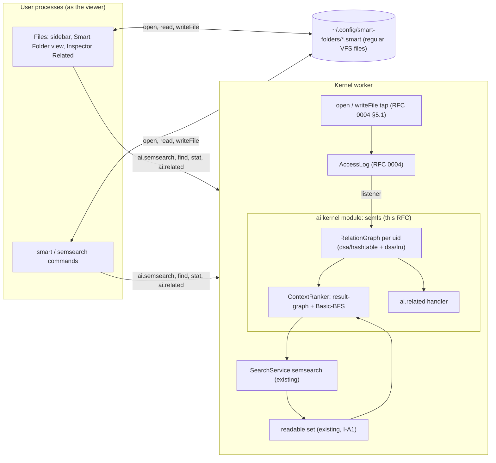

# RFC 0003: Semantic Smart Folders and context-aware search

| Field     | Value                                                                                                                                                                                                                                 |
| --------- | ------------------------------------------------------------------------------------------------------------------------------------------------------------------------------------------------------------------------------------- |
| Title     | Smart Folders as saved queries evaluated as the viewer (Semantic File Systems, with the macOS Smart Folder experience), and a Connections-style relation graph that re-ranks `semsearch` and powers "Related files"                   |
| Status    | **Approved with cuts** (ARB, 2026-09-30): P0 items 1 to 6; the Files sidebar section (item 7) is P1; `/mnt/smart` is **rejected** for Wave 3. See §13, §17 and [PLAN.md](PLAN.md).                                                    |
| Authors   | design-ai-fs (Wave 3 design track, AI-assisted and disclosed in AI_USAGE.md), writing for R4 AI (search) and R3 WM/UI (Files)                                                                                                         |
| Reviewers | critic 1 and critic 2 (design track); the ARB; subsystem owners R2 (VFS), R3 (Files, shell), R4 (AI), R5 (QA)                                                                                                                         |
| Date      | 2026-09-30                                                                                                                                                                                                                            |
| Builder   | `semantic-fs` (Workflow B), after the step-0 contract PR by `platform` ([PLAN.md](PLAN.md) §3)                                                                                                                                        |
| Related   | RFC 0004 defines the **file-access stream** this RFC consumes (RFC 0004 §5.1). The step-0 PR is owned by `platform` ([PLAN.md](PLAN.md) §3). The `/mnt/smart` virtual path on RFC 0001's mount seam was rejected for Wave 3 (§5.5.6). |

---

## 1. Summary

Plotinium can already find files by meaning. `semsearch` and the Files search box run an embedding model on the device, filter by the caller's current permissions before ranking, and reach Recall@5 0.938 and MRR 0.846 on the team's 40-query set (`ai/eval/rag/REPORT.md`). Two things are missing, and both have classic answers in the file-system literature:

1. **A search has to be retyped every time.** Gifford's _Semantic File Systems_ (SOSP 1991) made queries first-class: a **virtual directory** is a query, and its entries are the matching files. macOS turned the same idea into **Smart Folders**. This RFC adds Smart Folders as **saved queries that are ordinary files** (`~/.config/smart-folders/*.smart`). They combine semantic or keyword text with attribute filters (type, modified time, size, scope), in the conjunctive style of Gifford and LSFS. They are **evaluated as the viewer**, at view time, through the existing permission-filtered search. They appear in the Terminal through a `smart` command, and (P1) in the Files sidebar. A true virtual path (`/mnt/smart/<name>`) was proposed as P1 on RFC 0001's mount seam; the ARB rejected it for Wave 3 (§5.5.6).
2. **Search ignores how the user works.** _Connections_ (Soules and Ganger, SOSP 2005) showed that files used together in time are related in ways their contents do not reveal. On six users' traces, adding a relation graph to content search raised recall at 10 from 13 % to 22 % and average precision from 17 % to 28 %. This RFC builds a per-user **relation graph** from RFC 0004's private file-access stream, using the paper's read/write rule. The graph drives two features:
   - **context-aware re-ranking** of `semsearch` (flagged; default off until the evaluation gate passes);
   - **"Related files"** in the Files Inspector and `semsearch --related`.

Everything respects RAG-03: no feature ever ranks, lists or links a file the viewer cannot read now. The evaluation reuses the RAG harness and its metrics (Recall@5, MRR, nDCG@10 with bootstrap intervals), adds 20 context queries over 24 scripted work sessions, and compares against naive recency and same-directory baselines (§10).

**ARB outcome (2026-09-30).** P0 is approved: the relation graph, `ai.related`, the context stage, the evaluation, the Inspector's Related group, and the Smart Folder definitions, evaluator and `smart` command. Changes, each marked "ARB":

- the evaluation dataset is written and hash-frozen by an independent Workflow B agent before the build, with α and P fixed from the paper and only β and ω tuned, and leave-one-session-out cross-validation as the primary estimate (§10.2);
- the graph ingests only local (`fs: 'root'`) events (§5.1);
- the context stage is cooperative and stops at 8 ms (§5.3);
- the no-AI fallback stays on the scope's own file system (§5.5.2);
- slugs and definition creation are constrained (§5.5.1).

The Files sidebar section moves to P1, because the Files sidebar is `gdrive-ui`'s file in Wave 3. The Inspector's Related group ships through a small step-0 plumbing hook (§13).

## 2. Context and problem: what exists today

Verified in the tree on 2026-09-30. Line numbers drift while the stabilize track edits Files code, so each reference also names the symbol.

### 2.1 What exists

| Piece                      | Where                                                                                                                                                                                                                                   | Notes                                                                                                                                                                               |
| -------------------------- | --------------------------------------------------------------------------------------------------------------------------------------------------------------------------------------------------------------------------------------- | ----------------------------------------------------------------------------------------------------------------------------------------------------------------------------------- |
| Query path                 | `ai/src/kernel/search-service.ts:148` `SearchService.semsearch`                                                                                                                                                                         | Embed the query, then the readable bitset (`:103`), then exact scan (`dsa/heap`) or BM25 or RRF, then `assembleResults`, then warm the top 3. Runs in the kernel worker (`:15-17`). |
| Readable set, foreign rule | `ai/src/search/readable.ts:125` `readableSet`, `:145` `isForeign`, `:156` `ReadableCache`                                                                                                                                               | Permission from the **current** tree before ranking (I-A1); foreign results are verified online and hidden offline.                                                                 |
| Result assembly            | `ai/src/search/results.ts:123` `assembleResults`                                                                                                                                                                                        | Per-file collapse, version check (I-A4), live-tree check (I-A9), foreign verification, citations.                                                                                   |
| Index                      | `ai/src/kernel/index-store.ts:67` `SemanticIndex`: file table, per-uid BM25 and previews, `dsa/bloom`                                                                                                                                   | In memory (`:14-16`); `vectorOf(row)` on `VectorIndex` (`ai/src/search/vector-index.ts:130`).                                                                                       |
| Eval harness               | `ai/eval/rag/`: 223 documents, 40 graded queries (relevant = 2, partial = 1), a permission fixture with 13 leak probes; `pipeline.ts` assembles the real `ai/src` path; `metrics.ts` has Recall@5, MRR, nDCG@10 and bootstrap intervals | The latest report (`REPORT.md`, 2026-09-26): Recall@5 0.938 [0.850, 1.000], MRR 0.846, nDCG@10 0.833, 0 leaks. Hybrid RRF did not help, so `hybrid` stays false.                    |
| `semsearch` command        | `apps/coreutils/cmd/semsearch.ts:59`                                                                                                                                                                                                    | `-k -l --json --chunks --keyword --dir`; notices on stderr.                                                                                                                         |
| Files search               | `apps/files/lib/controller.ts:923` `search()`                                                                                                                                                                                           | `ai.semsearch` over the folder; falls back to a keyword walk (`apps/files/lib/ops.ts:658` `keywordSearch`) when the index cannot answer.                                            |
| Files sidebar              | `ui/src/apps/files/FilesSidebar.tsx:80-96`: sections Favourites and Locations; `types.ts:67-77` `PlaceIcon`, `Place`; places built in `apps/files/lib/model.ts:329`                                                                     | No saved searches. Screenshot: `docs/design/wave3/design-ai-fs/current-files-sidebar-inspector-light.png`.                                                                          |
| Inspector                  | `ui/src/apps/files/Inspector.tsx:100-167` (permissions, owner, size, dates, version), `:193-227` (Open, Open in Editor, Share)                                                                                                          | No notion of related files.                                                                                                                                                         |
| Sidebar primitive          | `ui/src/primitives/sidebar/SidebarList.tsx:26-43` (`SidebarItem` with `icon` and `badge`; `SidebarSection`)                                                                                                                             | Adding a section needs no primitive change.                                                                                                                                         |
| Synthesised files          | `protocol/src/wellknown.ts:110` `SYNTH_FILES` (a fixed set with fixed inodes)                                                                                                                                                           | There are **no** synthesised directories.                                                                                                                                           |
| Mounts                     | `specs/04-vfs/virtual-file-system.md:59`: "Mount points other than `/tmp` … are not implemented in v1"; `protocol/src/vfs.ts:14` `FS_IDS = ['root', 'tmp']`                                                                             | There is no provider seam for a virtual namespace today.                                                                                                                            |

### 2.2 Gaps

- **G1. There are no saved queries.** Every search starts from an empty box. The query is lost when the window closes, and nothing in the file system names it.
- **G2. There is no query namespace.** Gifford's defining feature, "a directory whose contents is a query result", has no mechanism, because the VFS has no mount or provider layer (see the Mounts row).
- **G3. There is no context signal.** The kernel records no file use (RFC 0004 G1). Search ranks by content alone, so a query such as "the performance report", where three reports exist, cannot prefer the one the user was working with 10 minutes ago.
- **G4. There is no "related" view.** The Inspector shows metadata only. Connections' main UX result, files that "go with" this one, has nowhere to appear.
- **G5. The product and the harness disagree on metrics.** nDCG@10 exists in the harness (`ai/eval/rag/metrics.ts`) but not in `ai/src/search/metrics.ts`. That is fine for now, but any new ranking stage must be measured through the harness, not by ad hoc numbers.

## 3. Goals and non-goals

### 3.1 Goals

1. **Smart Folders** that are files, private by default, evaluated as the viewer, visible in Files and the Terminal, and still useful without AI (SFS-01 … SFS-05).
2. **A relation graph** per user, faithful to Connections' read/write rule, bounded, decayed, cleared with the activity data (CTX-01, CTX-02).
3. **Context-aware ranking** that cannot leak (CTX-03), does no harm on RAG-04 (CTX-04), and is measurably better than naive personalisation on context queries (CTX-05), within ≤ 8 ms (CTX-06).
4. **"Related files"** in the Inspector and the Terminal, permission-safe (CTX-07).
5. **A clear LSFS mapping**: what we adopt now, later, or never, and why (§5.6).

### 3.2 Non-goals

- **LLM "what changed" summaries** (LSFS update summarisation). File contents would go to a hosted model, which breaks the local-by-default posture. It would also add an injection surface (AIS-03) and cost money for little grading value. A safe design is sketched in §5.6 for a later RFC.
- **A kernel virtual-directory mechanism in P0.** The VFS has no mount layer, and inventing one here would collide with RFC 0001. See §5.5.6 and §6.
- **Content-similarity "more like this".** Our embedding model is an **asymmetric** query-to-document retriever (LEAF, §4); document-to-document similarity with it is untested. This is P2 and needs its own evaluation.
- **Changing RAG-04's claimed configuration.** Context ranking is off by default until its gate passes (§11).

## 4. Research basis

| Paper                                                                                                                                                                               | Idea                                                                                                                                                                                                                                                                                                                                                                                                                                                                                                                                                              | What we adopt                                                                                                                                                                                                                                                               | What we adapt                                                                                                                                                                                                                                                                                                                                                                                                                                                                                                                                                                                                                                    | What we leave out                                                                                                                                  |
| ----------------------------------------------------------------------------------------------------------------------------------------------------------------------------------- | ----------------------------------------------------------------------------------------------------------------------------------------------------------------------------------------------------------------------------------------------------------------------------------------------------------------------------------------------------------------------------------------------------------------------------------------------------------------------------------------------------------------------------------------------------------------- | --------------------------------------------------------------------------------------------------------------------------------------------------------------------------------------------------------------------------------------------------------------------------- | ------------------------------------------------------------------------------------------------------------------------------------------------------------------------------------------------------------------------------------------------------------------------------------------------------------------------------------------------------------------------------------------------------------------------------------------------------------------------------------------------------------------------------------------------------------------------------------------------------------------------------------------------ | -------------------------------------------------------------------------------------------------------------------------------------------------- |
| Gifford, Jouvelot, Sheldon and O'Toole, _Semantic File Systems_, SOSP 1991 ([notes](https://web.mit.edu/6.826/www/notes/HO13.pdf))                                                  | Virtual directories are queries (attribute and value pairs, conjunctions by nesting). Entries are symbolic links to the matching files. Transducers extract attributes. The query is evaluated against the file system, so results stay current.                                                                                                                                                                                                                                                                                                                  | Queries as named, first-class objects; conjunctive queries (text ∧ type ∧ time ∧ scope); results evaluated at access time, never stored; results as links to the real files (a virtual path, rejected for Wave 3, §5.5.6).                                                  | The saved query is a **file** (a definition), not a path-encoded query, so it can be named, synced, shared and undone. The "transducer" is our existing indexer, whose attributes are chunk vectors and BM25 terms. Evaluation is **per viewer**, with that viewer's permissions.                                                                                                                                                                                                                                                                                                                                                                | An NFS-style server; path-syntax queries (`/sfs/owner:/smith`) in P0 (ad hoc query directories are a P2 idea on top of the P1 provider).           |
| Shi et al., _From Commands to Prompts: LSFS_, ICLR 2025 ([link](https://proceedings.iclr.cc/paper_files/paper/2025/hash/517eb19e99947f60afff0cf93e451825-Abstract-Conference.html)) | Semantic indexes and semantic system calls on AIOS: create, read, update and delete, group-by and join at the micro level; semantic retrieval, update summarisation and semantic rollback at the macro level. Reports at least 15 % better retrieval accuracy and 2.1× faster retrieval than their baseline.                                                                                                                                                                                                                                                      | Semantic operations exposed as **typed system calls** (`ai.semsearch`, `ai.related`), never as prompt strings; conjunctive retrieval (semantic plus attribute) in Smart Folders.                                                                                            | Rollback maps to the VFS's existing undo and `ai undo` (RFC 0002). Group-by maps to relation-graph components (Connections §5, "organizing results"), as P2.                                                                                                                                                                                                                                                                                                                                                                                                                                                                                     | LLM-driven CRUD (`ai` already covers natural-language actions with confirmation); update summarisation (§3.2).                                     |
| Soules and Ganger, _Connections: Using Context to Enhance File Search_, SOSP 2005 ([link](https://pdl.cmu.edu/ftp/ABN/CMU-PDL-05-105_abs.shtml))                                    | A tracer records file system calls. A relation graph gets an edge from each file **read** within a 30 s window to each file **written** (weight +1, one edge per pair per window stay). Search runs content search, then a breadth-first search over the graph (path length 3, weight cutoff 0.1 %), then the Basic-BFS ranking with α = 0.75. Directed edges beat undirected; the "open" filter performed poorly; HITS and PageRank variants did worse than Basic-BFS; directory co-location ("Indri-Dir") underperformed. Graphs stayed under 1 % of user data. | The read/write rule and its defaults (30 s window, directed, α = 0.75); the two-step result-graph and Basic-BFS algorithm, reproduced exactly (a unit test replays the paper's worked example, Fig. 2: w_B = 8.12); the directory baseline; per-user graphs.                | Our graph is bounded (2,048 files, 24 out-edges each) and decayed (half-life 30 days), since it lives in kernel memory, not BerkeleyDB. We add damped **co-open** edges (weight 0.2 within 10 s), because our users read far more than they write. The paper found plain open edges hurt, so the damping weight is tuned on validation queries and may be set to 0. The final score mixes the **exact content score** with the propagated weight (β), and context-only files get their true content score from stored vectors. So we re-rank rather than replace, which protects RAG-04. The BFS never enters a file the caller cannot read now. | `mmap`, `dup`, `stat` and `link` events (our tap sees `open` and `writeFile`, RFC 0004 §5.1); HITS and PageRank (the paper's own negative result). |
| Mei et al., _AIOS: LLM Agent Operating System_, COLM 2025 ([link](https://arxiv.org/abs/2403.16971))                                                                                | Agent services live in a kernel and are reached through system calls; LSFS is AIOS's storage layer.                                                                                                                                                                                                                                                                                                                                                                                                                                                               | Semantic file services as kernel-side `ai.*` system calls with capabilities and audit.                                                                                                                                                                                      | —                                                                                                                                                                                                                                                                                                                                                                                                                                                                                                                                                                                                                                                | An LLM in the retrieval loop.                                                                                                                      |
| Vujanic and Rueckstiess, _LEAF_, ACL 2026 ([link](https://arxiv.org/abs/2509.12539))                                                                                                | Teacher-aligned distillation gives a small **asymmetric** retriever (a query prefix, document vectors), Matryoshka truncation, and robustness to quantisation; this is our `mdbr-leaf-ir`.                                                                                                                                                                                                                                                                                                                                                                        | Candidate expansion re-scores context-only files with their **stored** document vectors against the query vector, which needs no new embedding. This is cheap because the index keeps one 384-dimension vector per chunk (MRL truncation, `rag-semantic-search.md` §3.2.5). | —                                                                                                                                                                                                                                                                                                                                                                                                                                                                                                                                                                                                                                                | Document-to-document similarity ("more like this"): the model is trained query-to-document, so this is P2 with its own evaluation.                 |
| Chang and Ungar, _Animation: From Cartoons to the User Interface_, UIST 1993 ([link](https://bibliography.selflanguage.org/_static/animation.pdf))                                  | Solidity, slow-in and slow-out, and no teleporting objects, so changes are easy to follow.                                                                                                                                                                                                                                                                                                                                                                                                                                                                        | A new Smart Folder slides into the sidebar and Related rows fade in, using the existing motion tokens (transform and opacity only).                                                                                                                                         | Reduced motion removes the movement (the tokens drop to 0 ms, `ui/src/tokens/tokens.css:780-790`).                                                                                                                                                                                                                                                                                                                                                                                                                                                                                                                                               | Decorative motion on live result refresh (rows update in place, announced politely).                                                               |
| Greshake et al., AISec 2023 ([link](https://arxiv.org/abs/2302.12173)); Debenedetti et al., _CaMeL_, 2025 ([link](https://arxiv.org/abs/2503.18813))                                | Data the system reads must not become instructions.                                                                                                                                                                                                                                                                                                                                                                                                                                                                                                               | A Smart Folder definition is **data**: a strict schema, a query string that is only ever embedded or tokenised, rendered as text, never interpreted. Relation edges come only from the user's own processes; agent-class reads are not recorded (RFC 0004 FAC-03).          | —                                                                                                                                                                                                                                                                                                                                                                                                                                                                                                                                                                                                                                                | —                                                                                                                                                  |

**Positioning.** Connections added context to a desktop search tool outside the kernel. SFS added queries to a file system without a notion of meaning. Plotinium puts both inside one OS: a permission-checked semantic index, a kernel-level tracer with privacy controls, saved queries as files, and one evaluation harness that measures content, context and leakage together.

## 5. Design

### 5.0 Architecture



- **Smart Folders are pure user space.** Definitions are files, and evaluation runs in the viewer's own process through existing system calls. There is no new kernel state and nothing new to leak.
- **The graph and the ranker are kernel-side**, next to the index they rank, like `SearchService` today.

### 5.1 Input: the file-access stream (defined in RFC 0004 §5.1)

This RFC **owns no part of the stream**. It registers one `AccessListener` named `relgraph` through `AccessLogApi.subscribe`, and reads `AccessLogApi.recent(uid, 5, 15 min)` for the current-context seeds.

**ARB, 0003-S3 and S-0003-01:** in Wave 3 the listener keeps only events whose `fs === 'root'`. RFC 0004's `AccessLog` already drops every other `fs` (FAC-03), and the listener checks again as defence in depth. So the graph never holds Drive or other remote nodes, which `ai.related` could not resolve through the local tree anyway. An `onPurge(uid, fs)` hook becomes a precondition only when a remote volume's events are admitted (RFC 0001 P3).

Everything the stream guarantees applies here:

- per effective uid (I-F3);
- inode ids only (I-F2);
- no system-class or agent-class events and no scan bursts (I-F4);
- `clear` calls `onClear(uid)` before returning (I-F6);
- local only (I-F1).

The stream's consumer rule **I-F5** binds everything here: every graph output (a ranking, a Related item, a seed) is re-checked against the caller's current permissions at the moment it is used.

### 5.2 The relation graph (`ai/src/kernel/semfs/relgraph.ts`, new)

**Construction** follows Connections §3.2, with our adaptations marked:

- **Input window.** Per uid, the files read in the last `W = 30 s` (monotonic time), kept in a `dsa/ringbuffer` `RingBuffer` of 64 entries, each with a "linked to" set.
- **Read/write edges** (the paper's rule). On a `write` event for file `o`, add +1 to `edge(i → o)` for each input `i ≠ o` in the window, at most once per `(i, o)` while `i` stays in the window.
- **Co-open edges** (adaptation, weight `ω`). On a `read` event for file `r`, add +ω to `edge(i → r)` for each input `i ≠ r` read in the last 10 s. The default is ω = 0.2, tuned over {0, 0.2, 0.5} on the validation queries (§10.2). The paper's "open filter" hurt precision, so ω = 0 is a legitimate outcome.
- **Storage.**
  - Nodes: files interned to dense ids 0 … 2,047 (a `Map<ino, id>`, the allowed hashing primitive), with node recency in a `dsa/lru` (evicting the least recently used file drops its edges).
  - Edge weights: a `dsa/hashtable` `IntHashTable<{w, t, rw, co}>` keyed by `src · 2048 + dst` (below 2^22).
  - Adjacency: per-node out and in lists capped at 24 entries; the lowest-weight edge is replaced only by a heavier one.
  - Totals: per-node `outW` and `inW`, kept incrementally for the cutoff rule.
- **Decay.** Every weight is a `(w, t)` pair decayed lazily with a half-life of 30 days (the same `decayed()` as `ai/src/predictor/markov.ts:43`), so old habits fade and a clock jump never produces negative ages.
- **Deletion.** The semfs module subscribes to `vfs.unlink` as root on the kernel bus, as `install.ts` already does for `vfs.chown` (`ai/src/kernel/install.ts:449-460`), and forgets unlinked inodes (CTX-01). Renames change nothing, because nodes are inodes.
- **Clear.** `onClear(uid)` drops the uid's whole graph (I-F6).
- **Cost.** An update is O(|window| + 24), at most about 90 operations. Memory is bounded at 2,048 × 24 edges × about 48 B, so at most about 2.4 MB per uid, and far less in practice (§8).

### 5.3 Context-aware ranking (`ai/src/kernel/semfs/context.ts`, new; called from `SearchService`)

A new stage runs **after candidates are generated and before `assembleResults`**, and only when the effective mode is not `off`:

```
rerank(cred, mode, qvec?, candidates, R, k):
  C  = best chunk per file among candidates, top M = max(4k, 20) files; s(f) = content score normalised by max
  S0 = {f: s(f) for f in C}  ∪  {f: γ for f in recent(uid, 5, 15 min) if readable(f)}     // seeds
  G' = resultGraph(S0, P, cutoff, canEnter = readableNow)       // Connections §3.3: BFS, P steps, weight cutoff
  w  = basicBFS(G', S0, P, α)                                     // Connections §3.4.1
  ctx(f) = Σ_{i=1..P} w_i(f)                                      // propagated weight only; seeds' own s(f) excluded
  rerank mode: final(f) = s(f) + β · ctx(f) / max ctx,           for f in C only
  expand mode: also add up to ⌈k/3⌉ files reached in G' that are indexed and readable,
               scored with their exact content score (max over their chunks of q · v, stored vectors)
  return candidates reordered; each moved file gets via = 'context' and relatedTo = the seed with the largest contribution
```

- **Basic-BFS**, exactly as the paper states it: `w_{m,i} = Σ_{n→m ∈ G'} w_{n,i−1} · (e_nm · α + (1 − α))`, where `e_nm` is the share of `n`'s outgoing weight on edge `n → m` and `w_{n,0}` is the seed weight.
- **The result graph.** An edge `n → m` is followed if it is at least `cutoff` of `n`'s outgoing weight **or** of `m`'s incoming weight.
- **Parameters** (ARB, 0003-S2). With 20 queries, tuning six parameters would over-fit, so four are fixed before the build:
  - α = 0.75 (the paper);
  - P = 2 (the paper uses 3; 2 keeps the worst case small);
  - cutoff = 1 % (the paper uses 0.1 % on far larger graphs);
  - γ = 0.5.

  Only **β** (over {0.25, 0.5, 1}) and **ω** (over {0, 0.2, 0.5}) are tuned, and only within the validation folds of §10.2.

- **Permissions are applied before any ranking** (CTX-03):
  - candidates already passed `R` (I-A1);
  - the BFS never enters a node the caller cannot read now (`canEnter`: the `R` bit if indexed, otherwise the same traversal check as `readableSet`, memoised per query);
  - expanded files must be indexed, so they have a `fileIdx`, are in `R` and go through `assembleResults` like any candidate, including freshness (I-A4), the live-tree check (I-A9) and foreign verification or hiding.
- **Keyword mode.** Content scores are normalised BM25; expanded files get content score 0 (rerank remains useful).
- **Recall guard.** In `rerank` mode no file outside the content top M can enter, and β bounds how far context can move a file. The gate CTX-04 checks the effect on RAG-04 (§10.2).
- **Results.** `SemsearchResult.results[n]` gains optional `via: 'content' | 'context'` and `relatedTo` (the seed's path, resolved as the caller). `timings` gains `contextMs`. The plain `semsearch` text output does not change (scripts rely on it); `--json` carries the fields, and Files shows a chip (§9).
- **Cost.** The result graph has at most M · 24 + M · 24² ≈ 12,000 edge visits at M = 20, P = 2, and the cutoff prunes most of them. Exact re-scoring covers at most 16 files × about 4 chunks × 384 dimensions. Budget ≤ 8 ms p95 (CTX-06).
- **Cooperative deadline** (ARB, 0003-S6 and X7). The stage runs inside `ai.semsearch` in the kernel worker, which serves every process. The BFS and the re-scoring therefore check a deadline every 256 edge visits (and before each file's re-score). At **8 ms** they stop and return the content order unchanged, with `contextMs` reported and a rate-limited klog line. This is the wave's rule that no kernel-worker task runs longer than 8 ms. The test is `CTX-06 on a worst-case graph the stage stops at the 8 ms deadline and returns the content-only order`.

### 5.4 Related files

**The call** (schemas in `protocol/src/ai/semfs.ts`, rows in step 0):

```ts
export const RelatedArgs = v.strictObject({
  path: Path,
  k: v.optional(v.pipe(v.number(), v.integer(), v.minValue(1), v.maxValue(20)), 5),
});
export const RelatedRet = v.strictObject({
  state: v.picklist(['ready', 'learning', 'paused', 'off']),
  items: v.pipe(
    v.array(
      v.strictObject({
        path: Path, // resolved as the caller
        ino: Ino,
        weight: Ratio, // normalised to the strongest neighbour
        reason: v.picklist(['edited-after', 'opened-together', 'both']),
        count: Count, // rounded decayed evidence, e.g. "5 times"
      }),
    ),
    v.maxLength(20),
  ),
  hidden: Count, // shared (foreign) neighbours omitted, as RAG's "n shared results hidden"
});
// 'ai.related': group ai, class F, origin EV, caps [fs.read], audit trace, errnos [ENOENT, ENOTDIR, EACCES],
// man: 'files used together with a file (on-device context)'
```

**Semantics:**

1. Resolve `path` as the caller. The caller must be able to read it now, else `EACCES` (asking "what goes with X" reveals your history of X).
2. Take the out-neighbours and in-neighbours of the node. Combined weight is `w(n→m) + 0.5 · w(m→n)`. The reason is `edited-after` for read/write evidence, `opened-together` for co-open evidence, or both.
3. Drop every neighbour the caller cannot read now (I-F5).
4. Drop foreign neighbours (the `isForeign` rule, `ai/src/search/readable.ts:145`) and count them in `hidden`. This is stricter than RAG's online verification: related files are hints, not answers, so we never pay a server round-trip for them.
5. Take the top k with a `dsa/heap` `BoundedTopKHeap`.

`state` is `paused` if the user paused learning (RFC 0004), `learning` if the node is unknown or has no edges, and `off` if the flag `ai.fs.related` is off.

**Terminal.** `semsearch --related PATH [-k N] [-l] [--json]` prints `path  reason  count` lines (`-l` prints paths only, for pipes). `semsearch --no-context …` forces `context: 'off'` for one query (the viva A/B).

**Files Inspector** (`ui/src/apps/files/Inspector.tsx`, a new optional `related` prop). A "Related" group sits under the metadata rows (§9 has the wireframe):

- up to 5 rows, each a button with the file icon, the name, its folder, and the reason in words ("Opened together · 5 times", "Edited after · 3 times");
- **Enter** reveals the file (navigates to its folder and selects it); **Shift+Enter** or a double click opens it;
- a final line "2 shared files hidden" when `hidden > 0`.

The section is hidden when `state` is `learning` or `off`. When it is `paused` it reads "Related files are off. Turn on in Settings › Privacy & AI" with a link button. The Files process calls `ai.related` when the single selection changes, debounced by 150 ms, and ignores stale replies by sequence number, as `controller.ts` already does for search (`searchSeq`).

### 5.5 Smart Folders

#### 5.5.1 The definition (a file)

- **Location.** `~/.config/smart-folders/<slug>-<id6>.smart`. The directory is created with mode 0700 and files with 0600. `slugFor` emits only `[a-z0-9-]`, at most 40 characters, so a crafted display name can never produce a path component. `smart new` writes with an exclusive create, so it can never overwrite another definition (ARB, S-0003-03). Being a dot-directory, it is skipped by the indexer (`specs/10-ai/rag-semantic-search.md:133`) and by the access tap (RFC 0004 §5.1.2), so definitions neither pollute search nor count as "use".
- **It is an ordinary VFS file** (SFS-01). Creating, renaming, deleting and editing it use `writeFile`, `rename` and `unlink`, so undo, sync to the user's other devices, quota and conflicts all behave as for any file. macOS keeps saved searches as files in the same way (`.savedSearch` in `~/Library/Saved Searches`).
- **The schema** is strict (unknown fields make the file invalid), at most 4 KiB, and lives in `apps/src/smart/def.ts`. It is app-level data, not ABI:

```ts
export const SmartFolderDef = v.strictObject({
  v: v.literal(1),
  name: v.pipe(v.string(), v.minLength(1), v.maxLength(64)), // display name, rendered as text only
  query: v.optional(v.pipe(v.string(), v.minLength(1), v.maxLength(1000))), // absent: attributes only
  mode: v.optional(v.picklist(['semantic', 'keyword']), 'semantic'),
  scope: v.optional(v.pipe(v.string(), v.maxLength(1024)), '~'), // '~' is the VIEWER's home
  filters: v.optional(
    v.strictObject({
      ext: v.optional(
        v.pipe(v.array(v.pipe(v.string(), v.regex(/^[a-z0-9]{1,10}$/))), v.maxLength(16)),
      ),
      modifiedWithin: v.optional(RelSpan), // reuses protocol's RelSpan (as find's mtime.within)
      minBytes: v.optional(Count),
      maxBytes: v.optional(Count),
      ownedByMe: v.optional(v.boolean()),
    }),
  ),
  k: v.optional(v.pipe(v.number(), v.integer(), v.minValue(1), v.maxValue(50)), 20),
  sort: v.optional(v.picklist(['relevance', 'modified', 'name']), 'relevance'),
  context: v.optional(v.boolean(), true), // use the viewer's context ranking if the flag allows it
  created: EpochMs,
});
```

#### 5.5.2 Evaluation (as the viewer, at view time; `apps/src/smart/eval.ts`, new)

1. Parse the definition. An invalid definition is **never partly executed**: the sidebar shows it with a warning and the text "This Smart Folder can't be read".
2. Expand `scope` against the **viewer's** home, and resolve it with `stat` (ENOENT, ENOTDIR and EACCES are shown in words).
3. **With a query:** call `ai.semsearch({q, k: min(50, 2k), scope, mode: keyword ? 'keyword' : 'auto', context: context ? 'default' : 'off'})`. Then apply the filters: extension from the name, and `modifiedWithin`, size and owner from one `stat` per result (at most 50). Keep the top k.
4. **Without a query** (attributes only, P1): call `find({path: scope, type: 'f', name, mtime, size, limit: 1000})` for each extension glob (at most 16), take the union, sort by `mtime`, and show the first 200.
5. **Without AI** (the litmus build, safe mode, or `ENOSYS` / `EAIUNAVAIL` from `ai.semsearch`): the query becomes a **name** match with `*term*` globs, one pass per term, intersected. The RAG-06 notice text is reused ("Semantic search not installed — showing name matches", or the safe-mode wording of `specs/10-ai/rag-semantic-search.md` §3.12). This is SFS-05: Gifford's attribute queries never needed AI.
   - ARB, 0003-S5 and S-0003-02: the kernel has no `find` (architecture review F3), so this is a userland `readdir` walk.
   - It uses the mount-aware walker from RFC 0001 (`apps/coreutils/lib/fs.ts`, GDRV-21), which stays on the scope's own file system.
   - It is capped at 5,000 entries visited and depth 8, with a "results truncated" notice.
   - Its budget is set from a QA measurement of that walk, not assumed.
6. The results are `{path, name, mtime, size, score?, snippet?, via?, relatedTo?}`. **Nothing is cached across evaluations**, so permissions are always current (SFS-02).

A definition shared by another user (for example `bob` copies his `.smart` file to `alice`) is evaluated **as alice, with alice's home and permissions**. The query is data, so no confused-deputy path exists.

#### 5.5.3 Files: sidebar and view (P1 by ARB decision; P0 is `smart` and the Inspector's Related group)

ARB, 0003-S7: the sidebar section is **P1**, not in Workflow B. In Wave 3 the Files sidebar, `FilesView.tsx` and the Files controller are owned by `gdrive-ui` (RFC 0001), and this RFC's budget was over 5 hours. Smart Folders are fully usable through `smart` in P0. The design below stands for P1.

- **The sidebar** (`ui/src/apps/files/FilesSidebar.tsx`) gains a "Smart Folders" section between Favourites and Locations. Items use the `folder-search` icon (lucide 1.47, already a dependency). The controller lists `~/.config/smart-folders` at start, and again on `vfs.create`, `vfs.rename`, `vfs.unlink` and `vfs.write` events in that directory, through a second subscription next to its existing one for the current folder (`apps/files/lib/controller.ts`, the `vfs.*` handling around line 246).
- **Selecting a Smart Folder** evaluates it (§5.5.2) and shows the results in the **existing results view** (`ui/src/apps/files/SemanticResults.tsx`: cards with path, lines, score, snippet, highlights and notices), under a header strip: the query, the scope, the item count, the mode and "Edit…" (P1). The Inspector describes the selected result, including its Related group.
- **P1, create:** a "Save" button in the search results header (Finder puts it at the right of the search scope bar) opens a sheet with a Name field (default: the query) and Save and Cancel. It writes the definition with `writeFile` (create, exclusive).
- **P1, live refresh:** while a Smart Folder is shown, `vfs.*` events under its scope and `ai.index.progress` changes schedule one re-evaluation after 2 s (at most one in flight). Rows update in place, and the count change is announced politely.
- **P1, context menu:** Rename, Edit, Delete, and "Copy Terminal command" (copies `smart ls <name>`).

#### 5.5.4 Terminal: `smart` (`apps/coreutils/cmd/smart.ts`, `man/smart.md`)

```
smart                                   list Smart Folders: name, mode, query, scope
smart ls NAME [-l] [--json]             evaluate now; default lines as semsearch (path:lines  score  snippet); -l paths only
smart new NAME [QUERY] [--keyword] [--dir PATH] [--ext md,ts] [--within 7d] [-k N]
smart rm NAME
smart show NAME                         print the definition
exit: 0 results · 1 no results · 2 error (errno printed)
```

`smart` is **not** in `AI_PROGRAMS` (`apps/coreutils/index.ts:108`). It exists in the AI-off build and falls back to name matching with the notice (SFS-05). `smart ls NAME -l | grep -i draft` works as expected (there is no `xargs` in the coreutils today).

#### 5.5.5 Why not store results

Results are **never written**: not into the definition, not into a cache directory, not into tmpfs. A stored result list goes stale in two dangerous ways. It keeps names after permissions change (a leak), and it keeps files that no longer match (a lie). Evaluating at view time costs one `ai.semsearch` (internal target ≤ 250 ms) plus at most 50 `stat` calls, which fits the budget (§8).

#### 5.5.6 A real virtual path, `/mnt/smart/<name>`: rejected for Wave 3 (ARB, 0003-S1)

The draft proposed a read-only `smart` provider on RFC 0001's mount seam in 60 to 90 minutes: `readdir /mnt/smart` lists the caller's definitions; `readdir /mnt/smart/<name>` evaluates one as the caller and returns symbolic links to the results; mutations answer EROFS.

The ARB does not approve this as written:

- RFC 0001's `MountTable` is kernel-core code. The kernel may not import `ai/` or `apps/`, and `ai/` may import only `@plotinium/kernel/hooks` (`tools/eslint-rules/boundaries.js`). A provider would first need a registration seam in `@plotinium/kernel/hooks`.
- Evaluation needs `ai.semsearch`, and the definition schema lives in `apps/src/smart/def.ts`. It would have to move to `protocol/`.
- EROFS is not in the closed errno set (`protocol/src/errno.ts:23-49`); a read-only volume answers EPERM `remote-fs`.
- Links that point out of a volume are not in RFC 0001's `MountVolume` interface.
- The honest estimate is 3 hours or more.

Revisit after RFC 0001's P1b, with the seam, the moved schema, EPERM `remote-fs` and a new estimate. SFS-07 is withdrawn for Wave 3. The Terminal story stays `smart ls` (P0). Materialising symbolic links into `/tmp` from a daemon remains rejected (§6, alternative B).

### 5.6 LSFS operations mapped to Plotinium

| LSFS operation               | Plotinium today                | This RFC                                                                        | Later, or never                                                                                                                                                                                                                                  |
| ---------------------------- | ------------------------------ | ------------------------------------------------------------------------------- | ------------------------------------------------------------------------------------------------------------------------------------------------------------------------------------------------------------------------------------------------ |
| Semantic retrieval           | `ai.semsearch`                 | Context ranking; saved as Smart Folders                                         | —                                                                                                                                                                                                                                                |
| Keyword retrieval            | BM25; the Files keyword walk   | The Smart Folder keyword mode; name fallback without AI                         | —                                                                                                                                                                                                                                                |
| Create, read, update, delete | VFS system calls               | Definitions are files                                                           | —                                                                                                                                                                                                                                                |
| Join                         | —                              | Conjunctive definitions (text ∧ extension ∧ time ∧ size ∧ scope), after Gifford | P2: `smart ls A --and B` (set operations across definitions)                                                                                                                                                                                     |
| Group by                     | —                              | —                                                                               | P2: group results by relation-graph components (Connections §5), or by embedding clusters after a doc-to-doc evaluation                                                                                                                          |
| Update summarisation         | —                              | Non-goal                                                                        | Only as an explicit user action on the user's **own** files: a tool-less `/api/llm` call with the diff datamarked, the output rendered as text, budgeted and audited (AIS-03, CaMeL's "control only from the user"), after its own safety review |
| Rollback                     | VFS undo; `ai undo` (RFC 0002) | —                                                                               | —                                                                                                                                                                                                                                                |
| Sharing                      | modes and groups               | Shared definitions are evaluated as the viewer                                  | —                                                                                                                                                                                                                                                |

### 5.7 The four AI-native properties (spec §3.2) and the coupling map

| Property                  | This RFC                                                                                                                                                                                                                                  |
| ------------------------- | ----------------------------------------------------------------------------------------------------------------------------------------------------------------------------------------------------------------------------------------- |
| Sees through the kernel   | The graph is fed only by the kernel's tap (RFC 0004) and `vfs.unlink` on the bus. Smart Folders read only through system calls (`ai.semsearch`, `find`, `stat`, and `open`/`read` for the definition).                                    |
| Acts through system calls | `ai.related`; the `context` argument of `ai.semsearch`. The AI never writes files: definitions are written by the user's own process.                                                                                                     |
| Scheduled by the system   | Graph updates are bounded kernel bookkeeping on each access (O(window)). Ranking runs inside the `ai.semsearch` call, bounded to ≤ 8 ms. Evaluation runs in the viewer's own process, at its priority. The indexer (PRI 32) is unchanged. |
| Informs the system        | Search results move with the user's current work. Related files steer navigation. RFC 0004 warms what a search is likely to open (AIN-A4).                                                                                                |

**Coupling cells extended** (the text goes to `platform`'s doc PR for `ai-safety-and-evaluation.md` §3.2):

- **CPL-A-VFS**: saved queries over the VFS, evaluated live.
- **CPL-A-SHELL**: `smart`, `semsearch --related`, `--no-context`.
- **CPL-A-SEC**: per-uid graph; BFS and results limited to the readable set; foreign neighbours hidden.
- **CPL-A-MEM**: the graph is bounded and reported through `ai.access.status` `consumers`.

### 5.8 Interfaces (what step 0 adds, and what this builder implements)

**Protocol (step 0).**

- `protocol/src/ai/semfs.ts`: `RelatedArgs` and `RelatedRet` (§5.4).
- `protocol/src/ai/rag.ts`:
  - `SemsearchArgs` gains `context: v.optional(v.picklist(['default', 'off', 'rerank', 'expand']))`, where `'default'` means the sysctl `ai.fs.context`;
  - each result row gains `via: v.optional(v.picklist(['content', 'context']))` and `relatedTo: v.optional(Path)`;
  - `timings` gains `contextMs: v.optional(Finite)`.
- The registry row for `ai.related` (§5.4).

**Kernel side (this builder).**

```ts
// ai/src/kernel/semfs/index.ts: the step-0 stub, filled by semantic-fs
export interface SemfsContext {
  readonly register: <C extends CallName>(name: C, impl: AiCallImpl<C>) => void;
  readonly index: SemanticIndex; // file table, chunksOf(ino), vectorIndex
  readonly fs: AiFsView; // live tree + permission oracle (existing)
  readonly accessLog: AccessLogApi; // RFC 0004 §5.1.2
  readonly bus: AiBus; // vfs.unlink as root
  readonly sysctl?: AiSysctl; // defines ai.fs.context and ai.fs.related
  now(): number;
}
export interface SemanticFs {
  /** SearchServiceDeps.rerank: reorders candidates; never adds a file outside R (CTX-03). */
  rerank?(input: RerankInput): RerankOutput;
  stop(): void;
}
export interface RerankInput {
  readonly cred: Cred;
  readonly mode: 'rerank' | 'expand';
  readonly qvec: Float32Array | undefined; // undefined in keyword mode
  readonly candidates: readonly Candidate[]; // existing type, ai/src/search/results.ts
  readonly readable: Bitset;
  readonly k: number;
}
export interface RerankOutput {
  readonly candidates: readonly Candidate[];
  readonly via: ReadonlyMap<number /* fileIdx */, { relatedTo: string /* ino */ }>;
  readonly ms: number;
}
```

`SemanticIndex` gains a read-only `chunksOf(ino): readonly {seq, row}[]` for exact re-scoring (`ai/src/kernel/index-store.ts`, owned by this builder).

**User side (this builder).** `apps/src/smart/def.ts` exports `parseSmartFolder`, `serializeSmartFolder` and `slugFor`. `apps/src/smart/eval.ts` exports `evaluateSmartFolder(sys, def, who) → {results, notices, mode}`. It uses only `@plotinium/protocol` and `@plotinium/kernel/sys`, as `apps/*` must (`tools/eslint-rules/boundaries.js`).

### 5.9 Failure modes

| Situation                                   | Behaviour                                                                                                                                                                     |
| ------------------------------------------- | ----------------------------------------------------------------------------------------------------------------------------------------------------------------------------- |
| AI-off build or safe mode                   | `ai.related` is ENOSYS: the Inspector hides the section. `semsearch` is absent. Smart Folders evaluate by name with the notice (SFS-05).                                      |
| Learning paused or the stream cleared       | The graph is empty: rerank is a no-op (results identical to `off`, a unit test), and Related shows its `paused` or hidden state.                                              |
| The model is loading or unavailable         | The existing RAG-06 path: keyword candidates, still re-rankable by context.                                                                                                   |
| A definition is invalid or too large        | Listed with a warning, never evaluated; `smart ls` exits 2 with "invalid Smart Folder: <reason>".                                                                             |
| The scope was deleted or is unreadable      | The error is shown in words; the definition is kept.                                                                                                                          |
| The graph listener throws                   | `AccessLog` disables it (RFC 0004 §5.8). Search falls back to content-only ranking, with a klog line.                                                                         |
| The context stage reaches its 8 ms deadline | It stops cooperatively (the deadline is checked every 256 edge visits) and keeps the content order, with `contextMs` reported and a rate-limited klog warning (ARB, 0003-S6). |
| A result is removed between rank and render | Dropped by the existing live-tree check (I-A9).                                                                                                                               |

## 6. Alternatives considered

- **A. A kernel virtual directory now** (synthesise `/smart` inside `FsHandlers`: intercept `readdir`, `stat`, `open` and `chdir` for a reserved prefix). It is rejected for P0. It touches every path-taking handler, plus `find`, `grep` and `du`, which walk the tree in the kernel, plus `chdir`, the dcache and `fsck`. That is a large regression surface in graded VFS code, and it would collide with RFC 0001, which is likely to need a mount layer anyway. If RFC 0001 adds one, we plug into it (§5.5.6).
- **B. Materialise results as symbolic links** in `/tmp/smart/<user>/<name>/` from a daemon. It is rejected:
  - it churns writes and bus events;
  - stale links keep result **names** after a permission change until the next refresh;
  - `/tmp` is shared, so squatting on `/tmp/smart/<user>` needs defensive checks;
  - system-class processes cannot write files (`protocol/src/caps.ts:61-73` has no `fs.write` in the system bounding set), so the daemon would need a user-class process with full write rights, a larger blast radius than the feature is worth.
- **C. LLM re-ranking or query rewriting** instead of a graph. It is rejected: it sends queries and snippets off the device, adds a round-trip to every search (RAG-05), costs money, is non-deterministic in CI, and cannot know the user's recent work without the same activity data we collect locally.
- **D. Directory co-location as context** ("boost files near the ones you just used"). It is kept as a **baseline**, not the design: Connections' Indri-Dir comparison found it clearly worse, because users' directories are cluttered and reorganised.
- **E. Recency boost** ("boost recently opened files"). Also kept as a baseline: it cannot find a related file the user has not opened recently, which is exactly the Connections case.
- **F. Store definitions in Settings** (a preferences key) instead of files. It is rejected: definitions would not sync, could not be shared, undone or listed from the Terminal, and would need a new storage path. As files they get all of that for free.
- **G. PageRank or HITS ranking over the graph.** Rejected on Connections' own evidence (Figs. 10 and 11): both did worse than Basic-BFS on temporal-locality graphs.

## 7. Security, privacy and abuse

| Threat                                                               | Mitigation                                                                                                                                                                                                                                                                                     |
| -------------------------------------------------------------------- | ---------------------------------------------------------------------------------------------------------------------------------------------------------------------------------------------------------------------------------------------------------------------------------------------- |
| Context ranking surfaces a file the caller cannot read               | Candidates are limited to `R` before ranking; the BFS never enters an unreadable node; expanded files pass `R` and `assembleResults` (freshness, live tree, foreign verification or hiding). CTX-03 extends the `rag-leak` probes to `rerank`, `expand` and `ai.related`: 0 leaks is the gate. |
| Related files reveal names after `chmod` or `chown`                  | Permissions are checked at every call (I-F5); foreign neighbours are hidden and only counted. The test `CTX-07 chmod 600 by bob after alice opened his file removes it from alice's Related list at once`.                                                                                     |
| One user's habits influence another user's results                   | Graphs are per effective uid and never shared or synced (RFC 0004 I-F1, I-F3).                                                                                                                                                                                                                 |
| A malicious shared Smart Folder definition                           | A strict schema, at most 4 KiB, evaluated as the viewer in the viewer's scope; the query is embedded or tokenised, never executed; the name and query are rendered as text nodes (L10, `no-html-sinks`). Unknown fields invalidate the file.                                                   |
| Injection steers the graph (a file makes the agent open other files) | Agent-class reads are never recorded (RFC 0004 FAC-03); files cannot open files.                                                                                                                                                                                                               |
| A query in a definition is sensitive                                 | The file is 0600 in a 0700 directory. It syncs to the user's own account like any document; that is stated in the Save sheet ("Saved in your home folder").                                                                                                                                    |
| Result-count side channel ("n shared files hidden")                  | The same disclosure RAG already accepts (`noticeHiddenOffline`, `ai/src/search/hybrid.ts`): a count, never a name.                                                                                                                                                                             |
| Denial of service (huge scopes, many folders)                        | `k` ≤ 50, at most 50 `stat` calls, `find` limited to 1,000 results, at most one evaluation in flight per window, and a P1 refresh debounce of 2 s.                                                                                                                                             |

## 8. Performance and budgets

| Metric                                     | Budget                                                                                                | How measured                                            |
| ------------------------------------------ | ----------------------------------------------------------------------------------------------------- | ------------------------------------------------------- |
| Graph update per access event              | mean ≤ 20 µs, p99 ≤ 100 µs                                                                            | bench, 10^5 synthetic events                            |
| Context stage in `ai.semsearch`            | ≤ 8 ms p95 at 2,048 nodes and 24 out-edges; cooperative stop at 8 ms (ARB, 0003-S6)                   | bench on a random worst-case graph; `timings.contextMs` |
| `ai.semsearch` end to end                  | unchanged: RAG-05 ≤ 500 ms, internal target ≤ 250 ms                                                  | the existing RAG-05 bench, run with `context: 'rerank'` |
| `ai.related`                               | ≤ 5 ms p95 (at most 48 neighbours, readable checks memoised)                                          | bench                                                   |
| Smart Folder evaluation (semantic, k = 20) | ≤ 350 ms p95: one semsearch plus at most 50 `stat` calls                                              | browser bench on the QA copy                            |
| Smart Folder evaluation (attributes, P1)   | set from a QA measurement (ARB, 0003-S5); the kernel has no `find`, so this is a userland walk        | browser bench (P1)                                      |
| Smart Folder name fallback without AI      | capped at 5,000 entries and depth 8; the budget is set from the QA measurement taken by `semantic-fs` | QA on :4718, recorded in the report                     |
| Graph memory                               | ≤ 2.5 MB per uid worst case, typically under 0.5 MB; reported in `ai.access.status`                   | unit test with a synthetic full graph                   |
| Sidebar with 32 Smart Folders              | render ≤ 2 ms; no layout thrash                                                                       | ui test                                                 |
| Motion                                     | ≤ 200 ms (`--pl-motion-med`), transform and opacity only; 0 ms under reduced motion                   | ui test for class names and token use; visual check     |

## 9. Accessibility and UX

**Wireframe.** A Files window with a Smart Folder selected (light and dark themes both come from tokens; the icons are lucide line icons):

```
+------------------------------------------------------------------------------------------+
| (o)(o)(o)   <  >   Memory leaks                     [grid|list]  [sort]  [Search...] [Semantic] |
+-----------------+-----------------------------------------------+------------------------+
| Favourites      | Smart Folder  "memory leak in the UI"         |  dock-hover-           |
|   [home] Home   | in ~/capstone - 7 items - Semantic   [Edit...] |  retention.md          |
| Smart Folders   | --------------------------------------------- |  Markdown document     |
|   [fs] Memory   | reports/dock-hover-retention.md   41-67  0.83 |  Permissions rw-r--r-- |
|        leaks  < |   "listeners registered on every drag..."      |  Owner  alice          |
|   [fs] This week| src/dock-magnify.ts               10-38  0.71 |  ...                   |
| Locations       |   [related to your recent work: weekly-sync]  |  Related               |
|   [bin] Trash   | meetings/2026-10-09-weekly-sync.md 1-22  0.64 |   weekly-sync.md       |
|   [tmp] Temp    |   ...                                         |    Opened together - 5x|
|   [/] Root      |                                               |   dock-magnify.ts      |
|                 |                                               |    Edited after - 3x   |
|  0 B of 1 GB    | 7 items - semantic - 212 ms                    |   2 shared files hidden|
+-----------------+-----------------------------------------------+------------------------+
```

- **Keyboard.**
  - The Smart Folders section is part of the sidebar's list navigation (arrow keys, Enter).
  - In the results, the existing SemanticResults keys apply.
  - In the Inspector, Tab reaches each Related row; Enter reveals the file; Shift+Enter opens it.
  - P1: File › New Smart Folder… (Ctrl+Alt+N) opens the Save sheet for the current search.
- **Screen readers.**
  - Each sidebar item is named "Memory leaks, Smart Folder".
  - The results header is a heading followed by a text summary.
  - Each Related row is named "weekly-sync.md, in capstone/meetings, opened together 5 times".
  - "Related to your recent work" chips carry `aria-describedby` with the seed file's name.
  - Live refresh (P1) announces "7 items" through the existing polite status region (WCAG 4.1.3).
- **WCAG 2.2 AA.**
  - Targets are at least 24 × 24 px (2.5.8), and sidebar rows already are.
  - Focus is visible and never hidden under the glass toolbar (2.4.7, 2.4.11).
  - Reasons are words, never colour alone (1.4.1).
  - Contrast comes from tokens (1.4.3).
  - No drag is needed (2.5.7).
- **Motion** (Chang and Ungar). A new sidebar item enters with opacity 0 → 1 and `translateY(4px) → 0` over `--pl-motion-med` with `--pl-ease-out`. Related rows fade over `--pl-motion-fast`. Result refresh updates rows in place without movement. All of it becomes 0 ms under reduced motion through the existing tokens.
- **Strict CSP.** Every static style lives in `Files.module.css` and `Inspector.module.css`, with no `style={{…}}` literals. The UI is verified on the QA copy with a `securitypolicyviolation` listener. The target is 0 new violations; the current build already reports one `require-trusted-types-for` violation, which is not ours and is recorded in §15.
- **Empty states.**
  - "No files match yet. Matches update as you work." plus the query summary.
  - When the index is still building, the existing model-loading notice (RAG-06).

## 10. Testing and evaluation

### 10.1 Tests (titles start with their requirement ID)

Projects and commands (ARB, 0003-S4 and X6). The draft's `ai-eval`, `bench` and `litmus` projects do not exist (`vitest.config.ts:40-53`):

- evaluation tests live under `ai/eval/ctx/*.test.ts` or `ai/tests/eval.ctx.test.ts` and run in the `ai` project;
- benches are `*.bench.ts` files, run with `pnpm bench`;
- AI-off assertions are composed-kernel tests with the AI runtime not installed.

| Test title                                                                                                                                                                                                                                            | Command                                                                                                                                                                                                                          |
| ----------------------------------------------------------------------------------------------------------------------------------------------------------------------------------------------------------------------------------------------------- | -------------------------------------------------------------------------------------------------------------------------------------------------------------------------------------------------------------------------------- |
| `CTX-01 a read of A then a write of B within 30 s creates one edge A to B, and repeated writes while A stays in the window add nothing`                                                                                                               | `pnpm exec vitest run --project ai ai/tests/semfs.relgraph.test.ts`                                                                                                                                                              |
| `CTX-01 co-open edges get weight ω only within 10 s, and ω = 0 disables them`                                                                                                                                                                         | same                                                                                                                                                                                                                             |
| `CTX-01 the graph never exceeds 2,048 nodes or 24 out-edges and evicts the least recently used file` (fast-check)                                                                                                                                     | same                                                                                                                                                                                                                             |
| `CTX-01 events whose fs is not root never enter the graph` (ARB, 0003-S3)                                                                                                                                                                             | same                                                                                                                                                                                                                             |
| `CTX-01 unlink removes a file from the graph and clear empties the uid's graph before ai.access.clear returns`                                                                                                                                        | `pnpm exec vitest run --project ai ai/tests/semfs.related.test.ts`                                                                                                                                                               |
| `CTX-02 the result graph from D with path length 2 and cutoff 30 % is exactly DE, EF, EG and EB (Soules and Ganger Fig. 2)`                                                                                                                           | `pnpm exec vitest run --project ai ai/tests/semfs.relgraph.test.ts`                                                                                                                                                              |
| `CTX-02 Basic-BFS replays the paper's Fig. 2 worked example (w_B = 8.12) with the α that example uses` (ARB, 0003-N1: the builder checks the α in the paper's text and names it in the title; the test replays the example, not the default α = 0.75) | same                                                                                                                                                                                                                             |
| `CTX-03 rag-leak with context rerank and expand returns zero unreadable results for alice, bob and carol`                                                                                                                                             | `pnpm exec vitest run --project ai ai/tests/eval.ctx.test.ts`                                                                                                                                                                    |
| `CTX-03 the BFS never visits a node the caller cannot read, even when it bridges two readable files`                                                                                                                                                  | `pnpm exec vitest run --project ai ai/tests/semfs.context.test.ts`                                                                                                                                                               |
| `CTX-03 with an empty graph, rerank returns exactly the content-only ranking`                                                                                                                                                                         | same                                                                                                                                                                                                                             |
| `CTX-04 Recall@5 on the RAG-04 set with context is at least the content-only Recall@5 minus 0.01 and at least 0.80`                                                                                                                                   | `pnpm exec vitest run --project ai ai/tests/eval.ctx.test.ts`                                                                                                                                                                    |
| `CTX-05 rerank MRR is reported against content-only, recency and directory baselines, by leave-one-session-out cross-validation and on the frozen test half, with paired bootstrap intervals`                                                         | same                                                                                                                                                                                                                             |
| `CTX-06 the context stage takes at most 8 ms p95 at 2,048 nodes`                                                                                                                                                                                      | `pnpm bench` (`ai/tests/semfs.context.bench.ts`)                                                                                                                                                                                 |
| `CTX-06 on a worst-case graph the stage stops at the 8 ms deadline and returns the content-only order` (ARB, 0003-S6)                                                                                                                                 | `pnpm exec vitest run --project ai ai/tests/semfs.context.test.ts`                                                                                                                                                               |
| `CTX-07 ai.related omits files the caller cannot read and counts foreign ones as hidden`                                                                                                                                                              | `pnpm exec vitest run --project ai ai/tests/semfs.related.test.ts`                                                                                                                                                               |
| `CTX-07 chmod 600 by bob after alice opened his file removes it from alice's Related list at once`                                                                                                                                                    | same                                                                                                                                                                                                                             |
| `CTX-07 the Inspector lists related files with their reason in words and Enter reveals the file`                                                                                                                                                      | `pnpm exec vitest run --project ui ui/src/apps/files/inspector-related.test.tsx`                                                                                                                                                 |
| `CTX-08 without the AI runtime ai.related is ENOSYS and the Inspector hides the Related group`                                                                                                                                                        | `pnpm exec vitest run --project ai ai/tests/semfs.related.test.ts` (the ai test harness with `installSemanticFs` not installed), and the ui test above (`relatedFor` returning `null`); the real AI-off check is QA's Q-AIOFF-01 |
| `SFS-01 smart new writes a 0600 definition under ~/.config/smart-folders that parses back to the same object, with an exclusive create and a [a-z0-9-] slug of at most 40 characters` (ARB, S-0003-03)                                                | `pnpm exec vitest run --project apps apps/src/tests/smart.test.ts apps/coreutils/tests/smart.test.ts`                                                                                                                            |
| `SFS-01 a definition with an unknown field or over 4 KiB is invalid and never evaluated`                                                                                                                                                              | same                                                                                                                                                                                                                             |
| `SFS-02 a Smart Folder shared by bob and evaluated by alice returns only files alice can read now, from alice's home`                                                                                                                                 | same                                                                                                                                                                                                                             |
| `SFS-02 smart ls returns the same files as semsearch with the same query, scope and k, after the filters`                                                                                                                                             | same                                                                                                                                                                                                                             |
| `SFS-04 smart ls -l prints one path per line and exits 1 when nothing matches`                                                                                                                                                                        | same                                                                                                                                                                                                                             |
| `SFS-05 with AI unavailable, a Smart Folder with a query matches file names, shows the not-installed notice and never leaves the scope's file system` (ARB, S-0003-02)                                                                                | same                                                                                                                                                                                                                             |
| `SFS-03` (sidebar) and `SFS-06` (live refresh)                                                                                                                                                                                                        | P1, not in Workflow B                                                                                                                                                                                                            |

### 10.2 Evaluation: `ai/eval/ctx/` (new), run by the same harness as `ai/eval/rag/`

- **Who writes the data** (ARB, 0003-S2). The builder who tunes the ranker never writes the data it is scored on. The Workflow B red team's evaluation-data author writes `sessions.json` first and then `queries-ctx.json`. The author hashes them into `ai/eval/ctx/MANIFEST.sha256` before `semantic-fs` starts item 4, and the evaluation refuses to run on a hash mismatch.
  - Both files come from the same independent agent. The independence that matters is from the builder, and the ARB accepts this in place of the draft's separate session and query authors. The report says so.
- **Data:**
  - **`sessions.json`**: 24 scripted work sessions for `alice` over the existing 223-document corpus. Each step is `{dt seconds, path, op: read | write}`: for example, prepare for the weekly sync, fix the dock memory leak, revise for the OS quiz. They are derived from links the corpus already contains (meetings cite reports and code).
  - **`queries-ctx.json`**: 20 **context queries** (CQ01 … CQ20). Each is bound to a session point (`at: {session, step}`), with graded relevance (relevant = 2, partial = 1) and a split: 10 validation, 10 test. They are deliberately **under-specified by content** ("the performance report", when three exist), which is the case context is for.
- **Protocol.**
  - For each query, replay all earlier sessions and the current session up to `at` through the real `RelationGraph`. `recent` is the last 5 files of the current session.
  - Run the real query path (`ai/eval/rag/pipeline.ts` gains an optional context stage that calls the same `ContextRanker`).
  - **Primary estimate** (ARB, 0003-S2): leave-one-session-out cross-validation over all 20 queries, tuning only β and ω inside each training fold.
  - **Confirmation:** the frozen 10-query test half, run once with the β and ω chosen on the 10 validation queries.
  - α, P, cutoff and γ are fixed (§5.3).
- **Baselines**, all on the same candidates:
  - content-only (today);
  - **recency** (boost files in `recent`);
  - **directory** (boost files that share a directory with `recent`, the Indri-Dir analogue);
  - rerank; expand.
- **No-harm run (CTX-04).** The 40 RAG-04 queries with (a) an empty graph, which must equal the baseline exactly, and (b) a full graph from all 24 sessions with `recent` set to an **unrelated** session (the worst case). Recall@5 may drop by at most 0.01 and must stay ≥ 0.80. MRR and nDCG@10 are reported.
- **Leakage.** The existing leak check (`ai/eval/rag/evaluate.ts`) runs every mode and `ai.related` for `alice`, `bob` and `carol`, with graphs that contain other users' files.
- **Metrics.** Recall@5, MRR, nDCG@10 (`ai/eval/rag/metrics.ts`), with 1,000-resample bootstrap intervals by query, and paired differences against each baseline.
- **Honesty statement for the report.** The sessions and context queries are synthetic and AI-authored, so absolute gains are optimistic. The claims we make are (1) **no harm** on RAG-04 and (2) the gain over **naive recency and directory baselines** on held-out context queries. A replication on real team traces (exported through RFC 0004's P1 `ai.access.export`, with consent) is planned for Week 13, like PRE-02's real-trace rule.
- **Smart Folders** are measured by correctness against `semsearch` and `find` (SFS-02), permission safety (SFS-02), evaluation latency (§8) and, for the viva, a keystroke-level comparison. Re-finding a recurring set takes about 25 keystrokes and 3 clicks with the search box, against 1 click on a Smart Folder, measured on the QA copy with Playwright.
- **Reports.** `ai/eval/ctx/REPORT.md` and `docs/evidence/ai-eval/wave3/ctx.json` (the format of `ai-safety-and-evaluation.md` §4.1). The AI.md row goes to `platform`'s doc PR.

### 10.3 Viva demonstration (about 3 minutes, QA or demo account)

1. In the Terminal: `smart new "UI leaks" "memory leak in the UI component" --dir ~/capstone`, then `smart ls "UI leaks"` shows the ranked results with citations (SFS-01, SFS-04). The Files sidebar item is P1.
2. The same definition, copied to another user and evaluated as that user, lists only files that user can read (SFS-02).
3. Open the weekly-sync note, then edit and save the dock report. Select the report: the Inspector's Related group lists the weekly-sync note as "Edited after" (CTX-01, CTX-07).
4. `semsearch --json "the performance report"` against `semsearch --json --no-context "the performance report"`: a different top result, marked `via: context` with its `relatedTo` (CTX-05).
5. Another user runs `chmod 600` on a file the demo user opened: it leaves the Related list on the next selection (CTX-07).
6. Show the evaluation table: the no-harm Recall@5 on the RAG-04 set, and context-query MRR against the recency and directory baselines (CTX-04, CTX-05).

## 11. Rollout

| Flag                     | Values (default first)                     | Who may set                                                                           | Effect                                                                   |
| ------------------------ | ------------------------------------------ | ------------------------------------------------------------------------------------- | ------------------------------------------------------------------------ |
| `ai.fs.context` (sysctl) | `off` → `rerank` after the gate · `expand` | root (`sys.admin`)                                                                    | The default `context` of `ai.semsearch`. A caller can always pass `off`. |
| `ai.fs.related` (sysctl) | `on` · `off`                               | root                                                                                  | Kill switch for `ai.related` (answers `state: 'off'`).                   |
| `ui.files.smartFolders`  | `true` · `false`                           | the session user (a `ui.*` session key, no capability, `protocol/src/sys/sys.ts:150`) | Hides the sidebar section; the definitions and `smart` still work.       |
| RFC 0004's pause         | "Learn from how I use files"               | the user                                                                              | An empty graph: rerank becomes a no-op and Related is paused.            |

- **Sequence.**
  1. Step 0 lands.
  2. Ship with `ai.fs.context = off`.
  3. Run the evaluation.
  4. If CTX-04 holds **and** the test-half MRR gain of `rerank` over content-only has a 95 % interval above 0, set the default to `rerank` and record it in the review log. Otherwise keep `off`, report the negative result, and keep `--context rerank` available for the viva A/B.
  - `expand` stays opt-in in any case.
- **Migration.** None. Definitions are new files in a new directory, and the graph is in memory (it persists only through RFC 0004's P1 ring persistence, by replay).
- **Rollback.** Flip `ai.fs.context` or `ai.fs.related`. Deleting `~/.config/smart-folders` removes every definition, and undo restores them. The AI-off build removes the graph and `ai.related`; Smart Folders keep working by name.

## 12. Observability

- `timings.contextMs` in every `ai.semsearch` reply (the `--json` output), and `via` and `relatedTo` per result.
- klog: `ai: semfs graph uid 1001 · 412 nodes · 1,906 edges · 0.31 MB`, logged at most once a minute on change; `ai: context stage stopped at its 8 ms deadline`, rate-limited.
- `ai.access.status().consumers` includes `relgraph` (entries and bytes), shown by `predict --files` and (P1) Settings.
- Evaluation JSON per release (§10.2), and the leak check in CI (`ai-eval` project).

## 13. Ownership and work breakdown

The canonical owned paths and contracts are in [PLAN.md](PLAN.md). This section summarises them for this RFC.

### 13.1 Step 0 (by `platform`, not this builder)

- `protocol/src/ai/semfs.ts` (step 0a), the `rag.ts` fields and the `ai.related` registry row, with its `syscall-abi.md` §4.4.10 row.
- The `rerank?` field type in `SearchServiceDeps`, in `ai/src/kernel/search-service.ts`, which this builder owns afterwards.
- The `installSemanticFs` stub (`ai/src/kernel/semfs/index.ts`, owned by this builder afterwards) and its call in `install.ts`.
- The `smart` registration in `apps/coreutils/index.ts`, with a stub command and a man page whose front matter has the complete flags. This lets step 0 regenerate `argspec.gen.ts` once. A later flag change is a handoff to `platform`, which alone runs the generator.
- The `semsearch` man page front matter gains `--related`, `--no-context` and `-k`.
- **The Inspector's Related plumbing** (ARB, 0003-N2 and X5):
  - `apps/files/lib/controller.ts` calls `relatedFor(sys, path)` from `apps/files/lib/related.ts` (a stub returning `null`, owned by this builder afterwards) when the single selection changes, debounced by 150 ms, and drops stale replies by sequence number;
  - `apps/files/view.tsx` and `ui/src/apps/files/FilesView.tsx` pass the result on as the Inspector's optional `related` prop;
  - the `RelatedView` type is added to `ui/src/apps/files/types.ts`.

  After step 0, `controller.ts`, `view.tsx`, `FilesView.tsx` and `types.ts` belong to `gdrive-ui`; this builder never edits them.

- The `SFS` and `CTX` prefixes (`tools/traceability/ids.ts`, `requirements-traceability.md` §3.13).

### 13.2 Builder `semantic-fs`: P0 (estimate about 4.3 h; checkpoint at 3 h)

| #   | Work                                                                                                                                                                                        | Paths (exclusive to this builder after step 0)                                                                                                                                                                                               | Estimate |
| --- | ------------------------------------------------------------------------------------------------------------------------------------------------------------------------------------------- | -------------------------------------------------------------------------------------------------------------------------------------------------------------------------------------------------------------------------------------------- | -------- |
| 0   | Re-verify the §2 citations on the post-close-out tree                                                                                                                                       | –                                                                                                                                                                                                                                            | 10 min   |
| 1   | `RelationGraph`: construction, bounds, decay, unlink, clear, and the `fs === 'root'` filter; the result graph and Basic-BFS; unit and property tests, including the paper's example         | `ai/src/kernel/semfs/relgraph.ts` (new), `ai/tests/semfs.relgraph.test.ts` (new)                                                                                                                                                             | 50 min   |
| 2   | `installSemanticFs`: the listener, the `vfs.unlink` subscription, the flags, the `ai.related` handler with permission filtering, and graph memory reported through the listener's `stats()` | `ai/src/kernel/semfs/index.ts`, `ai/src/kernel/semfs/related.ts` (new), `ai/tests/semfs.related.test.ts` (new)                                                                                                                               | 35 min   |
| 3   | The context stage (`rerank`; `expand` behind the flag), `via` and `relatedTo`, `contextMs`, and the cooperative 8 ms deadline                                                               | `ai/src/kernel/semfs/context.ts` (new), `ai/src/kernel/search-service.ts`, `ai/src/kernel/index-store.ts` (`chunksOf`), `ai/tests/semfs.context.test.ts` (new), `ai/tests/semfs.context.bench.ts` (new)                                      | 45 min   |
| 4   | Evaluation over the **frozen** dataset: the pipeline's context option, baselines, LOSO cross-validation, the test half, the no-harm and leak runs, and the report                           | `ai/eval/ctx/**` except `sessions.json`, `queries-ctx.json` and `MANIFEST.sha256`; `ai/eval/rag/pipeline.ts`; `ai/eval/rag/evaluate.ts`; `ai/tests/eval.ctx.test.ts` (new); `docs/evidence/ai-eval/wave3/ctx.json`                           | 50 min   |
| 5   | The Inspector's Related group, the `relatedFor` implementation, and `semsearch --related` and `--no-context`                                                                                | `ui/src/apps/files/Inspector.tsx`, `ui/src/apps/files/Inspector.module.css`, `ui/src/apps/files/inspector-related.test.tsx` (new), `apps/files/lib/related.ts`, `apps/coreutils/cmd/semsearch.ts`, `apps/coreutils/man/semsearch.md` (prose) | 40 min   |
| 6   | Smart Folder definitions and the evaluator, with the capped, mount-aware name fallback; the `smart` command and its man page                                                                | `apps/src/smart/**` (new), `apps/src/index.ts` (exports), `apps/src/tests/smart.test.ts` (new), `apps/coreutils/cmd/smart.ts`, `apps/coreutils/man/smart.md` (prose), `apps/coreutils/tests/smart.test.ts` (new)                             | 55 min   |

**UI verification** runs on the QA copy (:4718): both themes, reduced motion, and 0 enforced CSP violations (ARB, X8). Screenshots go under `docs/design/wave3/semantic-fs/` and are read before sign-off.

**Interface contract with `predictive-cache`** (RFC 0004): this builder imports only the `AccessLogApi`, `AccessListener` and `AccessRecord` types from `ai/src/kernel/files/access-log.ts`. Until that item lands, it tests against its own fake. It never edits RFC 0004's files, and RFC 0004 never edits `ai/src/kernel/semfs/**`.

**Order.** 1 → 2 → 3 (the kernel track), then 4, which needs 1, 3 and the frozen dataset. 6 → 5 is the user track. Items 1 and 6 can start in parallel after step 0a.

**Spec edits (§16)** are handoffs to `platform`, which owns `specs/**` in Wave 3.

### 13.3 P1 and P2

- **P1** (not in Workflow B): the Files sidebar section (item 7 of the draft; `FilesSidebar.tsx` belongs to `gdrive-ui`, so this needs a handoff or the next wave); GUI create, edit, rename and delete with the Save sheet; live refresh; attribute-only Smart Folders.
- **Rejected for Wave 3:** `/mnt/smart` (§5.5.6).
- **P2:** group-by with relation-graph components; `smart ls A --and B`; a "More like this" evaluation for document-to-document similarity; ad hoc query directories; feeding the graph neighbours of predicted files to the indexer's hot class.

## 14. Risks and mitigations; the cut line

| Risk                                                                           | Likelihood | Mitigation                                                                                                                        |
| ------------------------------------------------------------------------------ | ---------- | --------------------------------------------------------------------------------------------------------------------------------- |
| Context ranking lowers RAG-04 in the viva                                      | medium     | Default `off` until CTX-04 passes; `rerank` cannot bring in new files; β is tuned on validation; the no-harm test runs in CI.     |
| Synthetic sessions overstate the gain                                          | high       | Claim only no-harm and the gain over naive baselines on a held-out half; replicate on real traces (Week 13); say so in AI.md.     |
| Demo users mostly read, so read/write edges are sparse and Related looks empty | medium     | Co-open edges (ω) exist for this reason; the demo script includes an edit-and-save step; the section is hidden rather than empty. |
| RFC 0004's stream lands late                                                   | low        | A fake `AccessLogApi` in this builder's tests; the ranker and graph are pure and fully testable without it.                       |
| Files code is also edited by the stabilize track (`controller.ts`, `view.tsx`) | medium     | Workflow B starts after the close-out; the hunks are small and named; rebase and re-verify.                                       |
| `/mnt/smart` rejected for Wave 3                                               | decided    | `smart ls` covers the Terminal; revisit after RFC 0001 P1b with a hooks-level provider seam (§5.5.6).                             |
| The independent dataset is late                                                | low        | The red team writes it in parallel with step 0; items 1 to 3 and 5 to 6 do not need it.                                           |

**Cut line**, in order (if items 1 to 3 are not green at the 3 h checkpoint). Item 7, the sidebar, is already P1 (ARB, 0003-S7):

1. `expand` mode (keep `rerank`).
2. The directory baseline (keep content-only and recency).
3. The Inspector UI of item 5 (keep `ai.related` and `semsearch --related`).
4. The `smart show` and `smart rm` subcommands (keep `smart`, `smart new` and `smart ls`).

**Never cut** the permission rules (CTX-03), the no-harm run (CTX-04), the paper-example tests (CTX-02), the 8 ms cooperative deadline (CTX-06), the frozen-dataset check, or `smart ls`.

## 15. Open questions

1. **The ARB and the RFC 0001 designer:** will RFC 0001 add a volume-provider seam? _ARB: RFC 0001's seam is kernel-internal. `/mnt/smart` is rejected for Wave 3 (§5.5.6)._
2. **The instructor:** does a context-ranking stage behind a flag change what RAG-04 "claims"? _ARB: RAG-04 stays claimed on the content-only configuration, and context is reported as an extension. The lead confirms with the instructor._
3. **The ARB:** keep `~/.config/smart-folders` (hidden, like macOS's Library) or use a visible `~/Smart Folders`? _ARB: hidden. It keeps definitions out of search and out of the access stream._
4. **The team:** should the Related group also show **incoming** co-open neighbours (a "read before" relation)? _ARB: keep both directions, with incoming edges at half weight; the evaluation decides._
5. **The stabilize track:** the one `require-trusted-types-for` violation. _ARB: it is report-only Trusted Types (`Caddyfile:21`). The QA gate counts only violations with disposition `enforce` (X8); the sink is tracked by the stabilize track._

## 16. Spec and doc changes

| File                                                  | Change                                                                                                                                                                                                                      | Who                                                                                                              |
| ----------------------------------------------------- | --------------------------------------------------------------------------------------------------------------------------------------------------------------------------------------------------------------------------- | ---------------------------------------------------------------------------------------------------------------- |
| `specs/10-ai/rag-semantic-search.md`                  | New §3.13 "Context-aware ranking" (§5.3), §3.14 "Related files" (§5.4), §3.15 "Smart Folders" (§5.5); `SemsearchArgs` and `Result` fields in §4.1; budgets in §7; tests in §8; a CTX leak row in the `rag-leak` description | `semantic-fs` supplies the text; `platform` applies it in the doc PR (ARB: `platform` owns `specs/**` in Wave 3) |
| `specs/01-architecture/syscall-abi.md` §4.4.10        | `ai.related`; the `semsearch` optional fields                                                                                                                                                                               | `platform`, step 0                                                                                               |
| `specs/07-shell/shell-and-terminal.md`                | The `smart` command; `semsearch --related` and `--no-context`                                                                                                                                                               | `platform` doc PR (also edited by RFC 0005)                                                                      |
| `specs/04-vfs/virtual-file-system.md`                 | `~/.config/smart-folders` as a user convention (`/mnt/smart` was rejected for Wave 3)                                                                                                                                       | `platform` doc PR (also RFC 0001 and RFC 0004)                                                                   |
| `specs/05-wm/ui-design-system.md`                     | The Smart Folders sidebar section, the Smart Folder header strip, and the Inspector Related group (components, tokens, keyboard, a11y)                                                                                      | `platform` doc PR                                                                                                |
| `specs/10-ai/ai-safety-and-evaluation.md`             | AIN-A1 and AIN-A4 text; CPL-A-VFS, CPL-A-SHELL, CPL-A-SEC and CPL-A-MEM cells (§5.7); the context-query dataset in §3.6; litmus assertions (`smart` present with name matching; `ai.related` ENOSYS)                        | `platform` doc PR                                                                                                |
| `specs/08-dsa/data-structures.md`                     | `dsa/hashtable` second registry (graph edges); `dsa/lru` for graph nodes; `dsa/ringbuffer` input window; `dsa/heap` top-k related                                                                                           | `platform` doc PR                                                                                                |
| `specs/00-product/requirements-traceability.md` §3.13 | Register `SFS-nn` and `CTX-nn`                                                                                                                                                                                              | `platform`, step 0                                                                                               |
| `AI.md`, `DSA.md`, `SECURITY.md`                      | The coupling map; the structure rows; the result-count side channel accepted as for RAG                                                                                                                                     | `platform` doc PR                                                                                                |

The specs are Draft v0.1. If any is Frozen when this lands, SPX-07 needs an ADR in `docs/adr/`.

**New requirement IDs.**

- **SFS-01 … SFS-07** (Smart Folders):
  - definitions are strict private files;
  - evaluated as the viewer with no stale results;
  - the Files sidebar;
  - the `smart` command;
  - works without AI;
  - (P1) live refresh within 2 s of the index;
  - (withdrawn for Wave 3 by the ARB) the `/mnt/smart` virtual path.
  - SFS-03 (the Files sidebar) is P1.
- **CTX-01 … CTX-08** (context):
  - the graph rule, bounds, decay and clear;
  - Basic-BFS fidelity;
  - no leaks and no unreadable traversal;
  - no harm on RAG-04;
  - a measured gain over the baselines;
  - latency;
  - Related-files permissions and UI;
  - AI-off behaviour.

## 17. Review log

| Date       | Reviewer                                                | Verdict                                                                              | Notes                                                                                                                                   |
| ---------- | ------------------------------------------------------- | ------------------------------------------------------------------------------------ | --------------------------------------------------------------------------------------------------------------------------------------- |
| 2026-09-30 | critic-security ([review](reviews/security-privacy.md)) | Approve with changes; 1 SHOULD-FIX, 2 NIT                                            | –                                                                                                                                       |
| 2026-09-30 | critic-arch ([review](reviews/architecture.md))         | Approve P0 with changes; do not approve `/mnt/smart` as written; 7 SHOULD-FIX, 2 NIT | –                                                                                                                                       |
| 2026-09-30 | ARB                                                     | **APPROVED-WITH-CUTS**                                                               | P0 items 1 to 6 approved. Item 7 (the sidebar) moves to P1. `/mnt/smart` is **rejected** for Wave 3. Every finding is accepted (below). |

| Finding                                                                            | Severity | Decision                                  | Applied in, and reason                                                                                                                                                                                                                                                                                                                      |
| ---------------------------------------------------------------------------------- | -------- | ----------------------------------------- | ------------------------------------------------------------------------------------------------------------------------------------------------------------------------------------------------------------------------------------------------------------------------------------------------------------------------------------------- |
| 0003-S1 `/mnt/smart` cannot be built on RFC 0001's seam as written                 | SHOULD   | Accepted: the item is rejected for Wave 3 | §5.5.6, §13.3, §16 (SFS-07 withdrawn)                                                                                                                                                                                                                                                                                                       |
| 0003-S2 The dataset cannot be independent inside one builder; six tuned parameters | SHOULD   | Accepted, modified                        | §5.3, §10.2: the red team's evaluation-data author writes and hashes both files before item 4; α, P, cutoff and γ are fixed; only β and ω are tuned; LOSO cross-validation is the primary estimate. The same independent agent writes sessions and queries. The ARB accepts this because the independence that matters is from the builder. |
| 0003-S3 Drive inodes would enter the graph                                         | SHOULD   | Accepted                                  | §5.1: only `fs === 'root'` events; test under CTX-01                                                                                                                                                                                                                                                                                        |
| 0003-S4 Test projects that do not exist                                            | SHOULD   | Accepted                                  | §10.1: exact commands                                                                                                                                                                                                                                                                                                                       |
| 0003-S5 The no-AI fallback is a userland walk; budget unfounded                    | SHOULD   | Accepted                                  | §5.5.2, §8: capped, mount-aware, and measured on QA                                                                                                                                                                                                                                                                                         |
| 0003-S6 A 20 ms synchronous stage in the kernel worker                             | SHOULD   | Accepted                                  | §5.3, §5.9, §8: a cooperative 8 ms deadline, checked every 256 visits; test under CTX-06                                                                                                                                                                                                                                                    |
| 0003-S7 5.3 hours with UI, evaluation and kernel work                              | SHOULD   | Accepted                                  | §5.5.3, §13: the sidebar moves to P1, bringing P0 to about 4.3 h                                                                                                                                                                                                                                                                            |
| 0003-N1 CTX-02 α versus the paper                                                  | NIT      | Accepted                                  | §10.1: the test names the α of the paper's worked example                                                                                                                                                                                                                                                                                   |
| 0003-N2 Files files are shared with RFC 0001                                       | NIT      | Accepted, modified                        | §13.1: ownership instead of generic extension points. `gdrive-ui` owns the Files app files, and step 0 plumbs the Related hook so this builder only fills `related.ts` and the Inspector.                                                                                                                                                   |
| S-0003-01 The graph holds Drive activity with no purge                             | SHOULD   | Accepted, resolved by exclusion           | §5.1: no remote-fs events in Wave 3; `onPurge` is a precondition for admitting them                                                                                                                                                                                                                                                         |
| S-0003-02 The no-AI fallback crosses into Drive                                    | NIT      | Accepted                                  | §5.5.2: the mount-aware walker; test under SFS-05                                                                                                                                                                                                                                                                                           |
| S-0003-03 Constrain `slugFor`; create exclusively                                  | NIT      | Accepted                                  | §5.5.1; test under SFS-01                                                                                                                                                                                                                                                                                                                   |
| X1, X4, X5, X6, X7, X8, X9                                                         | –        | Accepted                                  | Step 0 by `platform`; `FsAccess` is the only contract; ownership in place of extension points; exact commands; the 8 ms rule; the CSP gate counts `enforce` only; spec edits via `platform`                                                                                                                                                 |
