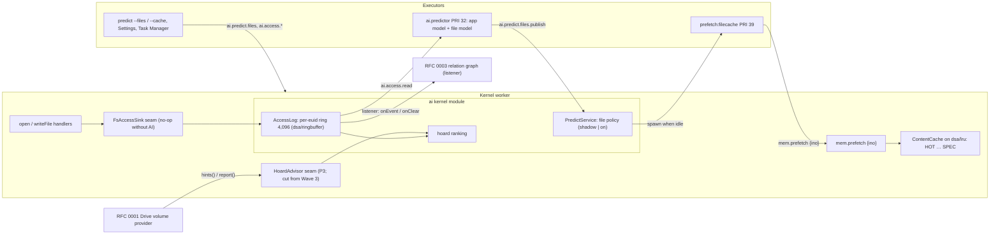

# RFC 0004: Predictive file cache and hoarding

| Field     | Value                                                                                                                                                                                                           |
| --------- | --------------------------------------------------------------------------------------------------------------------------------------------------------------------------------------------------------------- |
| Title     | Predictive file cache and hoarding: one shared file-access stream, a PPM file model, an LRU file cache with speculative entries, idle file pre-fetch, and a hoard advisor for remote volumes                    |
| Status    | **Approved with cuts** (ARB, 2026-09-30): P0, with `ai.access.export` (pseudonymised) moved into P0 and the hoard advisor cut from Wave 3; pre-fetch ships in shadow mode. See §13, §17 and [PLAN.md](PLAN.md). |
| Authors   | design-ai-fs (Wave 3 design track, AI-assisted and disclosed in AI_USAGE.md), writing for R4 AI (predictor) and R1 Kernel (cache, memory accounting)                                                            |
| Reviewers | critic 1 and critic 2 (design track); the ARB; subsystem owners R1 (kernel, mm), R2 (VFS), R3 (Settings, Task Manager), R4 (AI), R5 (QA)                                                                        |
| Date      | 2026-09-30                                                                                                                                                                                                      |
| Builder   | `predictive-cache` (Workflow B), after the step-0 contract PR by `platform` ([PLAN.md](PLAN.md) §3)                                                                                                             |
| Related   | RFC 0001 (Google Drive remote volume) calls the hoard advisor defined here. RFC 0003 (Smart Folders and context search) consumes the file-access stream defined here in §5.1 and owns no part of it.            |

---

## 1. Summary

Plotinium predicts which **application** the user opens next (Subsystem C, `ai/src/predictor/markov.ts`), but it has no idea which **files** the user uses, and the pieces that are supposed to warm files do nothing today. `mem.prefetch({ino})` is a stub that returns zero bytes, the pre-fetch policy never fires in production because the kernel link passes no memory facts, and the kernel's file content cache is a FIFO that nobody measures.

This RFC adds, in dependency order:

1. **One shared file-access stream** (§5.1). A kernel tap in `open` and `writeFile` records which regular files a user-class process uses, per effective uid, in a bounded ring on the device. Events carry an inode id, never a name. RFC 0003 builds its relation graph from the same stream. Privacy follows PRE-05: local only, viewable, pausable, clearable.
2. **An LRU file cache** (§5.2). The kernel `ContentCache` moves from FIFO to the team's `dsa/lru`, gains speculative entries that are evicted first (PRE-04 applied to files), and reports hits, misses, adopted and wasted bytes on the `Kernel` line of `free`.
3. **`mem.prefetch({ino})` for real** (§5.3), which makes the coupling-map cell CPL-C-VFS ("warms recently used files", spec §12.5) and AIN-A4 (semsearch warms its top-3 results) true for the first time.
4. **A file model** (§5.4): an order-2 prediction-by-partial-match (PPM) context model with Witten-Bell smoothing over file-open sequences, plus the app in use as a context (after FALCON's triggers). It reuses the decay and smoothing maths of the app predictor and runs inside the existing `ai.predictor` daemon.
5. **An idle, cost-benefit file pre-fetch** (§5.5). It follows Kroeger and Long's likelihood-threshold selector and FALCON's benefit-per-cost greedy knapsack, under the existing PRE-04 guard (idle ≥ 2 s, priority 39, free memory, one job at a time). It ships in **shadow mode** first.
6. **A hoard advisor** (§5.6): a small kernel seam that the Google Drive volume of RFC 0001 calls to learn which remote files to keep on the device for offline use, after Coda's hoard priorities and hoard walks. **Cut from Wave 3 by the ARB** (no consumer until RFC 0001 P3).

Everything is measured the way Kroeger and Long measured it: a trace-driven simulator reports the hit ratio of FIFO (today), LRU and LRU with prediction at several cache sizes, plus next-file prediction accuracy against MFU and MRU baselines, offline hoard hit rate and open latency (§10).

**ARB outcome (2026-09-30).** Items 1 to 5 are approved, and so is item 6's advisor _interface_. The review changes are applied in place, each marked "ARB":

- **Pre-fetch never fetches** (§5.3, 0004-M1). Since UI-006 the content cache downloads hash-only blobs on a demand read, so `mem.prefetch({ino})` refuses a blob whose chunks are not local and inserts only at the LRU end.
- **`ai.access.export` moves into P0** with export-time pseudonymisation (§5.1.3, 0004-M2, S-0004-02), so that consented trace collection can start the day this lands. P0 claims only the mechanism and synthetic curves. The enable gate is decided on real traces after a collection period.
- **The hoard advisor is cut from Wave 3.** It has no consumer until RFC 0001's P3.
- **Only local (`fs: 'root'`) events are recorded** in Wave 3 (S-0004-01).
- **"Learn from how I use files" starts off** for the shared demo account and for guests (S-0004-03).
- **AI memory is reported on the Kernel line** from P0 (0004-S1).
- **`warmFile` and `cacheState` live in a new `kernel/src/core/fs/warm.ts`** (0004-S2).

## 2. Context and problem: what exists today

Verified in the tree on 2026-09-30. Line numbers drift while the stabilize track edits some of these files, so each reference also names the symbol.

### 2.1 What exists

| Piece                   | Where                                                                                                                                                                                                                                                                                                                                                                                               | State                                                                                                                                                                                |
| ----------------------- | --------------------------------------------------------------------------------------------------------------------------------------------------------------------------------------------------------------------------------------------------------------------------------------------------------------------------------------------------------------------------------------------------- | ------------------------------------------------------------------------------------------------------------------------------------------------------------------------------------ |
| App predictor           | `ai/src/predictor/markov.ts:76` `MarkovPredictor` (Witten-Bell Markov-2, lazy decay, H = 14 d, cold start 50)                                                                                                                                                                                                                                                                                       | Implemented and tested; PRE-02 harness in `ai/src/predictor/evaluate.ts:95` `prequential`                                                                                            |
| Predictor daemon        | `ai/src/programs/predictor.ts:131` `runPredictor`: PRI 22 + NI 10, polls `ai.telemetry.read` every 2 s, publishes `ai.predict.publish`, sends `mem.hint`                                                                                                                                                                                                                                            | Implemented                                                                                                                                                                          |
| Telemetry tap and rings | `ai/src/kernel/predict-service.ts:59` `TelemetryService` (subscribes to `wm.*` as root, `ai/src/kernel/install.ts:449`); ring on `dsa/ringbuffer`                                                                                                                                                                                                                                                   | In memory only                                                                                                                                                                       |
| Pre-fetch policy        | `ai/src/predictor/prefetch.ts:58` `decidePrefetch` (enabled, not safe mode, not cold, θ, idle ≥ 2 s, free memory, one job); `ai/src/kernel/predict-service.ts:324` `evaluate`                                                                                                                                                                                                                       | Implemented, never fires in production (G3)                                                                                                                                          |
| Pre-fetch job           | `ai/src/programs/prefetch.ts:39` `runPrefetch`: `mem.prefetch({app})`, then `mem.prefetch({ino})` for each `--ino=` argument                                                                                                                                                                                                                                                                        | Runs, but both calls are stubs (G2)                                                                                                                                                  |
| Speculative pages       | `kernel/src/core/mm/mm.ts:880` `prefetch(pid)` pages a process's pages in as SPEC; `kernel/src/core/mm/lru.ts` three segments (HOT, COLD, SPEC) on `dsa/lru`                                                                                                                                                                                                                                        | Implemented for process pages only                                                                                                                                                   |
| File content cache      | `kernel/src/core/fs/content.ts:20` `ContentCache`: chunks by SHA-256, 64 MiB cap (`:18`)                                                                                                                                                                                                                                                                                                            | FIFO by insertion order (`put`, `:37-47`); a hit does not refresh recency (`load`, `:74-102`); no counters                                                                           |
| Kernel line of `free`   | `kernel/src/core/mm/accounting.ts:160` `kernelLine(structures)`                                                                                                                                                                                                                                                                                                                                     | Always 0 B: `kernel/src/core/io/mm.ts:70` starts the manager without `kernelStructures`                                                                                              |
| Kernel seams            | `kernel/src/core/hooks/index.ts:11-49`: `SchedulerHints`, `ShellNL`, `FsSemanticSearch`, no-op defaults; `ai/src/hooks.ts:40` `createAiHooks`                                                                                                                                                                                                                                                       | Implemented                                                                                                                                                                          |
| IndexedDB `telemetry`   | `vfs/src/store/migrations/001_init.ts:34`, key path `['uid', 'slot']`                                                                                                                                                                                                                                                                                                                               | Exists; nothing writes it                                                                                                                                                            |
| Remote content          | `vfs/src/sync/txn.ts:110-118` records a remote blob as `{chunks: null}`. **ARB re-check (architecture review F4):** since stabilize UI-006, `ContentCache.load` downloads a hash-only blob on a **demand** read (`GET /api/blobs/{sha}` through `fetchOnce`/`fetchAndKeep`, verified, then inserted with `put`; `kernel/src/core/fs/kfs.ts:148-149` `fetchBlob`; `kernel/src/core/io/index.ts:562`) | The draft's "no fetch" statement is stale. Pre-fetch must therefore refuse such blobs explicitly (§5.3). The idle home pre-fetch of `virtual-file-system.md:795` is still not built. |
| `predict` command       | `apps/coreutils/cmd/predict.ts:61-66`                                                                                                                                                                                                                                                                                                                                                               | `--why`, `--latency`, `--eval` answer ENOSYS (TODO at `:1-6`)                                                                                                                        |
| Settings › Privacy & AI | `apps/settings/model.ts` `toPrivacyModel`, `ui/src/apps/settings/panes/PrivacyPane.tsx`                                                                                                                                                                                                                                                                                                             | Telemetry table, clear, export and sync switch                                                                                                                                       |
| Task Manager            | `ui/src/apps/taskmgr/PredictionsPanel.tsx`, `models.ts:151` `PredictionsModel`                                                                                                                                                                                                                                                                                                                      | App predictions, speculative bytes, adopted and wasted bytes                                                                                                                         |
| Graded structures       | `dsa/src/lru` (putAtLru, pin, speculative flag), `dsa/src/hashtable` (IntHashTable, linear probing), `dsa/src/ringbuffer` (RingBuffer, Float64Ring percentiles), `dsa/src/heap` (BinaryHeap, BoundedTopKHeap), all `IMPLEMENTED = true`                                                                                                                                                             | Ready to reuse                                                                                                                                                                       |

### 2.2 Gaps

- **G1. There is no file-level access signal.** The bus has no open or read topic (`protocol/src/events.ts:56-205`), and `vfs.write` carries no writer uid (`:67-74`), so nothing can tell which user used which file. The spec's per-app "recent files" ring (`specs/10-ai/predictive-prefetch.md:109`) was never built: the kernel link spawns `prefetch:<app>` with no files (`web/src/kernel/ai-link.ts:139-140`, `prefetchArgv(app)`).
- **G2. File warming is a stub.** `mem.prefetch` returns `{bytes: 0, pages: 0}` for `{app}` and `{ino}` (`kernel/src/core/proc/mem-syscalls.ts:161-174`). So the §12.5 coupling-map cell C × VFS ("Warms recently used files") has no mechanism, and the test named for it in `specs/10-ai/predictive-prefetch.md:454` (`CPL-C-VFS …`) does not exist in the tree.
- **G3. The pre-fetch policy never fires in production.** `createAiLink` in `web/src/kernel/ai-link.ts:107-159` passes no `memory`, `declaredBytes` or `warm`. `PredictService.inputs` then reports a budget of 0 and `reclaimRunning: true` (`ai/src/kernel/predict-service.ts:313-319`), so `decidePrefetch` always answers `memory`. For the same reason the AIN-A4 "warm the top-3 search results" step (`ai/src/kernel/search-service.ts:228-238`) calls an absent `warm`.
- **G4. The file cache is FIFO, unmeasured and unaccounted.** See the table above. The spec's accounting rule says file warming is "charged to the Kernel line and bounded by the VFS cache" (`specs/03-kernel/memory-and-paging.md:542`), but the Kernel line is always 0 B. The QA copy shows `Kernel: 0B not charged` and `specul. 0B` (screenshot `docs/design/wave3/design-ai-fs/current-terminal-predict-ps-dark.png`). Spec §10.1 lists the inode cache next to the pager as a hash-map-plus-linked-list LRU site; the content cache uses neither.
- **G5. Learned state is lost on reload.** The telemetry ring and the prediction model live in kernel memory, so a reboot restarts the model cold. PRE-02's "≥ 500 real launches from team use" can only accumulate if the ring persists.
- **G6. Remote content has nowhere to plug hoarding in.** See the Remote content row. RFC 0001 will add a remote volume whose content is expensive to fetch and absent offline, which is exactly Coda's hoarding problem.
- **G7. The QA copy shows no live predictor output.** On 2026-09-30 at 18:18 on :4718, as `examiner1`: `predict` prints `MODEL MFU fallback (0 of 50 launches)` and `predict --json` gives `updatedAt: 0`. `ps -e` lists the service entries `[ai.predictor]` and `[ai.indexer]`, but no daemon processes, while `svcctl status` reports both services running with pids that `ps -e` does not list (screenshots `current-terminal-ps-bootlog-dark.png` and `current-terminal-svcctl-dark.png`). I have **not** found the cause. It is handed to the stabilize track (§15, Q1), because this RFC depends on the predictor daemon running.
- **G8. The app model does not scale to files.** `MarkovPredictor.stats` recounts T(c) over a context's members on every read (`ai/src/predictor/markov.ts:139-149`), and `distribution` scores every candidate (`:186-194`). That is fine for |V| ≤ 32 apps, but not for thousands of files. It also uses `Map` where the spec's `dsa/hashtable` was intended (`:21-22`, marked `TODO(dsa)`).

## 3. Goals and non-goals

### 3.1 Goals

1. **One stream, designed once.** A private, bounded, per-euid file-access stream that this RFC and RFC 0003 both consume, with one privacy story (FAC-01 … FAC-08).
2. **A real file cache.** An LRU on `dsa/lru` with speculative entries, counters and accounting (PFC-01, PFC-02).
3. **Real file warming.** `mem.prefetch({ino})`, CPL-C-VFS and AIN-A4 become true (PFC-03).
4. **A file model** that updates in O(1), predicts in ≤ 1 ms and beats MFU-file and MRU-file on held-out traces (PFC-04).
5. **Idle, cost-aware pre-fetch** that never slows the foreground and ships dark (shadow mode) until the evaluation gate passes (PFC-05, PFC-06, PFC-08).
6. ~~A hoard advisor for RFC 0001 (HRD-01 … HRD-04).~~ **Cut from Wave 3 by the ARB**: it has no consumer until RFC 0001's P3. The design in §5.6 stands for then.
7. **A trace-driven evaluation** with baselines, for the report and the viva (§10).
8. **Visibility**: `predict --files`, `predict --cache`, and (P1) the Task Manager and Settings (PFC-07, FAC-06).

### 3.2 Non-goals

- **App code and state warming** (`mem.prefetch({app})`, PRE-03). That is a separate Subsystem C work item; this RFC leaves the `{app}` branch as it is.
- **Client blob fetching** and the spec's idle pre-fetch of the whole home (`virtual-file-system.md:795`). These belong to R2/R5 (sync). The hoard advisor can order that work once it exists.
- **Building the Google Drive volume** (RFC 0001). This RFC defines only the advisor it calls.
- **Syncing activity data to the server.** There is no route for it, and none is planned (FAC-05).
- **Model-driven (LLM) caching decisions** in the MemGPT style. They are rejected in §6.
- **Persisting the rings to IndexedDB.** That is P1 (§13.3). It reuses the existing `telemetry` store, so it needs no migration.

## 4. Research basis

| Paper                                                                                                                                                                                 | Idea                                                                                                                                                                                                                                                                                                                                                                                                                          | What we adopt                                                                                                                                                                                                                       | What we adapt                                                                                                                                                                                                                                                                                                                                                                        | What we leave out                                                                                                                         |
| ------------------------------------------------------------------------------------------------------------------------------------------------------------------------------------- | ----------------------------------------------------------------------------------------------------------------------------------------------------------------------------------------------------------------------------------------------------------------------------------------------------------------------------------------------------------------------------------------------------------------------------- | ----------------------------------------------------------------------------------------------------------------------------------------------------------------------------------------------------------------------------------- | ------------------------------------------------------------------------------------------------------------------------------------------------------------------------------------------------------------------------------------------------------------------------------------------------------------------------------------------------------------------------------------ | ----------------------------------------------------------------------------------------------------------------------------------------- |
| Kroeger and Long, _Predicting File System Actions from Prior Events_, USENIX 1996 ([link](https://www.usenix.org/legacy/publications/library/proceedings/sd96/kroeger.html))          | A PPM context model over file-open events (a trie of contexts up to order m) predicts the next opens. A likelihood threshold `count(child)/count(parent)` selects what to pre-fetch. Replayed on 8 × 24 h Sprite traces, a second-order model with threshold 0.1 and a 4 MB cache gave 15 % more hits than LRU on average (22 % at best); threshold 0.05 to 0.1 was best and stable above 0.025; orders above 2 added little. | Order-2 contexts; the likelihood-threshold selector (default 0.1, tuned in 0.05 to 0.25); the order-0 context is not used to select pre-fetches; trace-driven replay against LRU at several cache sizes as the headline evaluation. | Witten-Bell interpolation ranks and scores candidates (for confidence and `predict`), while the K&L threshold still selects what to pre-fetch. We add the app in use as a context. K&L put pre-fetched files at the **MRU** end; PRE-04 requires speculative data to be evicted **first**, so we place it at the LRU end and measure the cost of that choice as an ablation (§10.2). | Trie storage (our contexts are hash-table keyed, see §5.4); whole-file pre-fetch of large files (we cap each file at its first chunks).   |
| Yan et al., _FALCON: Fast App Launching for Mobile Devices Using Predictive User Context_, MobiSys 2012 ([link](https://people.cs.umass.edu/~dganesan/papers/MobiSys12-Falcon.pdf))   | Context features (trigger apps that start a session, location, time of day, bursts) and a cost-benefit learner: benefit = latency saved × recall, cost = energy × (1 − precision), then a 0-1 knapsack solved greedily by benefit per unit cost under a daily energy budget. Reported about 6 s saved per launch for at most 2 % battery per day.                                                                             | The app in use as a "trigger" context; the greedy benefit-per-cost knapsack under a budget.                                                                                                                                         | Cost is **bytes × (1 − p)** (expected wasted cache bytes; network bytes for remote volumes), not energy. Benefit is **p × Δt(volume)**, the measured miss-minus-hit latency of the file's volume, so a remote Drive file outranks a local one of equal probability. The budget is speculative bytes per idle period.                                                                 | Location and sensor features (no such signal in a browser OS); burst detection over weeks.                                                |
| Witten and Bell, _The Zero-Frequency Problem_, IEEE Trans. Inf. Theory 1991 ([link](https://prism.ucalgary.ca/handle/1880/46607))                                                     | Escape probability from the number of distinct symbols seen in a context (method C): λ(c) = N(c) / (N(c) + T(c)).                                                                                                                                                                                                                                                                                                             | The same interpolation as the app model (`ai/src/predictor/markov.ts:10-15`).                                                                                                                                                       | T(c) is kept incrementally instead of recounted per read (G8).                                                                                                                                                                                                                                                                                                                       | —                                                                                                                                         |
| Kistler and Satyanarayanan, _Disconnected Operation in the Coda File System_, ACM TOCS 1992 ([link](https://courses.cs.washington.edu/courses/cse550/10au/papers/coda.pdf))           | Three client states (hoarding, emulation, reintegration). A cached object's priority combines a user-given hoard priority (the hoard database) with recent use. Ancestors of cached objects must be cached. A "hoard walk", every 10 minutes by default and on demand before disconnection, re-evaluates priorities to restore cache equilibrium: no uncached object has a higher priority than a cached one.                 | Priorities that combine recency and frequency; the equilibrium definition; the walk cadence as the recommendation to RFC 0001; pins (the hoard database) beat predictions.                                                          | The **advisor** only ranks: the volume provider (RFC 0001) owns fetching, eviction, pins and budgets. Mechanism and policy stay separate, and the AI can be removed (§5.6).                                                                                                                                                                                                          | Emulation and reintegration (the VFS outbox already does this for native files; RFC 0001 owns them for Drive).                            |
| Gray and Cheriton, _Leases_, SOSP 1989 ([link](https://pages.cs.wisc.edu/~remzi/Classes/739/Fall2015/Papers/leases89.pdf))                                                            | Time-bounded validity of cached copies.                                                                                                                                                                                                                                                                                                                                                                                       | —                                                                                                                                                                                                                                   | Native content is content-addressed (an inode names a blob by SHA-256), so a cached chunk can never be stale: a write creates a new blob. Leases matter only for hoarded remote copies, where RFC 0001 owns revalidation. We record that split.                                                                                                                                      | Leases on local content (not needed).                                                                                                     |
| Kleppmann et al., _Local-First Software_, Onward! 2019 ([link](https://www.inkandswitch.com/local-first/))                                                                            | Data stays usable offline and the user keeps control.                                                                                                                                                                                                                                                                                                                                                                         | Activity data and models never leave the device; hoarding exists so that files stay usable offline.                                                                                                                                 | —                                                                                                                                                                                                                                                                                                                                                                                    | CRDT sync (out of scope).                                                                                                                 |
| Soules and Ganger, _Connections_, SOSP 2005 ([link](https://pdl.cmu.edu/ftp/ABN/CMU-PDL-05-105_abs.shtml))                                                                            | A tracer at the system-call layer feeds per-user models, and user tasks are separated from background system activity.                                                                                                                                                                                                                                                                                                        | A single tracer (the kernel tap), per-user streams, and filtering of background processes. The graph itself is RFC 0003's.                                                                                                          | Our tap sees only `open` and `writeFile`, which approximates the paper's read/write filter.                                                                                                                                                                                                                                                                                          | `mmap`, `dup`, `stat` events.                                                                                                             |
| Mei et al., _AIOS_, COLM 2025 ([link](https://arxiv.org/abs/2403.16971)); Packer et al., _MemGPT_, 2023 ([link](https://arxiv.org/abs/2310.08560))                                    | AI as kernel services behind system calls; a model that pages its own context between tiers.                                                                                                                                                                                                                                                                                                                                  | The service shape: a daemon that learns, a kernel policy that decides, and typed calls between them.                                                                                                                                | —                                                                                                                                                                                                                                                                                                                                                                                    | An LLM deciding what to cache (§6, alternative C): cost, latency, privacy, and no gain over a statistical model for next-file prediction. |
| Greshake et al., _Not what you've signed up for_, AISec 2023 ([link](https://arxiv.org/abs/2302.12173)); Debenedetti et al., _CaMeL_, 2025 ([link](https://arxiv.org/abs/2503.18813)) | Content the model reads can steer it; control must come from the trusted user.                                                                                                                                                                                                                                                                                                                                                | Accesses made by the agent-class `ai` process are **not recorded** (FAC-03), so a file with injected instructions cannot make the agent read files to steer the cache or RFC 0003's graph.                                          | —                                                                                                                                                                                                                                                                                                                                                                                    | —                                                                                                                                         |

**Positioning for the report.** Kroeger and Long and FALCON studied prediction inside one kernel or one phone OS. We add a third setting, a web OS whose storage tiers are the in-memory cache, IndexedDB and the network (the server or Drive), with a Coda-style advisor for the network tier, and we run it under a spec rule (PRE-04) that forces speculative data to the eviction end.

## 5. Design

### 5.0 Architecture



The kernel stays free of AI: it calls two seams with no-op defaults, exactly like the existing `SchedulerHints` (`kernel/src/core/hooks/index.ts:11`). The AI module owns the ring, the policy and the ranking. The executor daemon owns the model. The kernel owns the cache and the permission checks.

### 5.1 The shared file-access stream (normative for this RFC and RFC 0003)

#### 5.1.1 Where events come from

- **The tap point.** `FsHandlers.doOpen` (`kernel/src/core/fs/handlers.ts:113`) calls the tap after the descriptor exists and just before it returns. `FsHandlers.writeFile` (`:609`) calls it after the commit. Only regular files are reported (`node.type === 'f'`), and synthesised files are not (`isSynthIno`). A failed call never produces an event.
- **The operation.** Open with flags `'r'` gives `op: 'read'`. Open with `'w'`, `'rw'` or `'a'`, and every `writeFile`, gives `op: 'write'`. This approximates the read/write operation filter of Connections (inputs are files read, outputs are files written); `stat`, `readdir`, `copy` and `rename` are not accesses.
- **Why not a bus topic.** A `vfs.open` topic would be delivered to every subscriber with `r` on the parent directory (`protocol/src/events.ts:4-7`). That would tell other users which of your files you open. The stream therefore never touches the bus: the tap is a direct kernel seam call.
- **The seam** (added to `kernel/src/core/hooks/index.ts` by the step-0 contract PR):

```ts
/** One successful file use, reported synchronously by the kernel. The sink must be O(1) and must not throw. */
export interface FsAccess {
  readonly uid: number; // effective uid of the caller (the identity whose permissions allowed the access)
  readonly pid: number;
  readonly cls: 'user' | 'agent' | 'system';
  readonly ino: string;
  readonly fs: string; // the inode's FsId: 'root' today, provider ids later (RFC 0001)
  readonly path: string; // the resolved path used; for eligibility only, never stored (I-F2)
  readonly op: 'read' | 'write';
  readonly bytes: number; // size at open, or after the write
  readonly t: number; // kernel monotonic ms
}
export interface FsAccessSink {
  onAccess(a: FsAccess): void;
}
export const NOOP_FS_ACCESS: FsAccessSink = Object.freeze({ onAccess: (_a: FsAccess): void => {} });
// KernelHooks gains: readonly fsAccess: FsAccessSink;
```

- **Kernel wiring.** `KernelFsDeps` (`kernel/src/core/fs/kfs.ts:119`) gains `onAccess?: (a: FsAccess) => void`. `kernel/src/core/io/vfs.ts` passes `(a) => k.hooks.hooks.fsAccess.onAccess(a)`, wrapped so that a throwing sink is logged once and ignored (I-F8). The registry is read on every call, so registering or resetting the AI seams takes effect at once (`HookRegistry.register`, `kernel/src/core/hooks/index.ts:62`).
  - `platform` lands the seam, the deps field and this wiring in step 0.
  - `predictive-cache` owns the two call sites in `kernel/src/core/fs/handlers.ts` (ARB, X1).
  - The seam also gains `AiMemoryReport` (PLAN.md, C-03), through which `AccessLog` and every listener's `stats()` reach the Kernel line of `free` in P0 (ARB, 0004-S1).
- **Other volumes.** A volume provider whose files are not opened through these handlers calls the same `hooks.fsAccess.onAccess` with its own `fs` id; RFC 0001's router does this with `fs: 'gdrive'`. In Wave 3 those events are dropped at eligibility (below).

#### 5.1.2 What is kept: `AccessLog` (`ai/src/kernel/files/access-log.ts`, new)

`AccessLog` implements `FsAccessSink` and filters each access in this order, counting every drop by reason:

1. **The flag and pause.** Drop if `ai.access.tap` is off (global kill switch) or the uid paused learning (`ai.access.pause`).
2. **Class** (I-F4). Only `cls === 'user'`. The indexer, the predictor, `prefetch:*` jobs (all `system`) and the `ai` agent (`agent`) never produce events. This is the no-feedback rule of I-C2 applied to files, and the injection defence of §4.
3. **Eligibility.**
   - The path is under `/home/` or `/mnt/`, has no dot segment (`/.config/`, `/.trash/`), and `fs !== 'tmp'`. These are the indexer's eligibility rules (`specs/10-ai/rag-semantic-search.md:133`), so both subsystems agree on what a "user file" is.
   - **In Wave 3, `fs` must be `'root'`** (ARB, S-0004-01 and S-0001-14). Events from remote volumes, such as Drive's `fs: 'gdrive'`, are dropped and counted as `remote`. Nothing Drive-derived therefore enters the ring, the file model or RFC 0003's graph, and no purge path is needed yet.
   - Admitting remote events later requires a purge seam, `hooks.volumePurge(uid, fs)`, with `onPurge` in every listener, and the P1 `AiRingStore` must never persist remote events.
4. **Scan guard.** A process that opens more than 16 distinct inodes within 5 s is treated as a scanner for 30 s (its later events are dropped). This covers the Files keyword fallback, which reads every file in a folder (`apps/files/lib/ops.ts:658` `keywordSearch` calls `readFile` at `:553` for up to 2,000 files), and `cat *`. Connections reports that many misleading edges come from files touched in bulk. The per-pid state is a `dsa/ringbuffer` `Float64Ring` of 16 timestamps in a `dsa/lru` of 64 pids.
5. **De-duplication.** A repeat of the same `(pid, ino, op)` within 1 s is collapsed (editors re-open on save).

**A known limitation** (ARB, 0004-N1): under the shipped Terminal, every tab of a Terminal window is one kernel pid, because commands run in the view-side host (architecture review F1). So `cat *` in one tab marks the whole window as a scanner for 30 s and silences its other tabs, and `appOf` reports `terminal`. This holds until R1's kernel TTY path lands.

**Per-account default** (ARB, S-0004-03): the shared `demo` account and guests start with learning **paused**. The composition passes `accountKind(uid)` from the kernel's login session (`kernel/src/core/io/login.ts`), and `AccessLog` treats `demo` and `guest` as paused until the user turns learning on. Otherwise "Related files", `predict --files` and the P1 "View…" table would show one examiner what the previous one opened. The test is `FAC-04 the demo account and guests start with file activity paused`.

It then resolves `app` with the `appOf(pid)` dependency: the manifest name of the nearest ancestor process whose manifest kind is `app`, so `cat` run in a Terminal is attributed to `terminal`. It appends to the uid's ring (a `dsa/ringbuffer` `RingBuffer` of 4,096 events per uid, overwrite mode) and notifies listeners synchronously. Listeners must be O(their own window); RFC 0003's graph update is.

```ts
// protocol/src/ai/access.ts (step 0). The exported event: no path, no name, no content (I-F2).
export const FileAccessEvent = v.strictObject({
  v: v.literal(1),
  seq: Count, // per uid, strictly increasing
  ts: EpochMs,
  ino: Ino,
  fs: v.pipe(v.string(), v.regex(/^[a-z][a-z0-9-]{0,31}$/)),
  op: v.picklist(['read', 'write']),
  app: AppId,
  bytes: Count,
  osSessionId: Ino,
});

// ai/src/kernel/files/access-log.ts: the in-process contract RFC 0003 codes against.
export interface AccessRecord {
  readonly uid: number;
  readonly t: number; // monotonic ms, for windows
  readonly event: FileAccessEvent;
}
export interface AccessListener {
  readonly name: string; // 'relgraph', 'filemodel', 'hoard'
  onEvent(r: AccessRecord): void;
  onClear(uid: number): void;
  /** Memory this consumer holds for `uid`, for ai.access.status and, through the aiMemory hook, the Kernel line of `free` (P0; ARB, 0004-S1). */
  stats(uid: number): { entries: number; bytes: number };
}
export interface AccessLogApi {
  subscribe(l: AccessListener): () => void;
  /** Up to `n` most recent distinct inos of `uid` within `withinMs`, newest first. O(n). */
  recent(uid: number, n: number, withinMs: number): readonly string[];
  /** Up to `n` most recent distinct inos opened by `app` (the per-app recent-files ring of predictive-prefetch.md §3.2). */
  recentForApp(uid: number, app: string, n: number): readonly string[];
  read(uid: number, since?: number, limit?: number): { events: FileAccessEvent[]; next?: number };
  status(uid: number): AccessStatus;
  clear(uid: number): number; // ring + every listener's onClear, before returning (I-F6)
  pause(uid: number, on: boolean): boolean;
  /** ai.access.export: the uid's ring as pseudonymised JSON Lines (ARB, S-0004-02; §5.1.3). */
  exportTrace(uid: number): Uint8Array;
}
```

#### 5.1.3 System calls (schemas in `protocol/src/ai/access.ts`; registry rows in step 0)

| Call                                      | Args → Ret                                                                                                                             | Class | Origin | Caps           | Audit    | Errnos | Notes                                                                                                                                       |
| ----------------------------------------- | -------------------------------------------------------------------------------------------------------------------------------------- | ----- | ------ | -------------- | -------- | ------ | ------------------------------------------------------------------------------------------------------------------------------------------- |
| `ai.access.read`                          | `{since?, limit? ≤ 4096}` → `{events: FileAccessEvent[], next?}`                                                                       | F     | E      | `ai.telemetry` | trace    | —      | Caller's euid only. The predictor's feed, the same shape as `ai.telemetry.read`.                                                            |
| `ai.access.status`                        | `{}` → `{events, oldest?, newest?, paused, dropped: {cls, ineligible, scan, paused, dup}, bytes, consumers: [{name, entries, bytes}]}` | F     | EV     | —              | trace    | —      | Caller's euid only. Feeds Settings and `predict --files`.                                                                                   |
| `ai.access.clear`                         | `{}` → `{cleared}`                                                                                                                     | T     | EV     | `privacy`      | security | —      | Empties the ring and every derived model (I-F6).                                                                                            |
| `ai.access.pause`                         | `{on: boolean}` → `{on}`                                                                                                               | T     | EV     | `privacy`      | security | —      | Settings "Learn from how I use files".                                                                                                      |
| `ai.access.export` (**P0**; ARB, 0004-M2) | `{}` → `ArrayBuffer` (JSON Lines of `ExportedAccessEvent`, below)                                                                      | F     | EV     | `privacy`      | security | —      | For consented evaluation traces. The caller writes the file with mode 600, like telemetry. `predict --export-files > trace.jsonl` wraps it. |

**Export pseudonymisation** (ARB, S-0004-02). The draft said exported traces are opaque. They are not:

- inode ids are the primary key of the server's `inodes` table (`db/migrations/20260924100200_vfs_core.sql:22-23`);
- each UUIDv7 encodes the file's creation time;
- `osSessionId` links events across sessions.

`ai.access.export` therefore pseudonymises at export time:

```ts
// protocol/src/ai/access.ts (step 0a)
export const ExportedAccessEvent = v.strictObject({
  v: v.literal(1),
  seq: Count,
  dt: Count, // ms since the first exported event (no absolute timestamps)
  file: v.pipe(v.string(), v.regex(/^[0-9a-f]{16}$/)), // HMAC-SHA-256(k, ino), first 16 hex
  op: v.picklist(['read', 'write']),
  app: AppId,
  bytes: Count,
  session: v.pipe(v.string(), v.regex(/^[0-9a-f]{8}$/)), // HMAC-SHA-256(k, osSessionId), first 8 hex
});
```

The key `k` is 32 random bytes, drawn per export and never stored or returned, so two exports cannot be joined. Each export is replayed as an independent trace. The test is `FAC-09 an export contains no ino, path, name, absolute time or session id, and two exports of the same ring share no file pseudonym`.

Members give written consent, which the lead records in `docs/evidence/`. Traces are committed to the repository only if the lead confirms it is private; otherwise they stay on the team's private share.

There are **no new capabilities**: `CAP_NAMES` order is part of the ABI digest (`protocol/src/caps.ts:5-6`), and `ai.telemetry`, `privacy`, `ai.predict` and `mm.speculative` already express these rights. `ai.predictor` already holds `ai.telemetry` (`ai/src/programs/index.ts:61`), and `privacy` is in the user bounding set (`protocol/src/caps.ts:49-58`). The ABI digest does change, because calls are added. The ABI-11 conformance test compares the registry with `specs/01-architecture/syscall-abi.md` §4.4, so `platform`'s step-0 PR adds the table rows there too (`protocol/src/sys/registry.ts:1-18`).

#### 5.1.4 Stream invariants

- **I-F1 Local only.** No code path sends access events or derived models off the device. There is no server route, and the litmus job asserts it (FAC-05).
- **I-F2 No names.** Events carry inode ids, never a path, name or content. Paths are resolved at display time, as the viewer, with current permissions.
- **I-F3 Own uid.** Every `ai.access.*` call acts on the caller's effective uid only.
- **I-F4 No feedback.** System-class and agent-class processes never produce events.
- **I-F5 Consumers re-check permissions.** No consumer shows, ranks, pre-fetches or hints a file the uid cannot read now. An unreadable item is dropped without a trace in the output.
- **I-F6 Clear is total.** `clear` returns only after the ring and every listener's state for that uid are empty.
- **I-F7 Bounded.** The ring holds 4,096 events per uid (about 480 KB). Each consumer declares its own budget (§8).
- **I-F8 Never in the way.** The tap is O(1) amortised, and cannot throw into, delay or fail the system call.

### 5.2 The file cache on `dsa/lru` (`kernel/src/core/fs/content.ts`)

`ContentCache` keeps its public API (`load`, `bytesOf`, `remember`, `rememberBytes`) and replaces its `Map` FIFO with the team's `LruCache<Sha256Hex, Uint8Array>` in unbounded mode, plus byte accounting.

The rewrite **keeps the stabilize track's demand-path blob fetch** (ARB, 0004-M1): `fetchOnce`'s single-flight download of a hash-only blob, its hash verification, and the demand-path insert (now at the MRU end with `put`).

- **A demand load** (`load`). For each chunk: on a hit, first check `isSpeculative(sha)` (if it is, count `adopted`, I-P3), then `get(sha)` (which moves the entry to the MRU end and clears the speculative flag). On a miss, read it from IndexedDB (`blob_chunks`, as today), `put` it at the MRU end, count `misses`, then evict from the LRU end until `bytes ≤ capBytes`. Evicting a speculative entry counts it as `wasted`.
- **A speculative insert** (`prefetch(sha, maxBytes)`, new). Chunks go in with `putAtLru` (the LRU end, speculative flag set; DSA-LRU-02 already tests this). Before inserting, if `bytes + size > capBytes`, the cache may evict only while `peekLru()` is itself speculative. If a non-speculative entry would have to go, it refuses with `EAGAIN no-free-memory` (I-P1). Speculative bytes are capped at `specCapBytes = capBytes / 4` (16 MiB by default, I-P2). Entries not adopted within 5 minutes are dropped by a sweep on the kernel timer heap and counted as wasted (I-P4). This mirrors PRE-04 for pages.
- **The policy switch.** The kernel sysctl `vfs.cache.policy` is `'lru'` (default) or `'fifo'`, the old behaviour, kept for rollback and as the evaluation baseline. The kernel defines it, because the cache is kernel code and LRU is not an AI feature, so it stays in the AI-off build (§11). `platform` defines the sysctl in `kernel/src/core/io/vfs.ts` in step 0 and passes it to the `ContentCache` constructor as `opts.policy: () => 'lru' | 'fifo'`; this builder implements both policies behind it.
- **Coherence.** Chunks are content-addressed (`content.ts:4-7`), so a cached chunk can never be stale. A write creates a new blob hash, and the old chunks simply age out (I-P5). This is why local pre-fetch needs no leases.
- **Accounting.** `platform`'s step 0 gives `kernel/src/core/io/mm.ts` a kernel-structures registry (PLAN.md, C-13) that feeds `startMemory({kernelStructures})`. This builder registers `{name: 'file cache', entries: cache.bytes, bytesPerEntry: 1}`. The `Kernel` line of `free` then shows the cache, and it stays "reported, not charged" (KMM-01), as `memory-and-paging.md:542` already says. `ContentCache.stats()` returns `{bytes, capBytes, specBytes, entries, hits, misses, adopted, wasted, policy}`.
- **Hit latency.** `load` measures the miss path per `fs` in a `Float64Ring` of 256 samples, giving `Δt(fs)` for the cost-benefit rule (§5.5). A remote fetch path (RFC 0001) reports its own miss latency through the same ring.

Every operation is O(1) per chunk: each is one `dsa/lru` call plus constant bookkeeping (spec §10.1, "Hash map + doubly linked list … Touch, insert and evict O(1)").

### 5.3 `mem.prefetch({ino})` (`kernel/src/core/proc/mem-syscalls.ts:161`)

The call already exists in the ABI (`protocol/src/sys/mem.ts:75-79`: `{ino, offset?, len?}`, capability `mm.speculative`, errnos `ENOENT EACCES EAGAIN ECANCELED`; registry `protocol/src/sys/registry.ts` `'mem.prefetch'`). This RFC implements the `{ino}` branch **without changing the ABI**:

1. Look up the inode. It must be a regular file present in the tree, else `ENOENT`.
2. **Permission.** The caller's credentials need `r` on the file and `x` on every ancestor of at least one of its links, else `EACCES`. This is the same rule as the RAG readable set (`ai/src/search/readable.ts:109-113`), evaluated in the kernel with `vfs/perm`. The pre-fetch job runs as the session uid, so it can never warm what that user could not open.
3. **Guards.**
   - `EAGAIN thrashing` while the thrashing guard is on (`MemoryManager.isThrashing`).
   - **ARB, 0004-M1:** `ContentCache.prefetch` first reads the blob record. If its chunks are not all local (`chunks === null`, the hash-only case), it returns `EAGAIN content-not-cached` **without calling `fetchOnce`** or any other network path.
   - It inserts only with `putAtLru`, so a speculative chunk can never evict a demand chunk (I-P1, PRE-04, `memory-and-paging.md` §3.15.3).
   - The test is `PFC-03 mem.prefetch of a hash-only blob makes no network request and changes no demand entry`.
4. Warm the first `⌈len / 1 MiB⌉` chunks of the blob from `offset` (default `len` = 1 MiB, maximum 8 MiB) with `ContentCache.prefetch`. Return `{bytes, pages: chunks}`.

The late binding: `ProcessSystem` gets `fileWarm?: (pcb, ino, offset, len) => Promise<{bytes, pages}>`. It is set in the `mounted` callback of `kernel/src/core/io/index.ts` (`mounted: (fs) => …`), because the file system mounts after the process system exists. `platform` lands this line and `KernelFs.warmFile`/`cacheState` in step 0. Both delegate to `kernel/src/core/fs/warm.ts`, a stub owned by this builder, so this builder never edits `kfs.ts` (ARB, 0004-S2).

### 5.4 The file model (`ai/src/predictor/files.ts`, new)

An order-2 PPM model over each uid's sequence of file uses, with Witten-Bell interpolation, and the app in use as an extra context (after FALCON's trigger apps):

- **Symbols.** Files, interned to dense integer ids (0 … 2,047) through a `Map<ino, id>` (the allowed hashing primitive) guarded by a `dsa/lru` of 2,048 files. When a file is evicted, its id is recycled and its contexts are dropped lazily.
- **Contexts.** `c2 = (f[t−2], f[t−1])`, keyed by `a · 2048 + b` in a `dsa/hashtable` `IntHashTable` (integer keys below 2^22; this becomes the graded hash table's second registry). `c1 = f[t−1]` in a second `IntHashTable`. `cA = app` (fewer than 32 apps, in a `Map`). `g` = global. The `c2` table is bounded at 8,192 contexts by a `dsa/lru` over their keys.
- **A context** holds at most 16 members `{sym, v, t}`, a total `{v, t}` and a distinct count `T`, all decayed lazily with half-life `H_f = 7 days` (tuned on the validation slice), using `decayed()` from `ai/src/predictor/markov.ts:43`. When a 17th member arrives, the member with the lowest decayed count is replaced. `T` is recomputed only for the context being updated (at most 16 members), so an update is O(1) and a read never recounts (G8).
- **An update** runs on every event of the uid's stream, reads and writes alike. Consecutive repeats of the same file are skipped. A gap of more than 30 minutes, or a new `osSessionId`, resets the history to the begin-of-session symbol (as `BOS` does in the app model).
- **Probabilities** use the app model's formulas (`markov.ts:10-15`): `P_G(f) = (N(g,f)+1)/(N(g)+|V|)`, then `P_A`, `P_1`, `P_2` by Witten-Bell interpolation with λ(c) = N(c)/(N(c)+T(c)).
- **Candidates.** The members of `c2 ∪ c1 ∪ cA` (at most 48), plus the top 8 of `g` while the model is cold. Scores are normalised over the candidates, and the top k (k ≤ 16) is found in one pass. **Cold start**: fewer than 200 events means the ranking is MRU-then-MFU, confidence 0 and no pre-fetch.
- **The pre-fetch selector** (Kroeger and Long). A candidate is selectable if its maximum-likelihood estimate `N(c,f)/N(c)` is at least `θ_f` (default 0.1) in at least one of `c2`, `c1`, `cA`. The global context is never used to select, as in K&L.
- **Reasons**, as in the app model: `after notes.md → report.md (order 2, 6 obs)`, `after report.md (order 1, 11 obs)`, `usually opened in Editor (app context, 23 obs)`. File names come from resolving inodes as the viewer at display time (I-F2), so the model itself stores ids only.

The model runs inside the existing **`ai.predictor` daemon** (`ai/src/programs/predictor.ts:131`). No new process or service is needed, and PRE-01's "trains and runs locally in a worker" holds as it does for apps. Each 2 s tick also drains `ai.access.read`, updates the model and, when the top set changes, calls `ai.predict.files.publish`.

```ts
// protocol/src/ai/access.ts (step 0)
export const FilePrediction = v.strictObject({
  ino: Ino,
  p: Ratio, // Witten-Bell probability over the candidates
  ml: Ratio, // best maximum-likelihood estimate over c2, c1, cA (the K&L selector)
  reason: v.pipe(v.string(), v.maxLength(200)),
});
export const PredictFilesPublishArgs = v.strictObject({
  predictions: v.pipe(v.array(FilePrediction), v.maxLength(16)),
  model: v.picklist(['cold', 'ppm2']),
  events: Count,
});
export const PredictFilesArgs = v.strictObject({
  k: v.optional(v.pipe(v.number(), v.integer(), v.minValue(1), v.maxValue(16))),
});
export const PredictFilesRet = v.strictObject({
  model: v.picklist(['cold', 'ppm2']),
  events: Count,
  updatedAt: EpochMs,
  theta: Ratio,
  mode: v.picklist(['off', 'shadow', 'on']),
  predictions: v.pipe(
    v.array(
      v.strictObject({
        ino: Ino,
        path: Path, // resolved as the caller; unreadable predictions are omitted entirely (I-F5)
        p: Ratio,
        reason: v.pipe(v.string(), v.maxLength(200)),
        cache: v.picklist(['miss', 'hit', 'speculative']),
      }),
    ),
    v.maxLength(16),
  ),
  cache: v.strictObject({
    policy: v.picklist(['fifo', 'lru']),
    bytes: Count,
    capBytes: Count,
    specBytes: Count,
    hits: Count,
    misses: Count,
    adopted: Count,
    wasted: Count,
  }),
});
// ai.predict.files.publish: F, E, caps [ai.predict], trace.
// ai.predict.files:         F, EV, caps [], trace, caller's own euid.
```

### 5.5 Idle, cost-aware file pre-fetch (`ai/src/kernel/predict-service.ts`)

`PredictService` keeps the published file set per uid and runs a **file policy** next to the app policy, on `onIdle` and after each publish.

**Conditions** (all must hold; this is `decidePrefetch`, `ai/src/predictor/prefetch.ts:58`, reused for its idle and memory rules):

1. `ai.cache.prefetch` is `'on'`. In `'shadow'`, the policy computes the decision, logs it and counts "would have hit" when the file is later opened, but never spawns.
2. Not safe mode. The file model is not cold.
3. Idle for at least 2 s, no gesture in progress, no interactive-band work (`IDLE_MS`, `prefetch.ts`).
4. Memory is free. There are no job-alive conflicts: **one** pre-fetch job at a time, shared with the app jobs (`predictive-prefetch.md` §3.5, condition 5). The file cache has speculative room.
5. **Real memory facts.** `web/src/kernel/ai-link.ts` now passes `memory: () => {…}` from `MemoryManager.summary()` (`kernel/src/core/mm/mm.ts:1181`: budget, accounted, reserved, thrashing, reclaim mode). This fixes G3 for app jobs too.

**Selection** (K&L, then FALCON):

- Take the candidates that pass the K&L selector. Drop files that are already cached (`ContentCache` state `hit` or `speculative`, answered by `KernelFsLike.cacheState(ino)`, which the kernel's `KernelFs` implements), unreadable, remote and not cached (§5.3, rule 3), or wasted within the last 10 minutes.
- Score each with **benefit** `b = p × Δt(fs)` and **cost** `c = bytes × (1 − p)`. Take them greedily by `b / c` until the job budget `W = min(8 MiB, specCapBytes − specBytes)` is full or 8 files are chosen (FALCON's greedy knapsack).
- Spawn `prefetch:filecache --no-app --ino=…` (at most 8) at priority 39 as the uid. It is the existing job program (`ai/src/programs/prefetch.ts`) with a `--no-app` flag that skips the `{app}` step. It shows in `ps` as `prefetch:filecache`.

**Two more users of the same path:**

- **App jobs get their files** (G1). `spawnPrefetch(app, uid)` passes `AccessLog.recentForApp(uid, app, 8)` into `prefetchArgv(app, inos)` (`ai/src/programs/index.ts:119`). The spec's "recent files per app" (`predictive-prefetch.md:109`) comes from the stream, and CPL-C-VFS becomes testable.
- **AIN-A4.** `installAi`'s `warm(inos)` (`ai/src/kernel/install.ts:81`) is wired to spawn the same file job with the top-3 search results, under the same idle and memory rules.

### 5.6 The hoard advisor (**cut from Wave 3 by the ARB**; kept here for RFC 0001's P3)

No step-0 seam and no ranking code ship in Wave 3. HRD-01 to HRD-04 are deferred.

```ts
// kernel/src/core/hooks/index.ts (step 0)
export interface HoardHint {
  readonly ino: string;
  readonly priority: number; // 0..1, higher first; pins are the provider's business and outrank every hint
  readonly bytes: number; // last known size
  readonly reason: 'predicted' | 'recent' | 'frequent';
}
export interface HoardReport {
  readonly ino: string;
  readonly kind: 'hoarded' | 'evicted' | 'hit-offline' | 'miss-offline';
  readonly bytes: number;
}
export interface HoardAdvisor {
  /** Best-first files for `uid` on volume `fs` that fit `budgetBytes`, at most `limit`. Pure; O(n log limit). */
  hints(uid: number, fs: string, budgetBytes: number, limit: number): readonly HoardHint[];
  /** Outcomes, for metrics only (offline hit rate). Never changes a ranking synchronously. */
  report(uid: number, fs: string, r: HoardReport): void;
}
export const NOOP_HOARD: HoardAdvisor = Object.freeze({ hints: () => [], report: () => {} });
// KernelHooks gains: readonly hoard: HoardAdvisor;
```

**Ranking.** Take the files of `uid` seen on volume `fs` in its stream (at most 2,048). Priority is `0.5·F + 0.3·R + 0.2·P`, where F is the decayed use frequency (half-life 7 days) normalised to the maximum, R is recency `2^(−age / 12 h)`, and P is the file model's probability (0 unless in the current top 16). This is Coda's "hoard priority combined with recent reference", with prediction as a third term. The advisor fills the budget greedily in priority order with a `dsa/heap` `BoundedTopKHeap`, then drops files the uid cannot read now (I-F5, HRD-02). It never fetches, evicts or pins: the provider owns the mechanism.

**What RFC 0001's provider should do** (a recommendation, not owned here):

- Run a **hoard walk** every 10 minutes while online and idle, and on demand when the user chooses "Make available offline" or is about to go offline (Coda's cadence).
- Pinned files come first, then hints, then the provider's own MRU. Keep the ancestors of hoarded files listable (Coda's ancestor rule).
- Evict the lowest priority first. Revalidate hoarded copies on reconnection by `headRevisionId` or `version` (ARB, 0004-N2: Drive v3 has no ETags).
- Call `report()` for hoard hits and misses while offline.

**With AI off**, `hints()` returns `[]` and the provider's own policy runs (HRD-04, graceful absence).

### 5.7 CLI and UI

**Terminal, P0.** `predict --files [-n N] [--json]`, `predict --cache [--json]` and `predict --export-files` (writes the pseudonymised trace to stdout; ARB, 0004-M2), in `apps/coreutils/cmd/predict.ts` and `man/predict.md`. `platform` writes the man page front matter with these flags in step 0 and regenerates `argspec.gen.ts`. Illustrative output:

```
$ predict --files
FILES  ppm-2 (witten-bell) · 1,812 events · θ 0.10 · pre-fetch shadow
  1  ~/capstone/reports/dock-hover-retention.md   0.46  after weekly-sync.md → notes.md (order 2, 6 obs)   cached
  2  ~/capstone/src/dock-magnify.ts               0.21  usually opened in Editor (app context, 23 obs)     miss
  3  ~/notes/os/priority-inversion.md             0.09  after dock-hover-retention.md (order 1, 4 obs)     speculative
$ predict --cache
FILE CACHE  lru · 12.4 MiB / 64.0 MiB · hit 91.2 % (1,204 / 116 misses)
SPECULATIVE 1.1 MiB (cap 16.0 MiB) · adopted 3.4 MiB · wasted 0.6 MiB · last job prefetch:filecache pid 318 exit 0
```

`--why` for files prints the four Witten-Bell components. The existing app `--why` stays ENOSYS until Subsystem C adds it; this RFC does not take it on.

**Settings › Privacy & AI, P1** (`ui/src/apps/settings/panes/PrivacyPane.tsx`, `apps/settings/model.ts`). A "File activity" group under Telemetry, reusing the existing controls:

- A switch "Learn from how I use files", with the description "Stays on this device and in this browser: anyone using this browser profile can read it. Used for related files, search ranking and faster opening." (ARB, S-0004-05.) It is off by default for the demo account and guests (S-0004-03).
- The facts "2,413 events · since 3 Oct".
- "View…": a sheet with a table of time, app, file (name resolved as you, or "unavailable") and action.
- "Clear file activity…": an `alertdialog`, as DSN-17 does for telemetry.

**Task Manager, P1** (`ui/src/apps/taskmgr/PredictionsPanel.tsx`). A "Files" sub-list in the Predictions panel: the top 3 files with confidence meters (the number always in text) and cache state. A "File cache" line: size, hit ratio, speculative, adopted and wasted.

**Motion and theme.** No new animation beyond the existing panel patterns. The confidence meter's fill is a dynamic `--pl-fill` custom property, which the strict CSP allows because it is dynamic (see `PredictionsPanel.tsx`). Static styles live in CSS modules. Both themes come from tokens.

### 5.8 Failure modes

| Situation                                           | Behaviour                                                                                                                             |
| --------------------------------------------------- | ------------------------------------------------------------------------------------------------------------------------------------- |
| AI-off build or safe mode                           | The seams are no-ops: no events, no model, no file jobs. The cache is still LRU (not AI). `hints()` returns `[]`.                     |
| `ai.runtime` restarts                               | In-memory rings and models are lost (P1 persistence fixes this); the model restarts cold; nothing breaks.                             |
| `ai.predictor` killed                               | No new file predictions; the last published set is kept and marked stale by `updatedAt`; the service manager restarts it.             |
| A pre-fetch job killed mid-way                      | Chunks warmed so far stay speculative and follow the normal expiry; nothing is half-written, because the cache holds verified chunks. |
| IndexedDB read error in `ContentCache.prefetch`     | The chunk is skipped, and the job continues with the next file (`EIO` is not surfaced to the user).                                   |
| Memory pressure (reclaim or thrashing) during a job | The kernel ends the job, and speculative entries go first (PRE-04).                                                                   |
| The listener throws (RFC 0003 bug)                  | `AccessLog` catches it, logs once per listener, and disables that listener until `ai.runtime` restarts. The ring keeps working.       |
| A file is deleted                                   | Its events stay in the ring until overwritten, but every consumer re-checks existence and permission at use (I-F5).                   |
| Clock jump                                          | Decay uses `max(0, now − t)`, as in `markov.ts:45`. Windows use kernel monotonic time.                                                |

## 6. Alternatives considered

- **A. A `vfs.open` topic on the kernel bus** instead of a seam. It is rejected: bus delivery follows directory permissions (`protocol/src/events.ts:4-7`), so it would broadcast who opens what to other readers of the directory. It would also cost an event per open for every subscriber.
- **B. Put pre-fetched chunks at the MRU end, as Kroeger and Long did.** Their hit rates were measured that way, and it would likely give more hits. It is rejected as the default because PRE-04 says speculative data "is evicted first". It stays as an **ablation** in the simulator (§10.2), so the report can state what the safety rule costs.
- **C. Let an LLM decide what to cache** (MemGPT or AIOS-style self-paging). It is rejected: a round-trip to `/api/llm` per decision costs money, adds latency that defeats the purpose, sends file-use history off the device (breaking I-F1), and gives no evidence of better next-file accuracy than an order-2 context model, which K&L found hard to beat by going to higher orders.
- **D. Extend the app telemetry ring** with a `file` event kind instead of a separate stream. It is rejected: file events outnumber launches by one or two orders of magnitude and would overwrite PRE-02's 4,096-launch ring. It would also break I-C6 ("app ids and times only") on which PRE-05 is argued.
- **E. Record in the executor** (each app reports its own opens). It is rejected: it is not trustworthy, since an app could lie or forget, and every app would need changes. The kernel already sees every open with the caller's credentials (C3, identity from the port).
- **F. Skip the model, and pre-fetch same-directory files or the MRU list.** This is kept as a **baseline** (§10), not as the design: Connections found directory context weaker than temporal context, and MRU cannot anticipate a file not used recently.

## 7. Security, privacy and abuse

| Threat                                                                               | Mitigation                                                                                                                                                                                                                                                                                                                                                                           |
| ------------------------------------------------------------------------------------ | ------------------------------------------------------------------------------------------------------------------------------------------------------------------------------------------------------------------------------------------------------------------------------------------------------------------------------------------------------------------------------------ |
| Another user on the device learns which files I use                                  | No bus topic (§6 A). Streams are per euid, and every call uses the caller's euid (I-F3). Kernel memory only; the P1 persistence uses the `telemetry` store keyed by uid, like app telemetry.                                                                                                                                                                                         |
| Activity leaves the device                                                           | There is no route (I-F1). A composed-kernel test and a network-log E2E on QA assert that no request carries events (FAC-05). The only exit is the user's own `ai.access.export`, which is pseudonymised (FAC-09).                                                                                                                                                                    |
| One examiner sees the previous examiner's activity on the shared demo account        | Learning starts paused for `demo` and `guest` (ARB, S-0004-03; FAC-04).                                                                                                                                                                                                                                                                                                              |
| A prediction or hint reveals a file I can no longer read (chmod after use)           | Every consumer re-checks now: `ai.predict.files` omits unreadable items entirely, `mem.prefetch` checks permission in the kernel, and `hints()` filters (I-F5). Test `FAC-04 …`, `PFC-07 …`.                                                                                                                                                                                         |
| Prompt injection steers the cache or RFC 0003's graph                                | The agent class is not recorded (I-F4). Files cannot generate opens by themselves.                                                                                                                                                                                                                                                                                                   |
| A malicious app running as me forges opens to steer pre-fetch or "Related"           | The impact is bounded: it can only use files I can read, pre-fetch never writes, and budgets are capped (≤ 8 MiB per job, ≤ 16 MiB speculative). The scan guard limits floods. This is an accepted risk, recorded in SECURITY.md.                                                                                                                                                    |
| A cache-timing side channel (a warm cache reveals that someone read a file recently) | The cache is shared across uids on one device, as IndexedDB already is (one origin). A probe needs read access to the same file. Speculative warming widens this slightly, to files nobody opened yet. This is an accepted residual risk, stated in `SECURITY.md` (a handoff to `platform`'s doc PR); partitioning speculative entries per uid moves from P2 to P1 (ARB, S-0004-04). |
| Denial of service by opens                                                           | The tap is O(1). The scan guard drops floods. The ring overwrites.                                                                                                                                                                                                                                                                                                                   |
| Pre-fetch writes or escalates                                                        | `prefetch:*` holds `mm.speculative` and `fs.read` only. `mem.prefetch` is read-only and checks permission as the job's uid (existing I-C3 test extended).                                                                                                                                                                                                                            |
| Compliance posture (for the report; not a legal claim)                               | Data minimisation (ids, no names), purpose limitation (search ranking, related files, caching), retention bounded by the ring and decay, transparency (view), control (pause and clear), local processing only.                                                                                                                                                                      |

## 8. Performance and budgets

| Metric                                                                        | Budget                                                                               | How measured                                                |
| ----------------------------------------------------------------------------- | ------------------------------------------------------------------------------------ | ----------------------------------------------------------- |
| Tap overhead per open (kernel side plus `AccessLog.record` with no listeners) | mean ≤ 20 µs, p99 ≤ 100 µs                                                           | bench, Node, 10^5 opens                                     |
| `ContentCache.load` hit path                                                  | ≤ 2 µs per chunk extra over FIFO                                                     | bench                                                       |
| File model update                                                             | p95 ≤ 50 µs                                                                          | bench, 10^4 events                                          |
| File prediction (top 16)                                                      | p95 ≤ 1 ms (the app model's PRE-01 bar is 5 ms)                                      | bench in an executor worker                                 |
| Policy decision (selector plus greedy)                                        | p95 ≤ 1 ms                                                                           | bench                                                       |
| `hints()` at 2,048 files                                                      | p95 ≤ 2 ms                                                                           | bench                                                       |
| Pre-fetch job                                                                 | ≤ 8 MiB and ≤ 8 files per job; one job at a time; each step one quantum at PRI 39    | trace; the existing PRE-04 frame test re-run with file jobs |
| Frame time while a file job runs, 10 windows                                  | p95 ≤ 16.7 ms, 0 long animation frames over 50 ms from our scripts (as PRE-04)       | nightly perf on the lab machine                             |
| Memory: ring                                                                  | ≤ 512 KB per uid                                                                     | unit test (`stats()`)                                       |
| Memory: file model                                                            | ≤ 4 MB per uid worst case (8,192 contexts × 16 members × about 24 B + symbol tables) | unit test with a synthetic worst case                       |
| Memory: speculative cache                                                     | ≤ 16 MiB (25 % of the 64 MiB cap), on the `Kernel` line                              | `free`, unit test                                           |
| Semsearch and RAG-05                                                          | unchanged (warming is asynchronous, after the reply)                                 | the existing RAG-05 bench                                   |

## 9. Accessibility and UX

- **Terminal output** is plain text with names escaped (`escapeName`, as `semsearch` does), and `--json` for scripts. Exit codes: 0 predictions shown, 1 cold start, 2 error, the same convention as `predict`.
- **Settings (P1)** reuses the Privacy pane controls, which already pass the DSN tests:
  - the switch has a visible label and a description;
  - the table has a caption ("Recent file activity");
  - Clear is an `alertdialog` with focus on the safe action;
  - unavailable names read "unavailable", never an empty cell (WCAG 1.3.1).
- **Task Manager (P1).** Confidence meters are `role="meter"` with the value in text next to them (colour is never the only cue, WCAG 1.4.1). Motion uses the existing tokens (`--pl-motion-med` and so on, zeroed under reduced motion, `ui/src/tokens/tokens.css:780-790`).
- **Where the user feels it.** They do not see pre-fetch; they feel it as faster opens, most of all for remote files. The privacy text says what is learned, in plain words, where the switch is.

## 10. Testing and evaluation

### 10.1 Tests (titles start with their requirement ID)

The draft's `browser`, `litmus`, `ai-eval` and "web (kernel worker test)" projects do not exist (architecture review F6). Every row now has a real command (ARB, 0004-N3, X6).

- **Kernel-only tests** use the kernel's `World` harness (`kernel/src/core/io/tests/world.ts`). A kernel test may not import `@plotinium/ai` (`tools/eslint-rules/boundaries.js`, `KERNEL_IMPORTS`).
- **Tests that need the real AI runtime inside a real kernel** go in `tests/integration/pfc-composed.int.test.ts`. It imports both by relative path, as the existing integration tests do, and runs without `DATABASE_URL`.
- **Rows marked QA** are Playwright specs that the Workflow B QA agents write and run on :4718.

| Test title                                                                                                                                             | Command                                                                                                                                            |
| ------------------------------------------------------------------------------------------------------------------------------------------------------ | -------------------------------------------------------------------------------------------------------------------------------------------------- |
| `FAC-01 an open for reading by a user process appends one read event with the file's ino to the caller's ring and the open still succeeds`             | `pnpm exec vitest run --project ai ai/tests/access-log.test.ts`                                                                                    |
| `FAC-01 a throwing access sink never fails or delays open`                                                                                             | `pnpm exec vitest run --project kernel kernel/src/core/fs/tests/access-tap.test.ts`                                                                |
| `FAC-02 access events carry no path, name or content and the schema rejects extra fields`                                                              | `pnpm exec vitest run --project ai ai/tests/access-log.test.ts`                                                                                    |
| `FAC-03 opens by ai.indexer, prefetch jobs and the ai agent are never recorded`                                                                        | same                                                                                                                                               |
| `FAC-03 a process opening more than 16 files in 5 s is treated as a scanner for 30 s`                                                                  | same                                                                                                                                               |
| `FAC-03 files under dot-directories, /tmp, outside /home and /mnt, and on any fs other than root are not recorded` (ARB, S-0004-01)                    | same                                                                                                                                               |
| `FAC-04 one uid cannot read, clear or pause another uid's file activity`                                                                               | same                                                                                                                                               |
| `FAC-04 the demo account and guests start with file activity paused` (ARB, S-0004-03)                                                                  | same                                                                                                                                               |
| `FAC-05 with file activity on, no network request carries access events`                                                                               | `pnpm exec vitest run --config tests/vitest.config.ts --project integration tests/integration/pfc-composed.int.test.ts`, plus a QA network-log E2E |
| `FAC-06 clear empties the ring, the file model and every listener before it returns`                                                                   | `pnpm exec vitest run --project ai ai/tests/access-log.test.ts`                                                                                    |
| `FAC-07 the ring holds at most 4,096 events per uid and counts drops by reason`                                                                        | same                                                                                                                                               |
| `FAC-08 without the AI runtime an open records nothing and ai.access.status is ENOSYS`                                                                 | kernel only: `pnpm exec vitest run --project kernel kernel/src/core/io/tests/fac-08-no-ai.test.ts`                                                 |
| `FAC-09 an export contains no ino, path, name, absolute time or session id, and two exports of the same ring share no file pseudonym` (ARB, S-0004-02) | `pnpm exec vitest run --project ai ai/tests/access-log.test.ts`                                                                                    |
| `PFC-01 the content cache evicts the least recently used chunk and a hit refreshes recency`                                                            | `pnpm exec vitest run --project kernel kernel/src/core/fs/tests/content-cache.test.ts`                                                             |
| `PFC-01 vfs.cache.policy fifo restores insertion-order eviction`                                                                                       | same                                                                                                                                               |
| `PFC-01 a demand read of a hash-only blob still fetches it once, verifies it and inserts it at the MRU end` (ARB, 0004-M1)                             | same                                                                                                                                               |
| `PFC-02 a speculative insert goes to the LRU end, never evicts a non-speculative chunk and returns EAGAIN when it would`                               | same                                                                                                                                               |
| `PFC-02 a demand hit adopts a speculative chunk and an unadopted one is dropped after 5 minutes as wasted`                                             | same                                                                                                                                               |
| `PFC-02 free shows the file cache on the Kernel line and it is not charged to the budget`                                                              | kernel only: `pnpm exec vitest run --project kernel kernel/src/core/io/tests/pfc-02-kernel-line.test.ts`                                           |
| `PFC-02 the access ring and listener memory appear on the Kernel line through the aiMemory hook` (ARB, 0004-S1)                                        | `tests/integration/pfc-composed.int.test.ts`                                                                                                       |
| `PFC-03 mem.prefetch of an ino the caller cannot read fails with EACCES and warms nothing`                                                             | `pnpm exec vitest run --project kernel kernel/src/core/fs/tests/warm.test.ts`                                                                      |
| `PFC-03 mem.prefetch of a hash-only blob makes no network request and changes no demand entry` (ARB, 0004-M1)                                          | same                                                                                                                                               |
| `PFC-04 the incremental file model equals a batch rebuild from the same events` (fast-check)                                                           | `pnpm exec vitest run --project ai ai/tests/predictor.files.test.ts`                                                                               |
| `PFC-04 Witten-Bell file probabilities over the candidates sum to 1` (fast-check)                                                                      | same                                                                                                                                               |
| `PFC-04 one file prediction takes at most 1 ms p95 with 2,048 files and 10,000 events`                                                                 | `pnpm bench` (`ai/tests/predictor.files.bench.ts`)                                                                                                 |
| `PFC-04 top-4 next-file accuracy beats the better of MFU-file and MRU-file on the held-out 30 %`                                                       | `pnpm exec vitest run --project ai ai/eval/cache/cache.test.ts` (synthetic in Wave 3; the real-trace run is the later gate, §10.2)                 |
| `PFC-05 the cache simulator reports hit ratio for FIFO, LRU and LRU with prediction at five cache sizes`                                               | same                                                                                                                                               |
| `PFC-06 no file pre-fetch job starts within 2 s of input, while another pre-fetch job is alive, or in shadow mode`                                     | `pnpm exec vitest run --project ai ai/tests/predictor.files.test.ts`                                                                               |
| `PFC-06 prefetch:filecache runs at PRI 39, appears in ps and a write from it fails with EPERM`                                                         | `tests/integration/pfc-composed.int.test.ts`, plus QA                                                                                              |
| `PFC-07 predict --files omits predicted files the caller can no longer read`                                                                           | `pnpm exec vitest run --project ai ai/tests/access-log.test.ts`                                                                                    |
| `PFC-08 in a composed kernel with free memory and an idle system the pre-fetch policy starts a job`                                                    | `tests/integration/pfc-composed.int.test.ts`                                                                                                       |
| `CPL-C-VFS pre-fetch warms the predicted app's recent files and raises the file-cache hit ratio at launch`                                             | `tests/integration/pfc-composed.int.test.ts`, plus QA                                                                                              |
| `AIN-A4 a semsearch warms the top-3 result files through a prefetch:filecache job`                                                                     | `pnpm exec vitest run --project ai ai/tests/access-log.test.ts`                                                                                    |
| HRD-01 to HRD-04                                                                                                                                       | cut from Wave 3 (§5.6)                                                                                                                             |

### 10.2 Evaluation: `ai/eval/cache/` (new), `pnpm eval:cache` (the lead adds the root script)

- **Traces.**
  - (a) **Synthetic**: a seeded persona generator over the RAG corpus paths (`ai/eval/rag/corpus/MANIFEST.jsonl`): meetings, reports, code and course notes, with order-2 habits and noise, in the style of `ai/eval/pre/persona.ts`. For unit tests and development only; **never the claim**.
  - (b) **Real**: consented team traces exported with `ai.access.export`, which is **P0** (ARB, 0004-M2) and pseudonymised at export (§5.1.3). Target: ≥ 5,000 events from ≥ 3 members.
    - **Collection starts the day this builder's work passes the Workflow B gate.**
    - The ring lives in memory until P1 persistence, so members export at the end of each working session (`predict --export-files`).
    - Traces are stored in `ai/eval/cache/traces/` only if the lead confirms the repository is private; otherwise they go on the team's private share.
  - (c) The demo account's recorded trace.
- **Prediction accuracy.** A chronological 70/30 split with the last 15 % of training as validation (the PRE-02 protocol, `ai/src/predictor/evaluate.ts:23`). Test-then-train, reporting top-1 and top-4 accuracy for the file model, MFU-file, MRU-file and same-directory-MRU. Bootstrap 95 % intervals by session.
- **Cache simulation.** Replay whole-file accesses with byte sizes from the trace.
  - Policies: FIFO (today); LRU; LRU plus prediction with speculative data at the **LRU end** (the design); LRU plus prediction at the **MRU end** (K&L placement, ablation); LRU plus oracle-next (upper bound).
  - Cache sizes: 5, 10, 20 and 40 % of the trace's working-set bytes, plus 4 MiB and 64 MiB absolute.
  - Pre-fetch timing: only in idle gaps ≥ 2 s in the trace (PRE-04), with "immediately after each access" (K&L) as an ablation.
  - Metrics: hit ratio by count and by bytes, pre-fetch precision (adopted ÷ pre-fetched), wasted bytes per hour, and simulated mean open latency from the measured hit and miss costs.
- **Hoard simulation** (cut from Wave 3 with the advisor; kept for P3). At disconnection points every 2 h of trace time, hoard the volume with budgets of 10, 25 and 50 % of its accessed bytes, and compare MRU-hoard against the advisor. The metric is the offline hoard hit rate: the share of the next 8 h of opens found on the device (HRD-03).
- **Live latency** (browser, the QA copy on :4718). `open` plus `read` of 4 KB, 50 KB and 1 MB files: a cache hit against an IndexedDB miss, p50 and p95. Then Editor open-to-first-paint for correctly predicted files, with pre-fetch on and off. **Expectation, stated in advance**: for local files the gain is a few milliseconds, because IndexedDB is fast. The latency case for prediction is remote volumes (RFC 0001), where a miss is a network round-trip. We report whatever we measure.
- **Gates** (ARB, 0004-M2: decided on real traces after the collection period, **before the P3 gate (W11)**, in the wave after Workflow B; Workflow B reports synthetic curves labelled "synthetic, not a claim"):
  - **PFC-04**: the file model beats max(MFU-file, MRU-file) at top-4 on held-out real traces.
  - **PFC-05 enable gate**: on real traces, LRU plus prediction (LRU-end placement) is at least LRU + 5 points of hit ratio at the two smallest cache sizes. K&L reported +15 % on average at 4 MB.
  - If a gate fails, `ai.cache.prefetch` stays `'shadow'`, and the report states the negative result.
- **Reports.** `docs/evidence/ai-eval/wave3/cache.json`, per `specs/10-ai/ai-safety-and-evaluation.md` §3.6. The AI.md table goes to `platform`'s doc PR.

### 10.3 Viva demonstration (about 3 minutes, QA or demo account)

1. `free` shows the file cache on the `Kernel` line, and `predict --cache` shows the policy and hit ratio (PFC-01, PFC-02).
2. Open three files in the Editor in the same order a few times (A, then B, then C). `predict --files` now ranks C first after A → B, with the reason `order 2` (PFC-04, PFC-07).
3. Leave the desktop idle for 2 s. `ps` shows `prefetch:filecache` at PRI 39 (in `on` mode; in `shadow` mode the klog line shows the decision instead). `predict --cache` shows speculative bytes. Opening C increments `adopted` (PFC-02, PFC-06).
4. Pause learning, then clear it: `ai.access.status` stops counting, and `predict --files` returns to cold start (FAC-06).
5. Show the simulator's hit-ratio curves: FIFO, LRU and LRU with prediction across cache sizes, plus the placement ablation (PFC-05).
6. On the AI-off build side by side (the litmus job's pair): no events, no file jobs, and the cache is still LRU (FAC-08).

## 11. Rollout

| Flag (sysctl)       | Values (default first)                                                                                      | Who may set                               | Effect                                                                             |
| ------------------- | ----------------------------------------------------------------------------------------------------------- | ----------------------------------------- | ---------------------------------------------------------------------------------- |
| `vfs.cache.policy`  | `lru` · `fifo`                                                                                              | root (`sys.admin`); defined by the kernel | Cache replacement. `fifo` is the rollback.                                         |
| `ai.access.tap`     | `on` · `off`                                                                                                | root                                      | Global kill switch for recording (all consumers go quiet).                         |
| `ai.cache.prefetch` | `shadow` · `on` · `off`                                                                                     | root                                      | File pre-fetch. `shadow` logs decisions and counts would-be hits without spawning. |
| `ai.cache.theta`    | `0.1` (0.025 … 0.5)                                                                                         | root                                      | The K&L selector threshold.                                                        |
| per user            | "Learn from how I use files": on for `user` and `examiner`, **off for `demo` and `guest`** (ARB, S-0004-03) | the user (`privacy`, `ai.access.pause`)   | Pauses recording for that uid.                                                     |

- **Sequence.**
  1. The step-0 contract lands.
  2. Ship with `shadow`.
  3. Run the evaluation on synthetic, then real traces.
  4. Flip `ai.cache.prefetch` to `on` only if PFC-04 and PFC-05 pass, recording the decision in the review log (§17).
  5. For the viva, the demo account runs with `on` if the gates passed, and otherwise with `shadow` plus the simulator's numbers.
- **How the flags get defined.** The `ai.*` keys are defined by the AI runtime through a `sysctl` port added to `AiKernel` (`ai/src/kernel/types.ts:100`; the link passes `k.sysctl`, `kernel/src/core/kernel.ts:138`). They are absent in the AI-off build, where they answer EINVAL for an unknown key, which is the truth.
- **Migration.** None in P0. Everything is in memory. P1 persistence writes the existing `telemetry` store with slot prefixes `a:` (access) and `m:` (model snapshot), which needs no schema change (`vfs/src/store/migrations/001_init.ts:34`).
- **Rollback.** Flip the flags. The AI-off build removes every AI part while the LRU cache remains. `ai.access.clear` erases the learned state.

## 12. Observability

- **klog** (volatile ring):
  - `ai: file activity on (uid 1001) · ring 4096`;
  - `ai: prefetch:filecache pid 318 · 3 files · 1.2 MiB · θ 0.10 · shadow=false`;
  - `ai: file policy skip (not idle)`, rate-limited to one line per 10 s.
- **Counters** via `ai.access.status` (events, drops by reason, consumer memory) and `ai.predict.files` (model, events, cache counters). `predict --cache` and the Task Manager (P1) read them.
- **Latency percentiles** from `dsa/ringbuffer` `Float64Ring` (prediction time, tap time, miss latency per `fs`), exposed in `ai.access.status` as p50 and p95.
- **Evaluation JSON** per release (§10.2), and `bootlog` unchanged (nothing here runs on the boot path).

## 13. Ownership and work breakdown

The canonical owned paths and contracts are in [PLAN.md](PLAN.md). The draft's §13.1 proposed a step-0 contract PR owned by "the tech lead or an integrator named by the ARB". The ARB adopted it and named **`platform`** as that integrator (architecture review X1). `platform` owns every shared file for the whole wave, and other builders reach those files by handoff.

### 13.1 Step 0 (by `platform`) for this RFC and RFC 0003

The full step-0 checklist is [PLAN.md](PLAN.md) §3. It carries every hunk of the draft's step-0 table, which this section replaced, with these ARB changes:

- `kernel/src/core/hooks/index.ts`:
  - gains `FsAccess`, `FsAccessSink` and `AiMemoryReport`, with no-op defaults;
  - `KernelHooks` gains `fsAccess` and `aiMemory`;
  - **no `HoardAdvisor`** (cut).
- `protocol/src/ai/access.ts` (step 0a) gains `ExportedAccessEvent`, and `ai.access.export` is registered **in P0**. The registry rows are the five calls of §5.1.3 plus `ai.predict.files.publish` and `ai.predict.files`. RFC 0003 adds `ai.related`.
- `kernel/src/core/fs/kfs.ts`:
  - `KernelFsDeps` gains `onAccess?` and `cachePolicy?`;
  - `KernelFs` gains `warmFile` and `cacheState`, delegating to the stub `kernel/src/core/fs/warm.ts`, which this builder owns;
  - the `ContentCache` constructor gains `opts.policy`.
- `kernel/src/core/io/vfs.ts` defines `vfs.cache.policy` (default `'lru'`) and wires `onAccess` with the never-throw guard.
- `kernel/src/core/io/mm.ts` gets the kernel-structures registry.
- `kernel/src/core/io/index.ts` sets `kernel.proc.fileWarm` in `mounted`.
- `web/src/kernel/ai-link.ts` gets `memory`, `declaredBytes`, `appOf`, `accountKind`, `cacheState`, `sysctl` and `spawnPrefetch` for both job kinds.
- `ai/src/programs/index.ts` gets `prefetchArgv(app, inos, {noApp?})`.
- The man page front matter of `predict` gains `--files`, `--cache`, `--export-files`, `-n` and `--json`, and `argspec.gen.ts` is regenerated.
- The prefixes `FAC`, `PFC` and `HRD` are registered.

### 13.2 Builder `predictive-cache`: P0 (estimate about 5 h; checkpoint at 3 h)

| #   | Work                                                                                                                                                                                                                 | Paths (exclusive to this builder after step 0)                                                                                                                              | Estimate |
| --- | -------------------------------------------------------------------------------------------------------------------------------------------------------------------------------------------------------------------- | --------------------------------------------------------------------------------------------------------------------------------------------------------------------------- | -------- |
| 0   | Re-verify the §2 citations on the post-close-out tree, especially `content.ts` after UI-006                                                                                                                          | –                                                                                                                                                                           | 10 min   |
| 1   | The tap: the two call sites in `doOpen` and `writeFile`                                                                                                                                                              | `kernel/src/core/fs/handlers.ts` (two call sites), `kernel/src/core/fs/tests/access-tap.test.ts` (new)                                                                      | 15 min   |
| 2   | `AccessLog`: filters (including `fs === 'root'` and the per-account default), scan guard, rings, listeners, `recent`, `recentForApp`, pseudonymised `exportTrace`, the `aiMemory` report; the `ai.access.*` handlers | `ai/src/kernel/files/**` (the `index.ts` stub from step 0, `access-log.ts` new), `ai/tests/access-log.test.ts` (new)                                                        | 70 min   |
| 3   | `ContentCache` on `dsa/lru`: speculative entries, counters, the expiry sweep, both policies, the Kernel-line registration, and the kept `fetchOnce`                                                                  | `kernel/src/core/fs/content.ts`, `kernel/src/core/fs/tests/content-cache.test.ts` (new)                                                                                     | 55 min   |
| 4   | `mem.prefetch({ino})`: the permission check, the hash-only refusal, and the chunk warm-up at the LRU end                                                                                                             | `kernel/src/core/proc/mem-syscalls.ts` (the `{ino}` branch calls `sys.fileWarm`), `kernel/src/core/fs/warm.ts` (step-0 stub), `kernel/src/core/fs/tests/warm.test.ts` (new) | 30 min   |
| 5   | The file model and its unit and property tests                                                                                                                                                                       | `ai/src/predictor/files.ts` (new), `ai/tests/predictor.files.test.ts` (new), `ai/tests/predictor.files.bench.ts` (new)                                                      | 45 min   |
| 6   | The predictor loop and publish; the file policy (shadow by default); `--no-app` in the job; recent files for app jobs; AIN-A4 `warm`                                                                                 | `ai/src/programs/predictor.ts`, `ai/src/programs/prefetch.ts`, `ai/src/kernel/predict-service.ts`, `ai/src/predictor/prefetch.ts`                                           | 40 min   |
| 7   | The simulator, synthetic traces and the report skeleton (LRU-end and MRU-end placement; the "immediate" ablation is cut)                                                                                             | `ai/eval/cache/**` (new), `docs/evidence/ai-eval/wave3/cache.json`                                                                                                          | 40 min   |
| 8   | `predict --files`, `--cache` and `--export-files`                                                                                                                                                                    | `apps/coreutils/cmd/predict.ts`, `apps/coreutils/man/predict.md` (prose)                                                                                                    | 20 min   |
| 9   | Kernel-only tests for FAC-08 and PFC-02, and composed tests (a real kernel with the real AI runtime) for FAC-05, PFC-02's AI part, PFC-06, PFC-08 and CPL-C-VFS                                                      | `kernel/src/core/io/tests/{fac-08-no-ai,pfc-02-kernel-line}.test.ts` (new), `tests/integration/pfc-composed.int.test.ts` (new)                                              | 25 min   |

**Interface contract with `semantic-fs`** (RFC 0003):

- `semantic-fs` imports only the `AccessListener`, `AccessRecord` and `AccessLogApi` types from `ai/src/kernel/files/access-log.ts`, and calls `subscribe`, `recent` and `status`. It never writes the ring.
- `predictive-cache` never imports from `ai/src/kernel/semfs/**`.
- Until item 2 lands, `semantic-fs` develops against a fake `AccessLogApi`: a 30-line test double in its own tests.

**Order.** 1 → 2 first (they unblock RFC 0003's integration), then 3 → 4 and 5 → 6, then 7, 8 and 9. Items 3 and 5 can run in parallel with 2.

**Spec edits (§16)** go to `platform` as handoffs.

### 13.3 P1 and P2 (not in Workflow B)

- **P1:**
  - persistence of the access ring, the app telemetry ring (closing G5 for PRE-02) and model snapshots, through a kernel `AiRingStore` port over the `telemetry` store, which never persists remote-fs events;
  - the Settings "File activity" group (`ui/src/apps/settings/**` belongs to `gdrive-ui` in Wave 3, so this is next wave);
  - the Task Manager "Files" section;
  - per-uid partitioning of speculative entries (moved up from P2; ARB, S-0004-04).
- **P3 (with RFC 0001):** the hoard advisor and the `hooks.volumePurge` seam.
- **P2:** a `vmstat` column for the file-cache hit ratio, and porting `markov.ts` onto the shared context-model code with an equivalence test.

## 14. Risks and mitigations; the cut line

| Risk                                                                                                                                                         | Likelihood | Mitigation                                                                                                                                                                          |
| ------------------------------------------------------------------------------------------------------------------------------------------------------------ | ---------- | ----------------------------------------------------------------------------------------------------------------------------------------------------------------------------------- |
| The predictor daemon is not actually running on the QA copy (G7)                                                                                             | medium     | Handed to the stabilize track (related: UI-134, "ai.predictor stopped — ai.runtime is down"). `PFC-08` (composed kernel) and a QA check assert that the daemon is in `ps`.          |
| Too few real traces by the P3 gate                                                                                                                           | medium     | Export ships in P0 (ARB, 0004-M2), so collection starts when Workflow B ends; members export after each session; synthetic results are labelled "synthetic, not a claim"            |
| Local latency gains are tiny, so the viva demo looks flat                                                                                                    | high       | Stated up front (§10.2). Lead with the hit-ratio curves and the remote-volume case (RFC 0001), and show `predict --files` and `ps` for the AI-native properties.                    |
| Too few real traces by the report deadline                                                                                                                   | medium     | Collect from the week this lands (P1 export). The synthetic results are marked "synthetic, not a claim".                                                                            |
| Kernel files are also touched by other Wave-3 work (`kernel/src/core/io/index.ts` and `io/vfs.ts` are modified in the current wave; RFC 0006 edits `kfs.ts`) | medium     | Workflow B starts after the stabilize close-out. Shared hunks land in step 0. The remaining hunks are small and named, and the builder rebases and re-verifies the line references. |
| LRU-end placement wastes most pre-fetches when the cache is full                                                                                             | low        | The 64 MiB cache is rarely full on our workloads. The ablation quantifies it. The ARB may choose MRU placement for **file** chunks, with a spec amendment (§15, Q3).                |
| RFC 0001 designs Drive without passing through the tap                                                                                                       | resolved   | RFC 0001's router calls the tap with `fs: 'gdrive'`; in Wave 3 those events are dropped at eligibility (S-0004-01).                                                                 |

**Cut line**, in order (if items 1 to 5 are not green at the 3 h checkpoint):

1. The MRU-placement ablation in item 7 (keep FIFO, LRU and LRU with prediction at the LRU end).
2. AIN-A4 `warm` (part of item 6).
3. Recent files for app jobs (part of item 6; CPL-C-VFS then stays untested for another wave).
4. The text forms of `predict --files` and `--cache` (keep the JSON).

**Never cut:** the tap, the privacy calls (`status`, `clear`, `pause` and the pseudonymised `export`), the `fs === 'root'` rule, the demo and guest default, the LRU cache with the kept demand fetch, the no-fetch rule for pre-fetch, and the simulator.

## 15. Open questions

1. **G7:** why does `ps -e` on :4718 not list the `ai.predictor` and `ai.indexer` daemons that `svcctl status` reports as running? _Open, stabilize track (see UI-134). This builder's composed-kernel test PFC-08 and the QA checks will show whether the daemon runs._
2. **The instructor** (spec §12.4 lists "applications"): may Subsystem C be extended to files, and may the file results appear in the Subsystem C evaluation section? _ARB: present them as an extension, not as the PRE-02 or PRE-03 claim. The lead asks._
3. **The ARB:** keep the spec's LRU-end placement for speculative **file** chunks, or allow K&L's MRU placement if the ablation shows a large gain? _ARB: keep the LRU end (PRE-04). The MRU placement is measured only as an ablation, and is the first item on the cut line._
4. **The RFC 0001 designer:** will Drive files go through the kernel `open` path, so that the tap sees them? _Answered by RFC 0001 §5.4: the router calls the tap itself with `fs: 'gdrive'`, and in Wave 3 those events are dropped._
5. **The ARB:** should "Learn from how I use files" default to on? _ARB: on for `user` and `examiner` accounts (local by default, like app telemetry under PRE-05), off for `demo` and `guest` (S-0004-03)._
6. (new) **The lead:** is the repository private? That decides whether consented, pseudonymised traces may be committed (S-0004-02). _Open._

## 16. Spec and doc changes

| File                                                  | Change                                                                                                                                                                                                                                       |
| ----------------------------------------------------- | -------------------------------------------------------------------------------------------------------------------------------------------------------------------------------------------------------------------------------------------- |
| `specs/10-ai/predictive-prefetch.md`                  | New §3.13 "The file-access stream" (§5.1 here, shared with RAG), §3.14 "File-level prediction and pre-fetch", §3.15 "Hoard advisor". §3.2's recent-files ring is now derived from the stream. New calls in §4.1, budgets in §7, tests in §8. |
| `specs/03-kernel/memory-and-paging.md` §3.15.3        | `{ino}` warming is implemented in the VFS content cache (speculative entries, LRU end, 16 MiB cap, 5-minute expiry), and the Kernel line includes the file cache.                                                                            |
| `specs/04-vfs/virtual-file-system.md`                 | The content cache is an LRU on `dsa/lru` (`vfs.cache.policy`). The access tap in `open` and `writeFile` (never on the bus).                                                                                                                  |
| `specs/01-architecture/architecture.md` §3.10         | The new seams `FsAccessSink` and `HoardAdvisor`.                                                                                                                                                                                             |
| `specs/01-architecture/syscall-abi.md` §4.4.10        | The seven calls of §5.1.3 and §5.4, including `ai.access.export` (by `platform` in step 0), and the `mem.prefetch {ino}` semantics.                                                                                                          |
| `specs/06-sync/offline-and-sync.md`                   | (Deferred with the hoard advisor to RFC 0001 P3.)                                                                                                                                                                                            |
| `specs/10-ai/ai-safety-and-evaluation.md`             | AIN-C1, AIN-C4 and AIN-A4 mechanisms and tests; CPL-C-VFS and CPL-C-MEM made real; the file-trace dataset in §3.6; litmus assertions (no events, no file jobs, hints empty).                                                                 |
| `specs/08-dsa/data-structures.md`                     | `dsa/lru` used by the content cache (the §10.1 LRU row); `dsa/hashtable` second registry (file-model contexts); `dsa/ringbuffer` for access rings and latency percentiles.                                                                   |
| `specs/00-product/requirements-traceability.md` §3.13 | Register the prefixes `FAC-nn`, `PFC-nn` and `HRD-nn`.                                                                                                                                                                                       |
| `AI.md`, `DSA.md`, `SECURITY.md`                      | The coupling map, the structure rows, and the accepted residual risks of §7.                                                                                                                                                                 |

ARB: `platform` owns `specs/**` in Wave 3. This builder supplies its text as a handoff; `predictive-prefetch.md` included. `platform` applies it in the end-of-wave doc PR after the lead's ADR, or writes `docs/design/wave3/spec-patches/0004.md` if the specs are Frozen and approval is pending. The specs are marked Draft v0.1; if any is Frozen when this lands, SPX-07 needs an ADR in `docs/adr/`.

**New requirement IDs.**

- **FAC-01 … FAC-08** (the stream): recorded in-syscall and never failing it; no names; no system or agent events and scans suppressed; own uid only; never leaves the device; viewable, pausable and clearable in Settings with total clear; bounded; AI-off records nothing.
- **PFC-01 … PFC-08** (the cache and prediction):
  - LRU on `dsa/lru` with a FIFO rollback;
  - speculative rules and counters;
  - `mem.prefetch {ino}` semantics;
  - model cost and accuracy against baselines;
  - simulator and enable gate;
  - idle PRI 39 read-only jobs;
  - visibility with permission re-checks;
  - real memory facts in production.
- **HRD-01 … HRD-04** (hoarding): the seam and cost; own, readable files only; the offline hoard simulation; graceful absence. **Deferred** by the ARB with the advisor; the prefix is still registered.
- **FAC-09** (new, ARB, S-0004-02): `ai.access.export` pseudonymises inos and session ids with a per-export key that is never stored, and uses relative times.

## 17. Review log

| Date       | Reviewer                                                | Verdict                                               | Notes                                                                                                                                                                                                                               |
| ---------- | ------------------------------------------------------- | ----------------------------------------------------- | ----------------------------------------------------------------------------------------------------------------------------------------------------------------------------------------------------------------------------------- |
| 2026-09-30 | critic-security ([review](reviews/security-privacy.md)) | Approve with changes; 3 SHOULD-FIX, 2 NIT             | –                                                                                                                                                                                                                                   |
| 2026-09-30 | critic-arch ([review](reviews/architecture.md))         | Revise, then approve; 2 MUST-FIX, 3 SHOULD-FIX, 3 NIT | –                                                                                                                                                                                                                                   |
| 2026-09-30 | ARB                                                     | **APPROVED-WITH-CUTS**                                | Both MUST-FIXes are applied. Every other finding is accepted (below). Export moves into P0. The hoard advisor is cut from Wave 3. Pre-fetch ships in shadow mode, and the enable gate is decided on real traces before the P3 gate. |

| Finding                                                                  | Severity | Decision                                       | Applied in, and reason                                                                                                                                                                                                                                         |
| ------------------------------------------------------------------------ | -------- | ---------------------------------------------- | -------------------------------------------------------------------------------------------------------------------------------------------------------------------------------------------------------------------------------------------------------------- |
| 0004-M1 Pre-fetch would download blobs and insert them as demand entries | MUST     | Accepted                                       | §2.1 (re-verified), §5.2, §5.3 rule 3, PFC-01 and PFC-03 tests                                                                                                                                                                                                 |
| 0004-M2 P0 cannot produce the real-trace claims                          | MUST     | Accepted: export into P0, persistence stays P1 | §1, §5.1.3, §10.2, §13: pseudonymised export in P0, so collection starts when Workflow B ends. Workflow B claims only the mechanism and synthetic curves. The enable gate is decided on real traces before the P3 gate. The hoard advisor is cut to make room. |
| 0004-S1 Kernel-side AI memory is invisible until P2                      | SHOULD   | Accepted                                       | §5.1.1 (the `aiMemory` hook), `stats()` in P0, PFC-02 Kernel-line test                                                                                                                                                                                         |
| 0004-S2 One file with two owners; `kfs.ts` with three                    | SHOULD   | Accepted                                       | §5.3, §13: `platform` owns `kfs.ts` and `ai/src/programs/index.ts`; `warm.ts` belongs to this builder                                                                                                                                                          |
| 0004-S3 Step 0 is a work package                                         | SHOULD   | Accepted                                       | §13: `platform` is the named integrator with a green gate (PLAN.md §3)                                                                                                                                                                                         |
| 0004-N1 The Terminal tab scan-guard limitation                           | NIT      | Accepted                                       | §5.1.2                                                                                                                                                                                                                                                         |
| 0004-N2 ETag advice                                                      | NIT      | Accepted                                       | §5.6: `headRevisionId` or `version`                                                                                                                                                                                                                            |
| 0004-N3 Test projects that do not exist                                  | NIT      | Accepted                                       | §10.1: exact commands, composed-kernel tests, QA specs                                                                                                                                                                                                         |
| S-0004-01 Drive accesses are recorded, persisted and never purged        | SHOULD   | Accepted, resolved by exclusion                | §5.1.2 eligibility: `fs === 'root'` only in Wave 3; the purge seam is a precondition for admitting remote events; the P1 store never persists remote events                                                                                                    |
| S-0004-02 Exported traces are not opaque                                 | SHOULD   | Accepted                                       | §5.1.3 (`ExportedAccessEvent`, per-export HMAC key), §10.2 (consent and repository privacy), FAC-09                                                                                                                                                            |
| S-0004-03 Default-on learning on the shared demo account                 | SHOULD   | Accepted                                       | §5.1.2, §11, FAC-04                                                                                                                                                                                                                                            |
| S-0004-04 Speculative pre-fetch widens a timing channel                  | NIT      | Accepted                                       | §7 (stated in `SECURITY.md` through `platform`); per-uid partitioning moves to P1                                                                                                                                                                              |
| S-0004-05 Browser-profile exposure in the Settings text                  | NIT      | Accepted for P1                                | §5.7 Settings description                                                                                                                                                                                                                                      |
| X1, X3, X4, X6, X7, X8, X9                                               | –        | Accepted                                       | Step 0 by `platform`; one content cache (Drive joins it in P1b); `FsAccess` is the only contract; exact commands; the 8 ms rule; the CSP gate counts `enforce` only; spec edits via `platform`                                                                 |
