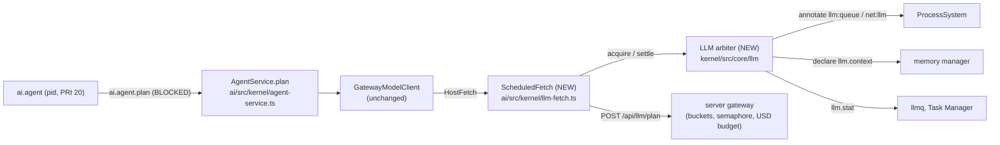

# RFC 0005: The LLM as a scheduled kernel resource

| Field     | Value                                                                                                                                                                                                                                                                   |
| --------- | ----------------------------------------------------------------------------------------------------------------------------------------------------------------------------------------------------------------------------------------------------------------------- |
| Title     | A kernel LLM arbiter (priority queue with aging, slots, rate gate, token budgets, kill and stop semantics), LLM visibility in `ps`, `llmq` and the Task Manager, the agent's context as accounted memory; staged AIOS-style snapshot/restore and MemGPT-style memory    |
| Status    | **Approved with cuts** (ARB, 2026-09-30): P0 only (the kernel arbiter, `llm.stat`, `llmq`, `llm.context`, the bench), with the review changes applied. The in-product demo waits for R1's kernel TTY path. P1 and P2 are not scheduled. See §17 and [PLAN.md](PLAN.md). |
| Authors   | design-ai-runtime (Wave 3 design track), for R1 Kernel and R4 AI                                                                                                                                                                                                        |
| Reviewers | Critics (Wave 3), ARB; R1 Kernel (scheduler, mm), R4 AI (agent, gateway), R2 (P1 migration), R3 (P1 Task Manager card), R5 (bench gate)                                                                                                                                 |
| Date      | 2026-09-30                                                                                                                                                                                                                                                              |
| Builder   | `llm-runtime` (Workflow B)                                                                                                                                                                                                                                              |
| Companion | [RFC 0002](0002-agent-provenance-undo-and-isolation.md) (builder `agent-safety`); disjoint files, one shared seam (§5.9)                                                                                                                                                |

Requirement IDs proposed here use the new prefix `LRT-` (§16). Existing IDs touched: AIN-B3, AIN-B4, CPL-B-SCHED, CPL-B-MEM, AGT-09, PROC-02, §12.6 ("per-user rate limits"), §3.4 "graceful absence".

---

## 1. Summary

Today an LLM call is not something the Plotinium kernel schedules. `ai.agent.plan` calls the gateway directly from the kernel worker (`ai/src/kernel/agent-service.ts:437-454`); the server admits or refuses it with a non-blocking semaphore and per-user token buckets (`server/src/engine/llm/gateway.ts:247-269`, `server/src/ratelimit/classes.ts:36-39`), and a refusal is a failure: `ai: agent unavailable (rate) — nothing was run`. With the production limits (6 calls per minute, burst 3), our discrete-event model (Appendix B) predicts that **two concurrent 3-turn agents both fail, and even one agent fails on its fifth turn** when the model answers in 4 s. `ps` shows the blocked agent as `io:ai.agent.plan` although the kernel already defines `net:llm` (`kernel/src/core/proc/pcb.ts:29`, never set; `kernel/src/core/proc/system.ts:219-231`). Tokens are not accounted per process, and the kernel-held context of a running agent is charged to nobody.

This RFC makes the LLM a kernel resource, the way AIOS proposes and the way Plotinium already treats CPU run tokens (`kernel/src/core/sched/tokens.ts`) and memory reservations (`kernel/src/core/mm/reserve.ts`):

- **P0 (one builder, about 4.5 h):** a kernel **LLM arbiter** in `kernel/src/core/llm/` with a `dsa/heap` wait queue keyed exactly like the ready queue (aged priority, then arrival), `LLM_SLOTS` concurrent calls, a **rate gate** that mirrors the server's per-user bucket so requests wait instead of failing, per-process and per-user **token budgets** with reserve-and-settle, **kill and stop** semantics, `WCHAN` values `llm:queue` and `net:llm`, a `llm.stat` system call and an `llmq` command, and the agent's kernel-held context declared as `llm.context` memory. This fills the one cell of the spec's coupling map that the spec itself leaves empty (spec §12.5, "B. Agent × Memory: —").
- **P1 (separately approvable):** the Task Manager "Model queue" card; a MemGPT-style **context-pressure notice** appended (never edited) to the transcript; **snapshot/restore** of a stopped agent's conversation beyond the in-memory TTL.
- **P2 (needs a privacy review first):** opt-in **episodic memory** of past commands (MemGPT recall/archival), retrieved through the existing semantic index and always treated as untrusted data by RFC 0002.

A deterministic bench with a fake gateway measures completion rate, latency, throughput, fairness and priority separation for N concurrent agents, baseline (today's direct path) against the arbiter.

**ARB outcome (2026-09-30).** P0 is approved with the review changes applied in place, each marked "ARB":

- `acquire` honours the request's remaining deadline (§5.2);
- offline requests are refused at once (§5.2);
- §5.3 now states correctly that a semaphore 429 has already spent rate tokens, and the bench models it;
- the bench gains an integration arm against the real server gateway and rate classes (§10.2);
- `llm.stat` shows only the caller's gate row (§5.7);
- the direct-fetch fallback never follows a budget refusal and is counted (§5.8).

**The in-product demo is not reachable yet** (0005-M1, X2). The Terminal runs `nice`, `kill`, `ps` and `ai` in its view-side host, and cannot spawn the agent at all (§2.1). So Workflow B demonstrates the arbiter with a composed-kernel scenario test that spawns real `ai-agent` processes against a scripted gateway, and the AIN-B3 evidence is labelled "kernel harness".

## 2. Context and problem

### 2.1 What exists today (verified in the code)

| Area                          | Today                                                                                                                                                                                                                              | Where                                                                                                                                                                    |
| ----------------------------- | ---------------------------------------------------------------------------------------------------------------------------------------------------------------------------------------------------------------------------------- | ------------------------------------------------------------------------------------------------------------------------------------------------------------------------ |
| Agent process                 | `ai.agent`, class `agent`, PRI 20, not checkpointable; drives `ai.agent.plan` turns (≤ 6).                                                                                                                                         | `ai/src/programs/index.ts:75-83`, `ai/src/programs/agent.ts:238-295`                                                                                                     |
| Kernel side of a turn         | `AgentService.plan` → `nextToolCall` → `GatewayModelClient.complete` → host `fetch('/api/llm/plan')`. No queue, no priority, no per-process accounting. The client ignores `usage` in the reply.                                   | `ai/src/kernel/agent-service.ts:388-493`, `ai/src/agent/model.ts:85-126`, `ai/src/kernel/gateway.ts:62-98`, `:181-228`                                                   |
| Failure mapping               | HTTP 429 → `EAIUNAVAIL rate` or `budget`; any throw from `fetch` → `EAIUNAVAIL offline` (or `ECANCELED` if the signal aborted). No retry.                                                                                          | `ai/src/kernel/gateway.ts:100-148`, `:206-212`                                                                                                                           |
| Retry hazard                  | The client advances its "sent" counter **before** the fetch, so re-calling `complete()` after a 429 finds nothing to send (`EINVAL nothing-to-send`). A retry must re-send the same body **below** the client.                     | `ai/src/kernel/gateway.ts:175-183`                                                                                                                                       |
| Kill                          | `onProcessExit(pid)` aborts the session's `AbortController`; the server aborts the provider call on client disconnect and settles at the reservation.                                                                              | `ai/src/kernel/agent-service.ts:660-669`, `server/src/llm/routes.ts:187-193`, `server/src/engine/llm/gateway.ts:395-420`                                                 |
| Kernel session TTL            | 10 minutes since the last turn; swept on every `plan` call.                                                                                                                                                                        | `ai/src/kernel/agent-service.ts:62`, `:273-278`                                                                                                                          |
| Server rate limits            | Route class `llm` = 6 per minute per uid, burst 3; `llm-hour` 60 per hour; examiner and demo pools.                                                                                                                                | `server/src/ratelimit/classes.ts:36-39`, `server/src/llm/routes.ts:167-170`, `specs/11-server/backend-api.md:504`                                                        |
| Server concurrency            | `LLM_MAX_INFLIGHT = 4` global semaphore, `tryAcquire` or immediate 429 `rate` with `retryAfterMs 1000`.                                                                                                                            | `server/src/config.ts:218`, `server/src/engine/llm/gateway.ts:188-201`, `:255-263`                                                                                       |
| Budget                        | Server reserve → provider call outside any transaction → settle, per uid per day and per pool.                                                                                                                                     | `server/src/engine/llm/gateway.ts:355-393`                                                                                                                               |
| Server transcript             | In-memory `dsa/lru`, uid-bound, append-only, TTL 10 min, 1,000 entries; one turn per `requestId` at a time; appended only after a successful turn.                                                                                 | `server/src/llm/transcripts.ts:16-81`, `server/src/llm/routes.ts:195-281`                                                                                                |
| CPU scheduler (template)      | Ready queue = `dsa/heap` keyed `effPrio · 2^32 + seq`; aging `effPrio = max(0, base − ⌊wait / T_age⌋)`; run-token semaphore; event-driven, never polls.                                                                            | `kernel/src/core/sched/scheduler.ts:1-27`, `kernel/src/core/sched/params.ts:245-258`, `kernel/src/core/sched/tokens.ts:14-58`                                            |
| Memory reservation (template) | Reserve before use; waiters in a `dsa/heap` keyed by (effPrio, arrival); no overtaking; timer → `EAGAIN`.                                                                                                                          | `kernel/src/core/mm/reserve.ts:1-20`; `mem.declare` charges an asset to a pid (`kernel/src/core/mm/mm.ts:508-540`)                                                       |
| Wait reasons                  | `WaitReason` includes `'net:llm'` but `waitReasonOf` maps every other blocking call to `io:<call>`; nobody annotates `net:llm`. `ps -o wchan` prints the raw reason; the Task Manager maps `net:llm` and `llm*` to "awaiting llm". | `kernel/src/core/proc/pcb.ts:17-33`, `kernel/src/core/proc/system.ts:219-231`, `:788-790`; `apps/coreutils/lib/procs.ts:148`; `apps/taskmgr/model.ts:127-129`            |
| Task Manager AI tab           | Indexer card, a monthly "Agent budget" card, and the audit list. No per-process LLM view.                                                                                                                                          | `ui/src/apps/taskmgr/AiPanel.tsx:88-287`, `ui/src/apps/taskmgr/models.ts:251-272`; screenshots `docs/design/wave3/design-ai-runtime/current-taskmgr-ai-{light,dark}.png` |
| Server knows the pid?         | No: the route sets `pid: null` in the caller.                                                                                                                                                                                      | `server/src/llm/routes.ts:177-185`                                                                                                                                       |
| Semantic index eligibility    | Only files under `/home` or `/mnt`, not in a dot-directory, with known text extensions.                                                                                                                                            | `ai/src/indexer/extract.ts:53-66`                                                                                                                                        |

Observed on the QA copy (http://localhost:4718, 2026-09-30, build `86995d1`): `ai "…"` prints `ai: agent unavailable (ai.agent is degraded: requires sync) — nothing was run`, `/api/readyz` reports `ai.llm = no-key`, and `ps -o pid,pri,ni,stat,wchan,comm` works (`docs/design/wave3/design-ai-runtime/current-terminal-ai-ps-dark.png`).

**ARB, 0005-M1 and X2: sync and a key are not the only blockers.**

- The shipped Terminal always uses its view-side process host, because no kernel `tty.*` handler exists (`apps/terminal/view.tsx:152`, `:162-163`; `apps/terminal/session.ts:10-13`). There, `nice`, `kill`, stop and continue act on host processes, and `ps` merges host processes over kernel ones (`apps/terminal/host/host.ts:1429-1450`).
- `ai` cannot spawn the agent: the host has no `ai-agent` program (`host.ts:1162-1168`). Even if it did, `ai.agent.plan` is origin `E` with capability `ai.plan`, while a view port is origin `V`.
- The arbiter keys on kernel PCBs (priority, nice, `stopped`). So LRT-02, LRT-05 and LRT-06 cannot be observed in the product until R1 wires the kernel TTY and process syscalls.

That fix is not in Workflow B; the ARB asks the lead to schedule it. Until then, the evidence comes from the kernel project and from a composed-kernel scenario test (§10.3).

### 2.2 The problems

| #   | Problem                                                                                                                                                                                                                                         | Consequence                                                                                                                                                                    |
| --- | ----------------------------------------------------------------------------------------------------------------------------------------------------------------------------------------------------------------------------------------------- | ------------------------------------------------------------------------------------------------------------------------------------------------------------------------------ |
| P1  | Rate limits and the server semaphore make concurrent or long agent runs **fail** instead of wait. Model (Appendix B): with 4 s model latency, 1 agent × 6 turns fails; 2 agents × 3 turns: 0 of 2 complete; 8 agents × 1 turn: 3 of 8 complete. | AGT-07 examiner prompts that need 4+ observations can fail on production for rate reasons alone; §3.4 "graceful absence" is honoured, but the OS gives up where it could wait. |
| P2  | No priority: a `nice`d background agent and an interactive one race.                                                                                                                                                                            | Spec §3.2 property 3 ("AI is scheduled by the system … priorities") is shown for the indexer, not for LLM work.                                                                |
| P3  | No per-process token accounting or budget; the only budgets are server-side USD per user per day.                                                                                                                                               | A runaway agent is bounded only by the 6-turn cap; `ps`/Task Manager cannot say who spent what.                                                                                |
| P4  | `WCHAN` says `io:ai.agent.plan`; the queue is invisible.                                                                                                                                                                                        | The viva cannot show "the kernel is holding this agent back"; the Task Manager pill reads "io".                                                                                |
| P5  | The agent's kernel-held context (datamarked envelope and observations, ≤ 60 KB per entry, `server/src/llm/routes.ts:65-72`) is uncharged.                                                                                                       | CPL-B-MEM is "minimal" (ai-safety §3.2) and the spec's own map cell is empty.                                                                                                  |
| P6  | A stopped agent (Ctrl-Z during a clarification) loses its conversation after 10 minutes on both sides.                                                                                                                                          | Resume fails with `conversation expired`; the user re-types and pays again.                                                                                                    |

## 3. Goals and non-goals

### Goals

1. Every LLM call the kernel makes goes through one kernel arbiter that decides **when** it runs (P0).
2. Waiting replaces failing whenever the server said "rate" and the wait is bounded (P0).
3. Priority with aging, per-process fairness, and bounded waiting, reusing the scheduler's formulas and `dsa/heap` (P0).
4. Per-process and per-user token budgets, visible and enforced before the call (P0).
5. Visibility in `ps`, a new `llmq` command, the kernel log, and (P1) the Task Manager (P0/P1).
6. The agent's context is accounted memory (P0).
7. A reproducible bench that reports baseline against arbiter (P0).
8. Staged, flag-guarded paths for snapshot/restore (P1) and episodic memory (P2), each with its own measurement.

### Non-goals

- Pre-empting an in-flight hosted-model call. It cannot be paused, and aborting it is charged at the reservation (`server/src/engine/llm/gateway.ts:395-420`).
- Replacing the server's limits. The server stays authoritative for money (USD caps) and cross-user fairness; the kernel only schedules its own tab's requests.
- In-browser inference (WebLLM) or a local model.
- Letting a model tune the scheduler (SchedCP): scheduling decisions stay deterministic kernel code.
- Editing a transcript. Claude Opus 5.5 rejects edited history (agentic-shell §3.8.1), so MemGPT's eviction and recursive summarisation inside one request are out.

## 4. Research basis

| Paper                                                                                                                                                                      | Idea                                                                                                                                                                                                                      | Adopt                                                                                                                                 | Adapt                                                                                                                                                                                                                                | Leave out                                                                                                                        |
| -------------------------------------------------------------------------------------------------------------------------------------------------------------------------- | ------------------------------------------------------------------------------------------------------------------------------------------------------------------------------------------------------------------------- | ------------------------------------------------------------------------------------------------------------------------------------- | ------------------------------------------------------------------------------------------------------------------------------------------------------------------------------------------------------------------------------------ | -------------------------------------------------------------------------------------------------------------------------------- |
| **AIOS**, Mei et al., COLM 2025, [arXiv 2403.16971](https://arxiv.org/abs/2403.16971)                                                                                      | An LLM kernel: a scheduler for LLM requests (FIFO and round-robin in the paper), a context manager with snapshot and restore, memory and storage managers, access control; reports up to 2.1× faster execution of agents. | A kernel-owned LLM request queue with admission, concurrency and accounting; LLM work visible as process state.                       | Priority with aging instead of FIFO/RR (we already have one policy for CPU; reuse it). Snapshot at **turn boundaries** of the conversation, not of the decoder state.                                                                | Round-robin time slicing of generations and logits snapshots (a hosted model cannot be pre-empted).                              |
| **MemGPT**, Packer et al., 2023, [arXiv 2310.08560](https://arxiv.org/abs/2310.08560)                                                                                      | Virtual context management: a main context (instructions, working context, FIFO messages) and external context (recall and archival storage); a memory-pressure warning; function calls page data in.                     | The memory-pressure warning (P1), a recall/archival split for past commands (P2).                                                     | The warning is **appended** to the next turn (append-only transcript); recall/archival entries are written by the kernel, retrieved by the existing semantic index, and enter the prompt as **untrusted** data (RFC 0002 label `O`). | Eviction and recursive summaries inside a request (edited history is rejected); model-authored memory writes (memory poisoning). |
| **vLLM / PagedAttention**, Kwon et al., SOSP 2023, [arXiv 2309.06180](https://arxiv.org/abs/2309.06180)                                                                    | Treat LLM context memory like OS pages: allocate in blocks, admit only what fits, account precisely.                                                                                                                      | Admission by **reservation**: estimated tokens are reserved before a call and settled after (§5.4); the context is charged as memory. | We have no KV cache; the "page" is the kernel-held context charged through `mem.declare`.                                                                                                                                            | KV-cache paging and sharing.                                                                                                     |
| **SchedCP**, Zheng et al., NeurIPS 2025 ML for Systems, [arXiv 2509.01245](https://arxiv.org/abs/2509.01245)                                                               | LLM agents that tune Linux schedulers.                                                                                                                                                                                    | –                                                                                                                                     | –                                                                                                                                                                                                                                    | An LLM in the scheduling decision path (spec §3.4: the model proposes, the kernel decides).                                      |
| **WebLLM**, Ruan et al., 2024, [arXiv 2412.15803](https://arxiv.org/abs/2412.15803)                                                                                        | In-browser LLM inference.                                                                                                                                                                                                 | –                                                                                                                                     | –                                                                                                                                                                                                                                    | Local inference (quality and memory, see §6 A5).                                                                                 |
| **Steinder and Franke** 2026, [arXiv 2607.25076](https://arxiv.org/abs/2607.25076); **AgentKernel**, Zou et al. 2026, [arXiv 2609.29647](https://arxiv.org/abs/2609.29647) | Derive agent abstractions from classical OS primitives; information-flow-controlled memory.                                                                                                                               | Framing: the LLM is a device-like resource with a queue, quotas and accounting; recalled memory carries a provenance label.           | –                                                                                                                                                                                                                                    | –                                                                                                                                |

## 5. Design

### 5.1 Architecture



The arbiter is **kernel** code, like the CPU scheduler and the memory manager: it knows PCBs, priorities, stop state and memory, and it schedules "LLM requests" generically. It has no AI dependency, so the AI-off litmus build (ai-safety §3.3) keeps an idle arbiter and an empty `llm.stat`. The AI package reaches it through the composition (`web/src/kernel/ai-link.ts`), as it already reaches `spawnProcess` (`web/src/kernel/ai-link.ts:88-106`), because `ai/` may import only protocol, dsa and `@plotinium/kernel/hooks` (`tools/eslint-rules/boundaries.js:18`).

### 5.2 The arbiter

```ts
// kernel/src/core/llm/arbiter.ts (NEW)
export type LlmPurpose = 'plan' | 'extract' | 'answer' | 'summarize';
export interface LlmRequest {
  readonly pid: number;
  readonly uid: number;
  readonly requestId: string; // the agent requestId (joins llm_requests and the audit)
  readonly purpose: LlmPurpose;
  readonly estInputTokens: number; // §5.4
  readonly maxOutputTokens: number; // 8,000 today (ai/src/agent/model.ts:50)
  readonly contextBytes: number; // kernel-held context of this request, for mm (§5.6)
}
export type LlmOutcome =
  | { kind: 'ok'; usage: { input: number; output: number; cacheRead: number; cacheWrite: number } }
  | { kind: 'rate'; retryAfterMs: number } // 429 rate: the caller re-acquires with resumeOf and re-sends the SAME body
  | { kind: 'failed' }; // any other error, including abort
export interface LlmLease {
  readonly id: number;
  readonly waitedMs: number;
  settle(o: LlmOutcome): void; // exactly once (INV-L4)
}
export class LlmArbiter {
  /** deadlineAt: the request's absolute deadline (kernel clock); ARB, 0005-S1. */
  acquire(
    req: LlmRequest,
    o?: { signal?: AbortSignal; resumeOf?: number; deadlineAt?: number },
  ): Promise<LlmLease>;
  stat(viewer: { uid: number }): LlmStat; // llm.stat (§5.7)
  onExit(pid: number): void; // kernel.procs.onTerminate
  isHolding(pid: number): boolean; // queued or in flight (keepAlive, §5.9)
}
```

**Construction** (ARB, 0005-N3). `kernel/src/core/llm/index.ts` exports `createLlmArbiter(deps: LlmArbiterDeps): LlmArbiter`. `platform`'s step 0 creates it as a stub and calls it once from `kernel/src/core/kernel.ts`, exposing `k.llm`; this builder owns everything under `kernel/src/core/llm/`. The deps are:

- `reg`, the `HandlerRegistry` (the arbiter registers the `llm.stat` handler itself);
- `procs`, for PCB lookups, `annotate` and `onTerminate`;
- `mm`, for `declare` and `undeclare`;
- `sysctl`, where it defines `llm.slots`, `llm.tAge` and `llm.proc.tokens`;
- `timers` and `now`;
- `online()`, backed by `net.state`;
- `log`.

**Refuse early** (ARB, 0005-S1 and 0005-S4):

- `acquire` refuses at once with EAIUNAVAIL `rate` (carrying the predicted wait) when the predicted grant time is later than `deadlineAt`. The kernel derives `deadlineAt` from the 120 s request cap of agentic-shell §3.8, which `ai/src/agent/loop.ts:26` and `:102` enforce, so two long waits can never exceed that cap.
- `acquire` refuses at enqueue with EAIUNAVAIL `offline` while `online()` is false, which keeps today's behaviour instead of queueing until `LLM_WAIT_MAX_MS`.

**Queue.** One `BinaryHeap` from `@plotinium/dsa/heap` per uid (usually one or two uids), handles are recycled ticket ids, exactly like `kernel/src/core/mm/reserve.ts`. The key is the scheduler's ready key:

```
base   = staticPri(pcb.priority, pcb.nice)                  // kernel/src/core/sched/params.ts (clamp 0..39)
eff    = agedEffPrio(base, enqueuedAt, now, T_AGE_LLM_MS)   // params.ts:245
key    = readyKey(eff, seq)                                  // params.ts:256, seq = arrival order
```

A request that was granted, got `429 rate` and re-queues keeps its original `seq` and `enqueuedAt` (`resumeOf`), so it does not lose its place.

**Dispatch** runs on enqueue, settle, gate re-open, aging tick and process continue (event-driven, as the CPU scheduler, `scheduler.ts:16-18`):

```
while inFlight < LLM_SLOTS:
  candidates = for each uid whose gate has ≥ 1 token: the heap top that is not STOPPED and has no lease in flight
  if none: arm a timer for the earliest gate token or aging step; return
  pick the candidate with the smallest key; pop it
  if budget(pid) or budget(uid) cannot reserve est: reject it with EAIUNAVAIL budget (scope proc|uid); continue
  take one gate token for its uid; reserve est; annotate(pid, 'net:llm'); grant
```

Aging tick: every `T_AGE_LLM_MS` while any heap is non-empty, `changePriority` each queued handle to its new key (O(q log q), as `agingTick`, `scheduler.ts:26`). No timer runs when the queue is empty.

**Parameters** (`kernel/src/core/llm/params.ts`, the style of `sched/params.ts`):

| Constant            | Default                  | Why                                                                                                                  |
| ------------------- | ------------------------ | -------------------------------------------------------------------------------------------------------------------- |
| `LLM_SLOTS`         | 2                        | ≤ half of the server's `LLM_MAX_INFLIGHT = 4`, so one tab cannot take every server slot                              |
| `T_AGE_LLM_MS`      | 1,000                    | one priority level per second of waiting: a PRI 39 request reaches level 0 in ≤ 39 s                                 |
| `LLM_WAIT_MAX_MS`   | 90,000                   | below the 120 s request deadline of agentic-shell §3.8                                                               |
| `LLM_GATE`          | 6 / min, burst 3; 60 / h | mirrors `server/src/ratelimit/classes.ts:36-37`; replaced by the server's advertised values when present (P1, §5.11) |
| `LLM_PROC_TOKENS`   | 150,000                  | charged tokens per process (§5.4); about 4× a measured-to-be 6-turn plan (to be re-measured)                         |
| `LLM_UID_TOKENS`    | 1,000,000                | per uid per OS session, soft; the server's USD caps stay authoritative                                               |
| `SYSTEM_TOKENS_EST` | 6,000                    | first-turn estimate of the cached system prompt and tools (re-measured from `usage` after the first call)            |

Root-only sysctl keys (`kernel/src/core/proc/sysctl.ts` `define`): `llm.sched` (`on`/`off`), `llm.slots` (1..4), `llm.tAge` (250..5,000), `llm.proc.tokens`.

**Invariants** (checked by `checkInvariants()` in tests, like the scheduler's INV-P2):

- INV-L1: `inFlight ≤ LLM_SLOTS` at every moment.
- INV-L2: at most one lease in flight per pid and per `requestId` (the server also refuses a second concurrent turn, `server/src/llm/routes.ts:198-201`).
- INV-L3 (bounded waiting): a request of base `b` is granted within `b · T_AGE_LLM_MS + W0`, where `W0` is the level-0 FIFO drain time given slot service and gate refill; the bench checks the bound empirically.
- INV-L4: every lease is settled exactly once, on every path (success, error, abort, kill).
- INV-L5: after `onExit(pid)` the pid has no queued entry, no reservation and no declared `llm.context`.
- INV-L6: Σ charged tokens per pid = Σ usage reported by the gateway for that pid (conservation).

### 5.3 The rate gate and why a 429 retry is safe

The gate is a token bucket per uid with the server's parameters and the same formula (`server/src/ratelimit/bucket.ts:27-49`), re-implemented in the kernel (the kernel may not import server code). It predicts refusals; it does not replace them. Whenever the server answers 429 `rate` with `retryAfterMs`, the gate for that uid is closed until then (resync).

Re-sending the identical body after a 429 `rate` is safe for the **transcript**. The transcript is appended only after a successful turn (`server/src/llm/routes.ts:260-269`), so a refused turn changes no conversation state.

**It is not free for the rate buckets** (ARB, 0005-S2; the draft said "the server refuses before any state changes"):

- the route's `llm` class runs in pre-validation (`routes.ts:167-170`);
- `#takeRate` takes the hourly, examiner and demo pools **before** `tryAcquire` of the in-flight semaphore (`server/src/engine/llm/gateway.ts:247-262`).

So a 429 from the semaphore has already spent a per-minute and a per-hour token. The bench's fake gateway models this order exactly. A server change, taking the semaphore before the pools or refunding the pools on a semaphore refusal, is proposed to the server owner as a P1 item. It is not in Workflow B.

A 429 `budget` is never retried. A `retryAfterMs` longer than `LLM_WAIT_MAX_MS` (the hourly or daily pools) fails every queued request of that uid at once with `EAIUNAVAIL rate`, carrying the wait, instead of making the user watch a 90 s spinner.

### 5.4 Token budgets (reserve and settle)

Charged tokens of a call = `input + cacheWrite + output + ⌈cacheRead / 10⌉` (cache reads are about a tenth of the input price, ai-safety §3.9). Before a grant the arbiter reserves `est = estInputTokens + maxOutputTokens`, where `estInputTokens = lastPromptTokens(requestId) + ⌈bytes(body) / 2⌉` (the server's conservative estimate, `server/src/engine/llm/gateway.ts:182-186`, plus the prompt size the previous turn reported; `SYSTEM_TOKENS_EST` on turn 1). After the reply it settles with the actual usage. A process or uid that cannot reserve `est` is refused **before** the call with `EAIUNAVAIL budget` and `detail.scope = proc | uid`. The pattern is the server's reserve → call → settle (`gateway.ts:355-393`) and the kernel's own memory reservation (`reserve.ts`).

### 5.5 Kill, stop and continue

- **Kill.** The kernel's terminate hook (`kernel.procs.onTerminate`, the same one that tells the AI link, `kernel/src/core/io/index.ts:661-665`) calls `arbiter.onExit(pid)`: queued entries are removed from the heap in O(log n) and their promises reject with `ECANCELED`; an in-flight fetch is already aborted by `AgentService.onProcessExit` (`agent-service.ts:660-669`) and its lease is settled `failed` by `ScheduledFetch`'s `finally`, which frees the slot (INV-L4). Test target: the slot is free within one event-loop turn of the fetch rejecting. Ordering: `onExit` marks the pid at once but rejects its queued promises in a microtask, so `AgentService.onProcessExit` (same terminate round) has already aborted the session's signal; `GatewayModelClient` then maps the rejection to `ECANCELED` and the audit says `killed_before_execute`, never `unavailable`.
- **Stop.** A queued request whose PCB is stopped (`pcb.stopped`, `pcb.ts:73`; job control parks it with `waitingOn = 'sigcont'`, `system.ts:1304`) is skipped by dispatch until `SIGCONT` and keeps its place (its key keeps aging, so a stop never costs it priority; it simply cannot be granted while stopped; dispatch reads `pcb.stopped`, and the aging tick re-checks it at least once per second). An in-flight call of a stopped process completes; its reply waits for the process like any blocked syscall.
- **Continue** re-runs dispatch.

### 5.6 The agent's context as accounted memory (CPL-B-MEM)

`ScheduledFetch` tracks the bytes of every body it sent for a `requestId`; the arbiter keeps `llm.context` for the pid at that size through the memory manager's `declare(pid, 'llm.context', bytes)` (`kernel/src/core/mm/mm.ts:508-540`) and releases it on exit or when the request ends (`plan` or `cannot` reply). The charge shows in `pmap <pid>`, `free -v` and the Task Manager's memory column, counts against the agent's 16 MB soft limit (agentic-shell §3.1), and is subject to the global budget (`mm.declare` may block on `mem` like any reservation). This turns the spec's empty "Agent × Memory" cell into a mechanism with a test (LRT-08).

### 5.7 Visibility

- **`ps`**: `WCHAN` shows `llm:queue` while waiting (new `WaitReason`, `pcb.ts:17-33`) and `net:llm` in flight, set through `ProcessSystem.annotate` (`system.ts:788-790`).
- **`llm.stat`** system call (group `llm`, class `F`, origin `EV`, no capability, audit `trace`; not an `ai.*` call, so it exists in the AI-off build):

```ts
// protocol/src/sys/llm.ts (NEW)
export const LlmStatRet = v.strictObject({
  slots: v.strictObject({ total: Count, inFlight: Count }),
  gate: v.array(
    v.strictObject({
      uid: Uid,
      tokens: v.number(),
      nextTokenInMs: Count,
      closedUntilMs: v.optional(Count),
    }),
  ),
  entries: v.pipe(
    v.array(
      v.strictObject({
        pid: Pid,
        uid: Uid,
        name: v.pipe(v.string(), v.maxLength(64)),
        state: v.picklist(['queued', 'in-flight', 'stopped']),
        base: Count,
        effPrio: Count,
        waitedMs: Count,
        purpose: v.picklist(['plan', 'extract', 'answer', 'summarize']),
      }),
    ),
    v.maxLength(256),
  ),
  procs: v.pipe(
    v.array(
      v.strictObject({
        pid: Pid,
        uid: Uid,
        calls: Count,
        tokensIn: Count,
        tokensOut: Count,
        cacheRead: Count,
        charged: Count,
        budget: Count,
        waitMsTotal: Count,
      }),
    ),
    v.maxLength(256),
  ),
  uids: v.array(v.strictObject({ uid: Uid, charged: Count, budget: Count })),
});
```

Other users' rows show pid, uid, state and counts only, like `ps` (`kernel/src/core/proc/info.ts:19-47`).

- **`gate[]`** holds only the caller's uid row; root sees every row (ARB, S-0005-03).
- **`LlmStatRet`** gains `fallbacks: Count`, the number of direct-fetch fallbacks since boot (ARB, S-0005-02). `platform` lands this schema in step 0a.

- **`llmq`** command (coreutils, man page, `--json`), for example:

```
$ llmq
LLM  slots 1/2 in flight · 2 queued · rate gate 0.4 of 3 (next in 6 s) · alice 41,210 of 1,000,000 tokens
  PID USER   PRI  EP STATE     WAIT  PURPOSE  CALLS  TOKENS IN/OUT   BUDGET LEFT
  412 alice   20  20 in-flight  0.0s plan         3  18,420/1,210      130,370
  418 alice   20  17 queued     3.1s plan         2   6,102/402        143,496
  415 alice   30  27 queued     3.2s plan         1       0/0          150,000
```

- **Kernel log**: `llm: pid 415 queued (rate gate, next token in 6.0 s)`, `llm: pid 412 granted after 3.1 s`, `llm: pid 415 refused: proc budget`.
- **Task Manager (P1)**: a "Model queue" card in the AI tab between the top cards and the audit log (§9).

### 5.8 `ScheduledFetch`: the AI side

```ts
// ai/src/kernel/llm-fetch.ts (NEW, owned by llm-runtime)
export interface LlmArbiterLike {
  // structural (ai/ cannot import the kernel)
  acquire(
    req: LlmRequestLike,
    o?: { signal?: AbortSignal; resumeOf?: number },
  ): Promise<LlmLeaseLike>;
  isHolding(pid: number): boolean;
}
export function scheduledFetch(
  fetch: HostFetch,
  arbiter: LlmArbiterLike,
  who: { pid: number; uid: number; requestId: string; purpose: 'plan' | 'extract' | 'answer' },
): HostFetch;
export function scheduledModelFactory(o: {
  fetch: HostFetch;
  arbiter: LlmArbiterLike;
  osSessionId(): string;
}): (requestId: string, caller: AiCaller) => ModelClient; // returns new GatewayModelClient(scheduledFetch(...), requestId, …)
```

**Fallback rule** (ARB, S-0005-02). `ScheduledFetch` falls back to one direct fetch **only** when the arbiter throws an internal error. It never falls back after a refusal: not after `budget`, not after a deadline, and not while offline. Each fallback increments `llm.stat.fallbacks` and writes one klog line.

Behaviour: `GET /api/llm/health` and non-LLM URLs pass straight through. For `POST /api/llm/*`: acquire → fetch → read the JSON once → on 429 `rate`: settle `rate`, re-acquire with `resumeOf`, re-send the same `init` → otherwise settle (`ok` with the reply's `usage`, which the gateway returns on every turn, `server/src/llm/routes.ts:104-120`) and return a response whose `json()` yields the parsed body. Arbiter refusals become **synthetic HTTP responses**, so `GatewayModelClient`'s existing mapping produces the right errno and message without any change to `ai/src/kernel/gateway.ts`: budget → `429 {reason: 'budget'}` → `EAIUNAVAIL budget`; wait timeout → `429 {reason: 'rate', retryAfterMs}` → `EAIUNAVAIL rate`; kill → the abort error with the signal aborted → `ECANCELED` (`gateway.ts:206-207`).

### 5.9 Interface contract with RFC 0002 (`agent-safety`)

agent-safety owns `ai/src/kernel/agent-service.ts` and `ai/src/kernel/install.ts` and delivers this seam first (RFC 0002 §5.9):

```ts
AgentServiceDeps.model?(requestId: string, caller: AiCaller): ModelClient | undefined;   // was model?(requestId)
AgentServiceDeps.keepAlive?(pid: number): boolean;                                       // sweep() spares the session
AiInstallOptions.modelFactory?: (requestId: string, caller: AiCaller) => ModelClient | undefined;
AiInstallOptions.keepAlive?: (pid: number) => boolean;
AiInstallOptions.agentPolicy?: () => 'off' | 'shadow' | 'enforce';
```

**ARB change:** `platform` owns `web/src/kernel/ai-link.ts` in Wave 3 and writes this composition complete in step 0, together with the seam (RFC 0002 §5.9). It adds, next to the existing `fetch` (`:125-128`):

```ts
const llmFetch = { fetch, arbiter: k.llm, osSessionId: () => ctx.osSessionId() };
modelFactory: llmSchedOn() ? scheduledModelFactory(llmFetch) : undefined,   // undefined → today's direct path (rollback)
keepAlive: (pid) => k.llm.isHolding(pid) || k.procs.get(pid)?.stopped === true,
agentPolicy: () => policyOf(k.sysctl.get('ai.agent.policy')),              // key defined here for RFC 0002
```

and defines the root-only sysctl keys `ai.agent.policy` (`off | shadow | enforce`, default `enforce`) and `llm.sched` (`on | off`, default `on`).

The contract tests are:

- `AGS-15 the agent service asks deps.model with the caller for every new request` (`agent-safety`);
- `LRT-10 with llm.sched off the composition passes no modelFactory and the agent uses the direct gateway client` (`llm-runtime`, in its own new test file `web/src/kernel/llm-composition.test.ts`).

`scheduledModelFactory` lives in `ai/src/kernel/llm-fetch.ts`. `platform` creates it in step 0 as a stub that returns `undefined`, which is the direct path, and `llm-runtime` owns and fills it.

No other file is shared between agent-safety and llm-runtime. Order: the seam lands in step 0, so neither builder waits on the other.

### 5.10 ABI and protocol

- New call `llm.stat` in `protocol/src/sys/registry.ts` and `names.ts` (new group `llm`, with a new `syscall-abi.md` §4.4.14 "LLM arbiter"). `platform` lands it in step 0.
  - The catalogue count is set once for the whole wave: **119 → 132** (ARB, 0005-N2). RFC 0001 adds 4 calls, RFCs 0003 and 0004 add 8, and this RFC adds 1.
  - Adding a call changes the ABI digest, not `ABI_VERSION`. The wave's single bump to 2 comes from RFC 0001's errno additions.
- `WaitReason` gains `'llm:queue'` (kernel-internal type; `ProcInfo.waitingOn` is already a free string ≤ 128, `protocol/src/sys/proc.ts:187`).
- No change to `/api/llm/*` bodies in P0. P1 adds an optional `rate: {perMinute, burst, perHour}` to `GET /api/llm/health`.

### 5.11 P1 (separately approvable; not in Workflow B)

**Precondition for snapshot and restore** (ARB, S-0005-01). The archive table is keyed by `(uid, request_id)`, with `uid … REFERENCES users ON DELETE CASCADE`.

- `put` refuses a `requestId` owned by another uid, and `begin` is scoped per uid. The existing in-memory store is owner-blind on write (`server/src/llm/transcripts.ts:64-65`, `:73`), which is a handoff to its owner, R4.
- The table's data is excluded from backups (`pg_dump --exclude-table-data=llm_transcripts`), or the backup retention is stated in Settings › Privacy.
- The table is included in any Drive purge once P2 exists.
- The test is `LRT-13 another uid can neither read nor overwrite a stored transcript`.
- Its migration takes the next free timestamp after `20261001100000` (PLAN.md, C-21).

**Task Manager "Model queue" card** (≈ 1 h with QA). Details in §9.

**Fake provider for demos and e2e** (≈ 0.5 h): `LLM_MODE=fake` in the server gateway returns scripted tool calls with a configurable latency and real-looking `usage`, never touches the network, and is refused when `PLOTINIUM_ENV=production`. It makes the viva demo independent of a key and budget.

**Context-pressure notice (MemGPT)** (≈ 0.75 h, server side): when the previous turn's prompt tokens (`input + cacheRead + cacheWrite`) exceed 70 % of a per-request context budget (`LLM_CONTEXT_BUDGET_TOKENS`, default 60,000) or at most 2 turns remain, the server appends one text block after the `tool_result` of the **new** user message: `<kernel_notice>context 72 % used · 2 turns left · finish with submit_plan, ask_clarification or cannot_comply</kernel_notice>`. Nothing earlier is edited. Flag `LLM_CONTEXT_NOTICE=0` by default until measured: it changes cassette keys (ai-safety §3.11), so it is evaluated as its own arm on AGT-40 live runs (metric: `turn-limit` failures and mean turns).

**Snapshot and restore (AIOS)** (≈ 2.5 h, touches `db/`): the server's `TranscriptStore` gains an archive tier, a table `llm_transcripts(request_id uuid primary key, uid int, turn smallint, messages jsonb, pending_tool_use_id text, updated_at timestamptz, expires_at timestamptz)`, written through on every `put` (`server/src/llm/transcripts.ts:63-66`), read on an in-memory miss, deleted when a turn returns `plan` or `cannot` (the conversation cannot continue), capped at 512 KB, swept after `LLM_TRANSCRIPT_RETENTION_H = 24`. On the kernel side `keepAlive` (§5.9) spares a stopped agent's session. Demo: `ai "…"` asks a clarification → Ctrl-Z → wait past the TTL (shortened in the demo profile) → `fg` → answer → the plan continues. Metric: resume success after TTL (baseline 0 of 10) and tokens spent to finish against restarting.

### 5.12 P2: episodic memory (MemGPT recall and archival), opt-in

Only after a privacy review (R3 Settings, R4, the ARB), which must also cover S-0005-04: exclude Drive paths from memory entries, and test that the kernel's audit mirror, on which the tamper check depends, survives a reload.

- **Write path (kernel only).** After a request ends, the kernel appends one entry built from its own audit record: date, the user's request text, outcome, at most 5 op lines with paths. The model never writes memory (no MemGPT `archival_memory_insert`), which removes the memory-poisoning channel through model output.
- **Archival store in the VFS.** `~/Agent Memory/<yyyy-mm>.md`, mode 600 in a 700 directory, owned by the user: visible, editable, deletable. It is not a dot-directory because the indexer skips those (`ai/src/indexer/extract.ts:57`); the existing indexer embeds it like any note.
- **Recall.** At turn 1, if `ai.memory = on` (a per-user session sysctl, default off, shown in Settings › Privacy & AI), the kernel runs the existing semantic search scoped to that directory with the request as the query, keeps the top 3 hits up to 1.5 KB, drops any entry whose digest is not in the kernel's own audit mirror (tamper check), and renders the rest in a datamarked `<untrusted source="memory">` block. RFC 0002 labels every value from it `O`: memory can inform, never license, an action.
- **Controls.** `ai forget [--all | TXN]`, 30-day retention, no memory in the AI-off build, and the provider receives recalled text (disclosed in Settings).
- **Metric.** An 8-case follow-up set ("do the same for October", "move them back") with and without memory; a 6-case tamper set (edited entries) with 0 accepted.

### 5.13 Failure modes

| Failure                                                | Behaviour                                                                                                                                                                                    |
| ------------------------------------------------------ | -------------------------------------------------------------------------------------------------------------------------------------------------------------------------------------------- |
| Arbiter bug throws in `acquire`                        | `ScheduledFetch` falls back to a direct fetch once, counts it in `llm.stat.fallbacks` and logs `llm: arbiter error, direct call`; never after a budget or deadline refusal (ARB, S-0005-02). |
| The kernel is offline                                  | refused at enqueue with EAIUNAVAIL `offline`, as today (ARB, 0005-S4).                                                                                                                       |
| The predicted grant is later than the request deadline | refused at once with EAIUNAVAIL `rate` and the wait (ARB, 0005-S1).                                                                                                                          |
| Server returns 429 `rate` repeatedly                   | re-queued each time, bounded by `LLM_WAIT_MAX_MS`, then `EAIUNAVAIL rate` with the wait.                                                                                                     |
| Two tabs of the same user                              | each tab's gate is local; the server bucket arbitrates; 429 resync keeps both correct (slower, never wrong).                                                                                 |
| Process killed while queued / in flight / stopped      | §5.5; INV-L4 and INV-L5.                                                                                                                                                                     |
| Budget exhausted mid-request                           | refused before the next call; the agent prints `ai: agent unavailable (budget) — nothing was run`; nothing ran (the plan is not yet submitted).                                              |
| `mem.declare` blocks on memory pressure                | the agent waits on `mem` like any process; `LLM_WAIT_MAX_MS` still bounds the total.                                                                                                         |
| `llm.sched = off`                                      | exactly today's direct path (the baseline arm).                                                                                                                                              |

## 6. Alternatives considered

| #   | Alternative                                                                        | Why not                                                                                                                                                                                                             |
| --- | ---------------------------------------------------------------------------------- | ------------------------------------------------------------------------------------------------------------------------------------------------------------------------------------------------------------------- |
| A1  | Keep fail-fast and add a retry loop with back-off inside `GatewayModelClient`      | Fixes P1 only; no priority, accounting, visibility or kill semantics; the "sent" counter makes client-level retry wrong (`gateway.ts:175-183`); and the AI package would be scheduling itself, which is not AIN-B3. |
| A2  | A fair queue on the server (replace `tryAcquire` with deficit round-robin per uid) | The server does not know pids or priorities (`routes.ts:183`); per-user buckets still refuse; nothing shows in `ps`. Complementary for cross-user fairness: listed as future work.                                  |
| A3  | The same queue inside `ai/` (`ai/src/kernel/llm-queue.ts`)                         | Same algorithm, but it needs PCB priority, stop state and `annotate` through extra callbacks, and it makes the claim "the AI schedules itself" rather than "the kernel schedules the AI" (spec §3.2 property 3).    |
| A4  | Make an LLM call a CPU "slice" in the existing scheduler                           | Wrong granularity (seconds-long remote waits against 5–20 ms quanta, `params.ts:34-38`) and it would break the run-token invariant INV-P2 (`tokens.ts:10`).                                                         |
| A5  | Local inference (WebLLM) so the LLM is a real local resource with GPU contention   | Lost the Week-3 bake-off on quality and latency (ai-safety §3.8), and gigabytes of weights conflict with the 256 MB memory budget the QA copy shows.                                                                |

## 7. Security, privacy and abuse

| Concern                                      | Mitigation                                                                                                                                                                                               |
| -------------------------------------------- | -------------------------------------------------------------------------------------------------------------------------------------------------------------------------------------------------------- |
| One process hogs the model                   | one lease in flight per pid (INV-L2); aging; per-process budget                                                                                                                                          |
| Priority abuse                               | priority comes from the PCB (`priority + nice`); raising it needs root, as `renice` does                                                                                                                 |
| Starving another user in the same tab (`su`) | one heap and one gate per uid; dispatch picks the smallest key across uids                                                                                                                               |
| Budget exhaustion as denial of service       | per-uid session budget in the kernel and the server's per-user USD caps; the agent shows "budget" before any call                                                                                        |
| Information leak via `llm.stat`              | no request text, prompt or file name; other users' rows are counts only, like `ps`                                                                                                                       |
| Disabling the scheduler                      | `llm.sched` is a root-only, security-audited sysctl; `off` only restores today's behaviour (no new privilege)                                                                                            |
| P1 transcripts at rest                       | uid-bound, ≤ 24 h, deleted at the terminal turn, `LLM_TRANSCRIPT_PERSIST=0` switch, stated in Settings › Privacy; they hold the request, datamarked names and model output, never file contents (INV-A8) |
| P2 memory                                    | opt-in, kernel-written, user-deletable, tamper-checked, untrusted in the prompt (RFC 0002)                                                                                                               |

## 8. Performance and budgets

| Item                                                  | Budget                                                | Gate                       |
| ----------------------------------------------------- | ----------------------------------------------------- | -------------------------- |
| `acquire` + `settle` overhead, uncontended            | ≤ 0.2 ms p95 (heap O(log n), n ≤ 64)                  | bench                      |
| Added latency for one agent with a free slot and gate | ≤ 1 ms p95 against the direct path                    | bench (N = 1 arm)          |
| Aging tick                                            | O(q log q) once per second only while q > 0           | unit (no timer when empty) |
| Memory                                                | ≤ 128 B per queued entry, ≤ 256 B per pid record      | unit                       |
| Frame time                                            | unchanged (kernel worker only)                        | existing PROC-05 budget    |
| Bench run time in CI (virtual clock)                  | ≤ 3 s                                                 | `kernel` project           |
| `llmq` refresh                                        | one `llm.stat` call, ≤ 1 ms                           | unit                       |
| Task Manager card (P1)                                | one extra `llm.stat` per 1 s refresh, no layout shift | QA on :4718                |

## 9. Accessibility and UX

- `llmq` output is plain text with a header line and fixed columns, `--json` for scripts; `ps -o wchan` needs no new flag.
- The agent's own messages stay the existing ones (`ai/src/programs/agent.ts:155-177`); the only visible difference in the common case is that "agent busy (rate limit)" becomes a wait. While a request waits more than 2 s, the agent prints one line to stderr: `ai: waiting for the model (2 ahead, about 8 s)`, so the Terminal never looks frozen.
- **Task Manager card (P1)**, matching the existing cards (`ui/src/apps/taskmgr/AiPanel.tsx:88-230`):
  - heading "Model queue" with the same tile style; a `role="meter"` for slots in use with `aria-valuetext="1 of 2 model slots in use"`; a list of rows (process name, pid, a `Pill` "Queued" or "In flight", wait time, tokens, budget left); empty state "No model requests waiting";
  - both themes through the existing tokens (screenshots of today's tab in both themes are in `docs/design/wave3/design-ai-runtime/`); only the meter fill uses a dynamic `--pl-fill` custom property, as `AiPanel.tsx:190` already does, so the strict CSP holds (no static `style`, no runtime `<style>`);
  - row enter and leave animate only opacity and transform, and not at all under `prefers-reduced-motion`; no `aria-live` region (a 1 s refresh would be noisy); keyboard: the card has no controls in P1;
  - verified on the QA copy (:4718) with a `securitypolicyviolation` listener (target 0) at 1440×900 and 1280×800.

## 10. Testing and evaluation

### 10.1 Tests (llm-runtime writes them; titles start with the ID)

| Title                                                                                                                                                                                     | Command                                                                                                                |
| ----------------------------------------------------------------------------------------------------------------------------------------------------------------------------------------- | ---------------------------------------------------------------------------------------------------------------------- |
| `LRT-01 never more than LLM_SLOTS leases are in flight`                                                                                                                                   | `pnpm exec vitest run --project kernel kernel/src/core/llm`                                                            |
| `LRT-02 a lower-priority request waits while a higher-priority one is queued, and ages to the head within the bound`                                                                      | same                                                                                                                   |
| `LRT-02 equal priorities are served in arrival order`                                                                                                                                     | same                                                                                                                   |
| `LRT-03 a 429 rate re-queues the same request at its old place and re-sends the identical body`                                                                                           | same, and `pnpm exec vitest run --project ai ai/tests/kernel.llm-fetch.test.ts`                                        |
| `LRT-03 a retry-after longer than LLM_WAIT_MAX_MS fails every queued request of that uid with EAIUNAVAIL rate`                                                                            | `kernel/src/core/llm`                                                                                                  |
| `LRT-03 a request whose predicted grant is later than its 120 s deadline is refused at once with the wait` (ARB, 0005-S1)                                                                 | same                                                                                                                   |
| `LRT-03 offline refuses at enqueue with EAIUNAVAIL offline` (ARB, 0005-S4)                                                                                                                | same                                                                                                                   |
| `LRT-04 a request that cannot reserve its estimate is refused with EAIUNAVAIL budget before any fetch`                                                                                    | `kernel/src/core/llm` and `ai/tests/kernel.llm-fetch.test.ts`                                                          |
| `LRT-05 killing a queued process removes its entry and a killed in-flight call frees its slot` (fast-check: 1,000 random kill, abort and settle sequences, no leaked slot or reservation) | `kernel/src/core/llm`                                                                                                  |
| `LRT-05 a stopped process keeps its place and is not granted until SIGCONT`                                                                                                               | same                                                                                                                   |
| `LRT-06 ps shows WCHAN llm:queue while waiting and net:llm in flight`                                                                                                                     | same                                                                                                                   |
| `LRT-07 llm.stat hides other users' request details and gate rows, and llmq prints slots, queue and budgets` (ARB, S-0005-03)                                                             | `kernel/src/core/llm`, and `pnpm exec vitest run --project apps apps/coreutils/tests/llmq.test.ts`                     |
| `LRT-08 the agent's context is declared as llm.context against its pid and released on exit`                                                                                              | `kernel/src/core/llm`                                                                                                  |
| `LRT-09 bench: N concurrent agents against the fake gateway, baseline and arbiter (report)`                                                                                               | `pnpm exec vitest run --project kernel kernel/src/core/llm/tests/bench.test.ts`                                        |
| `LRT-09 integration arm: the arbiter against the real server gateway and rate classes with a scripted provider` (ARB, 0005-S3)                                                            | `pnpm exec vitest run --config tests/vitest.config.ts --project integration tests/integration/llm-arbiter.int.test.ts` |
| `LRT-10 with llm.sched off the composition passes no modelFactory and the agent uses the direct gateway client`                                                                           | `pnpm exec vitest run --project web web/src/kernel/llm-composition.test.ts`                                            |
| `LRT-10 the direct-fetch fallback happens only on an internal arbiter error and is counted` (ARB, S-0005-02)                                                                              | `ai/tests/kernel.llm-fetch.test.ts`                                                                                    |
| `ABI-11 …` (existing catalogue tests, updated to 132 calls by `platform`)                                                                                                                 | `pnpm exec vitest run --project protocol`                                                                              |
| `AGT-09 kill during net:llm or tty:confirm runs nothing and audits killed_before_execute` (existing, must stay green)                                                                     | `pnpm exec vitest run --project ai`                                                                                    |

### 10.2 The bench (LRT-09)

A deterministic, virtual-clock bench in `kernel/src/core/llm/tests/bench.test.ts`, with a fake gateway that reproduces the server's behaviour:

- the per-uid bucket (6 per minute, burst 3) and the hourly pool, **taken before the semaphore**, as the real gateway does (ARB, 0005-S2);
- `LLM_MAX_INFLIGHT = 4`, with 429 `rate` and `retryAfterMs 1000`;
- a seeded latency distribution (median 4 s, p95 12 s), re-fitted from `llm_requests.latency_ms` once production data exists;
- `usage` per call;
- the 120 s request cap (ARB, 0005-S1).

**Integration arm** (ARB, 0005-S3). A virtual-clock bench that only checks the kernel's copy of the bucket against itself would be close to a tautology.

- `tests/integration/llm-arbiter.int.test.ts` drives `ScheduledFetch` and the arbiter against the **real** server `LlmGateway` and rate classes (`server/src/engine/llm/gateway.ts`, `server/src/ratelimit/classes.ts`).
- It uses an in-memory budget (`server/src/engine/llm/budget-memory.ts`) and a scripted `LlmProvider`, which the gateway already accepts by injection, so no P1 `LLM_MODE=fake` code is needed.
- Its completion rate is reported next to the virtual-clock arm.
- It runs without `DATABASE_URL`. If some path needs PostgreSQL, the arm skips and the report says so.

Arms: **baseline** = today's direct path (every 429 is a failure, as `gateway.ts:135-136` maps it) and **arbiter**. Scenarios: N ∈ {1, 2, 4, 8} agents × turns ∈ {1, 3, 6}; one agent `nice +10`; random kills.

| Metric                    | Definition                                                              | Target (arbiter)                                     |
| ------------------------- | ----------------------------------------------------------------------- | ---------------------------------------------------- |
| Completion rate           | agents that get a plan / N                                              | 100 % whenever the total wait fits 90 s per call     |
| p50 / p95 completion time | virtual seconds                                                         | reported against baseline                            |
| Throughput                | model calls per minute                                                  | equals the gate rate when saturated                  |
| Fairness                  | Jain's index over per-agent service rate at equal priority              | ≥ 0.9                                                |
| Priority separation       | mean wait of the niced agent / mean wait of the others                  | ≥ 1.5, and the niced agent completes (no starvation) |
| Bounded waiting           | max observed wait against INV-L3's bound                                | never above                                          |
| Leaks                     | slots, reservations and `llm.context` bytes after all agents end or die | 0                                                    |
| Overhead                  | N = 1 latency, arbiter − baseline                                       | ≤ 1 ms p95                                           |

**Predicted baseline** (Appendix B, a model of the same limits, to be replaced by the bench's measured numbers): 1 agent × 6 turns at 4 s latency: baseline 0/1, arbiter 1/1 in about 34 s; 2 × 3 turns: 0/2 against 2/2 (p50 about 34 s); 8 × 1 turn: 3/8 against 8/8 (p50 about 24 s, max about 54 s).

The bench writes `docs/evidence/ai-eval/wave3/llmq.json` (the `EvalReport` shape, ai-safety §4.1) when `LLMQ_REPORT` is set, for AI.md's "scheduled by the system" evidence.

### 10.3 Viva demonstration (5 minutes)

**Workflow B demo (ARB, 0005-M1).** The composed-kernel scenario test `tests/integration/llm-scenario.int.test.ts` shows the arbiter in action:

1. it spawns three real `ai-agent` processes, one with nice +10, against a scripted gateway that enforces the server's limits;
2. it prints `llmq` and `ps -o pid,pri,ni,stat,wchan,comm` snapshots as the queue drains in priority order, with no agent failing;
3. it kills a queued agent, and that row disappears;
4. it shows `llm.context` in `pmap`.

The output is saved as evidence and labelled "kernel harness".

**Target demo (after R1's kernel TTY path).** Three Terminal windows run `ai` at once, one with `nice -n 10`, and a fourth runs `watch`-style `llmq` and `ps -o pid,pri,ni,stat,wchan,comm`. It needs a key or the P1 fake provider, plus sync linked. Use an examiner account or the fake provider, because the demo pool is 20 calls per day for all demo users together (ARB, 0005-N1).

## 11. Rollout

- **Flag.** Root-only sysctl `llm.sched` (`on` default). `off` makes the composition pass no `modelFactory`, which is exactly today's direct path; the arbiter stays idle.
- **Stages.** (1) Merge P0 with `on`; the bench and the existing agent tests must pass. (2) One production soak day with the kernel log watched for `refused` and wait times. (3) P1 items each behind their own flag (`LLM_MODE=fake` never in production; `LLM_CONTEXT_NOTICE`; `LLM_TRANSCRIPT_PERSIST`).
- **Migration.** P0: none. P1 snapshot adds one table with a down migration (R2 reviews, `specs/09-database/database.md`).
- **Rollback.** `sysctl.set llm.sched off`; server flags off; the P1 table can stay (unused).

## 12. Observability

- `llm.stat` and `llmq` (live), kernel log lines (§5.7), `ps` WCHAN.
- The existing server metrics (`plotinium_llm_requests_total`, `_latency_seconds`, …, `specs/11-server/backend-api.md:770`) now show fewer 429s for the same load; P1: the kernel sends `x-plotinium-pid` so `llm_requests.pid` (today always null, `routes.ts:183`) joins server rows to processes (accounting only; never trusted for authorisation).
- The bench report and a before/after table in AI.md.

## 13. Ownership and work breakdown

The canonical owned paths are in [PLAN.md](PLAN.md). Following the ARB's decision on X1, `platform` lands every shared hunk in step 0:

- the `llm.stat` row, name and group, and the `syscall-abi.md` §4.4.14 row;
- the catalogue count of 132;
- `protocol/src/sys/llm.ts` (step 0a);
- `'llm:queue'` in `WaitReason`;
- the `LlmArbiterLike` type in `ai/src/kernel/types.ts`;
- the `createLlmArbiter` stub call and `k.llm` in `kernel/src/core/kernel.ts`;
- the complete composition in `web/src/kernel/ai-link.ts`;
- RFC 0002's seam;
- the `llmq` registration, with a stub command and a man page with its flags;
- the regenerated `argspec.gen.ts`;
- the `LRT` prefix.

**`llm-runtime` owns, after step 0:**

- `kernel/src/core/llm/**`: `index.ts` from the step-0 stub, and new `arbiter.ts`, `gate.ts`, `params.ts`, `syscalls.ts` and `tests/*`;
- `ai/src/kernel/llm-fetch.ts` (from the step-0 stub) and `ai/tests/kernel.llm-fetch.test.ts` (new);
- `apps/coreutils/cmd/llmq.ts` (from the step-0 stub), `apps/coreutils/man/llmq.md` (prose) and `apps/coreutils/tests/llmq.test.ts` (new);
- `apps/taskmgr/model.ts` (`WAIT_TEXT['llm:queue'] = 'queued for the model'`);
- `tests/integration/llm-arbiter.int.test.ts` and `tests/integration/llm-scenario.int.test.ts` (new);
- `web/src/kernel/llm-composition.test.ts` (new);
- `docs/evidence/ai-eval/wave3/llmq.json`.

**Not owned (handoffs to `platform`):**

- the spec text of §16;
- `AI_USAGE.md` and `SECURITY.md` (S-0005-05, a residual risk);
- any change to `kernel.ts`, `ai-link.ts`, `pcb.ts` or the protocol.

**Order (P0, about 4.5 h):**

1. Re-verify the §2 citations (0.25 h).
2. Params, gate, arbiter, deadline and offline rules, invariants, and unit and property tests (2 h).
3. The `llm.stat` handler, `annotate`, `onTerminate` and `mm.declare` of `llm.context` (0.5 h).
4. `ScheduledFetch`, the factory, and the fallback rules (0.5 h).
5. `llmq` with its man page (0.5 h).
6. The bench, the report, the integration arm and the scenario test (0.75 h).

**P1 and P2 are not scheduled in Workflow B.** The P1 items are the Task Manager card, the fake provider, the context notice and snapshot/restore (with the S-0005-01 precondition). P2 is episodic memory, after its privacy review.

## 14. Risks and mitigations; the cut line

| Risk                                                           | Mitigation                                                                                                                                        |
| -------------------------------------------------------------- | ------------------------------------------------------------------------------------------------------------------------------------------------- |
| Waiting hides a real outage behind a spinner                   | `LLM_WAIT_MAX_MS`, the stderr wait line after 2 s, immediate failure for long `retryAfterMs` and `budget`                                         |
| Gate parameters drift from the server's                        | 429 resync; P1 health advertisement; the gate only predicts, the server decides                                                                   |
| Token estimate is off, so budgets refuse too early or too late | settle with actual usage; budgets are soft kernel limits under the server's USD caps; re-measure `SYSTEM_TOKENS_EST` from the first `usage`       |
| Arbiter bug blocks every agent                                 | fallback to direct fetch once with a log line; `llm.sched off`; property tests on leaks                                                           |
| Catalogue test and spec table must change together             | one owner (`platform`) for `registry.ts`, `names.ts`, the tests and `syscall-abi.md`, in one step-0 change (ARB, X1)                              |
| The in-product demo is blocked (§2.1)                          | Composed-kernel scenario evidence labelled "kernel harness"; the ARB asks the lead to schedule R1's kernel TTY and process path (open question 7) |
| The kernel's copy of the bucket drifts from the server's       | 429 resync, plus the bench's integration arm against the real gateway and rate classes (ARB, 0005-S3)                                             |

**Cut line** (P1 and P2 are already out of Workflow B; within P0, drop in this order):

1. The `llm.context` declaration.
2. The per-uid budget (keep the per-process one).
3. `llmq` (keep `llm.stat` and `ps` WCHAN).
4. The scenario test's `pmap` step.

**Never cut:** the arbiter with aging and slots, the gate with 429 re-queue, the deadline and offline rules, kill semantics, the bench with its integration arm, and caller-only `llm.stat` gate rows.

## 15. Open questions

1. Should an agent started from the focused Terminal inherit the window's interactive boost for LLM priority? _ARB: no in P0; revisit with bench data once agents run from the kernel TTY._
2. Should `LLM_SLOTS` be derived from the server's `LLM_MAX_INFLIGHT` divided by the active tabs? _ARB: not in Wave 3; the P1 health advertisement could carry it._
3. Is a per-process token budget meaningful to examiners when the 6-turn cap already bounds a request? _ARB: keep it (cheap and demonstrable); it is second on the cut line._
4. P1 snapshot: is 24-hour retention acceptable? _Open for the P1 approval, together with S-0005-01._
5. P2: does the instructor count recalled memory as "file contents entering the model's context" (AGT-06)? _Open for P2._
6. ARB: one step-0 contract PR, or sequenced builders? _ARB: one step-0 PR by `platform` (X1)._
7. (new) **Lead:** schedule R1's kernel TTY and process path, so that the arbiter schedules agents started from the Terminal (X2). _Open._
8. (new) **Server owner:** take the in-flight semaphore before the pools, or refund the pools on a semaphore 429 (0005-S2)? _Open, P1._

## 16. Spec and doc changes

- `specs/03-kernel/processes-and-scheduling.md`: new section "The LLM arbiter": parameters of §5.2, invariants INV-L1..L6, dispatch pseudocode, `waitingOn` values `llm:queue` and `net:llm`, sysctl keys `llm.*`.
- `specs/03-kernel/memory-and-paging.md`: the `llm.context` declaration and its release rules.
- `specs/01-architecture/syscall-abi.md`: `llm.stat` row in §4.4 and its schemas; new group `llm`; **plus RFC 0002 §16's ABI lines**.
- `specs/07-shell/shell-and-terminal.md`: the `llmq` command and man page.
- `specs/10-ai/ai-safety-and-evaluation.md` (ARB: applied by `platform`, which owns `specs/**` in Wave 3, in its doc PR), verbatim:
  - §3.1 AIN-B3: "`ai.agent` PRI 20 on its own isolation executor; BLOCKED on `llm:queue`, `net:llm`, `tty:confirm`, `sync:result`; every model call is granted by the kernel LLM arbiter (priority with aging, slots, rate gate, token budgets); killable mid-plan. Tests: `AGT-09 …`; `LRT-02 a lower-priority request waits while a higher-priority one is queued, and ages to the head within the bound`."
  - §3.2 CPL-B-SCHED: "`ai.agent` is a killable process whose model calls wait in the kernel LLM queue by aged priority. Tests: `AGT-09 …`; `LRT-05 killing a queued process removes its entry and a killed in-flight call frees its slot`."
  - §3.2 CPL-B-MEM (the spec cell is "—"): "The agent's kernel-held LLM context is declared as `llm.context` memory against its pid and counts toward its 16 MB soft limit and the global budget. Test: `LRT-08 the agent's context is declared as llm.context against its pid and released on exit`."
  - §3.6 datasets: the LLM bench (`llmq.json`).
- `specs/11-server/backend-api.md` (P1): `GET /api/llm/health` `rate` field; `LLM_MODE=fake`; `LLM_CONTEXT_NOTICE`; `llm_transcripts` retention.
- `specs/00-product/requirements-traceability.md` and `tools/traceability/ids.ts`: register the `LRT` prefix (`platform`, step 0).
- ARB: every spec edit above is a handoff from `llm-runtime` to `platform`. The `syscall-abi.md` §4.4.14 row lands in step 0; the rest lands in the doc PR after the lead's ADR, or in `docs/design/wave3/spec-patches/0005.md` if the specs are Frozen and approval is pending.

New IDs: **LRT-01** slots; **LRT-02** priority with aging, FIFO within a level, bounded wait; **LRT-03** rate gate and 429 re-queue; **LRT-04** token budgets; **LRT-05** kill and stop; **LRT-06** WCHAN; **LRT-07** `llm.stat` and `llmq`; **LRT-08** `llm.context` memory; **LRT-09** bench; **LRT-10** flag and rollback; **LRT-11** Task Manager card (P1); **LRT-12** context notice (P1); **LRT-13** snapshot/restore (P1); **LRT-14** episodic memory (P2).

## 17. Review log

| Date       | Reviewer                                                | Verdict                                                                                                      | Notes                                                                                                                             |
| ---------- | ------------------------------------------------------- | ------------------------------------------------------------------------------------------------------------ | --------------------------------------------------------------------------------------------------------------------------------- |
| 2026-09-30 | critic-security ([review](reviews/security-privacy.md)) | Approve P0; P1 snapshot/restore only with S-0005-01; P2 gated on its own privacy review; 1 SHOULD-FIX, 4 NIT | –                                                                                                                                 |
| 2026-09-30 | critic-arch ([review](reviews/architecture.md))         | Approve the kernel arbiter and bench; in-product claims conditional; 1 MUST-FIX, 4 SHOULD-FIX, 3 NIT         | Plus X2                                                                                                                           |
| 2026-09-30 | ARB                                                     | **APPROVED-WITH-CUTS**                                                                                       | P0 approved with every finding accepted (below). P1 and P2 are not scheduled. The in-product demo waits for R1's kernel TTY path. |

| Finding                                                           | Severity | Decision                           | Applied in, and reason                                                                                                                                                                           |
| ----------------------------------------------------------------- | -------- | ---------------------------------- | ------------------------------------------------------------------------------------------------------------------------------------------------------------------------------------------------ |
| 0005-M1 The viva demo and in-product claims are unreachable       | MUST     | Accepted                           | §1, §2.1, §10.3 (scenario test), §14, §15 Q7                                                                                                                                                     |
| 0005-S1 Per-call waiting can exceed the 120 s request cap         | SHOULD   | Accepted                           | §5.2 (`deadlineAt`), §5.13, §10.1, §10.2                                                                                                                                                         |
| 0005-S2 A semaphore 429 has already spent rate tokens             | SHOULD   | Accepted                           | §5.3 corrected; the bench models the order; the server change is a P1 proposal (§15 Q8)                                                                                                          |
| 0005-S3 The bench is close to a tautology                         | SHOULD   | Accepted                           | §10.2 integration arm, run against the real gateway with an injected provider                                                                                                                    |
| 0005-S4 Offline requests wait instead of failing                  | SHOULD   | Accepted                           | §5.2, §5.13, LRT-03                                                                                                                                                                              |
| 0005-N1 The demo pool is 20 calls per day                         | NIT      | Accepted                           | §10.3                                                                                                                                                                                            |
| 0005-N2 The call count assumes no other RFC                       | NIT      | Accepted                           | §5.10: 119 → 132, set once by `platform`                                                                                                                                                         |
| 0005-N3 `kernel.ts` and `ai-link.ts` are needed by step 0         | NIT      | Accepted                           | §5.2 (`createLlmArbiter`), §5.9, §13                                                                                                                                                             |
| S-0005-01 The P1 transcript archive inherits an owner-blind store | SHOULD   | Accepted as a P1 precondition      | §5.11                                                                                                                                                                                            |
| S-0005-02 The arbiter fallback fails open                         | NIT      | Accepted                           | §5.7 (`fallbacks`), §5.8, §5.13, LRT-10                                                                                                                                                          |
| S-0005-03 `llm.stat` exposes every uid's gate row                 | NIT      | Accepted                           | §5.7, LRT-07                                                                                                                                                                                     |
| S-0005-04 P2 memory review items                                  | NIT      | Accepted for the P2 privacy review | §5.12                                                                                                                                                                                            |
| S-0005-05 Cross-user contention is a residual risk                | NIT      | Accepted                           | Handoff to `platform` (`SECURITY.md`), with the server fair queue (A2) as the follow-up                                                                                                          |
| X1, X2, X6, X7, X9                                                | –        | Accepted                           | Step 0 by `platform`; the product path is blocked and scheduling it is an open question; exact commands; the 8 ms rule (the arbiter's dispatch is O(log n) per event); spec edits via `platform` |

---

## Appendix B: the rate-limit model behind §2.2 and §10.2

A throw-away discrete-event model (not committed): N agents start 200 ms apart; each needs `turns` sequential model calls of fixed latency; calls take one token from a bucket of 6 per minute with capacity 3 (`server/src/ratelimit/classes.ts:36`) and one of 4 in-flight slots (`server/src/config.ts:218`). **Baseline**: a call that finds no token or slot fails the agent (today's mapping). **Queued**: the call waits for the next token or slot. Output on 2026-09-30:

```
turns=1  N=1 base 1/1 (4.0 s)    queued 1/1 (4.0 s)
turns=1  N=4 base 3/4            queued 4/4 (p50 4.4 s, max 14 s)
turns=1  N=8 base 3/8            queued 8/8 (p50 24 s,  max 54 s)
turns=3  N=1 base 1/1 (12.1 s)   queued 1/1 (12.1 s)
turns=3  N=2 base 0/2            queued 2/2 (34 s)
turns=3  N=4 base 0/4            queued 4/4 (p50 64 s,  max 94 s)
turns=6  N=1, latency 2 s: base 0/1, queued 1/1 (32 s)
turns=6  N=1, latency 4 s: base 0/1, queued 1/1 (34 s)
turns=6  N=1, latency 8 s: base 1/1 (48 s), queued 1/1 (48 s)
```

These are predictions of a simplified model (fixed latency, no priorities, no budgets); the bench of §10.2 replaces them with measured numbers from the real arbiter code.
