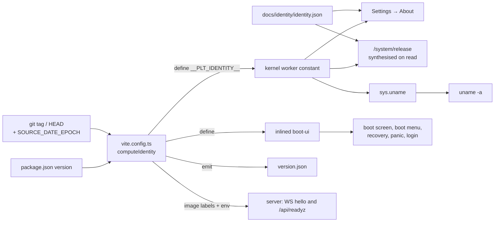

# Identity and branding

| Field | Value |
|---|---|
| Title | Plotinium identity and branding: name, tagline, wordmark, logo, versions, kernel identifier, registration |
| Status | Draft v0.1, 2026-09-24 |
| Primary owner | R3 WM/UI Subsystem Lead |
| Secondary reviewer | R5 QA/DevOps & Integration Engineer |
| Must be demonstrable at | **G0 Registration (Week 2):** name, alternative name, tagline, Appendix D form. **P2 gate (Week 7, v0.2.0):** complete identity kit in `/system/branding` and `docs/identity/`, name on every §5.3 surface, `uname`. |
| Requirement IDs covered | Spec §5.1, §5.2, §5.3 (no numbered IDs; tracked here as PLT-ID-01..17). Identity parts of BOOT-01. |
| Related specs | [Spec index](../README.md) · [Requirements traceability](./requirements-traceability.md) · [Glossary](./glossary.md) · [UI design system (tokens)](../05-wm/ui-design-system.md) · [Boot and services](../02-boot/boot-and-services.md) · [Shell and terminal](../07-shell/shell-and-terminal.md) · [Virtual file system](../04-vfs/virtual-file-system.md) · [System-call ABI](../01-architecture/syscall-abi.md) · [Deployment and CI](../14-devops/deployment-and-ci.md) · [Implementation plan](../16-delivery/implementation-plan.md) |

---

## 1. Purpose and scope

This spec fixes Plotinium's identity: the name and its origin, how to say it and write it, the tagline, the logo brief, the version and release-tag scheme, the kernel identifier printed by `uname`, the `/system/release` file, and every place the name must appear. It also drafts the Appendix D registration form.

In scope: the rules and data shapes that make the identity consistent and testable.
Out of scope, owned elsewhere:
- colours, typography, spacing and motion values: [05-wm/ui-design-system.md](../05-wm/ui-design-system.md) (this spec only points to the tokens);
- boot-screen layout and progress behaviour: [02-boot/boot-and-services.md](../02-boot/boot-and-services.md);
- the `uname` command's argument parsing inside the shell: [07-shell/shell-and-terminal.md](../07-shell/shell-and-terminal.md) (this spec fixes its output);
- the image, tag and release pipeline: [14-devops/deployment-and-ci.md](../14-devops/deployment-and-ci.md).

Spec §16.3 makes the name and identity kit an **entry requirement**: without a registered name or a working boot screen, the Phase 2 gate is not passed.

## 2. Requirements table

`Spec:` rows restate the capstone specification. `Plotinium design` rows are our own normative choices.

| ID | Summary | Spec § | How verified |
|---|---|---|---|
| PLT-ID-01 | Spec: MUST, §5. A decent, original name is registered with the Appendix D form by the end of Week 2; a signed scan is committed to `docs/registration.pdf`. | §5 p14, App. D p55 | Gate check: file present, 5 signatures, instructor approval recorded. |
| PLT-ID-02 | Spec: MUST, §5.2. The name and wordmark are written the same way everywhere, with capitalisation and spacing fixed: `Plotinium`. | §5.2 p15 | Wordmark lint over UI strings, docs, manifest (§8). |
| PLT-ID-03 | Spec: MUST, §5.2. An SVG logo legible at 16 px (favicon, taskbar) and at 256 px (boot screen). | §5.2 p15 | Playwright renders at 16 px and 256 px in both themes; screenshots reviewed on the P2 gate PR. |
| PLT-ID-04 | Spec: MUST, §5.2. SemVer `MAJOR.MINOR.PATCH` starting at `0.1.0`; tags `v0.2.0` (P2), `v0.3.0` (P3), `v0.4.0` (P4), `v1.0.0` (final). Codenames are optional. | §5.2 p15 | Release workflow tag check. |
| PLT-ID-05 | Spec: MUST, §5.2. One tagline that states what Plotinium does that Puter and daedalOS do not. | §5.2 p15 | Review at G0; identical string in README, About and manifest (test). |
| PLT-ID-06 | Spec: MUST, §5.2. Colours, typography, spacing and motion in one tokens file used by every system screen; light and dark themes. | §5.2 p15 | Owned and tested by [ui-design-system](../05-wm/ui-design-system.md). |
| PLT-ID-07 | Spec: MUST, §5.2. `uname` prints the name, version, short build hash and build date. | §5.2 p15–16 | Unit test on the formatter; e2e in the Terminal. |
| PLT-ID-08 | Spec: MUST, §5.3. The name appears on the boot screen, boot menu, recovery console and login screen. | §5.3 p15 | e2e screen checks. |
| PLT-ID-09 | Spec: MUST, §5.3. Settings → About shows name, version, build hash, build date and team members. | §5.3 p15 | e2e. |
| PLT-ID-10 | Spec: MUST, §5.3. Browser tab title, favicon and installable app manifest carry the name. | §5.3 p15 | e2e + manifest unit test. |
| PLT-ID-11 | Spec: MUST, §5.3. Repository name, README header, report cover, slides and demo-video title carry the name. | §5.3 p15 | Release checklist (manual, recorded in the gate evidence). |
| PLT-ID-12 | Spec: MUST, §5.2. The identity kit is in `/system/branding` and in `docs/` by the P2 gate. | §5.2 p15 | mkfs test + byte comparison. |
| PLT-ID-13 | Plotinium design. `/system/release` follows the spec's example layout (§5.2 p16) and is a kernel-synthesised, read-only file. | §5.2 p16 (example) | `cat` test; write test. |
| PLT-ID-14 | Plotinium design. One build identity feeds every surface; boot screen, `uname`, About, `/system/release` and `version.json` never disagree. | §5.2 | Consistency e2e. |
| PLT-ID-15 | Plotinium design. A release is built from a clean tree whose tag equals the root `package.json` version. | §5.2 | Release workflow check. |
| PLT-ID-16 | Plotinium design (supports §5.1 "decent and professional", "no political references"). No weapons, war or radiation-hazard wording or imagery in any identity asset or UI string. | §5.1 p15 | Identity lint (§8). |
| PLT-ID-17 | Spec: MUST, §5.1. After Phase 1 the name changes only with the instructor's written approval. | §5.1 p15 | Process rule; any rename after W4 needs an ADR with the approval attached. |

## 3. Design (normative)

### 3.1 The name

**Plotinium** (Plotinium design).

- **Origin.** A coined word formed from **plutonium**, chemical element 94, symbol **Pu**. Element 94 was named after the dwarf planet Pluto ([Wikipedia: Plutonium](https://en.wikipedia.org/wiki/Plutonium)). Spec §5.1 lists coined words and astronomy as good sources of names.
- **What the name stands for.** The element's physical character, never its uses:
  - **Density.** Alpha plutonium, the room-temperature phase, has a density of about 19.8 g/cm³ ([Wikipedia: Allotropes of plutonium](https://en.wikipedia.org/wiki/Allotropes_of_plutonium)). Plotinium packs a complete multi-user operating system (processes, paging, a UNIX-like file system, sync and AI services) into one browser tab.
  - **Energy.** The element is energy-rich. Plotinium does real work: it boots, schedules, pages, persists and reasons.
  - **Phases.** Plutonium has six solid phases (allotropes) at ordinary pressure, each with its own crystal lattice ([Wikipedia: Allotropes of plutonium](https://en.wikipedia.org/wiki/Allotropes_of_plutonium)). Our optional release codenames follow them (§3.7).
- **Pronunciation.** `ploh-TIN-ee-um`, IPA /ploʊˈtɪniəm/, stress on the second syllable, in the same pattern as "plu-TOH-nee-um". Spec §5.1 test sentence: *"Boot into Plotinium and open the terminal."*
- **Length and alphabet.** 9 Latin letters, inside the 3–16 character rule of §5.1.

**How to talk about the name (MUST, for every member, in the report, slides and viva):**

| Say | Never say or show |
|---|---|
| "Coined from plutonium, element 94." | Any weapons, war, military or test reference. |
| "Dense and energetic, like the element." | "Nuclear", "atomic bomb", "fission", "critical mass", "meltdown", "fallout", "reactor", "radioactive", "glowing". |
| "Named, like the element, after the dwarf planet Pluto." | Any reference to the mythological figure Pluto (a religious reference, banned by §5.1). |
| "Plutonium has six solid phases; our release codenames follow their crystal lattices." | The radiation trefoil (U+2622), biohazard sign, hazard stripes, green "glow" palettes, mushroom-cloud shapes. |

OS vocabulary that the capstone spec itself uses ("kernel panic", "critical service", "critical path", "atomic" and "atomicity" in the ACID sense) is allowed. The ban covers identity assets, the tagline, marketing copy and UI chrome. The identity lint (PLT-ID-16) therefore matches the banned phrases above as whole phrases ("atomic bomb", not "atomic") and runs only over `docs/identity/**`, `web/public/**`, `index.html`, `wm/boot-ui/**` strings, the manifest and the README header block.

**Viva answer, if an examiner raises plutonium's weapons history** (Plotinium design): *"The name refers to the element's physical properties, density and energy. We use no imagery or wording from its military uses, and the logo is a P drawn as an electron shell (the Bohr P), not a hazard symbol. The same element's isotope Pu-238 is also a spacecraft heat source."* Source for the last point: [Wikipedia: Plutonium](https://en.wikipedia.org/wiki/Plutonium) ("a heat source in radioisotope thermoelectric generators, which are used to power some spacecraft").

### 3.2 Compliance with the naming rules (§5.1)

| §5.1 rule | Status for "Plotinium" | Evidence or action |
|---|---|---|
| Original: not an existing OS or major software product; not confusingly similar to a registered trademark | No OS, software product or company named "Plotinium" was found in web searches on 2026-09-23 and 2026-09-24; the nearest names are unrelated plotting tools (Ploticus, Plotutils, Plottr). A web search is not a trademark search. | R3 checks the [WIPO Global Brand Database](https://branddb.wipo.int/) before submitting the form and attaches the screenshot to the G0 PR (open question Q1). |
| Decent and professional: no profanity, slurs, innuendo, political, sectarian or religious references, or names of real people | **Risk.** The spelling resembles **Plotinus** (c. 205–270), the founder of Neoplatonism, a real person whose philosophy has mystical and religious dimensions ([Stanford Encyclopedia of Philosophy: Plotinus](https://plato.stanford.edu/entries/plotinus/)). | Register the origin explicitly as "coined from plutonium; not a person's name". Put an alternative name on the form (§3.3). Ask the instructor to confirm acceptability in writing at registration (Q2). |
| Short and pronounceable: 3–16 Latin letters | 9 letters; passes the spoken test. | — |
| Unique in the cohort: first come, first served | Unknown until submitted. | Submit in Week 1, not at the Week 2 deadline (Q3). |
| Stable: changes after Phase 1 need written approval | Applies from W4. | PLT-ID-17. Every technical identifier is derived from one constant (§4.1), so a rename before W4 is one PR. |

### 3.3 Alternative name (for the form)

**Tabium** (Plotinium design): coined from *tab* (the whole operating system runs inside one browser tab) plus *-ium*, the suffix of element names. It keeps the element style, has 6 letters, and is pronounced `TAB-ee-um` (/ˈtæbiəm/). Spoken test: *"Boot into Tabium and open the terminal."* It has no political, sectarian or religious meaning and is not a person's name. A web search on 2026-09-24 found no operating system, software product or company with this exact name; the nearest names are unrelated products (TABu, a bar-payment app; Appium, a test-automation tool). The same WIPO check as for Plotinium applies (Q1).

Candidates checked on 2026-09-24 and rejected (Plotinium design):

| Candidate | Why rejected | Evidence |
|---|---|---|
| Kernium (kernel + -ium) | An existing company name (Kernium S.A., intralogistics, Argentina); a trademark conflict cannot be ruled out | [ZoomInfo: Kernium S.A.](https://www.zoominfo.com/c/kernium-sa/429967596) |
| Orbitium (orbit + -ium) | Confusingly similar to Orbitum, an existing web browser | [Amazon Appstore: Orbitum](https://www.amazon.com/Orbitum-software-LLC/dp/B01674OLXO) |
| Lattium (lattice + -ium) | Confusingly similar to Latium Technologies, an existing app developer | [Google Play: Latium Technologies](https://play.google.com/store/apps/developer?id=Latium+Technologies+Inc.&hl=en) |
| Tessium | An existing AI software company | [tessium.ai](https://tessium.ai/) |
| Ravium (Ravi river + -ium) | The Ravi is a transboundary river allocated under the Indus Waters Treaty, which is a political subject (§5.1) | [Wikipedia: Indus Waters Treaty](https://en.wikipedia.org/wiki/Indus_Waters_Treaty) |
| Nimbium (nimbus + -ium) | "Nimbus" is also the halo in religious iconography (§5.1 bans religious references) | [Wikipedia: Halo (religious iconography)](https://en.wikipedia.org/wiki/Halo_(religious_iconography)) |

If the instructor rejects "Plotinium" before the P1 defence, the team switches to the alternative in one PR: the display name, the slug (`tabium`), the npm scope, the IndexedDB and Web Lock names, the cookie prefix and the repository name all come from the constants in §4.1. No user data exists before P1, so renaming the IndexedDB database costs nothing. This contingency is the only case in which the canonical identifiers of decision C1 change.

### 3.4 Taglines

Each candidate names all three things Plotinium does that the two §7 benchmarks do not: **offline-first** execution (answers Puter's cloud coupling, §7.1), **memory paging** (answers daedalOS's memory bloat, §7.2) and **AI as a system service** (answers Puter's superficial AI layer, §7.1). Spec §7.2 also names daedalOS's missing multi-tenant orchestration; candidate 2 touches it through "permission-checked". Character counts were computed, not estimated.

| # | Candidate | Chars | Offline-first | Memory paging | AI as a system service |
|---|---|---|---|---|---|
| **1 (recommended)** | **A local-first web OS that pages its own memory and lets AI act only through the kernel.** | 87 | "local-first" | "pages its own memory" | "AI act only through the kernel" |
| 2 | Runs offline, pages memory out to swap, and schedules AI as a permission-checked process. | 89 | "Runs offline" | "pages memory out to swap" | "schedules AI as a permission-checked process" |
| 3 | Offline-first, memory-paged, AI-native: a web OS where the kernel decides. | 74 | "Offline-first" | "memory-paged" | "AI-native … the kernel decides" |
| 4 | Works offline, swaps out what it cannot hold, and runs AI as a system service. | 78 | "Works offline" | "swaps out what it cannot hold" | "runs AI as a system service" |
| 5 | Dense by design: a web OS that runs offline, pages its memory and schedules its AI. | 83 | "runs offline" | "pages its memory" | "schedules its AI" |

**Selection rule** (Plotinium design): the team votes at the W2 meeting under the TEAM_CONTRACT decision rule. The chosen tagline MUST be at most 90 characters, MUST name all three differentiators explicitly, and MUST be claimable at the final defence (each differentiator is backed by a gate demonstration: OFF-01, MEM-06, the §3.4 litmus test). Candidate 1 is recommended: it is the clearest of the five, and "act only through the kernel" states the §3.4 trust boundary ("the model proposes, the kernel decides") in six words.

The chosen tagline is stored once, in `docs/identity/identity.json` (§4.1), and appears in the README header, Settings → About, the web manifest `description`, the report cover, the title slide and the registration form.

### 3.5 Wordmark rules

- **Canonical form:** `Plotinium`. Capital P, the other eight letters lower case, one word, no space, no "OS" suffix (spec §5.1 allows one; we do not use it), no ™ or ®.
- **Forbidden variants in user-visible text:** `PLOTINIUM`, `plotinium`, `PlotiniumOS`, `Plotinium OS`, `Plotinium-OS`, `P.OS`, abbreviations. All-caps is allowed only where a CSS `text-transform` is applied for a visual style that screen readers still read as "Plotinium" (the source string stays canonical).
- **Technical slug** (not user-visible text): `plotinium`, lower case. It is the only allowed form in identifiers: the npm scope `@plotinium/*`, the IndexedDB databases `plotinium` and `plotinium-swap`, Web Lock and BroadcastChannel names `plotinium:*`, the repository `plotinium`, image names `ghcr.io/<org>/plotinium-*`, the env prefix `PLOTINIUM_*`, the GUC `plotinium.*`. The cookie uses the short prefix `plt` (`__Host-plt_sid` / `plt_sid`), and design tokens use `--pl-*`; neither is a display form.
- **Wordmark artwork.** `docs/identity/wordmark.svg` is drawn by the team as SVG outlines, so it renders identically on every OS without a web font. If it is traced from an OFL-licensed font, the font is credited in `THIRD_PARTY.md`.
- **Lock-up.** Logo mark to the left of the wordmark. Mark height = 1.25 × wordmark cap height. Gap between them = 0.5 × mark height. Clear space around the lock-up ≥ the wordmark x-height on all sides.
- **Minimum size.** Wordmark cap height ≥ 12 CSS px on screen; below that, use the mark alone.
- **Colour.** The wordmark uses `--pl-text`; the mark uses `--pl-accent` (two-tone variant) or `currentColor` (mono). No gradients, glows, outlines or drop shadows.

### 3.6 Logo brief (SVG)

**The mark: the "Bohr P"** (decided 2026-09-27; full record, exploration boards and contact sheets in [docs/design/logo/DECISION.md](../../docs/design/logo/DECISION.md)). An electron shell around a dense nucleus, open at 1:30 where the one electron sits. The shell grows a stem on its left, so the atom is also the P of Plotinium. It keeps the research identity's concept, *a plotted point on an orbit*: the electron is the plotted point in the shell's gap. It replaced the two-orbit "luminous atom" (and the earlier open-ring brief), which blurred into a smudge at the 16–20 px sizes where the mark is seen most. It avoids the three-ellipse "atom" icon, the radiation trefoil and any hazard symbolism (PLT-ID-16), and it is not the spec's illustrative Figure 6.1 mark (a ring with a centred dot): the stem and the electron set it apart.

**Construction** (normative; four filled shapes, no strokes, on a 24-unit grid):

| Shape | Geometry (24-unit grid) |
|---|---|
| stem | x 4.5 to 7.5, y 9 to 22.5, round at both ends (the top end hides under the shell) |
| shell | ring round (12, 9), outer radius 7.5, inner 4.5 (3 units wide), round ends, open 93° round the electron |
| nucleus | disc r 2.8 at (12, 9), 1.7 units clear of the shell |
| electron | disc r 2 on the shell's centre line (radius 6) at −45°, 1.25 units clear of each shell end |

**Normative constraints**, checked at every P2 review:

| Constraint | Value | Why |
|---|---|---|
| Canvas | `viewBox="0 0 24 24"`; the favicon is redrawn on its own 16-unit grid | the master's edges fall on multiples of 1.5 units, so on whole pixels at 16, 32 and 48 px |
| Outline at 16 px | at most 2 shapes (the P body and the electron; the nucleus sits in the counter) | a silhouette that survives 16 px |
| Shell and stem width | 3 units (2 px at 16 px); favicon 2 px | no hairline at the smallest size |
| Smallest shape | the electron, ≥ 2.5 px across at 16 px | it stays a dot when downscaled |
| Clearance | electron ≥ 1 px from each shell end, nucleus ≥ 1 px from the shell, at 16 px | the shapes stay separate |
| Forbidden | strokes, hairlines, filters, text, raster images in the mark itself (the app icon tile may use gradients and shadows) | legibility, and no stylesheet can thin a filled mark |
| Colour | light: shell and stem `--pl-logo-orbit-a` #5856D6, nucleus `--pl-logo-core`; dark: #B3B1FF, a white nucleus and a light electron; `glyph-mono.svg` and `logo-mono.svg` use `currentColor` | theme-aware, in the violet accent family |
| Hinting | `atomLogoFor(size)` (`ui/src/icons/atom-logo.ts`) picks the master, a drawing hinted for 20 px or one hinted for 24 px; the favicon has its own drawing | the same design, sharp at every size |
| Motion | the boot splash turns the electron and the shell's gap one step round the nucleus per real boot event, and flashes the nucleus when a service starts; still under reduced motion. Elsewhere the mark only fades or scales in, never rotates | the stem is the P and must stay upright |

**Where it is used.** Every inline use goes through `AtomLogo` (`ui/src/icons`): the menu bar, the login corner, Settings → About, Search, the agent confirmation sheet, the update and shutdown dialogs. The boot splash, boot menu, panic, recovery and unsupported-browser screens use `logoSvg` (`ui/src/boot/logo.ts`); the build inlines the splash into `index.html`, so the first paint shows the mark with no script.

**Files** (all team-made; copied into `web/public` and `web/public/branding` by `docs/design/logo/build-identity.mjs`, and mirrored to `/system/branding/`):

| File | Purpose |
|---|---|
| `docs/identity/glyph.svg`, `glyph-mono.svg` | the mark alone, two-tone and `currentColor` |
| `docs/identity/logo.svg`, `logo-mono.svg` | the mark for ≥ 64 px uses (boot screen at 96–256 px, About, report cover) and its `currentColor` version (small UI) |
| `docs/identity/wordmark.svg`, `lockup.svg` | the outlined wordmark, and the mark with the wordmark |
| `docs/identity/favicon.svg` | the 16-unit favicon drawing with an internal `<style>` and `@media (prefers-color-scheme: dark)`, because a favicon cannot read the page's CSS |
| `docs/identity/app-icon.svg`, `maskable-icon.svg` | the macOS-grid app tile with the white mark; the maskable version keeps the mark inside the 80% safe circle |
| `web/public/icons/*.png` | favicon, touch and PWA icons, rendered by `docs/identity/render-png.mjs` |
| `docs/identity/usage.md` | this section's rules in short form, for anyone making slides or the video |

### 3.7 Version scheme, release tags and codenames

**Versioning** (Spec: MUST, §5.2):
- SemVer 2.0.0 `MAJOR.MINOR.PATCH`, starting at `0.1.0` (the current version, 2026-09-24).
- Gate tags: `v0.2.0` P2 (W7), `v0.3.0` P3 (W11), `v0.4.0` P4 (W14), `v1.0.0-rc.N` feature freeze (W16), `v1.0.0` final (W18).
- A fix after a gate tag is a patch release, e.g. `v0.3.1`. After `v1.0.0`, `v1.0.x` only with the instructor's permission.

**Source of truth** (Plotinium design):
- The root `package.json` `version` holds the **next** release. After tagging `vX.Y.0`, R5 bumps it to the next minor in a `chore(release)` PR.
- A release build is made only from a tag `vX.Y.Z[-rc.N]` whose version equals `package.json`, on a clean tree (PLT-ID-15).
- Any other build is a development build: `X.Y.Z-dev.N`, where `N` is the number of commits since the last `v*` tag. SemVer orders `0.3.0-dev.14` before `0.3.0`, which is correct.
- The kernel release string follows the spec's display format `0.3.0-a1f93c2` (§5.2 p16). Note for the viva: in strict SemVer, `-a1f93c2` would be a pre-release label; the machine-readable form of the same fact is `0.3.0+a1f93c2`, which `version.json` carries as separate `version` and `build` fields.
- `protocol/` carries its own integer `ABI_VERSION`, bumped on any breaking syscall or wire change ([syscall ABI](../01-architecture/syscall-abi.md)). It is independent of the OS version.

**Codenames** (Spec: MAY, §5.2; Plotinium design): named after the **crystal lattices of plutonium's solid phases**, in increasing lattice symmetry, so the system "gains symmetry" as it becomes complete. The holohedral point-group orders are 4 (monoclinic) < 8 (orthorhombic) < 16 (tetragonal) < 48 (cubic).

| Tag | Phase | Codename | Plutonium phase(s) with this lattice ([source](https://en.wikipedia.org/wiki/Allotropes_of_plutonium)) |
|---|---|---|---|
| `v0.1.0` | Registration and P1 | none | development baseline |
| `v0.2.0` (+ patches) | P2 · VFS and window manager | **Monoclinic** | α (simple monoclinic, the room-temperature phase), β (body-centred monoclinic) |
| `v0.3.0` (+ patches) | P3 · scheduler and persistence | **Orthorhombic** | γ (face-centred orthorhombic) |
| `v0.4.0` (+ patches) | P4 · foundational AI layer | **Tetragonal** | δ′ (body-centred tetragonal) |
| `v1.0.0-rc.N`, `v1.0.0` | Freeze and final | **Cubic** | δ (face-centred cubic), ε (body-centred cubic) |

Codenames appear only in Settings → About, `/system/release` (line 3), the GitHub Release title (`Plotinium v0.3.0 "Orthorhombic"`) and `CHANGELOG.md`. They never replace the version.

Rejected schemes:
- *Isotope numbers (Pu-238, Pu-239, …).* Only Pu-238 has a clearly civilian primary association (spacecraft heat sources); the others are mainly known from weapons or reactor fuel. A series would drift into PLT-ID-16 territory.
- *Greek phase letters (Alpha, Beta, Gamma, …).* "Alpha" and "Beta" collide with pre-release meaning, and "Gamma" evokes radiation.

### 3.8 Kernel identifier: `uname`

Spec §5.2 p16 example: `YourOS 0.3.0 (kernel 0.3.0-a1f93c2, built 2026-11-02) · Chrome 153 · 8 cores · uid=1001(student)`.

**Plotinium output (Spec: MUST, §5.2, PLT-ID-07):**

```text
alice@plotinium:~$ uname -a
Plotinium 0.3.0 (kernel 0.3.0-a1f93c2, built 2026-11-02) · Chrome 154 · 8 cores · uid=1001(alice)
alice@plotinium:~$ uname
Plotinium
alice@plotinium:~$ uname -r
0.3.0-a1f93c2
alice@plotinium:~$ uname -v
built 2026-11-02
alice@plotinium:~$ uname -m
Chrome 154 · 8 cores
```

Field rules (Plotinium design):

| Field | Value | Source |
|---|---|---|
| name | `Plotinium` | build identity |
| version | `0.3.0`, or `0.3.0-dev.14` on a development build | build identity |
| kernel release | `<version>-<build>`; on a dirty local build `<version>-<build>+dirty` | build identity |
| build date | `YYYY-MM-DD`, UTC, derived from `SOURCE_DATE_EPOCH` (the tagged commit's committer time), so the same tag always gives the same string | build identity |
| browser | `<brand> <major>`: `Chrome`, `Edge` or `Chromium` and its major version | `navigator.userAgentData.brands` in the kernel worker (GREASE brands ignored), falling back to parsing `navigator.userAgent`; `Unknown browser` if neither works |
| cores | `<n> cores` (`1 core` when n = 1) | `navigator.hardwareConcurrency` in the kernel worker |
| identity | `uid=<uid>(<username>)` of the **calling process's effective credentials**: `uid=0(root)` inside a `su` shell | PCB `cred` |
| separators | `" · "`: space, U+00B7 MIDDLE DOT, space | spec example |

Options: `-a`, `-s` (default), `-r`, `-v`, `-m`. Combined short options (e.g. `-sr`) print the selected fields in the order s, r, v, m separated by one space. Any other option prints `uname: invalid option -- 'x'` and exits 2 (the syscall is not made).

### 3.9 `/system/release`

Spec §5.2 p16 example:

```text
NAME="YourOS"   VERSION="0.3.0"   BUILD="a1f93c2"
TEAM="Section D · Team 04"
```

**Plotinium format (Plotinium design, PLT-ID-13).** Lines 1 and 2 follow the spec's layout exactly (keys in this order, pairs separated by three spaces). Line 3 is optional extra data in the same syntax.

```text
alice@plotinium:~$ cat /system/release
NAME="Plotinium"   VERSION="0.3.0"   BUILD="a1f93c2"
TEAM="Section <S> · Team <NN>"
CODENAME="Orthorhombic"   BUILD_DATE="2026-11-02"   ABI="1"
```

Placeholders `<S>` and `<NN>` are filled from `docs/identity/identity.json` once the instructor assigns them on the registration form.

**The file is kernel-synthesised** (Plotinium design): it has a fixed well-known inode id from `protocol/` and mode `0444`, owner `root:root`, and its content is generated from the running kernel's build identity on every read. It is not stored in IndexedDB and never synced to the server, so after an OFF-05 update and reboot it always matches the running build, even offline, and it cannot drift between devices on different versions. Writes, `unlink`, `rename`, `chmod` and `chown` on it fail with `EPERM` for every uid, including root (see §6). The VFS supports kernel-synthesised read-only files for this purpose ([virtual-file-system.md](../04-vfs/virtual-file-system.md) PVFS-09, fixed id `…-000000000100`); the logs under `/system/log` use the same mechanism.

### 3.10 Where the name must appear (§5.3 checklist)

`M` = spec-mandated surface (§5.3). `P` = additional Plotinium surface.

| # | Surface | What is shown | Source | Owner | Test |
|---|---|---|---|---|---|
| 1 | Boot screen (M) | 96 px mark, wordmark, `version 0.3.0 · build a1f93c2`, painted from inlined HTML before any JS chunk loads | inlined build identity | R3 | BOOT-01, PLT-ID-08 |
| 2 | Boot menu (M) | header `Plotinium Boot Manager` | build identity | R3 | PLT-ID-08 |
| 3 | Recovery console (M) | header `Plotinium Recovery Console · 0.3.0 (a1f93c2)` | build identity | R3 (R5) | PLT-ID-08 |
| 4 | Login screen (M) | mark and wordmark above the user tiles; footer `Plotinium 0.3.0` | build identity | R3 | PLT-ID-08 |
| 5 | Kernel panic screen (P) | title `Plotinium kernel panic`, then the cycle or diagnostic | build identity | R3 (R5) | PLT-ID-08 |
| 6 | Unsupported-browser screen (P) | `Plotinium cannot start in this browser`, then each missing capability | build identity | R3 | PLT-ID-08 |
| 7 | Second-tab takeover screen (P) | `Plotinium is running in another tab — [Use here]` | build identity | R3 (R1) | PLT-ID-08 |
| 8 | Verbose boot log, first line (P) | `[    0.000] firmware: Plotinium 0.3.0 · POST ok (…)`, mirroring the spec's reference log (§6.6) | build identity | R5 | BOOT-05 |
| 9 | Settings → About (M) | mark, wordmark, tagline, version and codename, build hash, build date, `Section <S> · Team <NN>`, the five members with their roles, licence, links to the repository and `THIRD_PARTY.md`, and a "Copy uname" button | build identity + `identity.json` | R3 | PLT-ID-09 |
| 10 | Browser tab title (M) | `Plotinium` (static) | `index.html` `<title>` | R3 | PLT-ID-10 |
| 11 | Favicon (M) | `favicon.svg` | `index.html` `<link rel="icon">` | R3 | PLT-ID-10 |
| 12 | Installable app manifest (M) | `name` and `short_name` = `Plotinium`; `description` = tagline; icons | vite-plugin-pwa `manifest` option | R5 (R3) | PLT-ID-10 |
| 13 | `uname`, `/system/release`, `/version.json` (M for `uname`) | §3.8, §3.9, §4.2 | build identity | R1 (R3) | PLT-ID-07, PLT-ID-13, PLT-ID-14 |
| 14 | Secure prompt frame (P) | mono mark and a lock glyph in the compositor-owned frame used by `su` and agent confirmation | `logo-mono.svg` | R3 | [ui-design-system](../05-wm/ui-design-system.md) tests |
| 15 | `help` banner and `man` footer (P) | `Plotinium 0.3.0 shell — type 'man <command>'`; man pages end with `Plotinium 0.3.0` | build identity | R3 | [shell spec](../07-shell/shell-and-terminal.md) tests |
| 16 | Repository name (M) | `github.com/<org>/plotinium` | — | R5 | PLT-ID-11 |
| 17 | README header (M) | logo, `Plotinium`, tagline, live URL | `identity.json` | R3 | PLT-ID-11 |
| 18 | Technical report cover (M) | logo, name, tagline, `v1.0.0 "Cubic"`, team | Typst template reads `identity.json` | R1 (editor) | PLT-ID-11 |
| 19 | Slides (M) | title slide and footer | Typst template reads `identity.json` | R3 | PLT-ID-11 |
| 20 | Demo video title (M) | first frame and file name `Plotinium v1.0.0 — <title>` | — | R3 (R5) | PLT-ID-11 |
| 21 | Release artefacts (P) | GitHub Release title `Plotinium v0.3.0 "Orthorhombic"`, `CHANGELOG.md` headings, image names `ghcr.io/<org>/plotinium-web` and `plotinium-app` | release workflow | R5 | PLT-ID-11 |
| 22 | Registration form (M) | §3.13 | — | R5 (all sign) | PLT-ID-01 |

### 3.11 Design tokens (pointer)

The single tokens file is `wm/tokens/tokens.css`, specified in [05-wm/ui-design-system.md](../05-wm/ui-design-system.md) (PLT-ID-06). It is inlined into `index.html` for the boot screen, seeded to `/system/branding/tokens.css` and copied to `docs/identity/tokens.css`. The identity assets use only these roles: `--pl-accent` (ring), `--pl-text` (point, wordmark), `--pl-bg` and `--pl-surface` (backgrounds), and `--pl-font-ui`. The favicon and maskable icons are the only assets that cannot read CSS; their colours are generated from `tokens.css` at build time (§3.6). Identity colours must meet the contrast rules of the design-system spec in both themes.

### 3.12 Identity kit: contents and locations (§5.2)

| Item (§5.2) | `docs/identity/` | `/system/branding/` (seeded at mkfs, root:root 0644, directory 0755) |
|---|---|---|
| Name and wordmark | `wordmark.svg`, `identity.json` | `wordmark.svg`, `identity.json` |
| Logo | `logo.svg`, `logo-mono.svg`, `favicon.svg` | same files |
| Version scheme | `usage.md` §versioning (this spec, short form) | `usage.md` |
| Tagline | `identity.json` | `identity.json` |
| Design tokens | `tokens.css` (copy) | `tokens.css` |
| Kernel identifier | `usage.md` (format) | `/system/release` (synthesised, §3.9) |

The `/system/branding` directory has a fixed well-known id (decision C5). The files inside it are created identically by the client mkfs and the server seed, with fixed ids from `protocol/wellknown/seed-ids.json` ([virtual-file-system.md](../04-vfs/virtual-file-system.md) PVFS-02).

### 3.13 Registration form draft (Appendix D)

Due **by the end of Week 2**, signed by all five members; a scan is committed to `docs/registration.pdf` (owner R5). Fields in angle brackets are placeholders for the team.

**Operating system identity**

| Field | Entry |
|---|---|
| Proposed OS name | **Plotinium** |
| Alternative name (if the first is taken) | **Tabium** (coined from "tab" + "-ium": the whole OS runs in one browser tab) |
| Tagline (one line) | A local-first web OS that pages its own memory and lets AI act only through the kernel. *(or the candidate chosen under §3.4)* |
| Meaning or origin of the name | A coined word from *plutonium* (Pu, element 94), a dense, energy-rich metal. Plotinium packs a complete multi-user OS into one browser tab and does real work. Pronounced "ploh-TIN-ee-um". Not a person's name; no political or religious reference. |

Wording rules for the "Meaning or origin" line (Plotinium design): it MUST say "coined" and "element 94"; it MUST describe the element's physical character only (density, energy); it MUST state "not a person's name" because of the Plotinus resemblance (§3.2); it MUST NOT mention any use of the element. The line above is 243 characters and fits the form's single line when written at 9 pt; if it does not fit by hand, write the first two sentences and the last one.
| Repository URL | `https://github.com/<org>/plotinium` |
| Section | `<S>` |

**Team members and roles (exactly five).** The "Reviews" column lists what each member reviews as the named secondary reviewer (spec §4.2). The authoritative matrix is `TEAM_CONTRACT.md` and `.github/CODEOWNERS` ([implementation plan](../16-delivery/implementation-plan.md)).

| # | Name | Roll number | Primary role | Reviews | Signature |
|---|---|---|---|---|---|
| 1 | `<name>` | `<roll no.>` | Kernel / Systems Architect | VFS and client store; compositor and app views; CI and performance harness | `<signature>` |
| 2 | `<name>` | `<roll no.>` | VFS / Database Engineer | memory manager and swap; sync and lock clients; agent executor; LLM gateway | `<signature>` |
| 3 | `<name>` | `<roll no.>` | Window Manager / UI Lead | file coreutils; boot orchestration | `<signature>` |
| 4 | `<name>` | `<roll no.>` | AI Pipeline Specialist | Terminal and shell; keyword search; syscall protocol | `<signature>` |
| 5 | `<name>` | `<roll no.>` | QA / DevOps & Integration | kernel core and dispatcher; database schema, migrations and sync engine; boot UI | `<signature>` |

**Intended AI subsystems (at least two):** [x] A. Semantic VFS search (RAG) · [x] B. Agentic system execution · [x] C. Predictive pre-fetching. (A and B are built deep, C lean but complete; decision C12.)

**Declaration** (as printed on the form): "We confirm that our team has exactly five members; that the name above is original and appropriate under Section 5.1; that we have read this specification in full; that every member will be examined on the whole system; and that our marks will be moderated individually using the viva, the contribution evidence and peer assessment (Section 16.4). We have signed the team contract (Section 4.4)."

| Date | Instructor approval | Name registered as | Team code |
|---|---|---|---|
| `<date>` | *(instructor)* | *(instructor)* | *(instructor)* |

## 4. Interfaces and data shapes

### 4.1 Identity constants and build identity

```ts
// protocol/src/identity.ts  (Plotinium design; pure, no DOM, no Node)
import * as v from 'valibot';

export const OS_NAME = 'Plotinium' as const;   // display form; the only user-visible spelling
export const OS_SLUG = 'plotinium' as const;   // technical identifiers (npm scope, IDB, locks, repo)

export type RoleCode = 'R1' | 'R2' | 'R3' | 'R4' | 'R5';

export const BuildIdentitySchema = v.object({
  name: v.literal(OS_NAME),
  version: v.pipe(v.string(), v.regex(/^\d+\.\d+\.\d+(?:-(?:rc|dev)\.\d+)?$/)),
  build: v.pipe(v.string(), v.regex(/^[0-9a-f]{7}(?:\+dirty)?$/)),
  buildDate: v.pipe(v.string(), v.regex(/^\d{4}-\d{2}-\d{2}$/)),    // UTC, from SOURCE_DATE_EPOCH
  codename: v.nullable(v.picklist(['Monoclinic', 'Orthorhombic', 'Tetragonal', 'Cubic'])),
  abi: v.pipe(v.number(), v.integer(), v.minValue(1)),
});
export type BuildIdentity = v.InferOutput<typeof BuildIdentitySchema>;

// docs/identity/identity.json, validated by this schema in CI
export const TeamIdentitySchema = v.object({
  tagline: v.pipe(v.string(), v.maxLength(90)),
  section: v.string(),                 // "<S>" until assigned
  teamCode: v.string(),                // "<NN>" until assigned
  members: v.pipe(
    v.array(v.object({ name: v.string(), role: v.picklist(['R1', 'R2', 'R3', 'R4', 'R5']) })),
    v.length(5),
  ),
});
export type TeamIdentity = v.InferOutput<typeof TeamIdentitySchema>;
```

- `web/vite.config.ts` computes `BuildIdentity` once per build and injects it with `define: { __PLT_IDENTITY__: JSON.stringify(identity) }` into every bundle: the inlined boot-ui, the main thread, `kernel.worker.ts`, executors and `sw.ts`.
- Roll numbers never enter the repository's runtime data; they exist only on the signed form.

### 4.2 `/version.json` (served by Caddy, emitted by the build)

```json
{ "name": "Plotinium", "version": "0.3.0", "build": "a1f93c2", "buildDate": "2026-11-02",
  "codename": "Orthorhombic", "abi": 1 }
```

Used by POST to check that the page is really Plotinium (another app on the same localhost port is caught; see [boot spec](../02-boot/boot-and-services.md)) and by the `update` service to detect a new version (OFF-05). The Service Worker serves it network-first, falling back to the cached copy offline.

### 4.3 `sys.uname` result

```ts
// shape of the value returned by the `uname` syscall (catalogue owned by 01-architecture/syscall-abi.md)
interface UnameInfo {
  sysname: 'Plotinium';
  version: string;          // BuildIdentity.version
  build: string;            // BuildIdentity.build
  buildDate: string;        // BuildIdentity.buildDate
  codename: string | null;
  browser: { brand: 'Chrome' | 'Edge' | 'Chromium' | 'Unknown browser'; major: number | null };
  cores: number;            // navigator.hardwareConcurrency, >= 1
  uid: number;              // caller's effective uid (from the port-bound PCB, never from args)
  user: string;             // username for uid
}
```

### 4.4 Output grammars (ABNF, RFC 5234)

```abnf
uname-a      = sysname SP version SP "(kernel " krelease ", built " date ")"
               SEP browser SEP cores SEP ident
SEP          = SP %xB7 SP                       ; " · "
krelease     = version "-" build
build        = 7HEXLC ["+dirty"]
version      = 1*DIGIT "." 1*DIGIT "." 1*DIGIT ["-" ("rc" / "dev") "." 1*DIGIT]
date         = 4DIGIT "-" 2DIGIT "-" 2DIGIT
browser      = ("Chrome" / "Edge" / "Chromium") SP 1*DIGIT / "Unknown browser"
cores        = 1*DIGIT (" cores" / " core")
ident        = "uid=" 1*DIGIT "(" username ")"
HEXLC        = DIGIT / %x61-66

release-file = line1 LF line2 LF [line3 LF]
line1        = kv-NAME 3SP kv-VERSION 3SP kv-BUILD
line2        = kv-TEAM
line3        = kv *(3SP kv)                      ; CODENAME, BUILD_DATE, ABI in this order
kv           = key "=" DQUOTE value DQUOTE
key          = 1*(%x41-5A / "_")
value        = *(%x20-21 / %x23-7E / UTF8-nonascii) ; no DQUOTE, no control characters
UTF8-nonascii = UTF8-2 / UTF8-3 / UTF8-4        ; as defined in RFC 3629 §4
```

The grammar is written over Unicode code points: `%xB7` is U+00B7 MIDDLE DOT, which is the two bytes `C2 B7` in the UTF-8 output. Terminal output and the file are always UTF-8.

A parser for `/system/release` is the regular expression `/([A-Z_]+)="([^"]*)"/g` applied to the whole file.

### 4.5 Web manifest fields (generated by vite-plugin-pwa)

`name: "Plotinium"`, `short_name: "Plotinium"`, `description: <tagline>`, `id: "/"`, `start_url: "/"`, `display: "standalone"`, `background_color` and `theme_color` from the light-theme `--pl-bg` and `--pl-accent`, icons `favicon.svg` (`sizes: "any"`) plus the maskable 192 and 512 PNGs.

## 5. Algorithms and invariants



**computeIdentity (build time, Plotinium design):**
1. `sha = git rev-parse --short=7 HEAD`; if `git status --porcelain` is non-empty, `build = sha + "+dirty"`.
2. If `HEAD` is exactly at a tag `vX.Y.Z[-rc.N]`: `version = X.Y.Z[-rc.N]` and it MUST equal `package.json` `version`, otherwise the build fails. Else `version = <package.json version>-dev.<commits since last v* tag>`.
3. `buildDate = UTC date of SOURCE_DATE_EPOCH`; CI sets `SOURCE_DATE_EPOCH = git log -1 --format=%ct`.
4. `codename` from the table in §3.7 keyed by `MAJOR.MINOR`; `null` for 0.1.
5. `abi = protocol ABI_VERSION`.
6. Validate with `BuildIdentitySchema`; a failure stops the build.
7. When `git` is unavailable (building from a source archive), `build = "0000000"` and `version` gets `-dev.0`; release builds from an archive are not allowed.

**Browser detection (kernel worker, once at boot):** take `navigator.userAgentData?.brands`, drop GREASE entries (brands that are not in the known list), pick the first of `Google Chrome`, `Microsoft Edge`, `Chromium` and map it to `Chrome`, `Edge`, `Chromium`; otherwise match `/(Chrome|Edg)\/(\d+)/` against `navigator.userAgent`; otherwise `Unknown browser`. O(b) for b brands, run once.

**Invariants:**
- I-1 (PLT-ID-14): every surface in §3.10 rows 1–13 reads the same `BuildIdentity`; no surface formats its own version string from another source.
- I-2 (PLT-ID-02): `OS_NAME` is the only source of the display name in code; string literals `"Plotinium"` outside `protocol/src/identity.ts`, tests, docs and `index.html` fail the wordmark lint.
- I-3 (PLT-ID-15): a `v*` tag, a clean tree and `package.json` agree, or no release artefact is produced.
- I-4 (PLT-ID-13): `/system/release` content is a pure function of `BuildIdentity` and `identity.json`.
- I-5: the build date is a function of the commit, not of the wall clock, so two builds of one tag are byte-identical in their identity.

## 6. Errors and edge cases

| Case | Behaviour | errno / exit |
|---|---|---|
| `uname` with an unknown option | `uname: invalid option -- 'x'`, usage line; no syscall | exit 2 |
| `sys.uname` called with unexpected args | Valibot rejects them | `EINVAL` |
| `cat /system/release` on a build that lacks `identity.json` team data | lines printed with the placeholders `<S>` and `<NN>`; a release build fails CI instead (identity lint) | — |
| Write, truncate, `unlink`, `rename`, `chmod`, `chown` on `/system/release` | refused for every uid, including root, because the file is synthesised (root's rwx bypass does not apply) | `EPERM` |
| Non-root creates a file in `/system/branding` | normal rwx check on the root-owned 0755 directory | `EACCES` |
| `uname` inside `su` | shows `uid=0(root)` (effective credentials) | — |
| `navigator.userAgentData` missing, UA string unparsable | `Unknown browser`; the rest of the line is unchanged | — |
| `navigator.hardwareConcurrency` undefined or 0 | treated as 1 (`1 core`) | — |
| Development build | `0.3.0-dev.14`; the boot screen shows the build line in `--pl-warning` with the text prefix `dev build` | — |
| Dirty local build | `build` ends in `+dirty`; the boot screen shows `dirty build` in `--pl-warning`; a release workflow run fails | release job fails |
| `version.json` does not describe Plotinium at POST | POST shows "This page is not Plotinium" (the port is used by another app) and stops before kernel init | — |
| `version.json` newer than the running build | the `update` service offers "Restart to update" (OFF-05); identity switches only after reboot | — |
| Registration name rejected | switch to the alternative name before P1 (§3.3); after P1 an ADR with the instructor's written approval | — |

## 7. Performance budgets

All are Plotinium design budgets, measured on the lab-spec machine in current stable Chrome.

| Item | Budget | Measured by |
|---|---|---|
| Name, mark and version on the boot screen | visible in the first paint after HTML parse; no JavaScript dependency | Playwright trace: first contentful paint contains the wordmark |
| Inlined branding (logo SVG, wordmark SVG, identity strings) | ≤ 6 KB gzip in `index.html` (tokens are budgeted by the design-system spec) | bundle-budget job |
| `favicon.svg` | ≤ 1 KB gzip | bundle-budget job |
| `uname -a` end to end in the Terminal | p95 ≤ 5 ms after the Terminal is ready | shell perf test |
| `cat /system/release` | p95 ≤ 5 ms | shell perf test |
| Settings → About open | ≤ 100 ms to first paint of the panel | e2e trace |

## 8. Test plan

Vitest `unit` (U), `browser` (B) and Playwright e2e (E), plus release-workflow checks (W) and manual gate checks (M). Every title begins with its requirement ID.

| Title | Level | Gate |
|---|---|---|
| `PLT-ID-01 registration.pdf exists, carries five signatures and registers Plotinium` | M | G0 |
| `PLT-ID-02 wordmark lint finds no variant spelling of Plotinium in UI strings, docs or the manifest` | U | P2 |
| `PLT-ID-03 favicon at 16 px and boot logo at 256 px render in both themes and match the reviewed snapshots` | E | P2 |
| `PLT-ID-03 logo SVGs contain no text, gradient, filter or stroke thinner than 20 units` | U | P2 |
| `PLT-ID-04 release workflow rejects a tag whose version differs from package.json` | W | P2 |
| `PLT-ID-04 release workflow accepts only v0.2.0, v0.3.0, v0.4.0, v1.0.0, their patches and v1.0.0-rc.N` | W | P2 |
| `PLT-ID-05 README header, About and manifest description carry the same tagline string of at most 90 characters` | U | P2 |
| `PLT-ID-07 uname -a output matches the identity grammar with name, version, 7-hex build and ISO build date` | U | P2 |
| `PLT-ID-07 uname -a shows uid=0(root) inside su and the login uid otherwise` | E | P2 |
| `PLT-ID-07 uname prints Unknown browser when userAgentData and the UA string are unavailable` | U | P2 |
| `BOOT-01 boot screen shows Plotinium, the logo and the version with build hash before any JS chunk loads` | E | P2 |
| `PLT-ID-08 boot menu, recovery console, panic screen, unsupported-browser screen and login each render Plotinium` | E | P2 |
| `PLT-ID-09 About shows name, version, codename, build hash, build date and the five team members` | E | P2 |
| `PLT-ID-10 document title is Plotinium, the favicon is the logo SVG and the manifest name and short_name are Plotinium` | E | P2 |
| `PLT-ID-11 release checklist confirms repository name, README header, report cover, slides and video title` | M | P5 |
| `PLT-ID-12 mkfs seeds /system/branding with the identity kit and the files equal docs/identity byte for byte` | B | P2 |
| `PLT-ID-13 cat /system/release prints NAME, VERSION and BUILD on line 1 and TEAM on line 2 in the spec layout` | E | P2 |
| `PLT-ID-13 writing, unlinking or chmod-ing /system/release fails with EPERM for every uid including root` | B | P2 |
| `PLT-ID-14 boot screen, uname, About, /system/release and version.json report the same version and build` | E | P2 |
| `PLT-ID-15 a release build from a dirty tree fails the release workflow` | W | P2 |
| `PLT-ID-16 identity lint finds no banned term or hazard symbol in branding assets and UI strings` | U | P2 |

PLT-ID-06 (tokens) is tested in [05-wm/ui-design-system.md](../05-wm/ui-design-system.md). PLT-ID-17 is a process rule checked by the ADR template.

## 9. Open questions and cross-spec requests

**Open questions**
- Q1 (R3, W1): WIPO Global Brand Database check for "Plotinium" and "Tabium" (Nice class 9, software, and class 42, software services); attach the screenshots to the G0 PR. A web search is not a trademark search.
- Q2 (R5, W1): ask the instructor to confirm in writing that "Plotinium" is acceptable given its resemblance to "Plotinus" (§5.1 bans names of real people and religious references), and record the answer in `docs/adr/`.
- Q3 (R5, W1): submit the form in Week 1 to secure the name in the cohort's first-come order.
- Q4 (team, W2): choose the tagline (§3.4 selection rule).
- Q5 (R5, W2): production domain name (for the manifest `id` scope, README and report), e.g. a Student Pack `.me` or `.tech` domain containing the slug.
- Q6 (R3, W3): is the `-dev.N` build line on the boot screen acceptable at gates? Gates always run tagged builds, so this only affects rehearsals.

**Cross-spec requests** (status as of 2026-09-24)

Accepted by the owning specs:
- [04-vfs/virtual-file-system.md](../04-vfs/virtual-file-system.md) PVFS-09: kernel-synthesised read-only files; `/system/release` has the fixed id `…-000000000100`, mode 0444, and a write by root fails with EPERM.
- [04-vfs/virtual-file-system.md](../04-vfs/virtual-file-system.md) PVFS-02: fixed ids for seeded files (`protocol/wellknown/seed-ids.json`), shared by client `mkfs` and the server seed, covering `/system/branding/*`.
- [01-architecture/syscall-abi.md](../01-architecture/syscall-abi.md): the `uname` call returns `UnameInfo` (§4.3), identity taken from the calling port's PCB.
- [05-wm/ui-design-system.md](../05-wm/ui-design-system.md) DSN-11: a generated `tokens.json` (both themes, resolved hex) feeds the favicon and maskable-icon generator.
- [11-server/backend-api.md](../11-server/backend-api.md): the server's build identity (`BUILD_VERSION`, `BUILD_SHA`, `BUILD_DATE`) is returned by `/api/readyz` and in the WebSocket `hello` reply.
- [07-shell/shell-and-terminal.md](../07-shell/shell-and-terminal.md) §3.14.33: `uname` options and output exactly as §3.8.

Still open:
- To [14-devops/deployment-and-ci.md](../14-devops/deployment-and-ci.md): implement the tag, clean-tree and `SOURCE_DATE_EPOCH` checks of §5 in `release.yml`, and the `chore(release)` version bump after each gate tag.
- To [07-shell/shell-and-terminal.md](../07-shell/shell-and-terminal.md): the `help` banner and `man` footer identity strings of §3.10 row 15.
- To [16-delivery/implementation-plan.md](../16-delivery/implementation-plan.md): confirm the secondary-review matrix used in the form's "Reviews" column (§3.13), and schedule Q1–Q4 in Week 1.
