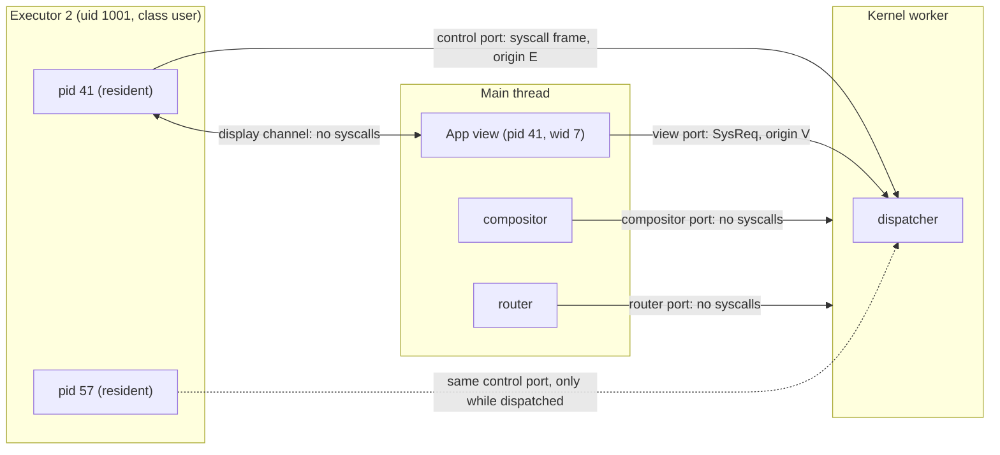
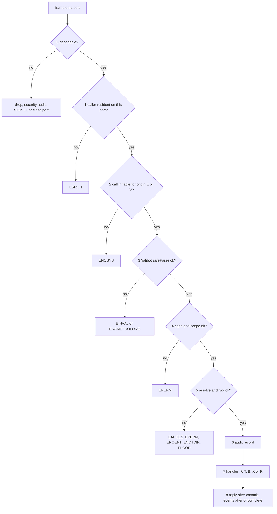
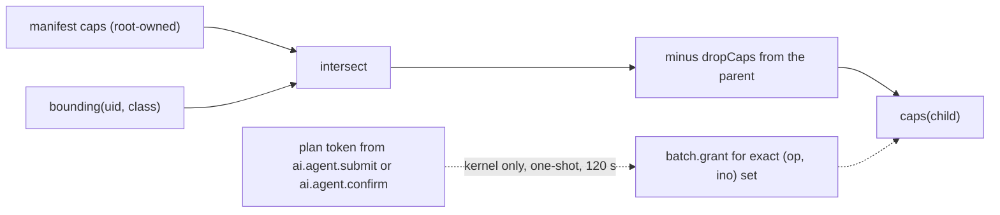
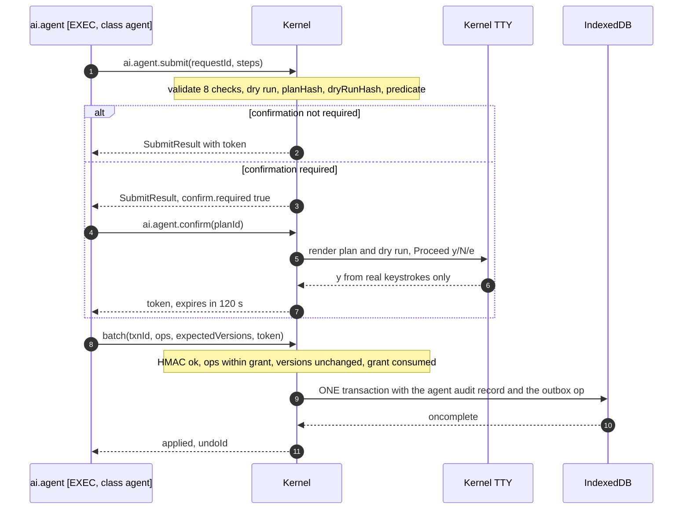

# Plotinium system-call ABI

| Field | Value |
|---|---|
| Title | Plotinium system-call ABI: envelope, transport, identity by port, dispatcher, full call catalogue, errnos, capabilities, events, audit, signals, versioning |
| Status | Draft v0.1, 2026-09-24 |
| Primary owner | R1 Kernel (dispatcher, IPC, capability checks; editor of `protocol/`) |
| Secondary reviewer | R2 VFS/DB (fs group, errno mapping from IndexedDB and PostgreSQL). R4 AI co-approves the `ai.*` group and the LLM tool export. Any change to `protocol/` needs R1 + R2 + R4 ([architecture.md §3.7](./architecture.md#37-packages-and-import-rules)) |
| Must be demonstrable at | **P1 defence (Week 4):** envelope, identity by port, dispatcher order and this catalogue, on paper. **P2 gate (W7, v0.2.0):** dispatcher live for the process, fs, fd/tty, window, time and sys groups; SYS-01 bypass suite green; `man 2` pages generated from the registry. **P3 gate (W11, v0.3.0):** lock, net, mem (reservation admission), `debug.inject`. **P4 gate (W14, v0.4.0):** `ai.*` group, `batch` with plan tokens, agent audit, litmus build answering ENOSYS. **Final defence (W17–18, v1.0.0):** everything |
| Requirement IDs covered | SYS-01, SYS-02 (syscall side), §9.6 (envelope), VFS-03, VFS-04, VFS-05, VFS-06, VFS-07, VFS-08, VFS-09, VFS-10, PROC-06, PROC-07, PROC-08, MEM-01, MEM-06, MEM-07, MEM-08 (may), WM-01, WM-02, WM-05, OFF-04, BOOT-06, BOOT-11, BOOT-12, AGT-01, AGT-02, AGT-03, AGT-04, AGT-05, AGT-08, AGT-09, AGT-10 (may), RAG-03, RAG-06, PRE-04, PRE-05, PRE-06, §3.2 property 2, §3.4; Plotinium design IDs ABI-01 … ABI-16 |
| Related specs | [architecture.md](./architecture.md) · [../03-kernel/processes-and-scheduling.md](../03-kernel/processes-and-scheduling.md) · [../03-kernel/memory-and-paging.md](../03-kernel/memory-and-paging.md) · [../04-vfs/virtual-file-system.md](../04-vfs/virtual-file-system.md) · [../05-wm/window-manager.md](../05-wm/window-manager.md) · [../06-sync/offline-and-sync.md](../06-sync/offline-and-sync.md) · [../07-shell/shell-and-terminal.md](../07-shell/shell-and-terminal.md) · [../02-boot/boot-and-services.md](../02-boot/boot-and-services.md) · [../08-dsa/data-structures.md](../08-dsa/data-structures.md) · [../09-database/database.md](../09-database/database.md) · [../10-ai/rag-semantic-search.md](../10-ai/rag-semantic-search.md) · [../10-ai/agentic-shell.md](../10-ai/agentic-shell.md) · [../10-ai/predictive-prefetch.md](../10-ai/predictive-prefetch.md) · [../10-ai/ai-safety-and-evaluation.md](../10-ai/ai-safety-and-evaluation.md) · [../11-server/backend-api.md](../11-server/backend-api.md) · [../12-security/security-model.md](../12-security/security-model.md) · [../13-quality/testing-and-performance.md](../13-quality/testing-and-performance.md) · [../00-product/identity-and-branding.md](../00-product/identity-and-branding.md) · [../00-product/requirements-traceability.md](../00-product/requirements-traceability.md) · [../00-product/glossary.md](../00-product/glossary.md) |

**Conventions used in this file.** RFC 2119 keywords (MUST, SHOULD, MAY) are used as in the spec's Conventions section (p. 3). Every normative statement is tagged either **Spec** (a requirement from the capstone specification, with its section and ID) or **Plotinium design** (our own binding choice). Any number from the AI-run prototype is marked *(pilot figure — re-measure on the lab machine)*. Canonical decisions are cited as C1–C18 (see [../15-decisions/stack-decisions.md](../15-decisions/stack-decisions.md)). Call names are written `call`; TypeScript shapes are the output types of the Valibot schemas in `protocol/`.

---

## 1. Purpose and scope

This document is the contract between user space and the kernel. Every application, built-in or not, reaches the operating system only through the calls listed here (Spec: MUST, §8 boundary 1, SYS-01). It fixes:

- the channels a call may travel on, the envelope, and the transfer rules (§3.1);
- how the kernel knows who is calling: identity comes from the **port**, never from message fields (§3.2, C3);
- the dispatcher order, which is part of the contract: ESRCH > ENOSYS > schema EINVAL > capability > rwx > audit > handler (§3.3, C3);
- call classes, blocking, cancellation and timeouts (§3.4);
- the capability model that adds least privilege on top of rwx (§3.5), and the rwx rules (§3.6);
- audit levels and the audit record (§3.7, §4.7), the event bus (§3.8, §4.6), signals and job control (§3.9, §4.8);
- ABI versioning (§3.10) and the Valibot conventions (§3.11);
- the **full call catalogue** with argument and return schemas, permission and capability checks, errnos, audit level and class for each call (§4.4);
- the errno master table with numeric codes (§4.3) and the mapping from IndexedDB, PostgreSQL, HTTP and the LLM gateway (§4.9);
- the SYS-01 bypass suite (§8.1).

It does **not** define: the WebSocket protocol v1 frames ([../06-sync/offline-and-sync.md](../06-sync/offline-and-sync.md)); HTTP routes ([../11-server/backend-api.md](../11-server/backend-api.md)); the executor control protocol beyond the frames that carry syscalls (dispatch, pre-emption, page-out: [../03-kernel/processes-and-scheduling.md](../03-kernel/processes-and-scheduling.md)); the TTY line discipline ([../07-shell/shell-and-terminal.md](../07-shell/shell-and-terminal.md)); VFS algorithms ([../04-vfs/virtual-file-system.md](../04-vfs/virtual-file-system.md)); or the agent pipeline internals ([../10-ai/agentic-shell.md](../10-ai/agentic-shell.md)). Where this file summarises behaviour owned elsewhere, the owning spec wins on semantics, and this file wins on **names, shapes, errnos, capabilities and check order**.

---

## 2. Requirements table

| ID | Summary | Spec § | How verified |
|---|---|---|---|
| SYS-01 | All applications, built-in or not, use only the system-call interface; the kernel checks permissions for every call | §8 (1), §9.6, SYS-01 | SYS-01 bypass suite, 8 cases from executor and view origins (§8.1); ABI-11 contract test; built-chunk scan ([architecture.md §3.5](./architecture.md#35-the-three-mandatory-boundaries)) |
| §9.6 envelope | Calls travel as messages `{id, call, args}`; replies come back as `{id, ok, value \| errno}` | §9.6 | ABI-01 envelope tests (§8.2) |
| SYS-02 (syscall side) | Pipes, redirection, background jobs and the required command set are built on these calls | §9.6, SYS-02 | Scripted terminal session ([../07-shell/shell-and-terminal.md](../07-shell/shell-and-terminal.md)); `SYS-02` pipe and signal tests (§8.2) |
| VFS-03 | Path resolution returns ENOENT, ENOTDIR and ELOOP after 40 hops | §9.3, VFS-03 | Path-resolution suite |
| VFS-04 | rwx enforced for owner, group and others on every call | §9.3, VFS-04 | Permission matrix 3 users × 9 modes × 8 operations, identical on kernel and server (§8.2) |
| VFS-05 | `lstat` and `stat` differ correctly; dangling links | §9.3, VFS-05 | Unit tests |
| VFS-06 | EDQUOT with no partial write | §9.3, VFS-06 | Quota test |
| VFS-07 | CRUD plus `cp -r`, `mv`, `rm -r`, `find`, `stat`, `chmod`, `chown`, `ln -s`, `tree` from terminal and Files, all on syscalls | §9.3, VFS-07 | Live demonstration; ABI-15 (views read, processes write) |
| VFS-08 | Names ≤ 255 bytes, paths ≤ 4096 bytes (ENAMETOOLONG beyond) | §9.3, VFS-08 | Boundary tests |
| VFS-09 | A second writer gets EBUSY or read-only access | §9.3, VFS-09 | Lock tests; [architecture.md §5.7](./architecture.md#57-walk-through-6-two-users-contend-for-a-lock-then-the-holder-crashes-vfs-09-vfs-10) |
| VFS-10 | Version conflicts produce a conflicted copy; never a silent overwrite (a success value, not an errno) | §9.3, VFS-10 | Concurrency test |
| PROC-06 | Every state transition is logged | §9.1, PROC-06 | `proc.state` events and klog records (§8.2) |
| PROC-07 | `kill` frees the worker, closes fds, releases locks, re-parents children to `init` | §9.1, PROC-07 | Integration test |
| PROC-08 | `ps top kill nice renice jobs bg fg` and a trailing `&` | §9.1, PROC-08 | Calls in §4.4.1 and §4.4.3; live demonstration |
| MEM-01, MEM-07 | Budget and per-process statistics exposed (`free`, `vmstat`, `pmap`, Task Manager) | §9.2 | `mem.stat`, `proc.info` tests |
| MEM-06 | Accounted memory never exceeds the budget for more than 1 s | §9.2, MEM-06 | Reservation admission in `mem.alloc`, `mem.declare` (C13); stress test |
| MEM-08 (may) | `sys.mmap(path)` returns a handle; `msync` flushes | §9.2, MEM-08 | Only if built (§4.4.5) |
| WM-01, WM-02, WM-05 | The compositor is the only writer of geometry; background processes cannot steal focus; window–process coupling | §9.4 | Window-call tests (§8.2); [../05-wm/window-manager.md](../05-wm/window-manager.md) |
| OFF-04 | Connectivity status and degraded services visible | §9.5, OFF-04 | `net.status`, `svc.status` tests |
| BOOT-06, BOOT-11, BOOT-12 | Boot menu reachable (`reboot --menu`), `bootlog --critical-path`, graceful shutdown | §6.5 | `reboot`, `bootlog`, `shutdown` tests |
| AGT-01 | Tools are typed system calls with JSON schemas; model output is parsed as data | §12.3, AGT-01 | ABI-14 strict-schema test; tool-to-syscall mapping test |
| AGT-02 | Invalid plans are rejected before anything runs, with the reason | §12.3, AGT-02 | `ai.agent.submit` returns the errno and `detail.check` (§4.4.10) |
| AGT-03 | Destructive plans need explicit confirmation; zero bypasses | §12.3, AGT-03 | Plan-token rule in `batch` (§5.4); kernel-owned TTY confirmation |
| AGT-04 | The agent runs as the invoking user, cannot escalate, cannot modify `/system` or `/bin` unless root and confirmed | §3.4, §12.3, AGT-04 | Agent class capability set and `fs.scope` (§3.5) |
| AGT-05 | A multi-step plan runs as one transaction | §12.3, AGT-05 | `batch` is class X, one transaction (§4.4.2) |
| AGT-08 | Every agent system call is audited with prompt, plan, confirmation and result | §12.3, AGT-08 | Agent audit level (§3.7); `ai.agent.log` |
| AGT-09 | The agent is a killable process; a kill mid-plan rolls back | §12.3, AGT-09 | Cancellation rules (§3.4) |
| AGT-10 (may) | `ai undo <txn>` | §12.3, AGT-10 | `ai.undo` (§4.4.10) |
| RAG-03 | Results never include content the caller cannot read | §12.2, RAG-03 | Caller credentials come from the port (§3.2); a `uid` smuggled in args is rejected (ABI-04) |
| RAG-06 | Keyword fallback with a clear notice | §12.2, RAG-06 | `ai.semsearch` returns `mode:'keyword'` plus a notice, never an error |
| PRE-04, PRE-05, PRE-06 | Pre-fetch only speculative and idle; telemetry viewable, clearable, opt-in; predictions visible | §12.4 | `mem.prefetch` under `mm.speculative`; `ai.telemetry.*`; `ai.predict` |
| §3.2 (2), §3.4 | AI acts through system calls; least privilege; confirmation; auditability | §3.2, §3.4 | Agent, indexer and predictor capability sets (§4.5) |
| ABI-01 | Envelope and transport rules: MessagePort, per-port ordering, one reply per id | Plotinium design (C3) | §8.2 |
| ABI-02 | Caller identity is a function of the port and the dispatch state only | Plotinium design (C3) | SYS-01 case B5; §8.2 |
| ABI-03 | The dispatcher order is fixed and observable | Plotinium design (C3) | Order test (§8.2) |
| ABI-04 | Valibot is the only schema library; every object schema is strict | Plotinium design (C3) | Lint (no other schema library imports); unknown-key test |
| ABI-05 | The errno set is closed; each errno has one numeric code and one message | Plotinium design (C3) | Errno corpus test |
| ABI-06 | Capabilities narrow, never widen, except `su` (new process) and a kernel-issued plan grant | Plotinium design | Capability derivation property test |
| ABI-07 | Event delivery: after commit, permission-filtered, per-topic sequence, at most one UI batch per frame | Plotinium design | Event-bus tests |
| ABI-08 | Audit levels trace, security and agent, with the record of §4.7 | Plotinium design, supports AGT-08 | Audit tests |
| ABI-09 | Signals and job control semantics of §3.9 | Plotinium design, supports PROC-07/08 | Signal tests |
| ABI-10 | `ABI_VERSION` handshake on every executor and view port | Plotinium design | Version-mismatch test |
| ABI-11 | Every call has args and return schemas, a handler, a class, capabilities, an audit level, an origin set, an errno list and a `man 2` page | Plotinium design | Contract test |
| ABI-12 | The dispatcher never throws and never leaves a request id unanswered while the caller lives | Plotinium design | fast-check fuzz test |
| ABI-13 | Binary data is an `ArrayBuffer`, transferred above 64 KB; non-binary args are bounded by their schemas | Plotinium design (C3) | Transfer tests |
| ABI-14 | Generated LLM tool schemas use only Claude's strict-mode subset | Plotinium design (C3, C12) | Strict-tool test |
| ABI-15 | Views read, processes write: a view port accepts only the view-origin subset | Plotinium design, supports SYS-01, PROC-05 | View-origin cases of §8.1 |
| ABI-16 | Executor realms are sandboxed before any program code loads | Plotinium design, supports SYS-01 | Descriptor-walk test (§8.2) |

---

## 3. Design (normative)

### 3.1 Channels and transport

**Spec: MUST, §9.6.** "Calls travel as messages (`postMessage` or `MessageChannel`) in the form `{id, call, args}`, and replies come back as `{id, ok, value | errno}`. The kernel checks permissions for every call."

**Plotinium design (C2, C3).** The kernel is one dedicated module worker. It owns every channel below. Only the first two carry system calls.

| Channel | Ends | Carries | Syscalls? |
|---|---|---|---|
| Executor control port | kernel ↔ executor *N* | slice frames (dispatch, resume, pre-empt, page bytes) and the syscall frames of the process currently dispatched there | **yes** (origin E) |
| View port | kernel ↔ one app view on the main thread | view-origin syscalls; kernel pushes (event batches, TTY output, close) | **yes** (origin V) |
| Display channel | process ↔ its view | state snapshots and diffs out, input events in | no (never carries syscalls) |
| Compositor port | kernel ↔ `wm/compositor.ts` | window commands and final geometry ([architecture.md §4.3](./architecture.md#43-compositor-port-messages-kernel--compositor)) | no |
| Router port | kernel ↔ main-thread router | boot progress, platform calls ([architecture.md §4.2](./architecture.md#42-router-port-messages-main--kernel)) | no |
| blkio, ai.embed ports | kernel ↔ special workers | swap I/O, embedding jobs | no |



Transport rules:

1. **Plotinium design (ABI-01).** Calls use `MessagePort.postMessage(message, transfer)` with structured clone. There is no BroadcastChannel, SharedWorker or SharedArrayBuffer path for syscalls. The 32-byte SharedArrayBuffer control block per executor carries only pre-emption and heartbeat flags ([../03-kernel/processes-and-scheduling.md](../03-kernel/processes-and-scheduling.md)).
2. **Plotinium design (ABI-01).** A request `id` is a uint32, strictly increasing per `(port, pid)`. The kernel answers every accepted `id` exactly once while the caller lives (ABI-12). Replies MAY arrive out of `id` order, because blocking calls finish later than fast ones. MessagePort delivery is FIFO per port, so frames on one port are handled in send order.
3. **Plotinium design (ABI-13, the 64 KB rule).** Binary data (file contents, page bytes, vectors, bitsets) is always an `ArrayBuffer` or a typed array, never a string. Any binary payload above 64 KB MUST be in the transfer list; the sys client and the kernel transfer every `ArrayBuffer` of 64 KB or more, and MAY copy smaller ones. `read` returns an `ArrayBuffer`. Every string and array field has a schema limit; the contract test (ABI-11) computes each call's worst-case non-binary size and requires it to be ≤ 64 KiB, except for calls marked `large` in the registry (`batch`, `ai.agent.submit`, `ai.agent.plan`, `ai.index.put`), which are allowed up to 1 MiB.
4. **Plotinium design.** Kernel-to-view replies are paginated because structured-clone deserialisation is paid on the main thread (boundary 2): `readdir` pages hold at most 1,000 entries, `proc.list` at most 1,024 processes, `dmesg` at most 8,192 lines.
5. **Plotinium design.** An executor process has at most one outstanding call (its generator is suspended on it). A view port has at most 64 outstanding calls; the 65th gets `EAGAIN` (`detail.reason = 'view-backlog'`).
6. **Plotinium design.** Replies to a terminated process or a closed view port are dropped. Nothing else is ever dropped silently.

### 3.2 Identity by port

**Spec: MUST, SYS-01** ("the kernel checks permissions for every call") requires the kernel to know the caller without trusting the caller. **Plotinium design (C3, ABI-02).** Caller identity is a pure function of the port the frame arrived on and the kernel's own dispatch state. It never comes from message fields: a `pid`, `uid`, `wid` or credential inside `args` is either rejected by the strict schema (EINVAL) or, where a call legitimately names a target (for example `kill({pid})`), treated as the target and never as the caller.

#### 3.2.1 Executor ports

- For each executor *e* the kernel keeps `slice[e] = {pid, sliceSeq}`: the process it dispatched there and a counter bumped at every dispatch.
- A syscall ends the current slice. The executor runtime (never program code) posts **one** frame that is both the syscall and the slice-end report: `{t:'syscall', pid, sliceSeq, req, cpuMs}`.
- The kernel attributes the call to `slice[e].pid`. The `pid` and `sliceSeq` in the frame are a consistency check only. A mismatch means the realm is compromised or the runtime is buggy: the kernel replies `ESRCH`, writes a **security** audit record `identity-mismatch`, and marks the executor suspect; a second mismatch from the same executor terminates it through the watchdog path (co-resident processes are restored from clean swap copies or exit 137 with reason `collateral`, [architecture.md §6](./architecture.md#6-errors-and-edge-cases)).
- A pid is resident on exactly one executor. A frame for a pid that is not resident on that port, or is TERMINATED, gets `ESRCH`.
- **Placement invariant (C2, ARC-05).** The isolation key of an executor is `(uid, class)` with `class ∈ {user, agent, system}` (§3.5). Processes with different isolation keys never share an executor, so even a fully compromised realm can only act as processes with the same uid and class, which already hold the same rights.

#### 3.2.2 View ports

- The kernel creates a view port during `window.create` and binds it to `(pid, wid)` at creation. The router hands the port to the view component when the compositor mounts the window; the view receives only `{sys, pid, wid}`, where `sys` wraps that port.
- A view-port call runs with the owning process's credentials and capabilities, restricted to the **view-origin subset** (the calls marked V in §4.4; ABI-15). Views read, processes write: a view cannot call `write`, `unlink`, `spawn` or any other mutating call; on a view port those names do not exist and answer `ENOSYS`.
- Window calls from a view act on the bound `wid`. A `wid` argument that differs from the bound one gets `EPERM`.
- When the window closes or the process ends, the kernel closes the port; outstanding ids are dropped.
- The compositor and router ports are kernel-only. The router keeps them in a module-private closure and never exposes them to view code; the kernel does not run the syscall dispatcher on them (they carry their own message unions).

#### 3.2.3 Sandboxing the realm

**Plotinium design (ABI-16, C2).** The executor bootstrap `kernel/runtime/executor.ts` runs before any program chunk is imported and does the following, in order:

1. Captures the control port and the SharedArrayBuffer control block in a closure that program code cannot reach.
2. Replaces each of these with a **non-configurable accessor that throws** `TypeError('Plotinium: use the system-call interface')`, on the global object **and on every prototype in its lookup chain that exposes the same name** (for example `WorkerNavigator.prototype.storage`, `WorkerNavigator.prototype.locks`, `StorageManager.prototype.getDirectory`):
   - storage: `indexedDB`, `caches`, `navigator.storage`, `navigator.locks`;
   - threads: `Worker`, `SharedWorker`, `importScripts`;
   - network: `fetch`, `XMLHttpRequest`, `WebSocket`, `EventSource`, `BroadcastChannel`;
   - escape hatches: `self.postMessage`, `self.onmessage`, `self.addEventListener('message', …)`;
   - timers: `setTimeout`, `setInterval` (processes use `sleep`, which the scheduler can see and account).
3. Freezes the runtime's own `ctx` and `sys` objects.
4. Sends `hello {abi, digest}` (§3.10) and waits for the first dispatch.

Why this is sufficient in executors: a worker has no DOM, so the `about:blank` iframe trick that defeats shadowing on the main thread does not exist; the only path out of the realm is the captured port; identity is taken from that port; and different isolation keys never share a realm. `crypto.subtle` and `WebAssembly` stay available because they are pure computation (the CSP still limits code to `'self'` plus `'wasm-unsafe-eval'`, C10).

On the main thread, shadowing is defence in depth only ([architecture.md §3.6 rule 4](./architecture.md#36-threads-and-workers-canonical-c2), ARC-07). The enforceable controls for views are the lint rules, the built-chunk scan, per-window closed shadow roots (cross-spec request to [../05-wm/window-manager.md](../05-wm/window-manager.md)), and the v1 rule that only first-party code runs ([../12-security/security-model.md](../12-security/security-model.md)).

### 3.3 Dispatcher order

**Plotinium design (C3, ABI-03).** The order below is part of the contract: a request that would fail several checks always gets the errno of the **first** failing stage, and stages 1–5 have no side effects apart from audit and klog records (INV-ABI-1).

| Stage | Check | Errno on failure | Cost |
|---|---|---|---|
| 0 | Frame decode: an object with a uint32 `id`, a string `call` and an `args` field | Reply `EINVAL` if the `id` is readable. Otherwise the frame is dropped, a security audit record is written, and the caller is ended: an executor process gets SIGKILL with exit reason `abi-violation`; a view port is closed | O(1) |
| 1 | **Resident.** Executor: the pid is `slice[e].pid` with matching `sliceSeq` and is not TERMINATED. View: the port is open and `(pid, wid)` is alive | `ESRCH` | O(1), `PidTable` lookup |
| 2 | **Table lookup.** `call` exists in the table **for this origin** (E or V). AI-off build: no `ai.*` entries | `ENOSYS` | O(1) |
| 3 | **Schema.** `v.safeParse(spec.args, args, {abortEarly: true})` | `ENAMETOOLONG` if the first issue's message is the tag `'ENAMETOOLONG'` (path or name byte limits, §4.2), else `EINVAL`. `msg` names the field and the issue kind, never the value | O(size of args), bounded by schema limits; about 0.9 µs for `stat` *(pilot figure — re-measure on the lab machine)* |
| 4 | **Capability.** `spec.caps ⊆ pcb.caps` (bitset AND). The required set MAY depend on the parsed arguments (for example `open` needs `fs.write` unless `flags` is `'r'`). For a process holding `fs.scope`, every path argument, normalised lexically against its cwd, must lie under an allowed prefix. Rules that depend on another object's owner (cross-uid `kill` or `setpriority` needing `kill.other`) are evaluated at stage 5 | `EPERM` (`detail.reason = 'capability'` or `'scope'`) | O(1), plus O(path length) for scoped processes |
| 5 | **Permission.** The call's `authorize(cred, args)` resolves paths (x on every traversed directory) and applies the rwx rules of §3.6 with `pcb.cred`. Resolution errors surface here in POSIX order: the first failing component wins | `EACCES` (rwx bits), `EPERM` (owner-or-root operations), `ENOENT`, `ENOTDIR`, `ELOOP`, `ENAMETOOLONG` (a component over 255 bytes) | O(depth) per path; O(subtree) for recursive calls, done in phase 1 |
| 6 | **Audit.** Append the trace record; for security and agent levels prepare the durable record (§3.7) | none | O(1) |
| 7 | **Handler** by class F, T, B, X or R (§3.4) | call-specific errnos (§4.4) | per call |
| 8 | **Reply and events.** Mutating calls reply after IndexedDB `oncomplete` (and, online, after the server's `op.result` for bulk and agent calls, C6). Events are published only after `oncomplete` | – | – |

Rejections at stages 0–5 of security-level calls (for example `debug.inject` from uid 1001, or an identity mismatch) are also written as durable security records.



### 3.4 Call classes, blocking, cancellation and timeouts

**Plotinium design.** Every call has exactly one class. The class decides how the scheduler treats the caller ([../03-kernel/processes-and-scheduling.md](../03-kernel/processes-and-scheduling.md)).

| Class | Meaning | Caller state while the call runs | Fast path |
|---|---|---|---|
| **F** fast | In-memory work, O(1), O(depth) or bounded by a page limit; no readwrite transaction | stays RUNNING (the slice ends at the call, but the reply comes in the same task) | **yes**: if `ready.peek()` shows nothing of higher priority, the reply is a `resume` with the remaining quantum, O(1), so the process continues on the same executor |
| **T** transaction | Exactly one IndexedDB readwrite transaction across every affected store (C4) | BLOCKED, `waitingOn = io:<txn>`; reply after `oncomplete` | no |
| **B** blocking | Waits for an event: pipe data, lock grant, timer, child exit, TTY input, memory reservation, network or LLM reply | BLOCKED, `waitingOn` set (for example `pipe:3`, `lock:<ino>`, `mem`, `net:llm`, `tty:confirm`) | no |
| **X** bulk | Two phases: a pre-emptible plan (yields every 2 ms, read-only transactions of ≤ 500 keys, subtree intent lock) then ONE non-pre-emptive transaction; online, the caller then waits for the server's `op.result` for up to `SYNC_WAIT_MS` (C6; value owned by [../06-sync/offline-and-sync.md](../06-sync/offline-and-sync.md)) | RUNNABLE during phase 1 work, BLOCKED otherwise | no |
| **R** read-only scan | Chunked, pre-emptible read-only work (`find`, `grep`, `du`, `wc`, `fsck` check, `ai.agent.submit` dry run); no readwrite transaction; results bounded by `limit` and paginated by cursor | as phase 1 of X | no |

Cancellation and timeouts:

1. **Plotinium design (C3).** POSIX `EINTR` is not in the canonical errno set. A B or R call interrupted by a signal the process **catches** completes with `ECANCELED` (`detail.reason = 'signal'`). If the signal terminates the process, the pending id is dropped.
2. **Plotinium design.** T calls are not interruptible: they commit or abort as a whole (syscalls are atomic at call granularity). X calls are interruptible only in phase 1 (`ECANCELED`, nothing changed). Once phase 2 has committed locally and the caller is waiting for the server, a kill sends `proc.signal` on the control lane; the server calls `pg_cancel_backend`, the server transaction rolls back, the client reverts from `undo`, and the audit outcome is `killed_rolled_back` (Spec: MUST, AGT-09; [architecture.md §5.6](./architecture.md#56-walk-through-5-ai-with-the-observation-loop-and-a-destructive-confirmation-agt-0109) step 11).
3. **Plotinium design.** B calls that accept `timeoutMs` fail with `ETIMEDOUT` when it expires, with nothing changed.
4. **Plotinium design.** Mutating calls report `sync: 'applied' | 'pending'`. `pending` means the change is committed locally and queued in the outbox; it is not an error (Spec: §9.5). A later server rejection reverts the change from `undo` and is reported with a `vfs.rejected` event and a notification ([architecture.md §6](./architecture.md#6-errors-and-edge-cases)).

### 3.5 Capability model

**Spec: MUST, §3.4** (least privilege; the agent cannot raise its own privileges) and **§9.6** (the kernel checks every call). **Plotinium design (ABI-06).** A capability is a named right checked at stage 4, **in addition to** rwx at stage 5. rwx says *whose* data a process may touch; capabilities say *which kinds of calls* a process may make at all. They are stored as a bitset in the PCB (`caps: Uint32Array(2)`), plus one parameterised capability, `fs.scope`, that carries a prefix list.

**Where capabilities come from.**

1. Every program has a root-owned manifest: `/bin/<name>.json` for commands and apps, `/system/services/<name>.json` for services (both directories are `root:root 0755`, files `0644`, Spec §9.3 hierarchy). The manifest declares `class` (`user`, `agent` or `system`) and `caps`, next to `requires` (the application start-up DAG, [../02-boot/boot-and-services.md](../02-boot/boot-and-services.md)).
2. At `spawn`, the kernel computes

   `caps(child) = manifest.caps ∩ bounding(child.uid, manifest.class) ∖ args.dropCaps`

   and expands `fs.scope` templates (`$CWD`, `$HOME`) with the child's cwd and home. Only root can write a manifest, so a user can never mint a capability; a parent can only narrow its child with `dropCaps`.
3. Nothing widens a running process's set. The two controlled exceptions are:
   - `su` creates a **new** process whose set is computed by the rule above with the target uid (`manifest.caps ∩ bounding(target uid, class)`), after the secure prompt and a server grant (§4.4.11);
   - `batch.grant` is added by the kernel only, bound to one plan token, for the exact `(op, ino)` set of that plan, and removed at first use or after 120 s (§5.4).
4. An agent spawned from a root shell runs with the real login uid (C12, Spec §3.4). Root is granted to a plan only through the kernel secure prompt, and is audited.

**Bounding sets.**

| Class | Bounding set | Notes |
|---|---|---|
| `user`, uid ≥ 1000 (users, guest, demo) | `fs.read fs.write proc window tty lock mem privacy` | Guest limits are enforced server-side (quota, AI budget) |
| `user`, uid 0 | the above + `kill.other sys.admin`, + `debug.fault` only while fault injection is enabled (§4.4.11) | |
| `agent`, any uid | `fs.read fs.scope ai.plan mem` + kernel-issued `batch.grant` | Never `fs.write`, `proc`, `window`, `lock` or `kill.other`, even at uid 0 |
| `system` | the union of the caps named in the `/system/services/*.json` manifests: `fs.read mem mm.speculative mm.hint ai.index ai.search ai.telemetry ai.predict auth.session window proc` | Each service holds exactly its manifest's list |

The process classes, their placement and their default capability sets are listed in §4.5. `net.sync` is kernel-internal (`syncd`, `lockd`) and can never be granted to a process.



### 3.6 Permission checks

**Spec: MUST, §9.3, VFS-04.** rwx for owner, group and others on every call; on directories r lists, w creates and removes, x traverses; root bypasses read and write checks; `chmod` accepts octal and symbolic modes; `chown` is root-only; default umask 022; the sticky bit on `/tmp` means only a file's owner can delete it.

**Plotinium design.** One isomorphic function in `vfs/perm.ts` is used by the kernel and the server (C9). It includes the critic's fix for the root execute check:

```ts
// vfs/perm.ts — pure, imported by kernel/ and server/
export type Want = 1 | 2 | 3 | 4 | 5 | 6 | 7;              // 4 = r, 2 = w, 1 = x
export function may(cred: Cred, ino: InodeMeta, want: Want): boolean {
  if (cred.uid === 0) {
    // root bypasses r and w; x on a regular file needs at least one x bit
    return (want & 1) === 0 || ino.type === 'd' || (ino.mode & 0o111) !== 0;
  }
  const shift = cred.uid === ino.uid ? 6
              : (cred.gid === ino.gid || cred.groups.includes(ino.gid)) ? 3 : 0;
  return (((ino.mode >> shift) & 7) & want) === want;   // first matching class only (POSIX)
}
```

| Operation | Rule | Errno |
|---|---|---|
| Path resolution | x on every directory traversed; `lstat`, `unlink`, `readlink`, `rename` of a link stop one step early (Spec §9.3 step 5) | EACCES, ENOENT, ENOTDIR, ELOOP (> 40 hops), ENAMETOOLONG |
| Read a file / list a directory | r on the file / r on the directory (plus x to stat entries) | EACCES |
| Write or truncate a file | w on the file | EACCES |
| Create, unlink, rename (in a directory) | w + x on the parent (both parents for rename) | EACCES |
| Sticky directory (`/tmp` is `1777`) | unlink or rename only by the file's owner, the directory's owner or root | EPERM |
| Recursive `unlink`, `copy`, `chmod`, `chown` | the per-inode rule on every inode, checked in phase 1 before anything changes; enumerating a directory needs r + x | EACCES / EPERM, nothing changed |
| `chmod`, explicit `utimes` | owner or root | EPERM |
| `utimes` to "now" | owner, root, or w on the file | EACCES |
| `chown` | root only | EPERM |
| `link` (hard link, may) | w + x on the new parent; source is a regular file owned by the caller, or caller is root (Plotinium protected-hardlink rule) | EACCES, EPERM |
| `spawn` | r and x on the manifest, x on every ancestor | EACCES |
| Create | new mode = `requested & ~umask` (umask default 022); owner = caller's uid, group = caller's gid | – |
| Quota (Spec: MUST, VFS-06) | checked **inside** the same transaction as the write; root exempt; no partial data | EDQUOT |

**EACCES versus EPERM** (Spec §9.3 table): EACCES means an rwx bit check failed; EPERM means the operation is reserved for the owner or root, or the process lacks a capability.

The same truth table of 3 users × 9 modes × 8 operations runs against the kernel and against the server (§8.2).

### 3.7 Audit

**Spec: MUST, AGT-08, §3.4 (auditability).** "Every AI-initiated system call is logged with its prompt, plan, user and outcome." **Plotinium design (ABI-08).** Three levels:

| Level | What | Where and how durable |
|---|---|---|
| **trace** | Every call that returns an error, every T, B, X and R call, and 1 in 64 successful F calls: `{t, pid, uid, call, errno, µs}` | Kernel klog ring (`dsa/ringbuffer`, 8,192 entries); read with `dmesg` and the Task Manager trace. Volatile by design |
| **security** | `su`, `chown`, cross-uid `kill`/`setpriority`, `debug.*`, `svc.restart`, `sysctl.set` of global keys, `fsck` repair, `shutdown`, `reboot`, `auth.*` (including login failures), telemetry clear/export/opt-in, lock breaks, identity mismatches, any stage 0–5 rejection of a security-level call | One strict IndexedDB transaction into the local `audit` store plus an `audit.append` outbox op; the server inserts it into `audit_log` |
| **agent** | Every call made by an agent-class process, read-only ones included | Mutating calls: the record is written **in the same IndexedDB transaction** as the `batch`, and the server inserts `audit_log` inside the op's `vfsTxn`. Read-only observation calls: kept in the plan session and written as one durable record per planning turn. Rejected, declined and killed plans: a separate local transaction, and on the server a separate autocommit after ROLLBACK. `ai log` reads the local store, so it works offline |

Records never contain file contents, write data, passwords, secrets or tokens: arguments are stored as a SHA-256 digest of their canonical JSON plus a redacted summary of at most 512 characters (§4.7). `audit_log` is INSERT and SELECT only for the application database role ([../09-database/database.md](../09-database/database.md)).

### 3.8 Event bus

**Spec: §3.2 property 1** ("System events … reach them on the kernel's event bus"). **Plotinium design (ABI-07).** Topics and payloads are in §4.6. Delivery rules:

1. **After commit.** VFS events are published only after IndexedDB `oncomplete`; process, window and memory events after the state change. Events re-emitted from the server (`vfs.changed`) carry `origin: 'remote'`.
2. **Ordering and loss.** In-memory, at most once, FIFO per topic per subscriber. Each topic has a strictly increasing `seq`, so a subscriber can detect a gap.
3. **Permission filter.** A `vfs.*` event is delivered only to subscribers whose credentials, at publish time, give r on the parent directory and x on every ancestor (for `rename`: on the old or the new parent). The other filters are in §4.6.
4. **Bounded queues.** A subscription holds at most 1,024 undelivered events. On overflow the oldest are dropped, the next read reports `dropped`, and the subscriber receives `bus.overflow`, which tells durable consumers to reconcile.
5. **UI batching.** View subscribers receive at most one batch per animation frame; the router applies it inside `requestAnimationFrame` (boundary 2).
6. **Lifetime.** A subscription is a handle in the process's fd table; closing the fd or ending the process drops it.
7. **Durable consumers never rely on the bus alone.** At start, `ai.indexer` reconciles against the current tree, then follows the bus ([../10-ai/rag-semantic-search.md §3.2.1](../10-ai/rag-semantic-search.md)).

### 3.9 Signals and job control

**Spec: MUST, PROC-07, PROC-08.** **Plotinium design (ABI-09).** The signal list is in §4.8.

- **Sending.** `kill({pid, sig})`: `pid > 0` is one process, `pid < 0` is the process group `|pid|`, `pid = 0` is the caller's group. The caller must have the target's uid, or hold `kill.other` (root); otherwise EPERM. Signal 0 only checks existence and permission.
- **Dispositions.** `sig.action({sig, action})` sets `default`, `ignore` or `catch`. SIGKILL and SIGSTOP cannot be caught or ignored (EINVAL).
- **Delivery.** The kernel sets a pending bit in the PCB. A caught signal is delivered when the process is next dispatched: the dispatch or resume frame carries `pendingSigs`, and the executor runtime calls the program's optional **synchronous** hook `signal(ctx, st, sig)` before resuming the generator. The hook may only update the serialisable state `st` (for example `st.stop = true`); it cannot make syscalls. If the process is BLOCKED in a B or R call, that call completes with ECANCELED first.
- **Default actions.** `terminate`: exit status `128 + n`, exit reason `signal`. `stop`: the process becomes BLOCKED with `waitingOn = 'sigcont'`. `continue`: a stopped process becomes READY. `ignore`.
- **Kill path (PROC-07).** SIGKILL, or an uncaught terminating signal, runs the kill path of [../03-kernel/processes-and-scheduling.md](../03-kernel/processes-and-scheduling.md): TERMINATED, free the executor slot, close fds, release leases, re-parent children to pid 1, close windows, free pages, wake `wait()`ers, audit. For windowed apps, `window.close` and the Task Manager send SIGTERM and then SIGKILL after 3 s (WM-05).
- **TTY job control.** Each TTY has a foreground process group (`tcsetpgrp`). Ctrl-C sends SIGINT, Ctrl-Z SIGTSTP, Ctrl-\\ SIGQUIT to the foreground group; closing the terminal window sends SIGHUP to its session; `tty.resize` sends SIGWINCH. A background process that reads from the TTY gets SIGTTIN; one that calls `tty.setattr` or `tcsetpgrp` gets SIGTTOU. Background writes to the TTY are allowed. `jobs`, `bg` and `fg` are shell builtins over `kill`, `tcsetpgrp` and `wait` ([../07-shell/shell-and-terminal.md](../07-shell/shell-and-terminal.md)).
- **Watchdog.** A runaway killed by the watchdog exits with 137 (`128 + SIGKILL`) and reason `watchdog`; co-resident processes that cannot be restored exit 137 with reason `collateral`.

### 3.10 ABI versioning

**Plotinium design (ABI-10).**

- `protocol/src/abi.ts` exports `ABI_VERSION`, an integer that starts at 1 with v0.2.0, and `ABI_DIGEST`, the SHA-256 of the canonical JSON of the registry (call names, classes, origins, capabilities, and the JSON Schema of every args and return schema), computed at build time. `ABI_VERSION` is independent of the OS version and of the WebSocket protocol version `v:1` ([../00-product/identity-and-branding.md](../00-product/identity-and-branding.md)).
- **Handshake.** The executor bootstrap sends `hello {abi, digest}` on its control port; the view `sys` client sends the same on its first use of a port. On any mismatch the kernel refuses the peer: the executor is terminated (its processes are restored from swap on another executor or exit with reason `abi-violation`), the view shows "Restart to update", and `bootlog` records the event. All chunks come from one build through the versioned Service Worker cache, so a mismatch means a mixed-cache bug.
- **What bumps `ABI_VERSION`:** removing or renaming a call, event topic or field; changing a field's type, meaning, default or limit in a way that rejects previously valid input; changing a call's class, origin set or capabilities; adding an errno to a call's list (callers may not handle it); adding an errno to the master table (which also needs a cross-spec request, C3).
- **What does not bump it** (the digest still changes): adding a call; adding an optional argument whose absence keeps the old behaviour; adding a return field; adding an event topic.
- Every bump gets a CHANGELOG entry under "ABI", and `man 2` pages are regenerated from the registry.

### 3.11 Valibot conventions

**Plotinium design (C3, ABI-04).** Valibot 1.5.0 (exact pin) is the only schema library; `@valibot/to-json-schema` 1.8.0 is used on the server only, at build time, to emit strict LLM tool schemas. An ESLint `no-restricted-imports` rule bans `zod`, `@sinclair/typebox`, `ajv` and `yup` in every package.

- **One schema module per group** under `protocol/src/sys/`: `common.ts` (shared primitives), `proc.ts`, `fs.ts`, `fd.ts`, `tty.ts`, `win.ts`, `mem.ts`, `time.ts`, `lock.ts`, `net.ts`, `ev.ts`, `sys.ts`; under `protocol/src/ai/`: `rag.ts` (shapes owned by [../10-ai/rag-semantic-search.md §4.1](../10-ai/rag-semantic-search.md)), `agent.ts`, `predict.ts`, `tools.ts`; plus `errno.ts`, `events.ts`, `audit.ts`, `signals.ts`, `envelope.ts`, `registry.ts`.
- Each module exports `<Call>Args` and `<Call>Ret` schemas, and the matching types as `type StatArgs = v.InferOutput<typeof StatArgs>`. No type that has a schema is written by hand.
- **Every object schema is `v.strictObject`.** Unknown keys are an issue, so a smuggled `uid` or `pid` field fails at stage 3 with EINVAL (SYS-01 case B5).
- Discriminated unions use `v.variant('kind', [...])` (or `'op'`); constraints go in `v.pipe(...)`.
- **Errno tags.** A schema action's message is either omitted or the literal errno tag `'ENAMETOOLONG'` (used by `v.maxBytes(4096, 'ENAMETOOLONG')` on paths and `v.maxBytes(255, 'ENAMETOOLONG')` on names). The dispatcher maps a tagged first issue to that errno and every other issue to EINVAL. No other tags are allowed (contract test).
- No `v.transform` with side effects, no async schemas; parsing is always `v.safeParse(schema, input, {abortEarly: true})`, which never throws and needs no `eval` (CSP-safe).
- Binary fields use `v.instance(ArrayBuffer)` or `v.instance(Float32Array)`. They never appear in agent tool schemas.
- **Registry.** `protocol/src/sys/registry.ts` exports `CALLS`, which `satisfies Record<CallName, CallSpec>`:

  ```ts
  interface CallSpec {
    args: v.GenericSchema; ret: v.GenericSchema;
    cls: 'F' | 'T' | 'B' | 'X' | 'R';
    origin: 'E' | 'V' | 'EV';
    caps: readonly Cap[];                    // all required (stage 4)
    audit: 'trace' | 'security';             // agent level applies automatically to agent-class callers
    large?: true;                            // allowed above 64 KiB of non-binary args (§3.1 rule 3)
    errnos: readonly Errno[];                // call-specific list; stages 1–4 errnos are implicit
    man: string;                             // one-line summary; the man 2 page is generated from it
  }
  ```
- **Server reuse.** Fastify `preValidation` hooks call `v.safeParse` with the same schemas for `/api/*` bodies ([../11-server/backend-api.md](../11-server/backend-api.md)).
- **LLM tools (AGT-01, ABI-14).** `protocol/src/ai/tools.ts` maps each agent tool to exactly one syscall schema. A server build step converts them with `@valibot/to-json-schema` and post-processes the output into Claude's strict subset (`anyOf` only, `additionalProperties: false`, every key required, and no `oneOf`, `maxItems`, `minLength`, `minimum` or `maximum`, C3). The limits removed from the JSON Schema are still enforced, because the kernel re-parses every tool call with the original Valibot schema.

---

## 4. Interfaces and data shapes

### 4.1 Envelopes

**Spec: MUST, §9.6** (`{id, call, args}` → `{id, ok, value | errno}`). **Plotinium design (ABI-01).** The envelope is exactly that; the port frames around it add only what the transport needs.

```ts
// protocol/src/sys/envelope.ts
export type SysReq = { id: number; call: CallName; args: unknown };
export type SysOk<T = unknown> = { id: number; ok: true; value: T };
export type SysErr = { id: number; ok: false; errno: Errno; msg?: string; detail?: ErrDetail };
export type SysRes = SysOk | SysErr;

export interface ErrDetail {
  reason?: string;            // one of the registered reasons in §4.3.1
  field?: string;             // schema issue path (stage 3); never the value
  path?: string;              // the path that failed (stage 5)
  step?: number; check?: string;   // agent plan validation (AGT-02)
  holder?: string;            // EBUSY on a lease, e.g. 'alice@lab-pc-3'
  retryAfterMs?: number;      // EAGAIN, EAIUNAVAIL
  remaining?: number;         // sync.flush timeout
  cycle?: string[];           // spawn: application dependency cycle path
}

// Executor control port — only the frames that carry syscalls (the full union is in 03-kernel)
export type ExecToKernel =
  | { t: 'hello'; abi: number; digest: string }
  | { t: 'syscall'; pid: number; sliceSeq: number; cpuMs: number; req: SysReq }  // also ends the slice
  | { t: 'yield' | 'exit'; pid: number; sliceSeq: number; cpuMs: number; code?: number };
export type KernelToExec =
  | { t: 'dispatch'; pid: number; sliceSeq: number; quantumMs: number; pendingSigs: number; res?: SysRes }
  | { t: 'resume';   pid: number; sliceSeq: number; quantumMs: number; pendingSigs: number; res: SysRes }; // fast path

// View port
export type ViewToKernel = { t: 'hello'; abi: number; digest: string } | { t: 'req'; req: SysReq };
export type KernelToView =
  | { t: 'res'; res: SysRes }
  | { t: 'events'; batch: KEvent[] }            // at most one batch per animation frame
  | { t: 'tty.out'; data: ArrayBuffer }         // Terminal views only
  | { t: 'close'; reason: 'window-closed' | 'process-exit' | 'abi-mismatch' };

// Event bus
export type KEvent<T extends Topic = Topic> = { topic: T; seq: number; t: number; data: EventData[T] };
```

Example on an executor port (walk-through 1 of [architecture.md §5.2](./architecture.md#52-walk-through-1-rm--r-old-drafts-including-a-fault-injected-failure)):

```json
→ {"t":"syscall","pid":412,"sliceSeq":9031,"cpuMs":0.4,
   "req":{"id":41,"call":"unlink","args":{"path":"/home/alice/old-drafts","recursive":true}}}
← {"t":"dispatch","pid":412,"sliceSeq":9032,"quantumMs":10,"pendingSigs":0,
   "res":{"id":41,"ok":true,"value":{"removed":1000,"bytes":7340032,"opId":"0192f0c1-…","sync":"applied"}}}
← {"t":"dispatch","pid":412,"sliceSeq":9040,"quantumMs":10,"pendingSigs":0,
   "res":{"id":42,"ok":false,"errno":"EACCES","msg":"permission denied","detail":{"path":"/home/bob"}}}
```

### 4.2 Common types

```ts
// protocol/src/sys/common.ts
import * as v from 'valibot';
const noNul = (s: string) => !s.includes('\u0000');

export const Path = v.pipe(v.string(), v.minLength(1), v.maxBytes(4096, 'ENAMETOOLONG'), v.check(noNul));
export const Name = v.pipe(v.string(), v.minLength(1), v.maxBytes(255, 'ENAMETOOLONG'),
  v.check((s) => noNul(s) && !s.includes('/') && s !== '.' && s !== '..'));
// UUIDv7 (C5). The well-known fixed inodes use the v7 layout with a zero timestamp,
// e.g. 00000000-0000-7000-8000-000000000001 for '/', so they pass the same schema.
export const Ino = v.pipe(v.string(),
  v.regex(/^[0-9a-f]{8}-[0-9a-f]{4}-7[0-9a-f]{3}-[89ab][0-9a-f]{3}-[0-9a-f]{12}$/));
export const Fd   = v.pipe(v.number(), v.integer(), v.minValue(0), v.maxValue(1023));
export const Pid  = v.pipe(v.number(), v.integer(), v.minValue(1), v.maxValue(32767));
export const Uid  = v.pipe(v.number(), v.integer(), v.minValue(0), v.maxValue(2 ** 31 - 1));
export const Mode = v.pipe(v.number(), v.integer(), v.minValue(0), v.maxValue(0o7777));   // DB CHECK 0..4095 (C7)
export const ModeChange = v.variant('op', [
  v.strictObject({ op: v.literal('set'), bits: Mode }),
  v.strictObject({ op: v.literal('delta'), add: Mode, clear: Mode }),   // symbolic modes, e.g. o-w
]);
export const Glob = v.pipe(v.string(), v.minLength(1), v.maxBytes(1024));   // * ? [..] ** ; never a regex
export const Bytes = v.instance(ArrayBuffer);
export const SignalName = v.picklist(SIGNAL_NAMES);     // §4.8
export const Cap        = v.picklist(CAP_NAMES);        // §4.5
export const Errno      = v.picklist(ERRNO_NAMES);      // §4.3
export const SyncState  = v.picklist(['applied', 'pending']);
```

```ts
export type InodeType = 'f' | 'd' | 'l';
export interface Stat {                      // Spec §9.3 inode fields
  ino: Ino; type: InodeType;
  mode: number;                              // rwxrwxrwx plus sticky (0o1000); setuid/setgid (0o6000) are rejected in v1
  uid: number; gid: number; size: number; nlink: number;
  atime: number; mtime: number; ctime: number;     // epoch ms
  version: number;                           // optimistic-concurrency counter
  blob: string | null;                       // SHA-256 of the content for files
  target: string | null;                     // symlink target
}
export interface DirEntry { name: string; ino: Ino; type: InodeType; stat?: Stat /* when plus: true */ }
export interface Cred { uid: number; gid: number; groups: number[] }
export interface Conflict { keptAs: { ino: Ino; path: string } }          // VFS-10: a success, not an error
export interface MutResult { opId: Ino; sync: SyncState; conflict?: Conflict }
export type WaitStatus =
  | { kind: 'exited'; code: number }
  | { kind: 'signaled'; signal: SignalName; code: number /* 128 + n */ }
  | { kind: 'stopped'; signal: SignalName }
  | { kind: 'continued' };
export interface Rect { x: number; y: number; w: number; h: number }
```

### 4.3 Errno master table

**Spec: MUST, §9.3** fixes the twelve file-system errnos. **Plotinium design (C3, ABI-05).** The thirteen extras below are the only other errnos allowed on the wire. Numeric codes are the Linux x86-64 values, so `perror` output and exit codes look familiar; the two AI errnos use the Plotinium range 1000–1099. The wire carries the **name**; the code is used in audit rows, the klog ring and `$?`-style reporting. Adding an errno needs a cross-spec request and bumps `ABI_VERSION` (§3.10).

| Errno | Code | Source | Message (`strerror`) | Returned when | Typical origins |
|---|---|---|---|---|---|
| EPERM | 1 | Spec | Operation not permitted | Operation reserved for the owner or root (`chmod` by a non-owner, `chown` by a non-root, sticky-bit delete, cross-uid `kill`), or a capability or scope check failed (stage 4) | dispatcher stage 4; `vfs/perm.ts` |
| ENOENT | 2 | Spec | No such file or directory | A path component does not exist | resolver; PG `23503` |
| ESRCH | 3 | Plotinium | No such process | Caller not resident on this port or TERMINATED; target pid or group does not exist; `wait` with no matching child | dispatcher stage 1; process table |
| EIO | 5 | Plotinium | Input/output error | Storage failure or injected fault; the operation was rolled back | IndexedDB `AbortError`/`UnknownError`; PG `P0001` fault trigger; checksum failure |
| EBADF | 9 | Plotinium | Bad file descriptor | fd not open, or not open for this mode | fd table |
| EAGAIN | 11 | Plotinium | Resource temporarily unavailable | Retryable condition: stale plan, retries exhausted, executors exhausted, thrashing guard, rate limit, offline for an online-only call | server `vfsTxn` after 5 retries; scheduler; kernel and server rate limits |
| EACCES | 13 | Spec | Permission denied | An rwx check failed | dispatcher stage 5; server re-check |
| EBUSY | 16 | Spec | Device or resource busy | File locked by another session; stale fence; `lock_timeout`; subtree busy | lock manager; PG `55P03`, `23P01` |
| EEXIST | 17 | Spec | File exists | The target name already exists | IndexedDB `ConstraintError` on `dentries`; PG `23505` |
| EXDEV | 18 | Plotinium | Invalid cross-device link | `rename` or `link` across a mount point (`/mnt/*`) | resolver |
| ENOTDIR | 20 | Spec | Not a directory | A directory was expected | resolver |
| EISDIR | 21 | Spec | Is a directory | A file operation was applied to a directory | VFS |
| EINVAL | 22 | Spec | Invalid argument | Schema failure (stage 3); a directory would move into its own subtree; semantic argument errors | dispatcher; acyclicity trigger |
| EMFILE | 24 | Plotinium | Too many open files | The process's fd table is full (1,024) | fd table |
| ENOTTY | 25 | Plotinium | Not a terminal | TTY call on a non-TTY fd; destructive agent plan with no interactive TTY | TTY layer; `ai.agent.confirm` |
| EPIPE | 32 | Plotinium | Broken pipe | Write to a pipe with no reader (SIGPIPE is also raised) | pipes |
| ENAMETOOLONG | 36 | Spec | File name too long | Name > 255 bytes or path > 4096 bytes | schema tag (stage 3); resolver per component |
| ENOSYS | 38 | Plotinium | Function not implemented | Unknown call, call not available on this origin, or an `ai.*` call in the AI-off build | dispatcher stage 2 |
| ENOTEMPTY | 39 | Spec | Directory not empty | `rmdir` on a non-empty directory; `rename` onto a non-empty directory | VFS |
| ELOOP | 40 | Spec | Too many levels of symbolic links | More than 40 symlink hops | resolver |
| ETIMEDOUT | 110 | Plotinium | Operation timed out | A caller-supplied `timeoutMs` expired (lock wait, `sync.flush`, `sys.events`, LLM deadline) | timer heap |
| EDQUOT | 122 | Spec | Disk quota exceeded | Byte or inode quota would be exceeded, or the device storage is full; nothing written | `users` row CHECK `23514`; IndexedDB `QuotaExceededError` |
| ECANCELED | 125 | Plotinium | Operation canceled | A blocking call was interrupted by a caught signal (replaces EINTR); the user declined a confirmation; a server transaction was cancelled by a kill | scheduler; `ai.agent.confirm`; PG `57014` |
| EAIUNAVAIL | 1001 | Plotinium | AI service unavailable | The LLM gateway is offline, rate-limited, over budget, has no key, or the upstream failed | LLM gateway |
| EAIREFUSED | 1002 | Plotinium | AI model refused the request | The model's `stop_reason` was `refusal` | LLM gateway |

**Not errors.** A version conflict on a content write succeeds with `conflict.keptAs` (Spec: MUST, VFS-10). `sync: 'pending'` means committed locally and queued. A semantic search without a loaded model answers in keyword mode with a notice (RAG-06).

#### 4.3.1 Registered `detail.reason` values

| Errno | Reasons |
|---|---|
| EPERM | `capability`, `scope`, `system-path`, `owner`, `root-only`, `sticky`, `init`, `no-token`, `outside-grant`, `foreign`, `directory` |
| EAGAIN | `stale-plan`, `stale-version`, `retry-exhausted`, `executors-exhausted`, `thrashing`, `pid-space`, `window-limit`, `view-backlog`, `rate`, `offline`, `not-idle`, `no-free-memory` |
| EBUSY | `lease`, `stale-fence`, `lock-timeout`, `subtree-busy`, `starting` |
| EIO | `injected`, `storage`, `abort`, `checksum`, `server` |
| EINVAL | `bad-manifest`, `dependency-cycle`, `exceeds-budget`, `turn-limit`, `unknown-plan`, `expired`, `unknown-job`, `unknown-lease`, `unknown-segment`, `unknown-service`, `unknown-txn`, `no-such-window`, `not-a-link`, `not-seekable`, plus schema issues reported through `detail.field` |
| ECANCELED | `signal`, `declined`, `killed` |
| EAIUNAVAIL | `offline`, `rate`, `budget`, `no-key`, `upstream`, `timeout` |
| ESRCH | `no-child`, `identity-mismatch` |
| ENOENT | `unlinked` (the cwd was removed) |

### 4.4 System-call catalogue

**How to read the tables.**

- **Cls** is the class of §3.4: F fast, T transaction, B blocking, X bulk two-phase, R read-only scan.
- **Org** is the origin: E executor ports only, V view ports only, EV both (ABI-15).
- **Caps** are required at stage 4 (§3.5). "–" means none.
- **Errnos** lists the call-specific errnos. Every call can also return the stage 1–4 errnos: ESRCH, ENOSYS, EINVAL (and ENAMETOOLONG on path fields) and EPERM (`capability`, `scope`).
- **Audit**: T trace, S security (§3.7). Calls made by an agent-class process are always audited at the agent level in addition.
- Argument limits not shown are in the Valibot module of the group; the contract test (ABI-11) checks that every call in these tables exists in `CALLS` with the same class, origin, capabilities and errnos.

#### 4.4.1 Processes and job control (`protocol/src/sys/proc.ts`)

| Call | Args → Returns | Cls | Org | Caps | Permission | Errnos | Audit |
|---|---|---|---|---|---|---|---|
| `spawn` | `{path, argv (≤ 256), env?, cwd?, fds?: {0?, 1?, 2?: Fd}, pgid?: 0 \| Pid, priority?: 0..39, nice?: -20..19, dropCaps?}` → `{pid}`; `argv` plus `env` ≤ 60 KiB | B (manifest load, app DAG, placement) | E | `proc` | r + x on the manifest `/bin/<name>.json`, x on its ancestors; `priority < 20` or `nice < 0` needs uid 0 | ENOENT, ENOTDIR, EACCES, ELOOP, EBADF (an fd in `fds`), EINVAL (`bad-manifest`, `dependency-cycle` with `detail.cycle`), EAGAIN (`executors-exhausted`, `thrashing`, `pid-space`), EPERM (`root-only`) | T |
| `exit` | `{code: 0..255}` → no reply | F | E | – | – | – | T |
| `wait` | `{pid: number (> 0 a child, -1 any child, < -1 a group), nohang?, untraced?, continued?}` → `{pid, status: WaitStatus}` or `{pid: 0}` with `nohang` | B | E | `proc` | only the caller's children | ESRCH (`no-child`), ECANCELED | T |
| `kill` | `{pid: integer (> 0 process, < 0 group, 0 own group), sig: SignalName \| 0}` → `{delivered}` | F | E | `proc`; `kill.other` for other uids | target has the caller's uid, or `kill.other`; pid 1 cannot be signalled | ESRCH, EPERM (`owner`, `init`) | S if cross-uid or the target is a system process, else T |
| `getpid` | `{}` → `{pid, ppid, pgid, sid}` | F | EV | – | – | – | T |
| `proc.cred` | `{}` → `{uid, gid, groups, user, groupNames, home, ruid, grantExpiresAt?}` (`ruid` = real login uid under `su`) | F | EV | – | – | – | T |
| `getcwd` | `{}` → `{path, ino}` | F | E | – | – | ENOENT (`unlinked`) | T |
| `chdir` | `{path}` → `{path, ino}` | F | E | `fs.read` | x on the target and every ancestor | ENOENT, ENOTDIR, EACCES, ELOOP | T |
| `umask` | `{mask?: 0..0o777}` → `{old}` | F | E | – | – | – | T |
| `nice` | `{inc: -39..39}` → `{priority, nice, effPrio}` | F | E | `proc` | `inc < 0` needs uid 0 | EPERM (`root-only`) | T |
| `setpriority` | `{pid: Pid \| 0, group?, priority?: 0..39, nice?: -20..19}` → `{priority, nice, effPrio}` | F | E | `proc`; `kill.other` for other uids | own uid or `kill.other`; raising priority or lowering nice needs uid 0 | ESRCH, EPERM | S if cross-uid, else T |
| `getpriority` | `{pid}` → `{priority, nice, effPrio, band: 'interactive' \| 'normal' \| 'background'}` | F | EV | – | – | ESRCH | T |
| `setpgid` | `{pid: Pid \| 0, pgid: Pid \| 0}` → `{pgid}` | F | E | `proc` | `pid` is the caller or its child in the same session; `pgid 0` makes a new group with id = pid | ESRCH, EPERM | T |
| `sig.action` | `{sig: SignalName, action: 'default' \| 'ignore' \| 'catch'}` → `{old}` | F | E | – | – | EINVAL (SIGKILL, SIGSTOP) | T |
| `proc.list` | `{uid?, pgid?, cursor?, limit?: 1..1024}` → `{procs: ProcInfo[], next?}` | F | EV | – | world-visible like `ps -e`; `argv` of other uids reduced to `argv[0]` | – | T |
| `proc.info` | `{pid}` → `ProcDetail` | F | EV | – | pages, fds, leases and caps only for the same uid or root | ESRCH | T |

```ts
export interface ProcInfo {
  pid: number; ppid: number; pgid: number; uid: number; user: string;
  state: 'NEW' | 'READY' | 'RUNNING' | 'BLOCKED' | 'SUSPENDED' | 'TERMINATED';
  class: 'user' | 'agent' | 'system'; waitingOn: string | null;
  priority: number; nice: number; effPrio: number;
  cpuPct: number; cpuTimeMs: number; residentBytes: number; swappedBytes: number;
  faults: number; hitRatio: number; speculative: boolean;
  argv: string[]; executor: number | null; windows: number[]; startedAt: number;
}
export interface ProcDetail extends ProcInfo {
  pages?: { pageId: number; loc: 'RESIDENT' | 'LOCAL_SWAP' | 'REMOTE_SWAP'; dirty: boolean;
            size: number; lastAccess: number; pinned: boolean; speculative: boolean }[];   // pmap
  fds?: { fd: number; kind: 'file' | 'dir' | 'pipe' | 'tty' | 'events'; path?: string; flags: string }[];
  leases?: LeaseInfo[]; caps?: Cap[]; exitReason?: string;
}
```

#### 4.4.2 Files (`protocol/src/sys/fs.ts`)

| Call | Args → Returns | Cls | Org | Caps | Permission | Errnos | Audit |
|---|---|---|---|---|---|---|---|
| `open` | `{path, flags: 'r' \| 'w' \| 'rw' \| 'a', create?, excl?, trunc?, mode?: Mode = 0o666, follow? = true}` → `{fd, ino, type, version, size}` | F; T when `create` or `trunc` changes something | E | `fs.read` for `r`; `fs.write` for `w`, `rw`, `a`, `create`, `trunc` | x on ancestors; r and/or w on the file; create: w + x on the parent; mode masked by umask | ENOENT, EEXIST (`excl`), EISDIR (write access to a directory), ENOTDIR, ELOOP, EACCES, EMFILE, EDQUOT, EBUSY (`lease`: a known foreign X lease when opening for write) | T |
| `read` | `{fd, len: 1..16 MiB, offset?}` → `ArrayBuffer` (transferred; length 0 = end of file) | F (content local); B (pipe, TTY, blob chunk being fetched) | E | `fs.read` | the fd is open for reading | EBADF, EISDIR, EIO, ECANCELED | T |
| `write` | `{fd, data: ArrayBuffer (≤ 16 MiB), offset?, expectedVersion?}` → `{bytes}` plus `{version, opId, sync, conflict?}` for regular files | T (regular file: one transaction per call); B (pipe full, TTY) | E | `fs.write` | the fd is open for writing | EBADF, EPIPE, EDQUOT, EBUSY (`lease`, `stale-fence`), EIO, ECANCELED | T |
| `writeFile` | `{path, data: ArrayBuffer (≤ 64 MiB), expectedVersion?, create? = true, mode?}` → `{ino, version, bytes, opId, sync, conflict?}` | T | E | `fs.write` | as `open` with `w`, `create`, `trunc` | ENOENT, ENOTDIR, EISDIR, EACCES, ELOOP, EDQUOT, EBUSY, EIO | T |
| `close` | `{fd}` → `{}` | F | E | – | own fd | EBADF | T |
| `seek` | `{fd, offset, whence: 'set' \| 'cur' \| 'end'}` → `{offset}` | F | E | – | regular files only | EBADF, EINVAL (`not-seekable`) | T |
| `stat` | `{path, follow? = true}` → `Stat` | F; B while a lazily loaded directory is read (C4) | EV | `fs.read` | x on every ancestor; no right needed on the target | ENOENT, ENOTDIR, ELOOP, EACCES | T |
| `lstat` | `{path}` → `Stat` | as `stat` | EV | `fs.read` | as `stat`; the last component is not followed | ENOENT, ENOTDIR, ELOOP, EACCES | T |
| `fstat` | `{fd}` → `Stat` | F | E | – | own fd | EBADF | T |
| `readdir` | `{path, plus?, cursor?, limit?: 1..1000}` → `{entries: DirEntry[], next?, dirVersion}` | F; B while loading | EV | `fs.read` | r + x on the directory, x on ancestors | ENOENT, ENOTDIR, EACCES, ELOOP | T |
| `mkdir` | `{path, mode?: Mode = 0o777, parents?}` → `{ino, created, opId, sync}` | T | E | `fs.write` | w + x on the parent of each created level | EEXIST (without `parents`), ENOENT, ENOTDIR, EACCES, EDQUOT, ELOOP | T |
| `rmdir` | `{path}` → `{opId, sync}` | T | E | `fs.write` | w + x on the parent; sticky rule | ENOENT, ENOTDIR, ENOTEMPTY, EACCES, EPERM (`sticky`), EBUSY, EINVAL (`/`, or a last component `.`) | T |
| `unlink` | `{path, recursive?}` → `{removed, bytes, opId, sync}` | T; X with `recursive` | E | `fs.write` | w + x on the parent; with `recursive`, r + w + x on every directory in the subtree; sticky rule | ENOENT, ENOTDIR, EISDIR (a directory without `recursive`), EACCES, EPERM (`sticky`), EBUSY (`lease`, `subtree-busy`), EIO (`injected`, `storage`), EAGAIN, ECANCELED | T |
| `rename` | `{from, to, noReplace?}` → `{ino, replaced?, opId, sync}` | T; X for a directory moved to another parent (server L2, C7) | E | `fs.write` | w + x on both parents; sticky rule on the source, and on the target when replacing | ENOENT, EEXIST (`noReplace`), EINVAL (directory into its own subtree), ENOTEMPTY, ENOTDIR, EISDIR, EACCES, EPERM, EBUSY, EXDEV, ELOOP | T |
| `symlink` | `{target: string (≤ 4096 bytes; may dangle), path}` → `{ino, opId, sync}` | T | E | `fs.write` | w + x on the parent | EEXIST, ENOENT, ENOTDIR, EACCES, EDQUOT | T |
| `readlink` | `{path}` → `{target}` | F | EV | `fs.read` | x on ancestors | ENOENT, ENOTDIR, EACCES, EINVAL (`not-a-link`) | T |
| `link` (may) | `{existing, path}` → `{ino, nlink, opId, sync}` | T | E | `fs.write` | w + x on the new parent; the source is a regular file owned by the caller, or the caller is root | EEXIST, ENOENT, EACCES, EPERM (`directory`, `owner`), EXDEV, EDQUOT | T |
| `chmod` | `{path, mode: ModeChange, recursive?}` → `{changed, opId, sync}` | T; X with `recursive` | E | `fs.write` | owner or root on every affected inode; enumerating needs r + x | ENOENT, EACCES, EPERM (`owner`), ELOOP, EINVAL (setuid/setgid bits), EBUSY | T |
| `chown` | `{path, uid?, gid?, recursive?}` → `{changed, opId, sync}` | T; X with `recursive` | E | `fs.write` | root only (Spec §9.3) | ENOENT, EPERM (`root-only`), EINVAL (unknown uid or gid), EDQUOT (the new owner's quota) | **S** |
| `truncate` | `{path} \| {fd}`, plus `{size}` → `{version, opId, sync}` | T | E | `fs.write` | w on the file | ENOENT, EISDIR, EACCES, EBADF, EDQUOT, EBUSY | T |
| `utimes` | `{path, atime?: number \| 'now', mtime?: number \| 'now'}` → `{opId, sync}` | T | E | `fs.write` | `'now'`: owner, root or w; explicit times: owner or root | ENOENT, EACCES, EPERM | T |
| `statfs` | `{path?}` → `StatFs` | F | EV | `fs.read` | x on ancestors | ENOENT | T |
| `quota` | `{uid?}` → `Quota` | F | EV | `fs.read` | own uid; any uid for root | EPERM (`root-only`), EINVAL (unknown uid) | T |
| `copy` | `{from, to, recursive?, noReplace?, preserve?}` → `{copied, bytes, opId, sync}` | T; X with `recursive` | E | `fs.write` | r on source files, r + x on source directories, w + x on the target parent; quota charged to the caller; preserving the owner needs root | ENOENT, EEXIST, EISDIR (a directory without `recursive`), EINVAL (a directory into itself), EACCES, EDQUOT, EIO, ECANCELED | T |
| `find` | `FindArgs` → `{paths: string[], entries?: DirEntry[], next?, denied, truncated, resolved?}` | R | E | `fs.read` | x on each traversed directory, r to list it; unreadable directories are skipped and counted in `denied` | ENOENT, ENOTDIR, EACCES (on the start directory) | T |
| `grep` | `{paths: Path[] (≤ 64), pattern: string (fixed string, ≤ 1024 bytes), recursive?, ignoreCase?, mode: 'l' \| 'c', limit?}` → `{matches: {path, count}[], denied, skippedBinary, next?}` | R | E | `fs.read` | r on each file, r + x on directories | ENOENT, EACCES | T |
| `du` | `{path, maxDepth?: 0..64, apparent?}` → `{bytes, inodes, children?: {name, bytes, inodes}[], denied}` | R | E | `fs.read` | r + x on directories | ENOENT, EACCES | T |
| `wc` | `{paths: Path[] (≤ 64)}` → `{files: {path, lines, words, bytes}[], total}` | R | E | `fs.read` | r on each file | ENOENT, EACCES, EISDIR | T |
| `lsof` | `{path?, pid?}` → `{open: OpenFile[], leases: LeaseInfo[]}` | F | EV | `fs.read` | leases on a file: anyone with r on it (holder shown as `user@host`); open fds of other uids: root only | ENOENT, EACCES | T |
| `batch` | `BatchArgs` → `{txnId, applied, inodes, bytes, undoId, opId, sync}` (`large`) | X | E | `fs.write`, **or** `batch.grant` for agent-class callers | each op is authorised as the matching single call; agent class: valid plan token and ops ⊆ the granted `(op, ino)` set (§5.4) | the member calls' errnos; EPERM (`no-token`, `outside-grant`), EAGAIN (`stale-plan`), EIO, ECANCELED | T |

```ts
export interface FindArgs {
  path: Path;
  name?: Glob;                                   // basename glob; the kernel never accepts a regex
  type?: 'f' | 'd' | 'l';
  mtime?: { within: RelSpan } | { olderThan: RelSpan } | { after?: number; before?: number };
  size?: { gt?: number; lt?: number };           // bytes
  maxDepth?: number;                             // 0..64
  limit?: number;                                // 1..10000, default 1000
  plus?: boolean; cursor?: string;
}
export interface RelSpan { unit: 'hour' | 'day' | 'week' | 'month'; count: number; mode?: 'rolling' | 'calendar' }
// `resolved` reports the absolute interval the kernel computed in the caller's time zone (AGT-07 relative dates).

export type BatchOp =
  | { op: 'mkdir';   path: Path; mode?: number; parents?: boolean }
  | { op: 'write';   path: Path; text: string /* ≤ 64 KiB UTF-8 */; expectedVersion?: number }
  | { op: 'rename';  from: Path; to: Path; noReplace?: boolean }
  | { op: 'copy';    from: Path; to: Path; recursive?: boolean }
  | { op: 'unlink';  path: Path; recursive?: boolean }
  | { op: 'symlink'; target: string; path: Path }
  | { op: 'chmod';   path: Path; mode: ModeChange; recursive?: boolean }
  | { op: 'chown';   path: Path; uid?: number; gid?: number; recursive?: boolean }
  | { op: 'utimes';  path: Path; mtime: number | 'now' };
export interface BatchArgs {
  txnId: Ino;                                         // UUIDv7; becomes the outbox opId (idempotency key)
  ops: BatchOp[];                                     // 1..1000
  expectedVersions: { ino: Ino; version: number }[];  // the dry-run fingerprint
  token?: string;                                     // plan token; required for agent-class callers (§5.4)
  planId?: Ino;
}
export interface StatFs { fsId: 'plotinium'; usageBytes: number; quotaBytes: number | null; // navigator.storage.estimate()
  inodes: number; persisted: boolean; swapBytes: { local: number; remote: number } }
export interface Quota { uid: number; usedBytes: number; quotaBytes: number | null /* null: root is exempt */;
  usedInodes: number; quotaInodes: number | null; source: 'server' | 'mirror' }
export interface OpenFile { pid: number; uid: number; fd: number; path: string; flags: string }
export interface LeaseInfo { path: string; holder: string; mode: 'S' | 'X'; expiresAt: number; scope: 'server' | 'local' }
```

Semantics owned here (details in [../04-vfs/virtual-file-system.md](../04-vfs/virtual-file-system.md)):

- **Plotinium design (C4).** Each `write` on a regular file is ONE readwrite transaction (content chunks, inode version, quota, undo and the outbox op) and produces a new version. The base version is `expectedVersion` if given, otherwise the version this fd last saw (set at `open`, advanced by its own writes). If the current version differs, the write is kept as a conflicted copy and `conflict.keptAs` is returned; content is never silently overwritten (Spec: MUST, VFS-10). In append mode (`a`) each write re-bases on the current local version, because the kernel serialises local appends; the server still detects a remote conflict.
- **Plotinium design.** `writeFile` replaces the whole content in one transaction. It is the Editor's save path ([architecture.md §5.3](./architecture.md#53-walk-through-2-offline-edit-then-reconnect-and-replay-off-0104-vfs-10) step 2).
- **Plotinium design (INV-ABI-7).** The kernel's `grep` matches fixed strings only. The kernel never runs a regular expression supplied by a process or by the model, because a catastrophic pattern would block the kernel worker. The `grep` command does regex matching inside its own process, where the watchdog can end it.
- **Plotinium design (C12).** `readdir`, `stat`, `find`, `grep`, `du` and `wc` are also the agent's read-only tools; each tool call is exactly one of these syscalls.
- **Plotinium design.** `rename` across a mount point under `/mnt` returns EXDEV; `mv` then uses `copy` plus `unlink` inside one `batch`.

#### 4.4.3 Descriptors, pipes and TTYs (`protocol/src/sys/fd.ts`, `tty.ts`)

| Call | Args → Returns | Cls | Org | Caps | Permission | Errnos | Audit |
|---|---|---|---|---|---|---|---|
| `pipe` | `{capacity?: 4096..1048576 = 65536}` → `{r: Fd, w: Fd}` | F | E | – | – | EMFILE | T |
| `dup` | `{fd}` → `{fd}` | F | E | – | own fd | EBADF, EMFILE | T |
| `dup2` | `{fd, to: Fd}` → `{fd}` | F | E | – | own fds | EBADF | T |
| `isatty` | `{fd}` → `{tty: boolean, n?}` | F | E | – | own fd | EBADF | T |
| `tty.open` | `{wid}` → `{fd, n}` | F | E | `tty`, `window` | the caller owns `wid`; the window's view port becomes the device end | EPERM (`foreign`), EBUSY (the window already has a TTY) | T |
| `tty.input` | `{data: string (≤ 4096 bytes)}` → `{}` | F | V | – | the view's window owns a TTY | ENOTTY | none (keystrokes are never logged) |
| `tty.resize` | `{cols: 2..1000, rows: 1..500}` → `{}` | F | V | – | as above; SIGWINCH to the foreground group | ENOTTY | T |
| `tty.getattr` | `{fd}` → `TtyAttr` | F | E | – | the fd is a TTY | EBADF, ENOTTY | T |
| `tty.setattr` | `{fd, canonical?, echo?, isig?, altScreen?}` → `TtyAttr` | F | E | – | the caller is in the foreground group (a background caller gets SIGTTOU) | EBADF, ENOTTY | T |
| `tcsetpgrp` | `{fd, pgid}` → `{}` | F | E | `tty` | the TTY is the caller's controlling TTY and `pgid` is in its session | EBADF, ENOTTY, ESRCH, EPERM | T |
| `tcgetpgrp` | `{fd}` → `{pgid}` | F | E | – | – | EBADF, ENOTTY | T |

`TtyAttr = {n, canonical, echo, isig, altScreen, cols, rows, fgPgid, sid}`. **Plotinium design.** The TTY line discipline runs in the kernel, so the kernel can own the confirmation prompt of `ai.agent.confirm` and read the answer only from real keystrokes (AGT-03). Line editing, echo and the job-control keys are specified in [../07-shell/shell-and-terminal.md](../07-shell/shell-and-terminal.md). TTY output reaches the Terminal view as `tty.out` pushes on its view port, batched per animation frame.

#### 4.4.4 Windows and notifications (`protocol/src/sys/win.ts`)

| Call | Args → Returns | Cls | Org | Caps | Permission | Errnos | Audit |
|---|---|---|---|---|---|---|---|
| `window.create` | `{title (≤ 256 chars), icon?, rect?: Rect, minSize?: {w, h}, restoreKey? (≤ 128)}` → `{wid, rect, display: MessagePort}` (display port transferred) | B (compositor round trip) | E | `window` | – | EAGAIN (`window-limit`: 32 per process) | T |
| `window.close` | `{wid}` → `{}` | F | EV | `window` | own `wid` (a view: its bound `wid`) | EPERM (`foreign`), EINVAL (`no-such-window`) | T |
| `window.focus` | `{wid}` → `{focused: boolean}` | F | EV | `window` | own `wid`. Focus is granted only with recent user activation: the compositor reported `input` for one of the caller's windows, or the user launched the caller's process group, within the last 1,000 ms. Otherwise the call is downgraded to `requestAttention` and returns `focused: false` (Spec §9.4: background processes cannot steal focus) | EPERM, EINVAL | T |
| `window.setTitle` | `{wid, title (≤ 256 chars)}` → `{}` | F | EV | `window` | own `wid` | EPERM, EINVAL | T |
| `window.setCloseGuard` | `{wid, reason: string (≤ 256 chars) \| null}` → `{}` | F | EV | `window` | own `wid`. While a reason is set, a close from the shell first asks "Discard unsaved changes?" with it; once the user confirms, SIGTERM follows as for `window.close`. `null` clears the guard (window-manager.md WMD-12; polish-wave contract C4, UI-036) | EPERM, EINVAL | T |
| `window.requestAttention` | `{wid, level: 'info' \| 'urgent'}` → `{}` | F | EV | `window` | own `wid` | EPERM, EINVAL | T |
| `notify.post` | `{title (≤ 128), body (≤ 1024), level: 'info' \| 'warn' \| 'error', wid?}` → `{nid}` | F | EV | `window` | own `wid` if given | EAGAIN (`rate`: 10 per minute per process), EPERM | T |

**Spec: MUST, WM-01.** Geometry, z-order, drag, resize and snapping are never syscalls: the compositor is the only code that writes window geometry. It reports final geometry to the kernel over the compositor port for session restore (WM-06). Closing a window sends SIGTERM to its process and SIGKILL after 3 s (WM-05).

#### 4.4.5 Memory (`protocol/src/sys/mem.ts`)

| Call | Args → Returns | Cls | Org | Caps | Permission | Errnos | Audit |
|---|---|---|---|---|---|---|---|
| `mem.alloc` | `{bytes: 1..budget, key? (≤ 128), kind?: 'state' \| 'buffer'}` → `{segId, bytes}` | B (reservation) | E | `mem` | – | EINVAL (`exceeds-budget`, until ENOMEM is approved), EAGAIN (`thrashing`), ECANCELED | T |
| `mem.declare` | `{key (≤ 128), kind: 'arraybuffer' \| 'imagebitmap' \| 'wasm' \| 'other', bytes}` → `{key, bytes}` (re-declaring a key reserves only the delta) | B (reservation) | E | `mem` | – | as `mem.alloc` | T |
| `mem.free` | `{segId} \| {key}` → `{bytes}` | F | E | `mem` | own segment | EINVAL (`unknown-segment`) | T |
| `mem.stat` | `{pid?}` → `MemStat` | F | EV | – | per-process rows with page detail: same uid or root; totals for everyone | ESRCH | T |
| `mem.prefetch` | `{app: string} \| {ino, offset?, len?} \| {pid, pages?: number[]}` → `{bytes, pages}` (all pages speculative) | B | E | `mm.speculative` | r on the file; `pid` form: same uid | ENOENT, EACCES, EAGAIN (`not-idle`, `no-free-memory`), ECANCELED | T |
| `mem.hint` | `{app: string, ttlMs: 1000..600000}` → `{}` | F | E | `mm.hint` | – | EINVAL (unknown app) | T |
| `mmap` (may) | `{path, flags: 'r' \| 'rw'}` → `{handle, size, pageSize}` | F; T to create the mapping record | E | `fs.read`, plus `fs.write` for `rw` | as `open` | as `open` | T |
| `msync` (may) | `{handle, pages?: number[]}` → `{version, opId, sync}` | T | E | `fs.write` | w on the file | EBADF, EDQUOT, EBUSY | T |
| `munmap` (may) | `{handle}` → `{}` | F | E | – | own handle | EBADF | T |

```ts
export interface MemStat {
  budget: number; accounted: number; reservedWaiting: number;
  resident: number; swappedLocal: number; swappedRemote: number; speculative: number;
  embed: { bytes: number; state: 'absent' | 'resident' | 'evicted' }; kernel: number;
  faults: number; faultsPerSec: number; hitRatio: number; bytesIn: number; bytesOut: number;
  procs?: { pid: number; accounted: number; resident: number; swapped: number;
            faults: number; hitRatio: number; softLimit: number }[];
}
```

**Plotinium design (C13).** Admission is reservation-based: `mem.alloc`, `mem.declare` and every page-in reserve budget first and BLOCK (`waitingOn = 'mem'`) until reclaim has freed space, so accounted memory never exceeds the budget (Spec: MUST, MEM-06). Reclaim starts at 85 % of the budget ([../03-kernel/memory-and-paging.md](../03-kernel/memory-and-paging.md)). The budget, the soft limit and the swap tier forced for demos and benchmarks (`mm.swap.tier = auto | local | remote`, the critic's fix for MEM-04/05) are `sysctl` keys (§4.4.11).

#### 4.4.6 Time (`protocol/src/sys/time.ts`)

| Call | Args → Returns | Cls | Org | Caps | Permission | Errnos | Audit |
|---|---|---|---|---|---|---|---|
| `time.now` | `{}` → `{epochMs, monotonicMs, tz, tzOffsetMin}` | F | EV | – | – | – | T |
| `sleep` | `{ms: 0..2147483647}` → `{sleptMs}` | B (timer heap) | E | – | – | ECANCELED | T |
| `uptime` | `{}` → `{bootAt, uptimeMs, users, load: [number, number, number]}` | F | EV | – | – | – | T |

In test mode `time.now` reads a frozen clock fixture, so agent envelopes and cassettes are reproducible (C12).

#### 4.4.7 Locks (`protocol/src/sys/lock.ts`)

| Call | Args → Returns | Cls | Org | Caps | Permission | Errnos | Audit |
|---|---|---|---|---|---|---|---|
| `lock.acquire` | `{path} \| {fd}`, plus `{mode: 'S' \| 'X', wait? = false, timeoutMs? (≤ 600000)}` → `{leaseId, fence, expiresAt, scope: 'server' \| 'local'}` | B | E | `lock` | S needs r, X needs w on the file; x on ancestors; directories cannot be locked | EBUSY (`lease`, with `detail.holder`), ETIMEDOUT, ECANCELED, ENOENT, EACCES, EISDIR | T |
| `lock.release` | `{leaseId}` → `{}` | F | E | `lock` | own lease | EINVAL (`unknown-lease`) | T |
| `lock.status` | `{path}` → `{holders: LeaseInfo[], queued}` | F | EV | `fs.read` | r on the file | ENOENT, EACCES | T |

**Plotinium design (C6).** Leases are S/X with TTL 30 s (15 s in the demo profile), a heartbeat at TTL/3 from the kernel worker, and a fencing token on every grant. The kernel attaches the fence to the process's writes on that file; a write with a stale fence gets EBUSY (`stale-fence`) and its bytes are kept as a conflicted copy. Offline, leases are local advisory locks (`scope: 'local'`, `navigator.locks` from the kernel worker). A process's leases are released when it exits (PROC-07).

#### 4.4.8 Network and sync status (`protocol/src/sys/net.ts`)

| Call | Args → Returns | Cls | Org | Caps | Permission | Errnos | Audit |
|---|---|---|---|---|---|---|---|
| `net.status` | `{}` → `NetStatus` | F | EV | – | – | – | T |
| `sync.flush` | `{timeoutMs: 1..60000}` → `{remaining: 0}` | B | E | – | – | ETIMEDOUT (`detail.remaining`), EAGAIN (`offline`) | T |

`NetStatus = {state: 'online' | 'offline' | 'connecting' | 'resuming' | 'auth-required', queuedOps, lastAckAt: number | null, degraded: string[], leaseTtlMs, serverBuild: string | null}`. The taskbar renders it (Spec: MUST, OFF-04). Processes never reach the network themselves (§3.2.3); `syncd` and `lockd` are the only network users and hold `net.sync`, which is kernel-internal.

#### 4.4.9 Events (`protocol/src/sys/ev.ts`)

| Call | Args → Returns | Cls | Org | Caps | Permission | Errnos | Audit |
|---|---|---|---|---|---|---|---|
| `sys.subscribe` | `{topics: TopicPattern[] (1..16; exact name or 'group.*'), path?}` → `{fd}` | F | EV | – | `path` scope: x on it and its ancestors; per-topic filters apply at delivery (§4.6) | ENOENT, EACCES, EMFILE, EINVAL (unknown topic) | T |
| `sys.events` | `{fd, max?: 1..256, timeoutMs?}` → `{events: KEvent[], dropped}` | B | E | – | own subscription fd | EBADF, ETIMEDOUT, ECANCELED | T |

Views do not call `sys.events`: their subscriptions are pushed to the view port as `{t:'events'}`, at most one batch per frame.

#### 4.4.10 AI (`protocol/src/ai/rag.ts`, `agent.ts`, `predict.ts`)

**Spec: MUST, §3.2 property 2** ("AI acts through system calls, not strings") and **§3.4**. **Plotinium design (C12).** The whole group is absent in the AI-off build (`__AI__=false`), where every `ai.*` name answers ENOSYS (litmus, ARC-06).

*A. Semantic search (shapes owned by [../10-ai/rag-semantic-search.md §4.1](../10-ai/rag-semantic-search.md)).*

| Call | Args → Returns | Cls | Org | Caps | Permission | Errnos | Audit |
|---|---|---|---|---|---|---|---|
| `ai.semsearch` | `SemsearchArgs` → `SemsearchResult` | B | EV | `fs.read` | the readable set is computed from the **port's** credentials over the current tree before ranking (RAG-03); `dir`: x on it and its ancestors | ENOENT, ENOTDIR, EACCES. A missing model is not an error: `mode: 'keyword'` plus a notice (RAG-06) | T |
| `ai.search.focus` | `{on: boolean}` → `{}` | F | V | – | – | – | T |
| `ai.index.status` | `{files?}` → `IndexStatus` | F | EV | – (`files: true` needs `ai.index`) | – | EPERM | T |
| `ai.index.lookup` | `{hashes: string[] (≤ 512)}` → `{known: boolean[]}` | F | E | `ai.index` | – | – | T |
| `ai.index.embed` | `{text (≤ 16 KiB), header (≤ 512 bytes), kind: 'doc'}` → `Float32Array(384)` (transferred) | B (`ai:embed`; held while a search has focus) | E | `ai.index` | – | EINVAL (over 512 tokens), EIO (embed worker failure), ECANCELED | T |
| `ai.index.put` | `IndexPut` → `{rows}` (`large`) | T | E | `ai.index` | the caller's uid has r on `ino` at `inodeVersion` | ENOENT, EACCES, EAGAIN (`stale-version`), EDQUOT | T |
| `ai.index.drop` | `{inos: Ino[] (≤ 1000)}` → `{rows}` | T | E | `ai.index` | – (drops derived data only; used by reconciliation) | – | T |
| `ai.search.serve` | `{}` → `SearchJob` | B | E | `ai.search` | – | ECANCELED | T |
| `ai.search.done` | `SearchReply` → `{}` | F | E | `ai.search` | – | EINVAL (`unknown-job`) | T |

*B. Agentic shell (pipeline owned by [../10-ai/agentic-shell.md](../10-ai/agentic-shell.md)).*

| Call | Args → Returns | Cls | Org | Caps | Permission | Errnos | Audit |
|---|---|---|---|---|---|---|---|
| `ai.agent.plan` | `PlanTurnArgs` → `PlanTurn` (`large`) | B (`net:llm`, 45 s deadline) | E | `ai.plan` | uid from the PCB; the request text is fixed at turn 1 and kept by the kernel for intent binding; names and observations are datamarked by the kernel with a per-request nonce; file contents never reach the planner | EAIUNAVAIL (`offline`, `rate`, `budget`, `no-key`, `upstream`, `timeout`), EAIREFUSED, EINVAL (`turn-limit`: more than 6 turns), ETIMEDOUT, ECANCELED | agent |
| `ai.agent.submit` | `{requestId, steps: PlanStep[] (1..64)}` → `SubmitResult` (`large`) | R (validation, then a dry run on a read snapshot) | E | `ai.plan` | the eight validation checks, as the caller; the first failure rejects the whole plan and nothing runs (AGT-02) | EINVAL (`detail.step`, `detail.check`), ENOENT, ENOTDIR, EISDIR, ELOOP, EACCES, EPERM (`scope`, `system-path`), EDQUOT (quota projection) | agent |
| `ai.agent.confirm` | `{planId}` → `{token, expiresAt, granted}` | B (`tty:confirm`) | E | `ai.plan` | the kernel renders the plan, the dry run and `Proceed? [y/N/e]` on the caller's controlling TTY and reads the answer **only** from kernel-owned TTY input; default N | ENOTTY (no interactive TTY, e.g. piped input), ECANCELED (`declined`, or no answer in 120 s), EINVAL (`unknown-plan`, `expired`) | agent |
| `ai.agent.log` | `{requestId?, limit?: 1..200, cursor?}` → `{records: AuditRecord[], next?}` | F | EV | – | own uid; root sees all | – | T |
| `ai.undo` (may, AGT-10) | `{txnId}` → `SubmitResult` for the inverse plan, which must then be confirmed and run with `batch` | R | E | `ai.plan` | the caller's uid committed `txnId`, or the caller is root | ENOENT (`unknown-txn`), EAGAIN (`stale-plan`: the same inodes changed later), EPERM | agent |

```ts
// protocol/src/ai/agent.ts
export type PlanTurnArgs =
  | { requestId: Ino; turn: 1; request: string /* ≤ 2000 chars */; envelope: AgentEnvelope }
  | { requestId: Ino; turn: number /* 2..6 */; observations: Observation[] /* ≤ 16 */ }
  | { requestId: Ino; turn: number /* 2..6 */; clarification: string /* ≤ 500 chars */ };
export interface AgentEnvelope {          // gathered by the agent through syscalls; re-checked by the kernel
  cwd: string; now: string /* ISO 8601 with offset */; tz: string;
  listing: DirEntry[] /* readdir {plus: true}, ≤ 150 */; listingTotal: number;
}
export type ReadOnlyTool = 'readdir' | 'stat' | 'find' | 'grep' | 'du' | 'wc';
export interface Observation { callId: string; call: ReadOnlyTool; ok: boolean; value?: unknown; errno?: Errno }
export type PlanTurn =
  | { kind: 'tools'; calls: { callId: string; call: ReadOnlyTool; args: unknown }[]; turnsLeft: number }
  | { kind: 'plan'; steps: PlanStep[] }                   // the model called submit_plan
  | { kind: 'clarify'; question: string; options: string[] }
  | { kind: 'cannot'; reason: string };
export interface PlanStep {
  id: string;
  op: BatchOp['op'] | 'find' | 'glob';
  args: unknown;                          // re-parsed by the kernel with the schema of `op`
  span: string;                           // verbatim quote of the request (intent binding)
  sources?: string[] | { ref: string };   // bind to the result set of an earlier find/glob step
}
export interface SubmitResult {
  planId: Ino; planHash: string; dryRunHash: string;
  dryRun: { ops: BatchOp[]; inodes: number; bytes: number; deletions: number; overwrites: number;
            quotaOk: boolean; resolvedTimes?: { from: string; to: string }[] };
  confirm: { required: boolean;
             reasons: ('delete' | 'overwrite' | 'chmod' | 'chown' | 'over-20-inodes' | 'system-path')[] };
  token?: string;                         // present only when confirm.required is false
  expectedVersions: { ino: Ino; version: number }[];
}
```

**Plotinium design (C12, AGT-01).** The kernel re-parses every model tool call with the Valibot schema of the named syscall. Read-only calls are handed back to the agent process, which executes each one as exactly one syscall from §4.4.2 as its own uid; mutating calls are buffered into the plan and never executed from model output. The observation loop is capped at 6 turns.

*C. Prediction and telemetry (owned by [../10-ai/predictive-prefetch.md](../10-ai/predictive-prefetch.md)).*

| Call | Args → Returns | Cls | Org | Caps | Permission | Errnos | Audit |
|---|---|---|---|---|---|---|---|
| `ai.predict` | `{k?: 1..10}` → `{predictions: {app, confidence, reason}[], model: 'markov2' \| 'markov1' \| 'mfu-bucket' \| 'mfu', launches, updatedAt}` | F | EV | – | the caller's own uid's predictions | – | T |
| `ai.predict.publish` | `{predictions (≤ 10), model, launches}` → `{}` | F | E | `ai.predict` | own uid | – | T |
| `ai.telemetry.read` | `{since?, limit?: 1..4096}` → `{events: TelemetryEvent[], next?}` | F | E | `ai.telemetry` | own uid only | – | T |
| `ai.telemetry.clear` | `{}` → `{cleared}` | T | EV | `privacy` | own uid | – | **S** |
| `ai.telemetry.export` | `{}` → `ArrayBuffer` (JSON Lines, transferred) | F | EV | `privacy` | own uid | – | **S** |
| `ai.telemetry.optin` | `{on: boolean}` → `{on, synced: boolean}` | T | EV | `privacy` | own uid; the flag is sent to the server when online | – | **S** |

Telemetry events are written by the kernel from `proc.spawn` and `wm.*` into the per-uid ring; that is not a syscall. Nothing leaves the device without the opt-in flag (Spec: MUST, PRE-05).

#### 4.4.11 System and administration (`protocol/src/sys/sys.ts`)

| Call | Args → Returns | Cls | Org | Caps | Permission | Errnos | Audit |
|---|---|---|---|---|---|---|---|
| `uname` | `{}` → `UnameInfo` ([../00-product/identity-and-branding.md §4.3](../00-product/identity-and-branding.md)) | F | EV | – | identity from the port's PCB, never from args | – | T |
| `users.list` | `{}` → `{users: {uid, name, gid, home, groups: number[]}[], groups: {gid, name}[]}` | F | EV | – | world-readable, like `/etc/passwd` | – | T |
| `bootlog` | `{criticalPath?, verbose?, boot?: 'current' \| 'previous'}` → `{entries: BootLogEntry[], criticalPath?: string[], totalMs}` | F | EV | – | – | ENOENT (no previous boot) | T |
| `dmesg` | `{since?, level?, limit?: 1..8192}` → `{entries: KlogEntry[]}` | F | EV | – | entries about other uids' processes: root only | – | T |
| `svc.status` | `{}` → `{services: {name, state: 'stopped' \| 'starting' \| 'running' \| 'degraded' \| 'failed', critical, pid?, restarts, lastError?}[]}` | F | EV | – | – | – | T |
| `svc.restart` | `{name}` → `{}` | B | E | `sys.admin` | root | EINVAL (`unknown-service`), EBUSY (`starting`) | **S** |
| `sysctl.get` | `{key?}` → `{values: Record<string, unknown>}` | F | EV | – | – | EINVAL (unknown key) | T |
| `sysctl.set` | `{key, value}` → `{old, value}` | T (`meta`) | E | – for session keys; `sys.admin` for global keys | session keys (`ui.*`, `boot.showMenuNextBoot`, `mm.*`, `sched.*`): the console session's user or root; global keys: root | EINVAL, EPERM | S for global keys, T otherwise |
| `shutdown` | `{delayMs?: 0..3600000}` → `{scheduledAt}`, then the system stops (BOOT-12) | B | E | – | uid 0 or the console session's user | EPERM | **S** |
| `reboot` | `{menu?, safe?, delayMs?}` → `{scheduledAt}` (`menu` shows the boot menu, BOOT-06) | B | E | – | as `shutdown` | EPERM | **S** |
| `su` | `{user? = 'root', spawn: {path, argv, env?}}` → `{pid, uid, grantExpiresAt}` | B (secure prompt, server grant) | E | `proc` | the password is typed into the compositor-owned secure prompt, never into the caller; the server verifies it and issues a 15-minute grant (C10); offline only to a non-root user with a local PBKDF2 verifier; never to root offline | EACCES (wrong password), EAGAIN (`offline` for root, `rate`), ECANCELED (prompt dismissed), EINVAL (unknown user) | **S** |
| `auth.login` | `{user, secret: string (≤ 1024)}` → `{uid, offline: boolean}` | B | V (login view only) | `auth.session` | – | EACCES, EAGAIN (`rate`) | **S** |
| `auth.logout` | `{}` → `{}` | B | EV | `auth.session` | own session | – | **S** |
| `auth.lock` | `{}` → `{}` | F | EV | – | own session | – | **S** |
| `fsck` | `{repair?, checksum?, scope?: 'local' \| 'server' \| 'both'}` → `FsckReport` | R (check); T (repair) | E | `fs.read`; `sys.admin` for `repair` | check: counts only, any user; repair: root (the recovery console runs as root) | EPERM, EIO | S for repair, T otherwise |
| `debug.inject` | `{target: 'client' \| 'server' \| 'both', op: 'unlink' \| 'rename' \| 'copy' \| 'chmod' \| 'chown' \| 'batch' \| 'any', after: 1..100000}` → `{armed: true, faultId}` | T | E | `debug.fault` | root, and fault injection enabled: the server's `welcome.faultInjection` flag, which is true only when `FAULT_INJECTION=1` and never on production (C7), or a test build; one-shot; scoped to the caller's `os_session_id` | EPERM | **S** |
| `debug.delay` | `{op: 'batch' \| 'unlink' \| 'copy', ms: 1..10000}` → `{armed: true}` | T | E | `debug.fault` | as `debug.inject`; stretches the next server transaction so an examiner can kill mid-transaction (AGT-09) | EPERM | **S** |

`FsckReport = {inodes, orphans, parentless, unreachable, nlinkErrors, quotaDrift, cycles, danglingLinks, checksum?, serverChecksum?, repaired?, durationMs}`.

#### 4.4.12 Required commands and the calls they use (SYS-02)

| Commands (Spec §9.6) | Calls |
|---|---|
| `ls`, `tree` | `readdir` (`plus`), `stat`, `users.list` |
| `cd`, `pwd` | `chdir`, `getcwd` |
| `mkdir`, `rmdir`, `touch` | `mkdir`, `rmdir`, `open` (`create`) + `utimes` |
| `cat`, `echo` (builtin) | `open`, `read`, `write`, `close` |
| `cp`, `mv`, `rm`, `ln` | `copy`, `rename` (EXDEV → `batch` of `copy` + `unlink`), `unlink`, `symlink`, `link` |
| `find`, `grep`, `du`, `wc` | `find`; `grep` for fixed strings, `open` + `read` in-process for regexes; `du`; `wc` |
| `stat`, `chmod`, `chown` | `stat`/`lstat`, `chmod`, `chown` |
| `df`, `quota` | `statfs`, `quota` |
| `ps`, `top`, `kill`, `nice`, `renice`, `jobs`, `bg`, `fg`, `&` | `proc.list`, `proc.info`, `mem.stat`, `kill`, `spawn` (`nice`), `setpriority`, `wait`, `setpgid`, `tcsetpgrp` |
| `free`, `vmstat`, `pmap` | `mem.stat`, `proc.info` |
| `uname`, `whoami`, `id`, `su`, `uptime` | `uname`, `proc.cred`, `users.list`, `su`, `uptime` |
| `bootlog`, `fsck`, `lsof`, `shutdown`, `reboot` | `bootlog`, `fsck`, `lsof`, `shutdown`, `reboot` |
| `history`, `help`, `man` | `open`/`read` of `~/.history` and the man pages |
| `ai`, `semsearch`, `predict` | `ai.agent.*`, `batch`, `ai.semsearch`, `ai.predict` |

### 4.5 Capability table

**Plotinium design (ABI-06).**

| Capability | Grants | Default holders | Scope and notes |
|---|---|---|---|
| `fs.read` | `open` (`r`), `read`, `stat`, `lstat`, `readdir`, `readlink`, `statfs`, `quota`, `find`, `grep`, `du`, `wc`, `lsof`, `lock.status`, `chdir`, `ai.semsearch`, `fsck` (check), `mmap` (`r`) | user, agent, `ai.indexer`, `prefetch:*`, services | Bounded by rwx |
| `fs.write` | `open` (`w`, `rw`, `a`, `create`, `trunc`), `write`, `writeFile`, `mkdir`, `rmdir`, `unlink`, `rename`, `symlink`, `link`, `chmod`, `chown`, `truncate`, `utimes`, `copy`, `batch`, `msync` | user | Bounded by rwx. **Never** held by the agent class |
| `fs.scope` | (parameterised) restricts every path argument to a prefix list | agent: `[$CWD, $HOME]` | Checked lexically at stage 4 and again on the resolved path, so a symlink cannot escape; `/system` and `/bin` give EPERM (`system-path`) unless the uid is 0 and the plan was confirmed (AGT-04) |
| `proc` | `spawn`, `wait`, `kill` (own uid), `nice`, `setpriority`, `setpgid`, `su` | user, services that start processes (`session`, `desktop`) | – |
| `kill.other` | `kill` and `setpriority` on other uids | uid 0 | Security audit |
| `window` | `window.*`, `notify.post`, `tty.open` | user programs with windows, `desktop`, `login` | Own `wid`s only |
| `tty` | `tty.open`, `tcsetpgrp` | `terminal`, shells | – |
| `lock` | `lock.acquire`, `lock.release` | user | – |
| `mem` | `mem.alloc`, `mem.declare`, `mem.free` | every class | – |
| `mm.speculative` | `mem.prefetch` | `prefetch:*`, `session` (boot stage 6 pre-fetch) | Speculative pages only; holders never have `fs.write` |
| `mm.hint` | `mem.hint` | `ai.predictor` | – |
| `ai.index` | `ai.index.lookup`, `ai.index.embed`, `ai.index.put`, `ai.index.drop`, `ai.index.status {files}` | `ai.indexer` | – |
| `ai.search` | `ai.search.serve`, `ai.search.done` | `ai.search` daemon | Receives only vectors and a readable bitset, never file access |
| `ai.plan` | `ai.agent.plan`, `ai.agent.submit`, `ai.agent.confirm`, `ai.undo` | the `ai` program (class agent) | – |
| `batch.grant` | `batch` for agent-class callers | issued by the kernel only (§5.4) | Exact `(op, ino)` set of one plan; one-shot; expires after 120 s |
| `ai.telemetry` | `ai.telemetry.read` | `ai.predictor` | Own uid's ring only |
| `ai.predict` | `ai.predict.publish` | `ai.predictor` | – |
| `privacy` | `ai.telemetry.clear`, `ai.telemetry.export`, `ai.telemetry.optin` | Settings app | Own uid only; security audit |
| `auth.session` | `auth.login`, `auth.logout` | `login`, `desktop` services | – |
| `sys.admin` | `svc.restart`, `fsck` repair, `sysctl.set` of global keys | uid 0 | Security audit |
| `debug.fault` | `debug.inject`, `debug.delay` | uid 0, only while fault injection is enabled | One-shot; security audit; never on production (C7) |
| `net.sync` | the WebSocket and `/api/*` | `syncd`, `lockd` (kernel services) | Kernel-internal; never grantable to a process |

**Process classes and placement** (C2; the isolation key is `(uid, class)`).

| Class | Examples | Executor | Typical manifest caps |
|---|---|---|---|
| `user` | `sh`, coreutils, Terminal, Files, Editor, Task Manager, Settings, `burn`, `memhog` | the uid's user executor | `fs.read fs.write proc window tty lock mem` (+ `privacy` for Settings) |
| `agent` | `ai` (the `ai.agent` process, including `ai log` and `ai undo`) | a dedicated agent executor for that uid | `fs.read fs.scope ai.plan mem` (+ kernel-issued `batch.grant`) |
| `system` | `ai.indexer`, `ai.search`, `ai.predictor`, `prefetch:*`, `login`, `session`, `desktop`, `complete`, `update` | the uid's system executor | exactly the list in `/system/services/<name>.json` or `/bin/<name>.json` |
| uid 0 | any program run from a root shell after `su` | executors keyed by uid 0 | `bounding(0, class)`; an agent started from a root shell drops to the real login uid |

### 4.6 Event topics and payloads

**Plotinium design (ABI-07).** Payload schemas live in `protocol/src/events.ts`.

| Topic | Emitted by | Payload | Delivered to |
|---|---|---|---|
| `vfs.create` | VFS after `oncomplete`; `syncd` for remote changes | `{ino, parent, name, type, uid, version, origin: 'local' \| 'remote', opId?}` | r on `parent` and x on its ancestors |
| `vfs.write` | as above | `{ino, parent, version, size, origin, opId?}` | as above |
| `vfs.rename` | as above | `{ino, fromParent, fromName, toParent, toName, origin, opId?}` | r on the old or the new parent |
| `vfs.unlink` | as above | `{inos: Ino[] (≤ 1000), truncated?, parent, name, origin, opId?}` | r on `parent` |
| `vfs.chmod`, `vfs.chown` | as above | `{root: Ino, inos: Ino[] (≤ 1000), truncated?, mode?, uid?, gid?, recursive, origin}` | r on the parent of `root` |
| `vfs.conflict` | `syncd` | `{ino, keptAs: {ino, path}, by: string}` | r on the parent |
| `vfs.rejected` | `syncd` | `{opId, errno, path, restored: boolean}` | the originating uid only |
| `proc.spawn` | scheduler | `{pid, ppid, pgid, uid, argv0, priority, class}` | everyone |
| `proc.state` | scheduler (PROC-06) | `{pid, from: PState, to: PState, reason}` | everyone |
| `proc.exit` | scheduler | `{pid, status: WaitStatus, reason: 'normal' \| 'signal' \| 'watchdog' \| 'collateral' \| 'abi-violation'}` | everyone |
| `wm.create`, `wm.focus`, `wm.minimise`, `wm.restore`, `wm.close` | compositor, relayed by the kernel | `{wid, pid, app}` | processes of the session's uid |
| `mem.fault` | mm | `{pid, pageId, tier: 'local' \| 'remote', bytes, ms}` | everyone |
| `mem.evict` | mm | `{pid, pageId, bytes, to: 'local' \| 'remote' \| 'drop'}` | everyone |
| `mem.pressure` | mm | `{accounted, budget, level: 'ok' \| 'reclaim' \| 'blocked'}` | everyone |
| `net.state` | `syncd` | `NetStatus` | everyone |
| `lock.granted`, `lock.queued`, `lock.lost`, `lock.released` | `lockd` | `{ino, mode, holder?, fence?, expiresAt?}` | r on the file |
| `svc.started`, `svc.degraded`, `svc.failed`, `svc.stopped` | service manager | `{name, critical, error?, retryInMs?}` | everyone |
| `update.available` | router (Service Worker waiting) | `{version, build}` | everyone |
| `ai.index.progress` | AI kernel module, at most 1 per second | `{pending, indexedFiles, chunks, state}` | everyone |
| `ai.model` | AI kernel module | `{state, bytes?, loadedBytes?, totalBytes?}` | everyone |
| `ai.predict` | `ai.predict.publish` | `{uid, predictions: {app, confidence}[]}` | processes of the same uid |
| `notify` | `notify.post` | `{nid, title, body, level, pid}` | the session's `desktop` |
| `bus.overflow` | event bus | `{topic, dropped}` | the overflowing subscriber |

### 4.7 Audit record

**Plotinium design (ABI-08, supports AGT-08).**

```ts
// protocol/src/audit.ts
export interface AuditRecord {
  auditId: Ino;                    // UUIDv7
  t: number;                       // epoch ms, kernel clock
  level: 'trace' | 'security' | 'agent';
  osSessionId: Ino;
  pid: number; uid: number;
  ruid?: number;                   // real login uid when running under su
  actor: 'user' | 'agent' | 'system';
  call: CallName;
  argsDigest: string;              // SHA-256 of the canonical JSON of args; binary fields replaced by {len, sha256}
  argsSummary: string;             // ≤ 512 chars, redacted: no file data, secrets, passwords or tokens
  outcome: 'ok' | 'error' | 'rejected' | 'declined' | 'confirmed' | 'killed_rolled_back' | 'attempt';
  errno?: Errno; errnoCode?: number;
  durationUs: number;
  // agent fields (AGT-08: prompt, plan, confirmation, result)
  promptId?: Ino;                  // = requestId
  request?: string;                // ≤ 2000 chars, only on the plan record of a request
  planHash?: string; dryRunHash?: string;
  confirmation?: 'not-required' | 'confirmed' | 'declined' | 'no-tty' | 'timeout';
  observations?: { call: ReadOnlyTool; argsDigest: string; ok: boolean; errno?: Errno }[];  // per planning turn
  txnId?: Ino; opId?: Ino; undoId?: Ino;
  inodes?: number;                 // blast radius
}
```

The local `audit` store keys records by `auditId` with indexes on `uid` and `promptId`. The server `audit_log` table mirrors these fields ([../09-database/database.md](../09-database/database.md)); it is INSERT and SELECT only for the application role.

### 4.8 Signals

**Plotinium design (ABI-09).** Numbers follow Linux x86-64. A process ended by signal *n* has exit status `128 + n`.

| Signal | No. | Default action | Can be caught or ignored | Sent by |
|---|---|---|---|---|
| SIGHUP | 1 | terminate | yes | the terminal window closed; session logout |
| SIGINT | 2 | terminate | yes | Ctrl-C to the foreground group |
| SIGQUIT | 3 | terminate | yes | Ctrl-\\ to the foreground group |
| SIGKILL | 9 | terminate | **no** | `kill -9`; 3 s after SIGTERM for windowed apps; the watchdog (exit 137) |
| SIGUSR1 | 10 | terminate | yes | user programs |
| SIGUSR2 | 12 | terminate | yes | user programs |
| SIGPIPE | 13 | terminate | yes | `write` to a pipe with no reader (the write also returns EPIPE if the process survives) |
| SIGTERM | 15 | terminate | yes | `kill` default; `window.close`; Task Manager "End task"; `shutdown` |
| SIGCHLD | 17 | ignore | yes | a child exited, stopped or continued |
| SIGCONT | 18 | continue | yes | `fg`, `bg` |
| SIGSTOP | 19 | stop | **no** | `kill -STOP` |
| SIGTSTP | 20 | stop | yes | Ctrl-Z to the foreground group |
| SIGTTIN | 21 | stop | yes | a background process read from its TTY |
| SIGTTOU | 22 | stop | yes | a background process called `tty.setattr` or `tcsetpgrp` |
| SIGWINCH | 28 | ignore | yes | `tty.resize` |

### 4.9 Error mapping from lower layers

**Plotinium design.** Every errno that reaches a caller comes from this mapping or from a kernel check; nothing else may appear on the wire (INV-ABI-8).

| Layer | Condition | Errno (`detail.reason`) |
|---|---|---|
| IndexedDB | `ConstraintError` on `dentries.add` | EEXIST |
| IndexedDB | `QuotaExceededError` | EDQUOT |
| IndexedDB | abort requested by the client fault point | EIO (`injected`) |
| IndexedDB | `AbortError`, `UnknownError`, `VersionError`, `InvalidStateError` | EIO (`storage`) |
| IndexedDB | `TransactionInactiveError` (a bug: something awaited inside a builder) | EIO (`abort`), plus a klog error; prevented by the `no-await-in-idb-builder` lint rule |
| IndexedDB | fencing epoch in `meta` does not match (the kernel lock was stolen) | EIO (`storage`); the kernel then stops |
| OPFS / blkio | SHA-256 mismatch on read-back or page-in | EIO (`checksum`) |
| PostgreSQL | `23505` unique violation | EEXIST |
| PostgreSQL | `23503` foreign-key violation (missing parent) | ENOENT |
| PostgreSQL | `23514` check violation, mapped by constraint name | quota constraints → EDQUOT; name-length constraint → ENAMETOOLONG; others → EINVAL |
| PostgreSQL | `23P01` exclusion violation on `locks` | EBUSY (`lease`) |
| PostgreSQL | `55P03` lock not available (`lock_timeout` 2 s) | EBUSY (`lock-timeout`) |
| PostgreSQL | `40001`, `40P01` after 5 retries with full jitter | EAGAIN (`retry-exhausted`) |
| PostgreSQL | `P0001` from the fault trigger | EIO (`injected`) |
| PostgreSQL | acyclicity trigger (own SQLSTATE, requested in [architecture.md §9.3](./architecture.md#93-cross-spec-requests)) | EINVAL |
| PostgreSQL | `57014` query cancelled (`pg_cancel_backend` after a kill) | ECANCELED (`killed`) |
| Server check | stale fence or live foreign lease | EBUSY (`stale-fence`, `lease`) |
| Server check | dry-run fingerprint or index version changed | EAGAIN (`stale-plan`, `stale-version`) |
| HTTP | 401 | not returned to callers: `net.state` becomes `auth-required` and queued ops stay queued |
| HTTP | 403 | EACCES |
| HTTP | 404 | ENOENT |
| HTTP | 409 | EAGAIN |
| HTTP | 413, 422 | EINVAL |
| HTTP | 429 | EAGAIN (`rate`, `retryAfterMs`) |
| HTTP | 503 on `/api/llm/*` | EAIUNAVAIL (`upstream`) |
| HTTP | other 5xx, network failure | EIO (`server`) for callers that were waiting; queued ops stay queued |
| LLM gateway | `stop_reason: 'refusal'` | EAIREFUSED |
| LLM gateway | offline, rate-limited, over budget, no key, 45 s deadline | EAIUNAVAIL (`offline`, `rate`, `budget`, `no-key`, `timeout`) |
| WebSocket | close codes (1008, 1009, 1012, 1013, 4401, 4408, 4409, 4429, 4508) | never an errno: they change `net.state` only ([../06-sync/offline-and-sync.md](../06-sync/offline-and-sync.md)) |

---

## 5. Algorithms and invariants

### 5.1 Dispatcher

**Plotinium design (ABI-03).** Stages 0–6 run synchronously in one task of the kernel worker. Only the handler (stage 7) may yield.

```ts
// kernel/core/ipc/dispatch.ts
export function onFrame(port: PortRec, frame: unknown): void {
  const req = decodeFrame(port, frame);                          // stage 0, O(1)
  if (req === DROP) return;                                      // audit + SIGKILL (executor) or close (view) already done
  const caller = port.kind === 'exec' ? residentCaller(port, frame as SyscallFrame) : viewCaller(port);
  if (!caller) return reject(port, req, null, 'ESRCH');          // stage 1, O(1)
  const spec = port.table.get(req.call);                         // stage 2, O(1): EXEC_TABLE or VIEW_TABLE
  if (!spec) return reject(port, req, caller, 'ENOSYS');
  const parsed = v.safeParse(spec.args, req.args, { abortEarly: true });   // stage 3, O(|args|), bounded
  if (!parsed.success) return reject(port, req, caller, schemaErrno(parsed.issues[0]));
  const capErr = checkCaps(caller.pcb, spec, parsed.output);     // stage 4, O(1) + O(path) when scoped
  if (capErr) return reject(port, req, caller, capErr);
  const permErr = spec.authorize(caller.pcb.cred, parsed.output, kernel);   // stage 5, O(depth) per path
  if (permErr) return reject(port, req, caller, permErr);
  const rec = audit.begin(caller, spec, parsed.output);          // stage 6, O(1)
  runHandler(spec, caller, parsed.output, req.id, rec);          // stages 7–8
}
const schemaErrno = (i: v.BaseIssue<unknown>) =>
  i.message === 'ENAMETOOLONG' ? err('ENAMETOOLONG', i) : err('EINVAL', i);  // detail.field = issue path; never the value
// reject(): replies with the errno; writes a durable security record when spec.audit === 'security' or the errno is an identity mismatch
```

For X-class calls, stage 5 checks the target and its parent. Phase 1 of the handler then applies the same rules to every inode of the subtree **before** any readwrite transaction opens; a failure there returns the same errno with nothing changed (Spec §8.1 step 2: "checks write permission on the parent directory and every descendant").

### 5.2 Identity check on an executor port

```ts
function residentCaller(port: ExecPort, f: SyscallFrame): Caller | null {
  const s = port.slice;                                        // written by the kernel at dispatch
  if (!s) return null;                                         // nothing dispatched here
  if (s.pid !== f.pid || s.sliceSeq !== f.sliceSeq) {          // forged or stale stamp
    audit.security('identity-mismatch', { exec: port.index, claimed: f.pid, dispatched: s.pid });
    if (++port.suspect >= 2) watchdog.terminate(port.index, 'abi-violation');
    return null;                                               // → ESRCH
  }
  port.slice = null;                                           // the syscall ended the slice
  const pcb = pidTable.get(s.pid);                             // O(1) average (dsa/hashtable)
  return pcb && pcb.state !== 'TERMINATED' && pcb.worker === port.index ? { pcb, origin: 'E' } : null;
}
```

Complexity O(1). The attribution never reads `f.pid` except to compare it.

### 5.3 Capability derivation at spawn

```ts
function capsForSpawn(m: Manifest, cred: Cred, drop: readonly Cap[]): CapSet {
  let caps = and(bits(m.caps), bounding(cred.uid, m.class, kernel.faultInjectionEnabled));  // O(1), 2 × Uint32
  caps = andNot(caps, bits(drop));
  caps = andNot(caps, bits(['batch.grant', 'net.sync']));      // never obtainable from a manifest
  return caps;
}
// fs.scope templates are expanded at spawn: '$CWD' → child's cwd, '$HOME' → child's home; both normalised.
```

Property (ABI-06, fast-check): for every manifest, uid, class and `dropCaps`, `capsForSpawn(...) ⊆ bounding(uid, class)` and `⊆ manifest.caps`.

### 5.4 Plan tokens and `batch.grant` (agent class)

**Spec: MUST, AGT-02, AGT-03, AGT-05; §3.4.** **Plotinium design (C12).** An agent-class process can change the file system **only** through `batch`, and only with a plan token that the kernel issued for a plan that passed validation and a dry run.

1. `ai.agent.submit` validates the plan (first failure rejects it, nothing runs), runs the dry run on a read snapshot, and computes
   - `planHash = SHA-256(canonical JSON of the resolved ops)`,
   - `dryRunHash = SHA-256(canonical JSON of {expectedVersions, dryRun})`.
2. **Confirmation predicate** (kernel-decided, C12): confirmation is required if the plan contains any `unlink`; any overwrite (a `write`, `rename` or `copy` onto an existing name); any `chmod` or `chown`; touches more than 20 inodes; or writes under `/system` or `/bin` (possible only for uid 0).
3. If confirmation is **not** required, `submit` issues the token at once. Otherwise only `ai.agent.confirm` issues it, after a `y` read from kernel-owned TTY input. Declined, timed out or no TTY: no token.
4. Token issue (outside any IndexedDB transaction, because WebCrypto is asynchronous):

   ```ts
   const kBoot = crypto.getRandomValues(new Uint8Array(32));        // per kernel boot; never leaves the kernel worker
   async function issue(pid: number, p: PlanRec): Promise<string> {
     const exp = kernel.now() + 120_000;
     const mac = await hmacSha256(kBoot, `${pid}|${p.planId}|${p.planHash}|${p.dryRunHash}|${exp}`);
     grants.set(p.planId, { pid, exp, mac, set: p.opInoSet /* Set<'op:ino'> */, expected: p.expectedVersions });
     return `${p.planId}.${exp}.${b64url(mac)}`;
   }
   ```
5. `batch` from an agent-class caller, phase 1 (no transaction open):
   1. no token → EPERM (`no-token`);
   2. recompute the HMAC and compare in constant time; check `exp`, the caller's pid and the `planId` → otherwise EPERM (`no-token`);
   3. every op's `(op, ino)` must be in the grant set → otherwise EPERM (`outside-grant`);
   4. re-read the versions of `expectedVersions` → any difference gives EAGAIN (`stale-plan`), nothing changed;
   5. delete the grant (one-shot) before phase 2.
6. Phase 2 is ONE transaction including the agent audit record (§3.7). Online, the caller waits for `op.result`; the server's `vfsTxn` re-checks the fingerprint under its locks and answers EAGAIN (`stale-plan`) if it changed, in which case the client reverts from `undo`.

Complexity: O(ops + inodes) for the checks; the HMAC is O(1).



### 5.5 Event permission filter

For each published `vfs.*` event the bus computes, per distinct subscriber credential, `readable(cred, parent)` = r on `parent` and x on every ancestor, memoised per `(uid, parent)` for the duration of one publish batch. First evaluation is O(depth); repeats are O(1). Delivery to S subscribers with U distinct uids costs O(U × depth + S). A `chmod` or `chown` bumps the kernel's `permEpoch`, which clears the memo.

### 5.6 Invariants

| ID | Invariant | Enforced by |
|---|---|---|
| INV-ABI-1 | A request rejected at stages 0–5 changes no kernel state other than appending audit and klog records | Dispatcher structure; fuzz test (ABI-12) snapshots the kernel state hash before and after |
| INV-ABI-2 | Every accepted request id gets exactly one reply while the caller lives, and none after it is terminated | Handler wrapper; fuzz test |
| INV-ABI-3 | Caller identity is a pure function of the port and the kernel's slice or view binding | §5.2; SYS-01 case B5 |
| INV-ABI-4 | `caps(p) ⊆ bounding(uid, class)` for every process at every time; a set grows only by a kernel-issued, one-shot `batch.grant`, and `su` creates a new process instead of widening one | §5.3, §5.4; property test |
| INV-ABI-5 | Events are published only after commit, and each topic's `seq` is strictly increasing | Event bus |
| INV-ABI-6 | An agent-class process mutates the file system only through `batch` with a valid token for a plan that passed validation and a dry run | Agent bounding set has no `fs.write`; §5.4 |
| INV-ABI-7 | The kernel worker never executes code or a regular expression supplied by a process or by the model | `grep` is fixed-string; model output is parsed by Valibot only; no `eval`, no `new Function` (CSP has no `unsafe-eval`) |
| INV-ABI-8 | Every errno on the wire is in the master table (§4.3) | `Errno` picklist on every `SysErr` in development builds; errno corpus test |

---

## 6. Errors and edge cases

| Situation | Behaviour | Errno or signal |
|---|---|---|
| Frame without a readable `id` | Dropped; security audit; the executor process is killed (exit reason `abi-violation`) or the view port is closed | SIGKILL / port closed |
| Stamped pid or `sliceSeq` differs from the dispatched one | Nothing executed; security audit; a second mismatch terminates that executor | ESRCH |
| A mutating call on a view port | The name does not exist for origin V | ENOSYS |
| `args` with an unknown key (for example `uid: 0`) | Rejected by the strict schema | EINVAL |
| Empty path `""` | Rejected by the schema (POSIX would say ENOENT; documented Plotinium choice) | EINVAL |
| Path of 4,097 bytes / a component of 256 bytes | Stage 3 tag / resolver | ENAMETOOLONG / ENAMETOOLONG |
| NUL byte in a path or name | Schema | EINVAL |
| Signal arrives during a T call | The transaction completes; the signal is delivered at the next dispatch | – |
| Signal the process catches arrives during a B or R call | The call returns | ECANCELED (`signal`) |
| Process killed while BLOCKED | The pending id is dropped; the kill path releases fds, leases, pages and windows | SIGKILL / SIGTERM |
| `write` to a pipe whose readers are gone | SIGPIPE; if caught or ignored, the write returns | EPIPE |
| `wait` with no matching child | – | ESRCH (`no-child`) |
| `kill` of pid 1 | – | EPERM (`init`) |
| `chmod` with setuid or setgid bits | – | EINVAL |
| Symlink inside the agent's scope pointing outside it | Rejected after resolution | EPERM (`scope`) |
| A plan token reused, expired or presented by another pid | – | EPERM (`no-token`) |
| Versions changed between the dry run and `batch` | Nothing changed | EAGAIN (`stale-plan`) |
| Destructive plan with piped input or no TTY | Refused, nothing runs | ENOTTY |
| `ai.*` call in the AI-off build | – | ENOSYS |
| `debug.inject` on production, or by a non-root uid | `debug.fault` is not in the caller's set | EPERM |
| Offline: mutating file calls | Committed locally | success with `sync: 'pending'` |
| Offline: `lock.acquire` | Local advisory lease | success with `scope: 'local'` |
| Offline: `su` to root; `ai.agent.plan`; `sync.flush` | – | EAGAIN (`offline`); EAIUNAVAIL (`offline`); EAGAIN (`offline`) |
| The kernel's Web Lock was stolen by a takeover | The next readwrite transaction fails the epoch check; pending mutating calls fail; the kernel stops | EIO |
| `ABI_VERSION` or digest mismatch at `hello` | The executor is refused; the view shows "Restart to update" | – |
| 65th outstanding call on one view port | – | EAGAIN (`view-backlog`) |
| A subscriber's queue overflows | Oldest events dropped; `dropped` reported; `bus.overflow` sent | – |
| All isolation executors in use and a new isolation key is needed | `spawn` fails ([architecture.md §3.6](./architecture.md#36-threads-and-workers-canonical-c2) rule 2) | EAGAIN (`executors-exhausted`) |

---

## 7. Performance budgets

| Budget | Target | Source | Measured by |
|---|---|---|---|
| `stat` round trip from an executor, UI under load | p95 ≤ 1 ms *(pilot: 0.13–0.17 ms — re-measure on the lab machine)* | Plotinium design | Kernel micro-benchmark M1 |
| Dispatcher stages 0–6 (excluding the handler) | p95 ≤ 20 µs; Valibot `safeParse` for `stat` about 0.9 µs *(pilot figure — re-measure on the lab machine)* | Plotinium design | `bench` project |
| Fast-path reply | O(1): one `peek()`, no scheduler pass | Plotinium design | Unit test counting heap operations |
| Trace audit append | O(1), p95 ≤ 2 µs | Plotinium design | `bench` project |
| `readdir` page of 1,000 entries | kernel handler p95 ≤ 5 ms; structured-clone decode on the main thread p95 ≤ 2 ms | Plotinium design (boundary 2) | `bench` + browser project |
| Kernel events to views | ≤ 1 batch per animation frame; the router's apply counts toward the 4 ms per frame of ARC-04 | Plotinium design | Event-bus test; ARC-04 measure |
| Dispatcher cost with 256 resident processes | independent of the number of processes (O(1) `PidTable`) | Spec PROC-09 (should) | Load test |
| `ai.agent.confirm` prompt | visible within 100 ms of the call | Plotinium design | e2e |
| SYS-01 bypass suite | ≤ 60 s in CI | Plotinium design | CI timing |

All budgets live in `tests/performance/budgets.json` ([../13-quality/testing-and-performance.md](../13-quality/testing-and-performance.md)).

---

## 8. Test plan

Every test title begins with its requirement ID (C18); `tools/traceability.ts` builds the matrix from the titles.

### 8.1 SYS-01 bypass suite (8 cases)

**Spec: MUST, SYS-01** (verified by "bypass attempts"). **Plotinium design.** A hostile test program (`tests/fixtures/hostile/`) is installed with an ordinary user manifest and run twice: as an executor process (origin E) and as an app view (origin V). Each case MUST fail closed, and after each case the kernel state hash, the IndexedDB contents and the Caddy access log MUST be unchanged except for audit records. Runs on every PR in the Vitest browser project on real Chrome (C14).

| Case | Origin | Attempt | Expected result | Test title |
|---|---|---|---|---|
| B1 Direct IndexedDB | E, V | `indexedDB.open('plotinium')`, also through every accessor found by walking the prototype chain with `Object.getOwnPropertyDescriptor` | Throws `TypeError`; the database is never opened | `SYS-01 B1 an executor process and an app view cannot open IndexedDB directly` |
| B2 Direct OPFS and Cache API | E, V | `navigator.storage.getDirectory()`, `caches.open('x')` | Throws | `SYS-01 B2 an executor process and an app view cannot reach OPFS or the Cache API` |
| B3 Threads and network | E: all; V: `Worker` (MUST), the rest (SHOULD, [architecture.md §3.6](./architecture.md#36-threads-and-workers-canonical-c2) rule 4) | `new Worker(...)`, `new SharedWorker(...)`, `fetch('/api/sync/snapshot')`, `new WebSocket('/ws')`, `new BroadcastChannel('plotinium:ctl')`, `navigator.locks.request(...)` | Throws; no request reaches the server | `SYS-01 B3 an executor process cannot start workers or reach the network and a view cannot start a worker` |
| B4 Kernel internals | E | Dynamic `import()` of a built kernel or VFS chunk URL, then calling its store opener | Throws, because the imported module runs in the executor realm where storage is shadowed; the build-time chunk scan also fails any `apps/*` chunk that references such a module | `SYS-01 B4 importing a kernel chunk into an executor gives no access to kernel state` |
| B5 Forged identity | E, V | (a) a frame stamped with the pid of another resident process; (b) `args` carrying `uid: 0` or `pid`; (c) a view naming another window's `wid` | (a) ESRCH plus a security audit record; (b) EINVAL; (c) EPERM; nothing executed | `SYS-01 B5 forged pid, uid or wid fields are never used as the caller identity` |
| B6 Another application's windows | E, V | `window.close`, `window.focus`, `window.setTitle` on a foreign `wid`; looking for the compositor port; querying another window's DOM from a view | EPERM; no reference to the compositor or router port is reachable; the query returns `null` (closed shadow root) | `SYS-01 B6 a process or view cannot act on another application's windows` |
| B7 Process table and privileged calls | E | `kill` and `setpriority` on another uid's process; `debug.inject` as uid 1001; `proc.info` of another uid's pid | EPERM, EPERM, EPERM; `proc.info` omits pages, fds, leases and caps | `SYS-01 B7 a user process cannot signal, reprioritise or inspect another user's processes or inject faults` |
| B8 Protocol abuse | E, V | Unknown call; `write` on a view port; malformed args; a string where an `ArrayBuffer` is required; a 1 MiB string in a non-`large` call; 65 outstanding view calls | ENOSYS; ENOSYS; EINVAL; EINVAL; EINVAL; EAGAIN (`view-backlog`); the dispatcher never throws and leaves no id pending | `SYS-01 B8 malformed, unknown, oversized and wrong-origin calls fail closed` |

### 8.2 Contract, conformance and behaviour tests

| Test title | Level | Runs |
|---|---|---|
| `ABI-01 every reply carries the request id and exactly one of value or errno` | unit (loopback kernel) | every PR |
| `ABI-01 read returns an ArrayBuffer and a 1 MiB write buffer is detached at the sender after the call` | browser | every PR |
| `ABI-02 a syscall frame whose stamped pid differs from the dispatched pid gets ESRCH and a security audit record` | browser | every PR |
| `ABI-03 a request failing every stage gets ESRCH, then with a live caller ENOSYS, then EINVAL, then EPERM, then EACCES` | unit | every PR |
| `ABI-04 an args object with an unknown key uid is rejected with EINVAL` | unit | every PR |
| `ABI-04 lint fixture importing zod in protocol fails with no-restricted-imports` | lint | every PR |
| `ABI-05 every errno produced by the test corpus is in the master table with a unique numeric code and message` | unit | every PR |
| `ABI-06 a spawned child never holds a capability outside its manifest and its bounding set` | property (fast-check) | every PR |
| `ABI-06 an agent-class process gets EPERM for every fs.write call` | unit | every PR |
| `ABI-07 a vfs.write event under a 0700 home is not delivered to another uid` | unit | every PR |
| `ABI-07 a view subscriber receives at most one event batch per animation frame` | browser | every PR |
| `ABI-08 an agent batch writes its audit record in the same IndexedDB transaction as the operation` | browser | every PR |
| `ABI-08 audit records never contain file data, passwords or tokens` | unit | every PR |
| `ABI-09 SIGKILL cannot be caught or ignored and the process exits with status 137` | unit | every PR |
| `ABI-09 a caught SIGINT during sleep returns ECANCELED and runs the signal hook before the generator resumes` | unit | every PR |
| `ABI-10 an executor with a different ABI_VERSION or digest is refused at hello` | browser | every PR |
| `ABI-11 every CallName has args and return schemas, a handler, a class, an origin, caps, an audit level, an errno list and a man 2 page` | unit | every PR |
| `ABI-11 every call listed in syscall-abi.md section 4.4 exists in CALLS with the same class, origin and caps` | unit | every PR |
| `ABI-12 fast-check arbitrary frames never make the dispatcher throw, never change state on rejection and never leave a pending id` | property | every PR |
| `ABI-13 a string where an ArrayBuffer is required is rejected with EINVAL` | unit | every PR |
| `ABI-14 every generated LLM tool schema uses only keywords in Claude's strict subset` | unit | every PR |
| `ABI-15 a view port answers ENOSYS for write, unlink and spawn` | browser | every PR |
| `ABI-16 no live accessor for indexedDB, caches, storage, locks, Worker or fetch remains anywhere on an executor's prototype chains` | browser | every PR |
| `VFS-04 permission matrix of 3 users, 9 modes and 8 operations gives identical results on the kernel and the server` | unit + integration | every PR |
| `VFS-04 root is refused execute on a file with no x bit` | unit | every PR |
| `VFS-03 a path with 41 symlink hops returns ELOOP` | unit | every PR |
| `VFS-08 a 256-byte name and a 4097-byte path both return ENAMETOOLONG` | unit | every PR |
| `VFS-06 rejects a write beyond quota with EDQUOT and no partial data` | browser | every PR |
| `VFS-09 a second X lock request returns EBUSY naming the holder` | integration | every PR |
| `VFS-10 a write on a stale version returns conflict.keptAs and overwrites nothing` | browser | every PR |
| `PROC-06 every process state transition emits proc.state and a klog record` | unit | every PR |
| `PROC-07 kill closes fds, releases leases, closes windows and re-parents children to init` | browser | every PR |
| `SYS-02 write to a pipe with no reader returns EPIPE and raises SIGPIPE` | unit | every PR |
| `SYS-02 Ctrl-Z stops the foreground group and fg resumes it with SIGCONT` | browser | every PR |
| `MEM-06 mem.alloc blocks until reclaim frees space and accounted memory never exceeds the budget` | browser | every PR |
| `WM-02 window.focus from a background process without user activation returns focused false and flashes the taskbar` | browser | every PR |
| `WM-05 closing a window sends SIGTERM to its process and SIGKILL after 3 s` | browser | every PR |
| `OFF-04 net.status reports offline and the number of queued ops` | browser | every PR |
| `BOOT-11 bootlog with criticalPath returns kernel, storage, vfs, login, session, desktop` | browser | every PR |
| `BOOT-12 shutdown by a user who is neither root nor the console user returns EPERM` | unit | every PR |
| `DB-02 debug.inject returns EPERM for uid 1001 and for root when fault injection is disabled` | integration | every PR |
| `AGT-01 a malformed model tool call is rejected with EINVAL by the protocol schema` | unit (cassette) | every PR |
| `AGT-02 an invalid plan is rejected by ai.agent.submit with detail.step and detail.check and nothing runs` | unit | every PR |
| `AGT-03 an agent batch that needs confirmation and has no token fails with EPERM and changes nothing` | browser | every PR |
| `AGT-03 piped input cannot answer ai.agent.confirm and the call returns ENOTTY` | browser | every PR |
| `AGT-04 an agent spawned from a root shell runs with the real login uid` | browser | every PR |
| `AGT-04 an agent plan writing under /system is rejected with EPERM` | unit | every PR |
| `AGT-05 a plan token is one-shot and a second batch with it fails with EPERM` | unit | every PR |
| `AGT-05 a batch whose expected versions changed after the dry run fails with EAGAIN stale-plan and changes nothing` | browser | every PR |
| `AGT-08 every read-only observation call of a planning turn appears in ai log` | browser | every PR |
| `RAG-03 ai.semsearch takes the caller from the port and rejects a uid field in args with EINVAL` | unit | every PR |
| `PRE-05 ai.telemetry.clear and export are refused with EPERM for a process without the privacy capability` | unit | every PR |
| `PRE-04 mem.prefetch from a process without mm.speculative returns EPERM and prefetched pages are marked speculative` | browser | every PR |
| `PRE-06 ai.predict returns predictions with confidence and prefetch processes appear in proc.list` | browser | every PR |
| `MEM-07 mem.stat reports faults, hit ratio and bytes paged in and out for each process` | browser | every PR |
| `AGT-09 kill of an agent blocked in ai.agent.plan drops the reply and aborts the gateway call` | integration (cassette) | every PR |
| `AGT-10 ai.undo returns an inverse plan that runs only after ai.agent.confirm and batch` | browser | every PR |
| `VFS-05 lstat of a dangling symlink succeeds and stat of it returns ENOENT` | unit | every PR |
| `PROC-08 setpriority that raises priority from a non-root process returns EPERM` | unit | every PR |
| `BOOT-06 reboot with menu true shows the boot menu on the next boot` | e2e | main, release |
| `WM-01 the call registry contains no call that sets window geometry or z-order` | unit | every PR |

---

## 9. Open questions and cross-spec requests

### 9.1 Open questions

1. **Instructor.** POSIX `EINTR` is not in the canonical errno set; interrupted blocking calls return `ECANCELED`. Is that acceptable for the viva, given that §9.3 lists only the file-system errnos?
2. **Instructor.** Is a closed shadow root per window, plus lint and the chunk scan, an acceptable enforcement of "no application touches another application's windows" for views on the main thread (case B6)?
3. **Team.** Should `lsof` show other users' open fds to non-root users? Currently root only; leases are visible to anyone with r on the file, which VFS-09 needs.
4. **Team.** Should `proc.list` show other users' full `argv`? Currently reduced to `argv[0]` (privacy), which is stricter than Linux `ps`.
5. **Team (Week 5 kernel spike).** Confirm that redefining the storage and network accessors on the worker's prototypes (§3.2.3) is effective in current stable Chrome and does not break Transformers.js inside `ai.embed` (which is a kernel-owned special worker and is **not** shadowed).
6. **Team.** `mem.alloc` larger than the whole budget returns EINVAL (`exceeds-budget`) until ENOMEM is approved (see cross-spec request below).

### 9.2 Cross-spec requests

- **Canonical errno set (C3, [../15-decisions/stack-decisions.md](../15-decisions/stack-decisions.md)):** add `ENOMEM` (Linux 12, "Cannot allocate memory") for `mem.alloc` and `mem.declare` requests that can never fit the budget or the per-process hard limit. Until approved, these return EINVAL with `detail.reason = 'exceeds-budget'`.
- **[../10-ai/rag-semantic-search.md](../10-ai/rag-semantic-search.md):** rename `mm.prefetch` to `mem.prefetch` (§3.5 step 9, §3.10), matching C13's `mem.*` group; note that `ai.index.status {files: true}` needs `ai.index`; `ai.semsearch` origin is EV; `ai.index.drop` is available for reconciliation.
- **[../10-ai/agentic-shell.md](../10-ai/agentic-shell.md):** adopt `ai.agent.plan`, `ai.agent.submit`, `ai.agent.confirm`, `ai.agent.log`, `ai.undo` and the plan-token rule of §5.4, including that `submit` returns the token directly when no confirmation is needed, so every agent mutation passes validation and a dry run; use EAGAIN (`stale-plan`) for a changed fingerprint; record read-only observation calls as one durable audit record per turn; the kernel `grep` is fixed-string only; `find` reports the resolved absolute interval for relative dates.
- **[../10-ai/predictive-prefetch.md](../10-ai/predictive-prefetch.md):** adopt `ai.predict`, `ai.predict.publish`, `ai.telemetry.read/clear/export/optin`, `mem.prefetch`, `mem.hint` and the capabilities `ai.telemetry`, `ai.predict`, `mm.hint`, `mm.speculative`, `privacy`; define `TelemetryEvent`.
- **[../04-vfs/virtual-file-system.md](../04-vfs/virtual-file-system.md):** confirm one transaction per `write` call and `writeFile` as the whole-content replace; `readdir` pagination (≤ 1,000) with `plus`; `find`, `grep`, `du`, `wc` as kernel R-class calls; EXDEV for `/mnt` mount boundaries; the protected-hardlink rule of §3.6; `chmod` in `set`/`delta` form; setuid/setgid rejected in v1; the well-known fixed inode UUIDs use the version-7 layout with a zero timestamp (for example `00000000-0000-7000-8000-000000000001`) so the `Ino` schema accepts them.
- **[../04-vfs/virtual-file-system.md](../04-vfs/virtual-file-system.md) and [../09-database/database.md](../09-database/database.md):** add an IndexedDB `audit` store (key `auditId`, indexes `uid`, `promptId`, durability `strict`) to the C4 store list, needed for AGT-08 `ai log` offline; make the server `audit_log` columns match §4.7.
- **[../09-database/database.md](../09-database/database.md):** confirm the SQLSTATE mapping of §4.9, including `23P01` → EBUSY and a distinct SQLSTATE for the acyclicity trigger.
- **[../03-kernel/processes-and-scheduling.md](../03-kernel/processes-and-scheduling.md):** the syscall frame is also the slice-end report (`{t:'syscall', pid, sliceSeq, cpuMs, req}`); dispatch and resume frames carry `pendingSigs`; programs may export a synchronous `signal(ctx, st, sig)` hook; the isolation key is `(uid, class)` with classes `user`, `agent`, `system`; interrupted blocking calls return ECANCELED; `wait` with no child returns ESRCH.
- **[../03-kernel/memory-and-paging.md](../03-kernel/memory-and-paging.md):** adopt the `mem.*` shapes of §4.4.5 and `MemStat`; the `sysctl` keys `mm.budgetMB`, `mm.softLimitMB`, `mm.swap.tier`.
- **[../02-boot/boot-and-services.md](../02-boot/boot-and-services.md):** add `class` and `caps` to the service manifests of C17 and to the `/bin/<app>.json` manifests (next to `requires`); list each service's capabilities.
- **[../05-wm/window-manager.md](../05-wm/window-manager.md):** mount each window's view in a closed shadow root (case B6); bind view ports to `(pid, wid)` at `window.create`; implement the 1,000 ms user-activation rule for `window.focus`.
- **[../07-shell/shell-and-terminal.md](../07-shell/shell-and-terminal.md):** the TTY line discipline runs in the kernel and owns the agent confirmation prompt; implement the `tty.*` calls, job-control signals and the command-to-call map of §4.4.12; the `grep` command performs regex matching in its own process.
- **[../06-sync/offline-and-sync.md](../06-sync/offline-and-sync.md):** define `NetStatus` as in §4.4.8, the `welcome.faultInjection` flag, `SYNC_WAIT_MS`, and `op.result` errnos drawn only from §4.3.
- **[../11-server/backend-api.md](../11-server/backend-api.md):** map HTTP statuses as in §4.9; validate `/api/*` bodies with the `protocol/` schemas in `preValidation`; provide the `su` verification endpoint and the root-only, audited fault-injection harness scoped to one `os_session_id`.
- **[../12-security/security-model.md](../12-security/security-model.md):** record the capability model, the bounding sets, the per-boot HMAC key for plan tokens and the residual risk of main-thread view shadowing.
- **[../13-quality/testing-and-performance.md](../13-quality/testing-and-performance.md):** register the ABI tests of §8, the fuzz project and the budgets of §7.
- **[../00-product/requirements-traceability.md](../00-product/requirements-traceability.md):** register the `ABI-` prefix (ABI-01 … ABI-16) so `tools/traceability.ts` accepts it.
