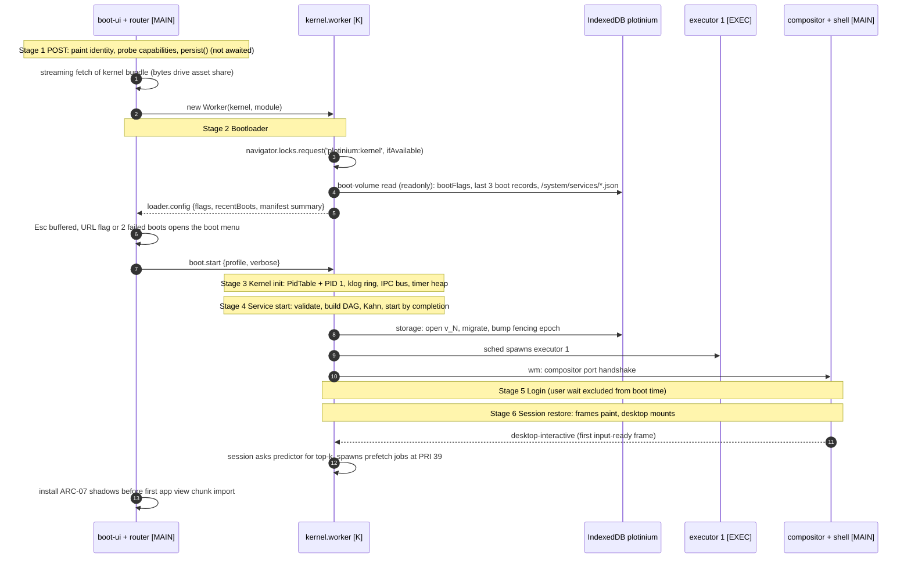
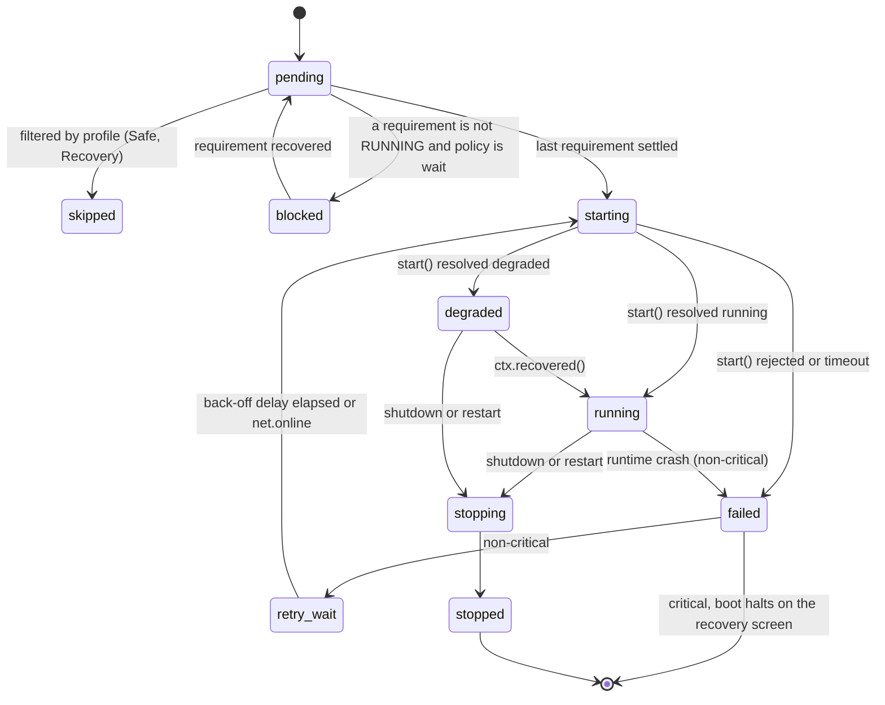
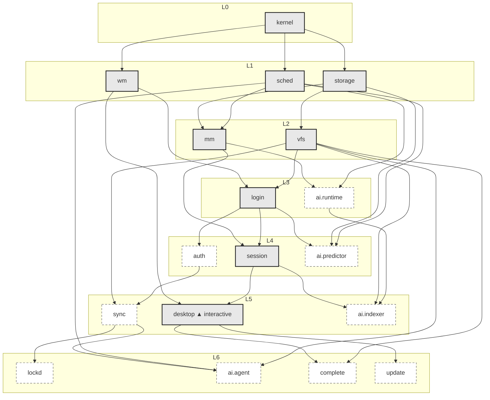

# Boot sequence, service manager and shutdown

| Field | Value |
|---|---|
| Title | Plotinium boot: the six stages, the service DAG, truthful progress, boot modes, `bootlog`, graceful shutdown and the application start-up DAG |
| Status | Draft v0.1, 2026-09-24 |
| Primary owner | R5 QA/DevOps & Integration (service manager, boot orchestration, `bootlog`, shutdown; editor of `BOOT.md`) |
| Secondary reviewer | R3 WM/UI (boot-ui: boot screen, boot menu, panic, recovery console, login and desktop mount). R5 in turn reviews R3's `wm/boot-ui` (role matrix: "each reviews the other") |
| Must be demonstrable at | **P1 defence (W4, paper):** service list, DAG, critical and degradable services, boot-time budget. **P2 gate (W7, v0.2.0):** boot screen v1 with identity (BOOT-01), truthful progress for asset loading and kernel initialisation (BOOT-02), login with several users plus guest and demo (BOOT-14), boot-screen accessibility (BOOT-13), `svcmgr` v1 (DAG, Kahn, cycle panic). **P3 gate (W11, v0.3.0):** boot v2, meaning BOOT-03 to BOOT-12 live (DAG-driven start, verbose log, boot menu, safe and recovery modes, degraded and offline boot, `bootlog --critical-path`, `shutdown -r now`). **Final defence (W17–18, v1.0.0):** everything on the reference machine |
| Requirement IDs covered | BOOT-01 … BOOT-14 (Spec §6.5); §6.1–§6.4, §6.6; the DAG row of §10.1 (service start-up and application start-up dependencies); §15.2 `BOOT.md` contents. Contributes to OFF-01, OFF-04, OFF-05, WM-06, MEM-04, PROC-06, SYS-02 (`bootlog`, `shutdown`, `reboot`), VFS-11 (recovery console), PRE (stage-6 pre-fetch). Plotinium design IDs SVC-01 … SVC-18 |
| Related specs | [../01-architecture/architecture.md](../01-architecture/architecture.md) · [../01-architecture/syscall-abi.md](../01-architecture/syscall-abi.md) · [../03-kernel/processes-and-scheduling.md](../03-kernel/processes-and-scheduling.md) · [../03-kernel/memory-and-paging.md](../03-kernel/memory-and-paging.md) · [../04-vfs/virtual-file-system.md](../04-vfs/virtual-file-system.md) · [../05-wm/window-manager.md](../05-wm/window-manager.md) · [../05-wm/ui-design-system.md](../05-wm/ui-design-system.md) · [../06-sync/offline-and-sync.md](../06-sync/offline-and-sync.md) · [../07-shell/shell-and-terminal.md](../07-shell/shell-and-terminal.md) · [../08-dsa/data-structures.md](../08-dsa/data-structures.md) · [../10-ai/predictive-prefetch.md](../10-ai/predictive-prefetch.md) · [../10-ai/rag-semantic-search.md](../10-ai/rag-semantic-search.md) · [../12-security/security-model.md](../12-security/security-model.md) · [../13-quality/testing-and-performance.md](../13-quality/testing-and-performance.md) · [../14-devops/deployment-and-ci.md](../14-devops/deployment-and-ci.md) · [../00-product/identity-and-branding.md](../00-product/identity-and-branding.md) · [../00-product/requirements-traceability.md](../00-product/requirements-traceability.md) · [../16-delivery/implementation-plan.md](../16-delivery/implementation-plan.md) |

**Conventions used in this file.** RFC 2119 keywords (MUST, SHOULD, MAY) as in the spec's Conventions (p. 3). **Spec: MUST (§x, ID)** marks an obligation copied from the capstone specification. **Plotinium design** marks our own binding choice; its RFC 2119 keywords bind the team. Numbers from the AI-run prototype are marked *(pilot figure — re-measure on the lab machine)*. Numbers in budget tables without that label are targets, not measurements. Thread tags: **[MAIN]** main thread, **[K]** kernel worker, **[EXEC]** executor, **[BLK]** blkio worker, **[IDB]** IndexedDB `plotinium`.

---

## 1. Purpose and scope

This spec is the normative source for how Plotinium comes to life in a browser tab and how it goes down again. It fixes:

- the six boot stages (Spec §6.3): which thread runs each, what work it does, what the screen shows, and how each failure is handled;
- the service-manifest schema and all **18 manifests** (canonical decision C17), with the level diagram and the critical path;
- the service manager (`svcmgr`): validation, completion-driven Kahn start, timeouts through the kernel timer heap, the degraded state with back-off, and the critical-failure recovery screen;
- the boot menu and the Normal, Safe, Recovery and Verbose modes, including the recovery console commands;
- the cycle panic and the examiner's cycle test (BOOT-04);
- the truthful-progress formula, the static "no timers" check and its allowlist (BOOT-02);
- the boot-time budget (BOOT-10) and the definitions of warm and cold boot;
- the `bootlog` record, the `bootlog --critical-path` algorithm and its sample output (BOOT-11);
- graceful shutdown and restart, including the `pagehide` path (BOOT-12);
- accessibility of every boot surface (BOOT-13);
- the **application start-up DAG**: `/bin/<app>.json` manifests resolved by `sys.spawn` with the same Kahn implementation (Spec §10.1, DAG row; critic fix);
- the test table mapping every BOOT ID to a named test.

Out of scope, linked instead: the DAG and heap implementations ([data-structures.md](../08-dsa/data-structures.md) S3, S4), the scheduler and the executor pool ([processes-and-scheduling.md](../03-kernel/processes-and-scheduling.md)), checkpoints and swap ([memory-and-paging.md](../03-kernel/memory-and-paging.md)), `fsck` semantics and the IndexedDB store layout ([virtual-file-system.md](../04-vfs/virtual-file-system.md)), the `syncd` state machine ([offline-and-sync.md](../06-sync/offline-and-sync.md)), login credentials and the offline verifier ([security-model.md](../12-security/security-model.md)), the compositor ([window-manager.md](../05-wm/window-manager.md)), the boot-screen visual tokens ([ui-design-system.md](../05-wm/ui-design-system.md)) and the identity strings ([identity-and-branding.md](../00-product/identity-and-branding.md)). The second-tab takeover is ARC-02 in [architecture.md](../01-architecture/architecture.md); this spec only says where in the boot it happens.

---

## 2. Requirements table

| ID | Summary | Spec § | How verified |
|---|---|---|---|
| BOOT-01 | Spec: MUST. The boot screen shows the registered OS name, logo and version | §6.5 | P2 gate visual inspection; e2e asserts the inlined first paint (§8) |
| BOOT-02 | Spec: MUST. Progress is computed from real work finishing (weighted DAG nodes and asset loading); no timer-driven progress anywhere in the boot path | §6.5, §6.1 "Not acceptable" | Code review; static check (§5.6); throttled-network e2e: the bar slows down in step with the network |
| BOOT-03 | Spec: MUST. Services start in the topological order of the service DAG; independent services start concurrently | §6.4, §6.5 | `bootlog` timestamps: every edge respected, same-level intervals overlap |
| BOOT-04 | Spec: MUST. A dependency cycle halts the boot with a kernel-panic screen that names the cycle | §6.5, §6.6 | Examiner adds a cycle to a manifest (§5.4) |
| BOOT-05 | Spec: MUST. A verbose mode, toggled by a key, shows a timestamped kernel-style boot log | §6.5 | Live demonstration; e2e |
| BOOT-06 | Spec: MUST. A boot menu offers Normal, Safe mode (no AI services, no autostart apps, default theme) and Recovery (file-system check, clear local cache, reset session) | §6.5; App. A "both reachable" | Live demonstration; keyboard-only e2e |
| BOOT-07 | Spec: MUST. A failed or timed-out non-critical service does not stop the boot; the desktop shows which services are degraded; failed services are retried with back-off | §6.5 | AI endpoint or backend blocked during boot |
| BOOT-08 | Spec: MUST. A failed critical service shows a recovery screen with retry, safe mode and diagnostic details; never a blank page or an endless spinner | §6.5 | Local database version corrupted by the examiner |
| BOOT-09 | Spec: MUST. With the network disabled the system boots to a usable desktop from cached assets and local state | §6.5 | Browser offline (and server killed), then reload |
| BOOT-10 | Spec: MUST. Warm boot ≤ 1.5 s and cold boot ≤ 3.0 s to an interactive desktop; large assets such as model weights load only after the desktop is interactive | §6.5 | Performance trace on the reference machine |
| BOOT-11 | Spec: MUST. Per-stage and per-service timings are saved; `bootlog` prints them; `bootlog --critical-path` shows the chain that determined the boot time | §6.5 | Terminal demonstration |
| BOOT-12 | Spec: MUST. Graceful shutdown and restart: dirty pages and pending writes flushed, services stopped in reverse topological order, session saved; restart returns to the same session | §6.4, §6.5 | `shutdown -r now` during a live session |
| BOOT-13 | Spec: MUST. The boot screen respects `prefers-reduced-motion`, exposes `role="progressbar"` with live values, announces status changes, and the boot menu works from the keyboard alone | §6.5 | Accessibility audit (axe + keyboard e2e) |
| BOOT-14 | Spec: SHOULD. The login screen supports several users and includes a guest or demo account | §6.5 | Live demonstration |
| SVC-01 | Plotinium design. 18 manifests (C17) validated against one Valibot schema and ten rules (V1–V10); any violation is a kernel panic naming the manifest | §6.4 | Unit tests per rule |
| SVC-02 | Plotinium design. Start is completion-driven Kahn: a service starts the moment its last dependency is done; there is no barrier between levels | §6.4 | Unit test with fake services; `bootlog` overlap check |
| SVC-03 | Plotinium design. Service timeouts and back-off run on the kernel timer heap (`dsa/heap`); they never change the progress value | §6.1 | Static check; unit test |
| SVC-04 | Plotinium design. Degraded state with jittered exponential back-off (0.5 s … 60 s); dependents either wait or start degraded per manifest | §6.5 BOOT-07 | Unit + e2e |
| SVC-05 | Plotinium design. Safe mode boots from the built-in manifests, skips `safeMode:false`, restores window frames without starting apps, and uses the default theme | §6.5 BOOT-06 | e2e |
| SVC-06 | Plotinium design. Recovery mode starts only `kernel, sched, storage, wm, vfs` (read-only) and opens the recovery console (§3.8) | §6.5 BOOT-06 | e2e |
| SVC-07 | Plotinium design. The boot menu is reachable by holding Esc (buffered from the first line of boot-ui), by `reboot --menu`, by a Settings flag, and automatically with Safe preselected after 2 consecutive failed boots | §6.3 stage 2; critic fix | e2e for each path |
| SVC-08 | Plotinium design (pending cross-spec agreement, §9). `/system/services` and `/system/log` are device-local subtrees: never synced, so a manifest edit on one device cannot break another | Spec §9.3 (standard hierarchy) | Integration test |
| SVC-09 | Plotinium design. One `BootRecord` per boot in IndexedDB `bootlog` (last 20); `/system/log/boot.log` is a kernel-synthesised read-only view | §6.5 BOOT-11 | Unit + e2e |
| SVC-10 | Plotinium design. The build fails if `setTimeout`, `setInterval`, `@keyframes` or `animation` appears in the boot path, except the two allowlisted, progress-free call sites | §6.1, App. A "0 timers" | CI static check |
| SVC-11 | Plotinium design. Shutdown checkpoints checkpointable processes before signalling the rest; `visibilitychange→hidden` checkpoints and saves the layout; `pagehide` is best effort | §6.5 BOOT-12 | e2e |
| SVC-12 | Plotinium design. `sys.spawn` resolves `/bin/<app>.json` dependencies with the same `dsa/dag` Kahn code, rejects cycles with the path, and starts each level concurrently | §10.1 DAG row; critic fix | Unit + bench + e2e |
| SVC-13 | Plotinium design. After `desktop-interactive` the session service asks the predictor for its top-k apps and spawns niced `prefetch:*` jobs, logged in `bootlog` | §6.3 stage 6; critic fix | e2e |
| SVC-14 | Plotinium design. POST separates required capabilities (fatal) from degradable ones; an insecure context is fatal | §6.3 stage 1 | Unit + e2e |
| SVC-15 | Plotinium design. The build emits `boot-manifest.json` (per-target asset list with decoded sizes); progress is exactly 1 at `desktop-interactive` | §6.5 BOOT-02 | Build test + e2e |
| SVC-16 | Plotinium design. The main-thread router installs the ARC-07 storage and worker shadows after the kernel link is up and before the first app view chunk is imported | §8 boundary 1 | e2e (ARC-07) |
| SVC-17 | Plotinium design. `svcctl`, `bootlog`, `shutdown` and `reboot` are user-space commands over typed syscalls (§4.7) | §9.6 SYS-02 | Shell e2e |
| SVC-18 | Plotinium design. A boot-stall watchdog shows a stall screen after 15 s with no boot event, so no stage can hang silently | §6.5 BOOT-08 | e2e with a stalled route |

---

## 3. Design (normative)

### 3.1 Boot timeline at a glance



### 3.2 The six stages

**Spec: MUST (§6.3, Figure 6.2).** The system boots through six stages; stages 3 and 4 are driven by the service DAG; stage 5 MUST work offline (BOOT-09). The table is normative for Plotinium.

| Stage | Thread | Work | On screen | If it fails |
|---|---|---|---|---|
| **1 POST** | [MAIN] inlined boot-ui (first `<script>` in `index.html`) | (a) Paint the logo, name, `version X.Y.Z · build abcdef0` and the hint line from inlined HTML before any script runs (BOOT-01). (b) Install Esc and V keydown listeners on the first line of the inline script; keys are buffered. (c) Probe capabilities (§3.2.1). (d) Read `navigator.storage.estimate()`; call `navigator.storage.persist()` through the router and record the result when it resolves, **never awaited** on the boot path. (e) Record whether a Service Worker controls the page (offline-capable). (f) Start `fetch('/version.json', {cache:'no-store'})` in the background; the `auth` service consumes it (§3.2.2). (g) Start the streaming fetch of the kernel bundle and `modulepreload` of the desktop-shell chunk. | Logo, name, version, build; progress bar at its true value; "checking system" | **Unsupported screen** ("Plotinium cannot start in this browser") listing each missing required capability with a fix line, e.g. "Open http://localhost:4717, not a LAN IP". Degradable capabilities only add a `WARN` line and a `bootlog` note |
| **2 Bootloader** | [MAIN] boot-ui (menu) + [K] (lock and config read) | (a) When the kernel bundle has streamed in, create `new Worker(kernelUrl, {type:'module', name:'kernel'})`; the request is an HTTP- or SW-cache hit (the e2e boot test asserts one transfer). (b) The kernel acquires Web Lock `plotinium:kernel` with `ifAvailable:true`; if refused, the takeover screen (ARC-02) replaces the boot. (c) The kernel performs the **boot-volume read** (§3.2.3) and posts `loader.config`. (d) boot-ui decides the profile (§3.7): menu if requested, else URL flag, else Normal. (e) V toggles verbose view at any time. (f) boot-ui posts `boot.start{profile, verbose, flags}`. | Boot menu (Figure 6.1) when requested; otherwise the splash continues | **Fall back to Safe mode** (Spec §6.3): an exception in the config read or menu logic boots Safe with a `WARN` line and `flags += ['loader-fallback']` |
| **3 Kernel init** | [K] | Create the process table (`dsa/hashtable` PidTable) with PID 1 `init`; the klog ring (`dsa/ringbuffer`, 8,192 entries); the IPC event bus; the kernel **timer heap** (`dsa/heap`) and its single host timer; register the syscall table and the no-op AI hooks. The timer heap is created here, not in `sched`, because every service timeout (including `sched`'s own) needs it. | Progress; verbose lines | **Kernel-panic screen** with diagnostic details (error, stack, build, capability matrix) and `[R] recovery console [S] safe mode [D] dump diagnostics`. An uncaught error in the worker reaches the router as the Worker `error` event |
| **4 Service start** | [K] (+ [MAIN] for `wm`, `desktop`; [EXEC] for executor-hosted services) | Load the manifests read in stage 2 (or the built-in set in Safe and Recovery), validate V1–V10 (§3.4), build the DAG, run Kahn, **reject cycles** (§5.4), then start services by completion (§5.2). Log `svc: 18 manifests (volume) · 30 edges · acyclic · 7 levels`. Spec stage 3 lists "start the scheduler and worker pool, arm the memory manager": in Plotinium these are the DAG's level-1 and level-2 services `sched` and `mm`, so their order is derived from the DAG like every other service; they are the first lines after kernel init in the verbose log. | Current service line (`vfs: mounting / (12,408 inodes)`) and `Service start · n of 9` | Critical service: **recovery screen** (§3.6). Non-critical: DEGRADED, retried with back-off (§3.5) |
| **5 Login** | [K] `login` service + [MAIN] login view (Solid, mounted by `login`) | Establish the session uid through exactly one of: cached session, online password login, offline PBKDF2 verifier, guest or demo tile (BOOT-14). Time between the login screen's first input-ready frame and submission is **user wait**, recorded as `userWaitMs` and excluded from boot time and from `login`'s timeout clock. | Login screen with user tiles, Guest and Demo | Server unreachable: offer the offline verifier and Guest (credential rules in [security-model.md](../12-security/security-model.md)); an internal error or a timeout of the non-interactive part is a critical failure (§3.6) |
| **6 Session restore** | [K] `session` + [MAIN] compositor and `desktop` | `session` restores the `os_session` layout (WM-06): window frames with geometry, state and z-order paint at once; app processes are respawned and their chunks load only **after** `desktop-interactive`. `desktop` mounts the shell; its first input-ready frame is the `desktop-interactive` mark (§3.2.4). After the mark: boot timings are written to `bootlog`, and the session service runs stage-6 pre-fetch (SVC-13). | Desktop | **Start a clean session and keep the old one for recovery** (Spec §6.3): an invalid or unreadable layout is renamed to `<os_session_id>.recovery-<bootId>`, a `WARN` line is logged, and `session` still counts as started |

Stages overlap by design: stage 4 continues for non-critical services while stages 5 and 6 run. A stage's `[start, end]` in the boot record (§4.6) is the interval of its own work; stage 4 ends when every service is settled (§5.2).

#### 3.2.1 POST capability matrix (SVC-14)

| Capability | Probe | Class | If missing |
|---|---|---|---|
| Secure context | `isSecureContext` | **Required** | Unsupported screen. Web Locks, `crypto.subtle`, OPFS, Service Workers and SharedArrayBuffer are all secure-context-only ([MDN: Web Locks API](https://developer.mozilla.org/en-US/docs/Web/API/Web_Locks_API), [MDN: SubtleCrypto](https://developer.mozilla.org/en-US/docs/Web/API/SubtleCrypto)), so without it one-kernel-per-origin (ARC-02) and checksum verification (MEM-03) are impossible |
| Module workers, nested workers | construct-and-terminate probe of a module worker; the kernel reports nested-worker support when it spawns executor #1 | **Required** | Unsupported screen (the kernel and executors are workers, C2) |
| IndexedDB | `'indexedDB' in self` and a successful `indexedDB.databases()` call in the kernel | **Required** | Unsupported screen ("storage disabled or private mode blocks IndexedDB") |
| Web Locks | `navigator.locks` | **Required** | Unsupported screen |
| `crypto.subtle` | `crypto.subtle.digest` exists | **Required** | Unsupported screen |
| Cross-origin isolation | `crossOriginIsolated`, `typeof SharedArrayBuffer` | Degradable | Pre-emption by messages; ORT single thread; no memory calibration. `WARN` + `bootlog` note |
| OPFS sync access handles | probed by `mm` in the blkio worker | Degradable | Swap on IndexedDB `plotinium-swap` (C4) |
| Service Worker | `'serviceWorker' in navigator` | Degradable | No offline boot; taskbar never shows "Offline-ready"; `WARN` |
| Persistent storage | result of `persist()` | Degradable | Recorded; Settings explains eviction risk |
| `CompressionStream` | global exists | Degradable | Remote swap pages sent uncompressed |
| `measureUserAgentSpecificMemory` | Window-only; router probe | Degradable | Calibration skipped (MEM-01 report says so) |

**Cross-spec note.** [architecture.md §6](../01-architecture/architecture.md) currently lists "not a secure context" as a degraded mode. Because Web Locks and `crypto.subtle` are secure-context-only, this spec makes it fatal; see §9.3.

#### 3.2.2 The `/version.json` identity check (off the critical path)

POST starts the fetch but nothing on the boot critical path awaits it (INV-A7 in [architecture.md](../01-architecture/architecture.md)). The `auth` service (non-critical, L4) awaits the result:
- `name !== 'Plotinium'`: another application answers on this origin's server. `auth` and therefore `sync` go DEGRADED with reason `foreign-server`; the local system still boots.
- `version`/`build` differ from the inlined build identity: the `update` service is told (OFF-05); boot continues.
- Offline or network error: `auth` uses the cached session state and goes DEGRADED `offline`.

#### 3.2.3 The boot-volume read (stage 2, kernel)

The kernel needs three things before any service starts: persisted boot flags, recent boot outcomes (for the 2-failure rule), and the manifests. It gets all three in **one read-only transaction**, then closes the connection so the `storage` service can later open and upgrade the database.

1. `indexedDB.databases()`; if `plotinium` is absent this is a first boot: no flags, no history, built-in manifests. The kernel MUST NOT call `indexedDB.open('plotinium')` without a version when the database may be absent, because that creates an empty version-1 database ([MDN: IDBFactory.open](https://developer.mozilla.org/en-US/docs/Web/API/IDBFactory/open)); `databases()` is available in workers ([MDN: IDBFactory.databases](https://developer.mozilla.org/en-US/docs/Web/API/IDBFactory/databases)).
2. Otherwise open without a version (current version) and run one `readonly` transaction over `meta`, `bootlog`, `dentries`, `inodes`, `blobs`, `blob_chunks`: read `meta['bootFlags']`, the last 3 `bootlog` records, and every child of the well-known `/system/services` inode (C5) whose name ends in `.json`.
3. Close the connection.
4. Any exception (missing store, bad JSON, `VersionError`) → built-in manifests, `WARN boot volume unreadable (<reason>); using built-in manifests`, and `flags += ['volume-fallback']`. The `storage` service then diagnoses the database properly, so a corrupted database still ends on the BOOT-08 recovery screen rather than here.

#### 3.2.4 The `desktop-interactive` mark

`desktop` is started when `session` and `wm` are done. It mounts the desktop shell (event handlers attached before mount returns), then waits for the **first input-ready frame**: a `requestAnimationFrame` callback followed by a `MessageChannel` message (runs after that frame is presented). At that point the router calls `performance.mark('desktop-interactive')`, takes pending Resource Timing records (`PerformanceObserver.takeRecords()`) and reports the mark to the kernel; `desktop` is then done. Boot time is `interactiveAt − userWaitMs` (seconds since t0, §4.6).

### 3.3 Service manifests (the 18 of C17)

**Spec (§6.4).** "Each system service declares its dependencies in a manifest." The spec's example fields `name, requires, critical, weight, timeoutMs, priority, safeMode` are kept with the same meaning; Plotinium adds optional fields with defaults (§4.1), so the spec's example manifest validates unchanged.

**Plotinium design.** Source of truth: `services/manifests/*.json`, compiled into the kernel bundle as the **built-in set** and seeded by client `mkfs` into `/system/services/` (root:root, `0644` files in a `0755` directory). Normal boots read the seeded copies (the boot volume); Safe and Recovery boots use the built-in set (§3.7).

| name | requires | critical | weight | timeoutMs | priority | safeMode | runs in | "started" means |
|---|---|---|---|---|---|---|---|---|
| `kernel` | – | true | 3 | 1000 | 0 | true | [K] | PID 1, PidTable, IPC bus, klog ring and timer heap exist; manifests loaded. Its timeout is enforced by the router's watchdog (§3.9), since a kernel cannot time itself |
| `sched` | kernel | true | 1 | 500 | 0 | true | [K] | ready heap and aging tick armed; executor #1 alive (nested-worker probe passed) |
| `storage` | kernel | true | 4 | 3000 | 2 | true | [K] | IndexedDB `plotinium` open at this build's version, migrations applied, required stores present, `meta.schemaVersion` consistent, fencing epoch bumped, `persist()` result recorded, `bootlog` record created |
| `wm` | kernel | true | 2 | 1000 | 2 | true | [MAIN] + [K] | compositor attached; kernel↔compositor port handshake done |
| `mm` | sched, storage | true | 2 | 2000 | 2 | true | [K] + [BLK] | budget loaded; LRU ready; swap device probed (OPFS or IndexedDB fallback); `*.tmp` sweep done |
| `vfs` | storage | true | 5 | 3000 | 4 | true | [K] | `/`, `/home/<last user>` and cwd loaded lazily; quick invariants checked; `/tmp` cleared (mkfs on first boot) |
| `login` | vfs, wm | true | 2 | 2000 (user wait excluded) | 8 | true | [K] + login view | session uid established |
| `session` | login, mm | true | 3 | 2000 | 10 | true (layout only, no app autostart) | [K] | layout restored; "restoring" states queued |
| `desktop` | session, wm | true | 3 | 3000 | 10 | true | [MAIN] | shell mounted; first input-ready frame gives `desktop-interactive` |
| `auth` | login | false | 1 | 4000 | 15 | true | [K] | server session validated or refreshed; verifier refresh scheduled; `/version.json` identity checked |
| `sync` (`syncd`) | auth, vfs | false | 2 | 4000 | 20 | true | [K] | WebSocket LIVE, else DEGRADED "offline, n queued" |
| `lockd` | sync | false | 1 | 2000 | 20 | true | [K] | lease table ready, heartbeat armed; else DEGRADED "local advisory locks only" |
| `ai.runtime` | sched, mm | false | 1 | 4000 | 32 | false | [K] + [EXEC] | ai syscall table and `FsSemanticSearch` seam registered, `ai.search` spawned (< 50 ms, no network, no weights) |
| `ai.indexer` | ai.runtime, vfs, session | false | 3 | 4000 | 32 | false | [EXEC] | process spawned, cursor reconciled, pending count reported |
| `ai.predictor` | sched, storage, login | false | 1 | 2000 | 32 | false | [EXEC] | Markov counts loaded from the telemetry ring |
| `ai.agent` | vfs, sched, sync | false | 1 | 2000 | 20 | false | [K] registry | registered; health probe runs after interactive (no network during boot) |
| `complete` | vfs, desktop | false | 1 | 10000 | 36 | true | [EXEC] | trie process running with `cmd:`, `flag:` and `hist:` namespaces loaded; `path:` indexing continues incrementally (≥ 10k entries) |
| `update` | desktop | false | 1 | 10000 | 38 | true | [MAIN] + SW | Service Worker registered after interactive plus idle; `update.available` wired (OFF-05) |

Totals: **18 manifests, 30 edges, acyclic, 7 levels (L0–L6)**. Plotinium extensions set in the shipped manifests (all others take the defaults of §4.1):

| name | Extension fields |
|---|---|
| `login` | `"userWait": true` |
| `lockd` | `"onDegradedDependency": "start-degraded"` (runs local advisory locks while `sync` is degraded, as in the spec's reference log) |
| `ai.agent` | `"onDegradedDependency": "start-degraded"` (registered; `ai` reports `EAIUNAVAIL` until online) |
| `sync` | `"stopTimeoutMs": 4000` (outbox flush waits up to 3 s for acks, §3.10) |
| `kernel`, `sched`, `storage`, `wm`, `vfs` | `"recovery": true` (the Recovery-mode set) |

**Priority.** Every started service is represented by a PCB (kind `service`, ppid 1, uid 0) so `ps`, `svcctl status` and the Task Manager show it. For executor-hosted services (`ai.indexer`, `ai.predictor`, `complete`, and `ai.search` spawned by `ai.runtime`) `priority` is the base scheduling priority of their process. For in-kernel and main-thread services it is informational in `ps` and breaks ties between timer-heap callbacks due at the same instant.

### 3.4 Validation rules at DAG build (SVC-01)

Any violation is a **kernel panic naming the offending manifest** (file name and rule), with the same `[R] [S] [D]` actions as a cycle panic.

| Rule | Check | Panic text (after `svc: KERNEL PANIC: `) |
|---|---|---|
| V1 | Each file parses as JSON and satisfies `ServiceManifestSchema` (§4.1) | `invalid manifest sync.json: <valibot issue path and message>` |
| V2 | `name` equals the file name without `.json` | `manifest foo.json declares name "bar"` |
| V3 | Names are unique | `duplicate service "sync"` |
| V4 | Every `requires` name exists | `vfs.json requires unknown service "storge"` |
| V5 | No self-dependency, no duplicate entries in `requires` | `sync.json requires itself` |
| V6 | A critical service requires only critical services | `critical service vfs requires non-critical sync` |
| V7 | Exactly one root, named `kernel`, with `requires: []`; every other service has ≥ 1 requirement | `kernel.json must have no requirements` |
| V8 | The boot target `desktop` exists and is critical | `boot target desktop missing or not critical` |
| V9 | Every name has an implementation registered in this kernel build | `no implementation for service "foo"` |
| V10 | The graph is acyclic (Kahn, §5.4) | `dependency cycle detected: auth → sync → lockd → auth` |

Rules V1–V9 run before V10 so a typo is not reported as a cycle. Ranges (`weight` 1..10, `priority` 0..39, `timeoutMs` 100..60000) are part of V1.

**Invariant A ⊆ critical.** Let A be the ancestor closure of `desktop` (including `desktop`). By V8 `desktop` is critical, and by V6 every requirement of a critical service is critical; by induction on distance from `desktop`, every member of A is critical. Consequence: a degraded or failed service can never hold the progress bar back (§5.5).

### 3.5 Degraded state and back-off (BOOT-07, SVC-04)

- A non-critical service whose `start()` rejects or whose timer-heap timeout fires becomes **FAILED** and then **RETRY-WAIT**. It is restarted after `delay_n` (§5.3), with attempts unbounded while the system is up; a successful start resets the counter.
- A service may also start **DEGRADED**: `start()` resolves `{status:'degraded', reason, selfHeals:true}` (for example `sync` offline). It runs in its fallback mode and manages its own recovery using the back-off helper `ctx.backoff` (same schedule, same timer heap), reporting each attempt so `svcctl status` shows `attempts` and `nextRetryAt`. It calls `ctx.recovered()` when it becomes RUNNING.
- **Dependents of a service that is not RUNNING:** with `onDegradedDependency: "wait"` (default) they stay **BLOCKED** ("blocked by dependency") and start once it is RUNNING; with `"start-degraded"` they start as soon as the dependency is RUNNING or DEGRADED and are themselves DEGRADED with reason `requires <dep>`, upgrading when notified through `ctx.onDependencyRecovered`.
- Network-dependent services (`auth`, `sync`, `ai.agent`) are retried immediately (back-off reset) on the router's `net.online` event.
- **Surfaces (OFF-04):** each transition to DEGRADED, FAILED or BLOCKED emits `svc.degraded` / `svc.failed` on the event bus. The taskbar tray shows a badge per degraded service ("sync · offline · 3 queued · retry in 4 s"); `desktop` logs `desktop: interactive · n windows restored · boot 0.73 s · 2 services degraded`; the Task Manager's Services tab and `svcctl status` list state, reason, attempts and next retry.

### 3.6 Critical failure: the recovery screen (BOOT-08)

A critical service that rejects, or whose timeout fires, halts the boot on the **recovery screen** (framework-free boot-ui; it does not need the Solid chunk, so it works when that chunk is the thing that failed):

```text
Plotinium could not start
storage failed: IndexedDB plotinium is at version 99; this build expects 7
[T] Retry storage   [S] Safe mode   [R] Recovery console   [D] Diagnostics
[C] Reset local cache and re-sync (exports the outbox first)          ← storage only
```

- **Retry** re-runs the failed service's `start()` in place (attempt n+1); its dependents are still pending.
- **Safe mode** reboots with `?boot=safe`.
- **Recovery console** reboots with `?boot=recovery`.
- **Diagnostics** shows the error, stack, service states and capability matrix on screen, and offers a download of the boot record as `plotinium-boot-<bootId>.json`.
- **Reset local cache and re-sync** (storage only): (1) opens the database at its current version, read-only, and downloads every `outbox` op as `plotinium-outbox-<date>.json` (skipped with a warning if the store is unreadable); (2) deletes `plotinium` and `plotinium-swap`; (3) reboots. The next boot is a first boot (mkfs; home snapshot at login).
- Every critical service has a finite `timeoutMs`, and the watchdog (§3.9) covers the kernel itself, so no failure can produce a blank page or an endless spinner. There is no spinner anywhere in boot-ui.

### 3.7 Boot modes and the boot menu (BOOT-05, BOOT-06, SVC-05, SVC-07)

**Profile decision (stage 2), first match wins:**
1. **Menu requested**: Esc keydown buffered since the first inline line (holding Esc produces repeats, so a hold is reliable), `?boot=menu`, or `meta.bootFlags.menuNextBoot` (set by `reboot --menu` or Settings → System → "Show boot menu on next boot"; one-shot, cleared by `storage` once the boot proceeds).
2. **Auto-safe**: the last 2 boot records have outcome `panic`, `recovery` or `incomplete` → menu opens with **Safe** preselected.
3. **URL profile flag** `?boot=safe|recovery|verbose|normal` (set by `reboot --safe` and so on); boot-ui removes it with `history.replaceState` so a manual reload does not repeat it.
4. **Normal**.

**Boot menu** (framework-free, "Plotinium Boot Manager"): entries `▶ Normal boot`, `Safe mode: no AI services, no autostart, default theme`, `Recovery: fsck · clear cache · reset session`, `Verbose boot`. Keys ↑/↓ move, Enter boots, Esc closes the menu (boots Normal). An **auto-boot countdown of 5 s** runs only while the menu is open and stops at the first keypress; it is one of the two allowlisted timers (§5.6). An Esc pressed after the stage-2 decision is ignored; the reliable paths for examiners are `reboot --menu` and the Settings flag.

| Mode | Manifest source | Services started | Other behaviour |
|---|---|---|---|
| Normal | boot volume `/system/services` (built-in if unreadable) | all 18 | – |
| Safe | **built-in set** (a known-good configuration; `/system/services` edits are ignored and `bootlog` says so) | those with `safeMode: true` (all but `ai.*`) | `session` restores window **frames only** (each shows "Not started (safe mode) · [Start]"); no app autostart and no stage-6 pre-fetch; default theme regardless of Settings; `ai`, `semsearch` and `predict` report the AI subsystems unavailable |
| Recovery | built-in set | `recovery: true` only: `kernel, sched, storage, wm, vfs`; `vfs` mounts **read-only** | no login; the recovery console (§3.8) replaces login and desktop; progress target is `recovery` (§5.5) |
| Verbose | any of the above | unchanged | the log view is shown from the start (V also toggles it at any time) |

Safe mode reads the built-in set so that `[S] safe mode` on a cycle panic always works, whatever an edited manifest contains.

**Verbose log (BOOT-05).** Every klog line is `[ssss.mmm] subsystem: message`, timestamps in seconds since t0 (§4.6), with text prefixes `WARN`, `DEGRADED`, `FAIL` and `KERNEL PANIC` so colour is never the only signal. Lines produced before the kernel exists (firmware, loader) are buffered by boot-ui and forwarded to the klog ring once it exists, so the boot record holds the complete log. Illustrative sample (not a measurement), mirroring Spec §6.6:

```text
[    0.000] firmware: Plotinium 0.3.0 · POST ok (workers, indexeddb, opfs, crypto, isolated) · quota 2.1 GB, persisted
[    0.004] loader: profile=normal · service worker active (offline-capable) · kernel image 104 KB (cache)
[    0.058] kernel: process table ready (hash table, cap 64) · pid 1 = init · klog 8192
[    0.060] svc: 18 manifests (volume) · 30 edges · acyclic · 7 levels
[    0.061] sched: priority heap + RR · quanta 5/10/20 ms · aging 250 ms · executors 1/4 · run tokens 2
[    0.122] storage: opened plotinium v7 (IndexedDB) in 61 ms · epoch 38
[    0.130] mm: budget 256 MB · swap tiers: opfs, server (write-behind)
[    0.212] vfs: mounted / · 12,408 inodes · 3 users · quotas enforced · quick check clean
[    0.341] login: session restored for uid=1001 (alice) · user wait 0.000 s
[    0.402] sync: WARN backend unreachable · offline mode · outbox holds 3 ops · retry in 2 s
[    0.405] lockd: DEGRADED (requires sync) · local advisory locks only
[    0.644] ai.indexer: 412 chunks pending · scheduled at priority 32 (background)
[    0.651] ai.predictor: Markov-2 loaded (214 transitions)
[    0.731] desktop: interactive · 4 windows restored · boot 0.73 s · 2 services degraded
[    0.790] session: pre-fetch: Terminal, Files (prefetch:terminal pid 41, prefetch:files pid 42, PRI 39)
```

### 3.8 Recovery console (SVC-06)

Header `Plotinium Recovery Console · <version> (<build>)` ([identity-and-branding.md](../00-product/identity-and-branding.md) row 3). A focusable list; each action has a single-key shortcut and a one-line consequence. Actions are router→kernel messages (`recovery.*`, §4.5), not syscalls: no process or uid exists yet.

| Key | Action | Effect |
|---|---|---|
| F | **fsck** (check) | Runs the VFS-11 check on the local tree read-only and prints the report (reachability, link counts, cycles, quota totals) |
| Y | **fsck --repair** | Applies the VFS-11 repairs to the **local** tree in one transaction. Plotinium design: repairs made in recovery are local-only (no outbox ops, since no uid is authenticated); the next online login re-converges from the server (per-owner feed or snapshot) |
| C | **clear local cache** | Same as §3.6 "Reset local cache and re-sync": outbox exported first, then both databases deleted, then reboot |
| S | **reset session** | Moves every `os_sessions` record for this device to `<id>.recovery-<bootId>`; the next boot starts a clean session |
| M | **restore default manifests** | Rewrites `/system/services/*.json` from the built-in set in one local transaction (device-local, SVC-08) and deletes any extra `.json` there |
| L | **boot log** | Shows the last 20 boot records and the critical path of the last one |
| D | **diagnostics** | Downloads the current boot record and the capability matrix as JSON |
| N / B | **reboot normal / safe** | `location.replace('/?boot=normal')` or `'/?boot=safe'` |

Security note: the console runs without login, as UNIX single-user mode does with physical access. It can only check or repair the local mirror, clear local state (after exporting the outbox) and reset the local session; it cannot read file content, act as any uid, or change server state. [security-model.md](../12-security/security-model.md) records this (§9.3).

### 3.9 Boot-stall watchdog (SVC-18)

The one boot-ui timer that is not the menu countdown. It is re-armed on every boot event (asset bytes, stage change, service event, klog line). It fires when **15 s** pass with no boot event while the boot is not waiting on the user (menu open, login screen, recovery console, panic screen). It also enforces the `kernel` manifest's `timeoutMs` (built-in value) between "kernel image loaded" and `kernel.ready`. On firing it shows `Plotinium is not making progress: <last event> (<n> s ago)` with `[T] Retry (reload) [S] Safe mode [D] Diagnostics`. It never reads or writes the progress value (checked by §5.6).

### 3.10 Graceful shutdown and restart (BOOT-12, SVC-11)

`shutdown -r now` and `reboot` (restart) and `shutdown -h now` (power off) run this sequence in the kernel. The shutdown screen (boot-ui) shows `Stopping <service> · n of 18`, a bar driven by stopped-service weights (the same truthful rule), and verbose lines.

1. **Stop admission.** `spawn` returns `EAGAIN` (`detail.reason = 'shutting-down'`); the router stops routing new input to apps.
2. **Checkpoint first.** Every checkpointable process is checkpointed at its next yield point: state encoded, written to swap, verified (MEM-03), write-behind upload queued when online (C4). A process cannot be checkpointed after it has exited, so this precedes step 3.
3. **Signal the rest.** SIGTERM to every non-checkpointable user process; 2 s grace; then SIGKILL. Checkpointed processes are then discarded without signals; their state lives on swap and in the layout.
4. **Flush dirty pages.** After step 2 every resident page has a verified swap copy; the pager drains the blkio queue.
5. **Save the session.** `session` writes the `os_session` layout (window geometry, state, z-order, cwd, and per window the `(os_session_id, pid, page_ids)` needed by MEM-04) locally with `durability:'strict'`, and to the server when online.
6. **Stop services in reverse topological order**, completion-driven on the reversed DAG (§5.2): a service stops when all its dependents have stopped; each `stop()` is raced against `stopTimeoutMs` (default 2000) on the timer heap; a timeout is logged `WARN` and the service is force-stopped. Service-specific stop work:
   - `lockd.stop` sends `bye`, releasing leases immediately;
   - `sync.stop` flushes the outbox: online, waits up to 3 s for acks; either way the outbox is already durable (C4 `strict`);
   - `storage.stop` (last before `kernel`) closes IndexedDB after writing the boot record's `shutdown` field.
7. **Release** the Web Lock `plotinium:kernel`; the kernel posts `kernel.halted`.
8. **Activate a waiting update (OFF-05).** If a new Service Worker is waiting, the router posts `SKIP_WAITING` and reloads on `controllerchange`.
9. **Restart or halt.** Restart: `location.replace('/')` (or `'/?boot=menu|safe|recovery|verbose'` for `reboot --menu` and similar). Halt: boot-ui shows `Plotinium has shut down · [Enter] Start`.

On restart, `session` restores the saved layout; each window's process is paged in from its checkpoint on first focus, so the session returns exactly as saved.

**Tab hidden, tab closed (pagehide path).** `pagehide` cannot await IndexedDB, so it cannot run the sequence above. Correctness does not depend on it, because every VFS mutation and outbox op is already committed with `durability:'strict'` (C4). The two browser-driven events do this:
- `visibilitychange → hidden` (the page is still alive): checkpoint every checkpointable window process (step 2) and save the layout with `durability:'relaxed'`. This is what makes MEM-04 "close the tab, reopen it" work.
- `pagehide`: best effort only. Save the layout (relaxed), send `lockd` `bye` with `ws.send`, and write the boot record's `shutdown` field `{kind:'pagehide', clean:false}`. Leases that were not released expire by TTL (VFS-09).
- The next boot sees `clean:false` and restores the last saved layout and checkpoints, which may be older than the last seconds before the close. `bootlog` prints `previous shutdown: unclean (pagehide)`.
- `pageshow` with `persisted:true` (back-forward cache restore) makes the kernel re-check its lock and fencing epoch and reconnect `sync`.

**Permissions.** `shutdown` and `reboot` succeed for uid 0 or for the uid that logged in on this console (Spec command table; [syscall-abi.md](../01-architecture/syscall-abi.md)). Agent-originated calls get `EPERM`.

### 3.11 Stage-6 pre-fetch (SVC-13)

**Spec (§6.3, stage 6):** "start pre-fetched applications". **Plotinium design.** After `desktop-interactive`, and only in Normal mode, `session` waits (event-driven, without blocking anything) for `ai.predictor` to be RUNNING and the system to be idle for ≥ 2 s. It then calls `ai.predict.top({k:3})` and, for each app with confidence ≥ θ ([predictive-prefetch.md](../10-ai/predictive-prefetch.md)), spawns `prefetch:<app>` at priority 39, which warms that app's start-up closure (§3.12) with speculative pages. The apps and pids go into the boot record (`prefetch`) and klog. If `ai.predictor` is degraded or skipped, nothing is pre-fetched and nothing waits.

### 3.12 Application start-up DAG (SVC-12)

**Spec (§10.1, DAG row):** mandatory locations are "service dependencies and boot order (§6.4); application start-up dependencies". **Plotinium design.** Every app and shared library has a manifest in `/bin` (seeded by mkfs from `apps/*/manifest.json`; root:root `0644`):

```json
// /bin/editor.json
{ "name": "editor", "kind": "app", "title": "Editor", "icon": "file-pen",
  "entry": "apps/editor/proc", "view": "apps/editor/view",
  "requires": ["svc:vfs", "svc:desktop", "lib:solid-ui", "lib:codemirror", "svc:lockd?"],
  "priority": 10, "checkpointable": true }

// /bin/lib/codemirror.json
{ "name": "codemirror", "kind": "lib", "chunks": ["vendor/codemirror"], "requires": ["lib:lezer"] }
```

- **Nodes.** `app:<name>` (the root), `lib:<name>` (loads `chunks`; may require other libs) and `svc:<name>` (a system service that must be RUNNING, or RUNNING/DEGRADED if marked `?`). A trailing `?` makes a requirement optional: if unavailable the app starts and sees `caps.<name> = false`.
- **Resolution in `sys.spawn`.** Collect the closure from the app manifest by DFS over `lib:` manifests; build the DAG; run the same `dsa/dag` Kahn used by `svcmgr` (`topoLevels`), which rejects cycles and returns levels. The result is memoised by `(app, versions of every manifest inode in the closure)`, so repeated launches cost one map lookup.
- **Execution.** Level by level, completion-driven as in §5.2: `svc:` nodes are checked against `svcmgr` state; `lib:` chunks are imported in parallel on the target executor, and view chunks through the router on [MAIN]; then the app's `entry` process is started and, if it has a `view`, the window is created.
- **Pre-fetch** (§3.11, PRE) uses the same resolved plan but only warms `lib:` chunks and speculative pages; it never starts the app.
- **Errors** (§6): missing manifest → `ENOENT`; cycle → `EINVAL` with the path; required service skipped or permanently failed this boot → `ENOSYS`; required service starting, blocked or in retry-wait → `EAGAIN`.

Example of the cycle error:

```text
alice@plotinium:~$ editor notes.md
editor: cannot start: dependency cycle: lib:codemirror → lib:lezer → lib:codemirror (EINVAL)
```

### 3.13 Device-local system subtrees (SVC-08, pending agreement)

`/system/services` holds this device's boot configuration and `/system/log` its logs. If they were ordinary synced files, a root user adding a cycle on one device (the BOOT-04 test on the production deployment) would replicate to the server and panic every other device on its next boot. **Plotinium design:** both directories exist on client and server with their C5 well-known ids, but their **children are device-local**: client mkfs seeds them, no op under them enters the outbox, the server rejects ops that target them, and snapshots and the per-owner feed never include their children. This needs changes in three other specs (§9.3). If the owners reject it, the fallback is that manifests are synced and the BOOT-04 examiner test runs on the local stack only; this spec would then say so.

### 3.14 Main-thread shadows (SVC-16)

Answering the request from [architecture.md §9.3](../01-architecture/architecture.md): the router captures the platform references it needs during POST into a frozen private object, including the Resource Timing observer and the `persist()` call used by boot-ui asset progress. It installs the ARC-07 throwing shadows on `window.indexedDB`, `caches`, `navigator.storage.getDirectory` and `Worker` **after `kernel.ready` and before the first `import()` of any app view chunk**. The login view and the desktop shell are system code (`wm/shell`), not app views, and are loaded before that point; restored app view chunks load after `desktop-interactive`.

---

## 4. Interfaces and data shapes

All schemas are Valibot in `protocol/` (C3); TypeScript types are inferred from them.

### 4.1 Service manifest schema

```ts
// protocol/src/services.ts  (Plotinium design)
import * as v from 'valibot';

export const ServiceNameSchema = v.pipe(
  v.string(), v.maxLength(32),
  v.regex(/^[a-z][a-z0-9]*(?:\.[a-z][a-z0-9]*)*$/),        // kernel, ai.runtime, ai.indexer
);
export type ServiceName = v.InferOutput<typeof ServiceNameSchema>;

export const ServiceManifestSchema = v.strictObject({     // unknown keys are rejected (V1)
  // --- fields of the spec's example manifest (§6.4) ---
  name: ServiceNameSchema,
  requires: v.pipe(v.array(ServiceNameSchema), v.maxLength(16)),
  critical: v.boolean(),
  weight: v.pipe(v.number(), v.integer(), v.minValue(1), v.maxValue(10)),   // share of the progress bar
  timeoutMs: v.pipe(v.number(), v.integer(), v.minValue(100), v.maxValue(60_000)),
  priority: v.pipe(v.number(), v.integer(), v.minValue(0), v.maxValue(39)), // 0 highest … 39 lowest
  safeMode: v.boolean(),                                                     // started in Safe mode
  // --- Plotinium extensions (optional, defaults applied by svcmgr) ---
  description: v.optional(v.pipe(v.string(), v.maxLength(120)), ''),
  runsIn: v.optional(v.picklist(['kernel', 'main', 'executor', 'kernel+main', 'kernel+executor', 'kernel+blkio', 'main+sw']), 'kernel'),
  recovery: v.optional(v.boolean(), false),                 // member of the Recovery-mode set
  userWait: v.optional(v.boolean(), false),                 // may wait for the user; that time is excluded
  onDegradedDependency: v.optional(v.picklist(['wait', 'start-degraded']), 'wait'),
  stopTimeoutMs: v.optional(v.pipe(v.number(), v.integer(), v.minValue(100), v.maxValue(10_000)), 2000),
});
export type ServiceManifest = v.InferOutput<typeof ServiceManifestSchema>;
```

`tools/emit-schemas.ts` also writes `docs/schemas/service-manifest.schema.json` (JSON Schema 2020-12) at build time for editors; it is never shipped to the client.

### 4.2 Service implementation contract

```ts
// services/src/types.ts
export type BootProfile = 'normal' | 'safe' | 'recovery';
export type ServiceState =
  | 'pending' | 'blocked' | 'starting' | 'running' | 'degraded'
  | 'failed' | 'retry-wait' | 'skipped' | 'stopping' | 'stopped';

export type StartResult =
  | { status: 'running' }
  | { status: 'degraded'; reason: string; selfHeals: boolean };

export interface KernelTimers {                        // kernel timer heap (dsa/heap), never setTimeout
  at(deadlineMs: number, fire: () => void, priority?: number): number;   // returns handle
  cancel(handle: number): boolean;
  now(): number;                                       // ms since t0, monotonic
}

export interface ServiceContext {
  readonly name: ServiceName;
  readonly profile: BootProfile;
  readonly pid: number;
  readonly timers: KernelTimers;
  readonly signal: AbortSignal;                        // aborted on timeout or shutdown
  log(level: 'info' | 'warn' | 'degraded' | 'fail', msg: string): void;
  label(text: string): void;                           // boot-screen current-service line; never moves the bar
  userWait<T>(p: Promise<T>): Promise<T>;              // only if manifest.userWait; pauses the timeout clock
  degraded(reason: string): void;
  recovered(): void;
  backoff(): { attempt: number; delayMs: number; retryAt: number }; // §5.3 schedule; records the attempt
  depState(dep: ServiceName): ServiceState;
  onDependencyRecovered(cb: (dep: ServiceName) => void): void;
}

export interface ServiceImpl {
  start(ctx: ServiceContext): Promise<StartResult>;    // rejects = failure
  stop(ctx: ServiceContext, reason: 'shutdown' | 'restart' | 'retry'): Promise<void>;
}
export type ServiceRegistry = ReadonlyMap<ServiceName, ServiceImpl>;   // V9 checks names against this
```

Service states and transitions (normative; `svcmgr` rejects any other transition):



`retry_wait` in the diagram is the state `'retry-wait'`. A critical service never reaches `retry-wait`: its failure halts the boot (§3.6), and "Retry" on the recovery screen moves it back to `starting`.

### 4.3 Service status (returned by `svc.status`)

```ts
export interface ServiceStatus {
  name: ServiceName; pid: number | null; level: number; critical: boolean; weight: number;
  state: ServiceState; reason: string | null;           // e.g. 'offline', 'requires sync', 'timeout 4000 ms'
  attempts: number; nextRetryAt: number | null;         // ms since t0
  startedAt: number | null; readyAt: number | null;     // ms since t0
  inBootTarget: boolean;                                // member of A (§5.5)
}
```

### 4.4 Application manifest schema

```ts
// protocol/src/apps.ts
export const DepRefSchema = v.pipe(v.string(), v.regex(/^(svc|lib):[a-z][a-z0-9.-]{0,31}\??$/));
export const AppManifestSchema = v.strictObject({
  name: v.pipe(v.string(), v.regex(/^[a-z][a-z0-9-]{0,31}$/)),   // equals the file name
  kind: v.picklist(['app', 'command', 'lib']),
  title: v.optional(v.string()), icon: v.optional(v.string()),
  entry: v.optional(v.string()),            // executor program module id (app, command)
  view: v.optional(v.string()),             // main-thread view chunk id (app)
  chunks: v.optional(v.array(v.string())),  // lib only
  requires: v.pipe(v.array(DepRefSchema), v.maxLength(32)),
  priority: v.optional(v.pipe(v.number(), v.integer(), v.minValue(0), v.maxValue(39)), 10),
  checkpointable: v.optional(v.boolean(), false),
});
export interface SpawnPlan { levels: string[][]; optionalMissing: string[]; key: string }   // key = memo key
```

### 4.5 Router ↔ kernel boot messages (router port, kernel-only)

```ts
type RouterToKernel =
  | { t: 'boot.start'; t0: number; profile: BootProfile; verbose: boolean; flags: string[];
      caps: CapabilityMatrix; preKernelLog: KlogLine[] }
  | { t: 'boot.userWait'; phase: 'begin' | 'end'; at: number }
  | { t: 'desktop.interactive'; at: number }
  | { t: 'asset.done'; url: string; bytes: number }                    // main-thread assets
  | { t: 'net.online' } | { t: 'visibility'; state: 'hidden' | 'visible' } | { t: 'pagehide' }
  | { t: 'recovery.run'; action: 'fsck' | 'fsck-repair' | 'clear-cache' | 'reset-session'
        | 'restore-manifests' | 'bootlog' | 'diagnostics' };

type KernelToRouter =
  | { t: 'loader.config'; bootFlags: BootFlags; recentBoots: BootOutcome[]; volumeOk: boolean }
  | { t: 'takeover.needed' }                                            // ARC-02
  | { t: 'boot.target'; target: 'desktop' | 'recovery'; weights: Record<ServiceName, number> }
  | { t: 'svc.event'; name: ServiceName; state: ServiceState; at: number; label?: string }
  | { t: 'asset.done'; url: string; bytes: number }                    // kernel-owned assets (executor, blkio)
  | { t: 'klog'; lines: KlogLine[] }                                    // batched, ≤ 1 batch per frame
  | { t: 'panic'; kind: 'cycle' | 'manifest' | 'critical' | 'kernel'; text: string; cycle?: string[] }
  | { t: 'kernel.ready' } | { t: 'kernel.halted'; restart: string | null };

interface BootFlags { menuNextBoot?: boolean }
interface KlogLine { t: number; sub: string; level: 'info' | 'warn' | 'degraded' | 'fail' | 'panic'; msg: string }
```

### 4.6 Boot record (IndexedDB `bootlog`, key `bootId`, last 20 kept)

```ts
export interface BootRecord {
  bootId: string;                       // UUIDv7 (time-ordered)
  seq: number;                          // per-device boot counter, printed as "boot #37"
  build: { version: string; build: string };
  profile: BootProfile; verbose: boolean;
  flags: string[];                      // 'esc', 'url:safe', 'meta:menuNextBoot', 'auto-safe', 'volume-fallback', 'loader-fallback'
  kind: 'warm' | 'cold' | 'cold-first'; // §5.7 definitions
  t0: number;                           // epoch ms = main-thread performance.timeOrigin; every other time is s since t0
  env: { chromeMajor: number | null; hwc: number; isolated: boolean; opfsSync: boolean;
         swActive: boolean; persisted: boolean | null; quotaBytes: number; usageBytes: number };
  manifests: { source: 'volume' | 'builtin'; count: number; edges: number; levels: number; sha256: string };
  stages: Array<{ stage: 1 | 2 | 3 | 4 | 5 | 6; name: string; start: number; end: number | null;
                  status: 'ok' | 'failed' | 'skipped'; note?: string }>;
  services: Array<{ name: string; level: number; critical: boolean; start: number | null; end: number | null;
                    status: ServiceState; attempts: number; reason?: string; userWaitMs?: number }>;
  assets: { bytesTotal: number; bytesDone: number };
  userWaitMs: number;
  interactiveAt: number | null;         // s since t0
  bootMs: number | null;                // interactiveAt*1000 − userWaitMs
  outcome: 'interactive' | 'panic' | 'recovery' | 'incomplete' | 'unsupported';
  panic?: { kind: 'cycle' | 'manifest' | 'critical' | 'kernel'; text: string; cycle?: string[] };
  prefetch?: Array<{ app: string; pid: number; confidence: number }>;
  log: KlogLine[];                      // at most 512 lines of this boot
  shutdown?: { kind: 'reboot' | 'poweroff' | 'pagehide'; at: number; clean: boolean };
}
```

- **Writes** (durability `relaxed`, diagnostic data): created by `storage` with outcome `incomplete` (earlier stages come from the in-memory klog); updated at `desktop-interactive`, when non-critical services settle, on panic and on shutdown. A panic before `storage` is written best-effort through a direct connection if the database exists at this build's version; `[D]` always works without IndexedDB.
- **Retention:** after insert, records beyond the 20 newest are deleted in the same transaction.
- **`/system/log/boot.log`**: a kernel-synthesised read-only file (mode `0444` root:root, content generated on read, never stored or synced; requested from the VFS spec by [identity-and-branding.md §9](../00-product/identity-and-branding.md)) rendering the current boot's `log` in the verbose format.

### 4.7 Syscalls and commands (SVC-17)

Requested from [syscall-abi.md](../01-architecture/syscall-abi.md) (the System group already lists `bootlog`, `shutdown`, `reboot`, `svc.status`):

| Call | Args | Value | Permission | Errnos |
|---|---|---|---|---|
| `bootlog` | `{boot?: 'current' \| number (seq), list?: boolean, criticalPath?: boolean}` | `BootRecord` \| summaries \| `CriticalPathRow[]` | any uid | `ENOENT` (no such boot), `EINVAL` |
| `svc.status` | `{name?: ServiceName}` | `ServiceStatus[]` | any uid | `ENOENT` (unknown name) |
| `svc.restart` | `{name}` | `{attempt}` | uid 0; non-critical services only | `EPERM`, `EINVAL` (critical), `ENOENT` |
| `svc.verify` | `{source: 'volume' \| 'builtin'}` | `{ok, count, edges, levels: string[][], errors: {rule, file, text}[], cycle?: string[]}` | any uid (manifests are world-readable) | – |
| `boot.setFlags` | `{menuNextBoot: boolean}` | `{}` | uid 0 or the console login uid | `EPERM` |
| `shutdown` | `{mode: 'poweroff' \| 'reboot', next?: 'menu' \| 'safe' \| 'recovery' \| 'verbose'}` | never returns on success | uid 0 or the console login uid; agent → `EPERM` | `EPERM`, `EBUSY` (already shutting down) |
| `reboot` | alias of `shutdown{mode:'reboot'}` | – | same | same |

Commands (user space, owned by R5, wired by [shell-and-terminal.md](../07-shell/shell-and-terminal.md)):

```text
bootlog [--list] [--boot N] [--critical-path] [--json]
shutdown [-h|-r] now
reboot [--menu|--safe|--recovery|--verbose]
svcctl status [NAME]
svcctl verify                       # dry-run DAG build of /system/services (prints levels or the cycle)
svcctl restart NAME                 # root, non-critical only
svcctl require SVC DEP [--force]    # root; edits /system/services/SVC.json through the VFS
svcctl unrequire SVC DEP            # root
svcctl defaults                     # root; restore default manifests (same as recovery key M)
```

`svcctl require` writes the file through ordinary VFS syscalls, then calls `svc.verify`. If the new set fails validation it prints the panic text the next boot would show and refuses unless `--force` is given, so the examiner can still create the cycle deliberately. Every change takes effect at the next boot.

---

## 5. Algorithms and invariants

### 5.1 Levels and the critical path

Level = longest path (in edges) from `kernel` (Spec Figure 6.3 legend). Edges point from a dependency to its dependent ("A → B: B requires A, so A starts first").



Solid: critical (failure halts the boot on the recovery screen). Dashed: degradable (boot continues; retried with back-off). Expected critical path: **kernel → storage → vfs → login → session → desktop**. `desktop-interactive` is at L5 while L5/L6 non-critical services may still be starting.

### 5.2 Completion-driven Kahn start (SVC-02)

```text
build (stage 4, O(V + E)):
  validate V1..V9 (§3.4)
  (order, level) := dsa/dag.topoLevels(manifests)           // throws CycleError(path) → panic (V10)
  filter by profile: Safe drops safeMode:false; Recovery keeps recovery:true
  for each v: waiting[v] := |requires(v)|                   // in-degree
  mark kernel done (it is running this code)
  for each dependent w of kernel: waiting[w]--, if 0 → start(w)

start(v):
  state[v] := starting; t := timers.at(now + timeoutMs[v], () => timeout(v))
  impl[v].start(ctx(v)).then(res => settle(v, res), err => fail(v, err))
  (a userWait begin cancels t; userWait end re-arms t with the remaining budget)

settle(v, res):  timers.cancel(t); state[v] := res.status
  for each dependent w of v:
     if res.status == running or policy(w) == start-degraded: waiting[w]--
     else: blocked[w] += {v}
     if waiting[w] == 0 and blocked[w] empty: start(w)

fail(v) / timeout(v):
  critical[v]  → halt: recovery screen (§3.6)
  otherwise    → state[v] := retry-wait; timers.at(now + delay(attempt[v]), () => start(v))

recovered(v) (degraded → running): for each w with v ∈ blocked[w]: remove v; if waiting[w]==0 and blocked empty: start(w)
```

- **No level barrier.** A service starts at the instant its last dependency settles, so services of one level run concurrently whenever their dependencies finish together (BOOT-03 "levels overlapping"). Concurrency in the single kernel thread is real: starts are asynchronous (IndexedDB open, worker spawn, the compositor handshake over a port) and interleave.
- **Correctness (topological order).** A service is started only when `waiting[v] = 0`, i.e. after every requirement has settled, so for every edge u→v, `start(v) ≥ end(u)`. This is exactly Kahn's invariant.
- **Termination.** Each service is started at most once per attempt; every critical start ends (settles, fails or times out) within its `timeoutMs`; so the critical closure settles in finite time or the boot halts on a screen.
- **Stage 4 ends** when no service is `starting` and no `pending` service has `waiting = 0`.
- **Shutdown** runs the same algorithm on the reversed DAG: `waitingStop[v] := number of running dependents`, and `stop(v)` when it reaches 0.
- Complexity: build O(V + E); each settle touches the dependents of one service, so a whole boot costs O(V + E) plus the timer-heap operations, O(log T) each.

### 5.3 Back-off schedule

`d_n = min(60 000, 500 · 2^(n−1))` ms for attempt n ≥ 1; the actual delay is `d_n/2 + U·d_n/2` with U uniform in [0, 1) (equal jitter, so delays stay within [½, 1] of the schedule: 0.25–0.5 s, 0.5–1 s, 1–2 s, … up to 30–60 s). The random source is seeded per boot so tests can fix it. All delays are timer-heap entries (SVC-03).

### 5.4 Cycle detection, the panic text and the examiner test (BOOT-04)

**Algorithm** (`dsa/dag`, [data-structures.md S4](../08-dsa/data-structures.md)):
1. Kahn: repeatedly remove a node with in-degree 0. If all V nodes are removed, the graph is acyclic.
2. Otherwise every remaining node has at least one remaining predecessor (its in-degree counts only unremoved predecessors). Start at the remaining node with the smallest name and repeatedly step to its smallest-named remaining predecessor. The walk stays in a finite set, so it must revisit a node; the revisited stretch is a cycle. O(V + E).
3. Print the cycle in dependency direction (u → v means v requires u), rotated to start at its alphabetically smallest member, and closed by repeating that member.

**Panic screen** (framework-free; title `Plotinium kernel panic`):

```text
[    0.060] svc: 18 manifests (volume) · 31 edges
[    0.060] svc: KERNEL PANIC: dependency cycle detected: auth → sync → lockd → auth
            boot halted. [R] recovery console   [S] safe mode   [D] dump diagnostics
```

`[R]` reboots into Recovery (built-in manifests, so it cannot hit the same cycle); `[S]` reboots into Safe mode (built-in manifests); `[D]` downloads the boot record. The boot record gets `outcome: 'panic'` and `panic.cycle`.

**Examiner cycle test (script for the P3 gate and Demo Day):**
1. As root (`su`), run `svcctl require auth lockd --force`, which adds `lockd` to `auth.requires`; or open `/system/services/auth.json` in the Editor as root and add `"lockd"` by hand. Either way the graph now contains auth → sync → lockd → auth, the cycle in the spec's reference log (§6.6).
2. `reboot`. The panic screen names the cycle as above.
3. Press R → Recovery console → M (restore default manifests) → N (reboot normal) → desktop.

CI does the same through the terminal in e2e, and additionally through the test-only URL flag `?bootflags=inject-cycle`, which exists only in builds with `__TEST_FLAGS__` (never in release builds).

### 5.5 Truthful progress (BOOT-02)

Definitions:
- **Target** T: `desktop` in Normal and Safe, `recovery` in Recovery. A = ancestor closure of T, including T. Default A (Normal, Safe) = {kernel, sched, storage, wm, mm, vfs, login, session, desktop}, Σw = 25. Recovery A = {kernel, sched, storage, wm, vfs}, Σw = 15.
- **Boot assets**: `web/dist/boot-manifest.json`, emitted by a Vite plugin (SVC-15), lists per target the assets on the critical path with their **decoded** sizes: `index.html` (counted done at t0), the kernel bundle, the executor bundle, the blkio bundle and, for `desktop` only, the desktop-shell chunk. Decoded sizes are used because a streaming `fetch()` body yields decoded bytes and Resource Timing's `decodedBodySize` is the post-decoding size, available in workers too ([MDN: decodedBodySize](https://developer.mozilla.org/en-US/docs/Web/API/PerformanceResourceTiming/decodedBodySize)).
- **bytesDone**: for the kernel bundle, bytes read so far from the streaming reader; for every other asset, its manifest size once its load completes, reported by its owner thread (main: `PerformanceObserver('resource')`; kernel: its own observer or the worker-ready event).

Formula (all quantities come from events; nothing depends on time):

```text
α  = W_assets / (W_assets + Σ_{s∈A} w_s^builtin)          W_assets = 10 → α = 10/35 (Normal/Safe), 10/25 (Recovery)
Pa = bytesDone / bytesTotal(T)
Ps = Σ_{s∈A, done} w_s / Σ_{s∈A} w_s                      weights from the manifests actually in use
P  = α · Pa + (1 − α) · Ps
```

With unedited manifests this equals the single-fraction form `P = (Σ_{done} w_s + W_assets·Pa) / (Σ w_s + W_assets)`, because α = W_assets / (Σw + W_assets). The two-part form keeps P monotone when an edited manifest changes Σw: α is fixed at build time, and Ps is 0 until `boot.target` delivers the weights, which happens before any service in A settles.

**Invariants.**
- *Monotone.* bytesDone and the done-set only grow, and bytesTotal is fixed once the target is chosen. The one change of target (Normal to Recovery at stage 2) removes assets and lowers `Σw^builtin`, so P can only jump **up** (less work remains).
- *Exactly 1 at interactive.* T ∈ A, so P < 1 until T is done. Every boot asset is needed before T can finish; at `desktop-interactive` the router flushes the observer (`takeRecords()`) and asserts P = 1. A mismatch logs `WARN progress accounting mismatch` and fails the e2e test.
- *Degraded services never hold the bar back* (A ⊆ critical, §3.4). Services outside A appear in the taskbar tray as "starting (n)".
- *Timeouts never move P.* A timed-out service is not done, so its weight is not added.

**On screen.** Bar width = P (no transition under reduced motion; otherwise a `--pl-motion-fast` width transition between two real values, never beyond the reported value). Label: `vfs: mounting / (12,408 inodes) · Service start · 7 of 9` (current label from `ctx.label`, then done/total over A). Before stage 4: `Loading kernel · 38 of 104 KB`.

**Warm versus throttled.** Warm boots are cache-bound: DevTools throttling does not slow Service Worker or HTTP-cache hits, so a throttled warm reload looks unchanged. The BOOT-02 demonstration and test therefore use DevTools **Disable cache** plus Application → Service Workers → **Bypass for network** (CDP `Network.setCacheDisabled` and `Network.setBypassServiceWorker`) together with throttling (critic fix).

### 5.6 The static "no timers" check (SVC-10)

`tools/check-boot-truth.ts` runs on every PR:
- Scope: `wm/boot-ui/**`, `services/**`, `kernel/host/boot-*.ts`, and the inlined `<script>`/`<style>` of the built `index.html`.
- Banned tokens: `setTimeout`, `setInterval`, `@keyframes`, CSS `animation` and `animation-*` properties.
- Allowlist `tools/boot-timer-allowlist.json` holds **exactly two** entries, each tagged with a pragma comment at the call site: `wm/boot-ui/menu.ts` (`// boot-timer-allow: menu-countdown`) and `wm/boot-ui/watchdog.ts` (`// boot-timer-allow: stall-watchdog`). Adding an entry needs R5 and R3 approval.
- Import-graph check: neither allowlisted module may import `wm/boot-ui/progress.ts`, and `progress.ts` exports no setter except `apply(event)`.
- Behavioural companion test: with a fake clock, advancing time by 60 s with no events leaves P unchanged.
- The kernel timer heap (`kernel/core/sched/timers.ts`) arms one host timer for its earliest deadline; it is outside the scope by design, and its callbacks (timeouts, back-off) never add weight or bytes.

For the Appendix A line "0 timers", the defence answer is: no timer drives progress anywhere; there are exactly two timers in boot-ui, neither can move the bar, and CI proves both facts.

### 5.7 Boot-time budget (BOOT-10)

**Definitions** (critic fix). Boot time = `desktop-interactive − t0 − userWaitMs`.
- **warm**: Service Worker active and caches warm, IndexedDB populated, cached session.
- **cold**: empty HTTP and SW caches, IndexedDB populated, cached session (a returning user after a cache clear).
- **cold-first**: first visit on a fresh profile. No caches and no IndexedDB, so mkfs runs; login needs one server round trip (the human wait is excluded) plus the minimal `/home/<user>` snapshot (C5).

| Segment | Warm target | Cold target | Notes |
|---|---|---|---|
| HTML + inlined boot-ui + tokens | 20 ms | 150 ms | Boot-critical main-thread JS ≤ 60 KB gzip (C13, PR gate); inlined boot-ui JS+CSS SHOULD stay ≤ 16 KB gzip |
| POST + bootloader decision | 20 ms | 20 ms | `persist()` and `/version.json` are not awaited |
| Kernel bundle fetch + eval, boot-volume read | 40 ms | 350 ms | Kernel worker bundle budget starts at 100 KB gzip, re-baselined at W7; kernel and executor ship as single bundles |
| kernel → storage → vfs | 150 ms | 170 ms | Lazy mount; the pilot measured vfs lazy mount p95 ≤ 15 ms against 118–242 ms for a full 10k scan *(pilot figure — re-measure on the lab machine)*; no WASM on the boot path |
| login (cached session) | 20 ms | 20 ms | Human wait excluded and reported separately |
| session + desktop mount | 200 ms | 250 ms | Solid measured 7.3 KB gzip *(pilot figure — re-measure on the lab machine)*; app chunks load after interactive |
| **Total** | **≈ 0.45 s (budget 1.5 s)** | **≈ 0.95 s (budget 3.0 s)** | Nightly lab-runner test fails the build over budget |
| cold-first extras | – | mkfs ≤ 100 ms; login round trip + home snapshot ≤ 300 ms on the local stack | Gated at 3.0 s on the local stack; measured and reported for the production URL from the campus network (RTT dependent) |

Warning thresholds from the risk register: warm > 1.2 s or cold > 2.5 s, or boot-critical JS > 55 KB gzip, opens a performance issue before the hard gate trips.

**Loaded only after `desktop-interactive`:** Service Worker registration, xterm and CodeMirror chunks, Transformers.js, `/ort/*`, `/models/*`, restored app view chunks, the trie `path:` indexing, `ai.embed`, executors beyond #1, and stage-6 pre-fetch.

### 5.8 `bootlog --critical-path` (BOOT-11)

**Algorithm** (O(V + E) over the boot record and the DAG):

```text
rows := []
v := T                                                    // 'desktop' (or 'recovery')
while v ≠ null:
  s := services[v]
  deps := [u ∈ requires(v) : services[u].end ≠ null]
  g := argmax_{u ∈ deps} end(u)       (ties: lower level, then name)
  rows.prepend({ name: v, start: s.start, end: s.end,
                 own: s.end − s.start − (s.userWaitMs ?? 0),
                 gatedBy: g, slack: { u: s.start − end(u) : u ∈ deps, u ≠ g } })
  v := g
prepend stage rows: POST, bootloader (kernel image), kernel init
```

**Why this is the critical path.** Under completion-driven start (§5.2), `start(v) = max_{u ∈ req(v)} end(u) + ε_v`, with ε_v the dispatch delay. Unrolling from T, `end(T)` equals the sum of the durations (and ε) along the chain of arg-max predecessors: that chain is the longest path through the DAG weighted by measured durations. Shortening any service off the chain by less than its slack leaves `end(T)` unchanged; shortening a chain service shortens the boot (until another path takes over). This is what BOOT-11 means by "the chain of services that determined the boot time".

Sample output (illustrative, not a measurement):

```text
alice@plotinium:~$ bootlog --critical-path
boot #37 · normal · warm · 0.731 s to desktop-interactive (user wait 0.000 s excluded)
stage  post        0.000 → 0.012    12 ms
stage  loader      0.012 → 0.058    46 ms   kernel image 104 KB (cache)
svc    kernel      0.058 → 0.060     2 ms
svc    storage     0.060 → 0.122    62 ms   gated by kernel
svc    vfs         0.122 → 0.212    90 ms   gated by storage
svc    login       0.212 → 0.341   129 ms   gated by vfs      (wm done 0.083, slack 129 ms)
svc    session     0.341 → 0.402    61 ms   gated by login    (mm done 0.130, slack 211 ms)
svc    desktop     0.402 → 0.731   329 ms   gated by session  (wm done 0.083, slack 319 ms)
off the path: sync degraded (offline, 3 queued, attempt 2), lockd degraded (requires sync)
```

`bootlog` without options prints the stage table and the per-service table (`name level start end ms status attempts`) for the current boot; `--list` prints one line per stored boot (`#seq date profile kind boot-ms outcome degraded-count`); `--json` prints the raw record.

### 5.9 Invariants summary

| ID | Invariant | Enforced by |
|---|---|---|
| INV-B1 | For every edge u→v in the service DAG, `start(v) ≥ end(u)` | §5.2; BOOT-03 test |
| INV-B2 | P is non-decreasing, never exceeds the fraction of real work done, and equals 1 exactly at `desktop-interactive` | §5.5; BOOT-02 tests |
| INV-B3 | Every member of A is critical | V6 + V8 (§3.4) |
| INV-B4 | No boot-critical service waits on the network | manifests; ARC-08; BOOT-09 test |
| INV-B5 | Every critical start ends within its `timeoutMs`, or the boot halts on a screen | §5.2; watchdog §3.9 |
| INV-B6 | Shutdown stops a service only after all its dependents have stopped | reverse Kahn; BOOT-12 test |
| INV-B7 | Safe and Recovery boots never read `/system/services` | §3.7; unit test |
| INV-B8 | No timer call site in the boot path except the two allowlisted ones, and neither touches progress | §5.6 |

---

## 6. Errors and edge cases

### 6.1 Boot-time failures (no errno: a screen)

| Situation | Behaviour |
|---|---|
| Required capability missing (§3.2.1), including an insecure context | Unsupported screen listing each missing capability and a fix line; boot record outcome `unsupported` if IndexedDB is writable |
| Second tab of the same profile | Kernel's lock request refused → takeover screen (ARC-02); no boot record is written by the second tab |
| Kernel bundle fetch fails (network error) | Stage-2 failure screen `Could not load the kernel: <error>` with `[T] Retry [D] Diagnostics`; offline with an active SW this cannot happen (cache hit) |
| No boot event for 15 s (stalled network or hung stage) | Stall screen (§3.9) |
| Worker `error` event from the kernel before `kernel.ready` | Kernel-panic screen with the error and stack |
| Manifest invalid (V1–V9) | Kernel panic naming the file and rule |
| Dependency cycle (V10) | Kernel panic naming the cycle (§5.4) |
| Boot volume unreadable (corrupt meta, missing store) | Built-in manifests, `WARN`; `storage` then fails if the database really is broken → recovery screen |
| `VersionError`: database newer than this build (examiner ran `indexedDB.open('plotinium', 99)`) | `storage` fails: `IndexedDB plotinium is at version 99; this build expects 7` → recovery screen with Reset local cache |
| `meta.schemaVersion` garbage or a required store missing | `storage` fails with the specific check → recovery screen |
| IndexedDB blocked (`onblocked` while upgrading) because a stale connection exists | `storage` logs `WARN upgrade blocked`; the takeover lock makes this rare; after `timeoutMs` it fails critically → recovery screen |
| `QuotaExceededError` while creating the boot record | Logged `WARN`; the boot continues (diagnostic data only) |
| Non-critical service rejects or times out | DEGRADED/RETRY-WAIT with back-off; taskbar badge; `svc.degraded` event |
| `session` layout invalid | Clean session; old record kept as `<id>.recovery-<bootId>`; `WARN` |
| Esc held but the page had no focus (e.g. the address bar had focus) | No menu; documented; `reboot --menu` and the Settings flag are the reliable paths |
| Two failed boots in a row | Menu opens with Safe preselected, 5 s countdown |
| `persist()` denied | Recorded in `env.persisted`; Settings explains the eviction risk |
| `/version.json` names another application | `auth` and `sync` DEGRADED `foreign-server`; the local system boots |
| Offline first visit (no SW, no cache) | Kernel bundle fetch fails → stage-2 failure screen; offline boot needs one prior online visit (the SW registers after interactive; the taskbar badge "Offline-ready" shows when it can) |

### 6.2 Syscall errno mapping

Errnos follow the master table in [syscall-abi.md](../01-architecture/syscall-abi.md); all are in the canonical C3 set.

| Call | Condition | Errno |
|---|---|---|
| `shutdown`, `reboot`, `boot.setFlags` | caller is neither uid 0 nor the console login uid, or the call comes from the agent | `EPERM` |
| `shutdown`, `reboot` | a shutdown is already in progress | `EBUSY` |
| `svc.restart` | not uid 0 | `EPERM` |
| `svc.restart` | target is critical | `EINVAL` (`detail.reason = 'critical'`) |
| `svc.status`, `svc.restart` | unknown service name | `ENOENT` |
| `bootlog` | `--boot N` not among the stored 20 | `ENOENT` |
| any | schema failure | `EINVAL` (dispatcher, before the handler) |
| `spawn` (app DAG, §3.12) | manifest for the app or a `lib:` node missing | `ENOENT` (`detail.missing`) |
| `spawn` | dependency cycle among `lib:` manifests | `EINVAL` (`detail.cycle`) |
| `spawn` | required `svc:` skipped (Safe/Recovery) or failed permanently this boot | `ENOSYS` (`detail.service`, `detail.state`) |
| `spawn` | required `svc:` starting, blocked or in retry-wait | `EAGAIN` (`detail.retryAt`) |
| `spawn` | during shutdown | `EAGAIN` (`detail.reason = 'shutting-down'`) |
| `spawn` | manifest JSON invalid | `EINVAL` (`detail.issues`) |
| writing `/system/log/boot.log` | any uid, root included | `EPERM` (kernel-synthesised file) |

---

## 7. Performance budgets

| Budget | Target | Source | Measured by | Runs |
|---|---|---|---|---|
| Warm boot to interactive | p95 of 20 runs ≤ 1.5 s (max reported) | Spec BOOT-10 | `boot.warm` perf test (Playwright, lab runner, Chrome stable), boot record `bootMs` | nightly, release |
| Cold boot to interactive | p95 of 20 runs ≤ 3.0 s | Spec BOOT-10 | `boot.cold` (cache cleared, SW unregistered, IndexedDB kept) | nightly, release |
| Cold-first boot | ≤ 3.0 s on the local stack; production reported | Plotinium design (definition §5.7) | `boot.cold-first` (fresh persistent context) | nightly (local), weekly (production) |
| Boot-critical main-thread JS | ≤ 60 KB gzip (warn 55) | C13 | bundle-budget gate | every PR |
| Kernel worker bundle | ≤ 100 KB gzip until re-baselined at W7 | Plotinium design | bundle-budget gate | every PR |
| Large assets before interactive | 0 requests to `/models/*`, `/ort/*`, the transformers, xterm or CodeMirror chunks, or app view chunks before the mark | Spec BOOT-10 | Resource Timing assertion in the boot test | every PR (browser), nightly |
| DAG build + validation (18 manifests) | ≤ 1 ms | Plotinium design | `services` unit bench | every PR |
| `svcmgr` overhead per service (start dispatch, settle) | ≤ 0.2 ms | Plotinium design | unit bench with no-op services | nightly |
| Kernel timeout precision | fires within 10 ms of the deadline when the kernel is idle | Plotinium design | unit test on the timer heap | every PR |
| App start-up DAG resolution | ≤ 1 ms for a 32-node closure; memo hit ≤ 20 µs | Plotinium design | `dsa/dag` app-closure bench | nightly |
| Shutdown (no slow acks) | ≤ 1.5 s from `shutdown -r now` to reload; worst case ≤ 8 s (2 s SIGTERM grace + 3 s ack wait + stop timeouts) | Plotinium design | BOOT-12 e2e (asserts upper bound) | main, release |
| Boot-screen announcements | ≤ 1 per 750 ms except stage changes and failures | Plotinium design (BOOT-13) | a11y test | every PR |

All budgets are entries in `tests/performance/budgets.json` ([testing-and-performance.md](../13-quality/testing-and-performance.md)).

---

## 8. Test plan

Every test title begins with its requirement ID (C18); `tools/traceability.ts` builds the matrix from them. Levels: U unit (Node, loopback kernel), B browser project (real Chrome), E e2e (Playwright, channel `chrome`), P performance (lab runner), S static/build check.

### 8.1 BOOT ID → test mapping

| ID | Test title | Level | Runs | Gate |
|---|---|---|---|---|
| BOOT-01 | `BOOT-01 built index.html paints the logo, the name Plotinium and version and build before any script runs` | S | every PR | P2 |
| BOOT-01 | `BOOT-01 boot screen shows name, logo SVG, version and build that equal version.json and uname` | E | main, release | P2 |
| BOOT-02 | `BOOT-02 progress never changes without an event: 60 s of fake time with no events leaves P unchanged` | U | every PR | P2 |
| BOOT-02 | `BOOT-02 P is non-decreasing over a recorded boot and equals 1 exactly at desktop-interactive` | E | every PR (browser), release | P2 |
| BOOT-02 | `BOOT-02 with cache disabled and SW bypassed at 400 kbps, P at 500 ms is lower than on the unthrottled run and the kernel download produces at least 5 distinct P values` | E | main, release | P2 |
| BOOT-02 | `BOOT-02 static check finds no timer, keyframes or animation in the boot path except the two allowlisted sites` | S | every PR | P2 |
| BOOT-02 | `BOOT-02 allowlisted menu and watchdog modules do not import progress.ts` | S | every PR | P2 |
| BOOT-02 | `BOOT-02 editing a service weight in the volume keeps P monotone` | U | every PR | P3 |
| BOOT-03 | `BOOT-03 in the boot record every service starts after all its requirements have ended` | E | main, release | P3 |
| BOOT-03 | `BOOT-03 sched, storage and wm run with overlapping intervals` | E | main, release | P3 |
| BOOT-03 | `BOOT-03 completion-driven start: a fast L2 service starts before a slow L1 sibling finishes` | U | every PR | P2 |
| BOOT-04 | `BOOT-04 svcctl require auth lockd then reboot shows the panic naming auth → sync → lockd → auth` | E | main, release | P3 |
| BOOT-04 | `BOOT-04 inject-cycle test flag panics with the cycle and recovery restores default manifests` | E | every PR (browser) | P2 |
| BOOT-04 | `BOOT-04 cycle path is canonical: rotated to the smallest name and every arrow is a real requires edge` | U | every PR | P2 |
| BOOT-04 | `BOOT-04 safe mode boots past an edited manifest cycle using the built-in set` | E | main, release | P3 |
| BOOT-05 | `BOOT-05 pressing V during boot shows timestamped lines for firmware, loader, kernel, svc and every service` | E | main, release | P3 |
| BOOT-05 | `BOOT-05 verbose lines carry WARN and DEGRADED text prefixes, not colour alone` | B | every PR | P3 |
| BOOT-06 | `BOOT-06 holding Esc from navigation opens the boot menu with Normal, Safe, Recovery and Verbose` | E | main, release | P3 |
| BOOT-06 | `BOOT-06 reboot --menu and the Settings flag each open the boot menu on the next boot only` | E | main, release | P3 |
| BOOT-06 | `BOOT-06 safe mode starts no ai service, autostarts no app and uses the default theme` | E | main, release | P3 |
| BOOT-06 | `BOOT-06 recovery console runs fsck, clear local cache, reset session and restore default manifests` | E | main, release | P3 |
| BOOT-06 | `BOOT-06 two failed boots in a row open the menu with Safe preselected` | E | nightly | P3 |
| BOOT-07 | `BOOT-07 with /api blocked the desktop becomes interactive and shows auth, sync and lockd degraded` | E | main, release | P3 |
| BOOT-07 | `BOOT-07 with the LLM endpoint blocked ai.agent is degraded after interactive and retried with back-off` | E | nightly | P3 |
| BOOT-07 | `BOOT-07 a rejected non-critical start retries at 0.25–0.5, 0.5–1 and 1–2 s and resets after success` | U | every PR | P3 |
| BOOT-07 | `BOOT-07 lockd starts degraded while sync is degraded and upgrades when sync recovers` | U | every PR | P3 |
| BOOT-08 | `BOOT-08 corrupted meta.schemaVersion shows the recovery screen with retry, safe mode and diagnostics` | E | main, release | P3 |
| BOOT-08 | `BOOT-08 database at version 99 shows the recovery screen and reset local cache exports the outbox first` | E | main, release | P3 |
| BOOT-08 | `BOOT-08 a critical start that never settles reaches the recovery screen within timeoutMs plus 100 ms` | U | every PR | P3 |
| BOOT-08 | `BOOT-08 a stalled kernel bundle shows the stall screen after 15 s, never a blank page` | E | nightly | P3 |
| BOOT-09 | `BOOT-09 with the server stopped and the browser offline, reload reaches a usable desktop` | E | main, release | P3 |
| BOOT-09 | `BOOT-09 offline boot logs in through the offline verifier and shows Offline and n queued` | E | main, release | P3 |
| BOOT-10 | `BOOT-10 warm boot p95 over 20 runs is at most 1.5 s on the lab runner` | P | nightly, release | P3 |
| BOOT-10 | `BOOT-10 cold boot p95 over 20 runs is at most 3.0 s on the lab runner` | P | nightly, release | P3 |
| BOOT-10 | `BOOT-10 no model, ort, transformers, xterm, CodeMirror or app view request starts before desktop-interactive` | B | every PR | P2 |
| BOOT-10 | `BOOT-10 boot-critical main-thread JS is at most 60 KB gzip` | S | every PR | P2 |
| BOOT-11 | `BOOT-11 bootlog prints per-stage and per-service timings for the current boot` | E | main, release | P3 |
| BOOT-11 | `BOOT-11 critical path ends at desktop, follows real edges, and its durations sum to the boot time within 5 ms` | U | every PR | P3 |
| BOOT-11 | `BOOT-11 bootlog keeps exactly the 20 newest boot records` | B | every PR | P3 |
| BOOT-12 | `BOOT-12 shutdown -r now restores window geometry, z-order, state and byte-identical process state` | E | main, release | P3 |
| BOOT-12 | `BOOT-12 services stop in reverse topological order` | U | every PR | P3 |
| BOOT-12 | `BOOT-12 a queued offline op survives reboot and replays exactly once` | E | main, release | P3 |
| BOOT-12 | `BOOT-12 visibilitychange hidden checkpoints window processes before the tab is closed` | B | every PR | P3 |
| BOOT-13 | `BOOT-13 axe finds no violation on boot screen, boot menu, panic, recovery, unsupported and stall screens in both themes` | E | every PR (browser) | P2 |
| BOOT-13 | `BOOT-13 progressbar exposes aria-valuenow equal to round(100·P) and aria-valuetext with the current service` | B | every PR | P2 |
| BOOT-13 | `BOOT-13 with reduced motion the bar has a 0 s transition` | B | every PR | P2 |
| BOOT-13 | `BOOT-13 boot menu, panic and recovery screens are fully operable with the keyboard alone` | E | main, release | P3 |
| BOOT-13 | `BOOT-13 the status region announces stage changes and degraded services at most once per 750 ms` | B | every PR | P2 |
| BOOT-14 | `BOOT-14 login screen lists several users plus Guest and Demo tiles and each can sign in` | E | main, release | P2 |

### 8.2 Plotinium design tests

| Test title | Level | Runs |
|---|---|---|
| `SVC-01 each validation rule V1–V9 panics with the file name and rule text` (one case per rule) | U | every PR |
| `SVC-01 the shipped 18 manifests validate: 30 edges, acyclic, 7 levels, A weight 25` | U | every PR |
| `SVC-01 the spec's example ai.indexer manifest validates unchanged against ServiceManifestSchema` | U | every PR |
| `SVC-03 a service timeout is a timer-heap entry and cancelling on settle removes it` | U | every PR |
| `SVC-05 safe mode ignores /system/services and records source builtin` | U | every PR |
| `SVC-06 recovery mode starts exactly kernel, sched, storage, wm and vfs, with vfs read-only` | U | every PR |
| `SVC-07 an Esc keydown before the loader decision opens the menu; one after it is ignored` | B | every PR |
| `SVC-08 an op under /system/services never enters the outbox and the server rejects one sent by hand` | integration | every PR |
| `SVC-09 /system/log/boot.log renders the current boot and rejects writes with EPERM` | U | every PR |
| `SVC-11 shutdown checkpoints checkpointable processes before sending SIGTERM to the rest` | U | every PR |
| `SVC-12 spawn resolves the editor closure into levels and starts each level concurrently` | U | every PR |
| `SVC-12 spawn fails with EINVAL and the path on a lib cycle, ENOENT on a missing lib, ENOSYS on a skipped service` | U | every PR |
| `SVC-12 app closure resolution p95 is at most 1 ms at 32 nodes` | bench | nightly |
| `SVC-13 after desktop-interactive the session spawns prefetch jobs at PRI 39 and bootlog lists them` | E | main, release |
| `SVC-14 an insecure context shows the unsupported screen naming secure context and the localhost fix` | E | main, release |
| `SVC-15 boot-manifest.json lists decoded sizes that equal the served assets` | S | every PR |
| `SVC-16 the first app view chunk import happens after the ARC-07 shadows are installed` | B | every PR |
| `SVC-17 svcctl require refuses a cycle without --force and prints the future panic text` | E | main, release |
| `SVC-18 the stall watchdog does not fire while the menu or login screen waits for the user` | B | every PR |

The `dsa/dag` unit, property and benchmark tests (diamonds, self-loop, 2- and 3-cycles, 500-node random DAGs, "the order respects every edge") live in [data-structures.md §8 S4](../08-dsa/data-structures.md).

### 8.3 Fixtures and harness notes

- `tests/e2e/boot/` holds the Playwright suites; a `bootRecord(page)` helper reads the current record through the `bootlog --json` syscall, so tests never open IndexedDB directly.
- Corruption fixtures (BOOT-08) run `page.evaluate` on a same-origin document (`/version.json`) **before** navigating to `/`, so the OS has not booted when the database is altered.
- Offline (BOOT-09) runs twice: `context.setOffline(true)` against the production-like compose stack, and `docker compose stop app web` for the local-stack variant (the localhost caveat in the demo plan).
- Throttling (BOOT-02) uses CDP `Network.setCacheDisabled`, `Network.setBypassServiceWorker` and `Network.emulateNetworkConditions`, and samples `aria-valuenow` on every mutation.

---

## 9. Open questions and cross-spec requests

### 9.1 Open questions

1. **Instructor (W4):** confirm the reading of Appendix A "0 timers" as "no timer drives progress", given the two allowlisted, progress-free timers (menu countdown, stall watchdog) and the kernel timer heap behind service timeouts (§5.6).
2. **Instructor (W4):** is "cold boot" measured as `cold` (caches cleared, local state kept) or `cold-first` (fresh profile)? We gate both on the local stack (§5.7); the production URL depends on the Lahore RTT.
3. **Team (W5, R5 + R2 + R3):** accept the device-local `/system/services` and `/system/log` (SVC-08)? If not, the BOOT-04 examiner test must run on the local stack, and a cycle added on production would reach every device.
4. **Team (W5):** 5 s auto-boot countdown (spec figure shows 3 s). 5 s is chosen for screen-reader users (WCAG 2.2.1); the first keypress cancels it.
5. **Lab machine (W2):** re-baseline the kernel-bundle budget and the segment targets in §5.7 on the published reference machine.
6. **Instructor:** is a recovery console without login acceptable, given it can only check, repair or clear the local mirror and cannot act as any uid (§3.8)?
7. **Team (P3):** is `outbox` export JSON enough for "reset local cache", or do we also need an `outbox import` command to replay exported ops after re-sync?

### 9.2 Deferred (not v1)

- Per-service sub-progress on the bar (e.g. vfs inode counts). v1 keeps the bar moving on completion events only; counts appear in the label text.
- User-defined services beyond the built-in registry (V9 rejects unknown names).

### 9.3 Cross-spec requests

- **[../01-architecture/architecture.md](../01-architecture/architecture.md):** change the §6 row "Not a secure context … none (degraded)" to fatal (Unsupported screen). Web Locks (ARC-02) and `crypto.subtle` (MEM-03, OFF-03) are secure-context-only (§3.2.1). The ARC-07 shadow-installation point is answered in §3.14.
- **[../01-architecture/syscall-abi.md](../01-architecture/syscall-abi.md):** add `bootlog`, `svc.status`, `svc.restart`, `svc.verify`, `boot.setFlags`, `shutdown` and `reboot` with the args, permissions and errnos of §4.7 and §6.2; `spawn` errno detail fields for the app DAG (§3.12); the router-port boot messages (§4.5).
- **[../03-kernel/processes-and-scheduling.md](../03-kernel/processes-and-scheduling.md):** (1) expose the kernel timer heap as `KernelTimers` (`at`, `cancel`, `now`), created in kernel init before `sched`; (2) PCB kind `service` for started services (ppid 1, uid 0), never occupying an executor unless executor-hosted; (3) `spawn` calls the app start-up DAG resolver (§3.12) before placement, and returns `EAGAIN` with `reason 'shutting-down'` during shutdown; (4) SIGTERM grace of 2 s at shutdown.
- **[../03-kernel/memory-and-paging.md](../03-kernel/memory-and-paging.md):** provide `mm.checkpointAll({reason})` used by shutdown step 2 and by `visibilitychange→hidden`, returning `(pid, page_ids)` per window process for the session layout.
- **[../04-vfs/virtual-file-system.md](../04-vfs/virtual-file-system.md):** (1) mark the children of `/system/services` and `/system/log` device-local (SVC-08); (2) implement `/system/log/boot.log` as a kernel-synthesised read-only file backed by the `bootlog` store; (3) recovery-mode `fsck --repair` applies local-only repairs with no outbox ops; (4) add IndexedDB `meta` keys `bootFlags`, `bootSeq`, `fencingEpoch`, `schemaVersion` and the `bootlog` store (key `bootId`); (5) seed `/bin/*.json` and `/bin/lib/*.json` app manifests at mkfs.
- **[../06-sync/offline-and-sync.md](../06-sync/offline-and-sync.md):** exclude device-local subtrees from the outbox, snapshots and the per-owner feed; `sync.start()` resolves `degraded` (self-healing) when offline and reports reconnect attempts through `ctx.backoff`; `sync.stop()` flushes the outbox waiting ≤ 3 s for acks.
- **[../09-database/database.md](../09-database/database.md):** the server seed creates the `/system/services` and `/system/log` directory inodes (well-known ids) but no children; the op pipeline rejects ops under them with `EPERM`.
- **[../05-wm/window-manager.md](../05-wm/window-manager.md):** Safe-mode session restore paints frames with a "Not started (safe mode)" placeholder; define the compositor handshake that makes `wm` "started"; confirm the `desktop-interactive` definition (§3.2.4).
- **[../05-wm/ui-design-system.md](../05-wm/ui-design-system.md):** tokens for the boot bar (`--pl-motion-fast` width transition, 0 ms under reduced motion), and the panic, recovery, stall and unsupported screens in both themes.
- **[../07-shell/shell-and-terminal.md](../07-shell/shell-and-terminal.md):** wire `bootlog`, `shutdown`, `reboot` and `svcctl` (§4.7), owned by R5; `ai`, `semsearch` and `predict` print "unavailable in safe mode" in Safe mode.
- **[../10-ai/predictive-prefetch.md](../10-ai/predictive-prefetch.md):** `ai.predict.top({k})` for the session service (SVC-13), and `prefetch:*` warming the whole app start-up closure (§3.12).
- **[../12-security/security-model.md](../12-security/security-model.md):** record the recovery console's no-login trust model (§3.8), the `foreign-server` identity check (§3.2.2) and that `shutdown`/`reboot` are limited to root and the console login uid.
- **[../13-quality/testing-and-performance.md](../13-quality/testing-and-performance.md):** add the §7 budgets to `budgets.json`, `tools/check-boot-truth.ts` to the PR pipeline, and the warm, cold and cold-first boot scenarios to the nightly lab run.
- **[../14-devops/deployment-and-ci.md](../14-devops/deployment-and-ci.md):** the Vite plugin emitting `boot-manifest.json` (decoded sizes per target); the kernel-bundle budget; `__TEST_FLAGS__` only in CI builds.
- **[../00-product/requirements-traceability.md](../00-product/requirements-traceability.md):** register the Plotinium prefix `SVC-` (this file) so `tools/traceability.ts` accepts it.
- **[../00-product/identity-and-branding.md](../00-product/identity-and-branding.md):** with SVC-08, `/system/services/*.json` need no well-known file ids (they are never synced); `/bin/*.json` still need either fixed ids or server-only seeding (your request stands for `/bin`).
- **[../16-delivery/implementation-plan.md](../16-delivery/implementation-plan.md):** schedule `svcmgr` v1 (DAG, Kahn, cycle panic) and boot-ui v1 truthful progress for W5; boot v2 (menu, modes, degraded, recovery console, `bootlog --critical-path`, shutdown) by W10; the app start-up DAG with `sys.spawn` by W7.
