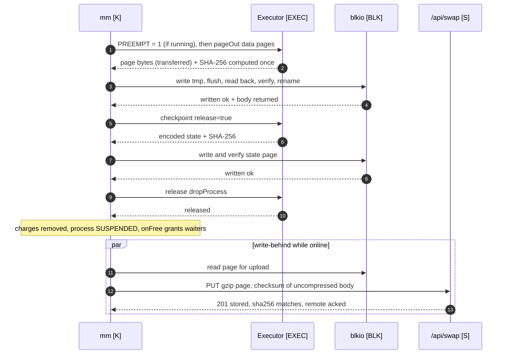

# Memory manager and paging

| Field | Value |
|---|---|
| Title | Memory manager and paging: accounting model and calibration, budget and soft limits, pages and PTEs, the global LRU, reclaim, reservation-based admission, the deterministic state codec, two-tier swap with write-behind, page faults, the thrashing guard, AI pages, window-process coupling, memory commands |
| Status | Draft v0.1, 2026-09-24 |
| Primary owner | R1 Kernel (`kernel/core/mm`, `kernel/blkio`, the memory commands `free vmstat pmap swapctl`, `memhog`; the server swap store and `/api/swap` are R1's second subsystem) |
| Secondary reviewer | R2 VFS/DB (storage, swap device and IndexedDB expertise; role matrix §2) |
| Must be demonstrable at | **P3 gate (W11, v0.3.0):** gate script step 2 (`memhog --total 512M --procs 8`, Task Manager Memory tab, `free`, `vmstat 1`, restore a minimised window with "Restoring…" and the printed page-in time), MEM-04 restore in a new browser session, the MEM-05 benchmark report. **P4 gate (W14, v0.4.0):** the `ai.embed` page, vector-segment pages, speculative pages and the residency hint. **Final defence (W17-18, v1.0.0):** Appendix A lines MEM-06, MEM-05 and MEM-03 on the reference machine; Demo Day "2× memory" segment |
| Requirement IDs covered | MEM-01, MEM-02, MEM-03, MEM-04, MEM-05, MEM-06, MEM-07, MEM-08 (may), WM-05 (paging side); contributes to PROC-06 (SUSPENDED), BOOT-12 (checkpoints), RAG-01/RAG-05 (`ai.embed` page, segments), PRE-03/PRE-04 (speculative pages, residency hint), §10.1 hash map + doubly linked list (LRU pager), hash maps (page tables, memory-mapped handles), §11.1 `swap_pages`; Plotinium design IDs KMM-01 … KMM-14 |
| Related specs | [processes-and-scheduling.md](./processes-and-scheduling.md) · [../01-architecture/architecture.md](../01-architecture/architecture.md) · [../01-architecture/syscall-abi.md](../01-architecture/syscall-abi.md) · [../02-boot/boot-and-services.md](../02-boot/boot-and-services.md) · [../04-vfs/virtual-file-system.md](../04-vfs/virtual-file-system.md) · [../05-wm/window-manager.md](../05-wm/window-manager.md) · [../06-sync/offline-and-sync.md](../06-sync/offline-and-sync.md) · [../08-dsa/data-structures.md](../08-dsa/data-structures.md) · [../09-database/database.md](../09-database/database.md) · [../10-ai/rag-semantic-search.md](../10-ai/rag-semantic-search.md) · [../10-ai/predictive-prefetch.md](../10-ai/predictive-prefetch.md) · [../11-server/backend-api.md](../11-server/backend-api.md) · [../12-security/security-model.md](../12-security/security-model.md) · [../13-quality/testing-and-performance.md](../13-quality/testing-and-performance.md) · [../00-product/requirements-traceability.md](../00-product/requirements-traceability.md) |

**Conventions.** RFC 2119 keywords as in the spec's Conventions section (p. 3). **Spec: MUST (§x, ID)** marks an obligation from the capstone specification; **Plotinium design (KMM-nn)** marks our own binding choice. Every number from the AI-run prototype is labelled *(pilot figure — re-measure on the lab machine)*. Sizes use binary units: 1 KiB = 1,024 bytes, 1 MiB = 1,048,576 bytes; command output writes them as `K`, `M`, `G`. The spec's "256 MB" budget is implemented as 256 MiB. Thread tags: **[MAIN]**, **[K]** kernel worker, **[EXEC]** executor, **[BLK]** blkio, **[EMB]** ai.embed, **[S]** server.

---

## 1. Purpose and scope

**Spec: §9.2.** "When the total resident state exceeds the system's memory budget, the memory manager must reclaim memory in three steps: serialise the least recently used inactive state; write it to swap; release it from memory. When the process is needed again, the state must be paged back in without the user having to do anything."

This file is the normative source for:

- the accounting model, its calibration procedure and error report (§3.2), the budget and soft limits (§3.3);
- pages, page tables and the PTE (§3.4); the global LRU, pinning and speculative pages (§3.5);
- reclaim and watermarks (§3.6); reservation-based admission, which is how MEM-06 is met (§3.7);
- the deterministic state codec (§3.8) and the page-out protocol (§3.9);
- tier 1 in the blkio worker (OPFS, with the IndexedDB fallback) (§3.10) and tier 2 with write-behind (§3.11);
- checkpoints, the `os_sessions` page map and restore in a new browser session (§3.12);
- page faults and the window's "Restoring" state (§3.13); the thrashing guard (§3.14);
- the `ai.embed` page, vector-segment pages and speculative pre-fetch pages (§3.15); window-process coupling (§3.16);
- `free`, `vmstat`, `pmap`, `swapctl` and `memhog` (§3.17); MEM-08 memory-mapped files as an optional feature (§3.18).

Out of scope, linked instead: the process lifecycle, program model, executors and scheduling ([processes-and-scheduling.md](./processes-and-scheduling.md)); call names, schemas, errnos and capabilities ([syscall-abi.md](../01-architecture/syscall-abi.md)); the server side of `/api/swap` and FsBlobStore routes ([backend-api.md](../11-server/backend-api.md)); the `swap_pages` and `os_sessions` DDL ([database.md](../09-database/database.md)); the LRU implementation ([data-structures.md](../08-dsa/data-structures.md)); the RAG and pre-fetch policies that use pages ([rag-semantic-search.md](../10-ai/rag-semantic-search.md), [predictive-prefetch.md](../10-ai/predictive-prefetch.md)).

---

## 2. Requirements table

| ID | Summary | Spec § | How verified |
|---|---|---|---|
| §9.2 model | Spec: MUST. Define and document an accounting model; check it against real measurements (browser task manager or `performance.measureUserAgentSpecificMemory()`) and report the error | §9.2 | Calibration report `docs/evidence/mem/`; KMM-02 nightly job |
| MEM-01 | Spec: MUST. A configurable global memory budget (default 256 MB, measured by the accounting model) and a soft limit for each process | §9.2, MEM-01 | Settings; `free` |
| MEM-02 | Spec: MUST. LRU eviction using our own hash map and doubly linked list, O(1) touch and evict; focused and pinned processes are never evicted | §9.2, §10.1, MEM-02 | Unit tests; benchmark; code review |
| MEM-03 | Spec: MUST. Page-out serialises the state, writes it to swap, verifies the checksum and only then releases the memory; page-in restores a byte-identical state | §9.2, MEM-03, App. A | Checksum comparison test |
| MEM-04 | Spec: MUST. Remote swap to backend storage works, and a remotely swapped state can be paged in from a new browser session | §9.2, MEM-04 | Close the tab, reopen in a new profile, restore the state |
| MEM-05 | Spec: MUST. For a 5 MB state, page-in p95 ≤ 300 ms from local swap and ≤ 2 s from remote swap | §9.2, MEM-05, App. A | Benchmark report (incompressible pages) |
| MEM-06 | Spec: MUST. With a workload of at least twice the budget open, accounted resident memory never exceeds the budget for more than 1 s, and the tab never crashes | §9.2, MEM-06, App. A | Stress script at the final defence; nightly `memhog` 2× test logging max ms over budget |
| MEM-07 | Spec: MUST. Page faults, hit ratio and bytes paged in and out are shown for each process in the Task Manager and `vmstat` | §9.2, MEM-07 | Live demonstration; golden-output tests |
| MEM-08 | Spec: MAY. `sys.mmap(path)` returns a handle, registered in a hash map, whose pages load on first access and are flushed by `msync` | §9.2, MEM-08 | Built only if the P3 gate is green by Week 10 (§3.18) |
| WM-05 | Spec: MUST. Minimised windows are the first candidates for paging, and restoring one triggers a page-in | §9.4, WM-05 | Integration test |
| §9.2 thrashing | Spec: MUST (text). If the page-fault rate stays above a threshold, refuse to start new heavy processes and tell the user | §9.2 | Thrashing test |
| KMM-01 | Plotinium design. Accounting formula of §3.2.1; the kernel line is reported but not charged | – | Unit tests; `free` |
| KMM-02 | Plotinium design. Calibration procedure with `ForceEagerMeasureMemory`, hold-out scenario, error < 25 % | strategy, examiner | Nightly calibration job |
| KMM-03 | Plotinium design. Page kinds, 256 KiB chunks, PTE with dual location for write-behind | architecture request | Unit tests |
| KMM-04 | Plotinium design. One global LRU with three segments (HOT, COLD, SPEC) separated by sentinels | – | LRU tests |
| KMM-05 | Plotinium design. Reclaim starts at 85 % and stops at 75 % | C13, critic | Watermark test |
| KMM-06 | Plotinium design. Reservation-based admission: `mem.alloc`, `mem.declare`, page-in and spawn reserve first and block on `mem` | C13, critic | MEM-06 tests |
| KMM-07 | Plotinium design. Deterministic codec: canonical JSON plus ArrayBuffer segments behind a 64-byte header with SHA-256 | coherence (gap) | Codec vectors |
| KMM-08 | Plotinium design. blkio page-out: write `.tmp`, flush, read back, verify, rename to a generation-numbered name; pipelined hashing | client record, critic | Crash and verify tests |
| KMM-09 | Plotinium design. Tier-2 write-behind: every page-out while online is also uploaded (gzip, checksum over uncompressed bytes); the local copy is kept | C4, critic | MEM-04 tests |
| KMM-10 | Plotinium design. Checkpoints on `visibilitychange → hidden`, BOOT-12 and idle; `os_sessions` window entries carry the page map | critic | Restore tests |
| KMM-11 | Plotinium design. Thrashing guard thresholds and hysteresis | strategy | Thrashing test |
| KMM-12 | Plotinium design. `ai.embed` is one evictable worker page; vector segments are backed pages | C12, coherence | RAG tests shared with [rag-semantic-search.md](../10-ai/rag-semantic-search.md) |
| KMM-13 | Plotinium design. Speculative pages and the residency hint for pre-fetch | C12 | PRE tests shared with [predictive-prefetch.md](../10-ai/predictive-prefetch.md) |
| KMM-14 | Plotinium design. `swapctl` and `memhog` contracts | critic, P3 gate | Command tests |

---

## 3. Design (normative)

### 3.1 Constants

All in `kernel/core/mm/params.ts`. *Settings* values are changed through `sysctl.set` (root, security-audited) or Settings → System → Memory, and take effect without a reboot.

| Name | Value | Meaning |
|---|---|---|
| `MM_BUDGET` | 256 MiB, *Settings* 64 MiB … 2 GiB | Global budget (MEM-01) |
| `MM_SOFT_LIMIT` | 64 MiB, *Settings* 8 MiB … budget; per-app override in the manifest | Per-process soft limit (MEM-01) |
| `PAGE_CHUNK` | 256 KiB | Fixed chunk size for large buffers |
| `LOGICAL_PAGE_MAX` | 8 MiB | A logical page larger than this must be allocated as chunks (EINVAL otherwise) |
| `STATE_SOFT` / `STATE_MAX` | 1 MiB / 16 MiB | Encoded-state warning threshold / hard limit (above it the process is marked non-pageable) |
| `STATE_HEADROOM` | 256 KiB | Reserved per resident checkpointable process for state growth between measurements |
| `STATE_SAMPLE_CPU_MS` | 1,000 | The state is re-encoded (measured) at least once per second of the process's CPU time |
| `OVERHEAD_PROC` | calibrated; 64 KiB until the first calibration | Charged per process resident on an executor |
| `HIGH_WM` / `LOW_WM` | 85 % / 75 % of the budget | Background reclaim starts above HIGH_WM and stops at or below LOW_WM |
| `MEM_WAIT_MAX_MS` | 10,000 | A reservation still blocked after this fails with EAGAIN (`mem-pressure`) |
| `BLKIO_INFLIGHT` | 4 | Pages queued to blkio at once (pipelining) |
| `LOCAL_SWAP_CAP` | `min(2 GiB, 25 % of navigator.storage.estimate().quota)` | Tier-1 capacity |
| `TIER2_PRESSURE` | `usage / quota > 0.8` | Local quota pressure: drop local copies that have an acknowledged remote copy |
| `UPLOAD_CONCURRENCY` | 2 | Parallel tier-2 uploads; retry back-off 1, 2, 4 … 60 s |
| `THRASH_ON` / `THRASH_OFF` | > 20 major faults/s for 5 s / < 10 faults/s for 5 s | Thrashing guard hysteresis |
| `HEAVY_BYTES` | 16 MiB | A spawn whose initial reservation exceeds this (or whose manifest says `heavy`) is heavy |
| `WS_WINDOW_MS` | 5,000 | Working-set window Δ for the WS column |
| `RESTORE_PROGRESS_MS` | 100 | Maximum interval between "Restoring…" updates |
| `CHECKPOINT_DEBOUNCE_MS` | 2,000 | Layout saves after checkpoints are debounced |
| `SWAP_KEEP_DAYS` | 14 | Local swap of an `os_session` no longer referenced by any layout is deleted after this |

### 3.2 Accounting model (MEM-01, KMM-01, KMM-02)

**Spec: MUST, §9.2.** "Browsers do not report exact memory use per object, so your team must define and document an accounting model. A typical model counts the serialised size of each process's state and the declared size of its large assets (blobs, image bitmaps, WebAssembly memory). Check your model against real measurements … and report the error."

#### 3.2.1 The formula

```text
accounted(pid)  = stateBytes(pid)            if the process's state is resident (last encoded size, §3.2.2)
                + Σ size(resident data pages of pid)            (logical pages and 256 KiB chunks, §3.4)
                + declaredAssets(pid)                           (ImageBitmap w·h·4, WebAssembly memory.buffer.byteLength,
                                                                 large ArrayBuffers not held in pages, via mem.declare)
                + OVERHEAD_PROC                  if the process is resident on an executor (calibrated constant)
accounted(ai.embed) = its declared worker page (about 100 MiB, measured, §3.15.1) while resident, else 0
committed       = Σ accounted(pid) over all processes + Σ outstanding reservations (§3.7)
kernel line     = Σ over kernel structures of entries × measured bytes/entry (inode tree, trie, dentry maps, caches)
                  + I/O buffers in flight (tier-2 uploads)        → reported by free, NOT charged to the budget
```

**Plotinium design (KMM-01).**

1. The **budget applies to `committed`**, the memory the OS hands to processes. The kernel's own structures are the operating system itself; they appear on their own `Kernel` line in `free`, with their size estimated from the bytes-per-entry figure of each DSA benchmark ([data-structures.md](../08-dsa/data-structures.md)). Charging them would let a large trie squeeze every process with no way to reclaim.
2. A page that is being paged out stays charged to its owner until the swap copy is verified and the bytes are dropped (§3.9), so `accounted` never under-counts memory in flight.
3. Declared assets are charged when declared, before the asset is created (§3.7). They are not paged by the codec: on whole-process suspend they are released and the program re-creates them after page-in (re-decode an image from its file, re-instantiate WebAssembly).
4. `OVERHEAD_PROC` covers what the model cannot see per process: the generator, closures, the executor's bookkeeping. It is charged only while the process is resident on an executor, so a SUSPENDED process costs 0.

#### 3.2.2 Measuring the state

The state page's size is known exactly only when the codec encodes it. **Plotinium design.**

- The executor encodes `st` at every checkpoint (§3.12) and at least once per `STATE_SAMPLE_CPU_MS` of the process's CPU time (at a yield point, between slices). `stateBytes` is the latest encoded size.
- Each resident checkpointable process also holds a reservation of `STATE_HEADROOM` for growth between measurements (§3.7).
- If a measurement exceeds `stateBytes + STATE_HEADROOM`, the kernel reserves the difference before the process runs again; if that reservation blocks, the process waits BLOCKED on `mem` at that yield point. This is the only path by which `committed` can exceed the budget, and only between two measurements; the excursion is recorded in `maxOverBudgetMs` (§3.7.3).
- Above `STATE_SOFT` (1 MiB) the process gets a klog warning and `!` in `ps`; programs are expected to keep large data in `ctx.mem` pages. Above `STATE_MAX` (16 MiB) the checkpoint fails, the process is marked non-pageable (its state page is pinned), and its data pages remain pageable.
- A non-checkpointable process has no state page; its state is `OVERHEAD_PROC` plus its pages and declared assets. Such processes are short-lived by contract ([processes-and-scheduling.md §3.5](./processes-and-scheduling.md#35-program-model-kps-03)).

#### 3.2.3 Calibration (KMM-02)

**Plotinium design**, following the strategy and the examiner's correction. `performance.measureUserAgentSpecificMemory()` is exposed only on Window (and shared and service workers), not in dedicated workers, so the main-thread router calls it on the kernel's request ([architecture.md §4.2](../01-architecture/architecture.md#42-router-port-messages-main--kernel), C2). It needs cross-origin isolation. It is **never** used in the live loop: in production it resolves only at a later garbage collection, which took about 60 s in the pilot *(pilot figure — re-measure on the lab machine)*.

Procedure (`tests/performance/mem/calibrate.spec.ts`, nightly on the lab-spec runner):

1. Launch Chrome stable with `--enable-blink-features=ForceEagerMeasureMemory` (the measurement then resolves in 16-27 ms *(pilot figure — re-measure on the lab machine)*) through Playwright `launchPersistentContext` (disk-backed profile).
2. Run the scenarios; after each settles, take 5 measurements and use the median.

   | Scenario | Workload |
   |---|---|
   | S1 | idle desktop after login |
   | S2 | 10 windows: 4 Terminals, 3 Files, 3 Editors with 1 MiB documents |
   | S3 | `memhog --total 256M --procs 4` (1× budget) |
   | S4 | `memhog --total 512M --procs 8` (2× budget) |
   | S5 | 256 sleeping processes |
   | S6a / S6b | S1 with `ai.embed` resident / evicted (hold-out, not used for fitting) |

3. Model for the whole page: `M = committed_accounted + κ · kernelLine + B_main + B_exec · executors + B_special · specialWorkers`. Fit `OVERHEAD_PROC`, `κ`, `B_main`, `B_exec` and `B_special` by non-negative least squares on S1-S5.
4. Report per scenario `err = |M − measured| / measured`, and the maximum and mean. **Target: maximum error < 25 %**, including the hold-out S6a/S6b. The per-worker attribution entries of the measurement breakdown, where Chrome provides them, SHOULD also be used to report the error per executor.
5. Write `docs/evidence/mem/calibration-<date>.json` (inputs, measurements, fitted constants, errors) and update `kernel/core/mm/calibration.json`, which the kernel loads at boot. `free --model` prints the constants and the last error.

If the error exceeds 25 %, the team refits and reports the error honestly (risk register: memory accounting error, owner R1). If the page is not cross-origin isolated, calibration is marked unavailable in `bootlog` and the last committed constants are used.

### 3.3 Budget and soft limits (MEM-01)

- **Budget.** `MM_BUDGET` is set in Settings → System → Memory (`mm.budget`). Raising it takes effect at once. Lowering it below `committed` starts reclaim toward the new `LOW_WM`; new reservations block until `committed` fits. It is never enforced by killing processes.
- **Soft limit.** `MM_SOFT_LIMIT` per process (`mm.softLimit`, with a manifest override `softLimit`). A process whose `accounted(pid)` exceeds it gets `!` in `ps` and `top`, a klog warning, and its pages move to the COLD segment of the LRU, so they are evicted before any HOT page (§3.5). Crossing the soft limit is not an error and never blocks the process by itself.

### 3.4 Pages and the page table (KMM-03)

**Spec: §9.2.** "Each process's state is divided into pages, either fixed-size chunks of serialised state or logical units such as one document. A per-process page table maps each page to its location (RESIDENT, LOCAL_SWAP or REMOTE_SWAP), with a dirty bit, a last-access time, a size and a checksum."

**Plotinium design.** Page kinds:

| Kind | What | Size | Pageable how |
|---|---|---|---|
| `state` | page 0: the codec encoding of `st` | measured (§3.2.2) | Only as part of a whole-process suspend; the process becomes SUSPENDED |
| `logical` | one logical unit: a document, a canvas, an editor buffer (`mem.alloc({kind:'logical'})`) | ≤ `LOGICAL_PAGE_MAX` | Individually |
| `chunk` | one 256 KiB chunk of a large buffer (`mem.alloc({kind:'chunk'})`) | `PAGE_CHUNK` (last chunk may be shorter) | Individually |
| `worker` | a special worker's memory, declared as one page (`ai.embed`) | declared, measured | Eviction = `worker.terminate()`; page-in = respawn and reload (§3.15.1) |
| `segment` | a vector segment of `ai.search` | about 1.5 MiB | Backed: eviction = drop; page-in = read the durable copy (§3.15.2) |
| `mmap` | a 256 KiB chunk of a memory-mapped file (MEM-08, may) | `PAGE_CHUNK` | Backed by the file until dirty (§3.18) |

- Page ids are per process, uint32, increasing, never reused within a process's lifetime (so swap files never collide); at most 2^20 pages per process. The global LRU key is `pid · 2^20 + pageId` (< 2^35, an exact double).
- The page table is `pcb.pageTable: Map<number, PTE>` (a hash map, Spec §10.1 "page tables").
- **Location.** The spec's three locations are kept as the PTE's `loc`, meaning "where the authoritative bytes are": `RESIDENT` (in the executor), `LOCAL_SWAP` (tier 1), `REMOTE_SWAP` (tier 2). A fourth value, `BACKED`, marks a clean page that can be re-created from a durable source (a model file, a vector segment store, a file for `mmap`).
- **Dual location (write-behind).** Separately from `loc`, the PTE records the state of each copy of the current generation: `local ∈ {none, valid, stale}` and `remote ∈ {none, pending, acked, stale, failed}`. A resident page with `dirty = false` and a valid copy (`local = valid` or `remote = acked` or `loc = BACKED`) is **clean** and can be dropped without a write.
- **Dirty bit.** Set when the process writes the page (`ctx.mem.get(id, 'rw')`, reported in the slice frame as `dirtied`); cleared when a new generation is written and verified. Writing a clean page marks its copies `stale`.
- **Generation.** `gen` increments at every page-out of a dirty page. Swap files and remote objects carry the generation, so an older copy can never be mistaken for the current one.
- **Checksum.** `sha256` is the SHA-256 of the page body of the current generation, as computed by the codec at encoding time.
- **Last access.** `lastAccess` is the kernel time of the last slice in which the page was touched (executor-reported `touched` set) or the last page-in.

The full PTE type is in §4.1.

### 3.5 The global LRU, pinning and speculative pages (MEM-02, KMM-04)

**Spec: MUST, §9.2, MEM-02.** "Replacement uses a global LRU list, built from a hash map and a doubly linked list so that touching a page and evicting a page are both O(1). The focused process and pinned system processes are never evicted." Figure 9.2: "Eviction takes the least recently used unpinned entry. A page fault reverses the path … it is inserted at the MRU end."

#### 3.5.1 Structure

**Plotinium design.** One global list from `dsa/lru` (written by R1 from first principles): a `Map<number, slot>` from page key to slot, plus a doubly linked list in typed arrays (`prev`, `next: Int32Array`, `keys: Float64Array`, `seg: Uint8Array`). Two **sentinel** nodes split the list into three segments, ordered from the MRU end to the LRU end:

```text
MRU end → [ HOT pages … ] ─ S_cold ─ [ COLD pages … ] ─ S_spec ─ [ SPEC pages … ] → LRU end (evicted first)
```

| Segment | Contents | Why |
|---|---|---|
| HOT | every other unpinned resident page | ordinary LRU order |
| COLD | pages of processes whose windows are all minimised (WM-05), and of processes over their soft limit (MEM-01) | "Minimised windows are the first candidates for paging" (Spec §9.4) |
| SPEC | speculative pages brought in by pre-fetch and never touched since (§3.15.3) | a wrong prediction must cost nothing |

| Operation | Effect | Cost |
|---|---|---|
| `insert(key, seg)` | at the head (MRU side) of `seg` | O(1) |
| `touch(key)` | move to the head of its own segment | O(1) |
| `move(key, seg)` | change segment, insert at its head | O(1) |
| `evict()` | the node at the LRU end, skipping at most two sentinels | O(1) |
| `remove(key)` | unlink (pin, page busy with I/O, page freed) | O(1) |
| `pin(key)` / `unpin(key)` | `pin` = `remove` and increment the PTE pin count; `unpin` = decrement and, at 0, `insert` at the head of the page's segment | O(1) |

A pinned or busy page is never in the list, so `evict()` returns "the least recently used unpinned entry" without scanning (the spec's `LRU<K,V>.evict` contract, §10.3). The structure also backs the VFS inode cache and the server rate-limit key bound as plain LRUs (one segment). Its tests and benchmark (ns/op and bytes/entry from 10^3 to 10^5) are defined in [data-structures.md](../08-dsa/data-structures.md).

#### 3.5.2 Pinning rules

A page is pinned (pin count > 0) while any of these holds:

| # | Rule | Source |
|---|---|---|
| P1 | Its process owns the **focused window**, or is in the foreground process group of the focused Terminal's TTY | Spec MEM-02 ("focused … never evicted") |
| P2 | Its process is a **pinned system process**: a service whose manifest has `pinned: true` ([boot-and-services.md](../02-boot/boot-and-services.md)) | Spec MEM-02 ("pinned system processes") |
| P3 | Its process is inside a **non-pre-emptive kernel section** (the one transaction of a T call or phase 2 of an X call) | strategy |
| P4 | The page is **busy**: a page-out or page-in is in flight | – |
| P5 | It is the `ai.embed` page or a vector segment while a search box has focus (`searchFocused > 0`) or a query is scanning it | [rag-semantic-search.md](../10-ai/rag-semantic-search.md) |
| P6 | It is a **state page** whose process has a non-restartable call in flight, or whose state exceeds `STATE_MAX` | [processes-and-scheduling.md §3.5.4](./processes-and-scheduling.md#354-restartable-and-non-restartable-pending-calls) |

Focus changes pin the new focused process's pages and unpin the old one's (O(pages of the two processes)).

#### 3.5.3 Victim order and the residency hint

`evict()` takes SPEC pages first, then COLD, then HOT, each in LRU order (§3.5.1). **Residency hint (C12, subsystem C informs the OS).** The predictor may set `mem.hint({app, ttlMs})` (capability `mm.hint`). While the hint is valid, a victim belonging to a process of that app is `touch`ed once instead of evicted, once per reclaim pass (logged as `hint-skip`), so the predicted next app stays resident if anything else can go.

### 3.6 Reclaim and watermarks (KMM-05)

**Plotinium design (C13, critic).**

- **Background reclaim** starts when `committed > HIGH_WM · budget` (85 %) and stops when `committed ≤ LOW_WM · budget` (75 %). It runs as a kernel task in steps of at most 1 ms of kernel time, so it never stalls the dispatcher.
- **Direct reclaim** starts whenever a reservation is blocked (§3.7) and frees at least that reservation's deficit, then continues as background reclaim.
- **Victim handling** for each `v = evict()`:
  1. `v` is a **state page** → suspend the whole process (§3.9.2), unless its pending call is non-restartable (then it would have been pinned, P6).
  2. `v` is **clean** (a valid local copy, an acknowledged remote copy, or `BACKED`) → drop it: tell the executor to release it (or `worker.terminate()` for `ai.embed`), remove the charge, `loc` becomes `LOCAL_SWAP`, `REMOTE_SWAP` or `BACKED`. **Spec: §9.2** "Clean pages that already have a valid swap copy are dropped without being rewritten."
  3. `v` is **dirty** → page it out (§3.9.1).
- Up to `BLKIO_INFLIGHT` page-outs are in flight at once; the executors encode in parallel while blkio writes (§3.9.3).
- If `evict()` returns nothing (everything resident is pinned or busy), reclaim stops and blocked reservations keep waiting (§3.7).

### 3.7 Reservation-based admission (MEM-06, KMM-06)

**Spec: MUST, MEM-06.** "With a workload of at least twice the budget open, accounted resident memory never exceeds the budget for more than 1 s, and the tab never crashes." **Plotinium design (C13, critic).** The critic showed that a guard that reacts after the fact is too slow: reclaiming about 256 MB with one blkio worker at 15-58 ms per 5 MB takes 1-3 s *(pilot figure — re-measure on the lab machine)*. So admission is **reservation-based**: memory is granted before it is used, and a request that does not fit waits while reclaim frees space.

#### 3.7.1 Invariant

> **INV-M1.** `committed = Σ accounted + Σ reserved ≤ budget` at every moment, except for the state-growth excursion of §3.2.2, which is recorded.

#### 3.7.2 Who reserves

| Path | Reservation | If it does not fit |
|---|---|---|
| `mem.alloc({kind, size})` | `size` (rounded up to 256 KiB for chunks) | caller BLOCKED `waitingOn = 'mem'` |
| `mem.declare({bytes})` | `bytes` | caller BLOCKED `mem` |
| `spawn` admission | `initialStateBytes` (default 64 KiB) + `OVERHEAD_PROC` + `STATE_HEADROOM` | child waits in NEW; parent's `spawn` stays BLOCKED |
| Page fault, whole-process page-in, restore | the page size / state + working set | process BLOCKED `mem`, then `page:<id>` |
| `ai.embed` spawn | its declared size | the search falls back to BM25 at once (RAG-06) and the load waits |
| State growth at a measurement | the growth beyond `STATE_HEADROOM` | process BLOCKED `mem` at that yield point |
| `mem.prefetch` (speculative) | the page sizes | **never waits**: only if `committed + bytes ≤ LOW_WM · budget`, else EAGAIN (`no-free-memory`) |

#### 3.7.3 Algorithm

```text
// kernel/core/mm/reserve.ts — normative pseudocode
reserve(p, bytes, why):
  if bytes > budget: fail ENOMEM                       // can never fit (requested errno, §9; fallback EAGAIN 'nomem')
  if memWait is empty and committed + bytes <= budget:
    reserved += bytes; return ticket(bytes)             // O(1)
  memWait.push(p, key = key(p.effPrio, arrivalSeq))     // small heap, same key shape as the ready heap
  block(p, 'mem'); directReclaim(committed + bytes - budget); arm timer MEM_WAIT_MAX_MS → fail EAGAIN 'mem-pressure'

onFree():                                               // after every drop, release, exit, verified page-out
  while memWait not empty:
    q = memWait.peek()
    if committed + q.bytes > budget: break              // no overtaking: a large request is not starved by small ones
    memWait.pop(); reserved += q.bytes; wake(q, ticket)
  if committed > HIGH_WM * budget: startBackgroundReclaim()

commit(ticket, actualBytes):                            // the allocation now exists
  reserved -= ticket.bytes; accounted += actualBytes    // actual ≤ ticket; a larger actual reserves the difference first
cancel(ticket): reserved -= ticket.bytes; onFree()
```

- The wait queue is ordered by the requester's `effPrio` then arrival, so the focused (boosted) process is served first.
- `maxOverBudgetMs`: the kernel timestamps every change of `committed`; while `committed > budget` it accumulates the interval and keeps the longest continuous one. `mem.stat` exposes it, `free -v` prints it, and the MEM-06 test logs it (§8). Target 0; the spec limit is 1,000 ms.
- **The tab never crashes** because nothing is granted beyond the budget: a workload twice the budget produces waiting, faults and the thrashing guard (§3.14), not an out-of-memory crash. The real browser heap is sampled during the calibration profile of the MEM-06 test as a sanity check, and Playwright's `crash` event must not fire.

### 3.8 Deterministic state codec (KMM-07)

**Plotinium design (coherence gap fix).** Structured clone is not a byte format and generators cannot be serialised, so MEM-03's "byte-identical state" needs our own codec, `kernel/core/mm/codec.ts`, shared by executors (encode, decode) and blkio (header checks).

#### 3.8.1 Page file format (little-endian)

| Offset | Size | Field |
|---|---|---|
| 0 | 4 | magic `PLTP` (0x50 0x4C 0x54 0x50) |
| 4 | 2 | version = 1 |
| 6 | 2 | flags: bit 0 `STATE`, bit 1 `RAW` (data page), bit 2 `CHUNK` |
| 8 | 4 | header length = 64 |
| 12 | 4 | `jsonLen`: bytes of canonical JSON (0 for `RAW`) |
| 16 | 4 | `segCount`: number of binary segments |
| 20 | 4 | reserved = 0 |
| 24 | 8 | `bodyLen` (uint32 low at 24, high at 28) |
| 32 | 32 | SHA-256 of the body |
| 64 | `bodyLen` | body |

Body of a `STATE` page: the canonical JSON bytes; zero padding to a multiple of 8; a segment table of `segCount` × (offset uint32, length uint32), offsets relative to the body start; each segment's bytes, each padded with zeros to a multiple of 8. Body of a `RAW` page: the page's bytes, unchanged (so a data page can be written and read back with no copy).

#### 3.8.2 Canonical JSON rules

1. Object keys are sorted by UTF-16 code units; numbers use the ECMAScript `Number.prototype.toString` form; strings use `JSON.stringify` escaping (well-formed JSON). These are the rules of RFC 8785, JSON Canonicalization Scheme ([rfc-editor.org/rfc/rfc8785](https://www.rfc-editor.org/rfc/rfc8785)).
2. Object properties whose value is `undefined` are omitted. `-0` is written as `0`.
3. `ArrayBuffer`, typed arrays and `DataView` values are moved to segments and replaced by `{"$seg": i, "$t": "u8" | "i8" | "u16" | "i16" | "u32" | "i32" | "f32" | "f64" | "ab" | "dv"}`; only the viewed bytes are copied. Segment indices follow the order of first appearance in a depth-first traversal with sorted keys. Two views of one buffer are encoded twice (aliasing is not preserved; programs must not rely on it).
4. Rejected with EINVAL (the checkpoint fails and is logged): `undefined` inside arrays, functions, symbols, `BigInt`, `Map`, `Set`, `Date`, class instances (any prototype other than `Object.prototype`, `Array.prototype` or `null`), `NaN`, `±Infinity`, cycles, keys starting with `$`, nesting deeper than 256.

Consequences: `encode(decode(b))` equals `b` byte for byte for every `b` that `encode` produced, and two states that are equal as JSON data with the same segment bytes encode identically. `decode` checks magic, version, lengths and the SHA-256 before parsing (EIO on mismatch). Complexity: O(bytes + Σ k log k over objects with k keys). Fixture vectors live in `kernel/core/mm/codec.vectors.json` and are shared by the unit tests and the MEM-03 test.

### 3.9 Page-out protocol (MEM-03, KMM-08)

**Spec: MUST, MEM-03.** "Page-out serialises the state, writes it to swap, verifies the checksum and only then releases the memory. Page-in restores a byte-identical state."

#### 3.9.1 A dirty data page

1. **[K]** The victim's PTE becomes busy (removed from the LRU, P4). The kernel sends `pageOut {pid, pageIds}` to the owner's executor.
2. **[EXEC]** Between slices (the process is not running a slice; if it is, the kernel first sets `PREEMPT = 1` and waits for the slice end), the runtime computes SHA-256 of the page bytes (`crypto.subtle.digest`, once), builds the 64-byte header, and **transfers** the page's `ArrayBuffer` to the kernel with its hash (5 MB in about 0.05 ms *(pilot figure — re-measure on the lab machine)*). The runtime marks the page non-resident locally; an access now faults (§3.13), and the kernel holds the fault until the write finishes.
3. **[K → BLK]** The kernel transfers header and body to blkio (§3.10). The bytes stay charged to the owner.
4. **[BLK]** Write `.tmp`, flush, read back, close; verify the read-back SHA-256 against the header hash; rename to the generation's final name; delete the previous generation. Reply `written` and **transfer the body back** to the kernel.
5. **[K]** On success: `loc = LOCAL_SWAP`, `local = valid`, `dirty = false`, `sha256`, `gen` updated. If a fault is waiting for this page, the returned body goes straight back to the executor (no read); otherwise the kernel drops its last reference, **only now** removes the charge, and runs `onFree()` (§3.7.3). Write-behind to tier 2 is queued (§3.11).
6. On failure (write error, verify mismatch twice): the returned body goes back to the executor, the page stays RESIDENT and dirty, the device is marked degraded in `bootlog` and `free`, and reclaim moves to the next victim.

"Release" therefore has one precise meaning: the last reference to the page's bytes is dropped and the charge removed, and this happens only after the swap copy has been read back and its checksum verified.

#### 3.9.2 Whole-process suspend (the state page)

When the victim is a state page (or `mem.pageOut(pid)` is called):

1. If the process is RUNNING, `PREEMPT = 1`; wait for the slice end (RUNNING → READY, `preempt`).
2. Check restartability ([processes-and-scheduling.md §3.5.4](./processes-and-scheduling.md#354-restartable-and-non-restartable-pending-calls)); if a non-restartable call is in flight, abort the suspend.
3. Page out every dirty resident data page (§3.9.1) and drop every clean one.
4. Send `checkpoint {pid, release: true}`: the executor encodes `st` with the codec and transfers the bytes; the kernel writes and verifies them like a data page (if the new SHA-256 equals the current valid copy's, no write is needed).
5. When every page is verified: send `release {pid, dropProcess: true}`; the executor drops the generator, `st` and any declared assets; the kernel removes the charges and `OVERHEAD_PROC`, frees the residency slot (`worker = null`), and moves the process READY or BLOCKED → **SUSPENDED** (reason `page-out`).
6. If any step fails, nothing is released and the process keeps running where it was.

The state page is written **last**, so the generator stays alive until everything else is safe.



#### 3.9.3 Pipelining

The critic's fix: hash the buffer once and verify the read-back asynchronously. **Plotinium design.** The source hash is computed once, by the executor, while encoding. blkio's synchronous work per page is write, flush, read back and rename; the read-back digest is an asynchronous `crypto.subtle.digest` that overlaps with the next page's write, and pages are acknowledged in submission order. Executors encode concurrently while blkio writes. Up to `BLKIO_INFLIGHT` pages are queued.

### 3.10 Tier 1: the blkio worker (KMM-08)

**Plotinium design (C4, coherence).** A synchronous 5 MB write-flush-read-verify blocks for 15-58 ms *(pilot figure — re-measure on the lab machine)*, which must not stall syscalls, so the swap device lives in a dedicated kernel-owned worker, `kernel/blkio/blkio.worker.ts`, that only the kernel talks to. It implements the `SwapDevice` interface (§4.4) with two back ends, chosen once at POST.

#### 3.10.1 OPFS back end (default)

Used when `FileSystemFileHandle.createSyncAccessHandle` exists (dedicated workers only, secure context). Layout under the origin private file system:

```text
/swap/
  u<uid>/                                   per uid (the critic: swap is per uid)
    <osSessionId>/                          UUIDv7 of the OS session
      <pid>/
        p<pageId>-g<gen>.pg                 verified page file (header + body)
        p<pageId>-g<gen>.tmp                only during a write
```

Write of page (`uid`, `osSession`, `pid`, `pageId`, `gen`):

1. `fh = dir.getFileHandle('p<pageId>-g<gen>.tmp', {create: true})`; `h = await fh.createSyncAccessHandle()`.
2. `h.truncate(0)`; `h.write(header, {at: 0})`; `h.write(body, {at: 64})`; `h.flush()`.
3. Read the header and the body back into a fresh buffer; `h.close()` (a sync access handle holds an exclusive lock on the file).
4. Compare the 64 header bytes; start `crypto.subtle.digest('SHA-256', readBack)` and continue with the next queued page while it runs.
5. On match: `await fh.move('p<pageId>-g<gen>.pg')`, then `removeEntry('p<pageId>-g<gen−1>.pg')` (NotFound ignored). On mismatch: rewrite once; a second mismatch is EIO.

The final name carries the generation, so the rename never has to overwrite an existing file: the overwrite behaviour of `move()` onto an existing name is not settled in the File System specification ([whatwg/fs PR #10 discussion](https://github.com/whatwg/fs/pull/10); OPFS `move()` usage: [web.dev, "The origin private file system"](https://web.dev/articles/origin-private-file-system)). A crash between steps leaves at worst a `.tmp` file or two generations; the sweep below repairs both.

Read of a page: open `p<pageId>-g<gen>.pg`, read the 64-byte header (magic, version, `bodyLen`, SHA-256 must match the PTE), read the body in 1 MiB steps into one `ArrayBuffer` of `bodyLen` bytes (posting `progress` every 256 KiB or `RESTORE_PROGRESS_MS`), close, verify the SHA-256, transfer the body to the kernel.

Pilot, on disk: OPFS page-in p95 18.2-27.1 ms and page-out p95 19.7-28.3 ms for 5 MB, against IndexedDB 23.2-33.5 ms and 44.7-62.4 ms *(pilot figures — re-measure on the lab machine)*. The client record's reversal trigger applies: if the crash suite finds any checksum mismatch or unswept orphan, or OPFS page-out is less than 1.5× faster than IndexedDB on the lab machine, the default returns to the IndexedDB back end.

#### 3.10.2 IndexedDB back end (fallback)

Used automatically when OPFS sync access handles are unavailable at POST (not a secure context, or no support); `bootlog` and `swapctl` show it. Database `plotinium-swap` (C1, C4), object store `pages`, key `[uid, osSession, pid, pageId]`, value `{gen, header: ArrayBuffer, body: ArrayBuffer, sha256, size, createdAt}`.

- Write: one readwrite transaction with `durability: 'relaxed'` that `put`s the record; after `oncomplete`, a readonly transaction `get`s it and the SHA-256 of the returned body is verified. A `put` replaces the old generation atomically, so no `.tmp` or rename is needed.
- The swap database is separate from `plotinium`, so swap can be dropped wholesale without touching the VFS.

#### 3.10.3 Boot sweep and capacity

- **Sweep** (the `mm` service start, boot stage 4, [boot-and-services.md](../02-boot/boot-and-services.md)): delete every `.tmp`; for each page keep only the highest generation; delete every `<osSessionId>` directory (or key range) not referenced by an `os_sessions` layout in the local store and older than `SWAP_KEEP_DAYS`. Report `swept n files, m bytes` in `bootlog`.
- **Capacity.** blkio tracks the bytes it stores. When a write would exceed `LOCAL_SWAP_CAP`, or `TIER2_PRESSURE` holds, it first deletes local copies whose remote copy is acknowledged (least recently accessed first); if still over, the write fails with EDQUOT and the kernel pages that victim out to tier 2 directly when online, or picks another victim.

### 3.11 Tier 2: remote swap with write-behind (MEM-04, MEM-05, KMM-09)

**Spec: §9.2.** "Tier 2 is remote swap in backend object storage, used under local quota pressure (monitor `navigator.storage.estimate()`) and for durability." **Plotinium design (C4, critic).** The critic showed that "remote only under quota pressure, delete the local copy after upload" leaves the remote tier empty on a lab PC with plenty of quota, so MEM-04 and the MEM-05 remote benchmark would have nothing to read. Hence **write-behind**: while online, every page-out is also uploaded, and the local copy is kept as a cache.

1. **Online** means `syncd` is LIVE and the auth session can act as the page owner's uid (the logged-in user; a root process only while an `su` grant lasts). Pages of other uids stay local (`remote = none`), and `pmap` shows it.
2. After a tier-1 write is verified, the kernel queues an upload `{key, gen, sha256}` (`remote = pending`). The upload queue (kernel, `UPLOAD_CONCURRENCY = 2`) reads the page back from tier 1 when its turn comes, so no page is held in memory while it waits. The in-flight upload buffers (at most 2 × 8 MiB) are counted on the `Kernel` line.
3. Upload: `PUT /api/swap/{osSessionId}/{pid}/{pageId}?gen={gen}` with the page file (header + body) compressed by `CompressionStream('gzip')`, headers `Plt-Sha256` (hex SHA-256 of the **uncompressed** body) and `Plt-Size` (uncompressed bytes). The server decompresses while streaming through a SHA-256 tee into FsBlobStore with an atomic rename, upserts the `swap_pages` row keyed by `(owner_uid, os_session_id, pid, page_id)` with the generation, and answers `201 {sha256, size, gen}`. The client sets `remote = acked` only if the returned hash matches ([backend-api.md](../11-server/backend-api.md)).
4. Queue order: checkpoints of window processes first, then the rest in page-out order. A newer generation of the same page supersedes a queued older one. Failures retry with back-off 1, 2, 4 … 60 s; `4401` or offline pauses the queue until `syncd` is LIVE again. After 5 failed attempts the copy is `failed` and the page stays local-only.
5. Remote page-in: `GET /api/swap/{osSessionId}/{pid}/{pageId}?gen={gen}` → `DecompressionStream('gzip')` → split header and body → verify header fields and the body SHA-256 against the PTE → transfer to the executor. Byte counts drive the "Restoring…" progress. Authorisation is by `owner_uid` on the server, so another user's page answers 403 (EACCES).
6. When a page is freed, its process exits or its session is discarded, the client sends `DELETE` for the page or the session; server-side garbage collection handles anything missed ([backend-api.md](../11-server/backend-api.md)).
7. `swapctl tier remote` (root) switches to **remote-only** page-out for demos and the MEM-05 remote benchmark: page-outs skip tier 1, a page is released when the server's `201` hash matches, and existing local copies with acknowledged remote copies are dropped. `swapctl tier local` disables uploads. The default is `auto` (§3.17.4).

Compression does not help incompressible data: MEM-05 is benchmarked with pages filled by `crypto.getRandomValues` (critic), so the remote figure is honest.

### 3.12 Checkpoints, the `os_sessions` page map and restore (MEM-04, KMM-10)

#### 3.12.1 Checkpoints

A checkpoint is a page-out **without release**: every dirty page and the state page are written and verified, the process keeps running, and afterwards its pages are clean (a later suspend drops them without writing). Triggers:

| Trigger | Processes | Source |
|---|---|---|
| `visibilitychange → hidden` (forwarded by the router) | window processes that are checkpointable | critic |
| BOOT-12 `shutdown` / `reboot`, **before** SIGTERM is sent | window processes that are checkpointable | critic; [boot-and-services.md](../02-boot/boot-and-services.md) |
| Idle checkpoint when blocking on a long wait | checkpointable processes with state ≤ 256 KiB | [processes-and-scheduling.md §3.5.3](./processes-and-scheduling.md#353-checkpoints) |
| `swapctl checkpoint <pid>`, Task Manager "Save state" | owner or root | KMM-14 |

`pagehide` cannot await storage, so a tab closed without a `hidden` event keeps only what earlier checkpoints wrote; every window process has had at least one checkpoint on each `hidden` transition.

#### 3.12.2 The page map in `os_sessions`

**Plotinium design (answers the architecture request).** Each window entry of `os_sessions.window_layout` carries its process's page map, so a new session can map remote pages to new pids:

```ts
// protocol/src/session/layout.ts — rect, state and z are owned by window-manager.md (WM-06); proc by this file
interface WindowLayoutEntry {
  wid: number; app: string; argv: string[]; title: string;
  rect: Rect; state: WinState; z: number; restoreRect?: Rect;
  proc: null | {                                  // null: the app restarts from init(argv)
    osSessionId: string; pid: number; uid: number; cwdPath: string; checkpointable: true;
    stateSha256: string; savedAt: number;         // savedAt: kernel wall-clock ms of the checkpoint
    pages: Array<{ pageId: number; gen: number; sha256: string; size: number;
                   kind: 'state' | 'logical' | 'chunk'; label: string;
                   copies: Array<'local' | 'remote'> }>;
  };
}
```

After each window-process checkpoint (debounced by `CHECKPOINT_DEBOUNCE_MS`), the session service writes the layout to the local `os_sessions` store (durability `relaxed`, C4) and, online, to the server's `os_sessions` row ([offline-and-sync.md](../06-sync/offline-and-sync.md)).

#### 3.12.3 Restore in a new browser session (MEM-04)

1. At login, the session service loads the most recent layout for the uid (local store first, else the server) and the desktop offers "Restore desktop from <date, time>?".
2. For each entry with `proc ≠ null`, the kernel spawns a **new** process of that app (new pid, NEW) whose PTEs point at the old pages: `loc = LOCAL_SWAP` where the local copy of that generation exists (same browser profile), else `REMOTE_SWAP`, with an `origin = {osSessionId, pid}` so reads use the old key.
3. Admission reserves the state page plus the pages listed in the map, then reads the state page (the window frame is already painted and shows "Restoring… 0.0 / 5.0 MB"), verifies it against `stateSha256`, and loads the program with `restore.from = 'session'`. NEW → READY (`admit`, detail `restore`). `ctx.restored === 'session'`, so the program re-opens files by path ([processes-and-scheduling.md §3.5.2](./processes-and-scheduling.md#352-the-ctx-object)).
4. The remaining pages are paged in behind it in map order (not speculative); a fault on one of them waits for its read. "Restoring" clears when the view has its first snapshot.
5. From then on the process's page-outs use the new `(osSession, pid)` key. The old session's pages are left for server garbage collection.

A remote read that returns 403 (another owner) or a checksum mismatch fails that window's restore: the app starts fresh from `init(argv)` and a notice explains why.

### 3.13 Page faults and the "Restoring" state (MEM-07)

**Spec: §9.2.** "Touching a non-resident page raises a page fault. The process becomes BLOCKED, the page is read and verified, and the process returns to READY. Its window shows a 'restoring' state, not a blank." Figure 9.2: "it is inserted at the MRU end."

#### 3.13.1 Data-page fault

`ctx.mem.get(id, mode)` returns the page from the executor's local table when resident (no IPC; the access counts as a **hit**). Otherwise the runtime issues the B call `mem.fault {pageId}`:

1. The process becomes BLOCKED (`page:<id>`). The fault counts as a **major fault** for the process.
2. `reserve(size)` (may wait on `mem` first).
3. Read by location: tier 1 (blkio), tier 2 (HTTPS), or the backing source. If the page is in transit (a page-out is writing it), the fault waits for the write and receives the returned buffer with no read.
4. Verify the SHA-256; transfer the body to the executor (`pageIn`); PTE `loc = RESIDENT`, clean, `lastAccess = now`; insert at the head of HOT (COLD if the process is minimised or over its soft limit), i.e. at the MRU end.
5. Reply to the fault; the process becomes READY (`wake`). `bytesIn += size`.

A checksum mismatch on tier 1 retries from tier 2 if an acknowledged remote copy exists; otherwise the fault fails with EIO and the program's `ctx.mem.get` throws (the page is marked lost and logged).

#### 3.13.2 Whole-process page-in (SUSPENDED → READY)

Triggers: the awaited event completes while SUSPENDED (`wakePending`), the user restores or focuses its window, a caught signal must be delivered, `mem.pageIn(pid)` (owner or root), or a restore (§3.12.3). Steps: place it on an executor ([processes-and-scheduling.md §3.14](./processes-and-scheduling.md#314-placement-rules-kps-06)); reserve the state page, `OVERHEAD_PROC`, `STATE_HEADROOM` and the pages that were resident at suspend time (its working set); read and verify the state page; `load` with `restore.from = 'page-in'`; the process goes SUSPENDED → READY (`page-in`) as soon as the state is loaded, and the working-set pages follow in the background. After page-in, the program re-runs from its checkpoint and re-issues any restartable wait ([processes-and-scheduling.md §3.4](./processes-and-scheduling.md#34-lifecycle-proc-06)).

#### 3.13.3 The window's "Restoring" state

For a window process, the kernel sends `restoring {wid, doneBytes, totalBytes}` to the compositor ([architecture.md §4.3](../01-architecture/architecture.md#43-compositor-port-messages-kernel--compositor)) from the first byte read until the view has received its first snapshot over its new display channel, at least every `RESTORE_PROGRESS_MS`. The byte counts are the real bytes read by blkio or streamed from `/api/swap`. The compositor shows "Restoring… 1.2 / 5.0 MB" over the last painted frame, never a blank window, and then "Restored 5.0 MB in 43 ms" for 2 s (the page-in time the P3 gate script prints). Input to the window is held until it is restored.

#### 3.13.4 Counters

Per process: `faults` (major), `hits` (accesses to resident pages: each resident `ctx.mem.get`, plus one per dispatch for the state page), `hitRatio = hits / (hits + faults)`, `bytesIn`, `bytesOut` (verified page-outs), `lastPageInMs`, and `wsBytes` (bytes of distinct pages with `lastAccess ≥ now − WS_WINDOW_MS`, computed on demand). System-wide sums feed `vmstat` and the Task Manager.

### 3.14 Thrashing guard (KMM-11)

**Spec: §9.2.** "If the page-fault rate stays above a threshold, the OS refuses to start new heavy processes and tells the user, in the spirit of the working-set model." **Plotinium design.**

- The kernel computes the system major-fault rate per second (a 1 s bucketed counter in a ring buffer).
- **On:** above 20 faults/s for 5 consecutive seconds. **Off:** below 10 faults/s for 5 consecutive seconds.
- While on: heavy spawns (initial reservation > `HEAVY_BYTES`, or manifest `heavy: true`) fail with EAGAIN (`detail.reason = 'thrashing'`); `mem.prefetch` and speculative page-ins stop; `free`, `top` and the Task Manager show `THRASHING`; the desktop shows once per episode: "Plotinium is short of memory and is paging heavily. Large apps will not start until it settles. Close some windows or stop memhog to recover."
- The working-set view: `vmstat -p` shows each process's `WS` (Δ = 5 s). When Σ WS exceeds the budget, `vmstat` prints `ws>budget`, which is the working-set explanation of the thrashing.

### 3.15 AI pages (KMM-12, KMM-13)

#### 3.15.1 The `ai.embed` page

**Plotinium design (C12, coherence).** ORT's WebAssembly memory never shrinks and `session.release()` frees nothing: linear memory was 36 MiB after session creation, 83 MiB after one 512-token inference, and 397 MiB after one 8 × 512 batch *(pilot figures — re-measure on the lab machine)*. So:

- `ai.embed` (a `special` process, [processes-and-scheduling.md §3.2](./processes-and-scheduling.md#32-process-kinds-kps-01)) owns exactly one page of kind `worker`, declared at the measured size, about 100 MiB *(pilot figure — re-measure on the lab machine)*; the calibration re-declares it from measurement (§3.2.3). `ps` shows it as the RSS of `[ai.embed]`.
- The worker is spawned only after `reserve(declared)` succeeds. **Eviction is `worker.terminate()`**: no write (weights are in Cache Storage and the ORT WASM is self-hosted, so the page is `BACKED` by source `model`); the charge is removed at termination. Page-in = spawn the worker and create the session again; its latency is reported as the cold "first query after eviction" figure, separately from RAG-05 (C13).
- It is pinned (P5) while `searchFocused > 0` or an embedding job runs; otherwise it is an ordinary HOT page in LRU order. While it is resident and active, `RUN_TOKENS` shrinks by its ORT thread count ([processes-and-scheduling.md §3.13](./processes-and-scheduling.md#313-executor-pool-isolation-versus-concurrency-kps-05)).
- Root's SIGKILL to `[ai.embed]` is an eviction. RAG reversal trigger 7 applies above 120 MiB ([rag-semantic-search.md](../10-ai/rag-semantic-search.md)).

#### 3.15.2 Vector segments

A segment (1,024 rows × 384 dims × 4 bytes = 1.5 MiB plus row maps) is a page of kind `segment` in `ai.search`'s page table, allocated with `mem.alloc({kind: 'segment'})`. After the owner has written the segment's durable copy (the store is defined by [rag-semantic-search.md](../10-ai/rag-semantic-search.md)), it calls `mem.setBacking({pageId, backing, sha256})`: the page becomes `BACKED` and clean. Eviction drops it; page-in reads the durable copy and verifies the SHA-256, so a paged-in segment is byte-identical (RAG test `CPL-A-MEM`). Segments are pinned (P5) while a search box has focus or a query scans them. 10k chunks is about 10 segments, 14.6 MB resident *(pilot figure — re-measure on the lab machine)*.

#### 3.15.3 Speculative pages and pre-fetch

**C12 (subsystem C).** `prefetch:*` jobs run at priority 39 only when the system is idle, confidence is at least θ and memory is free ([predictive-prefetch.md](../10-ai/predictive-prefetch.md)); their pages are speculative and evicted first.

- `mem.prefetch({target})` (capability `mm.speculative`): `target = {pid}` pages in the listed pages (default: the working set at suspend time) of a SUSPENDED or partly evicted process of the predicted app; `target = {ino, bytes?}` warms the VFS cache for a file (kernel cache memory, charged to the `Kernel` line and bounded by the VFS cache, [virtual-file-system.md](../04-vfs/virtual-file-system.md)).
- **Memory is free** means `committed + bytes ≤ LOW_WM · budget`; the reservation never waits (§3.7.2) and nothing is evicted to make room for a speculative page.
- Speculative pages are inserted into SPEC with `speculative = true`. They are clean copies, so evicting them costs nothing. A SUSPENDED process whose state page is speculatively resident stays SUSPENDED; the real page-in then finds the page resident and completes at once.
- The first real access (`ctx.mem.get`, a restore, a dispatch) moves the page to HOT, clears `speculative` and counts a **prefetch hit** (PRE-03 metrics). Evicted-untouched speculative pages count as prefetch misses.
- The thrashing guard stops pre-fetch (§3.14).

### 3.16 Window-process coupling (WM-05)

**Spec: MUST, §9.4, WM-05.** "Closing a window sends a termination signal to its process, and killing a process closes its windows. Minimised windows are the first candidates for paging, and restoring one triggers a page-in." **Plotinium design.** The kernel side:

| Event (compositor → kernel) | Memory manager action |
|---|---|
| `minimised {wid}`, and every window of the process is now minimised | `move` all its pages to COLD (O(pages)); the process becomes a first eviction candidate |
| `restored {wid}` (taskbar click) | If SUSPENDED or its working set is not resident: whole-process page-in (§3.13.2) **before** focus is delivered; send `restoring` progress; then move its pages to HOT |
| `focused {wid}` | pin all pages of the process and of the foreground group of its TTY (P1); unpin the previously focused ones (they return to HOT, or COLD if minimised) |
| `closeRequested {wid}` | SIGTERM, then SIGKILL after 3 s ([processes-and-scheduling.md §3.16](./processes-and-scheduling.md#316-the-kill-path-proc-07)) |
| process killed | the kernel sends `close` for every window; pages and swap copies are freed |

The WM-05 integration test (§8) minimises a window process with a 5 MB document, applies memory pressure, and checks that its pages go out before any HOT page, that restoring it shows real byte progress, and that the restored state is byte-identical.

### 3.17 Commands and output formats (MEM-07, KMM-14)

**Spec: MUST, §9.6 Memory group.** "`free`, `vmstat` and `pmap <pid>` show the budget, resident and swapped bytes, the fault count and the hit ratio." All commands accept `--json`. Sizes use one decimal and binary units.

#### 3.17.1 `free`

```text
free [-b | -k | -m | -g | -h] [-s SECS] [-v] [--model] [--json]      (default -h)
```

```text
$ free
             total       used       free   reserved     pinned   specul.      avail
Mem:        256.0M     187.4M      54.7M      13.9M      42.0M      9.1M      96.3M
Swap-L:       2.0G     412.0M       1.6G   device opfs
Swap-R:          -     390.0M          -   write-behind: 3 pending, 0 failed
Kernel:          -       9.0M          -   not charged (tree 3.1M, trie 1.9M, caches 4.0M)
```

| Column | Definition |
|---|---|
| `total` | the budget |
| `used` | Σ `accounted` |
| `free` | `budget − committed` (so `used + reserved + free = total`) |
| `reserved` | outstanding reservations |
| `pinned`, `specul.` | parts of `used` that are pinned, speculative |
| `avail` | `free` + unpinned resident bytes that are clean (droppable without any write) |
| `Swap-L` | cap `LOCAL_SWAP_CAP`, bytes used, remaining; device `opfs` or `idb` |
| `Swap-R` | bytes of acknowledged remote copies for this uid; upload queue state |
| `Kernel` | the kernel line of §3.2.1 |

`-v` adds `max over budget: 0 ms`, `blocked reservations: n (oldest 380 ms)`, `reclaim: idle | background | direct`, `hint: editor (12 s left)` and `THRASHING` when the guard is on. `--model` prints the calibration constants and the last error report.

#### 3.17.2 `vmstat`

```text
vmstat [INTERVAL [COUNT]] [-p [PID ...]] [-w] [--json]
```

The first line covers the time since boot; each later line covers one interval.

```text
$ vmstat 1 3
procs ------memory (MiB)------- ---------paging--------- -----swap (KiB/s)----- ---cpu---
 r  b  s   used  free  rsv  pin   flt  hit%    pi    po      si      so      ro  us ke id
 3  1  2  187.4  54.7 13.9 42.0     4  99.2     4     6    1204    3410    3410  62  4 38
 2  1  2  190.1  51.9 14.0 42.0    12  97.9    11     9    2816    2304    2304  58  5 42
 3  0  2  188.0  54.1 13.9 42.0     2  99.6     2     3     512     768     768  61  4 39
```

| Column | Definition |
|---|---|
| `r` / `b` / `s` | READY + RUNNING / BLOCKED (stopped included) / SUSPENDED processes |
| `used`, `free`, `rsv`, `pin` | as in `free`, MiB |
| `flt` | major faults per second |
| `hit%` | `hits / (hits + faults)` over the interval, all processes |
| `pi` / `po` | pages in / out per second |
| `si` / `so` / `ro` | KiB/s read from swap (both tiers) / written to tier 1 / uploaded to tier 2 |
| `us` / `ke` / `id` | user slices as % of run-token capacity / kernel-worker busy % / 100 − `us` |

`vmstat -p [PID …]` prints per-process rows (MEM-07), cumulative since the process started, or per interval with INTERVAL. `SWAP-L` and `SWAP-R` are the bytes of the process's pages that have a valid local copy and an acknowledged remote copy (resident pages included); `WS` is the working set over the last 5 s; `LAST-IN` is the last whole-process page-in time:

```text
$ vmstat -p
    PID USER        RES   SWAP-L   SWAP-R       WS    FLT   HIT%       IN      OUT   LAST-IN COMMAND
    412 alice      1.2M     1.5M   530.2K     1.2M     12   97.4     1.5M     2.0M     43 ms editor ~/notes/os.md
    601 alice     31.8M    32.3M    32.3M    18.5M   1832   88.1    58.0M    64.3M     19 ms memhog --child
```

#### 3.17.3 `pmap`

```text
pmap [-x] [--json] PID
```

```text
$ pmap 412
412:   editor ~/notes/os.md   (alice, READY, exec e1, soft limit 64.0M)
PAGE  KIND      LABEL                    SIZE  LOCATION     COPIES  FLAGS      AGE  SHA256
   0  state     process state           18.2K  RESIDENT     L S     -         0.3s  9f2c1a0e
   1  logical   ~/notes/os.md            1.2M  RESIDENT     L s     D         2.1s  77be02c4
   2  chunk     canvas[0]              256.0K  LOCAL_SWAP   L S     -        41.0s  a1d9e4f0
   3  chunk     canvas[1]              256.0K  REMOTE_SWAP  - S     -        41.0s  0c55f2aa
      declared  image bitmap             3.1M  (declared asset, not paged)
total 4 pages 1.7M | resident 1.2M, local copies 1.5M, remote copies 530.2K | declared 3.1M | faults 12, hit 97.4%, in 1.5M, out 2.0M
```

- `LOCATION` is the spec's location (`RESIDENT`, `LOCAL_SWAP`, `REMOTE_SWAP`) or `BACKED`.
- `COPIES`: `L` valid local copy, `S` acknowledged server copy, `s` upload pending, `B` backed, `-` none.
- `FLAGS`: `D` dirty, `P` pinned, `X` speculative, `W` I/O in progress, `-` none. `AGE` = now − `lastAccess`.
- `-x` adds `GEN`, the full SHA-256, the pin reasons (P1-P6) and the swap key.
- Another user's process: EACCES unless root (the page labels can reveal file names).

#### 3.17.4 `swapctl`

```text
swapctl                                  status (anyone)
swapctl tier auto|local|remote           (root; security audit)
swapctl drop-local [PID]                 drop local copies that have an acknowledged remote copy (owner or root)
swapctl checkpoint PID                   checkpoint now (owner or root)
```

```text
$ swapctl
tier: auto   device: opfs   online: yes   uid: 1000
local:  412.0M of 2.0G cap (118 pages)   quota 10.0G, usage 5.1%
remote: 390.0M (112 pages acked, 3 pending, 0 failed)
```

#### 3.17.5 `memhog` (KMM-14)

```text
memhog --total SIZE [--procs N] [--touch random|seq] [--rate PAGES_PER_S] [--write-ratio R] [--compressible] [--hold SECS]
```

- Spawns N children (default 1), each allocating `SIZE / N` through `mem.alloc({kind: 'chunk'})` in 256 KiB pages (so every byte is reserved and accounted), filled with `crypto.getRandomValues` bytes unless `--compressible`.
- Each child then touches its pages (`random` by default) at `RATE` pages/s (default 50), writing to a fraction `R` of the touches (default 0.25, which dirties pages), for `--hold` seconds (default until killed). Children are checkpointable with a tiny `st`.
- Every 5 s the parent prints `memhog: 8 procs, 512.0M allocated, budget 256.0M, committed 254.9M, faults 1832 (41/s), max blocked 380 ms, max over budget 0 ms`, and the same line at exit.
- Used by P3 gate step 2, the calibration scenarios, and the MEM-06 test.

### 3.18 MEM-08 memory-mapped files (MAY)

**Spec: MAY, MEM-08.** "`sys.mmap(path)` returns a handle, registered in a hash map, whose pages load on first access and are flushed by `msync`." **Plotinium design.** Built only if the P3 gate is green by Week 10 (strategy; first item cut otherwise, risk register R2). Sketch:

- `mmap({path, mode: 'r' | 'rw'})` checks r (and w for `rw`) on the file, records `{handle, ino, versionAtMap, size, mode}` in the process's `mmaps: Map<number, MmapRec>` (the hash map) and creates one PTE of kind `mmap` per 256 KiB chunk, all `BACKED` by `{store: 'vfs', ref: ino@version#chunk}` and non-resident.
- First access faults the chunk in through a VFS read as the process's uid (permissions checked again), charged like any page.
- Writes (`get(id, 'rw')`) mark chunks dirty; a dirty mmap chunk is paged out to swap like a data page until `msync`.
- `msync(handle)` writes every dirty chunk through **one** VFS write transaction with `expectedVersion = versionAtMap`; a version mismatch produces a conflicted copy (VFS-10) and `msync` reports it. `munmap(handle)` drops the pages.
- Tests are gated with `describe.runIf(MMAP_BUILT)`.

---

## 4. Interfaces and data shapes

### 4.1 PTE and per-process memory fields

```ts
// kernel/core/mm/types.ts — Plotinium design; [spec] marks the §9.2 page-table fields
export type PageKind = 'state' | 'logical' | 'chunk' | 'worker' | 'segment' | 'mmap';
export type Loc = 'RESIDENT' | 'LOCAL_SWAP' | 'REMOTE_SWAP' | 'BACKED';            // [spec] location (+ BACKED)
export type PinReason = 'focus' | 'service' | 'np-section' | 'io' | 'ai-search' | 'non-restartable';
export interface PTE {
  pageId: number; kind: PageKind; label: string;
  size: number;                                   // [spec] size in bytes (body)
  loc: Loc;                                       // [spec] where the authoritative bytes are
  dirty: boolean;                                 // [spec] dirty bit
  lastAccess: number;                             // [spec] last-access time (kernel monotonic ms)
  sha256: string;                                 // [spec] checksum of the current generation's body (hex)
  gen: number;
  local: 'none' | 'valid' | 'stale';
  remote: 'none' | 'pending' | 'acked' | 'stale' | 'failed';
  origin?: { osSessionId: string; pid: number };  // swap key of a page restored from another session
  backing?: { store: string; ref: string };       // BACKED pages
  pins: number; pinReasons: PinReason[];
  speculative: boolean; busy: boolean;
  lruSlot: number;                                // -1 when not in the LRU
  seg: 'HOT' | 'COLD' | 'SPEC';
  faults: number; hits: number;
}
export interface ProcMemStats {
  faults: number; hits: number; bytesIn: number; bytesOut: number; lastPageInMs: number | null;
  swapLocalBytes: number;   // Σ size of pages with a valid local copy (resident or not)
  swapRemoteBytes: number;  // Σ size of pages with an acknowledged remote copy
  pagedOutBytes: number;    // Σ size of pages that are not resident (the ps SWAP column)
  minimised: boolean; overSoftLimit: boolean;
}
// PCB fields owned by this file (declared in processes-and-scheduling.md §4.1):
// pageTable: Map<number, PTE>; residentBytes; declaredAssets; softLimit; stateBytes; mm: ProcMemStats; speculative
export interface MemSummary {
  budget: number; accounted: number; reserved: number; committed: number; free: number; avail: number;
  pinned: number; speculative: number; kernelBytes: number;
  swapLocal: { device: 'opfs' | 'idb'; bytes: number; cap: number; pages: number; degraded: boolean };
  swapRemote: { bytes: number; pages: number; pending: number; failed: number; tier: 'auto' | 'local' | 'remote'; online: boolean };
  faultsPerSec: number; hitRatio: number; pagesInPerSec: number; pagesOutPerSec: number;
  bytesInPerSec: number; bytesOutPerSec: number; uploadPerSec: number;
  thrashing: boolean; reclaim: 'idle' | 'background' | 'direct'; blocked: number; oldestBlockedMs: number;
  maxOverBudgetMs: number; hint: { app: string; ttlMs: number } | null;
}
```

### 4.2 Memory calls (semantics here; names, schemas and errno lists in syscall-abi.md §4.4.5)

| Call | Class | Caps | Returns | Call-specific errnos |
|---|---|---|---|---|
| `mem.alloc` `{kind: 'logical' \| 'chunk' \| 'segment', size, label}` | B (may wait on `mem`) | `mem` | `{pageIds}` | EINVAL (size, kind), ENOMEM (size > budget; requested), EAGAIN (`mem-pressure`) |
| `mem.declare` `{bytes, label}` · `mem.undeclare` `{label}` | B · F | `mem` | `{}` | EINVAL, ENOMEM, EAGAIN |
| `mem.free` `{pageIds}` | F | `mem` | `{freedBytes}` | EINVAL |
| `mem.fault` `{pageId}` (runtime-internal, issued by `ctx.mem.get`) | B | `mem` | `{}` (bytes arrive as `pageIn`) | EIO (lost page), EINVAL |
| `mem.setBacking` `{pageId, backing, sha256}` | F | `mem` | `{}` | EINVAL |
| `mem.stat` `{pid?}` | F | – | `MemSummary` or `{pid, rows: PTE-view[], stats: ProcMemStats}` | ESRCH, EACCES (another uid's page table, non-root) |
| `mem.pageOut` `{pid}` · `mem.pageIn` `{pid}` | B | `mem` (owner) or `kill.other` (root) | `{bytes, ms}` | ESRCH, EPERM, EBUSY (non-restartable call in flight), EIO |
| `mem.prefetch` `{target: {pid, pageIds?} \| {ino, bytes?}}` | F (never waits) | `mm.speculative` | `{bytes}` | EAGAIN (`no-free-memory`, `thrashing`, `not-idle`) |
| `mem.hint` `{app, ttlMs}` | F | `mm.hint` | `{}` | EINVAL |
| `mem.swapctl` `{op: 'tier' \| 'drop-local' \| 'checkpoint', …}` | B | `sys.admin` for `tier`; owner or root otherwise | status | EPERM, ESRCH |
| `mmap` `{path, mode}` · `msync` `{handle}` · `munmap` `{handle}` (MEM-08, may) | B | `fs.read` (+ `fs.write` for `rw`) | `{handle, size, pages}` / `{conflict?}` / `{}` | ENOENT, EACCES, EISDIR, EBADF, EIO |

The `ctx.mem` API wraps these: `alloc`, `declare`, `get(id, 'r' | 'rw')` (resident fast path in the executor, else `mem.fault`), `free`.

### 4.3 Executor page frames

These extend the executor control protocol of [processes-and-scheduling.md §4.3](./processes-and-scheduling.md#43-executor-control-protocol).

```ts
// protocol/src/host/executor-mem.ts — Plotinium design
export type MemKernelToExec =
  | { t: 'checkpoint'; reqId: number; pid: number; release: boolean }            // encode st now (process is between slices)
  | { t: 'pageOut'; reqId: number; pid: number; pageIds: number[] }              // hash and transfer these dirty data pages
  | { t: 'pageIn'; reqId: number; pid: number; pageId: number; body: ArrayBuffer; sha256: string }  // transferred
  | { t: 'release'; reqId: number; pid: number; pageIds: number[]; dropProcess: boolean };           // drop clean pages / the process
export type MemExecToKernel =
  | { t: 'checkpointed'; reqId: number; pid: number; ok: true; header: ArrayBuffer; body: ArrayBuffer; sha256: string; bytes: number }
  | { t: 'checkpointed'; reqId: number; pid: number; ok: false; errno: 'EINVAL'; msg: string }   // codec rejected the state
  | { t: 'pagedOut'; reqId: number; pid: number; pages: Array<{ pageId: number; header: ArrayBuffer; body: ArrayBuffer; sha256: string }> }
  | { t: 'released'; reqId: number; pid: number; bytes: number };
// Slice frames carry `touched` (page ids accessed in the slice) and `dirtied` (written) as Uint32Array.
```

### 4.4 Swap devices

```ts
// kernel/core/mm/swap.ts — Plotinium design
export interface SwapKey { uid: number; osSession: string; pid: number; pageId: number }
export interface SwapDevice {                                  // tier 1: 'opfs' or 'idb' (in blkio); 'memory' for Node unit tests
  readonly kind: 'opfs' | 'idb' | 'memory';
  write(key: SwapKey, gen: number, header: ArrayBuffer, body: ArrayBuffer, sha256: string):
    Promise<{ ok: true; body: ArrayBuffer; ms: number } | { ok: false; errno: 'EIO' | 'EDQUOT'; body: ArrayBuffer }>;
  read(key: SwapKey, gen: number, sha256: string, onProgress?: (done: number, total: number) => void):
    Promise<{ ok: true; body: ArrayBuffer; ms: number } | { ok: false; errno: 'EIO' | 'ENOENT'; reason?: 'checksum' }>;
  delete(key: SwapKey, gens?: number[]): Promise<void>;
  deleteSession(uid: number, osSession: string): Promise<void>;
  sweep(keep: Array<{ uid: number; osSession: string }>, olderThanMs: number): Promise<{ files: number; bytes: number }>;
  usage(): Promise<{ bytes: number; files: number }>;
}
export interface RemoteSwap {                                  // tier 2 client (kernel worker, fetch to /api/swap)
  put(key: SwapKey, gen: number, pageFile: ArrayBuffer, sha256: string): Promise<{ ok: boolean; status: number }>;
  get(key: SwapKey, gen: number, sha256: string, onProgress?: (done: number, total: number) => void):
    Promise<{ ok: true; body: ArrayBuffer } | { ok: false; errno: 'EIO' | 'EACCES' | 'ENOENT' }>;
  delete(key: SwapKey): Promise<void>;
  deleteSession(osSession: string): Promise<void>;
}
```

blkio messages mirror `SwapDevice` one-to-one (`{t:'write' | 'read' | 'delete' | 'deleteSession' | 'sweep' | 'usage', id, …}` with `ArrayBuffer`s in the transfer list, plus `{t:'progress', id, done, total}`).

### 4.5 Tier-2 wire contract (server side owned by backend-api.md)

| Request | Body / headers | Success | Errors |
|---|---|---|---|
| `PUT /api/swap/{osSessionId}/{pid}/{pageId}?gen=g` | gzip of the page file; `Plt-Sha256` (hex SHA-256 of the uncompressed body), `Plt-Size` (uncompressed bytes); ≤ 8 MiB + 64 bytes uncompressed | `201 {sha256, size, gen}` | 400 bad header or hash mismatch → EIO; 401 → EACCES and pause; 413 → EINVAL; 429 → retry after `retryAfterMs` |
| `GET /api/swap/{osSessionId}/{pid}/{pageId}?gen=g` | – | `200` gzip stream | 403 other owner → EACCES; 404 → ENOENT |
| `DELETE /api/swap/{osSessionId}/{pid}/{pageId}` · `DELETE /api/swap/{osSessionId}` | – | `204` | 403, 404 ignored |
| `GET /api/swap?osSession={id}` | – | `200 [{pid, pageId, gen, size, sha256}]` | 403 |

### 4.6 klog memory records and Settings keys

```ts
export interface KlogMem {
  seq: number; t: number; kind: 'mem';
  ev: 'reserve-block' | 'reserve-grant' | 'reserve-timeout' | 'page-out' | 'page-in' | 'drop' | 'fault'
    | 'suspend' | 'checkpoint' | 'upload' | 'upload-fail' | 'verify-fail' | 'thrash-on' | 'thrash-off'
    | 'hint-skip' | 'over-budget' | 'device-degraded' | 'sweep';
  pid?: number; pageId?: number; bytes?: number; ms?: number; detail?: string;
}
```

Settings / `sysctl` keys: `mm.budget`, `mm.softLimit`, `mm.swap.tier` (`auto | local | remote`). Events on the bus: `mem.fault`, `mem.evict`, `mem.pressure` ([syscall-abi.md §3.8](../01-architecture/syscall-abi.md#38-event-bus)).

---

## 5. Algorithms and invariants

| ID | Invariant | Enforced by |
|---|---|---|
| INV-M1 | `committed ≤ budget`, except the recorded state-growth excursion (§3.2.2) | `reserve`/`commit` (§3.7.3); MEM-06 test logs `maxOverBudgetMs` |
| INV-M2 | A page's bytes are dropped and its charge removed only after a swap copy of its current generation is verified, or the page is clean | page-out protocol (§3.9); MEM-03 fault test |
| INV-M3 | A pinned or busy page is never in the LRU list; every other resident page is in exactly one segment | `pin`/`remove` discipline; LRU model test |
| INV-M4 | A process is SUSPENDED iff its state page is not resident; it is then charged 0 | suspend and page-in paths |
| INV-M5 | For every PTE with `local = valid`, the tier-1 file of generation `gen` exists and its body hashes to `sha256` | blkio verify; crash suite; sweep |
| INV-M6 | `remote = acked` only after the server returned the same SHA-256 | upload path |
| INV-M7 | `encode(decode(b)) = b` for every encoded page `b` | codec property test |
| INV-M8 | A speculative page is clean | `mem.prefetch` only reads verified copies |
| INV-M9 | Reclaim never evicts a page of the focused process or of a pinned system process | P1, P2; MEM-02 test |

| Operation | Complexity | Structure |
|---|---|---|
| LRU touch, insert, move, evict, remove, pin, unpin | O(1) | `dsa/lru` (Map + typed-array list, sentinels) |
| PTE lookup | O(1) average | `Map<number, PTE>` per process |
| `reserve` fast path / blocked path | O(1) / O(log w) for w waiters | wait heap |
| minimise, restore, focus | O(pages of the process) | segment moves |
| reclaim step | O(1) per victim + I/O | – |
| codec encode, decode | O(bytes + Σ k log k) | – |
| `wsBytes` | O(pages) on demand | – |

---

## 6. Errors and edge cases

| Situation | Behaviour | Errno |
|---|---|---|
| `mem.alloc` larger than the budget | refused at once | ENOMEM (requested, §9; fallback EAGAIN `nomem`) |
| Reservation still blocked after `MEM_WAIT_MAX_MS` | refused; nothing allocated | EAGAIN (`mem-pressure`) |
| Logical page above `LOGICAL_PAGE_MAX`, bad kind or size | refused | EINVAL |
| Codec rejects the state (cycle, BigInt, Map, `$` key …) | checkpoint fails, klog record; the process becomes non-pageable (state page pinned) | EINVAL (logged; the process keeps running) |
| State above `STATE_MAX` | as above | – |
| blkio verify fails twice | page stays resident and dirty; device marked degraded; next victim | EIO (internal) |
| OPFS unavailable at POST (not a secure context, no support) | IndexedDB `plotinium-swap` back end; `bootlog` notes it | – |
| Local swap full (cap or quota) | local copies with acked remote copies dropped first; then remote-only page-out if online; else another victim | EDQUOT (internal) |
| `QuotaExceededError` from IndexedDB swap | as local swap full | EDQUOT (internal) |
| Offline with dirty pages and a full local swap | nothing can be paged out; reservations wait, then EAGAIN; nothing crashes | EAGAIN |
| Crash between `.tmp` write and rename | the old generation remains valid; sweep deletes the `.tmp` | – |
| Checksum mismatch on page-in, tier 1 | retry from an acked remote copy; else the page is lost | EIO to the faulting `ctx.mem.get` |
| Remote page of another owner | 403 | EACCES |
| Remote page missing (GC'd) | the restore of that window starts fresh with a notice | ENOENT (internal) |
| Upload fails 5 times | `remote = failed`; page stays local-only; `swapctl` shows it | – |
| Everything resident is pinned | reclaim stops; reservations wait, then EAGAIN | EAGAIN |
| Page-out requested while a non-restartable call is in flight | refused | EBUSY |
| Fault on a page that is being paged out | waits for the write and gets the returned buffer, no read | – |
| Kill of a SUSPENDED process | swap pages queued for GC; no page-in | – |
| `ai.embed` evicted while a query arrives | keyword results now, notice "semantic model loading" (RAG-06), page-in starts | – |
| Thrashing guard on | heavy spawn refused with a desktop notice | EAGAIN (`thrashing`) |
| Budget lowered below `committed` | reclaim toward the new watermarks; reservations wait | – |
| Two browsers restore the same layout | each gets its own new pids and new session keys; old pages are only read | – |

---

## 7. Performance budgets

All entries go into `tests/performance/budgets.json` ([testing-and-performance.md](../13-quality/testing-and-performance.md)) and fail the build. Authoritative runs are on the lab-spec machine, in Chrome stable, with `launchPersistentContext` (disk-backed), on both IndexedDB backends (LevelDB default and the SQLite backend forced by flag), with incompressible pages.

| Budget | Target | Source | Measured by |
|---|---|---|---|
| 5 MB page-in, local | p95 ≤ 300 ms (OPFS pilot p95 18.2-27.1 ms on disk; kernel pilot 35-56 ms *(pilot figures — re-measure on the lab machine)*) | Spec MEM-05 | paging benchmark |
| 5 MB page-in, remote | p95 ≤ 2 s (S8 spike target ≤ 1.2 s) | Spec MEM-05 | paging benchmark, `swapctl tier remote` |
| 5 MB page-out to tier 1 (write, flush, read back, verify, rename) | p95 ≤ 100 ms OPFS, ≤ 200 ms IndexedDB (pilot p95 19.7-28.3 ms OPFS, 44.7-62.4 ms IndexedDB *(pilot figures — re-measure on the lab machine)*) | Plotinium design | paging benchmark |
| Accounted memory over budget, 2× workload | `maxOverBudgetMs` = 0 target; ≤ 1,000 ms hard | Spec MEM-06; C13 | MEM-06 stress test |
| Blocked reservation wait, 2× workload | p95 ≤ 3 s (reported) | Plotinium design | MEM-06 stress test |
| LRU touch / evict | flat from 10^3 to 10^5 entries; ≤ 1 µs p95 at 10^5 | Spec MEM-02 | `dsa/lru` bench |
| Codec encode + hash of a 1 MiB state | p95 ≤ 10 ms; decode p95 ≤ 10 ms | Plotinium design | codec bench |
| Calibration error | < 25 % in every scenario, hold-out included | strategy | nightly calibration |
| "Restoring" progress updates | at least every 100 ms during a page-in | Plotinium design | WM-05 test |
| Thrashing detection | guard on within 6 s of the rate crossing 20/s | Plotinium design | thrashing test |
| `free`, `vmstat` line, `pmap` | ≤ 50 ms each | Plotinium design | command tests |
| `ai.embed` resident | ≤ 120 MiB | RAG reversal trigger 7 | RAG bench |
| First query after `ai.embed` eviction | reported separately; ≤ 2 s target | C13, RAG reversal 8 | RAG bench |

---

## 8. Test plan

Every title begins with its requirement ID (C18). Levels as in [processes-and-scheduling.md §8](./processes-and-scheduling.md#8-test-plan).

| Test title | Level | Runs |
|---|---|---|
| `MEM-01 free reports the configured budget, and changing mm.budget in Settings takes effect without a reboot` | browser | every PR |
| `MEM-01 calibration: model error against measureUserAgentSpecificMemory is under 25% in every scenario including the hold-out (ForceEagerMeasureMemory)` | perf | nightly |
| `MEM-01 a process over its soft limit is flagged in ps and top and its pages move to the COLD segment` | unit | every PR |
| `MEM-01 the kernel line is reported by free and never charged to the budget` | unit | every PR |
| `MEM-02 dsa/lru matches a list model under random touch, insert, move, evict, pin and unpin (fast-check)` | unit | every PR |
| `MEM-02 lru edge cases: evict on empty, single entry, pin the only entry, unpin into an empty segment, sentinels never returned` | unit | every PR |
| `MEM-02 bench: lru touch and evict stay flat from 10^3 to 10^5 entries and report ns/op and bytes/entry` | bench | nightly |
| `MEM-02 eviction order is speculative, then minimised or over-soft-limit, then least recently used` | unit | every PR |
| `MEM-02 under a 2x workload no page of the focused process or of a pinned system process is ever evicted` | browser | every PR |
| `MEM-03 page-out then page-in restores a byte-identical state: re-encoded bytes and SHA-256 are equal` | browser | every PR |
| `MEM-03 memory is released only after the read-back is verified: a corrupted read-back keeps the page resident and dirty` | browser | every PR |
| `MEM-03 codec vectors: key order, -0, omitted undefined properties and typed-array segments encode identically every time` | unit | every PR |
| `MEM-03 codec rejects cycles, functions, BigInt, Map, NaN and $-prefixed keys with EINVAL` | unit | every PR |
| `MEM-03 property: encode(decode(b)) equals b for random states (fast-check)` | unit | every PR |
| `MEM-03 a crash between the tmp write and the rename leaves the previous generation valid and the sweep removes the tmp file` | e2e | main, release |
| `MEM-03 a clean page with a valid swap copy is dropped without any write` | browser | every PR |
| `MEM-03 the IndexedDB swap back end passes the same byte-identity and verify tests` | browser | every PR |
| `MEM-04 close the tab, reopen in a new browser profile, and the window process restores its state from remote swap` | e2e | main, release |
| `MEM-04 write-behind: every page-out while online is uploaded and the local copy is kept` | integration | every PR |
| `MEM-04 the os_sessions layout maps old (os_session_id, pid, page_ids) to new pids` | integration | every PR |
| `MEM-04 another user's swap page answers 403 and the fault reports EACCES` | integration | every PR |
| `MEM-04 visibilitychange to hidden checkpoints every checkpointable window process` | e2e | main, release |
| `MEM-05 5 MB incompressible page-in p95 is at most 300 ms from local swap (OPFS and IndexedDB, both backends)` | perf | nightly, release |
| `MEM-05 5 MB incompressible page-in p95 is at most 2 s from remote swap with swapctl tier remote` | perf | nightly, release |
| `MEM-06 memhog 2x budget: accounted memory never exceeds the budget, the test logs max ms over budget (0 expected, at most 1000) and the tab never crashes` | perf | nightly, release |
| `MEM-06 mem.alloc blocks on mem until reclaim frees space, then succeeds` | browser | every PR |
| `MEM-06 an allocation larger than the budget fails with ENOMEM (EAGAIN nomem until ENOMEM is registered)` | unit | every PR |
| `MEM-06 a reservation blocked longer than 10 s fails with EAGAIN mem-pressure and allocates nothing` | unit | every PR |
| `MEM-06 background reclaim starts above 85% and stops at 75%` | unit | every PR |
| `MEM-06 thrashing guard: after 5 s above 20 faults/s a heavy spawn fails with EAGAIN and the user is told` | browser | every PR |
| `MEM-07 vmstat -p shows faults, hit ratio and bytes in and out per process, and the Task Manager matches within one refresh` | e2e | main, release |
| `MEM-07 free, vmstat, pmap and swapctl output matches the documented columns (golden files)` | unit | every PR |
| `MEM-08 mmap loads a chunk on first access and msync writes dirty chunks in one VFS transaction` (runIf MMAP_BUILT) | browser | every PR |
| `WM-05 minimising a window moves its process's pages to COLD and they are paged out before any HOT page` | browser | every PR |
| `WM-05 restoring a minimised window pages it in before focus with real byte progress and a byte-identical state` | e2e | main, release |
| `KMM-12 evicting ai.embed terminates its worker and removes exactly its declared bytes from committed` | browser | every PR |
| `KMM-12 a vector segment is dropped on eviction and paged in byte-identical from its backing store` | browser | every PR |
| `KMM-13 mem.prefetch never waits, never evicts, inserts speculative pages first in line for eviction and counts a hit on first real access` | unit | every PR |
| `KMM-13 the residency hint skips pages of the hinted app once per reclaim pass` | unit | every PR |
| `KMM-08 bench: page-out pipelining keeps blkio busy with 4 pages in flight and hashes each buffer once` | bench | nightly |

---

## 9. Open questions and cross-spec requests

### 9.1 Open questions

1. **Lab machine (Week 2).** Its `estimate().quota` fixes `LOCAL_SWAP_CAP`; a best-effort origin on the pilot machine reported exactly 10 GiB *(pilot figure — re-measure on the lab machine)*.
2. **Spike S5 M1 (Week 3).** Confirm the OPFS back end beats IndexedDB by ≥ 1.5× on page-out on the lab machine; otherwise the default device returns to IndexedDB (client record reversal trigger 1).
3. **Instructor.** Is "reservation-based admission with a recorded state-growth excursion" an acceptable reading of MEM-06's "never exceeds the budget for more than 1 s"? We report `maxOverBudgetMs` from the kernel's own accounting.
4. **Spike S8.** Remote 5 MB page-in from the chosen region with incompressible pages; if p95 exceeds 2 s, MEM-05 remote fails and the region decision is revisited.
5. Should a periodic checkpoint (for example every 60 s of dirty time) be added for window processes, so that a browser crash without a `hidden` event loses at most a minute? Cost: more blkio and upload traffic.

### 9.2 Cross-spec requests

- **[../01-architecture/syscall-abi.md](../01-architecture/syscall-abi.md):** (a) add `ENOMEM` to the errno master table for a reservation larger than the budget (fallback EAGAIN `nomem`; also requested by [processes-and-scheduling.md](./processes-and-scheduling.md)); (b) register in §4.4.5 the calls of §4.2 (`mem.alloc`, `mem.declare`, `mem.undeclare`, `mem.free`, `mem.fault`, `mem.setBacking`, `mem.stat`, `mem.pageOut`, `mem.pageIn`, `mem.prefetch`, `mem.hint`, `mem.swapctl`, and `mmap`/`msync`/`munmap` if MEM-08 is built) with the classes, capabilities and errnos given there; (c) `mem.alloc` is the only way a process can obtain pageable memory (the MEM-06 test depends on it).
- **[../11-server/backend-api.md](../11-server/backend-api.md):** implement the `/api/swap` contract of §4.5: gzip body, `Plt-Sha256` over the uncompressed body verified while streaming, atomic rename in FsBlobStore, upsert of `swap_pages` with `gen`, authorisation by `owner_uid` (plus an active `su` grant for root pages), the list route by `osSession`, `DELETE` of a page and a session, and garbage collection of swap pages of `os_sessions` that no layout references (proposed: after 14 days) and of exited processes.
- **[../09-database/database.md](../09-database/database.md):** `swap_pages (owner_uid, os_session_id, pid, page_id)` needs `gen`, `size`, `sha256`, `storage_key`, `created_at`, `updated_at`; document `os_sessions.window_layout` as an array of `WindowLayoutEntry` (§3.12.2).
- **[../05-wm/window-manager.md](../05-wm/window-manager.md):** render `restoring {wid, doneBytes, totalBytes}` as an overlay over the last frame, then "Restored x MB in y ms" for 2 s; hold input to a window while it is restoring; send `minimised`, `restored` and `focused` for every window; own the `rect`, `state`, `z` and `restoreRect` fields of `WindowLayoutEntry`.
- **[../02-boot/boot-and-services.md](../02-boot/boot-and-services.md):** the `mm` service start probes the swap device, loads `calibration.json` and runs the sweep of §3.10.3; BOOT-12 checkpoints window processes **before** SIGTERM; the session service implements the restore flow of §3.12.3; service manifests may set `pinned: true` (pinning rule P2).
- **[../06-sync/offline-and-sync.md](../06-sync/offline-and-sync.md):** expose `syncd`'s LIVE state and the auth session's uid (and `su` grants) to `mm` for the "online" test of §3.11; replicate the `os_sessions` layout to the server.
- **[../10-ai/rag-semantic-search.md](../10-ai/rag-semantic-search.md):** use `mem.setBacking` for segments after their durable copy is written, and `mem.prefetch` (the ABI name; the RAG spec currently says `mm.prefetch`) for warm hints; the durable segment store (`ai_vecseg`) and `ai_chunks` are not in C4's list of IndexedDB stores, so please record where they live (per-uid stores in `plotinium`, or a separate database) and ask for a C4 amendment if needed.
- **[../10-ai/predictive-prefetch.md](../10-ai/predictive-prefetch.md):** "memory is free" is `committed + bytes ≤ 75 %` of the budget (§3.15.3); prefetch hits and misses are counted by `mm` for PRE-03; the residency hint is `mem.hint({app, ttlMs})` with capability `mm.hint`.
- **[../08-dsa/data-structures.md](../08-dsa/data-structures.md):** `dsa/lru` needs segments separated by sentinel nodes, `move(key, seg)`, and pin/unpin implemented as remove/re-insert, with O(1) for every operation, keys up to 2^35 (Float64), and a benchmark reporting bytes/entry.
- **[../13-quality/testing-and-performance.md](../13-quality/testing-and-performance.md):** add the budgets of §7; MEM-05 uses incompressible pages; the MEM-06 test logs `maxOverBudgetMs` and fails on Playwright's `crash` event; the calibration job runs nightly with `--enable-blink-features=ForceEagerMeasureMemory`.
- **[../12-security/security-model.md](../12-security/security-model.md):** swap pages hold process state in clear text in OPFS or IndexedDB (per-uid directories or keys, enforced by the kernel) and in FsBlobStore on the server (authorised by `owner_uid`), like VFS data at rest; record this residual risk.
- **[../01-architecture/architecture.md](../01-architecture/architecture.md):** the requests of its §9.3 are answered here: the reclaim low watermark is 75 % (§3.6), dual-location PTE fields are `local` and `remote` beside `loc` (§3.4), and `os_sessions.window_layout` entries carry `(os_session_id, pid, page_ids)` (§3.12.2).
- **[../00-product/requirements-traceability.md](../00-product/requirements-traceability.md):** register the Plotinium design ID prefix `KMM-` so `tools/traceability.ts` accepts it.
