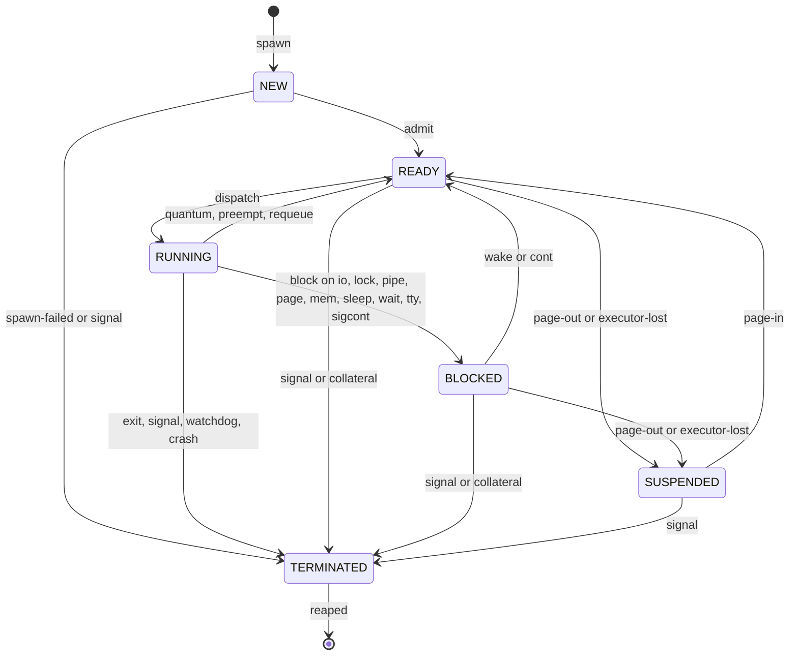

# Processes, scheduling and job control

| Field | Value |
|---|---|
| Title | Processes, scheduling and job control: PCB, PIDs, lifecycle, program model, executors, scheduler, aging bound, watchdog, kill path, signals, process commands |
| Status | Draft v0.1, 2026-09-24 |
| Primary owner | R1 Kernel (`kernel/core/{proc,sched,ipc}`, `kernel/runtime`, the process commands `ps top kill nice renice` and the job-control semantics behind `jobs bg fg &`) |
| Secondary reviewer | R5 QA/DevOps (boot orchestration and the test harness sit on the kernel; role matrix §2) |
| Must be demonstrable at | **P2 gate (W7, v0.2.0):** PidTable, spawn/exit/wait/kill on executors, heap scheduler with round-robin, pipes and job control keys used by the Terminal. **P3 gate (W11, v0.3.0):** everything in this file live: bands, SAB pre-emption, watchdog, placement, all process commands, the PROC-04 starvation test against the declared bound, the PROC-05 frame gate (P3 gate script steps 1 and 7). **Final defence (W17-18, v1.0.0):** Appendix A lines PROC-04 and PROC-05 on the reference machine |
| Requirement IDs covered | PROC-01, PROC-02, PROC-03, PROC-04, PROC-05, PROC-06, PROC-07, PROC-08, PROC-09; contributes to SYS-01 (identity by port), SYS-02 (process commands, `&`), WM-05 (close sends SIGTERM, kill closes windows), MEM-02 (focus pinning), RAG-01 (indexer is a scheduled niced process), PRE-04 (pre-fetch at priority 39, idle only), §10.1 binary heap (ready queue, timer queue), hash map (process table), DAG (application start-up dependencies); Plotinium design IDs KPS-01 … KPS-15 |
| Related specs | [../01-architecture/architecture.md](../01-architecture/architecture.md) · [../01-architecture/syscall-abi.md](../01-architecture/syscall-abi.md) · [memory-and-paging.md](./memory-and-paging.md) · [../02-boot/boot-and-services.md](../02-boot/boot-and-services.md) · [../05-wm/window-manager.md](../05-wm/window-manager.md) · [../07-shell/shell-and-terminal.md](../07-shell/shell-and-terminal.md) · [../08-dsa/data-structures.md](../08-dsa/data-structures.md) · [../10-ai/rag-semantic-search.md](../10-ai/rag-semantic-search.md) · [../10-ai/agentic-shell.md](../10-ai/agentic-shell.md) · [../10-ai/predictive-prefetch.md](../10-ai/predictive-prefetch.md) · [../12-security/security-model.md](../12-security/security-model.md) · [../13-quality/testing-and-performance.md](../13-quality/testing-and-performance.md) · [../00-product/requirements-traceability.md](../00-product/requirements-traceability.md) · [../00-product/glossary.md](../00-product/glossary.md) |

**Conventions.** RFC 2119 keywords as in the spec's Conventions section (p. 3). **Spec: MUST (§x, ID)** marks an obligation from the capstone specification; **Plotinium design (KPS-nn)** marks our own binding choice. Every number from the AI-run prototype is labelled *(pilot figure — re-measure on the lab machine)*. Thread tags follow [architecture.md](../01-architecture/architecture.md): **[MAIN]**, **[K]** kernel worker, **[EXEC]** executor, **[BLK]** blkio, **[EMB]** ai.embed.

---

## 1. Purpose and scope

This file is the normative source for how Plotinium runs work:

- the process control block (PCB), the process table and PID allocation (§3.3);
- the lifecycle of Figure 9.1 and the log record for every transition (§3.4);
- the program model that makes processes resumable and pageable (§3.5), and `spawn` with application start-up dependencies (§3.6);
- the executor runtime: slice loop, the 32-byte SharedArrayBuffer control block, and the message fallback (§3.7);
- the scheduler: ready heap, index map, timer heap, bands, quanta, pre-emption, the dispatch loop (§3.8-§3.11);
- aging and the **declared and proved PROC-04 bound** (§3.12);
- executor pool sizing (isolation versus concurrency), placement, the watchdog and collateral handling (§3.13-§3.15);
- the PROC-07 kill path (§3.16), signals and job control (§3.17);
- the output formats of `ps`, `top`, `kill`, `nice`, `renice`, `jobs`, `bg`, `fg`, `&` and `sched` (§3.18), the Task Manager feed (§3.19), and PROC-09 scale (§3.20).

Out of scope, linked instead: memory accounting, pages, the LRU, swap and the codec ([memory-and-paging.md](./memory-and-paging.md)); call names, argument schemas, the errno master table, capabilities and the dispatcher order ([syscall-abi.md](../01-architecture/syscall-abi.md), which wins on **names, shapes, errnos, capabilities and check order**); service manifests and the boot DAG ([boot-and-services.md](../02-boot/boot-and-services.md)); the TTY line discipline and the shell's job table ([shell-and-terminal.md](../07-shell/shell-and-terminal.md)); the heap, hash table, ring buffer and DAG implementations ([data-structures.md](../08-dsa/data-structures.md)). This file wins on **process semantics**: states, transitions, scheduling, signals, placement and kill.

---

## 2. Requirements table

| ID | Summary | Spec § | How verified |
|---|---|---|---|
| PROC-01 | Spec: MUST. The process table is a hash map keyed by PID with O(1) average lookup, insert and delete | §9.1, PROC-01 | Code review; `dsa/hashtable` unit, property and benchmark tests (§8) |
| PROC-02 | Spec: MUST. The ready queue is our own binary heap with O(log n) push and pop and O(log n) priority change through an index map | §9.1, §10.1, PROC-02 | Unit tests; micro-benchmark 10^3-10^5 |
| PROC-03 | Spec: MUST. Round-robin among equal priorities with a configurable quantum | §9.1, PROC-03 | Scheduling trace test |
| PROC-04 | Spec: MUST. Aging guarantees no runnable process waits longer than a declared bound, whatever its priority; the bound is stated and proved | §9.1, PROC-04, App. A | Starvation test: 50 high-priority CPU jobs and 1 low-priority job, asserted against the declared value (§3.12.5) |
| PROC-05 | Spec: MUST. All long-running work runs on Web Workers; with a CPU-bound workload and 10 windows open, p95 frame time ≤ 16.7 ms and no long task over 50 ms comes from OS code | §9.1, PROC-05, App. A | Chrome-trace frame durations plus LoAF attribution on the lab-spec machine (C13); placement test with `hardwareConcurrency` forced to 4 |
| PROC-06 | Spec: MUST. The lifecycle follows Figure 9.1 and every state transition is logged | §9.1, PROC-06 | Trace inspection; edge-set property test |
| PROC-07 | Spec: MUST. `kill` terminates the process, frees its worker, closes its fds, releases its locks and re-parents its children to `init` | §9.1, PROC-07 | Integration test; leak property test |
| PROC-08 | Spec: MUST. `ps top kill nice renice jobs bg fg` and a trailing `&` work, and a graphical Task Manager shows state, CPU share and memory | §9.1, §9.6, PROC-08 | Live demonstration; scripted terminal session with golden output |
| PROC-09 | Spec: SHOULD. The process table holds at least 256 concurrent processes (mostly sleeping) without degrading the interface | §9.1, PROC-09 | Load test |
| §10.1 heap | Spec: MUST. Binary heap for the scheduler ready queue and the timer and sleep queue, written by the team | §10.1, §10.2 | Code review; `dsa/heap` tests and benchmark |
| §10.1 DAG | Spec: MUST. DAG with Kahn's algorithm for application start-up dependencies (cycle path reported) | §10.1 | KPS-07 tests (§8) |
| SYS-02 (process side) | Background jobs (`&`) and the process commands | §9.6, SYS-02 | Scripted terminal session |
| WM-05 (process side) | Closing a window sends a termination signal; killing a process closes its windows | §9.4, WM-05 | Integration test (shared with [memory-and-paging.md](./memory-and-paging.md)) |
| KPS-01 | Plotinium design. Everything that runs has a PCB and a pid: user processes, kernel threads, special workers | C2 | `ps -e` lists all three kinds |
| KPS-02 | Plotinium design. PID allocation rules of §3.3.2 | – | Unit tests |
| KPS-03 | Plotinium design. Program model `init(argv) -> state` plus `*run(ctx, state)`; yield points; checkpointable versus non-checkpointable | C2 | Lint rule, runtime tests |
| KPS-04 | Plotinium design. Executor runtime: slice loop, control block, sandbox, message fallback | C2, C3 | Runtime tests |
| KPS-05 | Plotinium design. Isolation versus concurrency: up to `MAX_EXECUTORS` isolation executors, a run-token semaphore of `RUN_TOKENS` running slices | C2, critic | Placement test at `hwc = 4` |
| KPS-06 | Plotinium design. Placement rules of §3.14 | C2 | Placement tests |
| KPS-07 | Plotinium design. `spawn` resolves `/bin/<app>.json` `requires` with `dsa/dag` (Kahn), rejects cycles naming the path | C17, critic | Unit test and benchmark |
| KPS-08 | Plotinium design. Watchdog, forced termination and collateral handling | C2 | Watchdog tests |
| KPS-09 | Plotinium design. Signals, process groups, sessions and TTY job control semantics | ABI-09 | Signal tests |
| KPS-10 | Plotinium design. Task Manager feed `proc.snapshot` | – | Feed tests |
| KPS-11 | Plotinium design. The compositor's `interactive` hint pauses the background band, at most 1 s in any 2 s | C12 | Duty-cycle test |
| KPS-12 | Plotinium design. Focus boost: the focused window's process and the foreground group of the focused TTY run in the interactive band | – | Boost tests |
| KPS-13 | Plotinium design. All kernel timing goes through the kernel timer heap (sleep, aging, watchdog, service timeouts, lease heartbeats) | critic (BOOT-06 fix) | Timer tests |
| KPS-14 | Plotinium design. Demonstration programs `burn` (§3.18.10) and `memhog` ([memory-and-paging.md](./memory-and-paging.md)) are real processes with documented contracts | P3 gate script | Used by PROC-04/05 and MEM-06 tests |
| KPS-15 | Plotinium design. Starvation guard: while a parked process has `effPrio = 0`, no token goes to a larger key (§3.10); required by the PROC-04 proof | critic (PROC-04 fix) | Guard unit test; starvation test |

---

## 3. Design (normative)

### 3.1 Constants

Every constant lives in `kernel/core/sched/params.ts`. Values marked *Settings* are changed through `sysctl.set` (root, security-audited, [syscall-abi.md §3.7](../01-architecture/syscall-abi.md#37-audit)) or the Settings → System → Scheduler page.

| Name | Value | Meaning |
|---|---|---|
| `PID_MAX` | 32,768 | Valid pids are 1 … 32,767; 0 is never allocated |
| `PROC_MAX` | 4,096 | Maximum PCBs, zombies included (`spawn` → EAGAIN) |
| `NPROC_PER_UID` | 1,024 | Maximum PCBs per uid; uid 0 exempt (`spawn` → EAGAIN) |
| `DEFAULT_PRIORITY` | 20 | Static priority of a user process unless its manifest says otherwise |
| `NICE_MIN`, `NICE_MAX` | −20, 19 | Nice range; values outside are clamped (POSIX `setpriority` behaviour) |
| `FOCUS_PRIORITY` | 5 | Base priority of a boosted process (§3.9.3) |
| `QUANTUM_MS` | interactive 5, normal 10, background 20 | *Settings*, each 2 … 50 ms (PROC-03) |
| `Q` | max(`QUANTUM_MS`) = 20 ms | Longest quantum; used in the bound |
| `T_AGE_MS` | 100 | Aging interval, *Settings* 50 … 1,000 ms. The strategy's 250 ms is replaced by the critic's 100 ms default (§3.12.6 gives both) |
| `STEP_MAX_US` | 500 | A conforming program does at most 0.5 ms of work between yield points |
| `DELTA_MS` (δ) | 1 | Declared upper bound on per-slice overhead: the kernel's report and dispatch handling (≤ 0.5 ms p99) plus the last step's overshoot past the quantum (≤ `STEP_MAX_US`). Typical dispatch overhead ≈ 0.2 ms *(pilot figure — re-measure on the lab machine)* |
| `OVERRUN_SLACK_MS` | 5 | A slice longer than quantum + 5 ms counts as an overrun |
| `HARD_LIMIT_MS` | max(250, 10 × `Q`) = 250 | A slice still running after this is a runaway. Fixed at 250 ms for all bands; the strategy's `max(20 × quantum, 250)` would give 400 ms for the background band and break H_kill = 400 ms (C13) |
| `KILL_GRACE_MS` | 100 | Time between `PREEMPT = 2` and `worker.terminate()` |
| `WATCHDOG_PERIOD_MS` | 50 | Watchdog check period (a kernel timer; only boot progress must never be timer-driven) |
| `H_KILL_MS` | `HARD_LIMIT_MS + KILL_GRACE_MS + WATCHDOG_PERIOD_MS` = 400 | Worst time a runaway holds a run token (C13, critic) |
| `MAX_EXECUTORS` | 8 | Isolation executors, including one unbound spare ([architecture.md §3.6](../01-architecture/architecture.md#36-threads-and-workers-canonical-c2)) |
| `RUN_TOKENS` | `clamp(hwc − 2 − (embedActive ? ortThreads : 0), 1, 6)`, `ortThreads = hwc ≥ 8 ? 2 : 1` | Concurrently RUNNING slices (C2) |
| `EXEC_IDLE_REAP_MS` | 30,000 | An executor with no residents is terminated after this |
| `CLOSE_GRACE_MS` | 3,000 | Window close: SIGTERM, then SIGKILL after this (WM-05) |
| `INTERACTIVE_PAUSE` | ≤ 1,000 ms in any 2,000 ms | Background-band pause while the compositor reports a pointer gesture (KPS-11) |
| `IDLE_MS` | 2,000 | No input and no READY process in the interactive or normal band for this long means "idle" (pre-fetch, C12) |
| `KLOG_SIZE` | 8,192 | Kernel log ring entries (`dsa/ringbuffer`) |
| `SNAPSHOT_HZ` | 1 | Task Manager feed rate, *Settings* 0.5 … 2 Hz |

### 3.2 Process kinds (KPS-01)

**Spec: §9.1.** "Everything that runs is a process: applications, system services, AI jobs and terminal commands." **Plotinium design (KPS-01, C2).** Every runnable entity has a PCB, a pid and a line in `ps -e`. There are three kinds:

| Kind | Where it runs | Scheduled on run tokens? | Examples | `ps` shows |
|---|---|---|---|---|
| `user` | a generator resident on an executor [EXEC] | yes | shells, coreutils, app processes (`apps/*/proc.ts`), `ai.search`, `ai.indexer`, `ai.predictor`, `ai.agent`, `prefetch:*`, `complete`, `burn`, `memhog` | name and argv |
| `kthread` | inside the kernel worker [K], as event handlers | no; CPU time is the measured handler time | `init` (pid 1, owns the service manager), `syncd`, `lockd`, and the other kernel-resident services listed in [boot-and-services.md](../02-boot/boot-and-services.md) | `[syncd]` in brackets, like UNIX kernel threads |
| `special` | a kernel-owned dedicated worker [BLK] [EMB] | no; one job at a time | `blkio`, `ai.embed` | `[blkio]`, `[ai.embed]` |

The boot spec decides which of the 18 services is a `kthread` and which is a `user` process on an executor. This file only requires that each has a PCB. `kthread` and `special` PCBs are owned by uid 0, class `system`; users cannot signal them (EPERM, §3.17.1), except that root MAY send SIGKILL to `ai.embed`, which evicts the model page ([memory-and-paging.md](./memory-and-paging.md), [rag-semantic-search.md](../10-ai/rag-semantic-search.md)).

### 3.3 Process table and PID allocation (PROC-01, KPS-02)

#### 3.3.1 Process table

**Spec: MUST, §9.1, PROC-01.** A hash map from pid to PCB, O(1) average. **Plotinium design.** `procs: PidTable<PCB>` from `dsa/hashtable` (the team's own open-addressing table: linear probing, Fibonacci hashing `Math.imul(k, 0x9E3779B1) >>> shift`, backward-shift deletion with no tombstones, load factor ≤ 0.5, doubling). It is the hash table that earns the §10.2 distinction credit; its interface, collision strategy and benchmark live in [data-structures.md](../08-dsa/data-structures.md). Pilot: 61-397 ns/op for mixed get/set/delete at n = 256 … 10^5 *(pilot figure — re-measure on the lab machine)*.

#### 3.3.2 PID allocation rules

**Plotinium design (KPS-02).**

1. pid 0 is never allocated. In klog, audit and events, `pid = 0` means "the kernel itself".
2. pid 1 is `init`, created by the kernel at stage 3 before any other PCB. `init` never exits; `kill` of pid 1 is EPERM for every caller, root included.
3. The allocator keeps `nextPid`, starting at 2. `alloc()` returns the first `p ≥ nextPid` (wrapping from 32,767 to 2) that is **not** (a) a live pid, (b) a TERMINATED pid not yet reaped, or (c) the pgid or sid of any live process (POSIX: a pid is not reused while it names a group or a session). It then sets `nextPid = p + 1`.
4. If `PROC_MAX` PCBs exist, or the caller's uid holds `NPROC_PER_UID`, `spawn` fails with EAGAIN before any search. Because `PROC_MAX` (4,096) ≪ `PID_MAX` (32,767), the scan finds a free pid within at most 4,096 + (number of live pgids and sids) probes; the amortised cost is O(1).
5. Pids are per kernel boot. A process restored in a new OS session (MEM-04) gets a new pid; the `os_sessions` layout maps the old `(os_session_id, pid)` to the new one ([memory-and-paging.md](./memory-and-paging.md)).
6. A pid fits an `Int32` so it can be stored in the SharedArrayBuffer control block (§3.7.2) and in the heap's index map.

### 3.4 Lifecycle (PROC-06)

**Spec: MUST, §9.1, PROC-06, Figure 9.1.** States NEW, READY, RUNNING, BLOCKED, SUSPENDED (paged out), TERMINATED. "SUSPENDED is the state that links the scheduler to the memory manager: a process whose state has been paged out cannot be dispatched until a page-in brings it back to READY."



**Transition table.** Every row is one klog record `{t, kind:'proc', pid, from, to, reason, …}` (§4.6), appended to the kernel log ring (`dsa/ringbuffer`, 8,192 entries) and published on the `proc.state` topic.

| From → To | Reason code(s) | Trigger | In Figure 9.1? |
|---|---|---|---|
| (none) → NEW | `spawn` | `spawn` accepted; PCB allocated | implicit |
| NEW → READY | `admit` | placement found, initial memory reserved, module loaded ([memory-and-paging.md](./memory-and-paging.md) reservation) | yes |
| NEW → TERMINATED | `spawn-failed`, `signal:<n>` | module load failed (exit 126), or killed while NEW | Plotinium addition, needed for failed spawns |
| READY → RUNNING | `dispatch` | the dispatch loop (§3.10) | yes |
| RUNNING → READY | `quantum`, `preempt`, `requeue` | quantum expired; `PREEMPT = 1` honoured; an F call answered while a higher-priority process waits | yes ("preempt") |
| RUNNING → BLOCKED | `block` with `waitingOn` | a T, B, X or R call, a page fault, a memory reservation, or a stop signal | yes ("wait: I/O, lock, page fault") |
| BLOCKED → READY | `wake` (with the event), `cont` | the awaited event happened; SIGCONT on a stopped process | yes ("event done") |
| READY → SUSPENDED | `page-out`, `executor-lost` | the pager suspended the whole process; or its executor was terminated and it was restored from a clean checkpoint (§3.15.3) | yes ("page-out (LRU)") |
| BLOCKED → SUSPENDED | `page-out`, `executor-lost` | as above, only while the pending call is restartable (§3.5.4) | yes |
| SUSPENDED → READY | `page-in` | the state page is back and verified | yes |
| RUNNING → TERMINATED | `exit`, `signal:<n>`, `watchdog`, `crash` | normal exit; fatal signal; runaway killed; uncaught exception | yes ("exit · kill") |
| READY, BLOCKED → TERMINATED | `signal:<n>`, `collateral` | kill of a process that is not running; lost executor with no clean checkpoint | Plotinium addition: kill must work in every state (PROC-07) |
| SUSPENDED → TERMINATED | `signal:<n>` | kill of a paged-out process (no page-in needed) | Plotinium addition |
| TERMINATED → (removed) | `reaped` | the parent's `wait` returned it, or the parent is `init` | implicit |

Rules:

1. **Plotinium design.** A RUNNING process is never paged out directly: the pager sets `PREEMPT = 1`, the process goes RUNNING → READY (`preempt`), then READY → SUSPENDED (`page-out`). Both records are logged, so the observed edge set is exactly the one above.
2. **Plotinium design.** "Stopped" is not a seventh state: a stopped process is BLOCKED with `waitingOn = 'sigcont'`. If it was already BLOCKED on something else, `waitingOn` becomes `sigcont` when that event completes. A change of `waitingOn` inside BLOCKED is logged as an **annotation** record (`from === to`), which the edge-set test ignores.
3. **Plotinium design.** A SUSPENDED process whose awaited event completes stays SUSPENDED with `wakePending = true`; the pager pages it in (SUSPENDED → READY) because a runnable process needs its state ([memory-and-paging.md](./memory-and-paging.md) page-in triggers). There is no SUSPENDED → BLOCKED edge: after page-in, the program re-runs from its checkpoint and re-issues any restartable wait (§3.5.4), which is a normal RUNNING → BLOCKED.
4. **Plotinium design.** A TERMINATED process is a zombie: it keeps only `{pid, ppid, uid, exitCode, exitReason, cpuTimeMs, createdAt, exitedAt}` until reaped. Every other resource is freed on entry to TERMINATED (§3.16). `init` reaps its children immediately.
5. **Plotinium design.** The ring can overwrite old records. A trace consumer (the PROC-06 test, `dmesg -w`, Task Manager trace export) subscribes to `klog.follow`, which streams every record with a sequence number and reports `dropped` counts, so a complete trace can always be captured.

### 3.5 Program model (KPS-03)

**Spec: §9.1 "Time slices".** "Long-running work is written as resumable steps (generators, chunked loops or explicit state machines). A worker runs one quantum of steps, reports back, and the scheduler re-queues the process." **Plotinium design (KPS-03, C2).**

#### 3.5.1 Module shape

```ts
// bin/wc.ts — a checkpointable program (Plotinium design; argument shapes are illustrative, the ABI registry is authoritative)
import type { Program } from '@plotinium/protocol/proc';
interface St { path: string; offset: number; lines: number; fd: number | null }
export default {
  checkpointable: true,
  init(argv): St { return { path: argv[1] ?? '-', offset: 0, lines: 0, fd: null }; },  // serialisable state only
  *run(ctx, st) {
    st.fd ??= yield* ctx.sys.open({ path: st.path, flags: 'r' });   // restart-safe: re-opened after a cross-session restore
    for (;;) {
      const buf = yield* ctx.sys.read({ fd: st.fd, length: 65536, offset: st.offset });
      if (buf.byteLength === 0) break;
      const b = new Uint8Array(buf);
      for (let i = 0; i < b.length; i++) if (b[i] === 10) st.lines++;
      st.offset += buf.byteLength;
      yield ctx.tick;                                   // yield point: pre-emption, quantum, checkpoint
    }
    yield* ctx.sys.write({ fd: 1, data: `${st.lines}\n` });
    return 0;                                           // exit code
  },
  signal(ctx, st, sig) { if (sig === 'SIGTERM') st.offset = Number.MAX_SAFE_INTEGER; },  // optional, synchronous
} satisfies Program<St>;
```

Rules:

1. **State lives in `st` or in `ctx.mem` pages.** `init(argv)` returns the initial state. Everything a process must keep across a page-out is in `st` (encoded by the deterministic codec) or in pages it allocated with `ctx.mem` ([memory-and-paging.md](./memory-and-paging.md)). Generator objects, closures and local variables are **not** state: a JavaScript generator cannot be serialised (structured clone throws `DataCloneError`).
2. **Yield points.** A process yields in exactly two ways: `yield ctx.tick` (a voluntary yield point) and `yield*` of a syscall stub (the stub yields the request and returns the reply). The executor checks `PREEMPT`, the quantum and pending checkpoint requests only at yield points. The ESLint rule `no-yieldless-loop-in-generator` (tools/eslint-rules) fails any `for`/`while`/`do` loop inside a `function*` in `apps/`, `bin/`, `ai/` and `kernel/runtime` whose body contains no `yield`. A conforming program does at most `STEP_MAX_US` = 0.5 ms of work between yield points; the runtime measures the longest step of every slice (`maxStepUs`, §4.3) and `ps -o ovr` shows overruns.
3. **Syscalls.** `ctx.sys.<call>(args)` is a generator: it yields a `SysReq` without an `id` (the runtime assigns it), then returns `value` or throws `SysError(errno, msg, detail)`. Program code never sees `id`, `pid` or `sliceSeq` ([syscall-abi.md §3.2](../01-architecture/syscall-abi.md#32-identity-by-port)).
4. **Checkpointable programs** (`checkpointable: true`) MUST be re-runnable from any `st` produced at a yield point: `run(ctx, st)` is called again from the top after a page-in, a migration, a collateral restore or a cross-session restore. The idioms are `st.phase` switches and `??=` for resources. Window processes of built-in apps MUST be checkpointable (WM-05, MEM-03). A checkpointable program MUST NOT keep state in module-level variables.
5. **Non-checkpointable programs** (default for `cli` manifests: `ls`, `cat`, `grep` and the other short-lived commands) have no state page. They are never SUSPENDED; their `ctx.mem` data pages are still pageable. On a collateral executor loss they exit with 137, reason `collateral` (§3.15.3).
6. **Signals.** A caught signal is delivered by the executor runtime calling the optional **synchronous** hook `signal(ctx, st, sig)` before the generator resumes; the hook may only change `st` ([syscall-abi.md §3.9](../01-architecture/syscall-abi.md#39-signals-and-job-control)). A B or R call that was pending completes with `ECANCELED` (`detail.reason = 'signal'`) first.
7. **Uncaught exception** in `run` or `signal`: the process exits with code 1, reason `crash`; the message and the first 2 KB of the stack go to klog.
8. **No timers, no async.** Executors shadow `setTimeout` and `setInterval` ([syscall-abi.md §3.2.3](../01-architecture/syscall-abi.md#323-sandboxing-the-realm)). Programs wait with `yield* ctx.sleep(ms)` or `ctx.sleepUntil(tMs)`, which the scheduler sees and accounts. `async` functions and bare Promises are banned in program code by lint (a microtask would run outside any slice).

#### 3.5.2 The `ctx` object

```ts
// protocol/src/proc/ctx.ts — Plotinium design (types only; the runtime implements them)
export interface Ctx {
  readonly pid: number; readonly ppid: number; readonly pgid: number; readonly sid: number;
  readonly uid: number; readonly gid: number;
  readonly argv: readonly string[]; readonly env: ReadonlyMap<string, string>;
  readonly cwd: string;                                 // path at the last dispatch
  readonly tty: number | null;                          // controlling tty id
  readonly restored: 'no' | 'page-in' | 'migration' | 'session';  // why run() was (re)entered
  readonly sys: Sys;                                    // typed syscall stubs, one per call in the ABI registry
  readonly mem: Mem;                                    // page API, memory-and-paging.md §4
  readonly tick: unique symbol;                         // yield ctx.tick
  now(): number;                                        // monotonic ms (performance.now in the executor)
  sleep(ms: number): Generator<SysReq, void, SysRes>;  // B call 'sleep'
  sleepUntil(tMs: number): Generator<SysReq, void, SysRes>; // absolute deadline: restart-safe
  readonly display: Display | null;                     // windowed processes: snapshot/diff out, input in
}
```

`ctx.restored === 'session'` means every fd number held in `st` is invalid (a new kernel owns a new fd table): the program MUST re-open by path. After `page-in` and `migration`, fds stay valid because the kernel owns the fd table ([syscall-abi.md](../01-architecture/syscall-abi.md)).

#### 3.5.3 Checkpoints

A **checkpoint** is the codec encoding of `st` (plus the list of the process's pages) taken by the executor at a yield point, SHA-256-verified and written to swap ([memory-and-paging.md](./memory-and-paging.md)). The generator is dropped only if the checkpoint was requested with `release: true` (page-out). The scheduler requests checkpoints in three situations:

1. **Page-out** (release) and **migration** (release, then load on the target executor).
2. **Idle checkpoint (SHOULD).** When a checkpointable process with an encoded state ≤ 256 KiB enters BLOCKED on a wait expected to last (`sleep` ≥ 1 s, `tty:read`, `wait:*`, `sigcont`, `ai:search-focus`) and the blkio queue is idle, the kernel takes a non-releasing checkpoint. It makes a later page-out a clean drop and makes collateral restore possible (§3.15.3).
3. **Durability checkpoints** of window processes on `visibilitychange → hidden` and during BOOT-12 shutdown ([memory-and-paging.md](./memory-and-paging.md)).

#### 3.5.4 Restartable and non-restartable pending calls

A process may be SUSPENDED or collateral-restored while BLOCKED only if its pending call is **restartable**: re-running `run(ctx, st)` from the last checkpoint re-issues the same call with no duplicated effect. Restartable: `sleep` (with an absolute deadline in `st`), pipe and TTY reads with nothing consumed, `wait`, `lock.acquire` waits, `sigcont`, memory reservations, `ai:search-focus`, `ai:query`. Non-restartable: every T and X call and any B call that has already produced an effect (a lock granted, bytes consumed). While a non-restartable call is in flight, the process's state page is pinned and it cannot be suspended.

### 3.6 `spawn`, `exec` and application start-up dependencies (KPS-07)

**Spec: §10.1 DAG row** ("application start-up dependencies"). **Plotinium design (KPS-07, C17).**

1. `spawn({path | name, argv, env?, cwd?, fds?, pgid?, setsid?, ctty?, nice?, dropCaps?, exclusive?})` resolves `name` through `$PATH` to `/bin/<name>.json`, a root-owned manifest. The caller needs r and x on the manifest and x on every ancestor (EACCES, [syscall-abi.md §3.6](../01-architecture/syscall-abi.md#36-permission-checks)). The manifest schema (fields `class`, `caps`, `requires`, plus the fields of §4.4 that this file needs) is owned by [boot-and-services.md](../02-boot/boot-and-services.md) together with service manifests.
2. **Closure.** The kernel builds the dependency closure of `requires` (entries `{service}`, `{chunk}`, `{proc}`) over the manifests with `dsa/dag` and Kahn's algorithm, O(V + E). A cycle fails the spawn with EINVAL and `detail = {reason: 'dep-cycle', cycle: ['editor', 'spell', 'editor']}`, extracted by a DFS over the leftover subgraph, exactly as the boot DAG does. The resolved order is cached per manifest-set version.
3. **Start in topological order.** `{service}`: the service must be RUNNING; if it is DEGRADED or stopped, EAGAIN with `detail.reason = 'service-down:<name>'`. `{chunk}`: the chunk is imported into the target executor before the program module. `{proc}`: a helper process is spawned first (same uid and class, same pgid).
4. **Admission.** Allocate a PCB (EAGAIN limits of §3.3.2), compute caps ([syscall-abi.md §3.5](../01-architecture/syscall-abi.md#35-capability-model)), place it (§3.14; EAGAIN `no-executor`), reserve initial memory (`manifest.initialStateBytes` or 64 KiB, [memory-and-paging.md](./memory-and-paging.md); the child waits in NEW while the reservation is BLOCKED), refuse heavy spawns while the thrashing guard is on (EAGAIN `thrashing`), send `load` to the executor, run `init(argv)`. On success NEW → READY and `spawn` returns `{pid}`. `spawn` is class B for the parent: it returns only after the child is admitted or has failed, so ENOENT, EACCES and EAGAIN are reported synchronously.
5. **Priority.** `priority = manifest.priority ?? DEFAULT_PRIORITY`; `nice = parent.nice + (args.nice ?? 0)`, clamped. Only uid 0 may request a negative increment (EPERM otherwise, POSIX).
6. **Inheritance.** fds 0-2 (or `args.fds`), cwd, umask, env (plus `args.env`), pgid (or a new group with `pgid: 'new'`), sid (or a new session with `setsid: true`, becoming its leader, with `ctty` if given), caps narrowed by `dropCaps`, class from the manifest. An agent spawned from a root shell runs with the real login uid (C12, [syscall-abi.md §3.5](../01-architecture/syscall-abi.md#35-capability-model)).
7. **`exec` (MAY, v1 optional).** Replaces the calling process's program: new module, new `init(argv)` state; pid, ppid, pgid, sid, fds, cwd and pages freed as on exit; caps from the new manifest ∩ the current set. Not needed by the shell, which uses `spawn`.
8. **Pre-fetch (C12).** `prefetch:*` jobs warm the whole closure of a predicted app (chunks imported into a spare executor, manifest cached); the policy is owned by [predictive-prefetch.md](../10-ai/predictive-prefetch.md).

### 3.7 Executor runtime (KPS-04)

#### 3.7.1 Bootstrap and sandbox

`kernel/runtime/executor.ts` is the first module of every executor (a nested module worker spawned by the kernel). Before any program chunk is imported it captures its control port and control block, replaces storage, thread, network, message and timer globals with throwing accessors, freezes `ctx`/`sys`, and sends `hello {abi, digest}` — exactly as specified in [syscall-abi.md §3.2.3](../01-architecture/syscall-abi.md#323-sandboxing-the-realm) (ABI-16). This file adds:

1. **Plotinium design.** An executor is **bound** to one isolation key `(uid, class)` when its first process is placed, and never re-bound: an executor that has run code of one key could carry poisoned global state into another. An empty bound executor is terminated after `EXEC_IDLE_REAP_MS`; the kernel keeps one unbound **spare** executor warm to hide spawn latency (nested worker ready in 6.0-7.7 ms p50, 8.5-22 ms p95 *(pilot figure — re-measure on the lab machine)*).
2. **Plotinium design.** Only executor #1 starts during boot (stage 3); the spare and the rest start on demand after `desktop-interactive` (BOOT-10). If a process of a new isolation key must run before that, isolation wins and an executor is spawned anyway (logged in `bootlog`).

#### 3.7.2 Control block (32 bytes)

**Plotinium design (KPS-04).** When `crossOriginIsolated` is true, each executor gets an `Int32Array(new SharedArrayBuffer(32))`, i.e. 8 slots:

| Index | Name | Writer | Meaning |
|---|---|---|---|
| 0 | `PREEMPT` | kernel sets, executor clears at slice start | 0 none, 1 yield at next yield point, 2 kill at next yield point |
| 1 | `RUNNING_PID` | executor | pid of the slice now running; 0 when idle (written at slice start and end) |
| 2 | `HEARTBEAT` | executor | incremented at every yield point (`Atomics.add`) |
| 3 | `SLICE_SEQ` | kernel at dispatch; executor echoes it | slice counter; identifies stale reports |
| 4 | `STEPS` | executor | yield points in the current slice (reset at slice start) |
| 5 | `MAX_STEP_US` | executor | longest step in the current slice, µs, saturating at 2^31 − 1 |
| 6 | `FLAGS` | kernel | bit 0 `DRAINING` (no new dispatch), bit 1 `CHECKPOINT_WANTED`, bit 2 `SUSPECT` (identity mismatch seen) |
| 7 | reserved | – | 0; kept for alignment and future accounting |

The check at a yield point costs about 8 ns (`Atomics.load`); an `Atomics` round trip between two workers takes 8.0-9.4 µs *(pilot figures — re-measure on the lab machine)*.

#### 3.7.3 Slice loop

```ts
// kernel/runtime/slice.ts — Plotinium design (normative pseudocode)
function runSlice(pid: number, sliceSeq: number, quantumMs: number, input: SysRes | undefined, sigs: number) {
  const P = resident.get(pid)!;                      // {gen, st, program}
  deliverSignals(P, sigs);                           // program.signal?.(ctx, st, sig) for each caught signal
  const start = performance.now(), end = start + quantumMs;
  ctl && (Atomics.store(ctl, PREEMPT, 0), Atomics.store(ctl, RUNNING_PID, pid), Atomics.store(ctl, STEPS, 0), Atomics.store(ctl, MAX_STEP_US, 0));
  let last = start, maxStep = 0, steps = 0;
  for (;;) {
    const r = P.gen.next(input); input = undefined;
    const t = performance.now(); maxStep = Math.max(maxStep, t - last); last = t; steps++;
    if (r.done) return report({ t: 'exit', pid, sliceSeq, code: r.value ?? 0, ...acct() });
    if (r.value !== TICK) return report({ t: 'syscall', pid, sliceSeq, req: stamp(r.value), ...acct() }); // one frame: call + slice end
    if (ctl) { Atomics.add(ctl, HEARTBEAT, 1); Atomics.store(ctl, STEPS, steps); }
    const pre = ctl ? Atomics.load(ctl, PREEMPT) : 0;
    if (pre === 2) { drop(pid); return report({ t: 'killed', pid, sliceSeq }); }
    if (pre === 1 || t >= end) return report({ t: 'yield', pid, sliceSeq, ...acct() });
  }
  // acct() = { cpuMs: last - start, steps, maxStepUs: round(maxStep * 1000), touched, dirtied } (pages: memory-and-paging.md)
}
```

- The executor clears `RUNNING_PID` inside `report()`. Exceptions thrown by `gen.next` are caught around the loop and reported as `{t:'error'}` (exit 1, reason `crash`).
- A **resume** frame (F-call fast path, §3.10) re-enters `runSlice` with the reply as `input` and `quantumLeftMs` as the quantum, without a new dispatch.
- The quantum is **wall time from dispatch**, including syscall round trips inside the slice (the resume carries the remaining time), so a slice holds its run token for at most quantum + δ.

#### 3.7.4 Message fallback without cross-origin isolation

**Plotinium design.** Without `crossOriginIsolated` there is no SharedArrayBuffer. Then:

- The slice ends only at quantum expiry or a syscall; `{t:'preempt'}` messages are queued behind the running slice, so pre-emption latency is at most the remaining quantum (≤ `Q`).
- The watchdog cannot read `RUNNING_PID` or `HEARTBEAT`; it treats a slice with no report after `HARD_LIMIT_MS + KILL_GRACE_MS` as a runaway and terminates the executor directly.
- `bootlog` records `pre-emption: message fallback (not cross-origin isolated)`, `sched` prints it, and the PROC-04 declared bound is unchanged (the watchdog path has the same H_kill).

### 3.8 Scheduler data structures (PROC-02)

**Spec: MUST, §9.1, §10.1, PROC-02.** "A binary min-heap that you implement. Its key is (effective priority, arrival sequence number)." **Plotinium design.**

| Structure | Type | Key | Operations used | Complexity |
|---|---|---|---|---|
| `ready` | `dsa/heap` binary min-heap, struct-of-arrays: `keys: Float64Array`, `ids: Int32Array`, `pos: Int32Array(PID_MAX)` index map (pid → heap index, −1 absent) | `effPrio · 2^32 + seq` | `push`, `pop`, `peek`, `peekKey`, `changeKey`, `remove`, `has` | push, pop, changeKey, remove O(log n); peek O(1); has O(1) |
| `parked[e]` | small array per executor | same key, recomputed on read | min by key, remove | O(k), k = READY residents of a busy executor (typically ≤ 8) |
| `timers` | second `dsa/heap` instance; ids are timer slots from a free list | deadline in ms (float) | push, pop, peek, changeKey (reschedule), remove (cancel) | O(log T) |
| `procs` | `PidTable<PCB>` | pid | get, set, delete | O(1) average |

- **Key encoding.** `effPrio ∈ [0, 39]` and `seq ∈ [0, 2^32 − 1]`, so the largest key is 40 · 2^32 − 1 < 2^53: every key is an exact double. Comparing keys compares `(effPrio, seq)` lexicographically.
- **`seq`** is a uint32 counter taken **when a process enters READY** and kept while it ages or is parked. When the counter would pass 2^32 − 1, the scheduler renumbers: it lists every READY process (heap and parked) in key order, assigns `seq = 1 … n`, rebuilds the heap in O(n) and continues from n + 1. This preserves relative order and happens at most once per 4.29 × 10^9 READY entries.
- **Timers** (KPS-13): `sleep` wake-ups, the aging tick, the watchdog tick, `CLOSE_GRACE_MS` SIGKILL follow-ups, service start timeouts ([boot-and-services.md](../02-boot/boot-and-services.md)), lease heartbeats of `lockd` ([offline-and-sync.md](../06-sync/offline-and-sync.md)), `wait` and B-call `timeoutMs`. The kernel host arms **one** platform timer for the earliest deadline and re-arms it after every change to the minimum.
- The heap implementation, its tests and its benchmark belong to R1 in `dsa/heap` ([data-structures.md](../08-dsa/data-structures.md)). Pilot: pop + push pair 92-198 ns (struct-of-arrays) at n = 256 … 10^5 *(pilot figure — re-measure on the lab machine)*.

### 3.9 Priorities, bands and quanta (PROC-03)

#### 3.9.1 Priority terms

| Term | Definition |
|---|---|
| `priority` | Static priority 0 (highest) … 39 (lowest), from the manifest (Spec §9.1 PCB table) |
| `nice` | −20 … 19; `setpriority`/`renice`/`nice` change it |
| `base` | `clamp(priority + nice, 0, 39)`, lowered to `min(base, FOCUS_PRIORITY)` while boosted (§3.9.3) |
| `effPrio` | `max(0, base − ⌊(now − waitingSince) / T_AGE⌋)` while READY, updated on aging ticks; reset to `base` at dispatch |
| band / `cls` | from `base`: interactive 0-9, normal 10-29, background 30-39 |

`ps` column `PRI` shows `clamp(priority + nice, 0, 39)`, so the indexer (manifest priority 22, nice 10) shows `PRI 32 NI 10` as [rag-semantic-search.md](../10-ai/rag-semantic-search.md) expects; column `EP` shows the current `effPrio`.

#### 3.9.2 Bands

| Band | `base` | Quantum | Pre-emption |
|---|---|---|---|
| interactive | 0-9 | 5 ms | Pre-empts any lower-priority running slice at its next yield point |
| normal | 10-29 | 10 ms | Pre-emptible |
| background | 30-39 | 20 ms | Pre-emptible; not dispatched while the `interactive` hint is active, for at most 1 s in any 2 s (KPS-11) |

**Round-robin (PROC-03).** When a slice ends by quantum or pre-emption, the process re-enters READY with a fresh `seq`, so it goes behind every process of equal `effPrio`: FIFO within a level, hence round-robin within each priority. Quanta are configurable per band (*Settings*); a change applies from the next dispatch.

#### 3.9.3 Focus boost (KPS-12)

The process that owns the focused window, and every process in the foreground process group of the focused Terminal's TTY, is **boosted**: `base = min(clamp(priority + nice, 0, 39), FOCUS_PRIORITY)` — provided its `nice ≤ 0`, so an explicitly niced job is never boosted. Focus changes call `changeKey` for the old and the new process (O(log n)). Background jobs (`&`) are not in the foreground group and are not boosted.

#### 3.9.4 The `interactive` hint (KPS-11)

The compositor sends `interactive {active}` through the router on pointer-gesture start and end ([architecture.md §4.2](../01-architecture/architecture.md#42-router-port-messages-main--kernel)). While active, the dispatcher does not dispatch a process whose current `effPrio ≥ 30`, and pre-empts running background slices (`PREEMPT = 1`). The pause lasts at most 1,000 ms; after that, background dispatch resumes for at least 1,000 ms even if the gesture continues. Aging continues during the pause, and a process whose `effPrio` has aged below 30 is not paused. This gives the indexer its "throttled while the user is active" duty cycle of about 50 % (RAG-01).

### 3.10 Dispatch loop

**Spec: §10.3 dispatch pseudocode, §9.1 "Multi-core dispatch".** **Plotinium design.** The loop is event-driven: it runs after a process enters READY, after every slice report, after a blocking call completes, on a timer, and when `RUN_TOKENS` changes. It never polls.

```text
// kernel/core/sched/dispatch.ts — normative pseudocode
key(p)            = p.effPrio * 2^32 + p.seq
tokensFree        = RUN_TOKENS                       // run-token semaphore (KPS-05)
slice[e]          = {pid, seq} or IDLE               // what executor e is running

makeReady(p, reason):                                // the ONLY way into READY
  from = p.state; p.state = READY; p.seq = nextSeq(); p.waitingSince = now(); p.effPrio = p.base
  ready.push(p.pid, key(p)); klog(p, from, READY, reason); schedule()

guardKey():                                            // KPS-15 starvation guard, O(parked)
  return min over all parked processes q with q.effPrio == 0 of key(q), or +infinity

schedule():
  while tokensFree > 0 and ready.size > 0:
    p = ready.peek()
    if key(p) > guardKey(): break                              // KPS-15: free tokens wait for the starving parked process
    if p.effPrio >= 30 and interactivePaused(): break          // everything left is background (KPS-11)
    e = p.worker                                               // home executor (resident); fixed while resident
    if slice[e] != IDLE:                                       // home executor busy: park, keep key and seq
      ready.pop(); parked[e].push(p.pid); continue
    ready.pop(); dispatch(p, e)
  if guardKey() < infinity:                                    // speed up the starving process's executor
    m = the parked process with key guardKey(); v = pcb of slice[m.worker]
    if v.effPrio > 0 and not v.preemptRequested: setPreempt(m.worker, 1); v.preemptRequested = true
  if tokensFree == 0 and ready.size > 0:                      // pre-emption request
    top = ready.peek()
    v = argmax over running slices of key(pcb)                 // lowest-priority running slice
    if v and v.effPrio > top.effPrio and not v.preemptRequested:
      setPreempt(v.exec, 1); v.preemptRequested = true         // honoured at v's next yield point

dispatch(p, e):
  tokensFree -= 1; slice[e] = {p.pid, ++sliceSeq[e]}
  p.state = RUNNING; p.effPrio = p.base; p.preemptRequested = false
  p.sliceStartedAt = now(); p.lastRunAt = now(); p.slices += 1
  post(e, {t:'dispatch', pid, sliceSeq, quantumMs: QUANTUM_MS[band(p)], reply: p.pendingReply, pendingSigs})
  p.pendingReply = null; klog(p, READY, RUNNING, 'dispatch')

onFrame(e, f):                                         // f.t ∈ yield | syscall | exit | killed | error
  if slice[e].seq != f.sliceSeq or slice[e].pid != f.pid: identityMismatch(e, f); return   // ABI-02
  p = procs.get(f.pid); account(p, f)                  // cpuTimeMs += f.cpuMs; overruns; page touches (MEM)
  if f.t == 'syscall' and CALLS[f.req.call].cls == 'F':
    res = dispatcher.handle(p, f.req)                  // stages 0-8 of syscall-abi.md §3.3
    left = QUANTUM_MS[band(p)] - (now() - p.sliceStartedAt)
    if left > 0 and not p.preemptRequested and not (ready.size > 0 and ready.peek().effPrio < p.effPrio):
      slice[e].seq = ++sliceSeq[e]
      post(e, {t:'resume', pid, sliceSeq, reply: res, quantumLeftMs: left}); return      // keeps the token, O(1)
    p.pendingReply = res; endSlice(e); makeReady(p, 'requeue'); return
  endSlice(e)
  switch f.t:
    'yield'   : makeReady(p, p.preemptRequested ? 'preempt' : 'quantum')
    'syscall' : block(p, waitReason(f.req)); dispatcher.handle(p, f.req)   // T, B, X, R: reply later, then wake
    'exit'    : terminate(p, f.code, 'normal')
    'killed'  : finishKill(p)                                               // §3.16
    'error'   : terminate(p, 1, 'crash')

endSlice(e):                                           // e is idle again: its parked residents become dispatchable
  slice[e] = IDLE; tokensFree += 1
  for each pid in parked[e]: ready.push(pid, key(pid))  // keys and seqs unchanged
  parked[e].clear()
  schedule()                                           // pops in key order; the first e-resident takes e, the rest re-park

agingTick():                                           // timer, every T_AGE_MS
  for each READY p (heap ids and parked):
    e2 = max(0, p.base - floor((now() - p.waitingSince) / T_AGE_MS))
    if e2 != p.effPrio: p.effPrio = e2; if ready.has(p.pid): ready.changeKey(p.pid, key(p))
  schedule()
```

Complexities: `makeReady`, `dispatch` O(log n); `onFrame` O(log n) plus the handler; the F-call resume path O(1); `endSlice` O(k log n) for k parked residents; `guardKey` O(total parked); `agingTick` O(R log R) for R READY processes — well under 0.1 ms for R = 256.

**Starvation guard (KPS-15).** The dispatcher is work-conserving (a free token goes to the best process whose executor is idle) except in one case: while some parked process has `effPrio = 0`, no token is granted to a process with a larger key, and the executor that blocks it is asked to yield. The guard engages only under saturation (a process has aged to level 0 behind a busy co-resident, or a priority-0 process is parked), costs some throughput only then, and is what makes the PROC-04 proof hold under executor affinity (§3.12).

### 3.11 Pre-emptive and non-pre-emptive classes

**Spec: §9.1.** "Interactive and foreground processes pre-empt background ones at the next slice boundary. Non-pre-emptive tasks, such as a transaction commit, run to completion. A process that exceeds its hard limit is forcibly terminated with `worker.terminate()`." And the "Engineering reality" box: pre-emption at two levels, cooperative time-slicing at yield points and forced termination for runaways. **Plotinium design.**

| Class | What | How it is bounded |
|---|---|---|
| **Pre-emptive (cooperative)** | Every `user` process on an executor | `PREEMPT = 1` or quantum expiry ends the slice at the next yield point: latency ≤ `STEP_MAX_US` for conforming programs with SAB, ≤ remaining quantum without SAB |
| **Non-pre-emptive** | Kernel sections: the single IndexedDB readwrite transaction of every T call and of phase 2 of every X call ([syscall-abi.md §3.4](../01-architecture/syscall-abi.md#34-call-classes-blocking-cancellation-and-timeouts)); an embedding job in `ai.embed` | Run to completion. The caller is BLOCKED (`io:<txn>`) and its pages are pinned for the section. Kernel synchronous work per task is budgeted at ≤ 4 ms p99 (§7); IndexedDB auto-commit is avoided by issuing only IDB requests inside the builder (lint `no-await-in-idb-builder`) |
| **Forced termination** | A `user` slice past `HARD_LIMIT_MS` | Watchdog (§3.15): `PREEMPT = 2`, then `worker.terminate()` after `KILL_GRACE_MS` |

What a mid-slice termination costs (the defence answer): the runaway loses its un-yielded work and exits 137 (reason `watchdog`). Nothing in the kernel is lost, because syscalls are atomic at call granularity, VFS writes commit in one IndexedDB transaction, and the kernel owns every fd, lease and page table. Co-resident processes lose their executor: those with a clean checkpoint are restored, the others exit 137 (reason `collateral`, §3.15.3). Placement (§3.14) limits who can be collateral.

### 3.12 Aging and the PROC-04 bound

**Spec: MUST, §9.1, PROC-04.** "A process that waits for longer than a set interval has its effective priority improved step by step. No runnable process starves, and you must state and prove the bound." App. A: "Longest wait for a low-priority process under load ≤ declared bound." **Plotinium design (C13, critic).**

#### 3.12.1 Rule

Every `T_AGE_MS` the aging tick lowers the `effPrio` of every READY process by one level per whole `T_AGE_MS` it has waited, down to 0 (§3.10 `agingTick`). This is the spec's own step-by-step rule (§10.3: `changePriority(p, max(0, p.effective − 1))` every aging interval) with the level computed from the wait instead of counted, so a missed tick cannot lose a step. `seq` is kept while aging and while parked; dispatch resets `effPrio` to `base`.

#### 3.12.2 Definitions

- **W(P)**: the time a process P spends continuously in READY, from `makeReady` to `dispatch`. The test measures it from klog timestamps and reports the maximum over every READY period of P.
- **p**: P's `base` (≤ 39).
- **N**: the maximum number of runnable `user` processes (READY or RUNNING) during W(P), P included. `kthread` and `special` processes do not use run tokens.
- **E**: the parallelism available to P's predecessors: E = 1 for any placement (the declared bound); E = the minimum `RUN_TOKENS` during W(P) only under the corollary's placement condition.
- **L = Q + δ**: the longest conforming slice.
- **H_kill**: `H_KILL_MS` = 400 ms.

**Preconditions** (each is checked and logged by the test):

1. Programs are conforming (every step ≤ `STEP_MAX_US`), and a slice is measured from its dispatch to the moment the kernel has processed its end frame, so kernel processing delay counts. At most **one** slice during W(P) is longer than L; it is absorbed by the H_kill term (a runaway is killed within H_kill and never recurs because it is TERMINATED). A kernel task longer than 0.5 ms that delays report processing makes the affected slice a long one.
2. P's own executor is not terminated during W(P) (P is not collateral).
3. Scheduling parameters do not change during W(P).

#### 3.12.3 Lemmas

**Lemma 1 (aging phase).** After at most (p + 1) · T_age of waiting, `effPrio(P) = 0`.
*Proof.* `⌊wait / T_age⌋ ≥ p` once `wait ≥ p · T_age`. Ticks are T_age apart with an arbitrary phase, so the first tick at or after that moment comes at `wait < p · T_age + T_age`. That tick sets `effPrio = max(0, p − ⌊wait / T_age⌋) = 0`. ∎

Let t₀ be that moment. Let A be the set of processes that are READY at t₀ with `seq < seq(P)` (they entered READY before P and have not been dispatched since), and R₀ the set of processes RUNNING at t₀. A and R₀ are disjoint and exclude P, so |A| + |R₀| ≤ N − 1.

**Lemma 2 (only A goes first).** After t₀ and before P's dispatch, every run token is granted to a member of A, and each member at most once.
*Proof.* After t₀, `key(P) = seq(P)`. A key below `key(P)` must be at level 0 with a smaller `seq`, so it belongs to a process whose current READY period began before P's and has not ended, i.e. a member of A. A process that enters READY after t₀, or re-enters after a slice, gets a fresh `seq > seq(P)`; aging and `changeKey` never change `seq`. Tokens are granted only by `schedule()`, which pops the heap in key order. If P is in the heap, no key above `key(P)` is reached before P. If P is parked, P is a parked process with `effPrio = 0`, so `guardKey() ≤ key(P)` and the starvation guard stops `schedule()` at every key above `key(P)`. Either way every grant before P's goes to a key below `key(P)`, hence to a member of A; a member that is dispatched gets a fresh `seq` and leaves A. ∎

**Lemma 3 (any placement).** After t₀, P is dispatched within (N − 1) · L + H_kill.
*Proof.* By Lemma 2, every slice that starts after t₀ and before P's dispatch belongs to A, one per member; a member of R₀ finishes its current slice and re-enters READY behind P, so it cannot run again first. Take any moment τ of P's wait. If no slice of R₀ ∪ A were running at τ, no slice at all would be running (every other slice started before t₀ belongs to R₀ by definition), so every token would be free and every executor idle; P and the members of A would then all be dispatchable, and `schedule()`, which runs on every event, would already have dispatched the minimum of them. So every moment of the wait, apart from single dispatch instants, is covered by a slice of R₀ ∪ A. There are at most N − 1 such slices, each of length ≤ L, except at most one of length ≤ H_kill (precondition 1). Hence the wait after t₀ is at most (N − 2) · L + H_kill ≤ (N − 1) · L + H_kill. ∎

Executor affinity is why the general bound uses E = 1: a READY process lives in one realm and can only run there, and the starvation guard trades idle tokens for a guarantee, so predecessors may be served one after another.

**Corollary (E = RUN_TOKENS).** If during W(P) every runnable process is the only runnable resident of its executor (so nothing is ever parked, which needs N ≤ `MAX_EXECUTORS`; for example every job spawned with `exclusive: true`), then after t₀ P is dispatched within ⌈(N − 1)/E⌉ · L + H_kill, where E is the minimum `RUN_TOKENS` during W(P).
*Proof.* Nothing is parked, so the guard never engages and every READY process is dispatchable. While P waits, no token can be free (P or a smaller key would take it at once), so the E tokens are continuously busy. By Lemma 2 they serve only slices of R₀ ∪ A, at most one per process, each ≤ L. A token that is continuously busy with slices of length ≤ L starts at least m slices in any interval of length m · L; so after ⌈(N − 1)/E⌉ · L the E tokens have started at least N − 1 slices, which exhausts R₀ ∪ A, and the next free token goes to P. One long slice adds at most H_kill − L. ∎

#### 3.12.4 Theorem (the declared bound)

For every READY process P with base priority p, under the preconditions of §3.12.2:

> **W(P) ≤ (p + 1) · T_age + ⌈(N − 1)/E⌉ · (Q + δ) + H_kill**

This is the canonical form (C13). By Lemma 1 and Lemma 3 it holds with **E = 1 for any placement**; this is the **declared bound**. By Lemma 1 and the corollary it holds with **E = `RUN_TOKENS`** when every runnable process has an executor of its own. The interactive-hint pause does not extend the bound: it applies only while `effPrio ≥ 30`, which lies inside the aging phase that the first term already counts in wall time.

No starvation follows immediately: the bound is finite for every p ≤ 39 and every finite N.

#### 3.12.5 Declared values and the tests that assert them

**Starvation test (spec, App. A line PROC-04).** `tests/performance/sched/starvation.spec.ts`: 50 `burn` jobs at priority 0 and one `burn` job P at priority 39, same uid, normal placement, safe mode (no `ai.*` services), no focused window and no pointer input, run for 60 s after the run queue has drained. The test logs N (must be 51), `RUN_TOKENS`, every slice length (all but at most one must be ≤ L) and the maximum W(P).

| Test | Parameters | Declared bound | Asserted |
|---|---|---|---|
| **Starvation (declared bound, E = 1)** | p = 39, T_age = 100 ms, N = 51, E = 1, Q = 20 ms, δ = 1 ms, H_kill = 400 ms | 40 × 100 + 50 × 21 + 400 = **5,450 ms** | `max W(P) ≤ 5,450 ms` |
| **Corollary (E measured)** | 5 jobs at priority 0 and P at 39, each spawned with `exclusive: true` (6 executors), N = 6, E = `RUN_TOKENS` logged (minimum during the run) | 4,000 + ⌈5/E⌉ × 21 + 400: E = 1 → **4,505 ms**; E = 2 → **4,463 ms**; E = 3 or 4 → **4,442 ms**; E ≥ 5 → **4,421 ms** | `max W(P) ≤` the value computed from the logged E |

Each test asserts **exactly** its declared value, and `sched bound --p 39 --n 51` (or `--n 6 --exclusive`) prints the same number so the examiner can check it live (P3 gate step 7). The analysis predicts a measured maximum near 3.9-4.1 s: P reaches level 0 after 39 ticks, and A is empty at that point because every priority-0 job has re-queued with a fresh `seq`. The test prints the prediction next to the bound; the gap is the safety margin.

#### 3.12.6 Sensitivity

| T_age | Declared bound (N = 51, E = 1) | Corollary (N = 6, E = 2) |
|---|---|---|
| 50 ms | 3,450 ms | 2,463 ms |
| **100 ms (default)** | **5,450 ms** | **4,463 ms** |
| 250 ms (strategy value) | 11,450 ms | 10,463 ms |

A shorter T_age reduces starvation time but lets background work climb into the normal band sooner under load. 100 ms keeps a priority-39 job below the normal band for 1 s of waiting and gives a sub-6-second guarantee.

### 3.13 Executor pool: isolation versus concurrency (KPS-05)

**Spec: §9.1 "Multi-core dispatch".** "The worker pool is sized from `navigator.hardwareConcurrency`, and the scheduler maps runnable processes onto free workers." **Plotinium design (C2, critic).** Two separate limits:

| Concern | Mechanism | Limit | Cost |
|---|---|---|---|
| **Isolation** (who may share a realm) | executors bound to one isolation key `(uid, class)`, class ∈ {`user`, `agent`, `system`} ([syscall-abi.md §3.2.1](../01-architecture/syscall-abi.md#321-executor-ports)) | `MAX_EXECUTORS` = 8, including the spare | An idle executor costs no CPU and about 0.3 MB of JS heap *(pilot figure — re-measure on the lab machine)* |
| **Concurrency** (how many slices run at once) | run-token semaphore `tokensFree` | `RUN_TOKENS = clamp(hwc − 2 − (embedActive ? ortThreads : 0), 1, 6)` | One token = one busy core |

- `hwc = navigator.hardwareConcurrency`; the `− 2` leaves one core for the main thread and one for the kernel worker.
- `embedActive` is true while `ai.embed` is resident **and** has run a job in the last 2 s; `RUN_TOKENS` is recomputed when it changes. If the new value is below the number of running slices, no slice is pre-empted; tokens are simply not re-issued until the count falls.
- Worked example, 4-thread lab PC: `RUN_TOKENS = 2` (1 while an embedding runs). Threads busy at most: main + kernel + 2 slices (or 1 slice + ai.embed with 1 ORT thread) + blkio when paging. The placement rules can still give alice's shell, a root shell, `ai.agent` and system services separate executors, because isolation does not consume tokens.

### 3.14 Placement rules (KPS-06)

**Plotinium design.** Applied in this order when a process is admitted (NEW → READY), paged in, restored, or migrated:

1. **Isolation (MUST).** Only executors bound to the process's key `(uid, class)`, or the unbound spare. Different keys never share an executor; agent processes never share with user processes.
2. **Exclusive (MUST).** An executor that hosts a process marked `exclusive` accepts no other process. A process is marked `exclusive` by `spawn({exclusive: true})` (uid 0, or the test harness profile) or after its **second overrun** (a slice longer than quantum + `OVERRUN_SLACK_MS`). A checkpointable overrunner is migrated to an empty executor at its next yield point; a non-checkpointable one stays, and its executor stops accepting new residents.
3. **Focused process.** On focus, if the focused process shares its executor with another runnable process and a less-loaded executor of the same key exists (or can be spawned), it is migrated there at its next yield point if checkpointable.
4. **Least loaded.** Otherwise choose the executor of the key with the fewest runnable residents (READY + RUNNING), then the fewest residents, then the lowest index.
5. **Grow.** If the chosen executor already has a runnable resident, fewer than `MAX_EXECUTORS` exist, and `desktop-interactive` has passed, spawn a new executor for the key instead.
6. **Exhausted.** If no executor of the key exists and all `MAX_EXECUTORS` are bound, terminate an empty bound executor of another key and use a fresh one; if none is empty, `spawn` fails with EAGAIN (`detail.reason = 'no-executor'`).
7. **Sleepers.** Many BLOCKED processes may be resident on one executor; this is how PROC-09 reaches 256+ processes without 256 workers.

**Migration** is page-out without swap I/O: at a yield point the executor encodes `st` (checkpoint with `release: true`), the kernel verifies the SHA-256 and sends a `load` with `restore.from = 'migration'` to the target, and the view gets a new display channel ([architecture.md §4.1](../01-architecture/architecture.md#41-ports-and-channels)). Only checkpointable processes migrate. Data pages move by transfer ([memory-and-paging.md](./memory-and-paging.md)).

### 3.15 Watchdog, forced termination and collateral (KPS-08)

#### 3.15.1 Detection

A kernel timer runs every `WATCHDOG_PERIOD_MS`. For each executor `e` with `slice[e] = {pid, seq}`:

- **With SAB.** Runaway ⇔ `ctl[RUNNING_PID] == pid && ctl[SLICE_SEQ] == seq && now − sliceStartedAt > HARD_LIMIT_MS`. If `RUNNING_PID` is already 0, the report is in flight (the kernel is busy), and nothing is done.
- **Without SAB.** Runaway ⇔ no frame for this slice after `HARD_LIMIT_MS + KILL_GRACE_MS`; go straight to termination.
- A worker `error` event (crash of the realm) is handled as a termination without the grace period.

#### 3.15.2 Termination

```mermaid
sequenceDiagram
  autonumber
  participant WD as Watchdog timer [K]
  participant K as Scheduler [K]
  participant EX as Executor e [EXEC]
  participant CMP as Compositor [MAIN]
  WD->>K: slice on e running longer than HARD_LIMIT, heartbeat stale
  K->>EX: PREEMPT = 2 (kill at next yield point)
  alt program yields within KILL_GRACE
    EX-->>K: killed pid
    K->>K: kill path for the runaway only (no collateral)
  else no report after KILL_GRACE
    K->>EX: worker.terminate()
    K->>K: runaway exits 137, reason watchdog; kill path
    K->>K: spawn a fresh executor for the same key
    K->>K: each co-resident: restore from clean checkpoint, or exit 137 collateral
    K->>CMP: close windows of terminated processes; new display channels for restored ones
  end
```

The runaway's `overruns` count and a klog record `watchdog {pid, sliceMs, steps, maxStepUs}` are kept. `worker.terminate()` on a worker stuck in `for(;;){}` returned in about 0.01 ms, and the replacement was ready in 6-8 ms *(pilot figures — re-measure on the lab machine)*.

#### 3.15.3 Collateral handling

Every other process resident on the terminated executor is **restorable** iff all hold:

1. it is checkpointable;
2. its latest verified checkpoint was taken after its last slice (no slice since the checkpoint, so re-running from it repeats nothing);
3. every dirty data page has a valid swap copy of the current generation;
4. it is not waiting on a non-restartable call (§3.5.4).

A restorable process goes READY/BLOCKED → SUSPENDED (reason `executor-lost`) and is paged in on demand on the new executor; a restored window shows "Restoring…" like any page-in. Every other co-resident goes → TERMINATED with exit 137 and reason `collateral`; its parent gets SIGCHLD and `wait` returns `{kind:'signaled', sig:'SIGKILL', reason:'collateral'}`. The idle checkpoint of §3.5.3 exists to make sleeping co-residents restorable.

### 3.16 The kill path (PROC-07)

**Spec: MUST, §9.1, PROC-07.** "`kill` terminates the process, frees its worker, closes its file descriptors and releases its locks. Its children are re-parented to `init`." **Plotinium design.** SIGKILL, or an uncaught terminating signal (§3.17), runs these steps in order, inside the kernel worker, for a process P:

1. **Permission and audit.** Checked by `kill` (§3.17.1). A cross-uid kill is a security audit record; an agent-originated kill is an agent record ([syscall-abi.md §3.7](../01-architecture/syscall-abi.md#37-audit)).
2. **State.** P → TERMINATED, reason `signal:<n>` (or `watchdog`, `collateral`). Remove P from the ready heap, `parked[*]`, the timer heap and the memory wait queue.
3. **Pending call.** A B or R call is cancelled (its id dropped). A T call or phase 2 of an X call is a non-pre-emptive kernel section: it commits or aborts as a whole and the reply is discarded, so the tree is fully applied or untouched. An X call already committed locally and waiting for the server sends `proc.signal` on the control lane; the server cancels and rolls back and the client reverts from `undo` (AGT-09, [syscall-abi.md §3.4](../01-architecture/syscall-abi.md#34-call-classes-blocking-cancellation-and-timeouts)).
4. **Worker.** If P is RUNNING: `PREEMPT = 2`; if no `killed` frame arrives within `KILL_GRACE_MS`, terminate the executor and apply §3.15.3 to the co-residents. If P is resident but not running: post `{t:'drop', pid}`; the executor discards P's generator, state and pages. Release P's run token if it holds one. The residency slot is freed ("frees its worker").
5. **Files.** Close every fd in P's fd table: open-file refcounts drop ([virtual-file-system.md](../04-vfs/virtual-file-system.md)); a pipe with no writers left gives readers EOF; a pipe with no readers left gives writers EPIPE and SIGPIPE. Event subscriptions (fd handles) are dropped.
6. **Locks.** `lockd` releases P's leases; online, the server broadcasts `lock.released`; offline, the local `navigator.locks` handles are dropped ([offline-and-sync.md](../06-sync/offline-and-sync.md)).
7. **Children.** Every child's `ppid` becomes 1 and `init` reaps them when they exit. If P was a session leader with a controlling TTY, SIGHUP then SIGCONT go to that TTY's foreground group and the TTY is disassociated. A process group left orphaned with a stopped member gets SIGHUP then SIGCONT (POSIX orphaned-group rule).
8. **Windows.** For each `wid` in `P.windows`, the kernel sends `close` to the compositor and closes the view port (WM-05).
9. **Memory.** Free every page and declared asset, release reservations and pins, remove LRU entries, and queue P's local and remote swap pages for garbage collection asynchronously ([memory-and-paging.md](./memory-and-paging.md)). A SUSPENDED process is never paged in to be killed.
10. **Zombie and wake-ups.** Keep the zombie record (§3.4 rule 4), send SIGCHLD to the parent, wake `wait()`ers; if the parent is `init`, reap now.
11. **Log.** klog `{kind:'proc', pid, from, to:'TERMINATED', reason, by: callerPid, exitCode: 128 + n}`.

Kill latency (steps 2-11, SIGTERM grace excluded) p95 ≤ 50 ms, measured from the `kill` call to the `proc.exit` event (§7). The PROC-07 property test checks that after random sequences of spawn, block, page-out and kill, the counts of fds, open-file refs, leases, pages, windows, timers, parked entries, heap entries, run tokens and executor residents equal those implied by the surviving processes.

### 3.17 Signals and job control (KPS-09)

Names, numbering, dispositions and the delivery rule are fixed in [syscall-abi.md §3.9 and §4.8](../01-architecture/syscall-abi.md#39-signals-and-job-control). This section gives the process-side semantics.

#### 3.17.1 Signal table and sending

| Signal | No. | Default action | Catchable | Generated by |
|---|---|---|---|---|
| SIGHUP | 1 | terminate | yes | controlling process exit, Terminal window closed |
| SIGINT | 2 | terminate | yes | Ctrl-C (foreground group) |
| SIGQUIT | 3 | terminate | yes | Ctrl-\ |
| SIGKILL | 9 | terminate (kill path) | no | `kill -9`, watchdog, `CLOSE_GRACE_MS` follow-up |
| SIGPIPE | 13 | terminate | yes | write to a pipe with no readers |
| SIGTERM | 15 | terminate | yes | `kill` default, window close, Task Manager "End task", shutdown |
| SIGCHLD | 17 | ignore | yes | child exit, stop or continue |
| SIGCONT | 18 | continue | yes (hook runs after continuing) | `bg`, `fg`, `kill -CONT` |
| SIGSTOP | 19 | stop | no | `kill -STOP`, Task Manager "Suspend" |
| SIGTSTP | 20 | stop | yes | Ctrl-Z |
| SIGTTIN | 21 | stop | yes | background read from the TTY |
| SIGTTOU | 22 | stop | yes | background `tcsetpgrp` or `tty.setattr` |
| SIGWINCH | 28 | ignore | yes | TTY resize |

- `kill({pid, sig})`: `pid > 0` one process, `pid < 0` the group `|pid|`, `pid = 0` the caller's group; signal 0 tests existence and permission. The caller needs the target's uid, or `kill.other` (root). `kthread` and `special` targets and pid 1: EPERM (root may SIGKILL `ai.embed`, §3.2). A zombie target: success, no effect (Linux behaviour). No such pid: ESRCH. Bad signal: EINVAL.
- Exit status on a fatal signal: `128 + n` (SIGKILL 137, SIGTERM 143, SIGINT 130); `exitReason = 'signal'`.
- **Pending and delivery.** The kernel sets a bit in `pendingSignals`. SIGKILL runs the kill path at once. SIGSTOP/SIGTSTP/SIGTTIN/SIGTTOU with default action: the process stops (READY → removed from the heap, BLOCKED `sigcont`; RUNNING → `PREEMPT = 1`, then BLOCKED `sigcont` at the slice end; already BLOCKED → `stopped = true`). SIGCONT clears `stopped`, discards pending stop signals, and a process BLOCKED on `sigcont` becomes READY (reason `cont`). A caught signal is delivered through the `signal` hook at the next dispatch; if the process is BLOCKED in a B or R call, that call completes with ECANCELED first so the process becomes READY.
- **SUSPENDED targets.** Default-terminate: kill path without page-in. Caught: the process is paged in (it needs `st`) and the hook runs at its dispatch. Stop: `stopped = true`, no page-in.

#### 3.17.2 Process groups, sessions and the TTY

- Every process has a `pgid` and a `sid`. `setpgid(pid, pgid)` is allowed for the caller or its own children in the same session; `setsid()` creates a session led by the caller if it is not a group leader (else EPERM). `spawn({pgid: 'new'})` sets the group atomically, which removes the classic fork/setpgid race.
- Each TTY is a kernel object `{id, sid, fgPgid, winsize, mode}`; its line discipline is defined in [shell-and-terminal.md](../07-shell/shell-and-terminal.md). Only a process of the TTY's session may call `tcsetpgrp(fd, pgid)` (else EPERM; a background caller gets SIGTTOU); a non-TTY fd gives ENOTTY.
- **Keys.** The line discipline is kernel-owned for signal purposes: on Ctrl-C, Ctrl-Z and Ctrl-\ it calls the kernel's internal `ttySignal(ttyId, sig)`, which signals `-fgPgid` **with kernel authority**, so a Terminal owned by alice can interrupt a foreground job that runs as root after `su` (as a UNIX TTY driver would).
- A process whose pgid is not the TTY's foreground group and that reads the TTY gets SIGTTIN to its group (default: stop, shown as `Stopped (tty input)`). Background writes are allowed.
- Closing the Terminal window: SIGHUP to the session (§3.16 step 7).

#### 3.17.3 Job control (`jobs`, `bg`, `fg`, `&`)

These are shell builtins (the shell's job table lives in the shell process's `st`, [shell-and-terminal.md](../07-shell/shell-and-terminal.md)); this file fixes the kernel calls they use:

| Builtin | Kernel calls |
|---|---|
| `cmd &` | `spawn({pgid: 'new'})` for each pipeline stage (same new group); no `tcsetpgrp` |
| `cmd` (foreground) | `spawn({pgid: 'new'})`, `tcsetpgrp(tty, pgid)`, `wait({pid: -pgid, untraced: true})`, then `tcsetpgrp(tty, shellPgid)` |
| `jobs` | `wait({pid: -1, nohang: true, untraced: true, continued: true})` in a loop to collect state changes |
| `bg [%j]` | `kill({pid: -pgid, sig: 'SIGCONT'})` |
| `fg [%j]` | `tcsetpgrp(tty, pgid)`, `kill({pid: -pgid, sig: 'SIGCONT'})`, `wait({pid: -pgid, untraced: true})`, `tcsetpgrp(tty, shellPgid)` |

`wait({pid, nohang?, untraced?, continued?})` returns `{pid, status: {kind: 'exited' | 'signaled' | 'stopped' | 'continued', code?, sig?, reason?}}`, or `null` with `nohang` when nothing changed. No matching child: ECHILD (requested in §9; until it is in the master table, ESRCH with `detail.reason = 'not-child'`).

### 3.18 Commands and output formats (PROC-08)

**Spec: MUST, §9.6 Processes group, PROC-08.** All are programs in `apps/coreutils` (R1 owns `ps top kill nice renice sched burn`; `jobs bg fg` are shell builtins whose semantics are §3.17.3). Output is plain text; every command also accepts `--json` for tests. Times use `M:SS.cc`; sizes use binary units with one decimal (`18.2K`, `1.2M`, `2.0G`, where K = 1,024 bytes).

#### 3.18.1 Common fields

| Field (`-o` name) | Header | Meaning |
|---|---|---|
| `pid`, `ppid`, `pgid`, `sid` | PID PPID PGID SID | identifiers |
| `uid`, `user` | UID USER | effective uid and name |
| `pri` | PRI | `clamp(priority + nice, 0, 39)` |
| `ni` | NI | nice |
| `eprio` | EP | current `effPrio` (aging included) |
| `cls` | CLS | `int`, `nor`, `bkg` (band of `base`), `kth`, `spc` |
| `state` | STATE | full name: NEW, READY, RUNNING, BLOCKED, SUSPENDED, TERMINATED |
| `stat` | STAT | 3-letter code `NEW RDY RUN BLK STP SUS ZMB` (STP = BLOCKED on `sigcont`, ZMB = TERMINATED unreaped) followed by flags: `+` foreground group of its TTY, `s` session leader, `<` boosted, `N` nice > 0, `X` exclusive executor, `!` over its memory soft limit, `P` pinned |
| `wchan` | WCHAN | `waitingOn` (for example `pipe:3`, `tty:read:1`, `page:2`, `mem`, `ai:embed`) |
| `pcpu` | %CPU | lifetime average `cpuTimeMs / (now − createdAt) × 100` (`top` uses the last interval) |
| `time` | TIME | `cpuTimeMs` as `M:SS.cc` |
| `etime` | ELAPSED | wall time since spawn |
| `rss`, `swap` | RSS SWAP | accounted resident bytes (pages, declared assets and the per-process overhead); bytes of the process's pages that are currently paged out ([memory-and-paging.md](./memory-and-paging.md)) |
| `flt` | FLT | page faults |
| `exe` | EXE | `e0` … `e7`, `kern`, `blk`, `emb`, or `-` when SUSPENDED |
| `ovr` | OVR | overruns |
| `tty` | TTY | `tty1` … or `?` |
| `comm`, `args` | COMMAND | name; full argv (kernel threads in brackets) |
| `exit` | EXIT | exit code and reason, for zombies |

#### 3.18.2 `ps`

```text
ps [-e | -A] [-f] [-u user[,user]] [-p pid[,pid]] [-t tty] [-o field[,field]] [--sort [-]field] [--json]
```

- No option: processes whose controlling TTY is the caller's. `-e`/`-A`: all. `-f`: full format.
- Default columns `PID TTY STAT TIME COMMAND`; `-f` columns `UID PID PPID PGID SID PRI NI CLS STAT %CPU RSS SWAP TTY TIME COMMAND`.
- Data comes from `proc.list` (paginated, 1,024 rows per page, [syscall-abi.md §3.1](../01-architecture/syscall-abi.md#31-channels-and-transport)); `ps -e` with 256 processes completes in ≤ 100 ms (§7).

```text
$ ps
    PID TTY      STAT      TIME COMMAND
    203 tty1     BLKs   0:00.14 sh
    415 tty1     RUN+   0:00.01 ps
$ ps -ef --sort=-pcpu
  UID   PID  PPID  PGID   SID PRI  NI CLS STAT   %CPU    RSS   SWAP TTY      TIME COMMAND
 1000   501   203   501   203   0   0 int RUN    33.1  82.2K     0B tty1  0:39.72 burn --ms 120000
 1000   502   203   501   203   0   0 int RDY    32.9  82.2K     0B tty1  0:39.51 burn --ms 120000
    0     1     0     1     1   0   0 kth BLKs    0.0     0B     0B ?     0:00.31 init
    0    12     1    12    12  20   0 kth BLK     0.1     0B     0B ?     0:00.88 [syncd]
 1000   322     1   322   322  32  10 bkg RDYN    1.8   2.1M     0B ?     0:02.03 ai.indexer
```

#### 3.18.3 `top`

```text
top [-d secs] [-n iterations] [-b] [-p pid[,pid]] [-u user] [-o field]
```

Interactive on the TTY's alternate screen; `-b` batch mode prints `-n` frames separated by a blank line (used by tests). Default delay 1 s. Keys: `q` quit, `k` kill (prompts `PID to signal/kill [default pid = <top>]:` then `Send pid <n> signal [15/sigterm]:`), `r` renice (prompts `PID to renice:` then `Renice PID <n> to value:`), `P` sort by %CPU (default), `M` by RES, `T` by TIME, `s` change delay, `h` help, space refresh.

```text
top - 10:12:04 up 0:14:31,  2 users,  load average: 2.31, 1.87, 1.02
Tasks:  41 total,   2 running,   5 ready,  31 blocked,   2 suspended,   1 zombie
Sched: 2 run tokens (hwc 4), 5 executors, T_age 100 ms, quanta 5/10/20 ms, pre-emption SAB
CPU:  71.3% us,  24.6% id,   4.1% kernel      Memory: see free; faults 4/s, hit 99.2%
Mem:  256.0M total, 187.4M used, 13.9M rsv, 54.7M free, 42.0M pinned   Swap: L 412.0M  R 390.0M

    PID USER      PRI  NI  EP CLS STAT   %CPU    RES   SWAP  FLT EXE      TIME+ COMMAND
    501 alice       0   0   0 int RUN    49.8  82.2K     0B    0 e2     0:39.72 burn --ms 120000
    412 alice       5   0   5 int RDY<    3.1   1.2M   0.5M   12 e1     0:04.21 editor ~/notes/os.md
    322 alice      32  10  31 bkg RDYN    1.8   2.1M     0B    0 e3     0:02.03 ai.indexer
```

- `%CPU` = CPU time in the last interval ÷ interval × 100 (one process uses at most one token, so ≤ 100). `us` = user slice time ÷ (interval × `RUN_TOKENS`); `id` = 100 − `us`; `kernel` = kernel-worker busy fraction, reported separately.
- `load average`: exponentially damped averages of the runnable count (READY + RUNNING), sampled every 5 s with factors e^(−5/60), e^(−5/300), e^(−5/900), as on UNIX.
- `users`: number of distinct uids with an OS session. The `Mem` line uses the same definitions as `free` ([memory-and-paging.md](./memory-and-paging.md)).

#### 3.18.4 `kill`

```text
kill [-s SIG | -SIG | -n NUM] pid|-pgid|%job ...        kill -l [NUM]
```

Default SIGTERM. Silent on success. Per-target errors go to stderr as `kill: (<pid>) - No such process`, `kill: (<pid>) - Operation not permitted`; the exit status is 1 if any target failed. `kill -l` prints `1) SIGHUP  2) SIGINT  3) SIGQUIT  9) SIGKILL  13) SIGPIPE  15) SIGTERM  17) SIGCHLD  18) SIGCONT  19) SIGSTOP  20) SIGTSTP  21) SIGTTIN  22) SIGTTOU  28) SIGWINCH`; `kill -l 137` prints `KILL` (137 − 128 = 9).

#### 3.18.5 `nice`

```text
nice                     → prints the caller's niceness, e.g. 0
nice [-n N] cmd [args]   → runs cmd with nice + N (default N = 10), clamped to −20 … 19
```

A negative N from a non-root caller prints `nice: cannot set niceness: Permission denied` and runs the command at the unchanged niceness (GNU coreutils behaviour).

#### 3.18.6 `renice`

```text
renice [-n] N [-p] pid ... | -g pgid ... | -u user ...
```

Sets the **absolute** nice value (util-linux behaviour) through `setpriority`, which calls `changeKey` (O(log n), PROC-02). Output per target: `<id> (process ID) old priority <a>, new priority <b>` (`process group ID`, `user ID` for `-g`, `-u`). Errors: `renice: failed to set priority for <id> (process ID): Permission denied` (lowering nice without root, or another uid's process without `kill.other`), `… No such process`. Cross-uid `setpriority` is a security audit record.

#### 3.18.7 `jobs`, `bg`, `fg`, `&`

```text
$ burn --ms 120000 &
[1] 4211
$ top
^Z
[2]+  Stopped                 top
$ jobs -l
[1]- 4211 Running                 burn --ms 120000 &
[2]+ 4215 Stopped                 top
$ bg %2
[2]+ top &
$ fg %1
burn --ms 120000
^C
$
[2]+  Done                    top
```

- `&` prints `[<job>] <pid of the last process of the pipeline>`. Job states: `Running`, `Stopped`, `Stopped (tty input)`, `Done`, `Exit <n>`, `Killed`, `Terminated`. `+` marks the current job, `-` the previous one.
- Job specs: `%n`, `%%`, `%+`, `%-`, `%prefix`, `%?substring`. Errors: `fg: no current job`, `fg: %3: no such job`, `bg: job 1 already in background`.
- `jobs -p` prints only pids. Completion notices print before the next prompt.

#### 3.18.8 `sched` (Plotinium addition)

```text
sched                                    → parameters, tokens, executors, pre-emption mode
sched bound --p P --n N [--exclusive]    → evaluates §3.12.4 with the live parameters
```

```text
$ sched bound --p 39 --n 51
W <= (p+1)*T_age + ceil((N-1)/E)*(Q+delta) + H_kill
   = 40*100 + ceil(50/1)*(20+1) + 400 = 5450 ms   (E = 1: general placement)
```

#### 3.18.9 Task Manager actions

End task (SIGTERM, then SIGKILL after `CLOSE_GRACE_MS` for windowed apps), Kill (SIGKILL), Suspend/Resume (SIGSTOP/SIGCONT), Change priority (`setpriority`), Page out (`mem.pageOut`, owner or root, [memory-and-paging.md](./memory-and-paging.md)).

#### 3.18.10 `burn` (KPS-14)

```text
burn [--ms N] [--step-us S] [--priority P] [--nice N] [--exclusive]
```

A checkpointable CPU-bound program (`st = {remainingMs, iterations}`) that computes for N ms of CPU time (default unlimited) in steps of S µs (default 100) with `yield ctx.tick` between steps, then prints `burn: <iterations> iterations, <cpu ms> ms CPU, max step <µs> us`. `--priority` below 20 requires uid 0 or the test profile. Used by the P3 gate script step 1, PROC-04 and PROC-05.

### 3.19 Task Manager data feed (KPS-10)

**Spec: MUST, PROC-08** ("a graphical Task Manager shows state, CPU share and memory") and **MEM-07** (faults, hit ratio, bytes in and out per process). **Plotinium design.** The kernel publishes topic `proc.snapshot` at `SNAPSHOT_HZ` to subscribers (any process with the `proc` capability; the Task Manager process subscribes and diffs the rows for its view over its display channel). It also publishes `proc.spawn`, `proc.state`, `proc.exit` events ([syscall-abi.md §3.8](../01-architecture/syscall-abi.md#38-event-bus)).

- **CPU share** of a process = its CPU time in the last interval ÷ the CPU time of all processes (user, kthread, special) in that interval. `%CPU` is also given (§3.18.3).
- Snapshot size: 256 rows × ~40 fields ≈ 30 KB structured clone; built in ≤ 1 ms at 256 processes (§7). Rows above 1,024 are paginated.
- A trace export (`klog.follow` recording) gives PROC-06 evidence as JSON lines.

The row type is in §4.5.

### 3.20 PROC-09 scale

**Spec: SHOULD, PROC-09.** At least 256 concurrent processes, most sleeping, without degrading the interface. **Plotinium design.** What makes it cheap:

- `PidTable` at load ≤ 0.5 has capacity 512 for 256 processes; the ready heap and the aging tick touch only READY processes; sleepers sit in the timer heap (O(log T) per wake).
- Sleepers share executors (§3.14 rule 7); each resident process is charged `OVERHEAD_PROC` (calibrated, default 64 KiB) by the memory model, so 256 sleepers cost about 16 MiB of the 256 MB budget.
- `proc.list` pages at 1,024 rows; the Task Manager list is virtualised by R3.
- The load test (§8, PROC-09) spawns 256 `sleep 3600` processes plus 10 windows and checks frame p95 ≤ 16.7 ms, syscall p95 ≤ 1 ms and `ps -e` ≤ 100 ms.

### 3.21 Keeping the main thread free (PROC-05)

**Spec: MUST, PROC-05, boundary 2.** **Plotinium design.** No process code runs on the main thread. The main thread receives only compositor commands, kernel events batched at most once per animation frame, and view payloads that are paginated or transferred ([architecture.md §3.6](../01-architecture/architecture.md#36-threads-and-workers-canonical-c2)). Input latency: when the compositor reports `input {wid}`, the kernel sets `PREEMPT = 1` on the executor of the window's process if another process's slice is running there, so a keystroke waits at most one step, not one background quantum; the focused process is also boosted (§3.9.3) and placed on the least-loaded executor (§3.14). The PROC-05 gate is measured as frame durations from a Chrome trace plus zero LoAF entries over 50 ms attributed to our scripts, on the lab-spec machine in Chrome stable (C13, [testing-and-performance.md](../13-quality/testing-and-performance.md)).

---

## 4. Interfaces and data shapes

### 4.1 PCB

```ts
// kernel/core/proc/pcb.ts — Plotinium design. Fields marked [spec] are required by the Spec §9.1 PCB table.
export type PState = 'NEW' | 'READY' | 'RUNNING' | 'BLOCKED' | 'SUSPENDED' | 'TERMINATED';      // [spec]
export type ProcKind = 'user' | 'kthread' | 'special';
export type ProcClass = 'user' | 'agent' | 'system';             // syscall-abi.md §3.5
export type Band = 'interactive' | 'normal' | 'background';
export type WaitReason =                                          // [spec] waitingOn
  | `io:${string}` | `lock:${string}` | `pipe:${number}` | `tty:read:${number}` | 'tty:confirm'
  | `page:${number}` | 'mem' | 'sleep' | `wait:${number}` | 'sigcont' | 'net:llm'
  | 'ai:embed' | 'ai:search-focus' | 'ai:query' | `svc:${string}`;
export type ExitReason = 'normal' | 'signal' | 'watchdog' | 'collateral' | 'crash' | 'spawn-failed' | 'abi-violation';
export interface Cred { uid: number; gid: number; groups: readonly number[]; ruid: number }   // ruid: login uid

export interface PCB {
  // identity
  pid: number; ppid: number; pgid: number; sid: number;           // [spec] pid, ppid
  kind: ProcKind; cls: ProcClass; isolation: string;              // `${uid}:${cls}`
  name: string; argv: string[]; manifestPath: string | null;
  cred: Cred;                                                     // [spec] uid, gid
  caps: Uint32Array;                                              // bitset, syscall-abi.md §3.5
  fsScope: readonly string[] | null;
  cwdIno: string; cwdPath: string; env: Map<string, string>; umask: number;
  tty: number | null; sessionLeader: boolean;
  // lifecycle
  state: PState;                                                  // [spec]
  waitingOn: WaitReason | null;                                   // [spec]
  wakePending: boolean; stopped: boolean;
  pendingCall: { id: number; call: string; restartable: boolean } | null;
  pendingReply: unknown | null;
  exitCode: number | null; exitReason: ExitReason | null;         // [spec] exitCode
  pendingSignals: number;                                         // bit n = signal n
  sigDisposition: Uint8Array;                                     // per signal: 0 default, 1 ignore, 2 catch
  // scheduling
  priority: number; nice: number; base: number; effPrio: number;  // [spec] priority, nice
  band: Band; boosted: boolean; preemptRequested: boolean;
  seq: number;                                                    // arrival sequence (RR)
  cpuTimeMs: number; lastRunAt: number; waitingSince: number;     // [spec]
  createdAt: number; exitedAt: number | null; sliceStartedAt: number;
  slices: number; overruns: number; maxStepUs: number;
  worker: number | null;                                          // [spec] executor index where resident
  exclusive: boolean; checkpointable: boolean;
  lastCheckpoint: { gen: number; sha256: string; atSlice: number } | null;
  // memory (fields owned by memory-and-paging.md §4.1)
  pageTable: Map<number, PTE>;                                    // [spec] pageTable (hash map)
  residentBytes: number;                                          // [spec] residentBytes
  declaredAssets: number; softLimit: number; stateBytes: number;
  mm: ProcMemStats; speculative: boolean;
  // resources
  fdTable: Map<number, number>;                                   // [spec] fd -> open-file id (VFS-owned table)
  windows: Set<number>; leases: Set<string>; children: Set<number>;
  timers: Set<number>;
}
```

### 4.2 Scheduler state and parameters

```ts
// kernel/core/sched/types.ts
export interface SchedParams {
  quantumMs: { interactive: number; normal: number; background: number };
  tAgeMs: number; deltaMs: number; hardLimitMs: number; killGraceMs: number; watchdogPeriodMs: number;
  runTokens: number; maxExecutors: number; focusPriority: number;
}
export interface SchedInfo extends SchedParams {
  hwc: number; embedActive: boolean; executors: ExecutorInfo[];
  preemption: 'sab' | 'message'; tokensFree: number; readyCount: number; parkedCount: number;
  hKillMs: number;                                              // hardLimit + killGrace + watchdogPeriod
}
export interface ExecutorInfo {
  index: number; isolation: string | 'spare'; residents: number; runnable: number;
  runningPid: number | null; exclusive: boolean; spawnedAt: number; terminations: number;
}
export const key = (effPrio: number, seq: number) => effPrio * 4294967296 + seq;   // exact below 2^53
```

### 4.3 Executor control protocol

The frames that carry syscalls are specified in [syscall-abi.md §3.2](../01-architecture/syscall-abi.md#32-identity-by-port); this is the rest of the control port. Page frames are defined in [memory-and-paging.md §4](./memory-and-paging.md).

```ts
// protocol/src/host/executor.ts — Plotinium design
export type KernelToExec =
  | { t: 'init'; index: number; ctl: SharedArrayBuffer | null; abi: number }
  | { t: 'bind'; isolation: string }                                         // first placement only
  | { t: 'load'; pid: number; module: string; chunks: string[]; argv: string[]; env: [string, string][];
      checkpointable: boolean; restore?: { state: ArrayBuffer; sha256: string; from: 'page-in' | 'migration' | 'session' } }
  | { t: 'dispatch'; pid: number; sliceSeq: number; quantumMs: number; reply?: SysRes; pendingSigs?: number }
  | { t: 'resume'; pid: number; sliceSeq: number; reply: SysRes; quantumLeftMs: number; pendingSigs?: number }
  | { t: 'preempt'; level: 1 | 2 }                                           // only without SAB
  | { t: 'drop'; pid: number }                                               // kill of a non-running resident
  | MemKernelToExec;                                                         // checkpoint, pageOut, pageIn, release
export type ExecToKernel =
  | { t: 'hello'; abi: number; digest: string }
  | { t: 'loaded'; pid: number; ok: true; stateBytes: number } | { t: 'loaded'; pid: number; ok: false; error: string }
  | { t: 'yield'; pid: number; sliceSeq: number; cpuMs: number; steps: number; maxStepUs: number; touched?: Uint32Array; dirtied?: Uint32Array }
  | { t: 'syscall'; pid: number; sliceSeq: number; req: SysReq; cpuMs: number; steps: number; maxStepUs: number; touched?: Uint32Array; dirtied?: Uint32Array }
  | { t: 'exit'; pid: number; sliceSeq: number; code: number; cpuMs: number }
  | { t: 'killed'; pid: number; sliceSeq: number }
  | { t: 'error'; pid: number; sliceSeq: number; message: string; stack?: string }
  | MemExecToKernel;
export const CTL = { PREEMPT: 0, RUNNING_PID: 1, HEARTBEAT: 2, SLICE_SEQ: 3, STEPS: 4, MAX_STEP_US: 5, FLAGS: 6 } as const;
```

### 4.4 Application manifest fields used here

The manifest schema is owned by [boot-and-services.md](../02-boot/boot-and-services.md) (with `class`, `caps` and `requires` from [syscall-abi.md §3.5](../01-architecture/syscall-abi.md#35-capability-model)). This file needs these fields:

```ts
// /bin/<name>.json — fields read by spawn (Plotinium design)
interface AppManifestProc {
  name: string; entry: string;                     // module id in the build manifest
  kind: 'cli' | 'app' | 'daemon';
  class: ProcClass; caps: string[];
  requires?: Array<{ service: string } | { chunk: string } | { proc: string }>;   // KPS-07
  priority?: number;                               // default 20
  checkpointable?: boolean;                        // default: app true, cli false, daemon false
  initialStateBytes?: number;                      // admission reservation; default 65,536
  heavy?: boolean;                                 // refused while the thrashing guard is on
  window?: { role: 'main'; minW: number; minH: number; defaultW: number; defaultH: number };
}
```

### 4.5 Process calls (semantics here; names, schemas and errno lists in syscall-abi.md §4.4.1)

| Call | Class | Caps | Returns | Call-specific errnos |
|---|---|---|---|---|
| `spawn` `{path \| name, argv, env?, cwd?, fds?, pgid?: number \| 'new', setsid?, ctty?, nice?, dropCaps?, exclusive?}` | B | `proc` | `{pid}` | ENOENT, EACCES, EAGAIN (`nproc`, `proc-max`, `no-executor`, `thrashing`, `service-down:*`), EINVAL (`dep-cycle`), EPERM (negative nice, `exclusive` without root), ENOMEM (requested, §9) |
| `exec` `{path, argv, env?}` (may) | B | `proc` | never returns on success | as `spawn` |
| `exit` `{code}` | F | – | never returns | – |
| `wait` `{pid, nohang?, untraced?, continued?, timeoutMs?}` | B | `proc` | `{pid, status}` or `null` | ECHILD (requested), ECANCELED, ETIMEDOUT |
| `kill` `{pid, sig}` | F | `proc` (+ `kill.other` cross-uid) | `{}` | ESRCH, EPERM, EINVAL |
| `setpgid` `{pid, pgid}` · `setsid` `{}` | F | `proc` | `{}` / `{sid}` | ESRCH, EPERM, EINVAL |
| `tcsetpgrp` `{fd, pgid}` · `tcgetpgrp` `{fd}` | F | `tty` | `{}` / `{pgid}` | ENOTTY, EPERM, EINVAL, EBADF |
| `setpriority` `{which: 'pid' \| 'pgid' \| 'uid', who, nice}` · `getpriority` | F | `proc` (+ `kill.other` cross-uid) | `{old, new}[]` / `{nice}` | ESRCH, EPERM, EINVAL |
| `sleep` `{ms}` or `{untilMs}` | B | – | `{}` | EINVAL, ECANCELED |
| `sig.action` `{sig, action}` | F | – | `{previous}` | EINVAL (SIGKILL, SIGSTOP) |
| `proc.list` `{cursor?, limit?, filter?}` · `proc.info` `{pid}` | F | – | `{rows: ProcRow[], cursor?}` / `ProcRow` | EINVAL / ESRCH |
| `sched.info` `{}` | F | – | `SchedInfo` | – |

Scheduler parameters are set through `sysctl.set` keys `sched.quantum.interactive`, `sched.quantum.normal`, `sched.quantum.background`, `sched.tAge` (root, security audit).

### 4.6 klog and feed records

```ts
// protocol/src/proc/records.ts — Plotinium design
export type TransitionReason =
  | 'spawn' | 'admit' | 'spawn-failed' | 'dispatch' | 'quantum' | 'preempt' | 'requeue' | 'block'
  | 'wake' | 'cont' | 'page-out' | 'executor-lost' | 'page-in' | 'exit' | 'watchdog' | 'collateral'
  | 'crash' | 'reaped' | `signal:${number}` | 'annotate';
export interface KlogProc {
  seq: number; t: number; kind: 'proc'; pid: number;
  from: PState | null; to: PState | null;                  // from === to: annotation (waitingOn change)
  reason: TransitionReason; waitingOn?: WaitReason; by?: number; exitCode?: number; detail?: string;
}
export interface ProcRow {
  pid: number; ppid: number; pgid: number; sid: number; uid: number; user: string;
  kind: ProcKind; cls: ProcClass; name: string; args: string;          // args ≤ 256 chars
  tty: string | null; state: PState; stat: string; waitingOn: string | null;
  priority: number; nice: number; pri: number; base: number; effPrio: number; band: Band; boosted: boolean;
  cpuTimeMs: number; pcpu: number; cpuPctInterval: number; cpuShare: number;
  exe: string; overruns: number; exclusive: boolean; checkpointable: boolean;
  windows: number[]; createdAt: number; exit?: { code: number; reason: ExitReason };
  mem: { rssBytes: number; declaredBytes: number; pagedOutBytes: number; swapLocalBytes: number; swapRemoteBytes: number;
         faults: number; hits: number; hitRatio: number; bytesIn: number; bytesOut: number;
         wsBytes: number; overSoftLimit: boolean; pinned: boolean };  // memory-and-paging.md
}
export interface ProcSnapshot {
  seq: number; t: number; intervalMs: number;
  sys: { uptimeMs: number; users: number; load: [number, number, number];
         counts: Record<PState, number> & { stopped: number };
         runTokens: number; hwc: number; executors: number; kernelBusyPct: number; userPct: number;
         frameP95Ms: number | null; loafOver50: number; mem: MemSummary };  // MemSummary: memory-and-paging.md
  rows: ProcRow[]; cursor?: string;
}
```

---

## 5. Algorithms and invariants

| ID | Invariant | Enforced by |
|---|---|---|
| INV-P1 | A pid is in exactly one of: ready heap, one `parked[e]`, running on one executor, BLOCKED, SUSPENDED, NEW, TERMINATED. | State setter asserts in debug builds; PROC-06 property test |
| INV-P2 | `tokensFree + (number of executors with slice ≠ IDLE) = RUN_TOKENS` whenever `RUN_TOKENS` has been stable for one slice. | Token accounting assert; PROC-05 placement test |
| INV-P3 | An executor runs at most one slice, and all its residents share one isolation key. | `dispatch` and placement asserts; ARC-05 |
| INV-P4 | `seq` changes only in `makeReady` and in renumbering; renumbering preserves key order. | Unit test with the counter forced near 2^32 |
| INV-P5 | For every READY process, `effPrio = max(0, base − ⌊(t_lastTick − waitingSince)/T_age⌋)` after each tick. | Aging unit test |
| INV-P6 | A syscall is attributed to `slice[e].pid` only; frames with a stale `sliceSeq` are ignored. | ABI-02; identity tests |
| INV-P7 | After the kill path, no fd, lease, page, window, timer, heap entry, parked entry, run token or residency refers to the pid. | PROC-07 property test |
| INV-P8 | A process is SUSPENDED only if its pending call, if any, is restartable. | Pager precondition; PROC-06 test |
| INV-P9 | Every observed state change matches an edge of §3.4, and each is in klog. | PROC-06 edge-set test |
| INV-P10 | While a parked process has `effPrio = 0`, no process with a larger key is dispatched. | Starvation-guard unit test (KPS-15) |

| Operation | Complexity | Structure |
|---|---|---|
| `procs.get/set/delete` | O(1) average | `PidTable` |
| PID allocation | O(1) amortised, O(`PROC_MAX` + groups) worst case | scan with PidTable lookups |
| `makeReady`, `dispatch`, pre-empt check | O(log n) | ready heap |
| F-call resume | O(1) | peek |
| `setpriority`, focus boost, aging per process | O(log n) | `changeKey` through the index map |
| aging tick | O(R log R) | R = READY count |
| timer arm, cancel, fire | O(log T) | timer heap |
| `spawn` closure | O(V + E) | `dsa/dag` Kahn |
| kill path | O(fds + leases + children + windows + pages + log n) | – |

---

## 6. Errors and edge cases

Errnos follow the master table in [syscall-abi.md](../01-architecture/syscall-abi.md) (C3). No errno outside that table is returned without the cross-spec request in §9.

| Situation | Behaviour | Errno / signal |
|---|---|---|
| Manifest missing on `$PATH` | nothing created | ENOENT |
| No r+x on the manifest or x on an ancestor | nothing created | EACCES |
| `PROC_MAX` or `NPROC_PER_UID` reached | nothing created | EAGAIN (`proc-max`, `nproc`) |
| No executor available for a new isolation key | nothing created | EAGAIN (`no-executor`) |
| Heavy spawn while the thrashing guard is on | refused with a desktop notice | EAGAIN (`thrashing`) |
| `requires` cycle | nothing created; `detail.cycle` names the path | EINVAL (`dep-cycle`) |
| Required service down or degraded | nothing created | EAGAIN (`service-down:<name>`) |
| Program chunk fails to import (offline, 404, syntax error) | child NEW → TERMINATED, exit 126, `spawn-failed` | `spawn` returns ENOENT for a missing chunk, EIO otherwise |
| Negative nice or `exclusive` from a non-root caller | refused | EPERM |
| Initial reservation can never fit (larger than budget minus pinned) | refused | ENOMEM (requested; until then EAGAIN `nomem`) |
| `kill` of pid 1, a kthread, or a special worker (non-root) | refused | EPERM |
| `kill` of another uid's process without `kill.other` | refused; security audit record of the attempt | EPERM |
| `kill` of a zombie | success, no effect | – |
| `kill` of a SUSPENDED process with default action | terminated without page-in; swap pages queued for GC | – |
| `kill` during a T call or X phase 2 | the kernel section commits or aborts as a whole; reply discarded | SIGKILL (137) |
| Signal arrives while BLOCKED in a B or R call with a caught disposition | the call completes first | ECANCELED (`detail.reason = 'signal'`) |
| `wait` with no matching child | – | ECHILD (requested; until then ESRCH `not-child`) |
| `tcsetpgrp` on a non-TTY fd / from another session | – | ENOTTY / EPERM |
| Background process reads the TTY | its group stops | SIGTTIN |
| Frame with a stale `sliceSeq` (report raced a pre-empt) | ignored | – |
| Frame with a mismatched pid or `sliceSeq` | ESRCH to that frame, security audit `identity-mismatch`, executor marked SUSPECT; second time: terminated through the watchdog path | ESRCH |
| Runaway (`for(;;){}`) | watchdog: `PREEMPT = 2`, terminate after 100 ms, respawn | SIGKILL: exit 137, `watchdog` |
| Co-resident of a runaway with no clean checkpoint | terminated | exit 137, `collateral` |
| Uncaught exception in a program | terminated, message in klog | exit 1, `crash` |
| No cross-origin isolation | message pre-emption; bootlog notes it; bound unchanged | – |
| Executor `error` event (realm crash) | as a watchdog termination without grace | exit 137, `collateral` for non-restorable residents |
| Window close of an app that ignores SIGTERM | SIGKILL after `CLOSE_GRACE_MS` | SIGTERM, then SIGKILL |
| `RUN_TOKENS` drops (ai.embed becomes active) | no pre-emption; tokens are not re-issued until the running count falls | – |
| `seq` counter near 2^32 | renumbering in key order | – |
| Parent exits before a child | child re-parented to pid 1; `init` reaps it | – |
| Terminal window closed with running jobs | SIGHUP + SIGCONT to the session's groups | SIGHUP |
| Second tab of the same profile | the kernel lives in one tab only ([architecture.md §6](../01-architecture/architecture.md#6-errors-and-edge-cases)) | – |

---

## 7. Performance budgets

All budgets are entered in `tests/performance/budgets.json` ([testing-and-performance.md](../13-quality/testing-and-performance.md)) and fail the build; authoritative runs are on the lab-spec machine in Chrome stable.

| Budget | Target | Source | Measured by |
|---|---|---|---|
| Frame time, CPU-bound processes (3 × `burn`) + 10 windows | p95 ≤ 16.7 ms (Chrome-trace frame durations) and 0 LoAF > 50 ms from our scripts | Spec PROC-05; method C13 | nightly perf, release |
| Starvation, 50 × priority 0 + 1 × priority 39 | max W ≤ 5,450 ms (declared bound, E = 1); corollary test ≤ the value for the logged E | Spec PROC-04; §3.12.5 | nightly perf, release |
| Syscall round trip (`stat`) with UI load | p95 ≤ 1 ms (pilot 0.13-0.17 ms *(pilot figure — re-measure on the lab machine)*) | Plotinium design | kernel micro-benchmark |
| Dispatch overhead (frame received → next dispatch posted) | p99 ≤ 0.5 ms, so δ = 1 ms holds | Plotinium design (§3.12) | `sched` micro-benchmark |
| Kernel synchronous work per task | p99 ≤ 4 ms | Plotinium design | kernel task timing in klog |
| Pre-emption latency (READY interactive → RUNNING while a background slice runs) | p95 ≤ 1 ms with SAB; ≤ remaining quantum without | Plotinium design | pre-emption test |
| Keypress to paint while a background `burn` shares the focused process's executor | p95 ≤ 50 ms | examiner risk item | M1 input test |
| Heap push/pop/changeKey | O(log n) curve from 10^3 to 10^5; ≤ 2 µs p95 at 10^4 (pilot 92-198 ns *(pilot figure — re-measure on the lab machine)*) | Spec PROC-02 | `dsa/heap` bench |
| PidTable get/set/delete | flat from 10^3 to 10^5; ≤ 1 µs p95 at 10^5 (pilot 61-397 ns *(pilot figure — re-measure on the lab machine)*) | Spec PROC-01 | `dsa/hashtable` bench |
| Aging tick at 256 READY | ≤ 0.1 ms | Plotinium design | `sched` micro-benchmark |
| Executor spawn (spare replenish, respawn) | p95 ≤ 25 ms (pilot 8.5-22 ms *(pilot figure — re-measure on the lab machine)*) | Plotinium design | capability probe S0 |
| `spawn` of a cached cli program to READY | p95 ≤ 20 ms | Plotinium design | spawn bench |
| Kill path (call → `proc.exit`), SIGTERM grace excluded | p95 ≤ 50 ms | Plotinium design | PROC-07 test |
| `ps -e` with 256 processes | ≤ 100 ms end to end | Plotinium design (PROC-09) | load test |
| `proc.snapshot` build at 256 processes | ≤ 1 ms | Plotinium design | feed bench |

---

## 8. Test plan

Every title begins with its requirement ID (C18); `tools/traceability.ts` builds the matrix from them. Levels: unit (Node, loopback kernel with a virtual clock), browser (Vitest browser project, real Chrome channel), e2e (Playwright, `launchPersistentContext`), perf (lab-spec runner).

| Test title | Level | Runs |
|---|---|---|
| `PROC-01 PidTable matches Map under 200,000 random get, set and delete operations (fast-check)` | unit | every PR |
| `PROC-01 PidTable keeps load factor at or below 0.5 and deletes by backward shift with no tombstones` | unit | every PR |
| `PROC-01 PidTable edge cases: empty table, one element, reinsert after delete, wrap-around cluster, removal of a cluster head` | unit | every PR |
| `PROC-01 bench: PidTable get, set and delete stay flat from 10^3 to 10^5 entries and report ns/op and bytes/entry` | bench | nightly |
| `KPS-02 pid allocation skips live pids, unreaped zombies and live pgids and sids after wrapping at 32768` | unit | every PR |
| `KPS-02 kill of pid 1 fails with EPERM even for root` | unit | every PR |
| `PROC-02 ready heap pops in (effPrio, seq) order against a sorted-array model (fast-check)` | unit | every PR |
| `PROC-02 changeKey through the index map keeps the heap property after every operation` | unit | every PR |
| `PROC-02 heap edge cases: pop on empty, single element, duplicate keys, remove root, remove last, changeKey of root` | unit | every PR |
| `PROC-02 bench: push, pop and changeKey grow logarithmically from 10^3 to 10^5` | bench | nightly |
| `PROC-02 renice of a READY process calls changeKey once and moves it to its new position` | unit | every PR |
| `PROC-02 seq renumbering near 2^32 preserves dispatch order` | unit | every PR |
| `PROC-03 three equal-priority burn jobs run in round-robin order in the klog trace` | browser | every PR |
| `PROC-03 setting the normal quantum to 4 ms changes observed slice lengths to at most 4 ms plus delta` | browser | every PR |
| `PROC-03 an F call does not reset the quantum: the resume carries the remaining time` | unit | every PR |
| `PROC-03 an interactive-band process pre-empts a running background slice at its next yield point` | browser | every PR |
| `PROC-04 starvation: 50 priority-0 CPU jobs and 1 priority-39 job, the maximum wait is at most the declared 5450 ms` | perf | nightly, release |
| `PROC-04 corollary: 5 priority-0 jobs and 1 priority-39 job, each on its own executor, wait at most 4000 + ceil(5/E) x 21 + 400 ms for the logged E` | perf | nightly, release |
| `PROC-04 aging lowers effPrio by one level per T_age of waiting, never below 0, and dispatch resets it to base` | unit | every PR |
| `PROC-04 a parked process keeps its seq and is dispatched before later arrivals on its executor` | unit | every PR |
| `PROC-04 starvation guard: while a parked process has effPrio 0 no token is granted to a larger key and its executor is asked to yield` | unit | every PR |
| `PROC-04 simulated random workloads with affinity and the starvation guard never exceed the E = 1 bound (fast-check, virtual clock)` | unit | every PR |
| `PROC-04 sched bound prints the same value that the starvation test asserts` | unit | every PR |
| `PROC-05 p95 frame duration is at most 16.7 ms with three burn processes and 10 windows, with 0 LoAF over 50 ms from our scripts` | perf | nightly, release |
| `PROC-05 with hardwareConcurrency forced to 4 at most RUN_TOKENS slices run at once and isolation keys never share an executor` | browser | every PR |
| `PROC-05 with hardwareConcurrency forced to 4 and ai.embed active, RUN_TOKENS is 1 and a root shell, alice's shell and ai.agent all get executors` | browser | every PR |
| `PROC-05 pre-emption latency p95 is at most 1 ms with SAB` | perf | nightly |
| `PROC-05 without cross-origin isolation pre-emption falls back to messages and bootlog records it` | e2e | main, release |
| `PROC-05 keypress-to-paint p95 is at most 50 ms while a background burn shares the focused process's executor` | perf | nightly |
| `KPS-04 executor sandbox: indexedDB, caches, fetch, Worker, setTimeout and self.postMessage throw inside a program` | browser | every PR |
| `SYS-01 a syscall frame from an idle executor or with a foreign pid gets ESRCH and a security audit record` | browser | every PR |
| `KPS-08 watchdog: a for(;;) program exits 137 with reason watchdog within H_kill and the executor respawns` | browser | every PR |
| `KPS-08 collateral: a checkpointable co-resident with a clean checkpoint is restored; a non-checkpointable one exits 137 collateral` | browser | every PR |
| `KPS-06 a process that overruns twice is moved to an exclusive executor` | browser | every PR |
| `KPS-06 an empty executor bound to one isolation key is never re-bound to another` | unit | every PR |
| `KPS-07 spawn resolves /bin/<app>.json requires in topological order and rejects a cycle naming the path` | unit | every PR |
| `KPS-07 bench: requires closure resolution is linear in V + E` | bench | nightly |
| `PROC-06 every transition of a scripted workload appears in the klog trace with from, to and reason` | browser | every PR |
| `PROC-06 observed transitions are exactly the edges of Figure 9.1 plus the documented additions (random workload)` | unit | every PR |
| `PROC-06 a BLOCKED process on a restartable wait is paged out to SUSPENDED, paged in to READY and re-issues its wait` | browser | every PR |
| `PROC-06 a process with a non-restartable call in flight is never suspended` | unit | every PR |
| `PROC-07 kill -9 frees the executor slot, closes fds, releases leases, re-parents children to pid 1 and closes windows` | integration | every PR |
| `PROC-07 killing random processes never leaks fds, leases, pages, windows, timers, run tokens, heap or parked entries` | unit | every PR |
| `PROC-07 kill of a SUSPENDED process frees its swap pages without paging it in` | browser | every PR |
| `PROC-07 kill during an X-call commit leaves the tree fully applied or untouched` | browser | every PR |
| `PROC-07 kill of another user's process fails with EPERM and writes a security audit record` | unit | every PR |
| `WM-05 closing a window sends SIGTERM and SIGKILL follows after 3 s if the app ignores it` | e2e | main, release |
| `WM-05 killing a process closes all of its windows` | e2e | main, release |
| `PROC-08 scripted session: ps, ps -ef, top -b -n 1, kill, kill -l, nice, renice, jobs, bg, fg and & match the golden output` | e2e | main, release |
| `PROC-08 Ctrl-Z stops the foreground job, bg resumes it in the background and fg brings it back` | e2e | main, release |
| `PROC-08 Ctrl-C sends SIGINT to the foreground process group only` | browser | every PR |
| `PROC-08 Ctrl-C from alice's Terminal interrupts a foreground job running as root after su` | browser | every PR |
| `PROC-08 a background job that reads the TTY is stopped with SIGTTIN` | browser | every PR |
| `PROC-08 Task Manager rows show the same state, CPU share and memory as ps within one refresh` | e2e | main, release |
| `KPS-11 the interactive hint pauses background dispatch for at most 1 s in any 2 s and never pauses an aged process` | unit | every PR |
| `KPS-12 the focused window's process and the focused TTY's foreground group run in the interactive band unless niced` | unit | every PR |
| `KPS-13 sleep, aging, watchdog and service timeouts all fire from the kernel timer heap with one armed platform timer` | unit | every PR |
| `PROC-09 256 sleeping processes plus 10 windows keep frame p95 at most 16.7 ms, syscall p95 at most 1 ms and ps -e at most 100 ms` | perf | nightly, release |
| `PROC-09 spawning up to PROC_MAX processes then one more fails with EAGAIN and leaks nothing` | unit | every PR |

---

## 9. Open questions and cross-spec requests

### 9.1 Open questions

1. **Lab machine (Week 2).** `hardwareConcurrency` fixes `RUN_TOKENS` and therefore the corollary test's declared value; the P3 gate prints the measured E. The declared bound (E = 1) does not depend on the machine.
2. **Instructor.** The critic asked for the bound "parameterised by the measured E". Under executor affinity only E = 1 is provable for arbitrary placement, so the Appendix A line is checked against the E = 1 value (5,450 ms) and the E-parameterised form is proved and tested as a corollary (every runnable process on its own executor). Confirm this reading before the P3 gate.
3. **Spike (Week 5).** Measure δ on the lab machine; if dispatch overhead p99 exceeds 0.5 ms, raise δ (and the declared values) rather than let the test flake.
4. **Instructor.** T_age = 100 ms (critic) versus 250 ms (strategy): both are proved; we default to 100 ms.
5. Do any built-in app views need UI-local state that is not in the process (for example an unsaved editor buffer)? The examiner asked us to say which view state may stay in the view without breaching boundary 1; the answer belongs in [window-manager.md](../05-wm/window-manager.md), and this file assumes all durable state is in the process.

### 9.2 Cross-spec requests

- **[../01-architecture/syscall-abi.md](../01-architecture/syscall-abi.md):** (a) add `ECHILD` to the errno master table for `wait` with no matching child (fallback until then: ESRCH, `detail.reason = 'not-child'`); (b) add `ENOMEM` for a memory reservation that can never fit (shared with [memory-and-paging.md](./memory-and-paging.md); fallback EAGAIN `nomem`); (c) in §4.4.1 register `spawn` (with `pgid: 'new'`, `setsid`, `ctty`, `exclusive`), `exec` (may), `exit`, `wait` (with `untraced`, `continued`, `timeoutMs`), `kill`, `setpgid`, `setsid`, `tcsetpgrp`, `tcgetpgrp`, `setpriority`, `getpriority`, `sleep` (`ms` or `untilMs`), `sig.action`, `proc.list`, `proc.info`, `sched.info` with the classes, caps and errnos of §4.5; (d) §4.8 signal numbers as in §3.17.1 (Linux x86 numbering, SIGTTOU included); (e) state that `spawn({exclusive: true})` is root-only or test-profile-only.
- **[../02-boot/boot-and-services.md](../02-boot/boot-and-services.md):** (a) include in the manifest schema the fields of §4.4 (`kind`, `priority`, `checkpointable`, `initialStateBytes`, `heavy`, `window`) and `requires` entries `{service} | {chunk} | {proc}`; (b) state for each of the 18 services whether it is a `kthread` or a `user` process on an executor, and that `init` is pid 1 and owns `svcmgr`; (c) BOOT-12 order: checkpoint window processes **before** sending SIGTERM (the strategy's order sends SIGTERM first, which would leave nothing to restore); (d) route every service timeout and back-off through the kernel timer heap (KPS-13).
- **[../07-shell/shell-and-terminal.md](../07-shell/shell-and-terminal.md):** implement `jobs`, `bg`, `fg`, `&` over the calls of §3.17.3 with the output formats of §3.18.7; the line discipline delivers Ctrl-C, Ctrl-Z and Ctrl-\ through the kernel's `ttySignal` (kernel authority, §3.17.2); the shell spawns each job with `pgid: 'new'`.
- **[../08-dsa/data-structures.md](../08-dsa/data-structures.md):** `dsa/heap` must offer `push`, `pop`, `peek`, `peekKey`, `changeKey`, `remove`, `has` and an `Int32Array` index map sized by id capacity, with Float64 keys (§3.8); `dsa/hashtable` must expose `PidTable` with load factor ≤ 0.5 and backward-shift delete; `dsa/ringbuffer` must count overwritten entries so `klog.follow` can report `dropped`; `dsa/dag` must return the cycle path for KPS-07.
- **[../05-wm/window-manager.md](../05-wm/window-manager.md):** send `input {wid}` to the kernel on every user input to a window (for §3.21 pre-emption) and `interactive {active}` on pointer-gesture start and end; one main window per process for built-in apps; show "Not responding" while a SIGTERM grace runs.
- **[../10-ai/rag-semantic-search.md](../10-ai/rag-semantic-search.md):** confirmed: `ps` shows `PRI = clamp(priority + nice, 0, 39)` (so `PRI 32 NI 10` for the indexer) and `waitingOn` values `ai:embed`, `ai:search-focus`, `ai:query` are in the `WaitReason` union (§4.1). Please use the ABI name `mem.prefetch` (not `mm.prefetch`) for warm hints, as in [syscall-abi.md](../01-architecture/syscall-abi.md).
- **[../10-ai/predictive-prefetch.md](../10-ai/predictive-prefetch.md):** `prefetch:*` jobs run at priority 39, only after `IDLE_MS` = 2 s of idleness as defined in §3.1 (no input and no READY process in the interactive or normal band); the kernel calls `SchedulerHints.onIdle(idleMs)` ([architecture.md §4.4](../01-architecture/architecture.md#44-kernel-host-and-ai-hook-interfaces)).
- **[../13-quality/testing-and-performance.md](../13-quality/testing-and-performance.md):** add the budgets of §7 (dispatch overhead p99 ≤ 0.5 ms, kernel task p99 ≤ 4 ms, kill path p95 ≤ 50 ms, `ps -e` ≤ 100 ms at 256 processes, keypress-to-paint p95 ≤ 50 ms) and both starvation tests (declared bound and corollary) to `budgets.json`; the starvation test runs in safe mode with no focused window.
- **[../00-product/requirements-traceability.md](../00-product/requirements-traceability.md):** register the Plotinium design ID prefix `KPS-` (this file) so `tools/traceability.ts` accepts it.
- **[../12-security/security-model.md](../12-security/security-model.md):** record that executors are bound to one isolation key for life and never re-bound (§3.7.1), and that the TTY signal path acts with kernel authority (§3.17.2).
