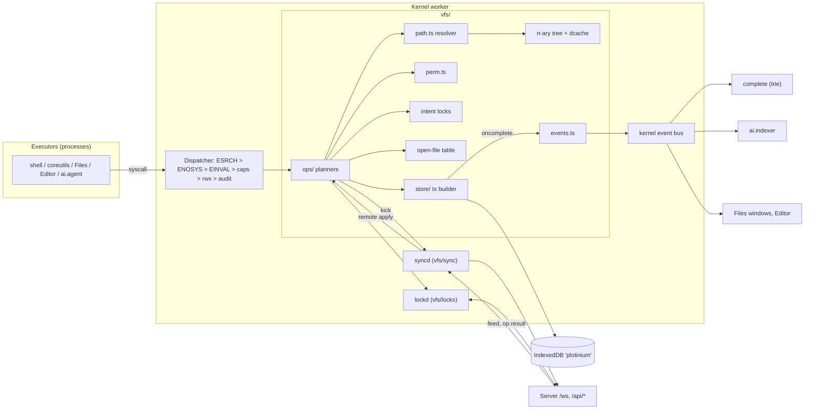
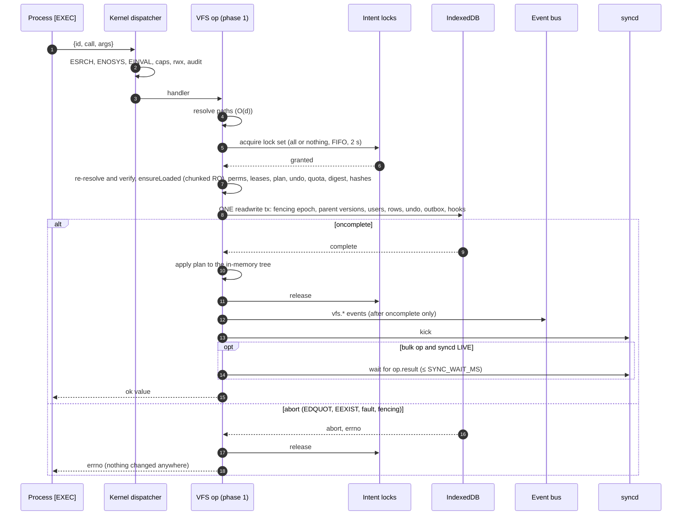
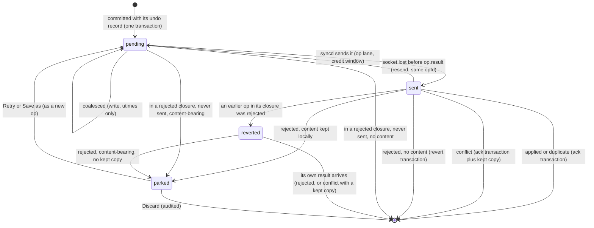
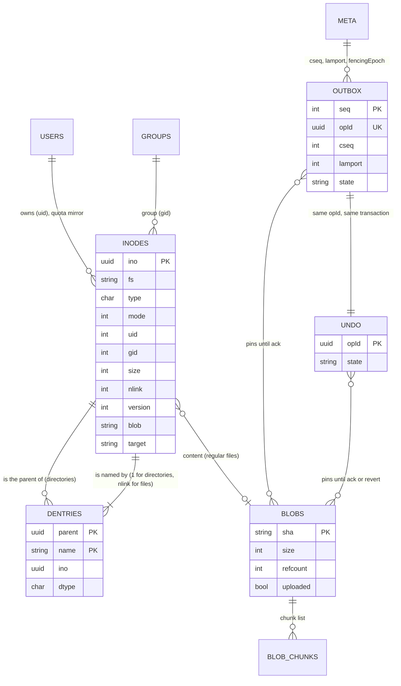

# Plotinium virtual file system

| Field | Value |
|---|---|
| Title | Plotinium VFS: inode tree, path resolution, permissions, links, quotas, open files, bulk operations, the client store, conflicts, locks, events and fsck |
| Status | Draft v0.1, 2026-09-24 |
| Primary owner | R2 VFS/DB (`vfs/` tree, path, perm, quota, oft, ops, store, mkfs, fsck, fault; the file coreutils) |
| Secondary reviewer | R1 Kernel (syscall, scheduler and memory integration). The client-side sync and lock code in `vfs/sync` and `vfs/locks` (§3.14–§3.16) has R5 as primary and R2 as reviewer (C15) |
| Must be demonstrable at | **P2 gate (W7, v0.2.0):** VFS-01 … VFS-08 live: `ls -la /`, the permission matrix, the quota test, `ln -s a b; ln -s b a; cat a` → ELOOP, 32-level nesting, CRUD from the Terminal and the File Explorer, trie fed by VFS events (SYS-03). **P3 gate (W11, v0.3.0):** VFS-09, VFS-10, VFS-11; the client side of DB-02 (fault-injected `rm -r` rolls back on the client and the server); outbox coupling (OFF-02); conflicted copies and lost+found. **P4 gate (W14, v0.4.0):** `batch` for the agent (AGT-03/05/08 support); the RAG event feed (RAG-02/03). **Final defence (W17–18, v1.0.0):** all of the above on the examiner's machine. |
| Requirement IDs covered | VFS-01 … VFS-11; DB-02 (§11.3 rule 5 client mirror, client fault hook), DB-03 (client side), DB-04 (client-side mirror of the constraints); OFF-01, OFF-02 (VFS side); SYS-01 (permission check on every call), SYS-02 (file-command semantics), SYS-03 (incremental trie feed); AGT-03, AGT-04, AGT-05, AGT-08 (VFS support for the agent); RAG-02, RAG-03 (event feed, current-permission helpers); MEM-08 (declared out of scope, §1.2). Plotinium design IDs PVFS-01 … PVFS-18 (§2.2) |
| Related specs | [../01-architecture/architecture.md](../01-architecture/architecture.md) · [../01-architecture/syscall-abi.md](../01-architecture/syscall-abi.md) · [../02-boot/boot-and-services.md](../02-boot/boot-and-services.md) · [../03-kernel/processes-and-scheduling.md](../03-kernel/processes-and-scheduling.md) · [../03-kernel/memory-and-paging.md](../03-kernel/memory-and-paging.md) · [../05-wm/window-manager.md](../05-wm/window-manager.md) · [../06-sync/offline-and-sync.md](../06-sync/offline-and-sync.md) · [../07-shell/shell-and-terminal.md](../07-shell/shell-and-terminal.md) · [../08-dsa/data-structures.md](../08-dsa/data-structures.md) · [../09-database/database.md](../09-database/database.md) · [../10-ai/rag-semantic-search.md](../10-ai/rag-semantic-search.md) · [../10-ai/agentic-shell.md](../10-ai/agentic-shell.md) · [../11-server/backend-api.md](../11-server/backend-api.md) · [../12-security/security-model.md](../12-security/security-model.md) · [../13-quality/testing-and-performance.md](../13-quality/testing-and-performance.md) · [../00-product/identity-and-branding.md](../00-product/identity-and-branding.md) · [../00-product/requirements-traceability.md](../00-product/requirements-traceability.md) · [../00-product/glossary.md](../00-product/glossary.md) |

**Conventions used in this file.** RFC 2119 keywords (MUST, SHOULD, MAY) are used as in the spec's Conventions section (p. 3). Every normative statement is tagged either **Spec** (a requirement of the capstone specification, with its section and ID, for example *Spec: MUST, §9.3, VFS-06*) or **Plotinium design** (our own binding choice, usually one of the canonical decisions C1–C18). Any number from the AI-run prototype is marked *(pilot figure — re-measure on the lab machine)*. "Kernel" means the single kernel worker (C2). "Node" means an in-memory inode object of the n-ary tree. "Op" means one user-visible mutation, which is one IndexedDB transaction and, for the synced file system, one outbox operation.

---

## 1. Purpose and scope

### 1.1 What this spec fixes

This is the normative source for the client-side virtual file system of Plotinium. It fixes:

- the inode and dentry model, as TypeScript types and IndexedDB records (§3.2, §4);
- the standard hierarchy, its owners and modes, the well-known inode UUIDs and the `mkfs` procedure (§3.3);
- the path-resolution algorithm, in full pseudocode (§3.5, §5.1);
- the permission function, the permission matrix per operation, umask, the sticky bit, `chmod` parsing and root-only `chown` (§3.6, §5.2, §5.4);
- soft links, hard links and `nlink` (§3.7);
- quotas enforced inside the same transaction, and the semantics of `df`, `du` and `quota` (§3.8);
- the limits (§3.4), the open-file table and fd semantics (§3.9);
- the precise semantics and errnos of every file-system system call (§3.10);
- the two-phase mutation discipline and every bulk operation (§3.11, §3.12);
- the IndexedDB schema: stores, keys, indexes and durability (§3.13);
- the undo record and its coupling with the outbox (§3.14);
- conflict detection by version, conflicted-copy naming and notification (§3.15);
- local advisory locks versus server leases, from the VFS side (§3.16);
- remote-change application, mirroring, `tmpfs` and kernel-synthesised files (§3.17);
- the `vfs.*` events on the kernel bus and the incremental trie feed (§3.18, §3.19);
- the client-side fault-injection hook (§3.20);
- `fsck` invariants and repairs, and `lost+found` (§3.21);
- the test plan per requirement ID, including property tests (§8).

### 1.2 What this spec does not fix

| Topic | Owner spec |
|---|---|
| Syscall envelope, dispatcher order, capability table, the errno enumeration | [syscall-abi.md](../01-architecture/syscall-abi.md) |
| WebSocket protocol v1 frames, replay, credit window, per-owner feed, snapshot API, `syncd` state machine | [offline-and-sync.md](../06-sync/offline-and-sync.md) |
| PostgreSQL DDL, `vfsTxn`, the canonical lock order L0–L4, set-based bulk SQL, the server fault trigger, Q1–Q5 | [database.md](../09-database/database.md) |
| Server routes, the lock manager and its sweeper, the blob store | [backend-api.md](../11-server/backend-api.md) |
| The trie itself, the tree, the LRU and the hash table (interfaces, tests, benchmarks) | [data-structures.md](../08-dsa/data-structures.md) |
| Shell syntax, command-line flags, output formatting, `man` pages, the `complete` service | [shell-and-terminal.md](../07-shell/shell-and-terminal.md) |
| Page tables, swap, memory accounting | [memory-and-paging.md](../03-kernel/memory-and-paging.md) |
| Accounts (uids, groups, guest, `su`), the offline verifier, the threat model | [security-model.md](../12-security/security-model.md) |
| Agent plan format, the confirmation predicate, the confirm token | [agentic-shell.md](../10-ai/agentic-shell.md) |
| Client index stores `ai_*` and the readable bitset | [rag-semantic-search.md](../10-ai/rag-semantic-search.md) |

Where this file summarises one of those, the owner spec wins on detail. This file wins on VFS semantics: what a call means, which errno it returns, and what a transaction contains.

**Out of scope.** MEM-08 (`sys.mmap`, a *May*) is not specified here; if the P3 gate is green by Week 10, [memory-and-paging.md](../03-kernel/memory-and-paging.md) adds it on top of §3.9. Mount points other than `/tmp` (`/mnt` is a *May*) are not implemented in v1: `/mnt` exists as an empty directory.

---

## 2. Requirements table

### 2.1 Spec requirements

| ID | Summary | Spec § | How verified (tests in §8) |
|---|---|---|---|
| VFS-01 | Spec: MUST. The VFS is our own n-ary tree of inodes, with hash-mapped directory entries and O(depth) path resolution | §9.3 p27, p29; §10.1 | Code review; DSA.md entry; `VFS-01` unit and bench tests (§8.1) |
| VFS-02 | Spec: MUST. The standard hierarchy is created at first boot with the specified owners and modes | §9.3 p28 | `ls -la /`; `VFS-02` mkfs tests including client/server id agreement |
| VFS-03 | Spec: MUST. Path resolution handles absolute and relative paths, `.`, `..`, repeated and trailing slashes, and symlinks, with ELOOP after 40 hops | §9.3 p28, p29; App. A | Path-resolution suite `VFS-03 *` |
| VFS-04 | Spec: MUST. rwx enforced for owner, group and others on every system call | §9.3 p28, p29 | Permission-matrix test (3 users × modes × operations), run against the kernel and the server |
| VFS-05 | Spec: MUST. Soft links can be created, read, followed and left dangling; `lstat` and `stat` differ correctly | §9.3 p28, p29 | `VFS-05 *` unit tests |
| VFS-06 | Spec: MUST. Per-user hard quotas: EDQUOT with no partial write; `df`, `du` and `quota` are accurate | §9.3 p29; App. A | Quota test `VFS-06 *`; P2 gate step 6 |
| VFS-07 | Spec: MUST. CRUD plus `cp -r`, `mv`, `rm -r`, `find`, `stat`, `chmod`, `chown`, `ln -s` and `tree`, from the terminal and the File Explorer, both on system calls | §9.3 p29 | Live demonstration; e2e `VFS-07 *` |
| VFS-08 | Spec: MUST. At least 32 levels of nesting; names up to 255 bytes; paths up to 4096 bytes | §9.3 p29; App. A | Boundary tests `VFS-08 *` |
| VFS-09 | Spec: MUST. Lease-based distributed locks: a second writer gets EBUSY or read-only access; a crashed holder's lock expires within the lease time | §9.3 p29; App. A | Two browsers, two users; `VFS-09 *` integration tests |
| VFS-10 | Spec: MUST. Concurrent changes detected by version numbers; conflicted copies kept; no update ever silently lost | §9.3 p29, p30 | Concurrency test `VFS-10 *` |
| VFS-11 | Spec: SHOULD. `fsck` checks the tree's invariants and reports or repairs problems | §9.3 p30 | Recovery-mode demonstration; `VFS-11 *`; property tests |
| DB-02 (client) | Spec: MUST. Every bulk VFS operation is atomic; the fault-injection suite passes with zero orphans and unchanged checksums. Rule 5: the client mirror is one IndexedDB transaction across every affected store | §11.3 rules 1–5; §11.5 | `DB-02 client *` fault tests in real Chrome, disk-backed |
| DB-03 (client) | Spec: MUST. Concurrent overlapping moves leave a consistent tree | §11.5 | `DB-03 client *` concurrency property test |
| DB-04 (client mirror) | Spec: MUST (server). Unique (parent, name) and type/mode checks; the client mirrors them in the store layer | §11.5 | `DB-04 client *` |
| OFF-01, OFF-02 | Spec: MUST. Core utilities work offline; changes are queued in a durable outbox and replayed exactly once | §9.5 | `OFF-02 *` (coupling side, here); replay tests in [offline-and-sync.md](../06-sync/offline-and-sync.md) |
| SYS-01 | Spec: MUST. The kernel checks permissions for every call | §9.6 | Every syscall row of §3.10 names its check; bypass suite in [syscall-abi.md](../01-architecture/syscall-abi.md) |
| SYS-02 | Spec: MUST. The Files command group | §9.6 | Scripted terminal session; command → syscall map §3.22 |
| SYS-03 | Spec: MUST. The trie is updated incrementally as the VFS changes | §9.6 | `SYS-03 trie follows vfs events *` (§8) |
| AGT-03/04/05/08 | Spec: MUST. Confirmation for destructive plans; no `/system` or `/bin` changes unless root and confirmed; atomic multi-step plans; every agent syscall audited | §12.3 | `batch` tests here; agent suites in [agentic-shell.md](../10-ai/agentic-shell.md) |
| RAG-02/03 | Spec: MUST. The index follows VFS changes within 30 s; no result leaks content the user cannot read | §12.2 | Event-contract tests here; RAG suites elsewhere |

### 2.2 Plotinium design requirements

| ID | Summary | Source | How verified |
|---|---|---|---|
| PVFS-01 | One IndexedDB database `plotinium` per device (not per uid); the kernel enforces rwx; the schema and durability of §3.13 | C4 | `PVFS-01 *` store tests |
| PVFS-02 | Fixed well-known UUIDs (UUIDv7-shaped) for system directories, synthesised files and seeded files, shared by client `mkfs` and the server seed; `/home/<user>` created only on the server | C5; critic | `VFS-02 client mkfs and server seed agree on ino for every system path` |
| PVFS-03 | Two-phase mutation: plan outside the transaction under in-kernel intent locks; one synchronous builder; in-memory tree, trie and events updated only after `oncomplete`; fencing epoch checked in every readwrite transaction | C4; client amendment | `PVFS-03 *` |
| PVFS-04 | Undo record and outbox op written in the same transaction as the change; ack and revert are each one transaction | C4; §11.3 rule 5 | `OFF-02 *` coupling tests (§8.2) |
| PVFS-05 | Online, bulk ops and agent batches wait for the server's `op.result` (up to `SYNC_WAIT_MS`), so a server fault prints EIO synchronously | C6; critic | `PVFS-05 *`, `DB-02 server fault surfaces EIO synchronously` |
| PVFS-06 | Conflicted-copy naming, `~/lost+found`, parked outbox ops; content is never discarded | C6; transport amendment | `VFS-10 *` |
| PVFS-07 | The `vfs.*` event contract of §3.18, published only after `oncomplete`, filtered by r/x | research `strategy/syscall_protocol.md` (event bus) | `RAG-02 *`, `RAG-03 *`, `SYS-03 *` event tests (§8.2) |
| PVFS-08 | Client fault hook: abort from the `onsuccess` of the Nth inode-row write | C7; client amendment | `DB-02 client *` |
| PVFS-09 | Kernel-synthesised read-only files (`/system/release`, `/system/log/*.log`) | identity spec request | `PVFS-09 *` |
| PVFS-10 | `/tmp` is a device-local `tmpfs`, cleared at boot, never synced; rename or link across it gives EXDEV | Plotinium design (§3.3.4) | `PVFS-10 *` |
| PVFS-11 | Open-file table with close-to-open write sessions; a failed session leaves no partial data | Plotinium design (§3.9) | `PVFS-11 *`, `VFS-06 *` |
| PVFS-12 | Names normalised to NFC at the syscall boundary; byte limits measured in UTF-8 after NFC; listings sorted by code point | C7 (`pg_c_utf8`, NFC CHECK) | `PVFS-12 *` |
| PVFS-13 | Local advisory locks (`navigator.locks`, `plotinium:vfs:<ino>`) when degraded; server leases are the truth when online | C6 | `VFS-09 *` |
| PVFS-14 | Every read-only scan is chunked to at most 500 keys per transaction and yields | client amendment | `PVFS-14 mkdir p95 stays in budget during a 10k-entry scan` |
| PVFS-15 | `fsck` invariants I1–I14, repairs, `/lost+found` | VFS-11 | `VFS-11 *` |
| PVFS-16 | `vfs/perm.ts`, `vfs/path.ts`, `vfs/modeparse.ts`, `vfs/names.ts` and `vfs/digest.ts` are isomorphic and imported unchanged by the server | C9 | `VFS-04 perm truth table is identical on kernel and server` |
| PVFS-17 | A directory cache bounded by `dsa/lru` (dcache); pins for open files, cwds, watches and in-flight plans | §10.1 LRU row ("inode cache") | `PVFS-17 *` |
| PVFS-18 | Mirroring states per directory; offline, an unmirrored directory answers EAGAIN, never a false ENOENT | Plotinium design (§3.17) | `PVFS-18 *` |

---

## 3. Design (normative)

### 3.1 Placement and package layout

- **Spec: MUST, §9.3, VFS-01.** The VFS is a UNIX-like hierarchy built as an n-ary tree of inodes. Each directory stores its entries in a hash map from name to inode, so a child lookup is O(1) and resolving a path of depth *d* is O(d).
- **Spec: MUST, §8 boundary 1, SYS-01.** No application, including built-in ones, touches storage. Every VFS operation is a system call.
- **Plotinium design (C2).** The whole VFS runs inside the kernel worker. The main thread never opens IndexedDB (C4); executors reach the VFS only through syscalls; the Service Worker never touches IndexedDB.
- **Plotinium design (C9, PVFS-16).** `vfs/path.ts`, `vfs/perm.ts`, `vfs/modeparse.ts`, `vfs/names.ts` and `vfs/digest.ts` are **isomorphic**: pure TypeScript with no DOM, no Node API and no IndexedDB. The server imports them unchanged, so the kernel and the server compute permissions, names, modes, digests and checksums identically.
- **Plotinium design (C16).** The n-ary tree helpers come from `dsa/tree` and the directory cache from `dsa/lru`, both written by the team. Directory entry maps use the built-in `Map` as the hashing primitive, which §10.2 allows.

```text
vfs/                               owner R2 (reviewer R1), except sync/ and locks/ (R5, reviewer R2)
├── path.ts        isomorphic      resolver over a NodeSource interface (§5.1)
├── perm.ts        isomorphic      may(), per-operation checks (§5.2)
├── modeparse.ts   isomorphic      chmod octal and symbolic parser/evaluator (§5.4)
├── names.ts       isomorphic      NFC, byte limits, conflicted-copy names (§5.5)
├── digest.ts      isomorphic      subtree digest and tree checksum lines (§5.6)
├── tree/          Node, mount table, dcache (dsa/lru), synthesised files
├── intent/        in-kernel intent locks (§5.7)
├── quota/         quota projection, statfs
├── oft/           open-file table, per-process fd tables, write sessions (§3.9)
├── ops/           one module per syscall; plan.ts, batch.ts, copy.ts, undo.ts, remote.ts
├── store/         Store interface; IdbStore (tx builder); MemStore (unit tests only); schema.ts; migrations/
├── events.ts      vfs.* topics (§3.18)
├── mkfs.ts        well-known tree and seed (§3.3)
├── fsck.ts        invariants and repairs (§3.21)
├── fault.ts       client fault hook (§3.20)
├── sync/          syncd client (spec: offline-and-sync.md)
└── locks/         lockd client (§3.16; spec: offline-and-sync.md)
```



### 3.2 The inode and dentry model

**Spec (§9.3 p28).** Each inode stores `ino`, `type` (file, directory or symlink), `mode` (nine permission bits plus the sticky bit), `uid` and `gid`, `size`, `nlink`, `atime`, `mtime` and `ctime`, `blob` (a reference to the content, for example a content hash), `target` (the symlink target path) and `version` (a counter for optimistic concurrency).

**Plotinium mapping.** The TypeScript types are in §4.1 and §4.2.

| Spec field | Plotinium field | Rule |
|---|---|---|
| `ino` | `ino: Uuid` | **C5.** Every inode id is a UUIDv7, generated by the client (a roughly 15-line generator: 48-bit ms timestamp + `crypto.getRandomValues`) or by the server (PG18 `uuidv7()`). Well-known ids are fixed (§3.3.2). `ls -i` shows the first 12 hex digits. The kernel maps UUIDs to dense slots where a typed-array structure needs them. |
| `type` | `type: 'f' \| 'd' \| 'l'` | Same letters as the server CHECK (C7). |
| `mode` | `mode: number` | Stored in 12 bits (the server CHECK allows 0–4095, C7). Plotinium uses only `0o1777`: the nine rwx bits and the sticky bit `0o1000`. Setuid and setgid (`0o6000`) are not supported: `chmod` rejects them with EINVAL. A symlink's mode is always `0o777` and is never checked. |
| `uid`, `gid` | `uid: number`, `gid: number` | Owner and group. Root is uid 0, group `root` gid 0; the default user group is `users` gid 100 ([security-model.md](../12-security/security-model.md) owns the account list). |
| `size` | `size: number` | Regular file: content length in bytes. Symlink: UTF-8 byte length of `target`. Directory: 0. |
| `nlink` | `nlink: number` | Regular file and symlink: number of dentries that point to the inode. Directory: 2 + number of child directories (the UNIX convention: its own entry, its `.`, and each child's `..`). The root directory counts its own `..`, so it follows the same formula. |
| `atime`, `mtime`, `ctime` | ms since the Unix epoch | `mtime`: content change (files) or entry-set change (directories). `ctime`: any change to the inode row, including a rename of the inode, `nlink` changes and `utimes`. `atime`: device-local, relatime semantics (§3.9.6), never synced. Plus `btime` (birth time, the server's `created_at`). |
| `blob` | `blob: Sha256Hex \| null` | SHA-256 of the whole content, for regular files; `null` for directories and symlinks. The bytes live in `blobs`/`blob_chunks` (§3.13.4). An empty file has the blob of zero bytes. |
| `target` | `target: string \| null` | Present if and only if `type === 'l'` (the server CHECK `(type='l') = (symlink_target IS NOT NULL)`, C7). |
| `version` | `version: number` | See the version rule below. |
| (none) | `fs: 'root' \| 'tmp'` | Client-only. Which file system the inode belongs to (§3.3.4). Server rows are always `root`. |
| (none) | `mir: 0 \| 1` | Client-only, directories only. Whether this directory's entry set is fully mirrored from the server (§3.17.2). |

**Version rule (Plotinium design, VFS-10).** A new inode has `version = 1`. Each committed op increments `version` by exactly 1 on an inode when, and only when, it changes one of:

1. the content of a regular file (write, truncate);
2. `mode`, `uid` or `gid`;
3. for a directory, its entry set (an entry created, removed, or renamed into or out of it).

Changes to `nlink`, `ctime`, `atime` and `mtime` alone (hard-link add or remove, a rename of the inode itself, `utimes`) do **not** bump `version`, so they never cause a false conflict. A symlink's `version` never changes after creation, because its target is immutable. Local version increments are provisional; the server's `op.result` returns the authoritative version, which the ack transaction stores (§3.14.3). [database.md](../09-database/database.md) MUST apply the same rule (cross-spec request X-DB-1).

**Dentries.** A dentry is `{parent, name, ino, dtype}`: an edge of the tree, stored apart from the inode, which makes hard links possible (Spec §11.1 dentries row). `(parent, name)` is unique (the IndexedDB primary key, §3.13). `dtype` equals the child inode's `type`. The root directory has no dentry; every other inode has at least one; a directory has exactly one.

**In-memory node.** The kernel holds a `Node` per loaded inode (§4.1). A directory node holds `children: Map<string, Node> | null` (`null` = not loaded) and `parent: Node` (unique for directories; the root's parent is itself). A file or symlink node does not store its parents; the dentry used to reach it travels with each operation, and the `by_ino` index finds all its links when needed (§3.13.2).

**Invariants** I1–I14 are listed in §5.12 and checked by `fsck` (§3.21).

### 3.3 Standard hierarchy, well-known ids and `mkfs`

#### 3.3.1 The hierarchy

**Spec: MUST, §9.3 p28, VFS-02.** The standard hierarchy is created at first boot with the correct owners and modes. `/root`, `/home`, `/system` and `/bin` are MUST, `/tmp` is SHOULD, `/mnt` is MAY. **Plotinium design:** we build all of them, plus the rows marked *Plotinium*.

| Path | Purpose | Owner | Mode | Spec level | Created by | Well-known ino (C5, PVFS-02) |
|---|---|---|---|---|---|---|
| `/` | root of the tree | root:root | `rwxr-xr-x` 0755 | MUST (implied) | client mkfs + server seed | `00000000-0000-7000-8000-000000000001` |
| `/bin` | built-in commands and app manifests (`/bin/<name>.json`, C17) | root:root | 0755 | MUST | both | `…-000000000002` |
| `/system` | configuration, services, branding, logs | root:root | 0755 | MUST | both | `…-000000000003` |
| `/system/services` | service manifests (spec §6.4), `*.json` | root:root | 0755 | MUST (in `/system`) | both | `…-000000000004` |
| `/system/log` | kernel log, audit log, boot log (synthesised files, §3.3.5) | root:root | 0755 | MUST (in `/system`) | both | `…-000000000005` |
| `/system/branding` | identity kit (spec §5.2) | root:root | 0755 | MUST (spec §5.2) | both | `…-000000000006` |
| `/root` | home of the superuser (uid 0) | root:root | `rwx------` 0700 | MUST | both | `…-000000000007` |
| `/home` | one home directory per user | root:root | 0755 | MUST | both | `…-000000000008` |
| `/home/<user>` | home of that user | `<user>:<primary group>` (spec example `student:users`) | 0700 | MUST | **server only**, when the user is created (C5) | server `uuidv7()` |
| `/tmp` | world-writable, sticky, cleared on boot; mount point of the device-local `tmpfs` (§3.3.4) | root:root | `rwxrwxrwt` 1777 | SHOULD | both (the directory; its contents are device-local) | `…-000000000009` |
| `/mnt` | optional mount points; empty in v1 | root:root | 0755 | MAY | both | `…-00000000000a` |
| `/usr`, `/usr/share`, `/usr/share/man` | man pages, seeded read-only (coherence gap fix "SYS: man") | root:root | 0755 | Plotinium | both | `…-00000000000b`, `…-00000000000c`, `…-00000000000d` |
| `/lost+found` | `fsck` reattaches orphans here (§3.21) | root:root | 0700 | Plotinium | both | `…-00000000000e` |
| `~/lost+found` | content from rejected or conflicting sync ops that could not stay next to the original (§3.15.4) | the user | 0700 | Plotinium | on demand (server, or client for local conflicts) | new UUIDv7 |

The `…` prefix is `00000000-0000-7000-8000-`. Seeded files and synthesised files are listed in §3.3.3 and §3.3.5.

Owners' groups: root is `root:root` (gid 0). `/home/<user>` uses the user's primary group (`users`, gid 100, for ordinary accounts). Guest accounts follow [security-model.md](../12-security/security-model.md): an online guest gets `/home/guest-XXXX` from the server; an offline guest (uid 65534) gets `/tmp/guest` (0700), which lives in `tmpfs` and disappears at the next boot.

#### 3.3.2 Well-known inode UUIDs

- **Plotinium design (C5, PVFS-02).** The fixed ids live in `protocol/src/wellknown.ts` (directories and synthesised files) and `protocol/wellknown/seed-ids.json` (seeded files). Both the client `mkfs` and the server seed import them; no other code may generate these ids.
- **Shape.** Each well-known id is a syntactically valid UUIDv7 with a 48-bit timestamp of 0: `00000000-0000-7000-8000-XXXXXXXXXXXX`. The version nibble is 7 and the variant bits are `10`. Real UUIDv7 ids carry the current time, so they can never collide with these, and well-known ids sort before every generated id. Ranges of the 12-hex-digit suffix:
  - `000000000001`–`0000000000ff`: directories (the table in §3.3.1);
  - `000000000100`–`0000000001ff`: synthesised files (§3.3.5);
  - `000000001000`–`00000000ffff`: seeded files, assigned by `tools/wellknown.ts` in `seed-ids.json`.
- **Append-only registry.** `seed-ids.json` maps a seeded path to its id and is append-only: CI fails if an existing entry's id changes or disappears, or if `mkfs` seeds a path that has no entry. A deleted seed file keeps its reserved id forever.

#### 3.3.3 Seeded files

`mkfs` and the server seed create the same seeded files, byte for byte, under the same ids:

| Path | Source in the repo | Owner, mode | Notes |
|---|---|---|---|
| `/bin/<name>.json` | `apps/coreutils/manifests/`, `apps/*/manifest.json` | root:root 0755 | One per program; `spawn` needs `x` on it; `requires` drives the app-dependency DAG (C17) |
| `/system/services/<name>.json` | `services/manifests/*.json` (18, C17) | root:root 0644 | Root may edit them (BOOT-04 cycle test) |
| `/system/branding/*` | `docs/identity/` | root:root 0644 | Identity kit ([identity-and-branding.md](../00-product/identity-and-branding.md)) |
| `/usr/share/man/<section>/` and `/usr/share/man/<section>/<name>.md` | `apps/coreutils/man/` | root:root 0755 (directories), 0644 (pages) | Rendered by `man` ([shell-and-terminal.md](../07-shell/shell-and-terminal.md)) |

Seeded directories and files have fixed registry ids but are **not** well-known directories: root may edit or remove them as on UNIX, and `fsck` does not require them (I9 covers only the §3.3.1 table).

The seed manifest `mkfs-seed.json`, generated at build time, lists for every seeded path: `{path, ino, type, mode, uid, gid, sha256, priorSha256[], size, seedVersion}`. `seedVersion` starts at 1 and increases by 1 whenever the file's bytes change between releases; `priorSha256` lists the hashes of every earlier seed version of that path (used by the seed-upgrade rule below). The seed bytes ship in a lazily imported chunk, `mkfs-seed.js`, loaded only when `mkfs` or a seed upgrade runs, so they never weigh on the boot path.

#### 3.3.4 Mounts: the synced root file system and `tmpfs`

- **Plotinium design (PVFS-10).** The client has two file systems:
  - `root` (`fs: 'root'`), mounted on `/`, mirrored from and synced to the server;
  - `tmp` (`fs: 'tmp'`), a device-local `tmpfs` mounted on `/tmp`.
- The `/tmp` directory inode itself belongs to `root` (well-known id, 1777, present on the server). Its children, and their descendants, belong to `tmp`.
- **Why.** Spec §9.3 says `/tmp` is "cleared on boot". In a multi-device system, clearing a synced `/tmp` on one device's boot would delete other devices' temporary files through sync. A per-device `tmpfs` gives the UNIX meaning: each machine's `/tmp` is its own and is cleared at its boot.
- `tmp` inodes are stored in the same `inodes` and `dentries` stores with `fs: 'tmp'`, never produce outbox or undo records, and use relaxed durability (they are volatile by definition).
- **Limits.** `TMPFS_MAX_BYTES` = 64 MiB and `TMPFS_MAX_INODES` = 4,096 per device, counted in `meta.tmpfsUsage`. They bind every uid, including root (a full `tmpfs` is full). Exceeding them gives EDQUOT with no partial data. `tmp` files do not count towards user quotas.
- **Cross-file-system operations.** `rename` and `link` between `root` and `tmp` fail with **EXDEV**. The `mv` command then falls back to copy plus delete, as on UNIX, and says that the move was not atomic ([shell-and-terminal.md](../07-shell/shell-and-terminal.md)).
- **Clearing at boot.** The `vfs` service ([boot-and-services.md](../02-boot/boot-and-services.md)) deletes every `fs: 'tmp'` inode and dentry through the `by_fs` index in one readwrite transaction (bounded by 4,096 inodes), releases their blob references, resets `meta.tmpfsUsage`, and only then reports ready.
- The sticky-bit demonstration therefore uses one device, switching user with `su` or logging out and in; two browser profiles each see their own `/tmp`.

#### 3.3.5 Kernel-synthesised read-only files

**Plotinium design (PVFS-09; requested by [identity-and-branding.md](../00-product/identity-and-branding.md)).** A synthesised file has a fixed well-known id, is owned by root:root, and its content is generated by the kernel when it is opened. It is never stored in IndexedDB, never synced, and never counted in quotas, digests or checksums.

| Path | Well-known ino | Mode | Content |
|---|---|---|---|
| `/system/release` | `…-000000000100` | 0444 | Build identity ([identity-and-branding.md §3.9](../00-product/identity-and-branding.md)) |
| `/system/log/boot.log` | `…-000000000101` | 0444 | The last boots from the `bootlog` store |
| `/system/log/kernel.log` | `…-000000000102` | 0444 | The kernel log ring buffer (what `dmesg` shows) |
| `/system/log/audit.log` | `…-000000000103` | 0400 | The local audit mirror (root only) |

Rules:
- The kernel inserts synthesised nodes into their parent's `children` map when that directory is loaded. `readdir` lists them with their fixed id.
- `open` generates a snapshot of the content; reads on that fd come from the snapshot. `stat` reports the size of a freshly generated snapshot, `mtime` = the time of that snapshot, `version` = 1, `nlink` = 1.
- **Every mutation fails with EPERM for every uid, root included:** `write`, `truncate`, `unlink`, `rename` (as source or target), `chmod`, `chown`, `utimes`, `link`. Creating a name that collides with one gives EEXIST. The normal read checks apply (`audit.log` is EACCES for non-root).
- A bulk op whose plan touches a synthesised file fails as a whole with EPERM (for example `rm -r /system/log` as root; `/system/log` is also well-known, see below).

**Well-known directories cannot be removed or renamed** by anyone (EBUSY, as for a mount point). Their contents obey the normal rules. Root may `chmod` or `chown` them; `fsck` reports a deviation from the mkfs owner or mode as a warning (I9), and `fsck --repair` resets it.

#### 3.3.6 `mkfs` procedure

`mkfs` runs inside the `vfs` service at first boot, when `meta.mkfsDone` is absent (a fresh device, or after "reset local cache"):

1. `import('./mkfs-seed.js')` (seed bytes and `mkfs-seed.json`).
2. Hash every seed file (`crypto.subtle.digest`) **before** the transaction and verify each hash against `mkfs-seed.json`. A mismatch is a critical `vfs` failure (a corrupt build).
3. Split the seed content into `blob_chunks` records (§3.13.4).
4. One `strict` readwrite transaction over `inodes, dentries, blobs, blob_chunks, users, groups, meta`:
   - `add` every well-known directory with its owner, mode, `version = 1`, `nlink` per §3.2, times = the build date from the build identity (so every device agrees);
   - `add` every seeded file with `version = seedVersion`;
   - `add` the dentries;
   - `put` the users `root` (uid 0, quota-exempt) and the groups `root` (0) and `users` (100);
   - set `meta.mkfsDone = true`, `meta.seedHash = sha256(mkfs-seed.json)` and `meta.deviceId` (a new UUIDv7). (`meta.schemaVersion` and `meta.fencingEpoch` were already written by the `storage` service.)
5. **No outbox op is written.** The server seed creates the identical rows, so `mkfs` is local-only. When the client first syncs, it compares the owner-0 tree with the server (§3.17) and adopts any newer server version (for example a manifest root edited on another device).

**Seed upgrade rule (a new release changes seed files).** When `meta.seedHash` differs from the running build's seed hash, the `vfs` service applies, local-only, for every seeded path: create it if missing; if the local `version` is below the new `seedVersion` and the local `blob` is in `priorSha256` (root has not edited it), replace the content and set `version = seedVersion`; otherwise leave it and log `seed: kept local edit of <path>`. The server seed applies the same rule at deploy. Because both sides compute the same result from the same inputs, they converge without sending ops; the feed's "apply only if newer" rule (§3.17.1) resolves the order in which they run.

**Test.** `VFS-02 client mkfs and server seed agree on ino for every system path` compares the client's well-known and seeded rows (ino, type, mode, uid, gid, size, nlink, version, blob) with the server's after `docker compose up`.

### 3.4 Names, paths and limits

**Spec: MUST, §9.3, VFS-08.** At least 32 levels of nesting; names up to 255 bytes; paths up to 4096 bytes; ENAMETOOLONG for a name over 255 bytes or a path over 4096 bytes.

**Name rules (Plotinium design, PVFS-12):**
- The kernel normalises every path string to Unicode NFC at the syscall boundary (`String.prototype.normalize('NFC')`), for lookups and for creation, before any length check. The server CHECK `name IS NFC NORMALIZED` (C7) then always holds, and an NFD spelling finds the NFC entry.
- A path containing a lone UTF-16 surrogate cannot be encoded as UTF-8 and is rejected with EINVAL.
- A name is any non-empty string with no `/` and no NUL (U+0000). `.` and `..` are resolver components, never stored names. Control, bidi and other invisible characters are allowed, as on UNIX; commands and views escape them on display, and the agent datamarks them ([agentic-shell.md](../10-ai/agentic-shell.md)).
- Names are case-sensitive.
- Listings (`readdir`, `ls`, `find`, `tree`) are sorted by Unicode code point, which equals UTF-8 byte order and the server's `pg_c_utf8` order (`LC_ALL=C ls`). IndexedDB compares strings by UTF-16 code unit, which differs for characters above U+FFFF, so the kernel sorts listings itself and never relies on the store's key order.

**Limits:**

| Limit | Value | Error | Source |
|---|---|---|---|
| `NAME_MAX` | 255 bytes (UTF-8, after NFC) | ENAMETOOLONG (on create and on lookup) | Spec VFS-08 |
| `PATH_MAX` | 4096 bytes: the whole input path string, UTF-8, after NFC | ENAMETOOLONG | Spec VFS-08 |
| Symlink target | 1–4096 bytes | ENAMETOOLONG (over 4096), ENOENT (empty, as on Linux) | Plotinium |
| `SYMLOOP_MAX` | 40 links followed per resolution; the 41st fails | ELOOP | Spec VFS-03 |
| Nesting depth | No separate limit; bounded by `PATH_MAX` (up to 2,048 levels with one-byte names). At least 32 levels is the tested floor | ENAMETOOLONG via `PATH_MAX` | Spec VFS-08 |
| Entries per directory | No limit (hash map); `readdir` pages at most 4,096 entries per call | — | Plotinium |
| `OPEN_MAX` per process | 256 fds | EMFILE | Plotinium |
| Open-file table | 4,096 entries per device | EMFILE | Plotinium |
| `read` length per call | 1 MiB (larger requests return at most 1 MiB) | — | Plotinium |
| Bulk op size (`BULK_MAX_NODES`) | 50,000 inodes in one plan | EINVAL, detail `too-large` | Plotinium |
| `batch` ops (`BATCH_MAX_OPS`) | 2,000 | EINVAL | Plotinium |
| `tmpfs` | 64 MiB, 4,096 inodes per device | EDQUOT | Plotinium (§3.3.4) |
| File size | Bounded only by the owner's quota and the device's storage | EDQUOT | Plotinium |

A spliced path (after following symlinks) may exceed 4096 bytes; it is bounded by 40 hops of targets that are each at most 4096 bytes.

### 3.5 Path resolution

**Spec: MUST, §9.3 p28, VFS-03.** 1) Start at `/` for an absolute path, or at the process's working directory for a relative one; split into components and ignore empty ones, so `//` is treated as `/`. 2) For each component, require execute (search) permission on the current directory; `.` stays in place, `..` moves to the parent (at `/` it stays at `/`). 3) Look up the child in the directory's hash map; if missing return ENOENT; if a later component follows and the child is not a directory, return ENOTDIR. 4) If the child is a symlink and it is not the last component, or the call follows links, resolve its target; relative targets resolve against the link's own directory; count the hops and return ELOOP after 40. 5) Return the final inode; operations that must not follow the last link (`lstat`, `unlink`, `readlink`) stop one step early.

**Plotinium design.** The full pseudocode is §5.1. Additional normative rules:

- **Tilde, variables and globs are shell features.** The kernel never expands `~`, `$HOME` or `*` ([shell-and-terminal.md](../07-shell/shell-and-terminal.md)).
- **Empty path.** `""` → ENOENT (as on Linux).
- **Trailing slash.** A path ending in `/` (after the first component) sets `mustBeDir`: the final component must resolve to a directory, and a final symlink is followed even for a no-follow call. So `rm file/` → ENOTDIR, `stat link-to-dir/` follows, and `mkdir newdir/` is allowed.
- **`..` is physical.** After a symlink to a directory, `..` goes to the target's real parent. Logical `cd -L` behaviour is the shell's.
- **x is checked for every component**, including `.` and `..`, on the directory being searched, and on the start directory for the first component of a relative path. Root passes every x check on directories (§3.6).
- **A deleted cwd.** If a process's working directory has been removed, relative resolution from it returns ENOENT and `getcwd` returns ENOENT.
- **Which calls follow the final symlink:**

| Follows the final link | Stops one step early (resolves the parent, keeps the final name) |
|---|---|
| `stat`, `open` (default), `readFile`, `writeFile`, `truncate`, `chdir`, `access`, `realpath`, `readdir`, `readdirPlus`, `chmod` (always; a symlink has no mode of its own), `chown` and `utimes` without `noFollow`, non-recursive `copy` source (GNU `cp` follows when not recursive) | `lstat`, `readlink`, `unlink`, `rmdir`, `rename` (both paths), `symlink` (link path), `link` (both paths), `mkdir`, `chown`/`utimes` with `noFollow`, recursive `copy` source (GNU `cp -r` is `-P`), `find` and `du` start paths (GNU default `-P`), `open` with `create` + `excl` (a final symlink counts as existing: EEXIST), `open` with `noFollow` (a final symlink gives ELOOP, as `O_NOFOLLOW` does) |

A trailing `/` overrides the right-hand column and forces the final link to be followed (for example `find link-to-dir/`).

- **Mutating calls on `.`, `..` or `/`.** A create whose final component is `.` or `..`, or whose path is `/`, fails with EEXIST (the name exists: `mkdir .`, `mkdir /`). A remove or rename whose final component is `.` or `..` fails with EINVAL (`rmdir .`, `rename a/.. b`; Linux gives ENOTEMPTY for `rmdir ..`, and we return EINVAL uniformly). Removing or renaming `/` fails with EBUSY.
- **Unmirrored directories (PVFS-18).** If a component lookup misses in a directory whose `mir` is 0: online, the kernel fetches that directory's listing from the server first (§3.17.2); offline, it returns **EAGAIN** (detail `not-mirrored-offline`), never a false ENOENT.
- **Complexity.** O(d) hash lookups plus O(h·d_t) for h symlink hops with targets of depth d_t, and one x check per component. A lookup in a loaded directory is O(1) on average; a directory that is not loaded costs one chunked read-only transaction the first time (§5.8).

### 3.6 Permissions

**Spec: MUST, §9.3 p28, VFS-04, SYS-01.** Read, write and execute for owner, group and others. On directories, *r* lists entries, *w* creates and removes entries, and *x* allows traversal. Root (uid 0) bypasses read and write checks. `chmod` accepts octal and symbolic modes, `chown` is root-only, and the default umask is `022`. The sticky bit on `/tmp` means only a file's owner can delete it. The kernel checks permissions for every call.

#### 3.6.1 The permission function

```ts
// vfs/perm.ts — isomorphic; the server imports this exact function (PVFS-16)
export const R = 4, W = 2, X = 1;
export function may(cred: Cred, n: PermSubject, want: number): boolean {
  if (cred.uid === 0) {
    // Root bypasses r and w. x is granted on directories, and on files only if SOME x bit is set.
    return (want & X) === 0 || n.type === 'd' || (n.mode & 0o111) !== 0;
  }
  const shift = cred.uid === n.uid ? 6 : cred.groups.includes(n.gid) ? 3 : 0;
  return (((n.mode >> shift) & 7) & want) === want;
}
```

- **The root x-bit rule (critic fix).** Root's bypass tests the x **bit** of `want` with `(want & 1) === 0`, not `want !== 1`. The old test granted `want = 5` (r+x) to root on a file with no x bits. The rule is exactly `(want & 1) === 0 || isDir || (mode & 0o111) !== 0`.
- **One class only.** If the caller owns the inode, only the owner bits apply, even when the group or other bits would grant more (UNIX semantics). `cred.groups` contains the primary gid and every supplementary gid.
- **Credentials come from the PCB** (`pcb.cred`, the effective credentials; a `su` shell has uid 0), never from syscall arguments (C3).

#### 3.6.2 Permission matrix per operation

"Anc x" means x on every directory traversed by resolution (§3.5), which applies to every row and is not repeated.

| Operation | Required (non-root) | Failure |
|---|---|---|
| `stat`, `lstat`, `readlink`, `realpath`, `access(F_OK)` | anc x only | EACCES |
| `open` read, `readFile` | r on the file | EACCES |
| `open` write or truncate, `writeFile` on an existing file, `truncate` | w on the file | EACCES |
| `open` read-write | r and w | EACCES |
| `spawn` of `/bin/x.json` (via [processes-and-scheduling.md](../03-kernel/processes-and-scheduling.md)) | x on the file (root: some x bit set) | EACCES |
| `readdir` | r on the directory | EACCES |
| `readdirPlus` (names plus stat) | r and x on the directory | EACCES |
| `chdir` | x on the directory | EACCES |
| Create (`open` + `create` of a new name, `mkdir`, `symlink`, `link`'s new name, `copy` destination, `writeFile` of a new name) | w and x on the parent | EACCES |
| `unlink`, `rmdir` | w and x on the parent; then the sticky rule | EACCES, then EPERM |
| `rename` | w and x on both parents; the sticky rule on the source parent, and on the target parent if an entry is replaced; w on the moved directory itself if its parent changes (it rewrites `..`) | EACCES, then EPERM |
| `unlink` recursive (`rm -r`) | w and x on the parent of the root; r, w and x on **every** directory in the subtree (r to enumerate, w and x to remove entries); the sticky rule at every level | EACCES / EPERM; nothing changed |
| `copy` recursive (`cp -r`) | r on every source file; r and x on every source directory; w and x on the destination parent | EACCES; nothing changed |
| `chmod` | caller owns the inode, or root | EPERM |
| `chmod` recursive | caller owns **every** inode in the subtree, or root; r and x on every directory to enumerate | EPERM / EACCES; nothing changed |
| `chown`, `chown` recursive (uid and/or gid) | root only (Spec) | EPERM |
| `utimes` to "now" | owner, or w on the file | EACCES |
| `utimes` to explicit times | owner or root | EPERM |
| `link` | w and x on the new parent; source is a regular file; caller owns it or has both r and w on it (Linux `protected_hardlinks`) | EACCES; EPERM |
| `lock.acquire` S / X | r / w on the file | EACCES |
| `find`, `du` | r and x on each directory descended into; an unreadable directory is reported in `errors[]` and skipped, and traversal continues (exit status 1 in the command) | per-directory |
| Any mutation of a synthesised file | not allowed for anyone, root included | EPERM |
| Remove or rename a well-known directory | not allowed for anyone | EBUSY |

**Check order.** The dispatcher performs the coarse rwx check it can do from the arguments (C3 order: ESRCH > ENOSYS > EINVAL > capability > rwx > audit > handler). The handler repeats every check of this table inside phase 1 of §3.11, under the intent locks, against the current tree. EACCES (missing rwx) is always tested before EPERM (ownership, sticky) for the same inode, as Linux does in `may_delete`.

**Sticky bit.** In a directory whose mode has `0o1000`, an entry may be unlinked, or renamed away, or replaced by a rename, only by the owner of the entry's inode, the owner of the directory, or root. Otherwise EPERM.

**umask.** Each PCB has `umask` (default `0o022`, inherited by children, set with the `umask` syscall). At creation: a regular file gets `requested & ~umask & 0o777` (requested defaults to `0o666`); a directory gets `(requested & ~umask & 0o777) | (requested & 0o1000)` (requested defaults to `0o777`; umask never clears the sticky bit); a symlink is always `0o777`. `copy` without preserve uses the source mode `& ~umask`.

**New inode ownership.** `uid` = the caller's effective uid; `gid` = the caller's effective primary gid (no setgid directories in v1).

**`chmod` modes.** Octal (1–4 digits) and symbolic modes, grammar and evaluation in §5.4. Bits `0o6000` (setuid, setgid) give EINVAL. Setting the sticky bit on a non-directory is allowed and has no effect (Linux behaviour).

**`chown`.** Root only (Spec). The new owner must exist in the `users` mirror or be confirmed by the server (else EINVAL). Changing owner moves the quota charge; if the new owner would exceed their quota, EDQUOT (§3.8). `chown` does not change the mode.

**AGT-04** (the agent cannot modify `/system` or `/bin` unless the user is root and confirms) is enforced by the agent's `fs.scope` capability in the dispatcher ([agentic-shell.md](../10-ai/agentic-shell.md)), in addition to this matrix.

### 3.7 Links

#### 3.7.1 Symbolic links (Spec: MUST, VFS-05)

- `symlink(target, linkPath)` stores `target` verbatim (after NFC), with no validation other than length (1–4096 bytes, else ENOENT for empty or ENAMETOOLONG for too long) and no NUL. The target may name nothing: a **dangling** link is legal. `mode` is `0o777`, `size` is the target's UTF-8 byte length (charged to quota), `nlink` is 1.
- `readlink` returns the stored target string (EINVAL if the path is not a symlink).
- `stat` follows (ENOENT for a dangling link, ELOOP for a loop); `lstat` returns the link itself. `ls -l` shows `lrwxrwxrwx` and `name -> target`.
- Relative targets resolve against the directory that contains the link (§3.5).
- `unlink` on a symlink removes the link, never its target. `rm -r` never follows symlinks into directories. `chmod` follows the link; `chown` follows unless `noFollow` (`chown -h`); `chown -R` changes a symlink's own owner without following it (GNU `-P`).
- A symlink's target is immutable; to change it, remove and re-create the link (`ln -sf` does both in one `batch`).

#### 3.7.2 Hard links (Spec: MAY; Plotinium design: implemented, `link` syscall)

- `link(existing, newPath)` adds a dentry to an existing **regular file** in the same file system. Directory or symlink sources → EPERM; across `root` and `tmp` → EXDEV; `newPath` existing → EEXIST.
- **Protected hard links.** A non-root caller must own the file, or have both r and w on it (EPERM otherwise). This stops a user pinning another user's quota by linking their file.
- `nlink` is maintained exactly (Spec: MUST, "nlink must be maintained correctly either way"): +1 on `link`, −1 on each `unlink` of one of its names. The inode's rows and its quota charge are released in the transaction that brings `nlink` to 0; an open file description keeps the content readable until it closes (§3.9.5).
- Quota is charged once per inode to its owner, whatever the link count.
- `rm -r` of a subtree removes the subtree's dentries; an inode also linked from outside the subtree survives with `nlink` reduced by the number of removed links (the server does the same, [database.md](../09-database/database.md)).
- `du` counts each inode once per invocation. The RAG readable set treats a hard-linked file as readable if at least one of its links is fully traversable ([rag-semantic-search.md](../10-ai/rag-semantic-search.md)).

### 3.8 Quotas, `df`, `du` and `quota`

**Spec: MUST, §9.3 p29, VFS-06.** Each user has a byte quota and an inode quota, enforced inside the same transaction as the write. A write that would exceed the quota fails with EDQUOT and leaves no partial data. `df`, `du` and `quota` report usage. Root is exempt. **Spec §11.3 rule 2:** quota is checked inside the transaction, so two concurrent writes cannot both pass.

**What is charged (Plotinium design; [database.md](../09-database/database.md) MUST match, cross-spec X-DB-2):**
- 1 inode for every inode (file, directory, symlink) of the `root` file system, charged to the inode's `uid`.
- Bytes: `size` of regular files and symlinks, charged once per inode to its `uid`. Directories charge 0 bytes.
- `tmp` inodes are not charged to users; they count against the device-wide `tmpfs` limits (§3.3.4).
- Synthesised files are never charged.

**Enforcement:**
1. **Phase 1 (fast fail).** The planner computes Δbytes and Δinodes per affected owner and compares them with the `users` mirror. If any non-root owner with Δ > 0 would exceed a limit, the call fails with EDQUOT before any transaction opens.
2. **Phase 2 (authoritative on the client).** The transaction reads each affected owner's `users` record, re-computes `used + Δ`, aborts with EDQUOT if a limit would be exceeded, and otherwise writes the new `used` values. IndexedDB serialises readwrite transactions whose scopes overlap, and every synced mutation includes `users`, so this is the client analogue of `SELECT … FOR UPDATE` (Spec §11.3 rule 2).
3. **Server (authoritative for the account).** The server repeats the check under the L1 `users` row locks with the `used <= quota` CHECK (C7) and may reject an op the client accepted (for example because another device used the quota meanwhile). The rejected content is kept (§3.15.4).
4. **Decreases never fail**, even if the user is already over a quota the server lowered.
5. **Root is exempt**: its `used_*` values are maintained but not checked.
6. **`chown`** moves the charge to the new owner and checks the new owner's limits.
7. **Device full.** A `QuotaExceededError` from IndexedDB aborts the whole transaction and is reported as EDQUOT (detail `device-full`), with no partial data.
8. **Write sessions.** A `write` that would push the projected file size past the owner's headroom fails with EDQUOT at once and poisons the session, so nothing from that session is ever committed (§3.9.3). This is what makes `cat big > f` leave no partial file.

**The `users` mirror.** The client's `users` record holds `{quotaBytes, quotaInodes}` from the server, `serverUsedBytes/serverUsedInodes` (the last values the server confirmed), and `usedBytes/usedInodes` = the server-confirmed values plus the deltas of this device's unacknowledged ops, maintained in every op transaction. Every `op.result` and every `quota` frame carries the server's authoritative `used_*`, which the ack transaction stores (§3.14.3). A device need not mirror every inode a user owns, so the local sum over stored inodes is only a lower bound (I6). Offline, `usedBytes` is the best knowledge.

**Commands (semantics; formatting in [shell-and-terminal.md](../07-shell/shell-and-terminal.md)):**

| Command | Syscall | Reports | "Accurate" means (VFS-06) |
|---|---|---|---|
| `quota [-u user]` | `statfs({quota: uid})` | the user's used and limit bytes and inodes, plus the source (`server` with its timestamp, or `local, offline`) | equals the server row `users.used_*` after sync, which equals Σ over the user's inodes on the server (I6) |
| `du [-s] [-a] [-h] path…` | `du` | apparent size in bytes (sum of `size`), each inode counted once per invocation; symlinks not followed; unreadable directories reported and skipped | equals the server's Q5 recursive sum for the same subtree |
| `df [-h] [-i]` | `statfs` | one line per file system: `/` (the device's storage: `navigator.storage.estimate()` usage and quota, plus `persisted`), and `/tmp` (the `tmpfs` limits and use); `-i` shows inodes (`/` has no inode limit, shown as `-`) | equals the browser's own `estimate()` and the `tmpfs` counters |

`estimate()` is available in workers, so the kernel calls it directly; `persist()` is Window-only and its result comes from the main-thread router at POST (C2).

### 3.9 The open-file table and file descriptors

**Spec §9.1 (PCB `fdTable`) and §10.1 (hash map for the open-file table).** Each process has a hash map from file descriptor to open-file handle.

#### 3.9.1 Structures

- **Per process:** `pcb.fdTable: Map<number, OftId>`. fds 0, 1 and 2 are set by `spawn` (TTY, pipes or files, [processes-and-scheduling.md](../03-kernel/processes-and-scheduling.md)).
- **Per device:** the open-file table (OFT), `Map<OftId, OpenFile>`, owned by R2 (§4.3). An entry holds `{ino, fs, flags, offset, refcount, snapshotBlob, versionAtOpen, expectedVersion, session, leaseId?, fence?, createdByOpen}`.
- `open` allocates the **lowest free fd** (POSIX). EMFILE if the process has 256 fds or the OFT has 4,096 entries.
- `dup`/`dup2` and pipes share an OFT entry by `refcount`, so they share the offset (POSIX). A child that inherits fds through `spawn` shares the parent's OFT entries.
- `close` decrements `refcount`; at 0 the entry is finalised (§3.9.3). `kill` closes every fd of the process ([processes-and-scheduling.md](../03-kernel/processes-and-scheduling.md) kill path, step 3), which finalises its sessions as a `close` would.

#### 3.9.2 Open flags

`open({path, flags})` where `flags` is `{read?, write?, create?, excl?, trunc?, append?, directory?, noFollow?, mode?, expectedVersion?}`:

| Flag | Meaning | Errors |
|---|---|---|
| `read`, `write` | access mode; at least one | EINVAL if neither |
| `create` | create the file if the name is free, with `mode & ~umask` | EACCES (parent w+x), EDQUOT |
| `excl` (with `create`) | fail if the name exists, including as a dangling symlink | EEXIST |
| `trunc` | the session starts empty (§3.9.3) | EACCES without w |
| `append` | every write goes to the end of the session's content | — |
| `directory` | the path must be a directory (used by `opendir`-style readers) | ENOTDIR |
| `noFollow` | a final symlink gives ELOOP | ELOOP |
| `expectedVersion` | the base version for conflict detection, instead of the version at open (the Editor passes the version it loaded) | — |

Opening a directory with `write` → EISDIR. `read` on a directory fd → EISDIR (use `readdir`). Opening a synthesised file for write → EPERM.

#### 3.9.3 Write sessions: close-to-open semantics (Plotinium design, PVFS-11)

Writes are buffered per open file description and committed atomically, as one op, at `close` or `fsync` (the AFS/NFS "close-to-open" model):

1. **Snapshot at open.** A read-only description reads the blob that was current at `open`. A commit by another description becomes visible to descriptions opened after that commit. Readers therefore never see a half-written file.
2. **Session.** The first `write`, `truncate(fd)` or a `trunc` flag starts a session: a copy-on-write overlay of 1 MiB chunks over the snapshot. Reads through the same description see the session (read-your-writes). Holes created by writing beyond the end are zero-filled.
3. **Staging.** Dirty chunks beyond `SESSION_MEM_MAX` (8 MiB) are sealed, hashed and written to `blob_chunks` in small relaxed transactions **before** the commit. They are content-addressed and unreferenced, so they are invisible, and GC removes them after 1 h if no commit references them (§3.13.4). This bounds kernel memory without breaking atomicity.
4. **Commit (`close` or `fsync`).** Phase 1 hashes the new content and computes the size delta. Phase 2 is one `strict` transaction: blob record, inode (`blob`, `size`, `mtime`, `ctime`, `version + 1`), `users`, undo, outbox op `write {ino, blob, size, mtime}` with `base {ino, version: expectedVersion ?? versionAtOpen}`. `fsync` then sets `versionAtOpen` to the new version and continues the session.
5. **Local conflict.** If the inode's committed version is no longer the base (another local description committed first), the commit does not overwrite: it creates a conflicted copy next to the file (§3.15), and `close` returns `ok` with `value.conflict = {keptAs}`. A version conflict is not an error ([syscall-abi.md](../01-architecture/syscall-abi.md) errno list).
6. **Poisoning.** If any `write` or `truncate` in the session fails (EDQUOT, EIO), the description is poisoned. Every later `write` returns the same errno; `close` discards the session and returns that errno; nothing from the session is committed. If this description also created the file (`createdByOpen`) and the file's version is still 1, `close` removes it in the same failure-handling transaction (and MAY drop the still-pending `create` op from the outbox instead of queuing a delete). So after a failed `cat big > f`, `f` does not exist, `du` shows nothing and `quota` is unchanged (P2 gate step 6).
7. **Deleted while open.** If the inode was unlinked while the session was open (and `nlink` is now 0), `close` does not lose the data: it creates the content as a conflicted copy in the original parent if it still exists and is writable, otherwise in `~/lost+found`, and returns `ok` with `value.conflict`.
8. **Create at open.** `open` with `create` of a new name commits the empty file at once (one op, `create`), so it is visible to other processes, `O_EXCL` works, and `ls` shows it while it is being written.

#### 3.9.4 Offsets

`lseek(fd, offset, whence: 'set' | 'cur' | 'end')` returns the new offset; a negative result → EINVAL; seeking past the end is allowed. `read` and `write` advance the shared offset; `append` descriptions write at the session's end whatever the offset. `pread`/`pwrite` take an explicit position and leave the offset alone.

#### 3.9.5 Descriptions that outlive their inode

An inode whose `nlink` drops to 0 while descriptions are open is removed from the store by the unlink transaction as usual: its rows are deleted and its quota charge is released there, so `fsck` never sees an orphan. The kernel keeps the in-memory node alive while descriptions refer to it, and adds the snapshot's blob to the in-memory `openBlobPins` set, which blob GC never collects (§3.13.4). Reads continue from the snapshot. When the last description closes, the pin is dropped; a pending session is handled by §3.9.3 rule 7.

#### 3.9.6 `atime`

Reads set `atime` on the in-memory node with relatime semantics: only if `atime < mtime` or `atime` is older than 24 h. Changed `atime` values are flushed in one relaxed transaction at most every 60 s and at shutdown. `atime` is device-local: it bumps nothing, produces no outbox op, and is excluded from checksums.

### 3.10 System calls: semantics and errnos

**Spec: MUST, §9.6.** Every application reaches the OS through typed system calls in the form `{id, call, args}` → `{id, ok, value | errno}`, and the kernel checks permissions for every call. The envelope, the dispatcher and the capability table are fixed in [syscall-abi.md](../01-architecture/syscall-abi.md) (C3). This section fixes what each **file-system** call means.

**Shared errno sets** (every call that takes a path can return them; they are not repeated below):
- **P (path):** EINVAL (schema failure, NUL byte, lone surrogate), ENAMETOOLONG, ENOENT, ENOTDIR, EACCES (x on a component), ELOOP, EAGAIN (unmirrored directory while offline, §3.17.2), EIO (store failure).
- **M (mutation):** EDQUOT (user quota, `tmpfs` limit, device full), EBUSY (a lease held by another session or process, an intent-lock wait over 2 s, a well-known directory, `/`), EPERM (synthesised file; read-only mount in recovery mode, detail `ro-mount`), EIO (store failure or injected fault; nothing changed), ECANCELED (the calling process was killed during phase 1; nothing changed).

Class: **fast** (answered from the in-memory tree, or one small transaction), **blocking** (the PCB goes BLOCKED: a blob fetch, a lock wait, a server wait), **bulk** (two-phase, §3.11; online, waits for the server's result, PVFS-05). "Op" names the outbox operation written (§4.4); "—" means none (reads, `tmpfs` changes).

| Call | Arguments (summary) | Final link | Permission (§3.6.2) | Result | Errnos beyond P/M | Class | Op |
|---|---|---|---|---|---|---|---|
| `open` | `path, flags{read, write, create, excl, trunc, append, directory, noFollow, mode, expectedVersion}` | follows unless `noFollow` or `create`+`excl` | per flags; create: w+x parent | `{fd}` | EEXIST (`excl`), EISDIR (write on a directory), ENOTDIR (`directory`), EMFILE, EBUSY (write while another session or local process holds S/X, §3.16.3) | fast | `create` if it creates |
| `read` | `fd, len ≤ 1 MiB, pos?` | — | fd opened for read | `ArrayBuffer` (transferred; empty at EOF) | EBADF, EISDIR, EAGAIN (content not cached, offline) | fast / blocking | — |
| `write` | `fd, data, pos?` | — | fd opened for write | `{written}` (buffered, §3.9.3) | EBADF, EDQUOT (poisons the session) | fast | — (at commit) |
| `fsync` | `fd` | — | fd opened for write | `{version, conflict?}` | EBADF, poisoned errno, M | fast | `write` |
| `close` | `fd` | — | — | `{version?, conflict?}` | EBADF, poisoned errno, M | fast | `write` if a session is open |
| `lseek` | `fd, offset, whence` | — | — | `{offset}` | EBADF, EINVAL (negative result) | fast | — |
| `truncate` | `path \| fd, size ≥ 0` | follows | w on the file | `{version, conflict?}` | EISDIR, EINVAL, EBADF | fast | `write` |
| `stat` / `lstat` | `path` | follows / no | anc x | `Stat` (§4.1) | — | fast | — |
| `fstat` | `fd` | — | — | `Stat` | EBADF | fast | — |
| `access` | `path, want ⊆ {r,w,x}` (empty = exists) | follows | anc x | `ok` | EACCES when `want` is not granted | fast | — |
| `readlink` | `path` | no | anc x | `string` | EINVAL (not a symlink) | fast | — |
| `realpath` | `path` | follows all | anc x | absolute canonical path | — | fast | — |
| `getcwd` | — | — | — | path | ENOENT (cwd removed) | fast | — |
| `chdir` | `path` | follows | x on the directory | `ok` | — | fast | — |
| `umask` | `mask?` (0–0o777) | — | — | previous mask | EINVAL | fast | — |
| `readdir` | `path, cursor?, limit ≤ 4096 (default 1024), dots?` | follows | r | `{entries:[{name, ino, type}], next?}` sorted by code point | — | fast / blocking (first load) | — |
| `readdirPlus` | as `readdir` | follows | r and x | entries with `Stat` | — | as above | — |
| `mkdir` | `path, mode?, parents?` | no | w+x parent | `{ino}` | EEXIST (final exists and is not a directory, or exists and `!parents`; also `.`, `..`, `/`), ENOTDIR (a middle component is a file) | fast | `create` (one op for all components) |
| `rmdir` | `path` | no | w+x parent; sticky | `ok` | ENOTEMPTY, EINVAL (`.`), EBUSY (well-known, `/`) | fast | `unlink` |
| `unlink` | `path, recursive?` | no | w+x parent; sticky; recursive: §3.12.1 | `{removed, bytes, opId, sync}` | EISDIR (directory without `recursive`), EBUSY (lease anywhere in the subtree; well-known) | fast; **bulk** if `recursive` | `unlink` |
| `rename` | `from, to, noReplace?` | no (both) | §3.12.4 | `{opId, sync}` | EXDEV, EINVAL (into own subtree, `.`/`..`), ENOTEMPTY, EISDIR, ENOTDIR, EEXIST (`noReplace`), EBUSY | **bulk** | `rename` |
| `symlink` | `target, path` | no | w+x parent | `{ino}` | EEXIST, ENOENT (empty target), ENAMETOOLONG (target > 4096 B) | fast | `create` |
| `link` | `existing, path` | no (both) | §3.7.2 | `{nlink}` | EEXIST, EPERM (not a regular file; protected), EXDEV | fast | `link` |
| `copy` | `src, dst, recursive?, noClobber?, preserve?` | §3.5 table | §3.12.3 | `{created, overwritten[], skipped[], opId, sync}` | EISDIR (directory without `recursive`), ENOTDIR, EINVAL (into own subtree) | fast; **bulk** if `recursive` | `copy` |
| `chmod` | `path, mode: number \| string, recursive?` | follows | owner or root | `{changed}` | EPERM (not owner), EINVAL (bad mode, `0o6000` bits) | fast; **bulk** if `recursive` | `chmod` |
| `chown` | `path, uid?, gid?, recursive?, noFollow?` | follows unless `noFollow` | root | `{changed}` | EPERM (not root), EINVAL (neither given; unknown uid/gid) | fast; **bulk** if `recursive` | `chown` |
| `utimes` | `path, atime?, mtime?, noFollow?` | follows unless `noFollow` | §3.6.2 | `ok` | EPERM (explicit times, not owner) | fast | `utimes` |
| `readFile` | `path, maxBytes? (default 16 MiB)` | follows | r | `ArrayBuffer` | EISDIR, EINVAL (larger than `maxBytes`), EAGAIN (not cached, offline) | fast / blocking | — |
| `writeFile` | `path, data, create?, excl?, append?, mode?, expectedVersion?` | follows | w (existing) or w+x parent (new) | `{ino, version, conflict?}` | EEXIST (`excl`), EISDIR | fast | `create` + content, or `write` |
| `statfs` | `path?, quota?: uid` | follows | anc x (quota of another uid: root) | `{filesystems:[…], quota?}` | EPERM (another uid's quota) | fast | — |
| `du` | `paths[], all?, maxDepth?` | no (start paths, §3.5) | r+x per directory | `{totals:[{path, bytes, inodes}], entries?, errors[]}` | — | blocking (chunked) | — |
| `find` | `paths[], pred{name, iname, type, mtime, size, user, maxDepth, minDepth}, limit ≤ 10,000, cursor?` | no (start paths) | r+x per directory | `{matches:[{path, ino, type}], errors[], next?}` | EINVAL (bad predicate) | blocking (chunked) | — |
| `batch` | `txnId, ops[] ≤ 2,000, expectedVersions?, dryRun?, confirmToken?` | per op | per op | `DryRun` or `{committed, opId, sync}` | the first failing op's errno with its `index`; EAGAIN (detail `stale-plan`) | **bulk** | `batch` |
| `lock.acquire` | `path \| fd, mode 'S'\|'X', wait?, timeoutMs?` | follows | r (S) / w (X) | `{leaseId, fence?, expiresAt?, scope:'server'\|'local'}` | EBUSY (denied, no wait), ETIMEDOUT, ECANCELED | blocking | — (control lane) |
| `lock.release` | `leaseId` or `path, force?` | follows | holder; `force`: file owner or root | `ok` | EPERM (`force` without right), EINVAL | fast | — |
| `lock.list` | `path?` | follows | anc x | holders with countdowns | — | blocking (one server query) | — |
| `lsof` | `path?, pid?` | follows | own processes; root sees all | `[{pid, user, fd, flags, path, ino, lease?}]` | — | fast | — |
| `fsck` | `path?, checksum?, repair?, deep?` | no | whole tree or `repair`: root; a subtree check: r+x on every directory of it | report (§3.21) | EPERM | blocking (chunked) | — (repairs are local-only, §3.21) |

**Notes that are part of the contract:**
- **`rename` onto an existing name** replaces it atomically (POSIX), subject to the matrix in §3.12.4. Renaming a name onto a link to the same inode is a successful no-op.
- **`mkdir` with `parents`** creates every missing component in one transaction and one op. An existing directory component is fine; a final component that exists as a directory is a successful no-op.
- **`unlink` of a directory without `recursive`** returns EISDIR (the spec's "file operation applied to a directory"). `rmdir` of a file returns ENOTDIR.
- **`copy` destination rule:** if `dst` is an existing directory, the target is `dst/<basename(src)>`; otherwise the target is `dst` and its parent must exist. Merge and overwrite rules are in §3.12.3.
- **`find` predicates** follow GNU semantics: `name`/`iname` are shell globs on the basename (§5.10); `type` ∈ {f, d, l}; `mtime: n` means ⌊age/24 h⌋ = n, `-n` means < n, `+n` means > n, with age measured from the kernel's `time.now`; `size: [+-]n[c|k|M|G]` rounds up to the unit as GNU does; `user` matches the owner name or uid. Output is pre-order, children sorted by code point.
- **`batch`** semantics are in §3.12.7.
- **`debug.inject`** (root, audited, one-shot) is defined in [syscall-abi.md](../01-architecture/syscall-abi.md); its VFS behaviour is §3.20.

### 3.11 Mutation discipline: two phases, intent locks, one transaction

**Spec: MUST, §11.3 rules 1, 3, 4, 5.** One transaction per user-visible operation; invariants checked before commit; any error rolls back and the client gets one clear error code; the client mirror is one IndexedDB transaction across every affected store, and a half-applied local state is never committed.

**Plotinium design (C4, PVFS-03).** Every mutating syscall, and every remote apply (§3.17.1), runs this pipeline:



**Phase 1: plan (pre-emptible).** It holds no readwrite transaction and yields to the kernel's event loop at least every 2 ms, so other syscalls keep being served.
1. Resolve every path argument (§5.1).
2. Compute the intent-lock set (§5.7) and acquire it all at once. Requests wait in FIFO order; a wait longer than `INTENT_WAIT_MS` = 2 s returns EBUSY (the client analogue of the server's `lock_timeout 2s` → EBUSY, C7).
3. Re-resolve under the locks. If a path now resolves to a different inode (the tree changed while waiting), release, and restart from step 1; after 3 restarts return EAGAIN.
4. For subtree ops, `ensureLoaded(subtree)` with chunked read-only transactions of at most 500 keys (§5.8, PVFS-14).
5. Check every permission of §3.6.2 over the whole plan, and every lease of §3.16 (a foreign lease anywhere in a subtree → EBUSY).
6. Build the plan: the exact list of store writes, the in-memory changes, the undo record (§3.14), the per-owner quota deltas (fast-fail EDQUOT, §3.8), new UUIDv7 ids, the subtree digest and content hashes (`crypto.subtle.digest`). **All hashing and every other promise-returning call happen here, never inside the transaction.**
7. Check `BULK_MAX_NODES`.

**Phase 2: one transaction (not pre-emptible).** `store.tx(scope, durability, build)` with a **synchronous** builder; the lint rule `no-await-in-idb-builder` fails the build on any `await` inside it (C4, C14). The builder issues, in this order:
1. `get(meta, 'fencingEpoch')`; its `onsuccess` aborts if the value differs from the kernel's epoch. The kernel then closes IndexedDB and shows "session moved to another tab" (C2). Errno EIO.
2. `get` of every parent directory inode the plan changes; `onsuccess` aborts if its version differs from the plan's. The kernel retries the whole syscall from phase 1 once, then returns EAGAIN. Under intent locks this should never fire; it is a guard against bugs and a belt against remote apply.
3. For the synced file system, `get`/check/`put` of every affected `users` record (quota, §3.8), then `get`/`put` of `meta.cseq` and `meta.lamport`.
4. The row writes: `add` for new dentries and inodes (a `ConstraintError` → EEXIST), `put` for changed rows, `delete` for removed rows, blob reference changes. Each inode-row write is a fault point (§3.20).
5. `put(undo, …)` and `add(outbox, …)` for the synced file system.
6. Registered transaction hooks (§4.6: the audit mirror, the `ai_*` stores), called synchronously with the transaction handle.

Durability is `strict` for any transaction that touches `outbox`, `users` or `credentials` (every synced mutation), and `relaxed` for `tmpfs` changes, the `atime` flush, remote apply and GC (C4).

**Phase 3: after `oncomplete`.**
1. Apply the plan to the in-memory tree (O(changes)); update the dcache; drop cached sorted listings of changed directories.
2. Release the intent locks.
3. Publish the `vfs.*` events (§3.18). Events are never published for a transaction that aborted.
4. `syncd.kick()`.
5. Reply. **Online synchronous confirmation (C6, PVFS-05):** for a **bulk** call (recursive `unlink`, `rename`, recursive `copy`, recursive `chmod`/`chown`, `batch`) while `syncd` is LIVE, the process stays BLOCKED (`waitingOn = net:op:<opId>`) until the server's `op.result`, up to `SYNC_WAIT_MS` = 10 s (defined in [offline-and-sync.md](../06-sync/offline-and-sync.md)). `applied` → `sync: 'applied'`; `rejected` → the revert of §3.14.4 runs first, then the call returns the server's errno (for example EIO for an injected fault); `conflict` → `ok` with `conflict`. Offline, or on timeout, the call returns `ok` with `sync: 'pending'`; a later rejection shows a notification and a line on the originating TTY if it is still open. Non-bulk calls return after the local commit with `sync: 'pending'`.

**Why this is safe.** The in-memory tree is only ever changed after a successful commit, so a fault at any point leaves memory, store and server unchanged (Spec §11.3 rules 4 and 5). Intent locks make the plan a function of a stable tree. The fencing check means a kernel whose Web Lock was stolen can never commit. A crash between `oncomplete` and phase 3 loses only events (at-most-once bus); the tree is rebuilt lazily from the store at the next boot, and durable consumers reconcile (§3.18).

**Failures.** A `QuotaExceededError` → EDQUOT (`device-full`). A `ConstraintError` → EEXIST. An abort we raised → our errno. Any other abort or `UnknownError` → retry once from phase 1, then EIO. The full mapping is §6.2.

### 3.12 Bulk operations

**Spec: MUST, §11.3.** Recursive delete, recursive copy, directory moves (especially to a new parent), batch renames (for example 500 files renamed by the agent), recursive `chmod` and `chown`, and the quota updates that go with them, must be atomic. **Spec §8.1 step 2:** the kernel checks write permission on the parent directory and on every descendant.

Every bulk op follows §3.11. The per-operation rules:

#### 3.12.1 `rm -r` (`unlink {recursive: true}`)

- **Resolve** the target without following a final symlink. A non-directory target is a plain unlink.
- **Locks:** T(target), E(parent).
- **Refuse** with EBUSY if the subtree contains a well-known directory of the §3.3.1 table (`rm -r /system` as root, `rm -r /`; seeded files may be removed by root), with EPERM if it contains a synthesised file, and with EBUSY if any inode in it holds another session's or process's lease.
- **Permissions:** w+x on the parent and the sticky rule there; r+w+x on every directory in the subtree and the sticky rule inside sticky directories (§3.6.2).
- **Plan:** a post-order list. For each removed dentry, count removals per inode. A directory inode is deleted. A file or symlink inode is deleted when its removed-link count equals its `nlink`; otherwise it survives with `nlink` reduced (a hard link outside the subtree). For each deleted file, the blob's inode reference moves to an undo pin (net refcount change 0, so no blob write). Quota: −bytes, −inodes per owner of deleted inodes. Parent: `version + 1`, `nlink − 1`, `mtime`, `ctime`. Digest: SHA-256 over the subtree's sorted `ino:version` pairs (§5.6).
- **Transaction:** the dentry deletes and inode deletes interleaved per node in post-order (dentry, then inode), so a fault at node N leaves a genuinely half-done transaction to roll back; surviving hard-linked inodes are `put`; the parent is `put`; undo; outbox `unlink {parent, name, ino, recursive: true}` with `base {root: ino, digest}`.
- **After commit:** detach the subtree at the parent's map (O(1)), purge the dcache entries, publish `vfs.unlink` with the removed `inos`, feed the trie (§3.19).
- **Server:** re-plans under L1/L3, recomputes the digest from its rows; a mismatch rejects the op with EAGAIN (`stale-base`) and no side effects; `file_chunks` rows go by `ON DELETE CASCADE` ([database.md](../09-database/database.md)).

#### 3.12.2 `mkdir -p`

All missing components in one transaction and one `create` op listing them in order; each parent's `nlink` and `version` are updated once per new child directory.

#### 3.12.3 `cp -r` (`copy {recursive: true}`)

- **Resolve** `src` without following (GNU `cp -r` is `-P`); apply the destination rule of §3.10. If the target lies inside the source subtree (`cp -r a a/b`) → EINVAL.
- **Locks:** T(src) (a stable source while planning; reads by others are unaffected), E(target parent), and T(target) when merging into an existing directory.
- **Permissions:** r on every source file, r+x on every source directory, w+x on the target parent (and on every existing directory merged into).
- **Plan (pre-order):** a new inode per source inode, with a new UUIDv7 generated in phase 1; same type; `mode = src.mode & ~umask` (`preserve`: the source mode and times; the source owner only for root); owner = the caller; `version = 1`; the same `blob` with its refcount +1 (no bytes copied: content addressing); symlinks copied as symlinks. Hard links inside the source are not preserved (GNU without `-a`). Merge rules at an existing target:

| Source | Existing target | Result |
|---|---|---|
| directory | directory | merge recursively |
| file or symlink | file | overwrite: the existing inode keeps its ino, takes the new blob and size, `version + 1` (listed in `overwritten[]`; with `noClobber`: skipped and listed in `skipped[]`) |
| file or symlink | directory | EISDIR, whole op fails |
| directory | file or symlink | ENOTDIR, whole op fails |

- **Quota:** +inodes and +bytes for the caller; for an overwrite, the size difference is charged to the overwritten inode's owner.
- **Transaction:** `add` of every inode and dentry, blob refcount +1 per new reference, overwritten inodes `put`, parents `put`, undo (created keys plus overwritten pre-images), outbox `copy {items}`. The items list the exact new inodes (`{newIno, srcIno, parentRef, name, type, mode, blob, target, size}`), so the server creates exactly what the client created and replay is deterministic. An envelope over 60 KB goes through `POST /api/ops/{opId}` (C6).
- **Server:** re-checks r on the sources at apply time (EACCES → reject), requires the blobs to be uploaded first, and resolves a top-level name collision with the conflicted-copy name (§3.15.3).

#### 3.12.4 `mv` (`rename`)

The POSIX `rename` matrix (the target is the entry at `to`):

| Source \ target | absent | file or symlink | empty directory | non-empty directory |
|---|---|---|---|---|
| file or symlink | move | replace (the old target loses one link) | EISDIR | EISDIR |
| directory | move | ENOTDIR | replace (the old directory is removed) | ENOTEMPTY |

- `noReplace` turns every "replace" into EEXIST.
- **Checks:** w+x on both parents; sticky rule on the source parent, and on the target parent when replacing; w on a moved directory whose parent changes; EINVAL if the destination parent is the moved directory or one of its descendants (walk from the destination parent up to `/`, O(depth)); EXDEV across `root` and `tmp`; EBUSY for well-known directories and `/`, and for a lease held by another session on the moved inode or the replaced one.
- **Locks:** E(source parent), E(target parent), N(moved inode), N(replaced file) or T(replaced empty directory) if any, and the global rename lock G when a **directory** moves to a **different parent**. G is the client analogue of the server's L2 advisory lock (C7) and of Linux's `s_vfs_rename_mutex`: without it, `mv /p/a /q/b/` and `mv /q/b /p/a/` have disjoint lock sets, both pass the ancestor check, and together create a cycle.
- **Transaction:** delete the old dentry key; delete the replaced dentry (and inode if its `nlink` reaches 0); `add` the new key; both parents `version + 1`, `mtime`, `ctime`; if a directory changed parent, old parent `nlink − 1` and new parent `nlink + 1`; the moved inode's `ctime` (not its version, §3.2); undo; outbox `rename {from, to, ino, replaced?}` with `base {from → ino, to → replaced ino or absent}`.
- `rename` is always a bulk call (it waits for the server online), because §11.3 and the DB-02 fault suite treat `mv` as a bulk operation.

#### 3.12.5 Batch rename

Batch renames (the agent's "500 files", or `mv a b c dir/`) use `batch` (§3.12.7) with `rename` ops. They are applied **sequentially** on an overlay, so `a→b, b→c` is legal and a swap needs a temporary name; any EEXIST, ENOTEMPTY or EINVAL on op *i* fails the whole batch with `{errno, index: i}`. One transaction, one `batch` op. Pilot: the server-side 500-file rename took 12 ms *(pilot figure — re-measure on the lab machine)*.

#### 3.12.6 `chmod -R` and `chown -R`

- **`chmod -R`:** T(root). Every inode in the subtree except symlinks. The caller must own every one (or be root): the first that fails gives EPERM and nothing changes. Each new mode is `evaluate(spec, oldMode, type)` from the isomorphic `modeparse.ts` (§5.4), so `X` and relative clauses are applied per inode. Each changed inode: `mode`, `ctime`, `version + 1`. Outbox `chmod {ino, spec, umask, recursive: true}` (the caller's umask travels with the op, because a symbolic spec without a *who* part depends on it) with `base {root, digest}`; the server re-evaluates with the same function under L3.
- **`chown -R`:** root only. Every inode including symlinks (their own owner). Quota: per old owner −Δ, per new owner +Δ, checked (EDQUOT). Outbox `chown {ino, uid?, gid?, recursive: true}` with the digest base.

#### 3.12.7 `batch` (agent plans and multi-step shell ops; AGT-03, AGT-05, AGT-08)

- **Ops allowed:** `mkdir`, `writeFile` (create or overwrite), `rename`, `unlink` (with `recursive`), `copy`, `chmod`, `chown` (root), `symlink`, `link`, `utimes`. Each is validated with exactly the rules and errnos of the standalone call.
- **Sequential semantics on a copy-on-write overlay.** Op *i* sees the effects of ops 0…i−1. The first failure fails the whole batch with `{errno, index}` and nothing runs (AGT-02).
- **Dry run (`dryRun: true`).** Returns `DryRun` (§4.3): creates, deletes, **overwrites** (a write, rename or copy onto an existing name), mode and owner changes, moves, the number of distinct inodes touched, the byte delta per owner, and the **fingerprint**: SHA-256 over the sorted `ino:version` of every inode the plan reads or changes. Overwrites are reported, never rejected, so the agent's confirmation predicate ([agentic-shell.md](../10-ai/agentic-shell.md), critic fix for AGT-03) can require confirmation for them.
- **Commit.** The kernel's confirmation predicate decides whether `confirmToken` is required; the VFS calls `confirm.verify(pid, planHash, dryRunHash, token)` (§4.6) and returns EPERM on failure. The VFS re-plans under the intent locks and compares the fingerprint with `expectedVersions`; a mismatch returns EAGAIN with detail `stale-plan` and changes nothing (the ABI has no ESTALE; the same convention as [architecture.md](../01-architecture/architecture.md)).
- **One transaction** over every affected store, including the audit rows (`actor 'agent'`, `promptId`, plan hash) through the audit hook (AGT-08), and **one** outbox op `batch {txnId, ops, fingerprint}` whose `opId = txnId`. Its undo record has `keepAfterAck = true` so that `ai undo <txn>` (AGT-10, a May) can build an inverse batch later.
- **Kill (AGT-09).** A kill during phase 1 returns ECANCELED with nothing written. Phase 2 is one IndexedDB transaction: it completes or aborts as a whole. A kill during the server wait sends `proc.signal`; the server cancels its transaction, the result is `rejected`, and §3.14.4 reverts the local change.

### 3.13 The IndexedDB store schema

**Plotinium design (C4, PVFS-01).** One database, `plotinium`, per device, not per uid; the kernel enforces rwx. The swap device's fallback database `plotinium-swap` belongs to [memory-and-paging.md](../03-kernel/memory-and-paging.md). Only the kernel worker opens either database.

#### 3.13.1 Stores

| Store | Key path | Indexes | Value (§4.2) | Written by | Durability |
|---|---|---|---|---|---|
| `inodes` | `ino` | `by_uid_mtime` `['uid','mtime']` (offline "recent files", the local analogue of Q4); `by_fs` `fs` (`tmpfs` clearing) | `InodeRec` | VFS | strict (synced fs); relaxed (`tmp`, `atime`, remote apply) |
| `dentries` | `['parent','name']` (the spec's unique `[parent, name]` index, §11.4) | `by_ino` `ino` (reverse lookup: hard links, fsck, lsof paths, ancestor chains) | `DentryRec` | VFS | as `inodes` |
| `blobs` | `sha` | `by_zero` `zeroSince` (sparse: only blobs with refcount 0) | `BlobRec` | VFS, GC | in the op's transaction |
| `blob_chunks` | `sha` (of the chunk) | — | `ChunkRec` | VFS (staging, mkfs, blob fetch), GC | relaxed (staging, fetch); strict (mkfs) |
| `users` | `uid` | `by_name` `username` (unique) | `UserRec` (quota mirror) | VFS, ack, login | strict |
| `groups` | `gid` | `by_name` `name` (unique) | `GroupRec` | login, sync | strict |
| `outbox` | `seq` (autoIncrement; replay order) | `by_op` `opId` (unique); `by_state` `state` | `OutboxRec` | VFS (add), syncd (state), ack | strict |
| `undo` | `opId` | `by_state` `state` | `UndoRec` | VFS, ack, revert | strict |
| `meta` | `k` | — | `{k, v}` (§4.2) | storage, VFS, syncd | strict inside op transactions |
| `os_sessions` | `osSessionId` | `by_uid` | owned by [window-manager.md](../05-wm/window-manager.md) | session | relaxed (autosave) |
| `credentials` | `username` | — | owned by [security-model.md](../12-security/security-model.md) | auth | strict |
| `telemetry` | `['uid','slot']` | — | owned by [predictive-prefetch.md](../10-ai/predictive-prefetch.md) | predictor | relaxed |
| `bootlog` | `bootId` | — | owned by [boot-and-services.md](../02-boot/boot-and-services.md) | svcmgr | relaxed |

The C4 list above is complete for the VFS. Other specs have asked for stores that are **not yet in C4** (cross-spec request X-ARC-1): `audit` (the local audit mirror for AGT-08 and security events; key `seq` autoIncrement; indexes `by_uid_ts ['uid','t']`, `by_prompt promptId`; strict; owned by [security-model.md](../12-security/security-model.md)), and `ai_files`, `ai_chunks`, `ai_vecseg`, `ai_lex` (owned by [rag-semantic-search.md](../10-ai/rag-semantic-search.md)). The VFS includes them in its transactions only through the hook seam of §4.6. They are created by the same migration chain in every build, including the litmus build (`__AI__=false`), where they stay empty.

#### 3.13.2 Keys, ranges and ordering

- A directory's entries are the key range `IDBKeyRange.bound([dir], [dir, []])`. It works because IndexedDB orders arrays element by element, a shorter prefix first, and any string before any array, so every `[dir, <name>]` lies between `[dir]` and `[dir, []]`.
- Dentries are created with `add`, never `put`, so a duplicate `[parent, name]` raises `ConstraintError` → EEXIST (DB-04 client mirror). A rename is `delete(old key)` plus `add(new key)` in one transaction.
- IndexedDB's string order (UTF-16 code units) is not the listing order; the kernel sorts by code point (§3.4).
- Every read-only scan (the trie build, `fsck`, `find`, `du`, indexer reconciliation, `ensureLoaded` of a large directory) runs as a sequence of read-only transactions of at most `SCAN_CHUNK` = 500 keys, continuing from the last key with an open lower bound and yielding between chunks (PVFS-14). The reason: Chrome makes a readwrite transaction wait for overlapping read-only ones, and a strict `mkdir` stalled 76–120 ms behind an 11k-row scan *(pilot figure — re-measure on the lab machine)*.

#### 3.13.3 Opening, versions and fencing

- The `storage` service opens `plotinium` with `version = the number of client migrations`. Each migration is a module `vfs/store/migrations/NNN_name.ts` with a synchronous `upgrade(db, tx)` that creates stores and indexes. Client "rollback" is the recovery flow: export the outbox to JSON, `deleteDatabase`, re-create, re-sync from the server, re-import the outbox ([boot-and-services.md](../02-boot/boot-and-services.md), BOOT-08). A `VersionError` (the stored version is newer than the code) is a critical `storage` failure that opens the recovery screen.
- On acquiring the Web Lock `plotinium:kernel`, `storage` bumps `meta.fencingEpoch` in a strict transaction (C2). Every readwrite transaction checks it first (§3.11). A `versionchange` event closes the connection.

#### 3.13.4 Content: blobs, chunks and garbage collection

- **`BlobRec`** `{sha, size, chunks: string[] | null, refcount, uploaded, zeroSince?}`. `sha` is the SHA-256 of the whole content. `chunks` lists the chunk hashes in order (`[]` for the empty blob; `null` when the bytes are not cached on this device). `uploaded` records that the server has the blob.
- **`ChunkRec`** `{sha, bytes: ArrayBuffer ≤ CHUNK_SIZE, t}`. `CHUNK_SIZE` = 1 MiB (tuned by the client-storage spike M1). Chunks are content-addressed, so identical chunks are stored once, and `read(fd, off, len)` loads only the chunks it needs.
- **Reference count.** `refcount` = the number of inodes (either file system) whose `blob` is `sha` + the number of pins held by undo records, outbox records (including parked ones) and staging. It changes inside the op's transaction. When it reaches 0, `zeroSince` is set.
- **GC.** A process `vfs.gc` at priority 39 (visible in `ps`) runs when idle: it deletes blobs with `refcount = 0` whose `zeroSince` is older than 10 min and that are not in the kernel's in-memory `openBlobPins`; then it sweeps (chunked) chunks that no blob references and whose `t` is older than 1 h (the staging grace, matching the server's 1 h rule for never-referenced blobs, C9).
- **Fetching.** A blob known only by metadata (`chunks: null`, from remote apply) is fetched on the first read: online, `GET /api/blobs/{sha}` streamed, verified against `sha`, stored as chunks in a relaxed transaction; offline, `read` and `readFile` return EAGAIN (detail `content-not-cached`). `syncd` prefetches, at idle priority, the blobs of the logged-in user's home when online, so OFF-01 works offline for the user's own files ([offline-and-sync.md](../06-sync/offline-and-sync.md)).
- **Upload.** Before an op that references a blob is sent, `syncd` uploads it (`PUT /api/blobs/{sha}`, idempotent, verified by the server) and sets `uploaded` (C9: blobs are uploaded before the server's DB transaction).
- **Integrity.** The server verifies every uploaded blob's hash. The client verifies fetched blobs, and `fsck --deep` re-hashes every local chunk and blob (§3.21).

### 3.14 Undo records and outbox coupling

**Spec: MUST, §9.5, OFF-02; §11.3 rules 4–6.** Each change is appended to an outbox with an idempotency key and a logical timestamp, replayed in order and exactly once; a rejected operation is reverted and the reason shown. **Plotinium design (C4, C6, PVFS-04).**

#### 3.14.1 The records

- **Outbox op** (`OutboxRec`, §4.2): `{seq, opId (UUIDv7, = server op_log.op_id), cseq, lamport, principal (uid), osSessionId, call, body, base, blobs[], touches[], state, attempts, lastError?, createdAt, awaitSync}`. `touches` lists every inode created, changed or deleted and every directory whose entries changed; it drives the revert cascade. The wire format is owned by [offline-and-sync.md](../06-sync/offline-and-sync.md).
- **Undo record** (`UndoRec`, §4.2): `{opId, state, pre: {inodes[], dentries[]}, created: {inodes[], dentries[]}, users: [{uid, dBytes, dInodes}], pins: sha[], keepAfterAck, summary}`: exactly what is needed to invert the op locally in one transaction.
- **Coupling (invariant I10).** Every outbox op in state `pending` or `sent` has exactly one undo record with the same `opId`, written in the same transaction as the change; and every undo record in state `open` has its outbox op. Neither exists for `tmpfs` changes.
- **cseq and Lamport.** Both are allocated in commit order and stored in `meta` in the same transaction; there is no hybrid logical clock (C6).

#### 3.14.2 Coalescing of content writes

When a `write` commits for inode I while the outbox holds a **`pending`** (not yet sent) `write` for I, and no later pending op touches I, the new commit **replaces that op's body** (blob, size, mtime) and keeps its original `base`; the undo record keeps the earlier pre-image, and the intermediate blob's pin is released. An offline editing session therefore reaches the server as one write with the version it started from, and produces at most one conflicted copy. `utimes` ops coalesce the same way. No other kind is coalesced.

#### 3.14.3 Ack (`op.result` = `applied` or `duplicate`)

One transaction ([offline-and-sync.md](../06-sync/offline-and-sync.md) runs it; the effect is fixed here):
- delete the outbox op, and delete the undo record (or set it to `committed` when `keepAfterAck`);
- store the server's authoritative `version`, `mtime` and `ctime` for every inode in `result.versions`;
- release the op's blob pins;
- store the server's `used_*` as `serverUsedBytes/serverUsedInodes` and recompute `usedBytes/usedInodes` = server values + the deltas of the remaining unacknowledged ops (§3.8, I6);
- record the result's `ownerSeqs` so the feed does not apply the op a second time; `meta.resume:<ownerUid>` advances only through contiguous sequence numbers, and a gap is filled by the feed (per-owner feed, C6; details in [offline-and-sync.md](../06-sync/offline-and-sync.md)).
No `vfs.*` event is published for an ack (nothing a user can see changed).

#### 3.14.4 Rejection and the revert cascade (`op.result` = `rejected`)

1. **Closure.** D = {k} plus every later op j (in `pending` or `sent`) whose `touches` intersect the `touches` of an op already in D, computed transitively in `seq` order. (Example: k = `mkdir /a` rejected; j = create `/a/f` depends on it.)
2. **Keep the content first.** Content-bearing ops are `write`, `create` with content, `copy` and `batch` with writes. For k: if its result carries `keptAs` (the server kept the bytes as a conflicted copy, usually in `~/lost+found`), the client creates that entry locally with its own blob (§3.15.4); otherwise a content-bearing k is **parked**: its outbox record moves to state `parked` (never replayed automatically) and keeps its blob pin. Every other content-bearing op in D that was never sent is parked the same way. Content is never discarded (VFS-10).
3. **One transaction** applies the undo records of D in reverse `seq` order (delete created rows, restore pre-images, reverse the `users` deltas, release pins other than those of parked records), deletes those undo records, deletes the outbox records of D that are neither parked nor already sent, and sets the already-sent ones (other than k) to `reverted`. When a `reverted` op's own result arrives: `rejected` deletes the record, or parks it if it is content-bearing and carries no `keptAs`; `conflict` with `keptAs` applies the copy; an unexpected `applied` schedules a server re-fetch of the touched inodes (the server is the authority, spec §8 boundary 3).
4. **After `oncomplete`:** re-attach restored nodes, detach created ones, publish the inverse events with `origin: 'revert'`, raise a notification that names the operation and the errno, and write a line on the originating TTY if it is still open. A process still BLOCKED on the op gets the errno (§3.11 phase 3). A revert is never silent.

Transient server errors (`error {retryable: true}`) are not rejections: the op stays `pending` and is retried.

**Parked ops** are listed by `sync status` and in Settings → Storage with their size and reason. The user can **Retry** (re-submitted as a new create in `~/lost+found` once quota allows), **Save as…** (a new `create` at a chosen path), or **Discard** (explicit and audited).

#### 3.14.5 Outbox op lifecycle



### 3.15 Conflicts: detection, conflicted copies, notification

**Spec: MUST, §9.3 p29, VFS-10.** Writes use optimistic concurrency: every write carries the inode version it expects to replace; a mismatch is a conflict; conflicts are never resolved by silently overwriting file content; the losing write is kept as a conflicted copy (*report (conflict from student, 2026-11-14).md*) and the user is notified. No update is ever silently lost.

#### 3.15.1 The base each op carries (Plotinium design)

The base is chosen so that every real conflict is detected and busy shared directories do not cause false ones:

| Op | Base | On mismatch |
|---|---|---|
| `write` (content, truncate) | the file's version at open (or `expectedVersion`) | **conflicted copy** of the writer's content; the original is untouched |
| `create`, `mkdir`, `symlink`, `link`, `copy` (top level) | the name is absent | the new inode is created under a conflicted-copy name (§3.15.3), never rejected |
| `unlink` of a file | the file's version | rejected, EAGAIN (`stale-base`): deleting a newer version would lose someone's update |
| `unlink {recursive}`, `chmod -R`, `chown -R` | the subtree digest (§5.6) | rejected, EAGAIN (`stale-base`), no side effects |
| `rename` | source entry → the same ino; target entry → the expected ino or absent | rejected, EAGAIN (`stale-base`) |
| `chmod`, `chown` (single) | the inode's version | rejected, EAGAIN (`stale-base`) |
| `utimes` | none | last writer wins (times are not user data) |
| `batch` | the fingerprint (§3.12.7) | rejected, EAGAIN (`stale-plan`) |
| any write to an inode under another session's X lease, or with a stale fence | the fence | EBUSY; the content is kept as a conflicted copy (the "zombie writer" rule) |

A parent directory's version is **not** part of any base: a concurrent create in the same directory is not a conflict.

#### 3.15.2 Where conflicts are detected

- **Locally, at commit.** A write session whose base version is no longer the committed version (another local process committed first) creates the conflicted copy in the same transaction instead of overwriting, and returns `ok` with `conflict` (§3.9.3). The date is the device's local date in the configured OS time zone.
- **On the server, at apply.** The server compares the base with its row under the canonical locks (C7 L4 compare-and-swap). For a content write it creates the conflicted copy in the same transaction and returns `op.result {status: 'conflict', keptAs}`. The date is the server commit date in `PLOTINIUM_TZ` (default `Asia/Karachi`).
- **Ino of the copy.** The client pre-generates `conflictIno` (a UUIDv7) in every content op, and the server uses it for the copy, so the client can create the copy locally with the blob it already has: no download is needed.

#### 3.15.3 Conflicted-copy names

`conflictName(name, username, date, n)` in `vfs/names.ts` (isomorphic; algorithm §5.5):
- Split the extension at the **last** `.` that is not the first character: `report.md` → `report` + `.md`; `archive.tar.gz` → `archive.tar` + `.gz`; `.bashrc` → `.bashrc` + `` (dotfile); `Makefile` → `Makefile` + ``.
- Result: `<stem> (conflict from <username>, <YYYY-MM-DD>)<ext>`; if that name exists, try ` 2`, ` 3`, … after the closing parenthesis: `report (conflict from alice, 2026-11-14) 2.md`.
- If the result would exceed 255 bytes, shorten the **stem** at a code-point boundary until it fits.
- `username` is the writer's (the principal of the losing write).

#### 3.15.4 Where kept content goes

1. Next to the original, in the same directory, if it exists and the writer has w+x on it.
2. Otherwise in the writer's `~/lost+found` (created on demand, 0700, owned by the writer), under the conflicted-copy name.
3. If the writer's quota cannot hold it, the op is **parked** on the device (§3.14.4): pinned, visible, recoverable.

In every case a `vfs.conflict` event is published with `{ino, path, keptAs: {ino, path}, by, source: 'local' | 'server'}`. The notification service shows, for example, *"report.md was changed by bob while you were offline. Your version was kept as 'report (conflict from alice, 2026-11-14).md'."*, and an open Editor shows a "reload / keep both" banner ([window-manager.md](../05-wm/window-manager.md)).

### 3.16 Locks: local advisory locks and server leases (VFS side)

**Spec: MUST, §9.3 p29, VFS-09.** The backend lock manager supports shared (read) and exclusive (write) locks; locks are leases with a time-to-live that the holder renews with heartbeats, so a crashed client cannot hold a lock forever; grants and releases are pushed over the WebSocket; a second writer gets EBUSY or read-only access; a crashed holder's lock expires within the lease time.

**Plotinium design (C6).** The server side (lock table, EXCLUDE constraint, sweeper, fences) is specified in [offline-and-sync.md](../06-sync/offline-and-sync.md), [backend-api.md](../11-server/backend-api.md) and [database.md](../09-database/database.md). The VFS side:

#### 3.16.1 Two layers

- **Local layer (always).** `lockd` keeps a per-device table `ino → {S: Set<pid>, X: pid | null, waiters: FIFO}` that arbitrates between local processes. A request conflicting with another local process waits (with `wait`) or fails with EBUSY.
- **Server layer (when `syncd` is LIVE).** The OS session holds at most one server lease per inode, shared by its local holders. The first local holder triggers `lock.acquire` on the control lane; an S → X upgrade needs a server X acquire; the last local holder's release releases the lease. Each grant carries `{leaseId, fence, expiresAt}`; the TTL is 30 s (15 s in the demo profile); the kernel worker heartbeats at TTL/3; every acknowledged op also renews the session's leases; pongs never renew (C6). At most 256 leases per session.
- **Degraded (offline, or `syncd` not LIVE).** Local locks use `navigator.locks.request('plotinium:vfs:<ino>', {mode: 'shared' | 'exclusive', ifAvailable: !wait, signal})`, so they are released automatically if the kernel dies. `lock.acquire` returns `scope: 'local'`. `lockd` shows DEGRADED in the taskbar (OFF-04).

#### 3.16.2 Semantics

| Situation | Result |
|---|---|
| X requested; another session or local process holds S or X | EBUSY (no `wait`); with `wait`, BLOCKED on `lock:<ino>` until granted, or ETIMEDOUT after `timeoutMs`; ECANCELED if the process is killed |
| S requested; another holds X | same as above |
| S requested; others hold only S | granted |
| The holder's process is killed | its local locks are dropped (kill path step 4, [processes-and-scheduling.md](../03-kernel/processes-and-scheduling.md)); the server lease is released if it was the last local holder |
| Clean shutdown (`bye`, close 1000/1001) | leases released at once |
| Crash (tab killed, network cut) | the lease expires at most TTL + 0.5 s after its last renewal; watchers are told |
| `lock.release {path, force: true}` by the file's owner or root | the server revokes the lease; the holder gets `lock.lost`; audited |
| Reconnect after degraded mode | `lockd` tries to acquire server leases for every local lock; a denial raises `lock.lost` for that holder (the Editor turns read-only); anything written offline is reconciled by versions (§3.15) |

#### 3.16.3 Enforcement on mutations

A mutation of inode I (content, metadata, `unlink` or `rename` of I, and any bulk op whose subtree contains I) by a process that does not hold X on I:
- fails with **EBUSY** if the kernel knows that another local process, or another session, holds S or X on I;
- is otherwise committed locally, and the server rejects it with EBUSY if a foreign lease exists there; the content is then kept as a conflicted copy (§3.15.1 last row).

To make the second writer's EBUSY synchronous online (VFS-09), `open` with `write` on a regular file of the synced file system calls `lockd.checkWritable(ino)`: it answers from the lease cache (kept current by `lock.*` pushes for watched inodes and by earlier answers, fresh for TTL/3); otherwise one `lock.list {ino}` query on the control lane, bounded by 2 s (on timeout the open proceeds and the server remains the final arbiter). A process that holds X attaches the lease's `fence` to its open-file entry, and every op it commits carries that fence; a stale fence is EBUSY at the server (C6).

`lsof` shows local holders (pid, fd) and server holders (`username@device`, mode, a countdown to expiry).

### 3.17 Remote changes, mirroring and the directory cache

**Spec §8 boundary 3.** The client runs offline from local state; the server is authoritative for multi-user data, locks and quotas.

#### 3.17.1 Remote apply

`syncd` hands the VFS the server's changes: per-owner feed items (`vfs.changed`), snapshot pages, and the authoritative results of our own ops ([offline-and-sync.md](../06-sync/offline-and-sync.md)). The VFS applies them with the discipline of §3.11 (intent locks, one transaction per feed batch, events after `oncomplete`), with no undo record and no outbox op, in a relaxed transaction that also advances `meta.resume:<ownerUid>` (re-applying after a crash is harmless because of the version rule below). Per item:

- **Skip** any item that touches an inode or an entry touched by a local op in state `pending`, `sent` or `reverted`. That op's own result will bring the server state (data flow 2, step 4).
- **Inode upsert:** apply if the inode is unknown locally and its parent directory is mirrored; if it is known, apply when the remote `version` is greater than the local one, or equal with a remote `ctime` not older than the local one (changes that do not bump `version`, such as `nlink` and times, §3.2); never apply a lower version (a stale item from a lagging feed). This needs a `ctime` that is monotonic per inode on the server (cross-spec X-DB-10). A new `blob` hash unknown locally is recorded as `BlobRec {chunks: null}` and fetched on first read (§3.13.4).
- **Entry add or remove:** apply only in mirrored directories.
- **Moved out of view:** if an entry is removed from a mirrored directory while the inode lives on elsewhere on the server (for example moved into a directory this device does not mirror), and no locally stored entry for it remains, the inode and its locally stored subtree are **forgotten**: their rows are removed from the local store in the same transaction, without undo or outbox (a cache eviction, not a delete), so no orphan is left (I1). Subscribers see a `vfs.rename` item whose `to` side is `null`.
- **Delete:** apply unless a local op touches the inode.
- **Quota:** a `quota` frame updates the `users` mirror.

Events are published with `origin: 'remote'`. A remote delete of a process's cwd marks it deleted (§3.5). A remote content change to a file open for write locally makes the local session's base stale, so its commit becomes a local conflicted copy (§3.15.2), which is the intended result.

**Affected owners** (used by the server's per-owner feed, C6): the owners, before and after the op, of every inode whose row changes, plus the owners of every directory whose entry set changes. The same op can therefore reach a device through several owners' feeds; applying it twice is harmless because of the rule above. [database.md](../09-database/database.md) and [offline-and-sync.md](../06-sync/offline-and-sync.md) use exactly this definition.

#### 3.17.2 Mirroring (PVFS-18)

- Each directory inode has a client-only flag `mir`: 1 when its complete entry set is in the local store.
- `mkfs` sets `mir = 1` on every well-known and seeded directory except `/home` (unknown until the first online login): their seed content is complete for an offline first boot. `tmp` directories are always complete.
- **At the first online login** the client pulls a snapshot of: the owner-0 system tree (compared with the `mkfs` rows, §3.3.6), the `/home` listing, and the whole metadata subtree of the user's home. Blobs are fetched lazily, and the user's own are prefetched at idle. The snapshot replaces the seed's assumption with the server's truth: every directory it lists gets `mir = 1`; every directory it cannot list for this user (for example `/root` for a non-root user) is set to `mir = 0`, so its content is fetched the first time a user who can list it asks while online.
- **`ensureMirrored(dir)`**: online, the kernel fetches the directory's entries (a depth-1 snapshot of that ino), applies them as remote changes, sets `mir = 1`, and adds the directory's owner to the resume set if new. Offline, any lookup miss or `readdir` in an unmirrored directory returns **EAGAIN** (detail `not-mirrored-offline`).
- **The resume set** is `{self, 0} ∪ {owners of mirrored directories}`, one `meta.resume:<ownerUid>` per owner: the client resumes each owner it mirrors (C6).
- The server's snapshot only returns what the user may see (r on the directory, x on its ancestors), so a device never mirrors a directory listing its user could not read online. Other users' data mirrored earlier on the same device stays protected by the kernel's rwx checks (C4); [security-model.md](../12-security/security-model.md) documents data at rest in the browser profile.

#### 3.17.3 The directory cache (PVFS-17)

- **Spec §10.1** puts the LRU (hash map + doubly linked list) in the "inode cache". The dcache is our `dsa/lru` over **loaded directories** (directories whose `children` map is in memory), bounded by `DCACHE_MAX_ENTRIES` = 50,000 loaded entries in total.
- **Touch** on every lookup through a directory (O(1)). **Evict** the least recently used directory that has no loaded subdirectory, no pinned child and no pin of its own: drop its `children` map (the node itself stays); O(1).
- **Pins:** every well-known directory; each process's cwd and its ancestors; the parent directory of every open file (by the path used to open it); directories with a watch; directories inside an in-flight plan; directories with synthesised children.
- Eviction touches no store and publishes no event, and the trie keeps its keys (§3.19). A later lookup reloads the directory (§5.8).
- **Loaded ancestors.** A loaded node's ancestors are always loaded (the eviction rule guarantees it). `ensureInoLoaded(ino)` loads a file's ancestor chain through the `dentries.by_ino` index (O(depth) reads) for callers that start from an ino (`lsof`, the RAG readable set, conflict notifications); `pinInode(ino)` keeps it loaded (§4.6).

### 3.18 VFS events on the kernel bus

**Spec §3.2 property 1 and §12.2.** The VFS emits change events; the background indexer is notified of writes, renames and deletes. **Spec SYS-03:** the trie is updated incrementally as the VFS changes.

**Plotinium design (PVFS-07).** Events are published only after the transaction's `oncomplete`, in commit order, with a per-boot monotonic `vseq`. The bus is in-memory and at-most-once ([syscall-abi.md](../01-architecture/syscall-abi.md)); UI subscribers receive at most one batch per animation frame; durable consumers (the indexer) reconcile at start and never rely on the bus alone.

Every event has the envelope `{topic, vseq, t, origin: 'local' | 'remote' | 'revert' | 'mkfs' | 'fsck', opId?, actorUid, data}`. Topics and `data`:

| Topic | `data` | Published for |
|---|---|---|
| `vfs.create` | `items: [{ino, parent, name, type, mode, uid, gid, size, version}]` | `open`+`create`, `writeFile` of a new name, `mkdir` (each new directory), `symlink`, `copy` (each new inode), a revert of an unlink, conflicted copies |
| `vfs.write` | `items: [{ino, version, size, blob}]` | a committed content change (`close`, `fsync`, `truncate`, `writeFile`, `copy` overwrite) |
| `vfs.rename` | `items: [{ino, type, from: {parent, name}, to: {parent, name}, replaced?: ino}]` | `rename`, batch renames |
| `vfs.unlink` | `items: [{parent, name, ino, type, inos: ino[], count}]` (`inos`: every inode freed, post-order) | `unlink`, `rmdir`, recursive unlink, rename replacement, a revert of a create |
| `vfs.link` | `items: [{ino, parent, name, nlink}]` | `link` |
| `vfs.chmod` | `items: [{ino, mode, version}]` | `chmod`, `chmod -R` |
| `vfs.chown` | `items: [{ino, uid, gid, version}]` | `chown`, `chown -R` |
| `vfs.utimes` | `items: [{ino, mtime}]` | `utimes` |
| `vfs.conflict` | `{ino, path, keptAs: {ino, path}, by, source: 'local' \| 'server'}` | §3.15.4 |
| `vfs.load` | `{dir, entries: [{name, ino, type}]}` | a directory's children loaded into memory |
| `vfs.revert` | `{opId, errno, detail?}` | before the inverse events of §3.14.4 |

**Delivery filter (SYS-01, RAG-03).** An item is delivered to a subscriber only if the subscriber's uid has r on the item's parent directory and x on every ancestor of it, computed on the current tree. For `vfs.rename`, the item is delivered if either side is visible, and the invisible side is replaced by `null`. Items that are not visible are removed; an event left with no item is not delivered. `vfs.load` follows the same rule. `vfs.conflict` goes to the writer and to root. Kernel-internal consumers (the dcache, and the `complete` service, which filters at query time, §3.19) receive everything.

**Size.** An `items` array longer than 10,000 is cut, with `truncated: true`; consumers then reconcile with chunked `readdirPlus` scans.

**`permEpoch`.** The VFS increments a kernel-global counter on every `chmod`, `chown`, `rename`, `link`, `unlink` and group-membership change. [rag-semantic-search.md](../10-ai/rag-semantic-search.md) uses it to invalidate cached readable bitsets.

**Subscriptions** are handles in the process's fd table ([syscall-abi.md](../01-architecture/syscall-abi.md)), so `kill` drops them. A subscription can be scoped to one directory (the File Explorer's watch); scoping also registers `watch {ino}` with `syncd` so the server pushes that directory's remote changes.

### 3.19 Incremental trie updates (SYS-03)

**Spec: MUST, §9.6, SYS-03.** Tab completion of commands, paths and flags is backed by our own trie, with p95 prefix lookup ≤ 1 ms over at least 10,000 entries, updated incrementally as the VFS changes.

The trie (`dsa/trie`) and the `complete` service belong to [data-structures.md](../08-dsa/data-structures.md) and [shell-and-terminal.md](../07-shell/shell-and-terminal.md). The VFS fixes the contract that keeps the `path:` and `cmd:` namespaces correct:

- **Key scheme (Plotinium design).** A path key is `path:` + the directory's ino + U+0000 + the entry name. U+0000 cannot occur in a name, so it is an unambiguous separator. Completing `~/Doc` resolves `~` to its ino D and asks for the prefix `path:D\0Doc`. Because keys are per directory, renaming or moving a directory touches **one** key, whatever the size of its subtree. A completion value carries `{type}` so directories complete with a trailing `/`.
- **`cmd:` namespace:** the entries of each directory in `$PATH` (default `/bin`), keyed by basename without `.json`.

| Event (§3.18) | Trie operation | Cost |
|---|---|---|
| `vfs.load {dir, entries}` | `insert` each `path:dir\0name` | O(Σ L) |
| `vfs.create` item | `insert(path:parent\0name)`; also `cmd:` if the parent is on `$PATH` | O(L) |
| `vfs.unlink` item | `remove(path:parent\0name)`; for every directory ino R in `inos`, `removePrefix(path:R\0)` | O(L) + O(removed keys) |
| `vfs.rename` item | `remove` the old key, `insert` the new key (a `null` side means remove only, or insert only); a directory moved out of view (`to: null`) also gets `removePrefix(path:ino\0)` | O(L) |
| `vfs.chmod`, `vfs.chown`, `vfs.write`, `vfs.utimes` | none (permissions are checked at query time) | — |
| `vfs.revert` | the inverse events arrive as ordinary events | — |
| dcache eviction | none: keys stay while the directory exists | — |

- **Initial content.** The keys of every directory loaded at boot, then, after `desktop-interactive`, an idle chunked scan of mirrored directories until the trie holds at least 10,000 entries ([boot-and-services.md](../02-boot/boot-and-services.md) `complete` service).
- **Permission at query time.** Completions for directory D are returned only if the requesting process's uid has r on D and x on every ancestor (one O(depth) check per query). The trie itself holds names from directories the requester may not read, so the check is mandatory.
- **Requirement on `dsa/trie`:** it MUST offer `removePrefix(prefix)` in O(P + removed) (cross-spec request X-DSA-2).

### 3.20 The client-side fault-injection hook (DB-02)

**Spec: MUST, §11.3 box.** The test build must include a hook that throws an error after N of M node operations. The reference test runs `rm -r` on a 1,000-node tree and fails at node 500; it then checks that the tree's checksum is unchanged, both orphan probes return nothing, and the user's quota usage is unchanged. The same test runs for `mv`, `cp -r`, batch rename and `chmod -R`, and is repeated live at the final defence.

**Plotinium design (C7, PVFS-08).**
- **Arming.** `debug.inject({target: 'client' | 'server' | 'both', op: 'unlink' | 'rename' | 'copy' | 'batch' | 'chmod' | 'chown', after: N})`. uid 0 and capability `debug.fault` only; written to the audit log as a security event; one-shot; it expires after 10 minutes if unused. The client target arms the next matching bulk op on this device. The server target requires `FAULT_INJECTION=1` on the server and never works on production (C7); it is scoped to this OS session ([database.md](../09-database/database.md)). `both` arms each side for the next matching op that reaches it. The `debug inject` command accepts command names and maps them: `rm` → `unlink`, `mv` → `rename`, `cp` → `copy`, `chmod`, `chown`, `rename`/`batch` → `batch` ([shell-and-terminal.md](../07-shell/shell-and-terminal.md)).
- **Node operation.** One inode-row write request (`add`, `put` or `delete` on the `inodes` store), counted in execution order. This is the same unit as the server's row-counting trigger, so "fails at node 500" means the same thing on both sides. For `mv`, M counts the parents and the moved inode (2–3).
- **Mechanism.** The `IdbStore` builder wraps each inode-row request of the armed op. In the `onsuccess` of the Nth executed request it calls `transaction.abort()`. N requests have therefore really executed inside the transaction before the abort, so the test proves rollback, not merely that `abort()` exists (client-record amendment). The transaction's `onabort` yields EIO with detail `injected`. The in-memory tree was never touched (§3.11), nothing is sent, and the command prints `EIO` at once.
- If the op performs fewer than N node operations, it succeeds, the hook is consumed, and the kernel log says `fault not reached (M < N)`.
- **Proof, in the live demo and in CI:** `fsck --checksum <path>`, the orphan probes (I1, I2) and `quota`, taken before and after, are identical; the server harness shows the same probes for the server target. Every fault test also asserts the **positive** outcome of the same op without the fault (exactly the expected node and quota deltas), because an empty commit would pass a negative-only test (client-record risk).
- **Crash variant.** A Playwright test crashes the renderer through CDP while a 1,000-node `rm -r` is committing, restarts on the same persistent profile, and checks that the store is entirely before or entirely after the op, that `fsck` is clean, and that I10 holds.
- **Cost when disarmed:** one branch per request; the overhead on the 1,000-node `rm -r` is measured and reported in TESTING.md.
- Pilot: aborting from the `onsuccess` of the 500th delete left checksum, orphan probes and quota unchanged in 20/20 runs on both IndexedDB backends, and the positive check passed 20/20 *(pilot figure — re-measure on the lab machine)*.

### 3.21 `fsck`, repairs and `lost+found` (VFS-11)

**Spec: SHOULD, §9.3, VFS-11.** `fsck` checks the tree's invariants (every inode reachable, correct link counts, no directory cycles, quota totals consistent) and reports or repairs problems. Verified by a recovery-mode demonstration.

**Plotinium design (PVFS-15).** The invariants are I1–I14 (§5.12); the algorithm is §5.9 (chunked scans, O(N + E)).

| Mode | Who | What |
|---|---|---|
| `fsck [path]` | root for the whole tree; any user for a subtree in which they have r+x on every directory | Checks; prints each invariant with its count and up to 100 examples; exit 0 when clean, 1 when problems remain |
| `fsck --checksum [path]` | as above | Prints the tree checksum of §5.6 over the mirrored subtree; the server harness prints the same formula, so equal output means identical metadata |
| `fsck --deep` | root | Also re-hashes every chunk and blob (I7) |
| `fsck --repair` (`-y`) | root; the recovery console | Repairs (below); exit 2 when something was repaired |
| `fsck --memory` | root; test builds | I14: the in-memory tree equals the store for every loaded directory |

**Repairs.** Online, the first choice is always to re-fetch the authoritative state of each damaged inode or directory from the server (a snapshot of the affected subtree) and replace the local rows. Offline, the local repairs below apply and `meta.fsckDirty` is set, so the next online session re-validates the affected owners against a snapshot. Repairs are local-only transactions: they never write outbox ops, because the server keeps its own integrity (DB-04 constraints and probes, [database.md](../09-database/database.md)).

| Invariant broken | Local repair |
|---|---|
| I1 orphan inode | Reattach as `/lost+found/#<first 12 hex digits of ino>` (owner and mode kept; `-2`, `-3` … if taken); a `tmp` orphan is simply deleted |
| I2 dentry with a missing or non-directory parent | Delete the dentry if its inode has other links; otherwise move the inode to `/lost+found` |
| I3 dentry to a missing inode, or a wrong `dtype` | Delete the dentry; fix `dtype` |
| I4 wrong `nlink` | Online: take the server's value. Offline: recompute where I4 requires equality; otherwise report only |
| I5 a directory with two parents, or a cycle | Keep the dentry whose parent is reachable from `/` (the lowest parent ino if several); move the rest of a cycle to `/lost+found`, breaking it at the lowest ino |
| I6 quota drift | Online: take the server's `used_*`. Offline: set `usedBytes/usedInodes` to the server-confirmed values plus the deltas of the unacknowledged undo records; recompute `meta.tmpfsUsage` |
| I7 refcount drift; missing blob or chunk | Recompute refcounts; fetch missing bytes online; offline, mark the file damaged (reads return EIO) and report it |
| I8 invalid name, type or mode | Rename to `#<ino12>` in `/lost+found`; clamp the mode to `0o1777`; report an invalid type |
| I9 well-known directory missing or changed | Recreate it from the seed; reset owner and mode |
| I10 outbox op without undo, or undo without op | Park the op; delete the orphan undo record |
| I11 `tmp` rows outside `/tmp`, or synced rows below it | Delete stray `tmp` rows; move synced ones to `/lost+found`; recompute `meta.tmpfsUsage` |
| I12 stored entry colliding with a synthesised file | Rename the stored entry to `#<ino12>` in `/lost+found` |

**Recovery mode** ([boot-and-services.md](../02-boot/boot-and-services.md)) mounts the VFS read-only: every mutation returns EPERM (detail `ro-mount`) except `fsck --repair`. The recovery console offers `fsck`, `fsck --repair` and "reset local cache and re-sync" (which exports the outbox first).

**Example output:**

```text
root@plotinium:~# fsck --checksum /home/alice/fixtures/tree1000
checksum 3f9c…a1d2  (1,001 inodes, mirrored)
root@plotinium:~# fsck
I1  orphan inodes ............ 0
I2  parentless dentries ...... 0
I4  link counts .............. ok
I5  directory cycles ......... 0
I6  quota totals ............. ok (5 users)
I7  blob references .......... ok
I10 outbox/undo coupling ..... ok (3 pending)
clean
```

### 3.22 Commands and the File Explorer on system calls (VFS-07, SYS-02)

**Spec: MUST, VFS-07.** Create, read, update and delete, plus `cp -r`, `mv`, `rm -r`, `find`, `stat`, `chmod`, `chown`, `ln -s` and `tree`, from both the terminal and the File Explorer, both built on system calls. The file coreutils belong to R2 (C15); flags and output formats are in [shell-and-terminal.md](../07-shell/shell-and-terminal.md).

| Command | System calls | VFS-relevant behaviour |
|---|---|---|
| `ls [-l -a -i -R -d -h]` | `readdirPlus`, `lstat` | sorted by code point; `-l` shows `t`/`T` for the sticky bit and `name -> target` for links; `-i` shows 12 hex digits |
| `cd`, `pwd` | `chdir`, `getcwd` | `cd` is a shell builtin |
| `mkdir [-p] [-m mode]` | `mkdir` | `-p`: one op |
| `rmdir` | `rmdir` | |
| `touch` | `open {create}` then `close`, or `utimes` | |
| `cat`, `echo … > f`, `>>` | `open`/`read`/`write`/`close` | redirection opens with `create`+`trunc` or `append`; EDQUOT leaves no partial file (§3.9.3) |
| `cp [-r] [-n] [-p]` | `copy` | |
| `mv [-n]` | `rename`; several sources → `batch`; EXDEV → copy then unlink, with a "not atomic" note | |
| `rm [-r] [-f]` | `unlink` | `-f` ignores ENOENT |
| `ln [-s] [-f]` | `symlink`, `link`; `-f` → `batch` (unlink + create) | |
| `find` | `find` | |
| `tree [-a] [-L n]` | `readdirPlus` recursively | |
| `stat [-L]` | `lstat` / `stat` | shows version, fs, and whether the content is cached |
| `chmod [-R]`, `chown [-R] [-h]` | `chmod`, `chown` | |
| `du [-s -a -h]`, `df [-h -i]`, `quota [-u]` | `du`, `statfs` | §3.8 |
| `grep [-r -l -c -n -i -F]` | `readFile`/`read` | runs in user space on the process's executor; the kernel never evaluates a regular expression (no ReDoS risk in the kernel worker) |
| `lsof`, `fsck` | `lsof`, `lock.list`, `fsck` | |

**File Explorer** ([window-manager.md](../05-wm/window-manager.md)): list = `readdirPlus` (with a directory-scoped subscription for live updates); open = `readFile`; save = `writeFile` with `expectedVersion`; new folder = `mkdir`; rename or move = `rename`; delete = `unlink {recursive}`; copy and paste = `copy {recursive}`; properties = `stat`, `chmod`, and `chown` for root; create link = `symlink`; search = `find` or `ai.semsearch`. It shows every errno as a message and never touches storage itself (SYS-01).

### 3.23 What the server must mirror exactly

The server is authoritative, so any semantic difference between the kernel and the server is a bug. [database.md](../09-database/database.md), [backend-api.md](../11-server/backend-api.md) and [offline-and-sync.md](../06-sync/offline-and-sync.md) MUST implement the following exactly as this spec defines them, preferably by importing the isomorphic modules (PVFS-16):

1. `may()` and the permission matrix of §3.6.2, re-checked inside the transaction after the canonical locks, including x on every ancestor, the sticky rule, root's x-bit rule and root-only `chown`.
2. Name rules (§3.4): NFC, byte limits, forbidden names; conflicted-copy names (§3.15.3).
3. The version rule (§3.2) and the base per op (§3.15.1), including "create collisions become conflicted copies".
4. Quota charging (§3.8): directories 0 bytes, symlinks their target length, one inode each, charged to `uid`, root exempt.
5. The subtree digest and the tree checksum formulas (§5.6).
6. `chmod` evaluation (§5.4) for `chmod -R` with symbolic modes.
7. The well-known and seeded ids (§3.3.2) and the seed-upgrade rule (§3.3.6).
8. `/tmp` children never exist on the server: an op that creates below `/tmp` is rejected with EXDEV. Synthesised files never exist on the server.
9. The "node operation" unit of the fault trigger (§3.20).
10. The "affected owners" definition of the feed (§3.17.1).

---

## 4. Interfaces and data shapes

Types live in `protocol/src/vfs.ts` (shared with the server) unless marked `vfs/` (kernel-internal). Every syscall argument and result type has a Valibot schema of the same name in `protocol/` (C3, Valibot is the only schema library); the TypeScript types below are the normative shapes.

### 4.1 Core types

```ts
// protocol/src/vfs.ts
export type Uuid = string;                 // canonical lowercase text, 36 chars (UUIDv7 or well-known)
export type Sha256Hex = string;            // 64 lowercase hex digits
export type InodeType = 'f' | 'd' | 'l';   // same letters as the server CHECK (C7)
export type FsId = 'root' | 'tmp';

export interface Cred { uid: number; gid: number; groups: readonly number[] } // from the PCB, never from args

export interface PermSubject { type: InodeType; mode: number; uid: number; gid: number }

export interface Stat {
  ino: Uuid; type: InodeType; mode: number;       // mode: 0..0o1777 (symlinks: 0o777)
  uid: number; gid: number;
  size: number; nlink: number; version: number;
  atime: number; mtime: number; ctime: number; btime: number;   // ms since the epoch
  blob: Sha256Hex | null;                          // regular files only
  target: string | null;                           // symlinks only (lstat)
  fs: FsId;
  synth: boolean;                                  // kernel-synthesised (§3.3.5)
  cached: boolean;                                 // content bytes present on this device
}

export type Errno =
  | 'ENOENT' | 'EEXIST' | 'ENOTDIR' | 'EISDIR' | 'ENOTEMPTY' | 'EINVAL' | 'EACCES' | 'EPERM'
  | 'ELOOP' | 'EDQUOT' | 'EBUSY' | 'ENAMETOOLONG'                               // spec errnos
  | 'ESRCH' | 'ENOSYS' | 'EIO' | 'EAGAIN' | 'ECANCELED' | 'ETIMEDOUT' | 'EBADF'
  | 'EMFILE' | 'ENOTTY' | 'EPIPE' | 'EXDEV' | 'EAIUNAVAIL' | 'EAIREFUSED';      // allowed extras (C3)

// Machine-readable reasons carried in SysRes.detail (syscall-abi.md) for VFS errors
export type VfsDetail =
  | 'injected' | 'device-full' | 'tmpfs-full' | 'ro-mount' | 'stale-base' | 'stale-plan'
  | 'not-mirrored-offline' | 'content-not-cached' | 'too-large' | 'lease' | 'intent-timeout'
  | 'well-known' | 'synthesised' | 'sticky' | 'protected-hardlink' | 'fencing';
```

```ts
// vfs/tree/node.ts — the in-memory n-ary tree node (built on dsa/tree)
export interface Node extends PermSubject {
  ino: Uuid; fs: FsId;
  size: number; nlink: number; version: number;
  atime: number; mtime: number; ctime: number; btime: number;
  blob: Sha256Hex | null; target: string | null;
  synth?: SynthFile;                          // present for synthesised files
  // directories only
  parent?: Node;                              // the unique parent; the root's parent is itself
  children?: Map<string, Node> | null;        // hash map name -> child; null = not loaded
  mir?: 0 | 1;                                // entry set fully mirrored (§3.17.2)
  sortedNames?: string[] | null;              // cached code-point order, dropped on change
  mountFs?: FsId;                             // 'tmp' on the /tmp node: children belong to tmpfs
  // bookkeeping
  lruSlot: number;                            // dcache slot, -1 if not a loaded directory
  pins: number;                               // dcache pins
  lock: { e: boolean; n: boolean; t: boolean; heldBelow: number };   // intent locks (§5.7)
  deleted?: boolean;                          // unlinked but still referenced (cwd or open fds)
}

export interface SynthFile {
  path: string; ino: Uuid; mode: number;      // 0o444 or 0o400; owner root:root
  generate(cred: Cred): Uint8Array;           // snapshot taken at open() and stat()
}
```

### 4.2 Store records and schema

```ts
// vfs/store/records.ts
export interface InodeRec {
  ino: Uuid; fs: FsId; type: InodeType; mode: number; uid: number; gid: number;
  size: number; nlink: number; version: number;
  atime: number; mtime: number; ctime: number; btime: number;
  blob: Sha256Hex | null; target: string | null;
  mir?: 0 | 1;                                // directories only, client-only
}
export interface DentryRec { parent: Uuid; name: string; ino: Uuid; dtype: InodeType }
export interface BlobRec {
  sha: Sha256Hex; size: number;
  chunks: Sha256Hex[] | null;                 // null = bytes not cached on this device
  refcount: number;                           // inode references + pins (§3.13.4)
  uploaded: boolean; zeroSince?: number;      // zeroSince set only while refcount = 0
}
export interface ChunkRec { sha: Sha256Hex; bytes: ArrayBuffer; t: number }   // bytes ≤ CHUNK_SIZE
export interface UserRec {
  uid: number; username: string; gid: number; groups: number[];
  kind: 'user' | 'guest' | 'system';
  quotaBytes: number; quotaInodes: number;    // from the server
  serverUsedBytes: number; serverUsedInodes: number;   // last values confirmed by the server
  usedBytes: number; usedInodes: number;      // server-confirmed + unacknowledged local deltas (I6)
  serverAt?: number;                          // when serverUsed* was last confirmed
  homeIno?: Uuid;
}
export interface GroupRec { gid: number; name: string; members: number[] }

export type OutboxState = 'pending' | 'sent' | 'reverted' | 'parked';
export interface OutboxRec {
  seq?: number;                               // autoIncrement key: replay order = commit order
  opId: Uuid;                                 // UUIDv7 = server op_log.op_id (idempotency key)
  cseq: number; lamport: number;              // C6: per-session sequence, Lamport counter (no HLC)
  principal: number;                          // uid the op runs as; the server re-derives and checks
  osSessionId: Uuid;
  call: OpKind; body: OpBody; base: OpBase;   // §4.4
  blobs: Sha256Hex[];                         // must be uploaded before the op is sent
  touches: Uuid[];                            // inodes and directories affected (revert cascade)
  fence?: number;                             // lease fence when the writer holds X
  awaitSync: boolean;                         // a process is BLOCKED on this op's result
  state: OutboxState; attempts: number;
  lastError?: { errno: Errno; detail?: string };
  createdAt: number;
}
export interface UndoRec {
  opId: Uuid; state: 'open' | 'committed';
  pre: { inodes: InodeRec[]; dentries: DentryRec[] };       // pre-images of changed or deleted rows
  created: { inodes: Uuid[]; dentries: [Uuid, string][] };  // rows to delete on revert
  users: { uid: number; dBytes: number; dInodes: number }[];
  pins: Sha256Hex[];                                         // blob pins held by this record
  keepAfterAck: boolean;                                     // agent batches (ai undo, AGT-10)
  summary: string;                                           // for notifications and `ai log`
  createdAt: number;
}

// meta keys used by the VFS (other specs add their own)
export type VfsMetaKey =
  | 'schemaVersion' | 'deviceId' | 'fencingEpoch' | 'mkfsDone' | 'seedHash'
  | 'cseq' | 'lamport' | 'tmpfsUsage' | 'fsckDirty' | 'persistGranted'
  | `resume:${number}`;                      // per-owner feed position (C6)
```

```ts
// vfs/store/migrations/001_init.ts — synchronous upgrade, run inside the versionchange transaction
export function upgrade(db: IDBDatabase, _tx: IDBTransaction): void {
  const inodes = db.createObjectStore('inodes', { keyPath: 'ino' });
  inodes.createIndex('by_uid_mtime', ['uid', 'mtime']);
  inodes.createIndex('by_fs', 'fs');
  const dentries = db.createObjectStore('dentries', { keyPath: ['parent', 'name'] });
  dentries.createIndex('by_ino', 'ino');
  const blobs = db.createObjectStore('blobs', { keyPath: 'sha' });
  blobs.createIndex('by_zero', 'zeroSince');                  // sparse
  db.createObjectStore('blob_chunks', { keyPath: 'sha' });
  db.createObjectStore('users', { keyPath: 'uid' }).createIndex('by_name', 'username', { unique: true });
  db.createObjectStore('groups', { keyPath: 'gid' }).createIndex('by_name', 'name', { unique: true });
  const outbox = db.createObjectStore('outbox', { keyPath: 'seq', autoIncrement: true });
  outbox.createIndex('by_op', 'opId', { unique: true });
  outbox.createIndex('by_state', 'state');
  db.createObjectStore('undo', { keyPath: 'opId' }).createIndex('by_state', 'state');
  db.createObjectStore('meta', { keyPath: 'k' });
  db.createObjectStore('os_sessions', { keyPath: 'osSessionId' }).createIndex('by_uid', 'uid');
  db.createObjectStore('credentials', { keyPath: 'username' });
  db.createObjectStore('telemetry', { keyPath: ['uid', 'slot'] });
  db.createObjectStore('bootlog', { keyPath: 'bootId' });
  // audit and ai_* are created by 002/003 once X-ARC-1 is accepted (§3.13.1)
}
```



### 4.3 System-call arguments and results (selected)

```ts
// protocol/src/syscalls/fs.ts (Valibot schemas of the same names)
export interface OpenArgs {
  path: string;
  flags: { read?: boolean; write?: boolean; create?: boolean; excl?: boolean; trunc?: boolean;
           append?: boolean; directory?: boolean; noFollow?: boolean;
           mode?: number; expectedVersion?: number };
}
export interface CloseResult { version?: number; conflict?: { keptAs: { ino: Uuid; path: string } } }
export type SyncState = 'applied' | 'pending';     // 'applied' only after the server's op.result
export interface BulkResult { opId: Uuid; sync: SyncState; conflict?: CloseResult['conflict'] }
export interface UnlinkResult extends BulkResult { removed: number; bytes: number }
export interface CopyResult extends BulkResult { created: number; overwritten: string[]; skipped: string[] }
export interface ReaddirResult { entries: { name: string; ino: Uuid; type: InodeType; stat?: Stat }[]; next?: string }

export interface StatFsResult {
  filesystems: {
    fs: FsId; mount: '/' | '/tmp';
    bytesTotal: number; bytesUsed: number; bytesAvail: number;   // '/': storage.estimate(); '/tmp': tmpfs limits
    inodesTotal: number | null; inodesUsed: number;               // null = no inode limit
    persisted?: boolean;                                          // '/' only (from POST)
  }[];
  quota?: { uid: number; username: string; usedBytes: number; quotaBytes: number;
            usedInodes: number; quotaInodes: number; source: 'server' | 'local'; at: number };
}

export type BatchOp =
  | { op: 'mkdir'; path: string; mode?: number; parents?: boolean }
  | { op: 'writeFile'; path: string; data: ArrayBuffer; create?: boolean; excl?: boolean; mode?: number }
  | { op: 'rename'; from: string; to: string; noReplace?: boolean }
  | { op: 'unlink'; path: string; recursive?: boolean }
  | { op: 'copy'; src: string; dst: string; recursive?: boolean; noClobber?: boolean }
  | { op: 'chmod'; path: string; mode: number | string; recursive?: boolean }
  | { op: 'chown'; path: string; uid?: number; gid?: number; recursive?: boolean }
  | { op: 'symlink'; target: string; path: string }
  | { op: 'link'; existing: string; path: string }
  | { op: 'utimes'; path: string; mtime?: number };
export interface BatchArgs {
  txnId: Uuid; ops: BatchOp[];                  // ≤ BATCH_MAX_OPS
  expectedVersions?: Record<Uuid, number>;      // from the dry run (the fingerprint)
  dryRun?: boolean; confirmToken?: string;
}
export interface DryRun {
  planHash: Sha256Hex; dryRunHash: Sha256Hex; fingerprint: Sha256Hex;
  expectedVersions: Record<Uuid, number>;
  creates: string[]; deletes: string[]; overwrites: string[];
  chmods: { path: string; from: number; to: number }[];
  chowns: { path: string; uid: number; gid: number }[];
  moves: { from: string; to: string }[];
  touchedInodes: number;                         // distinct inodes: the AGT-03 "more than 20" input
  bytesDelta: Record<number, number>;            // per owner uid
  quotaOk: boolean;
}

export interface FsckReport {
  scope: string; checked: { inodes: number; dentries: number; blobs: number };
  invariants: { id: `I${number}`; ok: boolean; count: number; examples: string[] }[];
  checksum?: Sha256Hex; repaired?: { id: `I${number}`; count: number }[];
  exitCode: 0 | 1 | 2;
}
```

```ts
// vfs/oft/types.ts — the open-file table (kernel-internal)
export interface OpenFile {
  id: number; ino: Uuid; fs: FsId;
  flags: OpenArgs['flags'];
  offset: number; refcount: number;
  snapshotBlob: Sha256Hex | null;               // content read by this description
  versionAtOpen: number; expectedVersion?: number;
  session: WriteSession | null;                 // §3.9.3
  poisoned?: Errno;
  createdByOpen: boolean;
  leaseId?: string; fence?: number;
  pathAtOpen: string;                           // for lsof and the dcache pin
}
export interface WriteSession {
  size: number;
  dirty: Map<number, Uint8Array>;               // chunk index -> bytes (≤ SESSION_MEM_MAX in memory)
  staged: Map<number, Sha256Hex>;               // sealed chunks already written to blob_chunks
  truncatedTo?: number;
}
```

### 4.4 Outbox operation bodies and bases (logical content)

The wire encoding, frame limits and replay are owned by [offline-and-sync.md](../06-sync/offline-and-sync.md); the logical content below is fixed here. Every reference is by ino, never by path (paths are only carried for logs), so a replay is independent of renames.

```ts
export type OpKind = 'create' | 'write' | 'unlink' | 'rename' | 'link' | 'copy' | 'chmod' | 'chown' | 'utimes' | 'batch';

export type OpBody =
  | { call: 'create'; items: { ino: Uuid; parent: Uuid | number;       // number = index of an earlier item (mkdir -p)
                               name: string; type: InodeType; mode: number; uid: number; gid: number;
                               blob?: Sha256Hex; size: number; target?: string; mtime: number }[] }
      // name taken on the server: it keeps item.ino under the conflicted-copy name and returns keptAs (§3.15.1)
  | { call: 'write'; ino: Uuid; blob: Sha256Hex; size: number; mtime: number; conflictIno: Uuid }
  | { call: 'unlink'; parent: Uuid; name: string; ino: Uuid; recursive: boolean }
  | { call: 'rename'; from: { parent: Uuid; name: string }; to: { parent: Uuid; name: string };
      ino: Uuid; replaced?: Uuid; noReplace?: boolean }
  | { call: 'link'; ino: Uuid; parent: Uuid; name: string }
  | { call: 'copy'; items: { newIno: Uuid; srcIno: Uuid; parentRef: Uuid | number; name: string;
                             type: InodeType; mode: number; blob?: Sha256Hex; target?: string; size: number }[];
      overwrites: { ino: Uuid; blob: Sha256Hex; size: number; conflictIno: Uuid }[] }
  | { call: 'chmod'; ino: Uuid; spec: number | string; umask: number; recursive: boolean }   // umask: for symbolic specs with no who (§5.4)
  | { call: 'chown'; ino: Uuid; uid?: number; gid?: number; recursive: boolean }
  | { call: 'utimes'; ino: Uuid; mtime: number }
  | { call: 'batch'; txnId: Uuid; ops: OpBody[]; audit: AuditDraft[] };

export type OpBase =
  | { kind: 'version'; ino: Uuid; version: number }
  | { kind: 'entries'; list: { parent: Uuid; name: string; expect: Uuid | null }[] }  // null = absent
  | { kind: 'digest'; root: Uuid; digest: Sha256Hex }
  | { kind: 'fingerprint'; fingerprint: Sha256Hex; versions: Record<Uuid, number> }
  | { kind: 'none' };

export interface AuditDraft {                    // AGT-08; the server inserts audit_log rows in the op transaction
  actor: 'user' | 'agent'; uid: number; syscall: string; args: unknown; promptId?: Uuid; planHash?: Sha256Hex;
}
```

`parentRef` in a `copy` item is either an existing directory ino or the index of an earlier item that creates the parent, so the item list is self-contained.

### 4.5 Events

```ts
export interface VfsEvent<T extends VfsTopic = VfsTopic> {
  topic: T; vseq: number; t: number;
  origin: 'local' | 'remote' | 'revert' | 'mkfs' | 'fsck';
  opId?: Uuid; actorUid: number;
  data: VfsEventData[T];
}
export type VfsTopic = 'vfs.create' | 'vfs.write' | 'vfs.rename' | 'vfs.unlink' | 'vfs.link'
  | 'vfs.chmod' | 'vfs.chown' | 'vfs.utimes' | 'vfs.conflict' | 'vfs.load' | 'vfs.revert';
export interface VfsEventData {
  'vfs.create':  { items: { ino: Uuid; parent: Uuid; name: string; type: InodeType; mode: number;
                            uid: number; gid: number; size: number; version: number }[]; truncated?: true };
  'vfs.write':   { items: { ino: Uuid; version: number; size: number; blob: Sha256Hex }[]; truncated?: true };
  'vfs.rename':  { items: { ino: Uuid; type: InodeType; from: { parent: Uuid; name: string } | null;
                            to: { parent: Uuid; name: string } | null; replaced?: Uuid }[]; truncated?: true };
  'vfs.unlink':  { items: { parent: Uuid; name: string; ino: Uuid; type: InodeType; inos: Uuid[]; count: number }[];
                   truncated?: true };
  'vfs.link':    { items: { ino: Uuid; parent: Uuid; name: string; nlink: number }[] };
  'vfs.chmod':   { items: { ino: Uuid; mode: number; version: number }[]; truncated?: true };
  'vfs.chown':   { items: { ino: Uuid; uid: number; gid: number; version: number }[]; truncated?: true };
  'vfs.utimes':  { items: { ino: Uuid; mtime: number }[] };
  'vfs.conflict':{ ino: Uuid; path: string; keptAs: { ino: Uuid; path: string }; by: string; source: 'local' | 'server' };
  'vfs.load':    { dir: Uuid; entries: { name: string; ino: Uuid; type: InodeType }[] };
  'vfs.revert':  { opId: Uuid; errno: Errno; detail?: string };
}
```

### 4.6 Kernel-internal interfaces

```ts
// vfs/store/store.ts
export type StoreName = 'inodes' | 'dentries' | 'blobs' | 'blob_chunks' | 'users' | 'groups' | 'outbox'
  | 'undo' | 'meta' | 'os_sessions' | 'credentials' | 'telemetry' | 'bootlog' | (string & {});
export interface TxHandle {
  /** Queue a read; `check` runs in onsuccess and returns an errno to abort the transaction. */
  get<T>(store: StoreName, key: IDBValidKey, check?: (v: T | undefined) => Errno | null, then?: (v: T | undefined) => void): void;
  add(store: StoreName, value: unknown): void;      // ConstraintError -> EEXIST
  put(store: StoreName, value: unknown): void;
  del(store: StoreName, key: IDBValidKey | IDBKeyRange): void;
  adjustUsers(uid: number, dBytes: number, dInodes: number): void;   // get, check quota (EDQUOT), put
  abort(errno: Errno, detail?: VfsDetail): void;
}
export interface TxOptions { fault?: { kind: OpKind; after: number }; label: string }
export interface Store {
  /** `build` MUST be synchronous: lint rule no-await-in-idb-builder. Resolves on oncomplete. */
  tx(scope: readonly StoreName[], durability: 'strict' | 'relaxed', build: (t: TxHandle) => void, opts?: TxOptions): Promise<void>;
  /** Chunked read-only scan: ≤ 500 keys per transaction, yields between chunks (PVFS-14). */
  scan<T>(store: StoreName, range: IDBKeyRange | null, each: (v: T) => void, opts?: { index?: string; chunk?: number }): Promise<void>;
  getMany<T>(store: StoreName, keys: IDBValidKey[]): Promise<(T | undefined)[]>;  // read-only, chunked
}
// Implementations: IdbStore (the product; browser tests) and MemStore (unit tests of pure logic only;
// atomicity and durability claims are verified only against IdbStore in real Chrome, C14).

// vfs/hooks.ts — seams for other subsystems (no-ops when not registered; the litmus build registers none)
export interface ChangeSet {
  opId?: Uuid; kind: OpKind | 'tmp' | 'remote'; pid: number; cred: Cred;
  created: Uuid[]; changed: Uuid[]; deleted: Uuid[];   // inos
  audit?: AuditDraft[];
}
export interface VfsTxnHook {
  name: string;                                 // 'audit', 'ai.index'
  stores(): readonly StoreName[];               // added to the transaction scope
  build(t: TxHandle, change: ChangeSet): void;  // synchronous, called in phase 2 step 6
}

// vfs/api.ts — what other kernel modules may call
export interface VfsKernelApi {
  resolve(cred: Cred, cwd: Node, path: string, opts: ResolveOpts): Promise<Resolved>;
  ensureLoaded(dir: Node): Promise<void>;
  ensureInoLoaded(ino: Uuid): Promise<Node | undefined>;   // ancestor chain via dentries.by_ino
  pinInode(ino: Uuid, reason: string): () => void;         // returns unpin
  nodeByIno(ino: Uuid): Node | undefined;                  // loaded nodes only
  pathOf(node: Node): string;                              // O(depth), directories and loaded files
  permEpoch(): number;
  registerHook(h: VfsTxnHook): void;
  applyRemote(batch: RemoteBatch): Promise<void>;          // called by syncd (§3.17.1); RemoteBatch: offline-and-sync.md
  onResult(result: OpResult): Promise<void>;               // ack, conflict, rejection (§3.14); OpResult: offline-and-sync.md
}
export interface ResolveOpts { follow: boolean; parent?: 'create' | 'remove' }   // parent: stop one step early
export interface Resolved { node: Node | null; parent: Node | null; name: string | null; path: string }

// provided by the agent subsystem (agentic-shell.md)
export interface ConfirmVerifier { verify(pid: number, planHash: Sha256Hex, dryRunHash: Sha256Hex, token: string): boolean }
```

### 4.7 Well-known ids

```ts
// protocol/src/wellknown.ts — fixed forever; used by client mkfs and the server seed (C5)
const WK = (n: number) => `00000000-0000-7000-8000-${n.toString(16).padStart(12, '0')}`;
export const INO = {
  ROOT: WK(0x01), BIN: WK(0x02), SYSTEM: WK(0x03), SYSTEM_SERVICES: WK(0x04), SYSTEM_LOG: WK(0x05),
  SYSTEM_BRANDING: WK(0x06), ROOT_HOME: WK(0x07), HOME: WK(0x08), TMP: WK(0x09), MNT: WK(0x0a),
  USR: WK(0x0b), USR_SHARE: WK(0x0c), USR_SHARE_MAN: WK(0x0d), LOST_FOUND: WK(0x0e),
  // synthesised files
  SYSTEM_RELEASE: WK(0x100), LOG_BOOT: WK(0x101), LOG_KERNEL: WK(0x102), LOG_AUDIT: WK(0x103),
} as const;
export const SEED_ID_BASE = 0x1000;             // seeded files: protocol/wellknown/seed-ids.json (append-only)
export const UID_ROOT = 0, GID_ROOT = 0, GID_USERS = 100;
```

---

## 5. Algorithms and invariants

### 5.1 Path resolution (VFS-03)

This is the normative algorithm; `vfs/path.ts` implements it over a `NodeSource` interface so the unit tests and the server use the same code. It follows the spec's five steps (§3.5) with the Plotinium rules added.

```text
async resolve(cred, cwd, rawPath, opts{follow, parent?: 'create' | 'remove'}) -> {node, parent, name}
  // 0. Validate and normalise
  if rawPath contains U+0000 or a lone surrogate            -> EINVAL
  p <- rawPath.normalize('NFC')
  if p = ""                                                  -> ENOENT
  if utf8Length(p) > 4096                                    -> ENAMETOOLONG
  mustBeDir <- (length(p) > 1 and p ends with "/")
  work <- split(p, "/") without empty strings                // step 1: "//" is "/", trailing "/" dropped
  for c in work: if utf8Length(c) > 255                      -> ENAMETOOLONG
  if opts.parent:
    if work is empty: opts.parent = 'create' -> EEXIST; 'remove' -> EBUSY        // the path is "/"
    if last(work) in {".", ".."}: 'create' -> EEXIST; 'remove' -> EINVAL
  cur <- (p starts with "/") ? ROOT : cwd                    // step 1
  if cur.deleted                                             -> ENOENT
  hops <- 0
  stack <- reverse(work)                                     // pop() gives the next component
  while stack is not empty:
    c <- stack.pop(); last <- stack.isEmpty()
    if cur.type != 'd'                                       -> ENOTDIR   // step 3: a component follows a non-directory
    if not may(cred, cur, X)                                 -> EACCES    // step 2: search permission
    if c = ".":  continue                                    // step 2: stays in place
    if c = "..": cur <- cur.parent; continue                 // step 2: at "/" it stays at "/"
    child <- await lookup(cur, c)
    if last and opts.parent:                                 // stop one step early (step 5)
      if child = null and cur.mir = 0 and offline            -> EAGAIN (not-mirrored-offline)  // the name may exist on the server
      if mustBeDir and child != null and child.type != 'd'   -> ENOTDIR   // a symlink to a dir is not a dir here
      return {node: child, parent: cur, name: c}             // child may be null (create)
    if child = null:
      if cur.mir = 0 and offline                             -> EAGAIN (not-mirrored-offline)
      else                                                   -> ENOENT    // step 3
    if child.type = 'l' and (not last or opts.follow or mustBeDir):       // step 4
      hops <- hops + 1
      if hops > 40                                           -> ELOOP     // the 41st follow fails
      t <- child.target                                      // stored NFC, 1..4096 bytes
      if last and t ends with "/": mustBeDir <- true
      for comp in reverse(split(t, "/") without empty strings):
        if utf8Length(comp) > 255                            -> ENAMETOOLONG
        stack.push(comp)
      if t starts with "/": cur <- ROOT                      // relative: stay in the link's own directory
      continue
    cur <- child
  if mustBeDir and cur.type != 'd'                           -> ENOTDIR
  return {node: cur, parent: null, name: null}               // step 5

async lookup(dir, name) -> Node | null
  if dir.children = null: await ensureLoaded(dir)            // §5.8; one shared in-flight promise per directory
  dcache.touch(dir)                                          // O(1)
  return dir.children.get(name) ?? null                      // hash map: O(1) average
```

Properties the tests check (§8): `"/a//b/"` ≡ `"/a/b"` for a directory `b`; `"a/./b/../c"` ≡ `"a/c"` when `b` is a directory; `".."` at `/` stays at `/`; a chain of exactly 40 symlinks resolves and a chain of 41 gives ELOOP; `ln -s a b; ln -s b a; cat a` gives ELOOP; `stat` of a dangling link gives ENOENT while `lstat` succeeds; x is required on every directory searched, including the start directory of a relative path.

### 5.2 Permission helpers (VFS-04)

```text
checkCreate(cred, P):          may(cred, P, W|X) else EACCES
checkRemove(cred, P, C):       may(cred, P, W|X) else EACCES
                               if (P.mode & 0o1000) and cred.uid != 0 and cred.uid != C.uid and cred.uid != P.uid -> EPERM (sticky)
checkRename(cred, SP, C, DP, T?):
                               checkRemove(cred, SP, C); checkCreate(cred, DP)
                               if T: checkRemove(cred, DP, T)
                               if C.type = 'd' and SP != DP and not may(cred, C, W) -> EACCES     // rewrites ".."
checkSubtreeRemove(cred, P, D):
                               checkRemove(cred, P, D)
                               for each directory E in subtree(D), pre-order:
                                 may(cred, E, R|W|X) else EACCES
                                 for each child F of E: if (E.mode & 0o1000): sticky rule (EPERM)
checkChmod(cred, N):           cred.uid = 0 or cred.uid = N.uid else EPERM
checkChown(cred):              cred.uid = 0 else EPERM
checkLink(cred, F, P):         checkCreate(cred, P); F.type = 'f' else EPERM
                               cred.uid = 0 or cred.uid = F.uid or may(cred, F, R|W) else EPERM   // protected_hardlinks
checkUtimes(cred, N, explicit): explicit ? (cred.uid = 0 or cred.uid = N.uid else EPERM)
                                         : (cred.uid = N.uid or may(cred, N, W) else EACCES)
checkSynth(N):                 if N.synth and the call mutates -> EPERM (every uid, root included)
checkWellKnown(N):             if N is a well-known directory and the call removes or renames it -> EBUSY
```

The permission-matrix test enumerates 3 users (owner, group member, other) plus root × the modes 000, 400, 200, 100, 444, 555, 644, 700, 750, 755, 777, 1777 × the operations of §3.6.2, and runs the same table against `vfs/perm.ts` in the kernel and against the server's re-check (PVFS-16).

### 5.3 The two-phase skeleton, on `rm -r`

```ts
// vfs/ops/unlink.ts (shape, not final code)
async function unlinkRecursive(ctx: SysCtx, path: string): Promise<UnlinkResult> {
  // Phase 1 — pre-emptible, no readwrite transaction open
  const r = await vfs.resolve(ctx.cred, ctx.cwd, path, { follow: false, parent: 'remove' });
  if (!r.node) throw errno('ENOENT');
  if (r.node.type !== 'd') return unlinkOne(ctx, r);
  const locks = await intent.acquire([E(r.parent!), T(r.node)], { timeoutMs: 2000 });   // EBUSY on timeout
  let plan!: RemovePlan; let op!: OutboxRec;
  try {
    await reverify(ctx, r);                               // re-resolve under the locks
    await vfs.ensureLoadedSubtree(r.node);                // chunked RO scans, yields
    plan = planner.removeSubtree(ctx.cred, r.parent!, r.name!, r.node);
    // plan: postOrder[], survivors[], quotaDeltas, undo, pins, parentUpdate, touches, digest input
    checkSubtreeRemove(ctx.cred, r.parent!, r.node);      // EACCES / EPERM, nothing changed
    refuseWellKnownOrSynth(plan);                         // EBUSY / EPERM
    await locks.assertNoForeignLease(plan.inos);          // EBUSY
    if (plan.inos.length > BULK_MAX_NODES) throw errno('EINVAL', 'too-large');
    quota.fastFail(plan.quotaDeltas);                     // decreases only here, never fails
    const digest = await digestOf(plan.inodes);           // crypto.subtle — outside the transaction
    op = outbox.build('unlink', { parent: r.parent!.ino, name: r.name!, ino: r.node.ino, recursive: true },
                            { kind: 'digest', root: r.node.ino, digest }, plan.touches);
    // Phase 2 — one strict transaction, synchronous builder (no await: lint rule)
    await store.tx(SCOPE_SYNCED, 'strict', t => {
      t.get('meta', 'fencingEpoch', v => (v === kernel.epoch ? null : 'EIO'));
      t.get('inodes', r.parent!.ino, v => (v?.version === r.parent!.version ? null : 'EAGAIN'));
      for (const d of plan.quotaDeltas) t.adjustUsers(d.uid, d.dBytes, d.dInodes);
      for (const n of plan.postOrder) {                   // dentry then inode, per node
        t.del('dentries', [n.parent, n.name]);
        if (n.deleteInode) t.del('inodes', n.ino); else t.put('inodes', n.survivorRec);
      }
      t.put('inodes', plan.parentUpdate);
      t.put('undo', plan.undo);
      t.add('outbox', op);
      outbox.stampSeqs(t, op);                            // meta.cseq, meta.lamport
      hooks.build(t, plan.changeSet);                     // audit, ai.index (synchronous)
    }, { label: 'rm -r', fault: fault.armedFor('unlink') });
    // Phase 3 — after oncomplete
    tree.detach(r.parent!, r.name!);  dcache.purge(plan.dirs);
  } finally { locks.release(); }
  events.publish('vfs.unlink', { items: [{ parent: r.parent!.ino, name: r.name!, ino: r.node.ino, type: 'd',
                                           inos: plan.freedInos, count: plan.freedInos.length }] });
  syncd.kick();
  return syncd.awaitIfLive(op.opId, { removed: plan.freedInos.length, bytes: plan.bytes });   // PVFS-05
}
```

### 5.4 `chmod` mode parsing and evaluation

```text
mode      = octal / symbolic
octal     = 1*4(%x30-37)                         ; digits 0-7; value must have (v & 0o6000) = 0 and v <= 0o1777, else EINVAL
symbolic  = clause *("," clause)
clause    = *who 1*action
who       = "u" / "g" / "o" / "a"
action    = op *perm
op        = "+" / "-" / "="
perm      = "r" / "w" / "x" / "X" / "t"
; not supported (EINVAL): "s", "S", "T", copy forms such as "g=u", an empty clause
```

```text
evaluate(spec, oldMode, isDir, umask) -> newMode
  if spec is a number or matches octal: v <- parseOctal(spec); check as above; return v
  mode <- oldMode
  for clause in spec split on ",":
    whoMask <- union of {u: 0o700, g: 0o070, o: 0o007, a: 0o777} over the clause's who letters
    implicit <- (no who letters)                          ; then whoMask = 0o777
    for (op, perms) in clause.actions:
      bits <- 0
      for p in perms:
        r -> bits |= 0o444;  w -> bits |= 0o222;  x -> bits |= 0o111
        X -> if isDir or (oldMode & 0o111) != 0: bits |= 0o111      ; X tests the ORIGINAL mode (POSIX)
      rwx <- bits & whoMask
      if implicit and op in {"+", "="}: rwx <- rwx & ~umask          ; POSIX: umask applies when who is omitted
      sticky <- ("t" in perms) and (implicit or who contains "o" or "a") ? 0o1000 : 0
      "+": mode <- mode | rwx | sticky
      "-": mode <- mode & ~(rwx | sticky)
      "=": mode <- (mode & ~whoMask) | rwx | sticky          ; "=" never clears the sticky bit unless "-t" is used
  return mode
```

| Spec | Old mode | Type | New mode |
|---|---|---|---|
| `644` | any | file | `0644` |
| `1777` | `0755` | dir | `1777` |
| `777` | `1777` | dir | `0777` (octal is exact: the sticky bit is cleared) |
| `o-w` | `0666` | file | `0664` |
| `a+X` | `0644` | dir | `0755` |
| `a+X` | `0644` | file | `0644` (no x bit set before) |
| `u=rw,go=r` | `0777` | file | `0644` |
| `+t` | `0777` | dir | `1777` |
| `+w` (umask 022) | `0444` | file | `0644` |
| `u+s` | any | any | EINVAL |

### 5.5 Conflicted-copy names

```text
conflictName(name, user, date, taken) -> string          ; date = "YYYY-MM-DD"
  i <- name.lastIndexOf(".")
  (stem, ext) <- (i > 0) ? (name[0:i], name[i:]) : (name, "")     ; i = 0 is a dotfile: no extension
  for n = 1, 2, 3, ...:
    suffix <- " (conflict from " + user + ", " + date + ")" + (n > 1 ? " " + n : "")
    s <- stem; e <- ext
    while utf8Length(s + suffix + e) > 255:
      if s is non-empty: s <- s without its last code point
      else: s <- e; e <- ""                                 ; an absurdly long extension becomes stem
    candidate <- s + suffix + e
    if not taken(candidate): return candidate
```

Examples: `report.md` → `report (conflict from alice, 2026-11-14).md`, then `report (conflict from alice, 2026-11-14) 2.md`; `.bashrc` → `.bashrc (conflict from alice, 2026-11-14)`; `archive.tar.gz` → `archive.tar (conflict from alice, 2026-11-14).gz`. The result is always a valid name (I8). Cost O(L + c) for c collisions.

### 5.6 Subtree digest and tree checksum

Both are isomorphic (`vfs/digest.ts`) and MUST be computed identically by the server (§3.23).

- **Subtree digest** (base of subtree ops, §3.15.1): `hex(SHA-256(UTF-8(lines)))` where `lines` is the concatenation, sorted by `ino` (ASCII order of the lowercase UUID text), of `"<ino>:<version>\n"` for every inode of the subtree including its root, each inode once even if hard-linked twice inside it; `tmp` and synthesised inodes are excluded. O(k log k).
- **Tree checksum** (`fsck --checksum`, the DB-02 proof): `hex(SHA-256(UTF-8(lines)))` where `lines` is the concatenation, sorted by `(parent, name)` with `parent` in ASCII order and `name` in UTF-8 byte order (= code-point order = the server's `pg_c_utf8` order), of one line per dentry of the subtree plus one line for the subtree root:
  `"<parent>|<name>|<ino>|<type>|<mode>|<uid>|<gid>|<size>|<nlink>|<version>|<blob or ->\n"`, with all integers in decimal. The root line uses the root's own dentry (for `/`, `parent` and `name` are empty strings). Times, `atime` and client-only fields are excluded, so the client and the server produce the same value for the same metadata.

### 5.7 Intent locks (PVFS-03)

**Lock objects.**
- **E(dir)**: the directory's entry map, and therefore also its row (an entry change rewrites the directory's `version`, `mtime` and `nlink`).
- **N(ino)**: one inode's row. E and N on the same directory conflict.
- **T(dir)**: the whole subtree: every entry map and every row inside it.
- **G**: the global rename lock, for directory moves to a different parent (§3.12.4).

Reads never take intent locks: they see the last committed tree.

**Lock set per operation:**

| Operation | Set |
|---|---|
| Create one name in P (`open create`, `mkdir`, `symlink`, `writeFile` new) | E(P) |
| `mkdir -p` | E(deepest existing directory) (the new directories are invisible until commit) |
| Content commit (`close`, `fsync`, `truncate`), `chmod`, `chown`, `utimes` on I | N(I), plus E(parent at open) for a commit that may create a conflicted copy |
| `unlink` of a file or symlink I in P | E(P), N(I) |
| `rmdir` of directory I in P | E(P), T(I) (no create may slip into I after the emptiness check) |
| `link` I as a new name in P | E(P), N(I) |
| `rename` C from SP to DP (replacing R?) | E(SP), E(DP), N(C), and N(R) for a replaced file or T(R) for a replaced (empty) directory; G if C is a directory and SP ≠ DP |
| `unlink {recursive}` of D in P | E(P), T(D) |
| `copy {recursive}` S into P | T(S), E(P), T(target) when merging into an existing directory |
| `chmod -R`, `chown -R` of D | T(D) |
| `batch` | the union over its ops (from the overlay pass), G if any op moves a directory across parents |
| Remote apply | E of each affected directory, N of each affected inode, T(D) for a remote recursive delete |

**Algorithm.** Each directory node carries `lock = {e, n, t, heldBelow}`, where `heldBelow` counts locks held on strict descendants. A file's ancestors are those of the path through which the operation reached it.

```text
compatible(set):
  for L in set:
    o <- L.object
    if some ancestor-or-self a of o has a.lock.t: return false         ; O(depth)
    E: if o.lock.e or o.lock.n or o.lock.t: return false
    N: if o.lock.n or o.lock.e: return false
    T: if o.lock.e or o.lock.n or o.lock.t or o.lock.heldBelow > 0: return false
    G: if G is held: return false
  return true

acquire(set, timeout = 2 s):
  append the request to the FIFO queue
  wait until: the request is the earliest queued request whose set is compatible with the held locks
              AND does not conflict with any EARLIER queued request (no overtaking)
  on grant: set the flags; for every strict ancestor a of every object: a.lock.heldBelow += 1
  on timeout: leave the queue; EBUSY (detail intent-timeout)

release(set): clear the flags; decrement heldBelow on the ancestors; re-scan the queue in FIFO order
```

- **No deadlock.** A request takes its whole set at once and never holds some locks while waiting for others (no hold-and-wait). The one exception: after `ensureLoaded`, a T holder whose subtree contains a hard-linked file reached through another path waits for any N lock on that file; every N holder already owns its complete set, so it always finishes and releases.
- **No starvation.** A queued T request blocks later conflicting requests (no overtaking), so a stream of small writes cannot starve a large `rm -r`.
- **Cost.** O(|set| · depth) per acquire and release.

### 5.8 Loading directories

```text
async ensureLoaded(dir):                         ; memoised: concurrent callers share ONE in-flight promise
  if dir.children != null: return
  if dir.mir = 0 and online: await ensureMirrored(dir)       ; §3.17.2 (sets mir = 1)
  ; offline and mir = 0: load the partial local listing; hits are served, misses and readdir answer EAGAIN
  entries <- []
  await store.scan('dentries', bound([dir.ino], [dir.ino, []]), e => entries.push(e))   ; ≤ 500 keys per tx
  recs <- await store.getMany('inodes', entries.map(e => e.ino))                          ; chunked ≤ 500
  dir.children <- new Map(); for each (e, rec): dir.children.set(e.name, nodeFrom(rec, parent = dir))
  add the synthesised children of dir, if any                ; §3.3.5
  dcache.insert(dir)                                         ; may evict another directory, O(1)
  publish vfs.load {dir: dir.ino, entries}

async ensureLoadedSubtree(root):                 ; breadth-first by level; yields at least every 2 ms
  level <- [root]
  while level is not empty:
    await all(ensureLoaded(d) for d in level where d.children = null)
    level <- [c for d in level for c in d.children.values() if c.type = 'd']
```

The memoised promise is required: two concurrent loads of one directory would otherwise create two `Node` objects for the same inode. Cost O(k) requests for k entries. Pilot: `ensureLoaded` of a 1,000-node subtree took p95 30–36 ms on disk, and the lazy mount of `/`, the home and the cwd p95 ≤ 15 ms in an in-memory context *(pilot figures — re-measure on the lab machine)*.

### 5.9 `fsck` passes (VFS-11)

Every pass is a chunked read-only scan (§3.13.2); memory is O(N + E) in typed arrays indexed by dense slots.

1. **Inodes:** assign a slot per ino; record type, fs, nlink, uid, size, blob, well-known membership; sum the per-uid charges and the `tmp` usage; count blob references by inodes.
2. **Dentries:** for each dentry: the parent exists and is a directory (I2); the child exists and `dtype` matches (I3); the name is valid (I8); count links per child and child directories per parent; count dentries per directory child (I5).
3. **Reachability:** breadth-first search from `/` over the dentry adjacency built in pass 2. Unreached inodes are orphans (I1). Unreached directories that have a parent entry lie on a cycle or hang off one (I5).
4. **Counts:** `nlink` against the counts (I4); per-uid sums against `users` (I6); blob `refcount` against inode references plus pins found by scanning `undo` and `outbox` (I7); every blob's chunk list present; `--deep` re-hashes chunks and whole blobs.
5. **Structure:** well-known inodes (I9), outbox/undo coupling (I10), the `tmp` boundary (I11), synthesised-name collisions (I12); with `--memory`, the loaded tree against the store (I14).

Cost O(N + E) requests, plus O(bytes) hashing for `--deep`.

### 5.10 Glob matching (`find -name`)

```text
match(pat, name):                                ; iterative, linear-memory, no backtracking blow-up
  p <- 0; n <- 0; star <- -1; mark <- 0
  while n < len(name):
    if p < len(pat) and (pat[p] = "?" or classMatch(pat, p, name[n]) or literal(pat, p) = name[n]):
      p <- next(pat, p); n <- n + 1
    else if p < len(pat) and pat[p] = "*":
      star <- p; mark <- n; p <- p + 1
    else if star >= 0:
      p <- star + 1; mark <- mark + 1; n <- mark
    else: return false
  while p < len(pat) and pat[p] = "*": p <- p + 1
  return p = len(pat)
```

Characters are code points. `literal(pat, p)` is the character at `p` (or the one after a `\`), and never matches for an unescaped `*`, `?` or `[`. `[...]` supports ranges and negation with `!` or `^`; `\` escapes the next character; `*` also matches a leading `.` (GNU `find -name` semantics). `iname` compares `toLowerCase()` forms. Worst case O(|pat| · |name|), so a hostile pattern cannot stall the kernel.

### 5.11 Complexity summary (VFS-01, DSA.md)

| Operation | Time | Notes |
|---|---|---|
| Child lookup in a loaded directory | O(1) average | `Map` |
| Resolve a path of depth d | O(d + h·d_t) | h symlink hops; plus one chunked load per unloaded directory |
| `readdir` of k entries | O(k), plus O(k log k) for the first sort (cached until the directory changes) | |
| Single create or unlink | O(d) resolve + O(1) plan + O(1) requests | |
| `rm -r`, `chmod -R`, `chown -R`, `cp -r` of k nodes | O(k) plan + O(k) requests + O(k log k) digest | |
| `mv` of a directory | O(depth) ancestor check + O(1) requests | move cost independent of the subtree size (adjacency list) |
| Intent acquire or release | O(\|set\| · depth) | |
| `du`, `find` over k nodes | O(k) | chunked |
| `fsck` over N inodes and E dentries | O(N + E) | |
| dcache touch or evict | O(1) | `dsa/lru` |
| Trie update per event item | O(L) | L = key length |

### 5.12 Invariants

These hold after every committed transaction, on the client store and (for the synced file system) on the server. `fsck` checks them; the property tests assert them after every random step.

| ID | Invariant |
|---|---|
| I1 | Every inode except `/` is reachable from `/` through dentries (no orphans). |
| I2 | Every dentry's parent exists and is a directory of the right file system (`tmp` children only below `/tmp`). |
| I3 | Every dentry's `ino` exists and its `dtype` equals the inode's `type`. |
| I4 | Server: `nlink` of a file or symlink equals its number of dentries, and `nlink` of a directory equals 2 + its number of child directories. Client (partial mirroring): the same equalities for directories with `mir = 1` and for inodes all of whose links lie in such directories; otherwise `nlink` ≥ the number of locally stored dentries, because links in directories this device does not mirror are invisible to it. |
| I5 | Every directory other than `/` has exactly one dentry, and following directory parents from any directory reaches `/` (no cycles). |
| I6 | Server: for every uid, `used_bytes` = Σ `size` of its regular files and symlinks and `used_inodes` = the number of its inodes. Client (which may not mirror every inode a user owns): `usedBytes` = `serverUsedBytes` + the byte deltas of that uid's unacknowledged undo records (the same for inodes), and the Σ over the uid's locally stored inodes never exceeds it. `meta.tmpfsUsage` equals the sums over `tmp`. No non-root user exceeds a quota as a result of a local op. |
| I7 | Every blob's `refcount` = inode references + pins; every regular file's blob record exists; every listed chunk exists (and, `--deep`, every hash verifies). |
| I8 | Names are non-empty, NFC, at most 255 bytes, contain no `/` or U+0000, and are not `.` or `..`; `type` ∈ {f, d, l}; `mode` ≤ `0o1777`; `(type = 'l') ⇔ target ≠ null`; `(blob ≠ null) ⇔ type = 'f'`; a symlink's size is its target's byte length and a directory's is 0. |
| I9 | Every well-known directory of the §3.3.1 table exists and is a directory; an owner or mode differing from the mkfs values is reported as a warning. (Seeded files are not checked: root may edit or remove them.) |
| I10 | Every outbox op in `pending` or `sent` has exactly one undo record with its `opId`, and every `open` undo record has its op. |
| I11 | `fs = 'tmp'` exactly for the descendants of `/tmp`. |
| I12 | No stored entry has the name of a synthesised file in the same directory, and no synthesised ino is stored. |
| I13 | `(parent, name)` is unique (guaranteed by the primary key; the check guards the in-memory maps). |
| I14 | For every loaded directory, the in-memory `children` map equals the stored dentries plus the synthesised entries (checked by `fsck --memory` in test builds). |

---

## 6. Errors and edge cases

### 6.1 Errno usage in the VFS

**Spec (§9.3 p29)** defines the twelve file-system errnos. The extras come from the allowed set of C3; no errno outside that set is used. Machine-readable reasons go in `detail` (§4.1 `VfsDetail`).

| Errno | Meaning in the VFS | Main sources |
|---|---|---|
| ENOENT | A path component or target does not exist | resolver; empty path; `stat` of a dangling link; a removed cwd; an empty symlink target; server FK `23503` |
| EEXIST | The target name already exists | `add` `ConstraintError`; `create`+`excl`; `mkdir`, `symlink`, `link`; `rename` with `noReplace`; creating `.`, `..` or `/` |
| ENOTDIR | A directory was expected | a middle component is not a directory; `rmdir`/`readdir` of a file; a trailing `/` on a non-directory; `directory` flag; `rename` of a directory over a file; `copy` of a directory onto a file |
| EISDIR | A file operation was applied to a directory | `open` for write or `read` on a directory; `unlink` of a directory without `recursive`; `rename` of a file over a directory; `copy` of a directory without `recursive`, or of a file onto a directory; `readFile`/`truncate` of a directory |
| ENOTEMPTY | `rmdir` of a non-empty directory; `rename` onto a non-empty directory | VFS |
| EINVAL | Invalid argument; a directory would move into its own subtree | schema; NUL or lone surrogate; bad or unsupported mode bits; removing or renaming `.`/`..`; `readlink` of a non-link; negative `lseek` result; unknown uid/gid; `too-large` plan; server acyclicity trigger |
| EACCES | A permission check failed | §3.6.2 rwx checks |
| EPERM | Reserved for the owner or root, or never allowed | `chmod` by a non-owner; `chown` by a non-root user; the sticky rule; `link` of a non-regular or protected file; any mutation of a synthesised file; `ro-mount`; explicit `utimes` by a non-owner; `lock.release force` without right; `batch` with an invalid confirm token; `fsck --repair` by a non-root user |
| ELOOP | More than 40 symlink hops; `noFollow` on a final symlink | resolver |
| EDQUOT | A byte or inode quota would be exceeded | user quota (client or server); `tmpfs-full`; `device-full` (`QuotaExceededError`); `chown` to a user without headroom; a poisoned session |
| EBUSY | Locked by another session or process, or not removable | a foreign lease; an intent-lock timeout; a stale fence (server); removing or renaming a well-known directory or `/`; `lock.acquire` denied without `wait`; server `lock_timeout` after retries |
| ENAMETOOLONG | A name over 255 bytes or a path over 4096 bytes | resolver; symlink target over 4096 bytes |
| EXDEV | Across file systems | `rename`/`link` between `root` and `tmp`; an op below `/tmp` reaching the server |
| EAGAIN | Retry later; the state is not available or has moved | `not-mirrored-offline`; `content-not-cached`; `stale-base` (server rejection of a structural op); `stale-plan` (batch fingerprint); a failed parent-version re-check after one retry; three failed re-resolutions under intent locks |
| EIO | Storage failure or injected fault; nothing was changed | an IndexedDB abort we did not request; `injected`; `fencing`; a damaged file (missing content offline after `fsck`) |
| ECANCELED | The calling process was killed before phase 2, or during a lock wait | scheduler |
| ETIMEDOUT | `lock.acquire` with `wait` exceeded `timeoutMs` | lockd |
| EBADF | Not an open fd, or the wrong access mode | fd table |
| EMFILE | 256 fds in the process, or 4,096 entries in the OFT | fd table |

A version conflict on a content write is **not** an error: the call succeeds and returns `conflict: {keptAs}` (VFS-10).

### 6.2 Store exceptions

| IndexedDB condition | Errno | Action |
|---|---|---|
| `ConstraintError` on `add` | EEXIST | the whole transaction aborts |
| `QuotaExceededError` | EDQUOT, detail `device-full` | the whole transaction aborts (no partial data); the taskbar raises the storage-pressure flag (OFF-04) |
| `AbortError` we requested through `t.abort(errno)` | that errno | — |
| `AbortError` from the fault hook | EIO, detail `injected` | — |
| Fencing epoch mismatch | EIO, detail `fencing` | the kernel closes IndexedDB and shows "session moved to another tab" (C2) |
| Other `AbortError`, `UnknownError` | retry once from phase 1, then EIO | kernel log entry |
| `TransactionInactiveError`, `InvalidStateError` | EIO | a bug (an `await` slipped into a builder): kernel log at error level; the lint rule should have caught it |
| `VersionError` at open | — | critical `storage` failure → recovery screen (BOOT-08) |
| `DataError` (an invalid key) | EIO | a bug; kernel log |

### 6.3 Server outcomes for an op

The server's reasons map to `op.result` as follows ([database.md](../09-database/database.md), [offline-and-sync.md](../06-sync/offline-and-sync.md)); the client's reaction is fixed here.

| Server condition | `op.result` | Client reaction |
|---|---|---|
| Applied, or a duplicate `opId` (L0) | `applied` / `duplicate` | ack transaction (§3.14.3) |
| Content write with a stale base version | `conflict`, `keptAs` (uses `conflictIno`) | ack plus the copy created locally from our own blob (§3.15.2) |
| Create of a name that now exists | `conflict`, `keptAs` (same `ino`, conflicted-copy name) | rename the local entry to `keptAs.name` in the ack transaction |
| Content-bearing op whose parent is gone | `conflict`, `keptAs` in `~/lost+found` (quota allowing) | as above |
| Structural op with a stale base or digest | `rejected`, EAGAIN `stale-base` | revert cascade, notification |
| Permission re-check fails (including an expired `su` grant) | `rejected`, EACCES or EPERM | revert cascade; content kept (`keptAs`) or parked |
| Quota CHECK (`23514`) | `rejected`, EDQUOT | revert cascade; content parked |
| Foreign lease or stale fence | `rejected`, EBUSY (content ops: `conflict` with `keptAs`) | revert, or keep the copy |
| Injected fault (`P0001`) | `rejected`, EIO (deterministic, recorded in `op_log`) | revert; a waiting bulk caller gets EIO synchronously |
| Acyclicity trigger | `rejected`, EINVAL | revert |
| `40001`, `40P01`, `55P03` after retries, statement timeout, lost DB connection | `error {retryable: true}` (EBUSY or EAGAIN) | the op stays `pending` and is retried; no revert |

### 6.4 Edge cases

| Case | Behaviour | Errno |
|---|---|---|
| `rm -r /` or `rm -r /system` as root | refused: well-known directories cannot be removed | EBUSY |
| `rm -r /system/log` as root | `/system/log` is well-known (EBUSY) and holds synthesised files (EPERM); nothing changes | EBUSY |
| `rmdir .`, `rmdir ..` | refused | EINVAL |
| `mkdir .`, `mkdir /` | the name exists | EEXIST |
| `mv a a` (same entry) or onto another link of the same inode | no-op success | — |
| `mv dir dir/sub` | move into own subtree | EINVAL |
| `cp -r a a/b` | copy into own subtree | EINVAL |
| `cp -r` of a tree containing a symlink loop | symlinks are copied as symlinks; no loop is followed | — |
| `unlink` of a file that is open in another process | the name goes; open descriptions keep reading; a pending session becomes a conflicted copy at close (§3.9.3) | — |
| `rmdir` of another process's cwd | allowed when empty; that process's relative lookups then give ENOENT | — |
| Path with NFD characters | normalised to NFC; finds the NFC entry | — |
| Two names differing only by case | two different entries | — |
| A name containing a newline or a bidi control | allowed; commands escape it on display; the agent datamarks it | — |
| Symlink to itself (`ln -s a a` in an empty directory) | creation succeeds; following it gives ELOOP | ELOOP |
| Symlink with an absolute target into `/tmp` from the synced tree | allowed (a target is only a string); following it works on each device separately | — |
| `find` meets an unreadable directory | reported in `errors[]`; traversal continues; exit status 1 | — |
| A directory with 100,000 entries | `readdir` pages of ≤ 4,096; loading is chunked; the dcache bound counts its entries | — |
| Examiner in a Guest or incognito window | storage is in memory; `df` shows `persisted: false`; POST shows an "ephemeral profile" notice ([boot-and-services.md](../02-boot/boot-and-services.md)) | — |
| The origin is evicted by the browser | detected at boot (`meta.deviceId` missing); online re-mirror from the server; offline edits never synced are lost, and this limit is stated honestly | — |
| Two tabs | one kernel per origin (C2); the second tab can take over; the fencing epoch stops the old kernel committing | EIO in the old kernel |
| Server unreachable during a bulk op | the local commit stands; after `SYNC_WAIT_MS` the call returns `sync: 'pending'` | — |
| Clock skew on an offline device | the server clamps `mtime` at commit; the ack stores the server's times | — |
| Root edits a service manifest on two devices offline | the second replay creates `sync (conflict from root, <date>).json`; `svcmgr` ignores files whose names are not valid manifest names (cross-spec X-BOOT-1) | — |
| `chmod 777 /tmp` by root | allowed; the sticky bit is cleared; `fsck` warns (I9) | — |
| A write to `/system/release` by root | refused | EPERM |
| Quota lowered by the server below current use | reads, deletes and shrinking writes still work; any growth gives EDQUOT | EDQUOT |
| `batch` that tries to swap two files without a temporary name | the first rename replaces the other file (POSIX), which the dry run lists under `overwrites` so the agent must confirm; with `noReplace` the batch fails at that op | EEXIST with `index` (`noReplace` only) |
| Hard link to a file owned by another user, both readable and writable | allowed; quota stays charged to the owner | — |
| Offline guest (uid 65534) | lives in `/tmp/guest`; nothing is synced; everything is gone after reboot | — |

---

## 7. Performance budgets

**Spec measurement rule (p3):** numerical targets are measured on the Department's lab workstation, in the current stable Chrome at each gate. **Plotinium design:** every storage budget below runs in Playwright with `launchPersistentContext` (disk-backed, never `newContext`), on both IndexedDB backends (the default LevelDB, and SQLite forced with `--enable-features=IdbSqliteBackingStore,IdbSqliteOnDiskRollout`), and is enforced by `tests/performance/budgets.json`, which fails the build ([testing-and-performance.md](../13-quality/testing-and-performance.md)). The VFS runs only in the kernel worker, so it costs the main thread nothing (PROC-05, WM-03).

| Measure | Budget | Evidence so far |
|---|---|---|
| Path resolution, depth 8, loaded (in-memory, `bench`) | p95 ≤ 0.05 ms | Plotinium budget |
| `stat` round trip from an executor | p95 ≤ 1 ms | syscall p95 0.13–0.17 ms from a worker kernel *(pilot figure — re-measure on the lab machine)* |
| Single create, `mkdir` or `unlink`, local commit (strict) | p95 ≤ 10 ms | strict small transaction p50 1.1–1.5 ms, p95 1.4–1.8 ms on NVMe *(pilot figure — re-measure on the lab machine; a SATA fsync may cost more)* |
| `rm -r`, `cp -r`, `mv`, `chmod -R` of 1,000 nodes, cold, including `ensureLoaded` | p95 ≤ 500 ms (client-record reversal trigger 2 → SQLite-WASM) | cold `rm -r` p95 96–112 ms; `ensureLoaded` p95 30–36 ms *(pilot figures — re-measure on the lab machine)* |
| 500-file batch rename (client) | p95 ≤ 1 s (reversal trigger 2) | server side 12 ms *(pilot figure — re-measure on the lab machine)* |
| `storage` + `vfs` boot stages, warm | ≤ 250 ms (reversal trigger 2); per-stage figures in [boot-and-services.md](../02-boot/boot-and-services.md) | lazy mount p95 ≤ 15 ms in an in-memory context *(pilot figure — re-measure on the lab machine, disk-backed)* |
| `mkdir` while a 10,000-entry chunked scan runs (PVFS-14) | p95 ≤ 10 ms | unchunked scan stalled writers 76–120 ms *(pilot figure — re-measure on the lab machine)* |
| `readdir` of 500 loaded entries, sorted | p95 ≤ 5 ms | Plotinium budget |
| `readdirPlus` of an unloaded 500-entry directory | p95 ≤ 30 ms | Plotinium budget |
| `du` of a 1,000-node loaded subtree | p95 ≤ 20 ms (client); the server's Q5 is ≤ 10 ms (DB-05) | server Q1–Q5 ≤ 2 ms at about 100k inodes *(pilot figure — re-measure on the lab machine)* |
| `find` over 10,000 nodes | ≤ 300 ms | Plotinium budget |
| `writeFile` of 5 MB (hash, chunks, commit) | p95 ≤ 150 ms | Plotinium budget |
| `fsck` | ≤ 2 s at 10,000 inodes; ≤ 20 s at 100,000 | Plotinium budget |
| Uncontended intent-lock acquire | ≤ 0.05 ms | Plotinium budget |
| Publishing events after `oncomplete` | ≤ 1 ms per 1,000 items | Plotinium budget |
| Crashed holder's lease expiry (VFS-09) | ≤ TTL + 0.5 s after the last renewal | Spec: within the lease time |
| Fault hook overhead when disarmed | reported, target < 2% on the 1,000-node `rm -r` | to be measured |

---

## 8. Test plan

Every test title begins with its requirement ID (C18); `tools/traceability.ts` builds the matrix from the titles. Projects (C14): **U** = Vitest `unit` (Node; pure modules and the planner over `MemStore`), **B** = Vitest `browser` (real Chrome channel; `IdbStore`, a unique database per test file), **I** = Vitest `integration` (compose Postgres and the server), **E** = Playwright e2e (channel `chrome`, `launchPersistentContext` for anything touching storage), **P** = property tests (fast-check), **F** = fault injection, **N** = bench/performance. Coverage: 85% lines on `vfs/**` (Spec §15.3). "Gate" is the first gate at which the test must be green.

### 8.1 Spec requirements

| Test title | Proj | Gate |
|---|---|---|
| `VFS-01 directory lookup stays flat from 10^3 to 10^5 entries` | N | P2 |
| `VFS-01 resolving a depth-8 path performs exactly 8 child lookups` | U | P2 |
| `VFS-01 moving a directory with 10,000 descendants rewrites one dentry` | B | P2 |
| `VFS-02 mkfs creates the standard hierarchy with the specified owners and modes` | B | P2 |
| `VFS-02 ls -la / prints root:root rwxr-xr-x for / and rwxrwxrwt for /tmp` | E | P2 |
| `VFS-02 client mkfs and server seed agree on ino for every system path` | I | P2 |
| `VFS-02 seeded files have the same ino, blob and seedVersion on client and server` | I | P2 |
| `VFS-02 mkfs is idempotent and writes no outbox op` | B | P2 |
| `VFS-02 seed upgrade replaces unedited seed files and keeps root's edits` | B | P3 |
| `VFS-02 /home/<user> appears only after the server creates the user and the first login mirrors it` | I | P2 |
| `VFS-03 absolute and relative paths resolve from / and from the cwd` | U | P2 |
| `VFS-03 . stays, .. moves to the parent, and .. at / stays at /` | U | P2 |
| `VFS-03 //a///b// equals /a/b for a directory b` | U | P2 |
| `VFS-03 a trailing slash on a regular file gives ENOTDIR` | U | P2 |
| `VFS-03 a missing component gives ENOENT and a file used as a directory gives ENOTDIR` | U | P2 |
| `VFS-03 search permission is required on every directory including the cwd` | U | P2 |
| `VFS-03 relative symlink targets resolve against the link's own directory` | U | P2 |
| `VFS-03 a chain of 40 symlinks resolves and a chain of 41 gives ELOOP` | U | P2 |
| `VFS-03 ln -s a b; ln -s b a; cat a gives ELOOP` | E | P2 |
| `VFS-03 lstat, unlink and readlink stop one step early` | U | P2 |
| `VFS-04 permission matrix: owner, group, other and root across 12 modes and every operation` | U | P2 |
| `VFS-04 perm truth table is identical on kernel and server` | I | P3 |
| `VFS-04 root gets x on a file only if some x bit is set` | U | P2 |
| `VFS-04 the owner class alone applies even when group bits grant more` | U | P2 |
| `VFS-04 sticky /tmp: bob cannot unlink or rename alice's file, the directory owner and root can` | B | P2 |
| `VFS-04 umask 022 gives 0644 files and 0755 directories, umask 077 gives 0600 and 0700` | U | P2 |
| `VFS-04 chmod by a non-owner and chown by a non-root user give EPERM` | U | P2 |
| `VFS-04 chmod parses octal and symbolic modes as in the table of 5.4` | U | P2 |
| `VFS-04 chmod rejects setuid and setgid bits with EINVAL` | U | P2 |
| `VFS-04 rm -r needs r, w and x on every directory of the subtree and changes nothing otherwise` | B | P2 |
| `VFS-04 moving a directory to a new parent needs w on the directory itself` | U | P2 |
| `VFS-04 as bob, cat /home/alice/notes.md gives EACCES` | E | P2 |
| `VFS-05 ln -s stores the target verbatim and readlink returns it` | U | P2 |
| `VFS-05 readlink on a regular file gives EINVAL` | U | P2 |
| `VFS-05 stat follows a link and lstat does not` | U | P2 |
| `VFS-05 a dangling link: stat gives ENOENT, lstat succeeds, ls shows the target` | U | P2 |
| `VFS-05 rm -r never follows symlinks into directories` | B | P2 |
| `VFS-05 a hard link raises nlink to 2 and the inode survives the first unlink` | B | P3 |
| `VFS-05 hard links to directories and across /tmp give EPERM and EXDEV` | U | P3 |
| `VFS-05 linking another user's file without r and w gives EPERM` | U | P3 |
| `VFS-06 rejects a write beyond quota with EDQUOT and no partial data` | B | P2 |
| `VFS-06 cat big > f over quota leaves no file f and du and quota unchanged` | E | P2 |
| `VFS-06 two concurrent writes cannot both pass the quota check` | B | P2 |
| `VFS-06 cp -r over the inode quota fails with EDQUOT and creates nothing` | B | P2 |
| `VFS-06 root is exempt from quota` | B | P2 |
| `VFS-06 chown to a user without headroom gives EDQUOT` | B | P2 |
| `VFS-06 QuotaExceededError from IndexedDB becomes EDQUOT with no partial data` | B | P2 |
| `VFS-06 quota equals the server row after sync` | I | P3 |
| `VFS-06 du counts hard-linked inodes once and equals the server Q5 sum` | I | P3 |
| `VFS-06 df reports storage.estimate for / and the tmpfs limits for /tmp` | B | P2 |
| `VFS-06 writing past the 64 MiB tmpfs limit gives EDQUOT` | B | P2 |
| `VFS-07 terminal CRUD with touch, echo, cat, mv and rm` | E | P2 |
| `VFS-07 cp -r, mv, rm -r, find, stat, chmod, chown, ln -s and tree from the terminal` | E | P2 |
| `VFS-07 File Explorer create, rename, copy, move, delete and properties use syscalls only` | E | P2 |
| `VFS-07 find -name, -type, -mtime -7 and -size +1M follow GNU semantics` | U | P2 |
| `VFS-07 mkdir -p creates every missing component in one op` | B | P2 |
| `VFS-07 the rename matrix of 3.12.4 holds for every source and target type` | U | P2 |
| `VFS-07 moving a directory into its own subtree gives EINVAL` | U | P2 |
| `VFS-07 mv across /tmp gives EXDEV and the command falls back to copy and delete` | E | P2 |
| `VFS-08 32 levels of nesting can be created, listed and removed` | E | P2 |
| `VFS-08 a 255-byte name works and a 256-byte name gives ENAMETOOLONG` | U | P2 |
| `VFS-08 multibyte names are measured in UTF-8 bytes after NFC` | U | P2 |
| `VFS-08 a 4096-byte path works and a 4097-byte path gives ENAMETOOLONG` | U | P2 |
| `VFS-08 a symlink target over 4096 bytes gives ENAMETOOLONG` | U | P2 |
| `VFS-09 a second writer gets EBUSY or opens read-only` | I | P3 |
| `VFS-09 a crashed holder's lease expires within TTL plus 0.5 s` | I | P3 |
| `VFS-09 two Chrome profiles: alice holds X, bob is read-only, alice's renderer ends, bob acquires within the TTL` | E | P3 |
| `VFS-09 a write with a stale fence gets EBUSY and its bytes are kept as a conflicted copy` | I | P3 |
| `VFS-09 S and X are incompatible across sessions and S with S is compatible` | I | P3 |
| `VFS-09 rm -r gives EBUSY when any descendant is locked by another session` | I | P3 |
| `VFS-09 offline local advisory locks arbitrate local processes and are re-acquired on reconnect` | B | P3 |
| `VFS-09 kill releases the process's locks` | B | P3 |
| `VFS-09 a hidden tab keeps its lease for 6 minutes` | E | P3 |
| `VFS-09 lsof shows the holders and a countdown` | E | P3 |
| `VFS-10 a stale-version write becomes a conflicted copy and the original is untouched` | I | P3 |
| `VFS-10 conflicted-copy names handle extensions, dotfiles, counters and the 255-byte limit` | U | P3 |
| `VFS-10 bob edits /home/shared while alice is offline, alice reconnects, tree checksums are equal` | I | P3 |
| `VFS-10 an offline editing session reaches the server as one write and yields at most one copy` | I | P3 |
| `VFS-10 a replayed write rejected for EDQUOT is parked, not lost` | I | P3 |
| `VFS-10 an offline write whose parent was deleted lands in ~/lost+found` | I | P3 |
| `VFS-10 a structural op on a changed subtree is rejected with EAGAIN and reverted with a notification` | I | P3 |
| `VFS-10 two creates of one name: the second becomes a conflicted copy, not an error` | I | P3 |
| `VFS-10 a file deleted while open keeps its session content as a conflicted copy` | B | P3 |
| `VFS-10 two local writers of one file produce a local conflicted copy` | B | P3 |
| `VFS-11 fsck is clean after mkfs and after the seeded demo tree` | B | P3 |
| `VFS-11 fsck detects and repairs each of I1 to I12 on corrupted fixtures` | B | P3 |
| `VFS-11 fsck --checksum equals the server checksum for the same subtree` | I | P3 |
| `VFS-11 recovery mode mounts read-only and allows fsck --repair` | E | P3 |
| `VFS-11 property: random op sequences keep fsck clean` | P | P2 |

### 8.2 Database, offline, syscall, trie, agent and RAG coupling

| Test title | Proj | Gate |
|---|---|---|
| `DB-02 client rm -r of 1,000 nodes aborted at the 500th inode write leaves checksum, orphan probes and quota unchanged` | F (B, disk-backed) | P3 |
| `DB-02 client mv aborted at its first inode write leaves the tree unchanged` | F | P3 |
| `DB-02 client cp -r of 1,000 nodes aborted at node 500 leaves the tree unchanged` | F | P3 |
| `DB-02 client batch rename of 500 files aborted at node 250 leaves the tree unchanged` | F | P3 |
| `DB-02 client chmod -R and chown -R aborted at node 500 leave the tree unchanged` | F | P3 |
| `DB-02 client the same ops without a fault change exactly the expected nodes and quota` | F | P3 |
| `DB-02 client a renderer crash during commit leaves the store all-before or all-after` | E | P3 |
| `DB-02 client the in-memory tree is unchanged after any aborted transaction` | B | P3 |
| `DB-02 server fault surfaces EIO synchronously while online and the client reverts` | I | P3 |
| `DB-03 client concurrent overlapping moves from two processes leave an acyclic tree` | P | P3 |
| `DB-03 client mv /p/a /q/b/ and mv /q/b /p/a/ at once: exactly one fails with EINVAL` | B | P3 |
| `DB-04 client a duplicate [parent, name] add raises EEXIST` | B | P2 |
| `DB-04 client invalid names, modes and types are refused before any write` | U | P2 |
| `OFF-02 every synced mutation writes its outbox op and undo record in the same transaction` | B | P3 |
| `OFF-02 an ack deletes the op and undo in one transaction and stores server versions` | B | P3 |
| `OFF-02 a rejection reverts the op and its dependent ops in one transaction` | B | P3 |
| `OFF-02 tmpfs changes never write an outbox op` | B | P2 |
| `SYS-01 every fs syscall re-checks permissions in phase 1 against the current tree` | U | P2 |
| `SYS-03 trie follows vfs events for create, unlink, rename, rm -r and revert` | U | P2 |
| `SYS-03 renaming a directory with 10,000 descendants changes one trie key` | U | P2 |
| `SYS-03 completion in a directory the caller cannot read returns nothing` | U | P2 |
| `AGT-05 a batch of 500 renames is one transaction and one outbox op` | B | P4 |
| `AGT-05 a batch fails as a whole on the first invalid op and reports its index` | U | P4 |
| `AGT-03 a batch dry run reports overwrites, deletes, mode and owner changes and touched inodes` | U | P4 |
| `AGT-05 a batch whose fingerprint changed gives EAGAIN stale-plan and changes nothing` | B | P4 |
| `AGT-08 a batch writes its audit rows in the same transaction` | B | P4 |
| `AGT-09 kill during batch phase 1 gives ECANCELED and nothing is written` | B | P4 |
| `RAG-02 vfs.write, vfs.rename and vfs.unlink are published after oncomplete with inode ids` | U | P4 |
| `RAG-03 vfs events are filtered by r on the parent and x on every ancestor` | U | P4 |
| `RAG-03 permEpoch increments on chmod, chown, rename, link and unlink` | U | P4 |

### 8.3 Plotinium design requirements

| Test title | Proj | Gate |
|---|---|---|
| `PVFS-01 one database per device serves two users with rwx enforced` | B | P2 |
| `PVFS-03 a stolen fencing epoch aborts the next readwrite transaction` | B | P3 |
| `PVFS-03 the lint rule rejects an await inside a transaction builder` | U | P2 |
| `PVFS-03 a create inside a directory being removed waits, then gets ENOENT` | B | P2 |
| `PVFS-03 a queued rm -r is not starved by a stream of creates` | U | P2 |
| `PVFS-05 online bulk ops wait for op.result and offline they return sync pending` | I | P3 |
| `PVFS-09 /system/release is synthesised, read-only even for root, and never stored or synced` | B | P2 |
| `PVFS-10 /tmp is cleared at boot and never synced` | E | P2 |
| `PVFS-11 read-only descriptions see the snapshot at open and later opens see new commits` | B | P2 |
| `PVFS-11 a poisoned write session commits nothing` | B | P2 |
| `PVFS-12 listings sort by code point, not by UTF-16 unit` | U | P2 |
| `PVFS-12 NFD input finds the NFC entry` | U | P2 |
| `PVFS-14 mkdir p95 stays in budget during a 10k-entry scan` | N | P3 |
| `PVFS-17 the dcache evicts the least recently used unpinned leaf directory` | U | P3 |
| `PVFS-18 an unmirrored directory answers EAGAIN offline, never ENOENT` | B | P3 |
| `PVFS-18 the first online login mirrors /home and the user's home` | I | P3 |

### 8.4 Property tests (Spec §15.3: SHOULD; Plotinium: required on every PR)

In `tests/property/vfs/`, fast-check, 200 runs per PR and 1,000 nightly, with the seed logged for replay:

1. **Model-based sequences** (`VFS-11 property: random op sequences keep fsck clean`). A reference model (a small, separately written map-based file system implementing §3.5–§3.12) runs the same random commands as the real VFS: create, write, truncate, mkdir, mkdir -p, rename, unlink, rm -r, cp -r, chmod and chmod -R, chown and chown -R (as root), symlink, link, as a random user among owner, group member, other and root. After every command: the same result or errno, `fsck` clean (I1–I14), and equal tree checksums. It runs on `MemStore` (U) and, with fewer runs, on `IdbStore` (B).
2. **Fault property** (`DB-02 client property: a fault at a random node leaves the store unchanged`). A random bulk op, a random N in 1..M: the negative and positive assertions of §3.20.
3. **Concurrency property** (`DB-03 client property: interleaved syscalls from several processes are serialisable`). 2–4 processes issue random syscalls; `fc.scheduler()` interleaves the kernel's asynchronous steps. Afterwards `fsck` is clean and the final state equals the state of some serial order of the committed calls.
4. **Revert property** (`OFF-02 property: rejecting op k leaves the state as if k and its closure never ran, content kept`).
5. **Coalescing property** (`VFS-10 property: coalesced offline writes produce the same final content as the sequence`).

### 8.5 Gate evidence

- **P2 (v0.2.0):** §8.1 VFS-01…VFS-08 green in the tag's CI run; live: `ls -la /`; as bob `cat /home/alice/notes.md` → EACCES, then `chmod 644` as alice; `quota`, write past it (EDQUOT, `du` shows no partial file), `df`; `ln -s a b; ln -s b a; cat a` → ELOOP; nest 32 levels; tab completion over a 10k-entry directory.
- **P3 (v0.3.0):** as root `debug inject --target server rm 500`, then as alice `rm -r ~/fixtures/tree1000` prints EIO; `fsck` 0 orphans, checksum and `quota` unchanged on both sides; the client-target variant; the two-profile lock demo with `lsof` countdown; an offline edit and reconnect producing a conflicted copy; `fsck --repair` in recovery mode.
- **Final:** the same on the examiner's machine; the DB-02 suite for `mv`, `cp -r`, batch rename, `chmod -R` and `chown -R` in the release's CI report.

---

## 9. Open questions and cross-spec requests

### 9.1 Open questions

1. **`/tmp` as a device-local `tmpfs`.** We read "cleared on boot" as per machine. The consequence is that the sticky-bit demo uses one device (`su` or log out and in), since two profiles each have their own `/tmp`. Ask the instructor at the Week-4 defence whether that is acceptable.
2. **Close-to-open write semantics.** Writes become visible at `close`/`fsync`, not after each `write` (POSIX makes them visible at once). This is what gives "no partial data" and whole-file conflict detection. Confirm at the defence that it counts as UNIX-like.
3. **`rmdir ..`** returns EINVAL (Linux: ENOTEMPTY). A deliberate simplification; confirm.
4. **Hard links** are a MAY that we implement in P3. If P3 slips, they move to P4, with `nlink` still maintained (it is a MUST either way).
5. **`BULK_MAX_NODES` = 50,000.** Large enough for every demo tree (1,000 nodes); an examiner's `rm -r` of a larger client subtree would get EINVAL `too-large`. Acceptable?
6. **Lab-machine fsync cost.** All strict-durability figures come from NVMe; a SATA or HDD lab machine may push the 10 ms single-op budget. Re-measure in the Week-3 client-storage spike and adjust the budget before the freeze.
7. **Time zone of conflicted-copy dates.** Server default `Asia/Karachi` (`PLOTINIUM_TZ`); confirm with the team.
8. **Synced `/system/services`.** Root's manifest edits propagate to every device through the owner-0 feed. Run the BOOT-04 cycle test on the local stack, never on production (root credentials exist there only on paper, C10).
9. **Per-file size cap.** We rely on quotas and device storage only. If the quota defaults in [database.md](../09-database/database.md) exceed about 1 GiB, reconsider a cap for IndexedDB stability.

### 9.2 Cross-spec requests

- **X-DB-1 → [database.md](../09-database/database.md):** adopt the version rule of §3.2 (rename bumps the parents' versions only; `nlink`, `ctime` and `utimes` never bump `version`); the batch-rename sketch must not bump renamed inodes.
- **X-DB-2 → database.md:** quota charging of §3.8 (directories 0 bytes, symlinks their target length, one inode each, charged to `uid`, root exempt).
- **X-DB-3 → database.md:** seed the well-known ids of §3.3.2 and §4.7 (including `/usr`, `/usr/share`, `/usr/share/man`, `/lost+found`) and the seeded files from `protocol/wellknown/seed-ids.json` with `version = seedVersion`; apply the seed-upgrade rule of §3.3.6 at deploy.
- **X-DB-4 → database.md:** compute the tree checksum and the subtree digest exactly as §5.6 (SHA-256, decimal integers, `(parent, name)` order), replacing the md5 probe checksum.
- **X-DB-5 → database.md:** keep `mode BETWEEN 0 AND 4095` (C7); do not add the record's `CHECK (type = 'd' OR mode < 512)`, because the sticky bit on a file is allowed and ignored (§3.6); optionally add `CHECK ((mode & 3072) = 0)`.
- **X-DB-6 → database.md:** no row may exist below `/tmp`; an op that would create one is rejected with EXDEV. Synthesised files never exist on the server.
- **X-DB-7 → database.md:** a create whose name is taken keeps the client's `ino` under the conflicted-copy name and returns `keptAs`; a content op whose parent is gone lands in `~/lost+found` when quota allows; a content write with a stale base uses the client's `conflictIno`.
- **X-DB-8 → database.md:** the fault trigger counts inode-row writes ("node operation", §3.20).
- **X-DB-9 → database.md:** re-check permissions with the isomorphic `vfs/perm.ts` (root's x-bit rule, the sticky rule, protected hard links, w on a directory moved to a new parent, r+w+x on every directory for `rm -r`).
- **X-DB-10 → database.md:** set `changed_at` (`ctime`) with `clock_timestamp()` after the row lock is held, so it is monotonic per inode; remote apply relies on it for changes that do not bump `version` (§3.17.1).
- **X-SYNC-1 → [offline-and-sync.md](../06-sync/offline-and-sync.md):** carry the `OutboxRec` fields of §4.2 (`touches`, `awaitSync`, `fence`; states `reverted` and `parked`); implement coalescing (§3.14.2), the ack and the revert cascade (§3.14.3–4); define `SYNC_WAIT_MS` = 10 s; add a `lock.list {ino}` query on the control lane; provide a depth-1 snapshot for `ensureMirrored`; maintain the per-owner resume set of §3.17.2; prefetch the logged-in user's home blobs at idle; treat `55P03` after retries as retryable.
- **X-SYNC-2 → offline-and-sync.md and database.md:** use the "affected owners" definition of §3.17.1 for feed rows.
- **X-ABI-1 → [syscall-abi.md](../01-architecture/syscall-abi.md):** add the file calls of §3.10 not yet in the catalogue (`fsync`, `access`, `realpath`, `getcwd`, `chdir`, `umask`, `readFile`, `writeFile`, `copy`, `lock.release` with `force`, `fsck` arguments) and the `VfsDetail` strings for `detail`; stale plans, stale bases, unmirrored directories and uncached content use EAGAIN with a `detail`, so no new errno is needed.
- **X-ABI-2 → syscall-abi.md:** register the `vfs.*` topics of §3.18 (including `vfs.load`, `vfs.conflict`, `vfs.revert`, `vfs.link`, `vfs.utimes`) and the delivery filter.
- **X-ARC-1 → [architecture.md](../01-architecture/architecture.md) §4.5 (C4 store list):** add the requested stores `audit` (security and AGT-08) and `ai_files`, `ai_chunks`, `ai_vecseg`, `ai_lex` (RAG); note that `blob_chunks` is keyed by chunk hash.
- **X-DSA-1 → [data-structures.md](../08-dsa/data-structures.md):** `dsa/tree` must offer what the VFS uses (create node, add, remove and get child, parent pointer, pre-order and post-order walks, ancestors, is-ancestor), and `dsa/lru` must offer pin/unpin and "evict the least recently used entry that satisfies a predicate".
- **X-DSA-2 → data-structures.md:** `dsa/trie` must offer `removePrefix(prefix)` in O(P + removed).
- **X-SHELL-1 → [shell-and-terminal.md](../07-shell/shell-and-terminal.md):** use the trie key scheme and query-time permission check of §3.19; the `mv` EXDEV fallback message; `ln -f` and multi-source `mv` through `batch`; `grep` in user space; man pages at `/usr/share/man/<section>/<name>.md`.
- **X-BOOT-1 → [boot-and-services.md](../02-boot/boot-and-services.md):** the `vfs` service runs `mkfs` on first boot, the seed upgrade, the `tmpfs` clearing and the synthesised-file registry, and supports the read-only recovery mount; `svcmgr` loads only manifests named `/^[a-z][a-z0-9.-]*\.json$/`, so conflicted copies of manifests are ignored and reported in `bootlog`.
- **X-SEC-1 → [security-model.md](../12-security/security-model.md):** offline guest uid 65534 with home `/tmp/guest`; the data-at-rest statement for the one-database-per-device design; owner of the `audit` store; protected hard links in the threat model.
- **X-MEM-1 → [memory-and-paging.md](../03-kernel/memory-and-paging.md):** account write-session buffers (at most 8 MiB in memory per session) and the tree and dcache on the `kernel` line of `free`.
- **X-WM-1 → [window-manager.md](../05-wm/window-manager.md):** the File Explorer uses only the calls of §3.22; the conflict notification and the Editor's "reload / keep both" and "locked, read-only" banners.
- **X-AGT-1 → [agentic-shell.md](../10-ai/agentic-shell.md):** consume `DryRun` (§4.3), implement `ConfirmVerifier` (§4.6), handle EAGAIN `stale-plan`, and use `keepAfterAck` undo records for `ai undo`; implement the `grep` and `wc` read-only tools as kernel-spawned helper processes running as the uid, because the VFS evaluates no regular expressions in the kernel.
- **X-RAG-1 → [rag-semantic-search.md](../10-ai/rag-semantic-search.md):** accepted: the `VfsTxnHook` seam includes the `ai_*` stores in unlink transactions (§4.6); the event payloads of §4.5; `permEpoch`; `ensureInoLoaded`/`pinInode` for the readable set.
- **X-ID-1 → [identity-and-branding.md](../00-product/identity-and-branding.md):** accepted: synthesised read-only files (§3.3.5) and fixed ids for seeded files (§3.3.2, §3.3.3).
- **X-BE-1 → [backend-api.md](../11-server/backend-api.md):** `GET /api/sync/snapshot?root=<ino>&depth=1`; streaming `GET /api/blobs/{sha}` for lazy fetch; the fault harness returns the same probes and the §5.6 checksum.
- **X-TRACE-1 → [requirements-traceability.md](../00-product/requirements-traceability.md):** register PVFS-01 … PVFS-18 and the invariant ids I1–I14.
