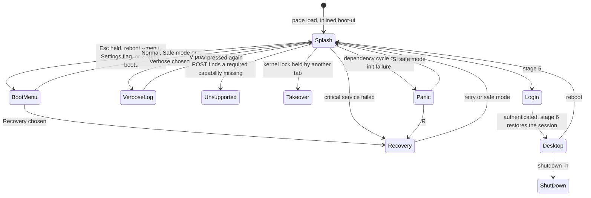

# UI design system

| Field | Value |
|---|---|
| Title | UI design system: the single `tokens.css`, visual identity, component rules, every system screen and built-in app, WCAG 2.2 AA rules and axe checks |
| Status | Draft v0.1, 2026-09-24 |
| Primary owner | R3 WM/UI |
| Secondary reviewer | R5 QA/DevOps (accessibility gate and screen evidence). Code review of `wm/tokens/` follows CODEOWNERS (R1) |
| Must be demonstrable at | **P2 gate (W7, v0.2.0):** tokens in both themes; boot splash v1; login; desktop and taskbar; window chrome; Terminal; File Explorer (CRUD); Settings → About; axe clean in both themes. **P3 gate (W11, v0.3.0):** boot menu, verbose log, kernel panic, recovery console; Task Manager (Processes, Memory); taskbar badges; Editor conflict and lock banners; offline login. **P4 gate (W14, v0.4.0):** Files semantic search with citations; agent confirmation; Settings → Privacy; Task Manager → Predictions. **Final defence:** all screens on the examiner's machine. |
| Requirement IDs covered | Spec: §5.2 design tokens (PLT-ID-06), §5.3 (About), BOOT-01, BOOT-02 (visual), BOOT-05, BOOT-06, BOOT-08, BOOT-13, BOOT-14, WM-07, OFF-01, OFF-03, OFF-04, VFS-07 (Files), VFS-09 (lock banner), VFS-10 (conflict banner), MEM-01 (Settings budget), MEM-07 (Task Manager), PROC-03 (Settings quanta), PROC-08 (Task Manager), PRE-05 (Privacy), PRE-06 (Task Manager predictions), RAG-06 (Files search), AGT-03 (confirmation surface), AGT-08 (`ai log` view). Plotinium design: DSN-01 … DSN-20 |
| Related specs | [Window manager](./window-manager.md) · [Identity and branding](../00-product/identity-and-branding.md) · [Boot and services](../02-boot/boot-and-services.md) · [Shell and terminal](../07-shell/shell-and-terminal.md) · [Virtual file system](../04-vfs/virtual-file-system.md) · [Offline and sync](../06-sync/offline-and-sync.md) · [Processes and scheduling](../03-kernel/processes-and-scheduling.md) · [Memory and paging](../03-kernel/memory-and-paging.md) · [RAG semantic search](../10-ai/rag-semantic-search.md) · [Agentic shell](../10-ai/agentic-shell.md) · [Predictive pre-fetch](../10-ai/predictive-prefetch.md) · [Security model](../12-security/security-model.md) · [Testing and performance](../13-quality/testing-and-performance.md) · [System-call ABI](../01-architecture/syscall-abi.md) |

**Conventions.** RFC 2119 keywords as in the capstone spec (p. 3). **Spec** marks an obligation from the capstone specification with its section and ID; **Plotinium design** marks our own choice. Contrast ratios in this file were computed with the WCAG 2.x relative-luminance formula from the exact hex values below; they are calculations, not measurements. Numbers from the AI-run prototype are marked *(pilot figure — re-measure on the lab machine)*.

---

## 1. Purpose and scope

This spec fixes how every Plotinium screen looks and behaves visually:

- the **one tokens file** (Spec §5.2: colours, typography, spacing and motion values in one tokens file used by every system screen, light and dark themes), with every value;
- the **visual identity** derived from the name (Plotinium, coined from plutonium, element 94): restrained, dense, one accent;
- **component rules** shared by all screens;
- a **screen spec** (layout, content, states, accessibility, owner, gate) for the boot splash, boot menu, verbose boot log, kernel panic, recovery console, login, desktop and taskbar, window chrome, each built-in app (Terminal, File Explorer, Text Editor, Task Manager, Settings), the agent confirmation, the secure prompt and notifications;
- the **WCAG 2.2 AA rules** and the **axe checks** in both themes.

Out of scope, owned elsewhere: window behaviour (focus, z-order, gestures, taskbar logic, secure-prompt isolation) in [window-manager.md](./window-manager.md); boot stages, progress computation and boot flags in [boot-and-services.md](../02-boot/boot-and-services.md); the name, logo geometry, wordmark and `uname` in [identity-and-branding.md](../00-product/identity-and-branding.md); terminal behaviour and command output formats in [shell-and-terminal.md](../07-shell/shell-and-terminal.md).

---

## 2. Requirements table

| ID | Summary | Spec § | How verified |
|---|---|---|---|
| PLT-ID-06 | Spec: MUST, §5.2. Colours, typography, spacing and motion values in one tokens file used by every system screen; light and dark themes. | §5.2 | DSN-02 lint; DSN-03 contrast test; axe in both themes |
| BOOT-01 | Spec: MUST, §6.5. The boot screen displays the registered OS name, logo and version. | §6.2, §6.5 | e2e; visual review at P2 |
| BOOT-02 (visual) | Spec: MUST, §6.5. The progress indicator shows real work; no fixed-length animation. | §6.1, §6.5 | Boot e2e (throttled) owned by the boot spec; DSN-07 here |
| BOOT-05 | Spec: MUST, §6.5. A verbose mode toggled by a key shows a timestamped, kernel-style boot log. | §6.5, §6.6 | e2e |
| BOOT-06 | Spec: MUST, §6.5. A boot menu offers Normal, Safe mode and Recovery. | §6.5 | e2e keyboard-only |
| BOOT-08 | Spec: MUST, §6.5. A critical failure shows a recovery screen with retry, safe mode and diagnostics; never a blank page or endless spinner. | §6.5 | e2e with a corrupted local database version |
| BOOT-13 | Spec: MUST, §6.5. The boot screen respects `prefers-reduced-motion`, exposes `role="progressbar"` with live values, announces status changes, and the boot menu works from the keyboard alone. | §6.5 | axe; keyboard e2e; reduced-motion e2e |
| BOOT-14 | Spec: SHOULD, §6.5. The login screen supports several users and includes a guest or demo account. | §6.5 | e2e |
| WM-07 | Spec: SHOULD, §9.4. WCAG 2.2 AA for contrast and keyboard operation. | §9.4 | §3.10, §3.11 |
| OFF-01 | Spec: MUST, §9.5. Boot, login, Terminal, File Explorer, Text Editor, Task Manager and Settings work fully offline. | §9.5 | Offline e2e (screens show honest offline states, §3.8) |
| OFF-03 | Spec: MUST, §9.5. Offline login never stores plain-text passwords. | §9.5 | Owned by the security spec; the login screen states the offline mode (§3.8.6) |
| OFF-04 | Spec: MUST, §9.5. The taskbar shows connectivity and lists degraded services. | §9.5 | [window-manager.md](./window-manager.md) §3.11; visuals §3.8.7 |
| VFS-07 | Spec: MUST, §9.3. CRUD plus `cp -r`, `mv`, `rm -r`, `find`, `stat`, `chmod`, `chown`, `ln -s`, `tree` from the terminal and the File Explorer. | §9.3 | Files e2e (§3.8.11) |
| VFS-09, VFS-10 | Spec: MUST, §9.3. Read-only access for a second writer; conflicted copies kept, never a silent overwrite. | §9.3 | Editor banner e2e (§3.8.12) |
| MEM-01, PROC-03 | Spec: MUST, §9.2 and §9.1. Configurable memory budget and soft limit; configurable quantum. | §9.1, §9.2 | Settings e2e (§3.8.14) |
| MEM-07, PROC-08 | Spec: MUST. Task Manager shows state, CPU share, memory, faults, hit ratio and bytes paged per process. | §9.1, §9.2 | Task Manager e2e (§3.8.13) |
| PRE-05, PRE-06 | Spec: MUST, §12.4. Telemetry can be viewed and cleared in Settings → Privacy; predictions with confidence in the Task Manager. | §12.4 | e2e |
| RAG-06 | Spec: MUST, §12.2. Semantic search in the File Explorer, keyword fallback with a clear notice. | §12.2 | Files search e2e online and offline |
| AGT-03 | Spec: MUST, §12.3. Destructive operations need explicit confirmation after the dry run. | §12.3 | Confirmation surface e2e (§3.8.15) |
| DSN-01 | Plotinium design. Identity: neutral cool greys plus one accent; no gradients, glows, hazard symbols, hazard stripes or weapons, war or radiation wording (PLT-ID-16). | §5.1 | Identity lint (owned by the identity spec); design review |
| DSN-02 | Plotinium design. Every colour, font, size, radius, shadow, duration and z-layer used by `wm/`, `apps/*/view.tsx`, the xterm theme and the CodeMirror theme comes from `--pl-*` tokens; no raw hex or px values for these in component CSS. | §5.2 | Stylelint-style check in `tools/` (DSN-02 test) |
| DSN-03 | Plotinium design. Text-role tokens reach ≥ 4.5:1 and non-text UI tokens (borders, focus ring, icons, meter fills) ≥ 3:1 against every surface token they are used on, in both themes. | WCAG 1.4.3, 1.4.11 | Contrast unit test over `tokens.json` |
| DSN-04 | Plotinium design. Theme = System, Light or Dark per user; boot screens follow the system scheme until the kernel reports the device's last theme. | §5.2 | Theme e2e |
| DSN-05 | Plotinium design. Motion tokens are 0 ms under `prefers-reduced-motion: reduce` or the Settings override; nothing else animates. | BOOT-13, WCAG 2.3.3 (AAA, adopted) | Reduced-motion e2e |
| DSN-06 | Plotinium design. System font stacks only; no web-font download (C10: everything self-hosted; COEP `require-corp`). | C10 | Network log in e2e shows no font request |
| DSN-07 | Plotinium design. No spinner anywhere in the boot path or any system screen; progress is a determinate bar with real values or a text state. | BOOT-02, §6.1 "not acceptable" | Static check: no indeterminate progress element in `wm/boot-ui/**`; review |
| DSN-08 | Plotinium design. Every status conveyed by colour also has a text or icon label. | WCAG 1.4.1 | Review; axe; screenshot review in greyscale |
| DSN-09 | Plotinium design. User-supplied text (file names, snippets, process names, agent plans) renders as text nodes only; no HTML sinks. | C10, lint `no-html-sinks` | Lint; XSS fixture test |
| DSN-10 | Plotinium design. `tokens.css` ≤ 4 KB gzip; the inlined boot-ui (splash, menu, panic, recovery) ≤ 5 KB gzip; both are inside the 60 KB boot-critical budget (C13). | BOOT-10 | Bundle-budget job |
| DSN-11 | Plotinium design. A machine-readable `tokens.json` (both themes, resolved hex) is generated from `tokens.css` at build time and used by the favicon/manifest generator and the contrast test. | §5.2, identity spec request | Build test |
| DSN-12 | Plotinium design. Screens show honest offline and degraded states with the exact strings of §3.8. | OFF-01, OFF-04, RAG-06 | e2e |
| DSN-13 | Plotinium design. The terminal theme (16 ANSI colours) and the editor syntax theme come from tokens and are contrast-checked; xterm runs with `minimumContrastRatio: 4.5`. | WCAG 1.4.3 | Contrast test; Terminal e2e |
| DSN-14 | Plotinium design. The boot menu, panic screen and recovery console are part of the framework-free inlined boot-ui and render with no JS chunk loaded. | BOOT-05/06/08, C11 | e2e with the shell chunk blocked |
| DSN-15 | Plotinium design. Destructive confirmations default to the safe answer and name the consequence in text. | AGT-03, WCAG 3.3.4 | e2e |
| DSN-16 | Plotinium design. The secure prompt and the kernel-confirmation strip use a visual treatment no app can reproduce above the windows layer (mark + lock + accent band on `--pl-z-secure`). | C10, AGT-03 | Stacking test (window manager) and visual review |
| DSN-17 | Plotinium design. Settings → Privacy shows the telemetry ring, clears it, exports it as JSON, and holds the opt-in sync switch (default off). | PRE-05 | e2e |
| DSN-18 | Plotinium design. Settings → About shows name, version, codename, build hash, build date, tagline and the five team members with roles, and a "Copy uname" button. | §5.3 | e2e (identity spec PLT-ID-09) |
| DSN-19 | Plotinium design. Lists over 2,000 rows are virtualised; the Task Manager grid applies ≤ 1 update per frame. | PROC-09, WM-03 | Perf test |
| DSN-20 | Plotinium design. axe (tags `wcag2a`, `wcag2aa`, `wcag21a`, `wcag21aa`, `wcag22aa`) reports zero serious or critical issues on every screen of §3.8 in both themes. | WM-07, BOOT-13 | §8 matrix |

---

## 3. Design (normative)

### 3.1 Identity direction: "dense metal, one orbit"

Plotinium design (DSN-01), consistent with [identity-and-branding.md §3.1](../00-product/identity-and-branding.md) (the name refers to the element's physical properties, density and energy, never its uses):

- **Palette.** Neutral, slightly cool greys, like a polished metal surface, carry all structure. One accent, "orbit blue" (`#3452d6` light, `#8aa2ff` dark), marks the logo ring, focus, the focused window's title strip, primary buttons, selection and progress. In the dark theme the lighter accent reads as a subtle luminous point on dark surfaces; this effect comes from contrast only: no glow filters, blurred shadows of colour, gradients or animated shimmer.
- **Density.** OS-like information density: 13–14 px UI text, 32 px title bars, compact tables. Calm neutral surfaces, not decoration.
- **Forbidden** (PLT-ID-16, DSN-01): the radiation trefoil, hazard stripes, green "glow" palettes, mushroom-cloud shapes, three-ellipse atom icons, and any weapons, war or radiation wording in UI strings.
- **Mark.** The logo is the identity spec's "plotted point on an orbit". The mono mark (`currentColor`) is the launcher button, the secure-prompt frame and small UI; the two-tone mark (ring `--pl-accent`, point `--pl-text`) is used at 64 px and above.
- **Wallpaper.** A generative SVG of 3–5 thin partial orbit arcs and one point, drawn from `--pl-wallpaper-*` tokens, static, a few KB, inlined (no bitmap on the boot path). Decorative only (`aria-hidden="true"`).

### 3.2 Token architecture

Plotinium design:
1. **One file**, `wm/tokens/tokens.css`. It is inlined into `web/index.html` for the boot-ui, imported by the shell, seeded to `/system/branding/tokens.css` and copied to `docs/identity/tokens.css` ([identity-and-branding.md §3.12](../00-product/identity-and-branding.md)).
2. **Semantic tokens only** (`--pl-<role>`). Components never use a raw colour, font, size, radius, shadow, duration or z-index (DSN-02). New roles are added to this file through a PR that updates §3.3 and the contrast table.
3. **Themes.** Colours use `light-dark(light, dark)` under `color-scheme: light dark` on `:root`, so "System" needs no JS. `:root[data-theme="light"]` and `:root[data-theme="dark"]` force a scheme.
4. **Reduced motion.** Motion tokens are zeroed by `@media (prefers-reduced-motion: reduce)` and by `:root[data-motion="reduce"]` (Settings override: "Reduce motion: Follow system / Always").
5. **Forced colours.** Under `@media (forced-colors: active)` the focus ring and borders map to system colours.
6. **Cascade layers.** `@layer reset, tokens, shell, apps;` Components use CSS Modules in `shell` or `apps`.
7. **Resolving tokens in JS** (xterm, CodeMirror, canvas sparklines). A custom property holding `light-dark()` is returned unresolved by `getPropertyValue`, so JS reads a colour through a hidden probe element: set `probe.style.color = 'var(--pl-accent)'`, then read `getComputedStyle(probe).color` (a resolved `rgb()`). Checked on 2026-09-24 in Chrome 153 with the file of §3.3: `getPropertyValue('--pl-accent')` returns `light-dark(#3452d6, #8aa2ff)`, while the probe returns `rgb(52, 82, 214)` in the light scheme and `rgb(138, 162, 255)` in the dark scheme. Themes are re-read on `data-theme` change and on `matchMedia('(prefers-color-scheme: dark)')` change.

### 3.3 `tokens.css` (normative content)

```css
/* wm/tokens/tokens.css — the single tokens file (Spec §5.2, PLT-ID-06). Values are binding; see §3.4 for contrast. */
@layer reset, tokens, shell, apps;

@layer tokens {
  :root {
    color-scheme: light dark;

    /* ---------- colour: surfaces ---------- */
    --pl-bg:              light-dark(#f4f5f9, #10121a);   /* desktop, boot screens */
    --pl-surface:         light-dark(#ffffff, #1b1e29);   /* window content, cards, dialogs */
    --pl-surface-2:       light-dark(#eceef5, #242836);   /* title bars, side panels, table headers */
    --pl-surface-3:       light-dark(#e1e4ee, #2e3345);   /* hover and pressed states, progress track */
    --pl-taskbar-bg:      light-dark(#e6e9f1, #151821);
    --pl-scrim:           light-dark(rgb(16 18 26 / .32), rgb(0 0 0 / .56));   /* behind modal dialogs */

    /* ---------- colour: text and lines ---------- */
    --pl-text:            light-dark(#151823, #e7e9f1);
    --pl-text-muted:      light-dark(#4a5066, #a9aec2);
    --pl-text-disabled:   light-dark(#6e7489, #8a90a5);   /* disabled controls (exempt from 1.4.3, kept ≥ 3.6:1) */
    --pl-border:          light-dark(#767c90, #7c839b);   /* component boundaries, ≥ 3:1 */
    --pl-border-subtle:   light-dark(#d6d9e3, #333849);   /* decorative dividers only */

    /* ---------- colour: accent and states ---------- */
    --pl-accent:          light-dark(#3452d6, #8aa2ff);   /* orbit blue */
    --pl-accent-hover:    light-dark(#2a43b3, #a5b7ff);
    --pl-on-accent:       light-dark(#ffffff, #0d1330);
    --pl-accent-subtle:   light-dark(#e3e8fc, #27305a);   /* selected rows, snap preview fill */
    --pl-selection:       light-dark(#dbe2fb, #2c3764);   /* text selection, terminal selection */
    --pl-danger:          light-dark(#b3261e, #ffb4ab);
    --pl-danger-subtle:   light-dark(#fbe9e7, #3b1d1c);
    --pl-warning:         light-dark(#8a5a00, #ffcf70);
    --pl-warning-subtle:  light-dark(#fdf1dc, #3a2e14);
    --pl-success:         light-dark(#1b6f35, #7fdc9a);
    --pl-success-subtle:  light-dark(#e3f4e8, #173323);
    --pl-focus-ring:      2px solid var(--pl-accent);
    --pl-focus-offset:    2px;

    /* ---------- colour: decorative wallpaper (aria-hidden) ---------- */
    --pl-wallpaper-a:     light-dark(#e9ecf5, #141722);
    --pl-wallpaper-b:     light-dark(#dfe4f3, #1a1f30);
    --pl-wallpaper-orbit: light-dark(#c9d1ee, #2a3354);

    /* ---------- terminal (xterm theme) ---------- */
    --pl-term-bg:         light-dark(#ffffff, #12141c);
    --pl-term-fg:         light-dark(#151823, #e7e9f1);
    --pl-term-cursor:     var(--pl-accent);
    --pl-term-selection:  var(--pl-selection);
    --pl-ansi-0:  light-dark(#151823, #3a3f52);   --pl-ansi-8:  light-dark(#4a5066, #8a90a5);
    --pl-ansi-1:  light-dark(#b3261e, #ff8a80);   --pl-ansi-9:  light-dark(#c0392b, #ffb4ab);
    --pl-ansi-2:  light-dark(#1b6f35, #7fdc9a);   --pl-ansi-10: light-dark(#237a3f, #a6ecb9);
    --pl-ansi-3:  light-dark(#7a5000, #ffcf70);   --pl-ansi-11: light-dark(#8a5a00, #ffe0a3);
    --pl-ansi-4:  light-dark(#3452d6, #8aa2ff);   --pl-ansi-12: light-dark(#2a43b3, #b3c2ff);
    --pl-ansi-5:  light-dark(#8a3aa8, #e3a0ff);   --pl-ansi-13: light-dark(#9b2fb5, #efc4ff);
    --pl-ansi-6:  light-dark(#0b6b78, #6fd6e6);   --pl-ansi-14: light-dark(#00707e, #a4e9f2);
    --pl-ansi-7:  light-dark(#5c6275, #c9cdda);   --pl-ansi-15: light-dark(#3a3f52, #ffffff);

    /* ---------- editor syntax (CodeMirror theme) ---------- */
    --pl-syn-keyword:     light-dark(#8a3aa8, #e3a0ff);
    --pl-syn-string:      light-dark(#1b6f35, #7fdc9a);
    --pl-syn-number:      light-dark(#8a4b00, #ffcf70);
    --pl-syn-comment:     light-dark(#5c6275, #a9aec2);
    --pl-syn-function:    light-dark(#3452d6, #8aa2ff);
    --pl-syn-type:        light-dark(#0b6b78, #6fd6e6);
    --pl-syn-invalid:     light-dark(#b3261e, #ffb4ab);
    --pl-editor-active-line: light-dark(#f4f5f9, #242836);

    /* ---------- typography (system stacks only, DSN-06) ---------- */
    --pl-font-ui:   system-ui, "Segoe UI", Roboto, Ubuntu, Cantarell, "Noto Sans", "Helvetica Neue", Arial, sans-serif;
    --pl-font-mono: ui-monospace, "Cascadia Mono", Consolas, "Ubuntu Mono", "DejaVu Sans Mono", "Liberation Mono", Menlo, monospace;
    --pl-text-xs: 12px;  --pl-text-sm: 13px;  --pl-text-md: 14px;  --pl-text-lg: 16px;
    --pl-text-xl: 20px;  --pl-text-2xl: 28px; --pl-text-3xl: 36px;
    --pl-leading: 1.45;  --pl-leading-tight: 1.2;  --pl-leading-mono: 1.2;
    --pl-weight-regular: 400;  --pl-weight-medium: 500;  --pl-weight-semibold: 600;

    /* ---------- spacing (4-pt scale) ---------- */
    --pl-space-0: 0;     --pl-space-1: 4px;   --pl-space-2: 8px;   --pl-space-3: 12px;
    --pl-space-4: 16px;  --pl-space-5: 20px;  --pl-space-6: 24px;  --pl-space-8: 32px;
    --pl-space-10: 40px; --pl-space-12: 48px;

    /* ---------- shape and fixed sizes ---------- */
    --pl-radius-sm: 4px;  --pl-radius-ctl: 6px;  --pl-radius-win: 10px;  --pl-radius-pill: 999px;
    --pl-titlebar-h: 32px;   --pl-taskbar-h: 44px;   --pl-titlebar-btn: 28px;
    --pl-target-min: 24px;   --pl-resize-hit: 8px;   --pl-resize-corner: 16px;
    --pl-icon-sm: 16px;  --pl-icon-md: 20px;  --pl-icon-lg: 24px;  --pl-icon-app: 48px;
    --pl-boot-logo: 96px;    --pl-boot-bar-w: 320px;  --pl-boot-bar-h: 4px;

    /* ---------- elevation ---------- */
    --pl-shadow-1:          0 1px 2px   light-dark(rgb(0 0 0 / .08), rgb(0 0 0 / .40));
    --pl-shadow-pop:        0 4px 14px  light-dark(rgb(0 0 0 / .14), rgb(0 0 0 / .50));
    --pl-shadow-win:        0 6px 20px  light-dark(rgb(0 0 0 / .12), rgb(0 0 0 / .45));
    --pl-shadow-win-focus:  0 10px 32px light-dark(rgb(0 0 0 / .20), rgb(0 0 0 / .60));
    --pl-shadow-dialog:     0 16px 48px light-dark(rgb(0 0 0 / .24), rgb(0 0 0 / .64));

    /* ---------- motion (zeroed under reduced motion, DSN-05) ---------- */
    --pl-motion-fast: 120ms;  --pl-motion-med: 200ms;  --pl-motion-slow: 320ms;
    --pl-ease:     cubic-bezier(.2, .8, .2, 1);   /* standard */
    --pl-ease-in:  cubic-bezier(.4, 0, 1, 1);     /* exits */
    --pl-ease-out: cubic-bezier(0, 0, .2, 1);     /* entrances */

    /* ---------- layers (windows are one stacking context renumbered 1..n inside --pl-z-windows) ---------- */
    --pl-z-desktop: 0;      --pl-z-windows: 100;   --pl-z-snap-preview: 9000;
    --pl-z-taskbar: 10000;  --pl-z-popover: 10050; --pl-z-notify: 10100;
    --pl-z-meter: 10150;    --pl-z-secure: 10200;  --pl-z-boot: 10300;
  }

  :root[data-theme="light"] { color-scheme: light; }
  :root[data-theme="dark"]  { color-scheme: dark; }

  @media (prefers-reduced-motion: reduce) {
    :root { --pl-motion-fast: 0ms; --pl-motion-med: 0ms; --pl-motion-slow: 0ms; }
  }
  :root[data-motion="reduce"] { --pl-motion-fast: 0ms; --pl-motion-med: 0ms; --pl-motion-slow: 0ms; }

  @media (forced-colors: active) {
    :root { --pl-focus-ring: 2px solid CanvasText; --pl-border: CanvasText; }
  }
}
```

**Changes from the research draft** (`docs/research/strategy/design_identity.md` §6): `--pl-border` moved from `#8b91a6 / #5d637a` to `#767c90 / #7c839b`, because the draft values compute to 2.70:1 on light `--pl-surface-2` and 2.47:1 on dark `--pl-surface-2`, below the draft's own 3:1 rule; `--pl-success` light moved from `#1f7a3a` to `#1b6f35` to stay ≥ 4.5:1 on `--pl-surface-3`. Every other draft value is kept; the roles after `--pl-success` are additions.

### 3.4 Contrast table (DSN-03)

Minimum ratio of each text or UI token over the five surfaces it may appear on (`--pl-bg`, `--pl-surface`, `--pl-surface-2`, `--pl-surface-3`, `--pl-taskbar-bg`), computed from the hex values in §3.3:

| Foreground token | Required | Light (min) | Dark (min) |
|---|---|---|---|
| `--pl-text` | 4.5:1 | 13.93 | 10.34 |
| `--pl-text-muted` | 4.5:1 | 6.29 | 5.68 |
| `--pl-accent` (links, focus ring, accent text) | 4.5:1 | 4.97 | 5.19 |
| `--pl-danger` | 4.5:1 | 5.15 | 7.38 |
| `--pl-warning` | 4.5:1 | 4.67 | 8.60 |
| `--pl-success` | 4.5:1 | 4.90 | 7.52 |
| `--pl-border` | 3:1 | 3.27 | 3.33 |

| Pair | Required | Light | Dark |
|---|---|---|---|
| `--pl-on-accent` on `--pl-accent` | 4.5:1 | 6.32 | 7.54 |
| `--pl-on-accent` on `--pl-accent-hover` | 4.5:1 | 8.23 | 9.38 |
| `--pl-text` on `--pl-accent-subtle` | 4.5:1 | 14.50 | 10.46 |
| `--pl-accent` on `--pl-accent-subtle` | 4.5:1 | 5.18 | 5.25 |
| `--pl-text` on `--pl-selection` | 4.5:1 | 13.72 | 9.43 |
| `--pl-danger` on `--pl-danger-subtle` | 4.5:1 | 5.58 | 8.97 |
| `--pl-warning` on `--pl-warning-subtle` | 4.5:1 | 5.30 | 9.12 |
| `--pl-success` on `--pl-success-subtle` | 4.5:1 | 5.45 | 8.22 |
| `--pl-text` on each `*-subtle` banner | 4.5:1 | ≥ 15.09 | ≥ 10.96 |

Terminal colours on `--pl-term-bg`: light, all 16 ANSI colours are ≥ 5.35:1; dark, ANSI 1–15 are ≥ 5.79:1 and ANSI 0 (`#3a3f52`) is 1.76:1 by design (it is the "black" that programs use as a background). Because xterm runs with `minimumContrastRatio: 4.5` (DSN-13), any foreground drawn in ANSI 0 on the dark background is lightened at render time. Syntax colours are ≥ 5.57:1 (light) and ≥ 6.07:1 (dark) on both `--pl-surface` and `--pl-editor-active-line`.

### 3.5 Typography

| Use | Token | Weight | Leading |
|---|---|---|---|
| Boot wordmark fallback text, About title | `--pl-text-3xl` (36) | semibold | tight |
| Screen titles (panic, recovery, login name) | `--pl-text-2xl` (28) | semibold | tight |
| Dialog titles, app section headings | `--pl-text-xl` (20) | semibold | tight |
| Emphasised body, login inputs | `--pl-text-lg` (16) | regular | `--pl-leading` |
| Default UI text, table cells, Terminal (14 px mono) | `--pl-text-md` (14) | regular | `--pl-leading` (mono: `--pl-leading-mono`) |
| Title bars, menus, buttons, tray, boot status lines, verbose log | `--pl-text-sm` (13) | regular; title bar semibold | `--pl-leading` |
| Captions, keycaps, table meta, boot hint line | `--pl-text-xs` (12) | regular | `--pl-leading` |

Rules: UI text never below 12 px; numbers in tables use `font-variant-numeric: tabular-nums`; all-caps only through `text-transform` with the source string in sentence case (screen readers read the source).

### 3.6 Spacing, shape, elevation, motion, layers, icons

- **Spacing.** 4-pt scale (`--pl-space-*`). Dialog padding `--pl-space-6`; window content padding `--pl-space-3` (Terminal `--pl-space-2`); table and grid row height 28 px; control height 28 px (min target 24).
- **Radius.** Controls `--pl-radius-ctl`; windows `--pl-radius-win` (0 when maximised, full-screen, or on the snapped edge side); badges and progress bars `--pl-radius-pill`.
- **Elevation.** Unfocused windows `--pl-shadow-win`; focused `--pl-shadow-win-focus`; menus, popovers, switcher `--pl-shadow-pop`; dialogs and the secure prompt `--pl-shadow-dialog`. Under forced colours shadows are replaced by 1 px `CanvasText` borders.
- **Motion** (only `transform` and `opacity` animate; the boot bar animates `width`, which is one small element):

| What | Duration | Easing |
|---|---|---|
| Boot progress bar width | `--pl-motion-fast` | `--pl-ease` |
| Window minimise, restore from minimised, toast enter | `--pl-motion-med` | `--pl-ease-out` enter, `--pl-ease-in` exit |
| Window maximise, un-maximise, close, snap preview, menus and popovers, window switcher | `--pl-motion-fast` | `--pl-ease` |
| Taskbar attention pulse (once) | `--pl-motion-slow` | `--pl-ease` |
| Terminal cursor blink | xterm default; disabled under reduced motion | — |

  No looping animation anywhere except the Terminal cursor blink, which is off under reduced motion (WCAG 2.2.2).
- **Layers** as in §3.3; the window manager spec defines what lives on each.
- **Icons.** UI glyphs from `lucide-solid` at 16, 20 or 24 px, `stroke-width` 2, colour `currentColor`; decorative icons `aria-hidden="true"`, icon-only buttons carry `aria-label`. App icons (Terminal, Files, Editor, Task Manager, Settings) are the team's own SVGs: a 48 × 48 rounded square (radius 12) filled `--pl-surface-2`, 1 px `--pl-border` outline, a 2-unit-stroke glyph in `--pl-accent`; they reuse the logo's grid rules and must be legible at 16 px (taskbar in compact mode).

### 3.7 Component rules

| Component | Rules |
|---|---|
| Button | Height 28 px (min target 24). Variants: **primary** (`--pl-accent` bg, `--pl-on-accent` text; hover `--pl-accent-hover`), **secondary** (`--pl-surface` bg, 1 px `--pl-border`), **ghost** (transparent, hover `--pl-surface-3`), **danger** (`--pl-danger` text and 1 px border on `--pl-surface`; the danger action is never the default button). Focus: `outline: var(--pl-focus-ring); outline-offset: var(--pl-focus-offset)`. Disabled: `--pl-text-disabled`, `aria-disabled`. |
| Text input | Height 28 px, 1 px `--pl-border`, `--pl-surface` bg, `--pl-radius-ctl`; error state: 1 px `--pl-danger` border plus an error line with an icon and text, linked by `aria-describedby`. Paste always allowed. |
| Determinate progress | Track `--pl-surface-3`, fill `--pl-accent`, height 4 px (boot) or 6 px (in-window), `role="progressbar"` with `aria-valuenow`, `aria-valuemin="0"`, `aria-valuemax="100"` and an `aria-valuetext` in words. No indeterminate variant exists (DSN-07). |
| Banner (in-window) | Full-width strip at the top of the content: `--pl-*-subtle` bg, 4 px left rule in the state colour, icon + text + actions; `role="status"` (info/warning) or `role="alert"` (error). |
| Toast | 360 px wide, `--pl-surface`, `--pl-shadow-pop`, 4 px left rule in the level colour, icon, title (`--pl-text-sm` semibold), body, up to 2 actions, close button 24 × 24. |
| Menu, popover | `--pl-surface`, `--pl-shadow-pop`, `--pl-radius-ctl`, items 28 px, WAI-ARIA APG `menu` pattern (arrow keys, `Home`/`End`, type-ahead, `Esc` closes and returns focus). |
| Dialog | Modal on `--pl-scrim`, `--pl-surface`, `--pl-shadow-dialog`, focus trapped and restored on close, initial focus on the safe action; `role="dialog"` (or `alertdialog` for destructive questions) with `aria-labelledby`/`aria-describedby`. |
| Tabs | APG tabs pattern; selected tab has a 2 px `--pl-accent` underline and `--pl-text`; others `--pl-text-muted`. |
| Data grid | APG grid pattern with sortable column headers (`aria-sort`), row height 28 px, selected row `--pl-accent-subtle`, `tabular-nums`, virtualised above 2,000 rows (`@tanstack/solid-virtual` only if the W3 spike needs it, else our own windowing). |
| Badge / chip | Pill, `--pl-text-xs`, `--pl-*-subtle` bg with state-colour text; always text, never colour alone. |
| Keycap | `--pl-font-mono`, `--pl-text-xs`, 1 px `--pl-border`, `--pl-radius-sm`, padding 0 4 px. |

### 3.8 Screen specs

How the system screens connect (behaviour owned by [boot-and-services.md](../02-boot/boot-and-services.md)):



Each screen lists layout, content, states, accessibility, owner and the gate where it must be shown. Strings in `code` are exact (placeholders in angle brackets). The version and build come from the build identity ([identity-and-branding.md §4.1](../00-product/identity-and-branding.md)).

#### 3.8.1 Boot splash (Spec §6.2, Figure 6.1; BOOT-01, BOOT-02, BOOT-13; framework-free, inlined)

Layout: full viewport `--pl-bg`, one centred column (max width 480 px), vertical gap `--pl-space-3`:

| # | Element | Content | Style |
|---|---|---|---|
| 1 | Logo | two-tone mark, inline SVG | `--pl-boot-logo` (96 px) |
| 2 | Wordmark | `Plotinium`, inline SVG outlines (`role="img"`, `aria-label="Plotinium"`) | cap height 28 px |
| 3 | Version line | `version 0.3.0 · build a1f93c2` | `--pl-text-sm`, `--pl-text-muted` |
| 4 | Progress bar | real boot progress `P` (boot spec §5) | `--pl-boot-bar-w` × `--pl-boot-bar-h`, pill |
| 5 | Current step | `vfs: mounting / (12,408 inodes)` | `--pl-text-sm`, `--pl-text` |
| 6 | Count | `Service start · 7 of 9` | `--pl-text-xs`, `--pl-text-muted` |
| 7 | Hints (bottom of viewport, 24 px from the edge) | `Esc  boot menu    V  verbose log` with keycaps | `--pl-text-xs`, `--pl-text-muted` |

States:
- **Normal.** As above; line 5 shows the stage (`checking system`, `loading kernel 412 / 890 KB`, `<service>: <detail>`).
- **Development build.** Line 3 reads `version 0.3.0-dev.14 · build a1f93c2` preceded by the text prefix `dev build` in `--pl-warning` (identity spec §6).
- **Slow network.** Nothing special: the bar moves with bytes received (BOOT-02). No spinner, no fake animation (DSN-07).
- **Degraded non-critical service.** The splash continues; the desktop's tray shows it (OFF-04).
- **Critical failure** → recovery console (§3.8.5). **Cycle** → kernel panic (§3.8.4).
- **Unsupported browser.** Same column; title `Plotinium cannot start in this browser`; a list of each missing capability with a one-line fix, for example `Service Worker — open http://localhost:4717, not a LAN IP address`.
- **Not Plotinium.** `This page is not Plotinium` (POST found another app on the port).
- **Another tab.** `Plotinium is running in another tab` and a primary button `Use here` (C2 takeover).
- **Shut down.** After `shutdown -h`: `Plotinium has shut down.` and `Start again`.

Accessibility (BOOT-13): bar is `role="progressbar"` with `aria-valuenow` (integer %), `aria-valuetext` such as `Starting vfs, 5 of 9`; a visually hidden `role="status" aria-live="polite"` region announces stage changes at most once per 750 ms; reduced motion removes the bar's width transition; the hint keys work from the first line of the inlined script (the boot spec buffers an early `Esc`).

Owner R3 (visuals) with R5 (progress wiring). Gate: P2 (v1: asset and kernel-init progress), P3 (DAG-driven).

#### 3.8.2 Boot menu (BOOT-06, BOOT-13; framework-free)

Layout: a modal panel 480 px wide centred on `--pl-bg`, `--pl-surface`, `--pl-radius-win`, `--pl-shadow-dialog`:
- header `Plotinium Boot Manager` (`--pl-text-lg` semibold) and a divider;
- a `listbox` of four options, each 36 px high with a title and a description line:
  1. `Normal boot`
  2. `Safe mode` — `no AI services, no autostart apps, default theme`
  3. `Recovery` — `file-system check · clear local cache · reset session`
  4. `Verbose boot` — `timestamped kernel log`
- footer: `↑↓ select    Enter boot    Esc close` and, only while the menu is open, `auto-boot in 3 s` (the only allowlisted timer, boot spec §5).

States: the selected option has `--pl-accent-subtle` bg, a 2 px `--pl-accent` left rule and a `▶` marker; after two consecutive failed boots, `Safe mode` is pre-selected and a warning line reads `The last 2 boots failed. Safe mode is selected.`; any key press stops the countdown.

Accessibility: `role="dialog"` labelled by the header containing `role="listbox"` with `aria-activedescendant`; focus lands on the listbox; the countdown is not announced every second (only "auto-boot in 3 seconds" once).

Owner R3 with R5. Gate P3.

#### 3.8.3 Verbose boot log (BOOT-05; framework-free)

Layout: a compact header (logo 32 px, `Plotinium 0.3.0 · build a1f93c2`, the progress bar at 240 px) above a full-width log panel, `--pl-surface`, `--pl-font-mono` `--pl-text-sm`, padding `--pl-space-3`, newest line at the bottom, auto-scrolling unless the user has scrolled up (then a `Jump to latest` button appears).

Line format (same information as spec §6.6): `[    0.087] storage: opened plotinium v7 (IndexedDB) in 64 ms` — timestamp right-aligned in 11 columns, `service:` in `--pl-text` semibold, message in `--pl-text`.
- `WARN` lines: the literal prefix `WARN` in `--pl-warning` (e.g. `[    0.402] sync: WARN backend unreachable · offline mode · outbox holds 3 ops · retry in 2 s`);
- `DEGRADED` lines: literal `DEGRADED` in `--pl-danger`;
- `KERNEL PANIC` lines: literal text in `--pl-danger` semibold, then the panic screen.

Toggle: `V` during boot, the boot-menu entry, or `reboot --verbose`. `V` again hides it.

Accessibility: the panel is `role="log"` with `aria-live="off"` (too chatty to announce); the status region still announces stage changes; colours are always paired with the text prefix (DSN-08).

Owner R5 (content) and R3 (visuals). Gate P3.

#### 3.8.4 Kernel panic (BOOT-04; framework-free)

Layout: full screen `--pl-surface`; a 4 px `--pl-danger` rule at the top; a left-aligned column (max 720 px):
- title `Plotinium kernel panic` (`--pl-text-2xl`);
- reason in a monospace block, for a cycle exactly `KERNEL PANIC: dependency cycle detected: sync → lockd → auth → sync` and `boot halted.`;
- `boot #37 · 0.3.0 (a1f93c2) · <timestamp>`;
- three buttons, each with its key: `[R] Recovery console`, `[S] Safe mode`, `[D] Download diagnostics` (downloads `plotinium-boot-<bootId>.json`).

Accessibility: `role="alertdialog"` with `aria-labelledby` (title) and `aria-describedby` (reason); focus on `Recovery console`; single-key shortcuts `R`, `S`, `D`; no timeout.

Owner R3 with R5. Gate P3.

#### 3.8.5 Recovery console (BOOT-06, BOOT-08; framework-free)

Layout: full screen `--pl-bg`; header `Plotinium Recovery Console · 0.3.0 (a1f93c2)`; a reason line (`Critical service "storage" failed: local database version is newer than this build (VersionError).`); two columns ≥ 1024 px wide, stacked below:
- **Actions** (a vertical list of buttons, each with a one-line consequence in `--pl-text-muted`):

| Action | Consequence line |
|---|---|
| `Retry boot` | `Boot again with the same settings.` |
| `Safe mode` | `Boot without AI services, autostart apps or custom theme.` |
| `Check file system` | `Run fsck read-only and show the report.` |
| `Repair file system` | `Run fsck and fix problems in one transaction (root password required).` |
| `Clear local cache and re-sync` | `Export unsynced changes to a file, delete this device's local copy, download it again.` |
| `Reset session` | `Forget the saved window layout. Files are not affected.` |
| `Restore default service manifests` | `Replace /system/services with the built-in manifests.` |
| `Download diagnostics` | `Save the boot log and system report as JSON.` |

- **Output**: a monospace panel for fsck reports and progress (determinate bars with real counts).

Destructive actions (clear cache, reset session, restore manifests, repair) use a two-step confirmation (DSN-15): the first press turns the button into `Press Enter again to confirm — deletes 212 MB of local data; 3 unsynced changes will be exported first` with `Cancel` focused; clear-cache always exports the outbox (`plotinium-outbox-<timestamp>.json`) before deleting anything (boot spec BOOT-08).

Accessibility: `main` landmark; actions are buttons in a `list`; results announced via `role="status"`; everything works from the keyboard (`Tab`, `Enter`).

Owner R3 (UI) with R5 (actions). Gate P3.

#### 3.8.6 Login (BOOT-14, OFF-03)

Layout: full screen `--pl-bg` with the wallpaper; a centred column (max 640 px):
- logo 64 px and the wordmark;
- a row of **user tiles** (wrap to more rows): 48 px initials avatar (circle, `--pl-accent-subtle` bg, `--pl-accent` initials), display name, `@username` in `--pl-text-muted`. Tiles for known users on this device plus **Demo** and **Guest**, and `Other user…` (username field). Root is never listed (root log-in at the greeter is disabled; elevate with `su`);
- after choosing a tile: the password field (`type=password`, `autocomplete="current-password"`, paste allowed, `Show` toggle), `Sign in` (primary), and a caps-lock warning line when active;
- footer: `Plotinium 0.3.0`, and icon buttons `Restart` and `Shut down`.

States:
- **Offline** (no server): banner at top `Offline — signing in with this device's saved verifier`; tiles of users with no cached verifier are disabled with `Needs network (no saved verifier)`; Guest becomes `Guest (offline, local only)`.
- **Signing in:** the button text becomes the real stage (`Checking password` → `Loading your desktop`), no spinner.
- **Error:** always `Invalid username or password` (no user enumeration).
- **Back-off:** `Too many attempts. Try again in 28 s` (countdown text).
- **Guest:** `Continue as guest` (no password); a note `Guest files are deleted when you log out.`
- **Session expired** (from the tray `Sign in to sync`): the same screen as a dialog over the desktop.

Accessibility: tiles are a `radiogroup` (arrow keys), the password field has a visible label, the error is linked with `aria-describedby` and announced (`role="alert"`); no cognitive test (WCAG 3.3.8).

Owner R3 (UI) with R5 (auth sessions, offline verifier). Gate P2 (online), P3 (offline).

#### 3.8.7 Desktop, taskbar, launcher and window switcher (WM-04, OFF-04)

Layout:
- **Desktop:** full viewport minus the taskbar; generative wallpaper; no desktop icons in v1.
- **Taskbar** (bottom, `--pl-taskbar-h` 44 px, `--pl-taskbar-bg`, 1 px `--pl-border-subtle` top line), left to right: launcher button (mono mark, 24 px, `aria-label="Launcher"`); task-group buttons (36 px high; app icon 24 px plus a label in `--pl-text-sm` up to 160 px with ellipsis, or 40 px wide icon-only in compact mode; count badge top-right; activity dot 6 px `--pl-accent` under the icon; the focused group has a 2 px `--pl-accent` underline); flexible space; the tray.
- **Tray items** (behaviour in [window-manager.md §3.11](./window-manager.md)): connectivity chip (`Online` with a check icon, `Syncing 3 ops` with an arrows icon, `Reconnecting in 4 s` with a clock icon, `Offline · 2 queued` in `--pl-warning` with a cloud-off icon, `Sign in to sync` in `--pl-warning`); degraded chip (`2 degraded`, `--pl-warning-subtle`); memory meter (`198 / 256 MB` and a 48 × 6 px bar, `--pl-accent` fill, `--pl-warning` ≥ 85%, `--pl-danger` ≥ 95%); `Offline-ready` (check icon); `Restart to update` (primary chip); secure indicator (lock icon, `Secure prompt`); notifications bell with unread count; clock `10:12`.
- **Launcher panel:** 360 × 480 px above the launcher button, `--pl-surface`, `--pl-shadow-pop`: filter box, app list (icon 24 + name), divider, the user's name and `@username`, power row (`Lock`, `Log out`, `Restart`, `Shut down`).
- **Window switcher overlay:** centred, 480 px, `--pl-surface`, list rows of icon + title + state label (`minimised`, `suspended`), highlighted row `--pl-accent-subtle`.

States: compact mode below 800 px (icons only); safe mode shows a chip `Safe mode` left of the tray (`--pl-warning-subtle`); guest shows `Guest` next to the clock.

Accessibility: taskbar `role="toolbar"` with roving tabindex; tray `group` "Status" with its own live region; the switcher is a `listbox` announced on open.

Owner R3. Gate P2 (taskbar, launcher), P3 (badges).

#### 3.8.8 Window chrome ([window-manager.md](./window-manager.md) §3.3 flags)

- **Frame:** `--pl-surface` content, `--pl-radius-win`, 1 px `--pl-border-subtle` outline; `--pl-shadow-win` (unfocused) or `--pl-shadow-win-focus` (focused).
- **Title bar** (`--pl-titlebar-h` 32 px, `--pl-surface-2`): left, the app icon as the **window-menu button** (28 × 28, `aria-label="Window menu"`); the title (`--pl-text-sm` semibold, ellipsis; `--pl-text` when focused, `--pl-text-muted` when not); right, `Minimise`, `Maximise`/`Restore`, `Close` (each 28 × 28, 16 px lucide `Minus`, `Square`/`Copy`, `X`; Close hover `--pl-danger-subtle` with `--pl-danger` icon). A 3 px `--pl-accent` strip along the top edge marks the focused window.
- **Resize handles:** invisible; cursors `ns-resize`, `ew-resize`, `nwse-resize`, `nesw-resize`.
- **Snap preview:** `--pl-accent-subtle` at 60% opacity with a 2 px `--pl-accent` border and `--pl-radius-win`.
- **Overlays inside the content area** (centred, `--pl-surface` at 92% over the content, text in `--pl-text`):

| Flag | Content |
|---|---|
| restoring | `Restoring… 3.1 / 5.0 MB`, 240 px determinate bar, second line `from local swap` or `from server` |
| suspended | `Suspended to save memory — click to restore` |
| crashed | `<App> stopped` · `[Restart]` `[Details]` (details show the error message as text) |
| notResponding | `<App> is not responding` · `[Wait]` `[Force quit]` |
| closing | `Closing…` |
| closeGuard | in-window alertdialog `Discard unsaved changes to report.md?` · `[Cancel]` (default) `[Save and close]` `[Discard and close]` |
| safe mode | `Not started in safe mode` · `[Start]` |

- **Window menu:** `Move`, `Size`, `Snap left`, `Snap right`, `Maximise`, `Full screen`, `Minimise`, divider, `Close` — each with its shortcut shown as a keycap.

Owner R3. Gate P2 (chrome), P3 (restoring, suspended).

#### 3.8.9 Secure prompt (su) and kernel-confirmation strip (DSN-16)

- **Secure prompt:** `--pl-scrim` over the whole screen on `--pl-z-secure`; a 400 px dialog with a 40 px header band in `--pl-accent` with `--pl-on-accent` text: the mono mark, a lock glyph and `Plotinium · Secure prompt`. Body: title `Authenticate as root` (`--pl-text-xl`), requester line `Requested by sh (pid 214) in Terminal · tty2` (`--pl-text-sm` muted), password field with `Show`, the error line (`Authentication failure · 2 attempts left`), buttons `Cancel` and `Authenticate` (primary). Time remaining is not shown as a countdown; after 60 s it closes with `Timed out`.
- **Kernel-confirmation strip:** a 28 px band in `--pl-accent` with `--pl-on-accent` text anchored over the Terminal window's title bar on the secure layer: lock glyph, mono mark, `Kernel confirmation · ai.agent pid 812 · answer in this terminal`. No controls.

Owner R3 (UI) with R5 (su flow) and R4 (agent). Gate P3 (su), P4 (strip).

#### 3.8.10 Terminal ([shell-and-terminal.md](../07-shell/shell-and-terminal.md))

- **xterm options** (xterm.js 6, DOM renderer; the canvas renderer was removed in 6.0 ([release notes](https://newreleases.io/project/github/xtermjs/xterm.js/release/6.0.0))): `fontFamily = --pl-font-mono`, `fontSize = 14`, `lineHeight = 1.2`, `cursorStyle = 'block'`, `cursorBlink = !reducedMotion`, `scrollback = 5000`, `minimumContrastRatio = 4.5`, `screenReaderMode` from Settings → Accessibility, `theme` built from `--pl-term-*` and `--pl-ansi-0..15` (§3.2 rule 7). Content padding `--pl-space-2`, background `--pl-term-bg`.
- **Prompt:** `alice@plotinium:~/notes$ ` with `alice@plotinium` in ANSI 2 (green) bold, the path in ANSI 4 (blue) bold, `$` in the default foreground; root uses `#` and the user part in ANSI 1 (red), so the elevated state has both a colour and a character cue.
- **Title:** `alice@plotinium: ~/notes` (set by the `term` process from the shell's working directory).
- **Kernel confirmation block** (rendered into the TTY by the kernel, §3.8.15).
- **States:** `[Process completed — press Enter to close]` when the shell exits while the window is kept open by a setting (default: the window closes with the shell).

Owner R3. Gate P2.

#### 3.8.11 File Explorer (VFS-07, RAG-06)

Layout:
- **Toolbar** (40 px): `Back`, `Forward`, `Up` (icon buttons), a breadcrumb path (click a segment to go there; press `/` or click the empty part to type a path), the search box (`Ctrl+F`) with a mode switch `Name | Content`, and a view menu (`List`, `Show hidden files`).
- **Sidebar** (200 px, `--pl-surface-2`): `Home`, `Shared` (`/home/shared` when it exists), `Temporary` (`/tmp`), `Root` (`/`).
- **List** (APG grid, default): columns `Name` (icon + name; symlinks show `→ target` in muted), `Size` (human, right-aligned), `Modified` (`YYYY-MM-DD HH:MM`), `Owner`, `Mode` (`rwxr-xr-x`), `Sync` (icon + text `pending` when an outbox op exists). Sort by any column; directories first.
- **Details pane** (right, 280 px, toggle `Alt+Enter` in the view): the `stat` fields, the lock holder if any, and buttons `Permissions…` (chmod dialog: octal field plus a 3 × 3 checkbox matrix and sticky bit; owner or root), `Owner…` (chown, root only; disabled with the reason otherwise).
- **Context menu:** `Open`, `Open with ▸`, `Rename` (F2), `Copy` (Ctrl+C), `Cut` (Ctrl+X), `Paste` (Ctrl+V), `Delete` (Delete, with confirmation naming the count and total size), `New folder`, `New file`, `Create link` (`ln -s`), `Properties`.

Semantic search (RAG-06, with [rag-semantic-search.md §3.5](../10-ai/rag-semantic-search.md)): with mode `Content`, typing and pressing `Enter` calls `ai.semsearch` with `dir` = the current folder (focusing the box calls `ai.search.focus`). Results replace the list: one row per file with the citation `~/notes/os/memory.md:41-67` (accent, link-styled), the score `0.83` (tabular), and the snippet (≤ 240 chars, text node, muted, two lines max). `Enter` or double-click opens the Editor at `lineStart`. Notices from the syscall appear as a banner above the results with the exact strings of the RAG spec, e.g. `semantic model loading — showing keyword matches`, `Semantic search unavailable — showing keyword matches`, `1 shared result hidden while offline`. In the AI-off (litmus) build and safe mode the switch shows only `Name` and a muted line `Semantic search not installed`.

States: empty folder (`This folder is empty`), permission denied (`You do not have permission to open this folder` with the errno `EACCES`), rows the user cannot read are listed (names are visible with `r` on the parent) but open fails with the same message; offline shows the normal UI plus `pending` sync markers; a long operation (`cp -r`, `rm -r`) shows an in-window determinate bar with real node counts and ends with the exact errno line on failure (for example `EIO — injected fault at node 500 — nothing was changed`).

Owner R3 (view) with R2 (file operations). Gate P2 (CRUD), P4 (semantic search).

#### 3.8.12 Text Editor (VFS-09, VFS-10)

Layout: a header bar (32 px) with the file path, the save state and the lock state; CodeMirror 6 below with line numbers (`--pl-text-muted`), active line `--pl-editor-active-line`, syntax colours from `--pl-syn-*`; a status bar (24 px): `Ln 41, Col 7 · UTF-8 · LF · 12.4 KB · Saved`.

Save state text: `Saved` · `Edited` · `Saving…` · `Saved · offline, 1 queued` · `Not saved`.

Banners (exact strings; actions in brackets):
- **Conflict (VFS-10):** `This file changed on the server. Your version was saved as "report (conflict from alice, 2026-11-14).md".` [Open your version] [Dismiss]
- **Read-only lock (VFS-09):** `Locked by bob — read-only. The lock expires in 12 s if bob's session stops.` [Try again]; the editor is `readonly` and the title shows `(read-only)`.
- **Changed elsewhere:** `report.md was changed by another window.` [Reload] [Keep mine] (Keep mine saves with the old `expectedVersion`, which produces a conflicted copy rather than an overwrite).
- **Quota:** `Not saved: your quota is full (99.8 of 100 MB). Nothing was written.` (`EDQUOT`)
- **Permission:** `You can read this file but not write it.` (`EACCES`)

Keys: `Ctrl+S` save, `Ctrl+Shift+S` save as, `Ctrl+F` find (CodeMirror search panel). The close guard applies while `Edited`.

Owner R3 (view) with R2 (save semantics). Gate P2 (basic), P3 (banners).

#### 3.8.13 Task Manager (PROC-08, MEM-07, PRE-06)

Tabs: `Processes`, `Memory`, `Predictions`, `Services`, `Performance`. Updates arrive at most once per frame (reconcile keyed by pid; 10 Hz source).

- **Processes** (APG grid, sortable): `Name`, `PID`, `User`, `State` (`running`, `ready`, `blocked`, `stopped`, `suspended`, `new`, `zombie`), `PRI`, `NI`, `CPU %`, `Memory` (accounted), `Faults`, `Waiting on` (e.g. `net:llm`, `tty:confirm`, `page:12`, `mem`), `Time`. AI processes (`ai.indexer`, `ai.agent`, `prefetch:editor`) appear like any other. Row actions: `End task` (SIGTERM), `Kill` (SIGKILL; confirmation dialog naming the process), `Priority…` (renice dialog with the allowed range and the reason when a value needs root). `Delete` key = End task (with confirmation). Filter box; `Show all users` toggle.
- **Memory:** a budget bar (`198.4 / 256 MB accounted · reclaim starts at 85%`), a table per process: `Resident`, `Swapped (local)`, `Swapped (remote)`, `Faults`, `Hit ratio`, `Paged in`, `Paged out`, `Speculative` (marked with the text `speculative`); a 60 s sparkline of accounted memory and faults per second; a line `Swap device: OPFS · write-behind to server: on`.
- **Predictions** (PRE-06): the top 3 apps with confidence (`Editor 0.62`) and the reason text from `predict --explain`; the active `prefetch:*` jobs with their pages and speculative bytes; the model state (`Markov-2 (Witten-Bell) · 214 launches · MFU fallback until 50`).
- **Services:** name, level, state, attempts, next retry, `Retry now` (as in the tray).
- **Performance:** executors and run tokens in use, frame p95 and LoAF count (from the frame meter summary), syscall rate.

Owner R3 (view) with R1 (process and memory data) and R4 (predictions). Gate P3 (Processes, Memory), P4 (Predictions).

#### 3.8.14 Settings (§5.3, MEM-01, PROC-03, PRE-05, BOOT-06)

Layout: a left navigation list (200 px) and a content pane. Sections and controls:

| Section | Controls | Scope and persistence |
|---|---|---|
| **About** (DSN-18) | two-tone mark, wordmark, tagline, `Version 0.3.0 "Orthorhombic"`, `Build a1f93c2 · built 2026-11-02`, `Section <S> · Team <NN>`, the five members with roles, licence, repository link, `Third-party licences`, `Copy uname` | build identity + `identity.json` (read-only) |
| **Appearance** | Theme: `Follow system` / `Light` / `Dark`; Reduce motion: `Follow system` / `Always` | per user (`~/.config/plotinium/settings.json`) |
| **Memory** (MEM-01) | Memory budget (number field + slider, 128–1024 MB, default 256); per-process soft limit (16–256 MB, default 64); `Keep swapped pages only on the server` (demo switch, same as `swapctl --tier remote`) | per device (kernel config) |
| **Scheduler** (PROC-03) | Quantum per band: interactive (default 5 ms), normal (10 ms), background (20 ms), each 1–50 ms; aging interval `T_age` (100–1000 ms, default 250 ms) with the declared starvation bound recomputed and shown | per device |
| **Privacy** (PRE-05, DSN-17) | explanation text; telemetry table (time, event, app, previous app, time bucket) with the count and size; `Clear telemetry` (confirmation), `Export as JSON`; `Sync telemetry to my account` switch, default off, with the exact effect stated | per user; ring on the device |
| **Boot** | `Show the boot menu on next boot` (BOOT-06 fix), `Verbose boot by default` | per device |
| **Keyboard** | the bindings table of [window-manager.md §3.9](./window-manager.md) with `Change…` per row (conflict check) | per user |
| **Accessibility** | Terminal screen-reader mode; focus ring width (2 or 3 px) | per user |
| **Accounts** | change password (online), `Forget this device` (removes the offline verifier) | per user |
| **Developer** | Frame meter on/off; show LoAF details | per user |
| **Help** | shortcuts, `help` and `man` pointers (same place on every screen, WCAG 3.2.6) | — |

Device settings are changed through the kernel (requested syscalls `config.get`/`config.set`, §9); guests cannot change them (`EACCES` shown as `Guests cannot change device settings.`); each change is audited.

Owner R3 (view) with R1 (memory, scheduler), R4 (privacy data), R5 (boot flags). Gate P2 (About, Appearance), P3 (Memory, Scheduler, Boot), P4 (Privacy).

#### 3.8.15 Agent confirmation (AGT-03, AGT-08)

The confirmation is **rendered into the Terminal by the kernel** and answered **only from kernel-owned TTY input** (C12). The layout follows the spec's example (§12.3):

```text
── Kernel confirmation · ai.agent (pid 812) ─────────────────────────────
Plan · 4 steps · 1 transaction
  1  mkdir   ~/reports                                   create 1 dir
  2  find    ~ -type f -name "*.pdf" -mtime -7           → 12 files
  3  mv      <12 files> ~/reports/                       modify 12 entries
  4  chmod   -R o-w ~/reports                            modify 13 inodes
Blast radius: 13 inodes · 0 deletions · 0 overwrites · within quota
Needs confirmation because: chmod
Proceed? [y/N/e=edit] 
```

Rules: the header line in ANSI 12 (bright blue) bold; destructive steps carry the word `delete`, `overwrite`, `chmod` or `chown` in their right column in ANSI 1 (red) **and** in text; file names are escaped as in the shell spec (control and bidi characters shown as `\u{…}`); the default is `N`; the result line is `✓ committed in 41 ms · txn 8f2c · undo with: ai undo 8f2c` (ANSI 2) or `✗ declined — nothing ran` / `✗ rejected: <reason> — nothing ran`. While the prompt is active the compositor shows the kernel-confirmation strip (§3.8.9). `ai log` output format is owned by [agentic-shell.md](../10-ai/agentic-shell.md).

Owner R4 (content) with R3 (surface). Gate P4.

#### 3.8.16 Notifications

Toasts as in §3.7, placed bottom-right 12 px above the taskbar; the notification centre is a 360 × 480 popover from the tray bell listing the last 50 with time, source and actions. Exact texts come from their owners; examples: `report.md changed on the server — your version was kept as "report (conflict from alice, 2026-11-14).md"` [Open]; `Server rejected "mv notes old" — restored (Permission denied)`; `Lock lost on plan.md — now read-only`; `Plotinium 0.3.1 is ready — Restart to update`.

Owner R3. Gate P3.

### 3.9 Screen ownership and gates (summary)

| Screen | Framework | Owner (reviewer) | Gate |
|---|---|---|---|
| Boot splash, boot menu, verbose log, panic, recovery | framework-free inlined boot-ui (DSN-14) | R3 visuals, R5 behaviour (each reviews the other) | P2 splash; P3 the rest |
| Login, desktop, taskbar, launcher, chrome, notifications, secure prompt | Solid (`wm/shell/`); secure prompt framework-free | R3 (R1) | P2; secure prompt P3 |
| Terminal, File Explorer, Text Editor, Task Manager, Settings | Solid views, lazy chunks | R3 (R1), data owners as listed | P2–P4 |

### 3.10 WCAG 2.2 AA rules

Spec: SHOULD, WM-07 (WCAG 2.2 AA for contrast and keyboard operation); MUST, BOOT-13 for the boot screen. The criteria new in 2.2 are listed by the W3C in [What's New in WCAG 2.2](https://www.w3.org/WAI/standards-guidelines/wcag/new-in-22/).

| Criterion | Plotinium rule | Verified by |
|---|---|---|
| 1.1.1 Non-text content | Icon-only buttons have `aria-label`; decorative SVG `aria-hidden`; the wordmark SVG `role="img" aria-label="Plotinium"` | axe |
| 1.3.1 Info and relationships | Landmarks (`main`, `toolbar`, `region`), headings per screen, grids with headers, labels on every input | axe; review |
| 1.4.1 Use of colour | Every coloured state has text or an icon (DSN-08) | review; greyscale screenshot check |
| 1.4.3 Contrast (minimum) | §3.4 table; `minimumContrastRatio: 4.5` in xterm | DSN-03 unit test; axe |
| 1.4.4 Resize text / 1.4.10 Reflow | Usable at 200% zoom; compact mode below 800 px ([window-manager.md §3.6](./window-manager.md)) | e2e at 200% |
| 1.4.11 Non-text contrast | Borders, focus ring, meters, icons ≥ 3:1 | DSN-03 |
| 1.4.12 Text spacing | No fixed heights on text containers that clip when spacing grows | e2e with a text-spacing bookmarklet stylesheet |
| 1.4.13 Content on hover or focus | Tooltips are dismissible with `Esc`, hoverable and persistent | review |
| 2.1.1 Keyboard, 2.1.2 No keyboard trap | Every action by keyboard; modals trap focus only while open and release on close | keyboard e2e |
| 2.2.1 Timing adjustable | Toast timers pause on hover and focus; all toasts kept in the centre; secure prompt timeout 60 s is a security exception with a clear message | e2e |
| 2.2.2 Pause, stop, hide | No looping animation except the cursor blink, off under reduced motion | review |
| 2.4.3 Focus order, 2.4.7 Focus visible | Logical DOM order; `--pl-focus-ring` everywhere | axe; e2e |
| 2.4.11 Focus not obscured (minimum) | Focusing raises the window; maximised windows stop at the taskbar; toasts avoid the focused element | e2e |
| 2.5.7 Dragging movements | Window menu Move and Size, snap commands, single-click taskbar actions | keyboard e2e |
| 2.5.8 Target size (minimum) | ≥ 24 × 24 CSS px for every target (`--pl-target-min`) | automated target-size test |
| 3.2.6 Consistent help | Settings → Help and `help` in the same place on every screen | review |
| 3.3.1 Error identification, 3.3.3 Suggestion | Errors in text with the errno name and a fix where one exists | review |
| 3.3.4 Error prevention | Destructive actions confirmed with the safe default (DSN-15) | e2e |
| 3.3.8 Accessible authentication (minimum) | Paste and password managers allowed; no puzzles; passkey optional | e2e |
| 4.1.2 Name, role, value | APG patterns for menus, tabs, grids, listboxes, dialogs; windows `role="dialog" aria-modal="false"` | axe |
| 4.1.3 Status messages | `role="status"` for boot stages, sync, degraded services, restoring progress, save state | axe; screen-reader pass |

Manual checks at each gate (R3 owns the audit report, attached to the P2, P3 and P4 evidence): a keyboard-only pass over every screen, and a screen-reader pass with NVDA on a Windows lab PC or Orca on Linux.

### 3.11 axe checks in both themes (DSN-20)

- Tool: `@axe-core/playwright` 4.13.0 on Playwright 1.63.0, channel `chrome`.
- Tags: `wcag2a`, `wcag2aa`, `wcag21a`, `wcag21aa`, `wcag22aa`. The build fails on any `serious` or `critical` violation; `moderate` and `minor` are reported and tracked as issues.
- Themes: every screen is scanned twice with `page.emulateMedia({ colorScheme: 'light' | 'dark' })` (the "Follow system" path) and once more with `data-theme` forced to the opposite of the emulated scheme, to catch values that only resolve correctly one way. A reduced-motion (`reducedMotion: 'reduce'`) and a forced-colours (`forcedColors: 'active'`) pass run on the desktop and the boot splash.
- Screens (each in both themes): boot splash (held with a test-only boot flag), boot menu, verbose log, kernel panic (injected cycle), recovery console (injected storage failure), login (online, offline, error), desktop with launcher open, a window with each overlay state, window switcher, secure prompt, Terminal, File Explorer (list, details, semantic results with a notice), Text Editor (each banner), Task Manager (each tab), Settings (each section), notification centre.
- Runs on every `main` build and each release ([testing-and-performance.md](../13-quality/testing-and-performance.md)).

---

## 4. Interfaces and data shapes

### 4.1 Machine-readable tokens (DSN-11)

```ts
// wm/tokens/tokens.json — generated at build time by tools/tokens-export.ts from tokens.css
interface TokensJson {
  version: 1;
  light: Record<string, string>;     // e.g. { "--pl-accent": "#3452d6", "--pl-bg": "#f4f5f9", ... }
  dark: Record<string, string>;      // resolved second argument of light-dark()
  shared: Record<string, string>;    // non-colour tokens: sizes, fonts, durations, z-layers
}
```

The exporter parses each `--pl-*` declaration: `light-dark(a, b)` → `light[a]`, `dark[b]`; `var(--x)` is resolved from the same file; any other value → `shared`. The favicon, the maskable icons and the manifest's `theme_color` and `background_color` are generated from `light["--pl-accent"]`, `light["--pl-text"]`, `light["--pl-bg"]` and their dark counterparts (answering the identity spec's request).

### 4.2 Theme and motion preference

```ts
type ThemePref = 'system' | 'light' | 'dark';
type MotionPref = 'system' | 'reduce';
interface UserUiSettings {           // ~/.config/plotinium/settings.json (per user, synced like any file)
  v: 1;
  theme: ThemePref;
  motion: MotionPref;
  keybindings?: Record<string, string>;         // action id → key string
  terminal?: { screenReaderMode: boolean };
  a11y?: { focusRingPx: 2 | 3 };
  developer?: { frameMeter: boolean; loafDetails: boolean };
}
// Applying: root.dataset.theme = pref === 'system' ? undefined : pref; root.dataset.motion = motion === 'reduce' ? 'reduce' : undefined
```

Boot screens run before login and before the kernel opens storage, so they follow the system scheme; at kernel init the kernel reports the device's last theme through the router (`{t:'theme', theme}`, requested in §9) and the boot-ui applies it.

### 4.3 Device settings keys (kernel config)

| Key | Type | Default | Range | Who may set |
|---|---|---|---|---|
| `mm.budgetMB` | integer | 256 | 128–1024 | non-guest console user; audited |
| `mm.softLimitMB` | integer | 64 | 16–256 | same |
| `mm.swapTier` | `'auto' \| 'remote'` | `auto` | — | same |
| `sched.quantumMs` | `{interactive, normal, background}` | `{5, 10, 20}` | 1–50 each | same |
| `sched.tAgeMs` | integer | 250 | 100–1000 | same |
| `boot.menuNextBoot` | boolean | false | — | same |
| `boot.verbose` | boolean | false | — | same |
| `ui.lastTheme` | `'light' \| 'dark'` | — | — | kernel (on user theme change) |

### 4.4 xterm and CodeMirror theme mapping

```ts
// apps/terminal/theme.ts
const xtermTheme = (t: Resolve) => ({
  background: t('--pl-term-bg'), foreground: t('--pl-term-fg'),
  cursor: t('--pl-term-cursor'), cursorAccent: t('--pl-term-bg'), selectionBackground: t('--pl-term-selection'),
  black: t('--pl-ansi-0'),  red: t('--pl-ansi-1'),  green: t('--pl-ansi-2'),  yellow: t('--pl-ansi-3'),
  blue: t('--pl-ansi-4'),   magenta: t('--pl-ansi-5'), cyan: t('--pl-ansi-6'), white: t('--pl-ansi-7'),
  brightBlack: t('--pl-ansi-8'),  brightRed: t('--pl-ansi-9'),  brightGreen: t('--pl-ansi-10'), brightYellow: t('--pl-ansi-11'),
  brightBlue: t('--pl-ansi-12'),  brightMagenta: t('--pl-ansi-13'), brightCyan: t('--pl-ansi-14'), brightWhite: t('--pl-ansi-15'),
});
// Resolve = (token) => rgb string via the probe element (§3.2 rule 7)
```

CodeMirror uses an `EditorView.theme` plus a `HighlightStyle` built from `--pl-syn-*`, `--pl-surface`, `--pl-text`, `--pl-editor-active-line` and `--pl-selection` through the same resolver; both are rebuilt on theme change.

---

## 5. Algorithms and invariants

- **Contrast** (DSN-03): relative luminance `L = 0.2126 R + 0.7152 G + 0.0722 B` with sRGB channels linearised (`c ≤ 0.04045 ? c/12.92 : ((c+0.055)/1.055)^2.4`), ratio `(L1 + 0.05) / (L2 + 0.05)`. The test enumerates the pairs of §3.4 from `tokens.json` in both themes: O(pairs).
- **Theme switch:** set one attribute on `:root`; the browser recomputes styles once; JS consumers (xterm, CodeMirror, sparklines) re-resolve their tokens (≈ 40 probe reads) and re-theme. O(tokens).
- **Invariants:**
  - **I-DS1** every `--pl-*` token referenced anywhere in `wm/**`, `apps/**/view.tsx` and `web/index.html` is defined in `tokens.css` (build check);
  - **I-DS2** no component CSS contains a raw colour literal, a `px` font size, a raw `z-index` or a raw duration (DSN-02 check; exemptions: `0`, `1px` borders, `100%`);
  - **I-DS3** every text-role/surface pair in use satisfies §3.4;
  - **I-DS4** under reduced motion, no `Animation` object with duration > 0 is created by OS code (checked in e2e by `document.getAnimations()`);
  - **I-DS5** no system screen contains an indeterminate progress indicator (DSN-07).

---

## 6. Errors and edge cases

| Situation | Behaviour | errno |
|---|---|---|
| A system font in the stack is missing | the next family in the stack is used; layouts use flexible widths | — |
| Forced colours active | system colours via the forced-colours block; shadows replaced by borders | — |
| 200% zoom or a narrow window | compact mode below 800 px; no horizontal page scroll | — |
| Theme changes while the Terminal and Editor are open | both re-theme within one frame after the change | — |
| `tokens.json` missing at build | build fails (favicon and contrast test depend on it) | — |
| Guest opens Memory or Scheduler settings | controls disabled with `Guests cannot change device settings.` | `EACCES` |
| Device setting out of range | field error `Must be between 128 and 1024 MB.`; nothing sent | `EINVAL` (if sent) |
| Clear telemetry fails (storage error) | banner `Telemetry was not cleared (storage error). Try again.` | `EIO` |
| Export telemetry while the ring is empty | file with an empty array; toast `Exported 0 events` | — |
| File name or snippet contains control or bidi characters | rendered as text; control characters shown as `\u{…}` in the Terminal and as visible replacement glyphs in lists | — |
| Very long file name (255 bytes) | ellipsis in lists; full name in the details pane and tooltip | — |
| Semantic model unavailable | Files shows the RAG spec's notice banner; keyword results still shown | — |

---

## 7. Performance budgets

| Budget | Target | Source | Measured by |
|---|---|---|---|
| `tokens.css` inlined | ≤ 4 KB gzip (the §3.3 content compresses to about 2.3 KB with gzip; checked 2026-09-24) | DSN-10 | bundle-budget job |
| Inlined boot-ui (splash, menu, verbose log, panic, recovery) | ≤ 5 KB gzip (ui record: about 3–5 KB) | DSN-10 | bundle-budget job |
| Boot-critical main-thread JS in total | ≤ 60 KB gzip | C13 | bundle-budget PR gate |
| Boot splash first paint | before any JS chunk loads (inline HTML + CSS) | BOOT-01 | e2e trace |
| Theme switch including xterm and CodeMirror re-theme | ≤ 16 ms script | Plotinium design | e2e perf |
| Task Manager at 256 processes, 10 Hz updates | ≤ 1 ms UI script per frame (Week-2 spike threshold (c) in the UI record) | ui record | perf test |
| File Explorer, 1,000-entry directory | first page painted ≤ 50 ms after the `readdirPlus` reply | Plotinium design | perf test |
| Files semantic results render | ≤ 16 ms after the syscall reply | Plotinium design | e2e perf |

---

## 8. Test plan

Levels: `unit` (U), `browser` (B), e2e Playwright (E), build/lint (L).

| Title | Level | Runs |
|---|---|---|
| `PLT-ID-06 every --pl token used in wm, apps views and index.html is defined in tokens.css` | L | PR |
| `DSN-02 component CSS contains no raw colour, font size, z-index or duration literal` | L | PR |
| `DSN-03 every text token reaches 4.5:1 and every non-text token 3:1 on its surfaces in both themes` | U | PR |
| `DSN-03 the 16 ANSI colours and the syntax colours meet the contrast rule on their backgrounds in both themes` | U | PR |
| `DSN-11 tokens.json is generated from tokens.css and matches both themes of light-dark()` | U | PR |
| `DSN-04 Follow system switches light and dark with the OS scheme and a forced theme overrides it` | E | PR |
| `DSN-05 with reduced motion no OS animation has a duration above 0` | E | PR |
| `DSN-06 no font file is requested during boot, login or desktop use` | E | PR |
| `DSN-07 no indeterminate progress element exists in the boot-ui or any system screen` | L | PR |
| `DSN-09 a file named with HTML markup renders as text in Files, Terminal, Task Manager and search results` | E | PR |
| `DSN-10 tokens.css is at most 4 KB gzip and the inlined boot-ui at most 5 KB gzip` | L | PR |
| `DSN-14 boot menu, kernel panic and recovery console render with the shell chunk blocked` | E | main |
| `DSN-15 every destructive confirmation defaults to the safe answer` | E | PR |
| `DSN-17 Settings Privacy shows telemetry events, clears them and exports JSON, and sync is off by default` | E | PR |
| `DSN-18 Settings About shows name, version, codename, build hash, build date, tagline and five team members` | E | PR |
| `DSN-19 the Task Manager keeps UI script at or below 1 ms per frame with 256 processes at 10 Hz` | B | nightly |
| `DSN-20 axe reports zero serious or critical issues on every screen in light and dark themes` | E | main, release |
| `BOOT-01 boot splash shows Plotinium, the logo and the version line before any JS chunk loads` | E | PR |
| `BOOT-05 pressing V during boot shows the timestamped verbose log with WARN and DEGRADED text prefixes` | E | main |
| `BOOT-06 the boot menu offers Normal, Safe mode, Recovery and Verbose and works with the keyboard alone` | E | main |
| `BOOT-08 a corrupted local database version shows the recovery console with retry, safe mode and diagnostics` | E | main |
| `BOOT-13 the boot progress bar exposes role progressbar with live values and stage changes are announced` | E | main |
| `BOOT-14 the login screen lists several users plus Demo and Guest and never lists root` | E | PR |
| `OFF-03 offline login shows the saved-verifier banner and disables users without a verifier` | E | main |
| `VFS-07 File Explorer creates, renames, copies, moves, deletes, links and changes mode through system calls` | E | main |
| `VFS-09 a second writer opens the Editor read-only with the Locked by banner` | E | main |
| `VFS-10 a stale save shows the conflict banner and the conflicted copy exists` | E | main |
| `RAG-06 Files content search shows path:line citations, scores and snippets and the keyword-fallback notice when the model is unavailable` | E | main |
| `MEM-01 changing the memory budget in Settings is reflected by free within one second` | E | main |
| `PROC-03 changing the normal-band quantum in Settings changes the slice length seen in the scheduler trace` | E | main |
| `MEM-07 the Task Manager Memory tab shows faults, hit ratio and bytes in and out per process` | E | main |
| `PRE-05 telemetry can be viewed and cleared in Settings Privacy` | E | main |
| `PRE-06 the Task Manager Predictions tab shows the top 3 apps with confidence and running prefetch jobs` | E | main |
| `AGT-03 the kernel confirmation block defaults to N and names the destructive operation in text` | E | main |

---

## 9. Open questions and cross-spec requests

### 9.1 Open questions

1. **Tagline and team data** for About come from `docs/identity/identity.json`; the tagline vote is W2 ([identity-and-branding.md §3.4](../00-product/identity-and-branding.md)).
2. **Lab display and OS.** Font rendering of the stacks differs between Windows (Segoe UI, Cascadia Mono/Consolas) and Ubuntu (Ubuntu, Ubuntu Mono/DejaVu Sans Mono); the Terminal's column metrics must be checked on the lab image in W5.
3. **Accent in the favicon.** Is a two-colour favicon (generated from `tokens.json`) legible at 16 px on the lab browser's tab strip in both OS themes? Review screenshots at P2.
4. **Screen-reader pass.** Which screen reader is available on the lab image (NVDA or Orca)?

### 9.2 Cross-spec requests

- **[../00-product/identity-and-branding.md](../00-product/identity-and-branding.md):** the machine-readable token export it requested is `wm/tokens/tokens.json` (§4.1); use it for `favicon.svg`, the maskable icons and the manifest colours.
- **[../02-boot/boot-and-services.md](../02-boot/boot-and-services.md):** router message `{t:'theme', theme:'light'|'dark'}` at kernel init (§4.2); test-only boot flags to hold the splash, open the menu, inject a cycle and fail `storage` for the axe matrix (§3.11); the exact stage strings of §3.8.1 line 5; the two-step confirmation and outbox export rules of the recovery console (§3.8.5).
- **[../01-architecture/syscall-abi.md](../01-architecture/syscall-abi.md):** `config.get({key})` and `config.set({key, value})` for the device keys of §4.3 (guest → `EACCES`, out of range → `EINVAL`, audited); `ai.telemetry.read/clear/export/setSync` are expected from [predictive-prefetch.md](../10-ai/predictive-prefetch.md).
- **[../03-kernel/processes-and-scheduling.md](../03-kernel/processes-and-scheduling.md):** accept `sched.quantumMs` and `sched.tAgeMs` changes at runtime and publish the recomputed PROC-04 bound for display in Settings; `proc.state` values used in §3.8.13 (`zombie` for TERMINATED but not reaped).
- **[../03-kernel/memory-and-paging.md](../03-kernel/memory-and-paging.md):** accept `mm.budgetMB`, `mm.softLimitMB`, `mm.swapTier` at runtime; expose per-process resident, swapped local/remote, faults, hit ratio, bytes in/out and speculative bytes for the Memory tab.
- **[../10-ai/rag-semantic-search.md](../10-ai/rag-semantic-search.md):** confirm the Files search UI contract of §3.8.11 (mode switch, `ai.search.focus` on focus, notice strings rendered verbatim).
- **[../10-ai/agentic-shell.md](../10-ai/agentic-shell.md):** adopt the confirmation block layout and colour/text rules of §3.8.15, and the escaping of names.
- **[../13-quality/testing-and-performance.md](../13-quality/testing-and-performance.md):** add the §7 budgets and the §3.11 axe matrix to CI.
- **[../12-security/security-model.md](../12-security/security-model.md):** document that login never enumerates users beyond those with a profile on this device (tiles) and always shows `Invalid username or password`.
