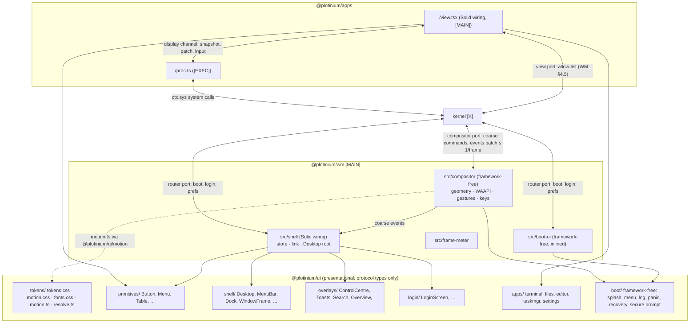

# UI implementation guide

| Field | Value |
|---|---|
| Title | UI implementation guide: component inventory, the compositor/Solid split, kernel wiring, vertical-slice order, asset pipeline and UI test plan for Plotinium's Liquid Glass shell |
| Status | Draft v0.1, 2026-09-25 |
| Primary owner | R3 WM/UI |
| Secondary reviewer | R5 QA/DevOps & Integration (test plan, budgets, visual and axe evidence). R1 Kernel also reviews §3.5 and §3.6 (main-thread budget, ports) |
| Must be demonstrable at | **P2 gate (W7, v0.2.0):** slices S0–S6 of §3.7: tokens and primitives, boot splash v1, login, desktop (menu bar, dock, windows with traffic lights), Terminal, Files CRUD, Settings About and Appearance; axe clean and visual baselines in both themes; the 10-window drag trace with the real chrome. **P3 gate (W11, v0.3.0):** S7–S10: boot menu, verbose log, kernel panic, recovery console, menu-bar status items, Control Centre, notifications, Task Manager, Editor banners, window overlays, `su` secure prompt, offline login. **P4 gate (W14, v0.4.0):** S11–S12: Files semantic search, Search palette, kernel-confirmation surface, Settings Privacy & AI, Task Manager Predictions, Overview and switcher, update and shutdown. **Final defence (W17–18, v1.0.0):** S13 polish on the examiner's machine. |
| Requirement IDs covered | Implements, owned elsewhere: WM-01 … WM-07, PROC-05 (frame part), BOOT-01, BOOT-02 (visual), BOOT-04, BOOT-05, BOOT-06, BOOT-08, BOOT-13, BOOT-14, OFF-01, OFF-03, OFF-04, OFF-05, VFS-07, VFS-09, VFS-10, MEM-01, MEM-03 (restore visuals), MEM-07, PROC-03, PROC-08, PRE-05, PRE-06, RAG-06, AGT-03, AGT-08, PLT-ID-06; DSN-01 … DSN-20; WMD-01 … WMD-23. Plotinium design: UIG-01 … UIG-24 |
| Related specs | [Window manager](./window-manager.md) · [UI design system](./ui-design-system.md) · [Boot and services](../02-boot/boot-and-services.md) · [Shell and terminal](../07-shell/shell-and-terminal.md) · [Identity and branding](../00-product/identity-and-branding.md) · [System-call ABI](../01-architecture/syscall-abi.md) · [Architecture](../01-architecture/architecture.md) · [Testing and performance](../13-quality/testing-and-performance.md) · [Requirements traceability](../00-product/requirements-traceability.md) · [Agentic shell](../10-ai/agentic-shell.md) · [RAG semantic search](../10-ai/rag-semantic-search.md) · [Predictive pre-fetch](../10-ai/predictive-prefetch.md) · [Offline and sync](../06-sync/offline-and-sync.md) · design sources [docs/design/stitch/](../../docs/design/stitch/) · tick list [docs/design/ui-checklist.md](../../docs/design/ui-checklist.md) |

**Conventions.** RFC 2119 keywords as in the capstone specification (p. 3). **Spec** marks an obligation copied from the capstone specification with its section and ID; **Plotinium design** marks our own binding choice. Numbers from the AI-run prototype are marked *(pilot figure — re-measure on the lab machine)*. "Stitch notes" means `docs/design/stitch/<slug>/notes.md`; "reference render" means that folder's `reference.html` / `reference.png`. Component paths are relative to the repository root. Thread tags: **[MAIN]** main thread, **[K]** kernel worker, **[EXEC]** executor worker.

---

## 1. Purpose and scope

This guide turns the Stitch design set (24 screens in `docs/design/stitch/`) and the normative UI specs into one buildable plan for the five engineers. It is normative for **how** the UI is built; the owning specs stay normative for **what** it must do. It fixes:

1. the **component inventory**: every presentational component with its file under `ui/src/{primitives,shell,overlays,login,apps,boot}`, its props, the kernel events and system calls that feed it (and which layer feeds them), its DOM structure, the tokens it uses, its named animations and its ARIA and keyboard behaviour (§3.4);
2. the **split between the framework-free compositor and Solid** for opening, closing, minimising, restoring and maximising windows: the compositor drives the Web Animations API on `transform` and `opacity`; `WindowFrame` supplies the chrome (§3.5);
3. the **integration wiring**: how `apps/<app>/view.tsx` and `wm/src/shell` connect `@plotinium/ui` components to the kernel through `@plotinium/kernel/sys`, the display channel and kernel events (§3.6);
4. the **implementation order** as vertical slices mapped to phases and requirement IDs (§3.7);
5. the **asset pipeline**: fonts, icons, the logo, wallpapers (AVIF/WebP with a byte budget) and the inlined, framework-free boot splash inside the 60 KB boot-critical JavaScript budget (§3.8);
6. the **UI testing plan**: component tests, visual regression per screen in both themes, axe, reduced-motion snapshots and the 10-window drag trace (§3.9).

The per-screen, per-element, per-state and per-animation tick list is [docs/design/ui-checklist.md](../../docs/design/ui-checklist.md) (UIG-24).

**Precedence.** Capstone specification > canonical decisions C1–C18 > the owning spec ([window-manager.md](./window-manager.md) for window behaviour, [ui-design-system.md](./ui-design-system.md) for visuals and strings, [boot-and-services.md](../02-boot/boot-and-services.md) for boot, [shell-and-terminal.md](../07-shell/shell-and-terminal.md) for the Terminal) > this guide > Stitch notes > reference renders. The user's design direction (macOS Liquid Glass era, violet accent, the "Bohr P" atom logo, self-hosted Inter and JetBrains Mono) changes some normative values of the owning specs. §3.1 records each change as a decision `D-nn` with what to build now; §9.2 sends the matching cross-spec request. Until the owning spec is updated, reviewers check code against §3.1; nothing in §3.1 relaxes a **Spec** obligation.

**State of the design sources (read first).** Stitch returned **no screen** for any slug: every `generate_screen_from_text` call on 2026-09-24 timed out or returned only a session id, and `list_screens` stayed empty (see each `screen.json`). The folders therefore hold `notes.md` plus a **hand-built** `reference.html` and `reference.png` made from the same prompts and the two design systems (dark `assets/10121591451242352758`, light `assets/3690503530025860907`, project `12849137298552292712`); the files are named `reference.*`, not `screen.html` / `screenshot.png`. Exceptions: `files-light` and `files-semantic-search` have notes and `screen.json` only (no render); `recovery-console` and `unsupported-browser` have no `screen.json`. The reference renders are the visual target; where a note contradicts a rule in this guide (for example an ambient loop, a spinner or `Alt+Tab`), this guide wins and the checklist says what to build instead.

**Out of scope.** Window behaviour (focus, z-order, clamping, snapping maths, secure-prompt isolation) is owned by [window-manager.md](./window-manager.md); token values by `ui/src/tokens/tokens.css` and [ui-design-system.md](./ui-design-system.md); boot stages, progress maths and boot messages by [boot-and-services.md](../02-boot/boot-and-services.md); TTY and shell semantics by [shell-and-terminal.md](../07-shell/shell-and-terminal.md); syscall schemas by `protocol/` and [syscall-abi.md](../01-architecture/syscall-abi.md); the frame-trace harness by [testing-and-performance.md](../13-quality/testing-and-performance.md).

---

## 2. Requirements table

| ID | Summary | Spec § | How verified |
|---|---|---|---|
| UIG-01 | Plotinium design. Presentational components live under `ui/src/{primitives,shell,overlays,login,apps,boot}`. Kernel wiring lives only in `wm/src/shell/**` and `apps/<app>/view.tsx`. `ui/` imports `@plotinium/protocol` **types** only and touches no storage, worker or network global. | SYS-01, ARC-01 | ESLint `plotinium/boundaries/ui`; review |
| UIG-02 | Plotinium design. Components are controlled: every visible value arrives as a prop; every user action leaves as an `on<Intent>` callback. No component fetches, subscribes to kernel events, persists anything or runs a timer over kernel data; countdowns and clocks receive absolute timestamps plus a `now` prop from the wiring. Interaction-local timers (hover intent, tooltip delay, a confirm pill reverting after 3 s) are allowed. | SYS-01 | `UI-*` unit tests; review |
| UIG-03 | Plotinium design. `ui/src/boot/**` is framework-free: no Solid, JSX, `lucide-solid`, xterm or CodeMirror; DOM is built with text nodes only; no `@keyframes`, CSS `animation`, `setTimeout` or `setInterval`. It is exported only through `@plotinium/ui/boot`, which `wm/src/boot-ui` and `wm/src/compositor` may import. | C11, DSN-14, SVC-10 | Requested ESLint scope and `tools/check-boot-truth.ts` scope extension (§9.2); `UI-boot` tests |
| UIG-04 | Plotinium design. No `ui/` component takes or writes a window's `x`, `y`, `w`, `h` or `z`. `WindowFrame` hands its element references to the compositor and styles itself from `data-*` state only. | WM-01, WMD-01 | `no-geometry-style` lint; `UI-WindowFrame` tests |
| UIG-05 | Plotinium design. Only `transform` and `opacity` animate, with no exception (progress fills, including the boot bar, use `scaleX`; see D-07). Animations use the named classes of `ui/src/tokens/motion.css` or the keyframe table of `ui/src/tokens/motion.ts`; durations and easings are motion tokens; `will-change` is set only while an animation runs. | WM-03, PROC-05 | CSS scan test `UIG-05`; trace |
| UIG-06 | Plotinium design. Every animation has a reduced-motion fallback. Under `prefers-reduced-motion: reduce` or `:root[data-motion="reduce"]` no `Animation` with a duration above 0 is created, the end state appears in the next frame, and no information is lost. | DSN-05, BOOT-13, WCAG 2.3.3 | e2e `document.getAnimations()`; reduced-motion snapshots |
| UIG-07 | Plotinium design. No infinite animation exists except the Terminal cursor blink and the Editor caret blink, both off under reduced motion. Every other repeat is bounded (at most 3 passes and 5 s). No Plotinium screen uses a spinner: busy states are text ("Checking password") or determinate bars and rings driven by real counts (the existing `Spinner` primitive stays out of every screen of §3.4). | WCAG 2.2.2, DSN-07 | CSS scan for `infinite`; e2e idle check (no running animation 6 s after load) |
| UIG-08 | Plotinium design. `backdrop-filter` is used only by the menu bar, dock, menus and popovers, Control Centre, notifications and toasts, the Search palette, sheets and dialogs, and HUDs (app switcher, frame meter). Window frames use the static tint `--pl-glass-window-bg`. A dragging window drops its heavy shadow. Windows have `contain: layout paint`. Blur values never animate. | WM-03, PROC-05 | CSS scan `UIG-08`; 10-window trace |
| UIG-09 | Plotinium design. Every component renders correctly in light and dark (`prefers-color-scheme` and `[data-theme]`), in forced colours, with reduced transparency (`prefers-reduced-transparency` and `[data-transparency="reduce"]`) and at 200 % zoom. | DSN-04, WM-07 | Visual matrix (§3.9.2); axe |
| UIG-10 | Plotinium design. Each component has the roles, names, keyboard behaviour and focus ring listed in §3.4; targets are at least 24 × 24 CSS px; state is never conveyed by colour alone; live regions are throttled (at most one announcement per 750 ms for boot, per 2 s elsewhere; latest wins). | WM-07, WCAG 2.2 AA | `UI-*` tests; axe; manual keyboard and screen-reader pass per gate |
| UIG-11 | Plotinium design. Status and error text is produced by pure formatter functions (`ui/src/**/format.ts`) from typed data and unit-tested against the exact strings of [window-manager.md §3.11](./window-manager.md) and [ui-design-system.md §3.8](./ui-design-system.md). Components never compose status strings inline. | DSN-12, OFF-04 | `UI-format` tests |
| UIG-12 | Plotinium design. User-supplied text (file names, snippets, process names, plans, notification bodies) renders as text nodes; no `innerHTML`, `outerHTML`, `insertAdjacentHTML` or `srcdoc`. The Markdown preview builds nodes from a parsed tree. | DSN-09 | `no-html-sinks` lint; XSS fixture test |
| UIG-13 | Plotinium design. Updates cost O(changed): `<For>`/`<Index>` keyed lists, `reconcile`/`produce` store updates, no layout read inside render or per-frame effects, lists above 2,000 rows virtualised. A `pointermove` during a window gesture causes zero Solid computations. | DSN-19, WMD-04, WMD-20 | `UI-WindowFrame` computation-count test; DSN-19 perf test |
| UIG-14 | Plotinium design. Every area has a gallery page `ui/gallery/pages/<area>.tsx` with realistic data, a theme toggle, a reduced-motion toggle and a reduced-transparency toggle, plus one full-screen story per Stitch slug at 1440 × 900. `pnpm --filter @plotinium/ui gallery:build` passes in CI. | — | CI job; §3.9.2 |
| UIG-15 | Plotinium design. Every Stitch slug has visual baselines for {light, dark} × {settled, reduced motion}; a diff above 0.2 % of pixels fails. | DSN-20 (visual part) | `tests/visual/**` (§3.9.2) |
| UIG-16 | Plotinium design. Text on glass sits on a tint of at least 55 % (dark) or 60 % (light) opacity and reaches 4.5:1 (text) or 3:1 (glyphs, borders, focus ring) over both the darkest and the lightest wallpaper region under that surface. | DSN-03 | Contrast test over sampled wallpaper pixels |
| UIG-17 | Plotinium design. Budgets of §3.8.6: inlined boot-ui ≤ 16 KB gzip (splash-critical part ≤ 6 KB), desktop-shell chunk ≤ 32 KB gzip, no font request before the login screen, wallpaper bitmaps within the §3.8.4 byte budget and never on the boot path. | BOOT-10, C13, DSN-10 | Bundle-budget job; network log in e2e |
| UIG-18 | Plotinium design. Every UI test title begins with a requirement ID or `UI-<Component>` (for example `UI-Dock moves focus with ArrowRight and activates with Enter`). | C18 | `tools/traceability.ts` once the prefixes are registered (§9.2) |
| UIG-19 | Plotinium design. The `su` secure prompt, the kernel-confirmation strip and (only if an ADR approves it) the agent confirmation sheet are framework-free builders from `@plotinium/ui/boot`, rendered by the compositor inside a closed shadow root on `--pl-z-secure`. No Solid component can render them. | WMD-17, DSN-16, C10, C12 | WMD-17 tests |
| UIG-20 | Plotinium design. A window has chrome mode `titled` (own title bar) or `unified` (the app's toolbar is the title bar). In `unified` windows the app marks drag regions with `data-pl-drag-region`; controls inside a region never start a drag; a double-click on any drag region toggles maximise. | WM-04 | `UI-WindowFrame` tests; WM-04 e2e |
| UIG-21 | Plotinium design. The new bindings of D-11 avoid keys reserved by Chrome or the lab OS; `⌘` is never shown; every binding appears in Settings → Keyboard and `help`. | WMD-08 | Keyboard e2e; W5 key audit |
| UIG-22 | Plotinium design. The compositor's WAAPI keyframes (`ui/src/tokens/motion.ts`) equal the window keyframes of `motion.css`, and both read durations and easings from the same tokens. | UIG-05 | `UI-motion parity` test |
| UIG-23 | Plotinium design. A component that shows live data shows a stale state (dimmed values plus "last update hh:mm:ss") when its source stops, never a frozen number without notice. | DSN-12 | `UI-*` stale-state tests |
| UIG-24 | Plotinium design. Each screen passes its section of [docs/design/ui-checklist.md](../../docs/design/ui-checklist.md) before the gate that ships it; the ticked checklist is attached to the gate evidence. | — | Review at P2, P3, P4 |

---

## 3. Design (normative)

### 3.1 Design-direction decisions that change owning specs

The user's direction is the latest macOS (Liquid Glass era): a glass menu bar, a floating glass dock with magnification, traffic-light window controls on the left, vibrancy sidebars, large soft shadows, spring animations and meticulous detail, under Plotinium's own identity (no Apple logo, Apple app names, SF Symbols or SF Pro). The table records every place where that direction, or a correction to the Stitch notes, departs from a normative value. "Build now" is binding for code review; the right-hand column is the request in §9.2.

| # | Decision (Plotinium design) | Replaces | Build now | Request to |
|---|---|---|---|---|
| D-01 | **Menu bar + dock replace the taskbar.** A 28 px glass menu bar (`--pl-menubar-h`) at the top holds the atom menu, the focused app's name and menus, and the status group (the old tray). A floating glass dock at the bottom holds the task groups (WMD-10). The launcher becomes the atom menu plus Search. | DSN §3.8.7; WM §3.10–§3.11 (taskbar, tray, launcher) | Work area `{x: 0, y: menubarH, w: innerWidth, h: innerHeight − menubarH − dockReserve}` with `--pl-dock-reserve` 84 px; maximised windows stop above the dock (WCAG 2.4.11). Grouping, count badge, attention, click semantics and every tray string of WM §3.10–§3.11 are kept, only moved. Compact mode (< 800 px) keeps the menu bar, shrinks dock icons to 40 px and maximises windows. | WM §3.6, §3.10, §3.11; DSN §3.8.7 |
| D-02 | **Traffic lights on the left.** Close, minimise and zoom are 12 px circles (`--pl-traffic-size`) inside 24 × 24 px hit targets; glyphs (×, −, ⤢) appear on group hover and on keyboard focus; unfocused windows show all three in `--pl-traffic-idle`. Zoom toggles maximise. The window-menu button and the 3 px accent focus strip are dropped. Focus stays visible through coloured lights, the focused shadow tier, full-strength title text and the dim layer on unfocused content (WM-02). The window menu opens with `Alt+W`, `Shift+F10`, the context-menu key or a right-click on the title bar or a drag region (WCAG 2.5.7). | DSN §3.8.8 title bar | `WindowFrame` + `TrafficLights` (§3.4.2) | DSN §3.8.8 |
| D-03 | **Accent violet.** `--pl-accent` `#5E5CE6` (dark) and `#5856D6` (light); accent used as text is `--pl-accent-text` (`#A5A4FF` dark, `#4F4DC9` light) so it reaches 4.5:1. | DSN §3.3 orbit blue | Tokens as in `ui/src/tokens/tokens.css` | DSN §3.3–§3.4 (contrast table recomputed) |
| D-04 | **The logo is the "Bohr P"** ([docs/design/logo/DECISION.md](../../docs/design/logo/DECISION.md), 2026-09-27; it replaced the two-orbit luminous atom, which blurred at 16–20 px): one electron shell around a dense nucleus, open where the single electron sits, with a stem on its left so the atom is also the P of Plotinium (`ui/src/icons/atom-logo.ts`). Four filled shapes on a 24-unit grid, no strokes; edges are hinted to whole pixels at 16, 20, 24, 32 and 48 px, and the favicon is redrawn on its own 16-unit grid. A mono `currentColor` variant is used under forced colours and below 20 px. | Identity §3.6 ("plotted point on an orbit", no gradients, "glowing" banned); DSN-01 | Every screen uses the atom (the `editor-conflict` and `task-manager-processes` references still draw the ring and must be switched) | Identity §3.6, PLT-ID-03, PLT-ID-16; DSN-01 |
| D-05 | **Self-hosted fonts (D15).** Inter 4 variable with the optical-size axis (UI) and JetBrains Mono variable (Terminal, Editor, code) from `@fontsource-variable`, bundled by Vite and served from our origin (`ui/src/tokens/fonts.css`; record: `docs/design/fonts/DECISION.md`). No font file is requested by the boot-ui, which uses the system stack and an outlined SVG wordmark; no font is preloaded. | DSN-06 ("system font stacks only, no web-font download") | §3.8.1 | DSN-06 and its test title |
| D-06 | **Materials.** Glass (translucent tint + `backdrop-filter`) only on the UIG-08 surfaces; static tint on windows; soft gradients and glows are allowed as decoration (wallpaper, logo, dock icons, accent glow on primary buttons) but never carry information, never animate `filter` or blur, and all collapse to solid surfaces under reduced transparency and forced colours. | DSN-01 ("no gradients, glows") | Tokens `--pl-glass-*`; `GlassSurface` primitive enforces the allowlist | DSN-01 |
| D-07 | **Motion.** Springs are CSS `linear()` curves with `cubic-bezier` fallbacks (`--pl-ease-spring`, `--pl-ease-spring-bouncy`, `--pl-ease-spring-soft`); named one-shot classes live in `ui/src/tokens/motion.css`; window transitions are WAAPI animations started by the compositor from `ui/src/tokens/motion.ts` (§3.5). Progress fills (boot bar included) animate `transform: scaleX()`, never `width`, and never with a spring (an overshoot would show more progress than is true, BOOT-02). The boot path uses CSS transitions only (SVC-10). | DSN §3.6 motion table (boot bar `width`, three cubic-beziers) | §3.5, §3.4.6 | DSN §3.3, §3.6 |
| D-08 | **No loops.** Rejected from the Stitch notes: the login wallpaper drift, halo "breathing", pulsing status dots, the "verifying" sweep, the About logo's continuous orbit rotation, the looping speculative hatch, looping skeleton shimmer, the braille planning spinner and every spinner. Replacements: one-shot transitions, static hatches, static skeletons (or at most 3 sheen passes), stage text. | Stitch notes (several) | UIG-07; checklist marks each replacement | — |
| D-09 | **Honest busy states.** "Checking password" → "Loading your desktop" on the sign-in button; "Restarting…", "Checking…", "Exporting…" labels; determinate bars and rings only where real counts exist (DSN-07). | Stitch spinners | UIG-07 | — |
| D-10 | **Toasts top-right**, 8 px under the menu bar, in the same column as the notification centre, newest on top, at most 3 visible. Timers, stickiness, pause-on-hover and "never cover the focused element" are unchanged. The 4 px level rule is replaced by a level glyph plus text in the accessible name. | WM §3.17 and WMD-18 placement; DSN §3.7 toast rule | `ToastStack` (§3.4.3) | WM §3.17; DSN §3.7 |
| D-11 | **Keyboard additions** (pending the W5 key audit, WM §3.9 rule 5): Search `Ctrl+Space` (alternate `Alt+S`); Overview `Alt+O`; Control Centre `Alt+C`; focus the menu bar `Alt+B` (`F10` is reserved by Chrome); focus the dock `Alt+N` (the spec's taskbar key). No surface uses or shows `Alt+Tab`, `Ctrl+W`, `Ctrl+T`, `Ctrl+N`, `Ctrl+Tab`, `F6`, `F10` or `⌘`; the Stitch hints that do are rewritten (`Ctrl` for `⌘`, `Alt+`` ` for `Alt+Tab`). | WM §3.9 table | Compositor key table; hints via `Kbd` | WM §3.9 |
| D-12 | **Selected rows** in a focused list are solid accent (`--pl-selection`) with white text (`--pl-on-selection`); when the list is not focused they use `--pl-selection-idle`. | DSN §3.7 (accent-subtle rows) | `Table`, `Listbox`, `SidebarList` | DSN §3.7 |
| D-13 | **Section lists follow the specs.** Task Manager tabs: `Processes`, `Memory`, `Predictions`, `Services`, `Performance` (the Stitch variants "Scheduler" and "AI" are not used). Settings sections: the DSN §3.8.14 list (About, Appearance, Memory, Scheduler, Privacy & AI, Boot, Keyboard, Accessibility, Accounts, Developer, Help); the Stitch-only sections (General, Desktop & Dock, Network & Sync, Users & Groups, Storage, Updates) are not built in v1, and the Appearance "accent colour" dots are dropped (the accent is the brand). | Stitch notes | §3.4.5 | — |
| D-14 | **Agent confirmation stays in the TTY.** v1 builds the kernel-written block in the Terminal plus the compositor's kernel-confirmation strip and the menu-bar secure indicator (C12, DSN §3.8.15). The clickable `agent-confirm-sheet` is a design exploration: it is built only after an ADR approves it, and then only as a compositor-drawn, framework-free surface on `--pl-z-secure` whose buttons call the kernel confirm path, with the TTY prompt still active and the first answer winning. | Stitch `agent-confirm-sheet` | Strip + indicator only | New ADR; DSN §3.8.15; agentic-shell |
| D-15 | **One TTY per Terminal window.** No tab strip and no suggestion popover in v1 (completion prints in the TTY, SHL spec §3.10). The optional status strip (agent pid, last txn, size) is P4. The title is `alice@plotinium: ~/notes`, set by `term`. | Stitch `terminal-ai` tabs and popover | §3.4.5 | — |
| D-16 | **Overview without desktops.** The desktops strip ("Desktop 1", "+") is behind a feature flag and hidden in v1 (one desktop, WM §3.15). | Stitch `overview-switcher` | §3.4.3 | WM (Overview itself is new: §9.2) |
| D-17 | **Login controls.** Power row `Restart` and `Shut down` only (a browser cannot sleep the machine, so `Sleep` is dropped); no Wi-Fi or battery glyphs (the page cannot know them honestly); no language picker (single locale in v1); `Forgot password?` opens a text popover ("Ask an administrator to reset your password"). Errors always read `Invalid username or password`. | Stitch `login-*` | §3.4.4 | — |
| D-18 | **Files follows the VFS.** Context-menu `Delete…` with a confirmation naming the count and total size (DSN §3.8.11), not "Move to Trash" (there is no GUI trash in the VFS spec); no Tags section (no tags in the VFS). Places are `Home`, `Shared`, `Temporary`, `Root`. | Stitch `files-*` | §3.4.5 | VFS spec if a trash is wanted later |
| D-19 | **Recovery console without window controls.** The windowed layout of `recovery-console` is kept (top bar, action sidebar, main pane), but without traffic lights, because there is no window manager in recovery. Keys follow boot spec §3.8 (`F`, `Y`, `C`, `S`, `M`, `L`, `D`, `N`, `B`). Destructive actions use the two-step confirmation of DSN §3.8.5. | Stitch `recovery-console` | §3.4.6 | — |
| D-20 | **Unsupported browser variants.** Fatal: the spec title `Plotinium cannot start in this browser`, no Continue. Degradable-only results do not stop the boot (a `WARN` line only); the card with "Continue in degraded mode" is shown only with `?boot=verbose`. | Stitch `unsupported-browser` | §3.4.6 | — |
| D-21 | **Boot-menu countdown** uses one ring segment per second, so it works for 3 s (DSN §3.8.2) or 5 s (boot spec §3.7). Until the W5 question is closed, build 5 s. | DSN vs boot spec | §3.4.6 | DSN §3.8.2 |
| D-22 | **Frame meter HUD** sits top-right under the menu bar (WMD-19) and shifts left of an open Control Centre or popover; one position, no corner setting. | Stitch `offline-lock-states` (bottom-right) | §3.4.3 | — |
| D-23 | **One tokens file** is `ui/src/tokens/tokens.css` (values), with `motion.css` (keyframes and classes that read those values) and `fonts.css`. `wm/src/tokens/` keeps only a README pointing there. | DSN §3.2 (`wm/tokens/tokens.css`) | Import `@plotinium/ui/tokens.css` and `@plotinium/ui/motion.css` | DSN §3.2; identity §3.12 |
| D-24 | **Chrome metrics** come from tokens: title bar `--pl-titlebar-h` 38 px, unified toolbar `--pl-toolbar-h` 52 px, window radius `--pl-radius-win` 14 px (0 when maximised, full-screen or on a snapped edge), row and control height 28 px. | DSN §3.3 (32 px, 10 px) | Tokens | DSN §3.3 |
| D-25 | **Search is an app.** The Search palette is the view of a `search` process (so every query goes through system calls, SYS-01), opened in a chrome-less window of kind `palette` that the compositor centres on `--pl-z-search`. | Stitch (system overlay) | §3.6.5 | WM §4.3 (`create.kind`) |

### 3.2 Layers and packages



Rules (Plotinium design):
1. **`ui/` renders; it never decides.** It holds layout, styling, motion, accessibility semantics and pure formatters. Which window is focused, what the kernel said, what the user may do: all of it arrives as props.
2. **`wm/src/shell` wires system UI** (desktop, menu bar, dock, window chrome, overlays, login) to the compositor and the router. It owns the Solid store of coarse state and the interaction timers that depend on kernel data (toast timers, 1 Hz countdown redraw, the clock).
3. **`apps/<app>/view.tsx` wires one app window**: it turns display-channel snapshots and patches into a store, renders the app component from `ui/src/apps/<app>/`, and turns intents into display-channel `input` messages or allow-listed view-port calls.
4. **`wm/src/compositor` and `wm/src/boot-ui` stay framework-free.** They may import `@plotinium/ui/boot` and `@plotinium/ui/motion` (both framework-free subpaths), never the package root, which pulls Solid.
5. **Imports into `ui/`** are limited to `solid-js`, `lucide-solid`, `@xterm/*`, `@codemirror/*`, the fontsource CSS and `import type` from `@plotinium/protocol` (ESLint-enforced, UIG-01).

### 3.3 Component conventions

- **Files.** One folder per component: `ui/src/<area>/<kebab-name>/<Name>.tsx`, `<Name>.module.css`, `<Name>.test.tsx` (the layout the primitives already use, e.g. `ui/src/primitives/toggle/`); shared helpers in `ui/src/<area>/internal/`; one barrel `index.ts` per area; the package root `ui/src/index.ts` re-exports every Solid area; `ui/src/boot/index.ts` is the framework-free entry (`@plotinium/ui/boot`). Shorter paths in §3.4 (for example `WindowFrame.tsx`) mean `ui/src/<area>/<kebab-name>/<Name>.tsx`.
- **Props.** An exported `interface <Name>Props`. Never destructure props: `splitProps` for pass-through, `mergeProps` for defaults. Controlled values (`value`, `open`, `selected`) with `on<Intent>` callbacks (`onSelect`, `onCommit`, `onDismiss`). Callbacks receive plain data, never DOM events, except `onContextMenu(target, point)`.
- **State styling.** CSS reads `data-state`, `data-tone`, `data-focused`, `data-dragging` and ARIA attributes; inline `style` is used only for custom properties on a component's own elements (`--pl-stagger-index`, `--pl-seg-x`, a magnification scale), never for window geometry.
- **CSS.** CSS Modules in `@layer shell` (system UI) or `@layer apps` (app components), using only `--pl-*` tokens (DSN-02: no raw colour, font size, radius, shadow, duration or z-index). Hairlines use `--pl-hairline-width`. Numbers in tables use `font-variant-numeric: tabular-nums`.
- **Icons.** `lucide-solid` imported per icon (`import Wifi from 'lucide-solid/icons/wifi'`) at `--pl-icon-sm|md|lg`, `stroke-width` 1.75, `aria-hidden="true"`; icon-only buttons carry a visible tooltip and an `aria-label`. App icons and the logo come from `ui/src/icons` (`AppIcon`, `AtomLogo`).
- **IDs** from `createUniqueId()`; label and description links use them (`aria-labelledby`, `aria-describedby`).
- **Focus.** Every focusable element shows `outline: var(--pl-focus-ring); outline-offset: var(--pl-focus-offset)` on `:focus-visible` (set globally in `tokens.css`; components must not remove it). Composite widgets use roving `tabindex` or `aria-activedescendant` as listed per component.
- **Motion.** Add a `.pl-anim-*` class for the length of one animation and remove it on `animationend`, or use a CSS transition keyed off a `data-*` attribute; never keep `will-change` after the animation.
- **Strings.** Fixed chrome labels (`Close`, `Minimise`, `Clear all`) live in the component; status and error sentences come from the area's `format.ts` (UIG-11). Keyboard hints use `Kbd` with the platform-neutral names (`Ctrl`, `Alt`, `Shift`, `Enter`, `Esc`).
- **Tests.** `UI-<Name> …` titles; query by role and name; drive the keyboard with `fireEvent.keyDown`; assert callbacks with `vi.fn()`; set `document.documentElement.dataset.motion = 'reduce'` for the reduced-motion case.

Reference implementations of these conventions already exist (`ui/src/primitives/toggle/Toggle.tsx`, `ui/src/primitives/table/Table.tsx`). Minimal skeleton for a primitive still to build (normative shape):

```tsx
// ui/src/primitives/meter/Meter.tsx
import { createUniqueId, splitProps, type JSX } from 'solid-js';
import { cx } from '../internal/cx.ts';
import styles from './Meter.module.css';

export interface MeterProps {
  value: number;
  min: number;
  max: number;
  label: string;
  /** Words for assistive technology, e.g. "198 of 256 MB, 77 percent". */
  valueText: string;
  thresholds?: { warn: number; danger: number };
  class?: string;
}

export function Meter(props: MeterProps): JSX.Element {
  const [local] = splitProps(props, ['value', 'min', 'max', 'label', 'valueText', 'thresholds', 'class']);
  const id = `pl-meter-${createUniqueId()}`;
  const ratio = (): number => (local.value - local.min) / (local.max - local.min || 1);
  const tone = (): 'ok' | 'warn' | 'danger' => {
    const t = local.thresholds;
    if (t === undefined) return 'ok';
    return local.value >= t.danger ? 'danger' : local.value >= t.warn ? 'warn' : 'ok';
  };
  return (
    <div class={cx(styles.meter, local.class)} data-tone={tone()}>
      <span id={id} class={styles.label}>{local.label}</span>
      <div
        role="meter"
        aria-labelledby={id}
        aria-valuemin={local.min}
        aria-valuemax={local.max}
        aria-valuenow={local.value}
        aria-valuetext={local.valueText}
        class={styles.track}
      >
        {/* the fill scales inside a fixed track: transform only (UIG-05) */}
        <div class={styles.fill} style={{ '--pl-meter-ratio': String(ratio()) }} />
      </div>
    </div>
  );
}
```

### 3.4 Component inventory

How to read the tables:
- **Fed by** names the kernel events (`topic`) and system calls (`call()`) behind the props, and the wiring layer that turns them into props: **SH** = `wm/src/shell` (from the compositor port, the router port or the events batch), **CMP** = compositor coarse events, **V:<app>** = `apps/<app>/view.tsx` (from its process over the display channel, or its view port). Call names are those of `protocol/src/sys/names.ts`; where a spec uses another name, the spec name follows in brackets.
- **Motion** names a class from `motion.css` (`.pl-anim-*`), a transition on a token, or a WAAPI entry of `motion.ts`, then `→` the reduced-motion result.
- Tokens are listed by role; every component also uses `--pl-focus-ring` and the type scale.
- Exact strings are those of the owning spec; the checklist repeats them per screen.

#### 3.4.1 Primitives (`ui/src/primitives/`)

Primitives are generic; their data comes from the parent component.

Status on 2026-09-25: ✓ marks a primitive already in `ui/src/primitives/<kebab-name>/` (built in parallel by the primitives work; the file is authoritative for exact prop names, this table for behaviour). "(to build)" marks one that the slices of §3.7 still need. Shared helpers live in `ui/src/primitives/internal/` (`cx`, `computePosition`, `Floating`, `createPresence` for exit animations, `createDismissableLayer`, focus and list-navigation helpers, `prefersReducedMotion`).

| Component · file | Key props | DOM · tokens | Motion → reduced | ARIA · keyboard |
|---|---|---|---|---|
| **Button** `button/Button.tsx` ✓ | `variant: 'primary'\|'secondary'\|'tinted'\|'ghost'\|'danger'\|'destructive'`, `size?: 'sm'\|'md'\|'lg'`, `icon?`, `busyLabel?` (shown while `busy`; no spinner), `disabled?`, `reason?` (why disabled), `keyshortcut?`, `onPress()` | `<button type=button>` › icon › label (› busy label stacked); height `--pl-control-h` (sm `--pl-control-h-sm`), radius `--pl-radius-ctl`; primary `--pl-accent`/`--pl-on-accent`/`--pl-accent-hover`/`--pl-accent-pressed` + `--pl-accent-glow`; secondary/glass `--pl-control-bg`/`-hover`/`-pressed`; danger text and 1 px border `--pl-danger` | press `.pl-press` (scale .97, spring back); label ↔ busy label crossfade on `--pl-motion-fast` → instant swap | native button; `aria-disabled="true"` + `aria-describedby` → reason (stays focusable); `aria-keyshortcuts`; Enter/Space; danger is never the initial focus (DSN-15) |
| **IconButton** `icon-button/IconButton.tsx` ✓ | `label` (required), `icon`, `variant?: 'ghost'\|'glass'\|'bordered'`, `pressed?` (toggle), `tooltip?: boolean` (default true), `onPress()` | `<button>` 28 × 28 visual, ≥ 24 × 24 hit; ghost fill `--pl-control-hover` | `.pl-press` → none | `aria-label`; `aria-pressed` when a toggle; tooltip shows the label on hover/focus |
| **Toggle** (switch) `toggle/Toggle.tsx` ✓ | `checked`, `onChange(next)`, `label`, `description?`, `hideLabel?`, `disabled?`, `size?`; to add: `locked?: {reason}` (Privacy's locked switch) | `<button role=switch>` › track (off layer `--pl-toggle-off`, on layer `--pl-accent` stacked) › knob (`--pl-control-raised`, `--pl-control-raised-shadow`); label and description beside | knob `translateX` on `--pl-motion-med` `--pl-ease-spring-soft`; squash `.pl-anim-toggle-spring` on press; on-layer opacity → knob jumps, layer swaps | `aria-checked`; locked → `aria-disabled`, lock glyph, reason in `aria-describedby`; Space/Enter |
| **Checkbox** `checkbox/Checkbox.tsx` ✓ | `checked`, `mixed?`, `label`, `onChange(next)` | native `<input type=checkbox>` (visually replaced) + `<label>`; box `--pl-radius-xs`, `--pl-border`, checked `--pl-accent` | check glyph scale .5 → 1 on `--pl-motion-fast` `--pl-ease-spring-soft` → instant | native semantics; `aria-checked="mixed"` when `mixed` |
| **SegmentedControl** `segmented-control/SegmentedControl.tsx` ✓ | `options: {value, label, icon?, disabled?}[]`, `value`, `onChange(v)`, `mode: 'radio'\|'tabs'`, `label`, `panelIds?` (tabs) | `div role=radiogroup\|tablist` › thumb (one element; `--pl-seg-x`, `--pl-seg-w` custom properties measured once at mount and on `ResizeObserver`) › option buttons; track `--pl-control-bg`, thumb `--pl-control-raised` | thumb `translateX` + inner `scaleX` on `--pl-motion-med` `--pl-ease-spring` (label counter-scaled) → thumb jumps | radio: `role=radio`, arrows move and select, Home/End; tabs: `role=tab` + `aria-controls`, automatic activation |
| **TextField** `text-field/TextField.tsx` ✓ | `label`, `labelHidden?`, `value`, `onInput(v)`, `onCommit?(v)`, `error?`, `description?`, `mono?`, `type?`, `autocomplete?` | `<label>` › `<input>` › error line (icon + text); height `--pl-control-h`, `--pl-control-bg`, 1 px `--pl-border` (error `--pl-danger`) | focus ring `.pl-anim-focus-ring` → instant | visible or `aria-label`; error `aria-invalid` + `aria-describedby`; paste always allowed |
| **SearchField** `search-field/SearchField.tsx` ✓ | `label`, `value`, `onInput`, `onSubmit`, `onClear`, `onFocusChange?(on)`, `leading: 'search'\|'sparkle'`, `hint?` (`/`, `Ctrl+F`), `trailing?` (mode switch slot) | `<div role=search>` › icon › `<input type=search>` › clear button › hint keycap | clear button fade on `--pl-motion-fast`; sparkle one-shot rotate on focus (320 ms `--pl-ease-spring-soft`) → none | `aria-label`; Esc clears then blurs; `aria-controls` → results when given |
| **Select** `select/Select.tsx` ✓ | options, value, change callback, label (see the file) | button + listbox popup; popover material | popup `.pl-anim-menu-in` → instant | APG select-only combobox: Enter/Space/↓ open, arrows, type-ahead, Esc |
| **Slider** `slider/Slider.tsx` ✓ | `min`, `max`, `step`, `value`, `onInput(v)` (preview), `onCommit(v)` (release or key up), `valueText(v)`, `label`, `error?` | native `<input type=range>` styled; fill layer `transform: scaleX()` inside a fixed track; thumb `--pl-control-raised` | thumb grab scale 1.15 while held; keyboard step fill `scaleX` on `--pl-motion-fast` → jumps | native slider; `aria-valuetext` in words ("256 megabytes"); arrows, PageUp/PageDown, Home/End |
| **ProgressBar** `progress/ProgressBar.tsx` ✓ | `value` (0..1), `label`, `valueText`, `size: 'hairline'\|'sm'\|'md'`, `tone?`, `glintOnComplete?` | `div role=progressbar` › track (`--pl-control-bg`) › fill (`transform: scaleX(value)`, origin left; `--pl-accent`) | fill transition `transform --pl-motion-fast --pl-ease` (never a spring); completion glint `.pl-anim-progress-sweep` with `--pl-sweep-count: 1` → jump, no glint | `aria-valuenow` (integer %), `aria-valuemin=0`, `aria-valuemax=100`, `aria-valuetext`; no indeterminate variant exists (DSN-07) |
| **ProgressRing** `progress/ProgressRing.tsx` ✓ | `value` (0..1), `size: 16\|24\|64`, `label?`, `valueText?` | two half-disc masks rotated with `transform: rotate()` (transform only); track `--pl-control-bg`, arc `--pl-accent` | rotate on `--pl-motion-fast` `--pl-ease` → snaps | `role=progressbar` when labelled, else `aria-hidden` with the value in adjacent text |
| **Meter** `meter/Meter.tsx` (to build) | `value`, `min`, `max`, `label`, `valueText`, `thresholds?: {warn, danger}`, `segments?: {id, label, value, tone, pattern?: 'hatch'}[]`, `ticks?: {at, label}[]` | `div role=meter` › track › fill or stacked segments (each `scaleX` inside a fixed slot, positioned by `translateX`), tick marks; warn `--pl-warning`, danger `--pl-danger`; hatch is a static `repeating-linear-gradient` | segment `scaleX` on `--pl-motion-slow` `--pl-ease-out`; threshold crossing: one opacity pulse → instant | `aria-valuenow`/`min`/`max`/`valuetext` ("198 of 256 MB, 77 percent"); warn/danger also shown as text and icon (DSN-08); segments are a `role=list` of labelled items |
| **Badge / Pill** `badge/Badge.tsx` ✓ | `tone: 'neutral'\|'accent'\|'success'\|'warning'\|'danger'\|'info'`, `icon?`, `children` (text required), `variant?: 'solid'\|'subtle'\|'dashed'` | `<span>`, pill `--pl-radius-pill`, `--pl-<tone>-subtle` background, `--pl-<tone>` text, `--pl-text-xs` | optional mount `.pl-anim-pop-in` → none | text always present; icon `aria-hidden` |
| **StatePill** `state-pill/StatePill.tsx` (to build) | `state: ProcStateView` (`'running'\|'ready'\|'blocked'\|'stopped'\|'suspended'\|'new'\|'zombie'`, mapped from protocol `PState` plus the stop and reap flags by `formatProcState`), `reason?` | Badge with a fixed glyph per state (play `running`, clock `ready`, pause-circle `blocked`, moon `suspended`, square `stopped`, sparkle `new`, x `zombie`) | label crossfade old −4 px / new +4 px on `--pl-motion-fast` → swap | accessible name "Blocked, awaiting net:llm" |
| **Kbd** (keycap) `kbd/Kbd.tsx` ✓ | `keys: readonly string[]`, `variant?: 'cap'\|'plain'`; to add: `pressed?` | `<kbd>` per key, `--pl-font-mono`, `--pl-text-xs`, 1 px `--pl-border-subtle`, bottom edge `--pl-hairline`, radius `--pl-radius-xs` | pressed `translateY(1px) scale(.94)` on `--pl-motion-press` → tint only | keys `aria-hidden` when a sentence describes them; otherwise read as text ("Ctrl Space") |
| **Tooltip** `tooltip/Tooltip.tsx` ✓ | `content`, `anchor`, `placement?`, `openDelayMs?` (300; 0 on focus) | `div role=tooltip`; tint `--pl-glass-popover-bg` without blur, `--pl-shadow-tooltip`, `--pl-z-tooltip` | `.pl-anim-tooltip-in` → instant | `aria-describedby` on the anchor; Esc dismisses; hoverable and persistent (WCAG 1.4.13) |
| **Menu / ContextMenu** `menu/Menu.tsx` ✓ | `items: MenuItemModel[]` (§4.3), `label`, `anchor: HTMLElement \| {x, y}`, `onSelect(id)`, `onClose(reason)` | `div role=menu` › `role=menuitem\|menuitemcheckbox\|menuitemradio` (icon, label, `Kbd` shortcut, submenu chevron) and `role=separator`; one highlight pill element; material `popover` (backdrop allowed), `--pl-radius-lg`, `--pl-shadow-pop`, rows `--pl-row-h` | open `.pl-anim-menu-in`, close `.pl-anim-menu-out`; highlight FLIP `translateY` 80 ms; confirm blink (opacity 1 → .4 → 1, 90 ms) then close; submenu `translateX(-6px)` → 0 → all instant, no blink | APG menu: arrows, Home/End, type-ahead, Enter/Space, → opens and ← closes a submenu, Esc closes and returns focus; disabled items stay focusable with the reason in `aria-describedby`; `aria-keyshortcuts` |
| **Popover** `popover/Popover.tsx` ✓ (positioning in `internal/position.ts`, `Floating`) | `open`, `anchor`, `placement`, `label`, `arrow?`, `onClose()`, `children` | `div role=dialog aria-modal=false`, material `popover`, `--pl-radius-lg`, `--pl-shadow-pop`, `--pl-z-popover`; position computed once on open from `anchor.getBoundingClientRect()` and written as the popover's own `transform` | `.pl-anim-popover-in` / `.pl-anim-popover-out` (origin at the anchor) → instant | Esc and outside click close and return focus to the anchor; focus moves in only when opened from the keyboard |
| **Dialog / AlertDialog** `dialog/Dialog.tsx` ✓ (`modal.ts`) | `open`, `title`, `description?`, `destructive?` (→ `alertdialog`), `actions: {id, label, variant, default?}[]`, `safeActionId`, `onAction(id)`, `onDismiss()` | scrim `--pl-scrim` › `div role=dialog\|alertdialog aria-modal=true` material `sheet`, `--pl-radius-sheet`, `--pl-shadow-dialog`, `--pl-z-popover` | `.pl-anim-scrim-in/out`, `.pl-anim-dialog-in/out`; scrim click nudges the dialog once (`translateX` 6 → −4 → 2 → 0 px, 240 ms) → no nudge, a status line says "Choose an option first" | focus trapped and restored; initial focus on the safe action (DSN-15); Esc = safe action; `aria-labelledby`/`aria-describedby`; `Ctrl+Enter` for the destructive action only where the screen says so |
| **Sheet** `sheet/Sheet.tsx` ✓ | as Dialog + `host` (the window content element) | drops from under the title bar inside a clip container; material `sheet`; rest of the window content `inert` | `.pl-anim-sheet-in/out` → instant | `role=dialog\|alertdialog aria-modal=true` scoped to the window; the menu bar and dock stay usable |
| **Banner** `banner/Banner.tsx` (to build) | `tone: 'info'\|'warning'\|'danger'\|'success'`, `icon?`, `title?`, `message`, `actions?: {id, label, variant}[]`, `onAction(id)`, `onDismiss?()` | full-width strip at the top of the content: `--pl-<tone>-subtle` tint, 1 px `--pl-<tone>` hairline border, icon + text + actions | enter `translateY(-8px)` + fade on `--pl-motion-slow` `--pl-ease-spring`; tone change crossfades two stacked tint layers; exit fade → present / removed at once | `role=status` (info, warning, success) or `role=alert` (danger); announced once on appearance |
| **Tabs** `tabs/Tabs.tsx` ✓ | `tabs: {id, label, badge?}[]`, `selected`, `onSelect(id)`, `label` | `div role=tablist` › `role=tab` buttons › one underline/thumb element; panels `role=tabpanel` | indicator `translateX`/`scaleX` on `--pl-motion-med` `--pl-ease-spring`; panel crossfade ±12 px on `--pl-motion-med` → instant | APG tabs: arrows, Home/End; no `Ctrl+PageUp/PageDown` (Chrome) |
| **Table** (data grid) `table/Table.tsx` ✓ | built: `columns: TableColumn[]` (`id`, `header`, `cell`, `sortValue`, `align`, `width`, `mono`), `rows`, `rowId(row)`, `label`, `sort`/`onSortChange`, `selectionMode`, `selected`/`onSelectionChange`, `onActivate(row)`, `striped`, `density`, `empty`; to add for Files and Task Manager: `onContextMenu(id \| null, point)`, `onDelete?(ids)`, `onRename?(id)`, `rowState?(row)` (`cut`, `pending`, `locked`, `dim`, `new`), `loading`, `error?`, virtualisation | `div role=grid aria-multiselectable` › header `role=row` of `role=columnheader` (sort button, `aria-sort`) › body rows `role=row aria-selected aria-rowindex` › `role=gridcell`; own windowing above 2,000 rows (fixed `--pl-row-h`, `aria-rowcount`); zebra `--pl-row-alt`; selection `--pl-selection` + `--pl-on-selection` when focus is within, `--pl-selection-idle` otherwise (D-12); static skeleton rows after 150 ms of `loading` | new row `translateY(-6px)` + fade (stagger ≤ 20 rows); re-sort FLIP `translateY` on `--pl-motion-slow` `--pl-ease-spring` when ≤ 40 rows move, otherwise instant; exit `translateX(16px)` + fade then FLIP; hover fill opacity → all instant | APG grid: arrows cell by cell, Home/End, PageUp/PageDown, Space toggles, Shift+arrow extends, Ctrl+A, Enter activates, F2 rename, Delete → `onDelete` (the parent confirms), Shift+F10/context key; re-sort frozen while the pointer is over the grid or a row has focus |
| **Listbox** `listbox/Listbox.tsx` (to build; `Select` keeps a private one) | `groups: {id, label?, options: OptionModel[]}[]`, `activeId`, `onActive(id)`, `onPick(id, how)`, `label`, `focusOwner?: 'self'\|'external'` | `div role=listbox` › `role=group` (labelled) › `role=option aria-selected`; one shared highlight element | highlight FLIP `translateY` (and `scaleY` for uneven rows) on 180 ms `--pl-ease-spring` → jumps | `aria-activedescendant` on the listbox, or on the external combobox input; arrows, Home/End, Enter |
| **ListGroup / ListRow** `list/List.tsx` ✓ | grouped inset list and its rows (label, description, trailing control) | Settings panes, About, popovers; `--pl-glass-card-bg`, hairline separators | row hover fill → instant | a `section` with a heading; rows are plain content or the control's own semantics |
| **SidebarList** (source list) `sidebar/SidebarList.tsx` ✓ | `sections: SidebarSection[]` (items with icon, tint, badge), current item, navigation callback, `label` (see the file for exact names) | `<nav aria-label>` › section headings › `<ul>` of buttons with `aria-current=page`; material `sidebar` (static `--pl-glass-sidebar-bg`, no blur: it lives in a window), width `--pl-sidebar-w`; one selection pill element | pill FLIP `translateY` on 280 ms `--pl-ease-spring` → jumps | roving tabindex (↑/↓, Home/End), Enter navigates |
| **Toolbar** `toolbar/Toolbar.tsx` (to build) | `label`, `children`, `dragRegion?: boolean` | `div role=toolbar`; adds `data-pl-drag-region` when `dragRegion` (UIG-20) | — | roving tabindex with ←/→ |
| **Avatar** `avatar/Avatar.tsx` ✓ | name → `initialsOf`, tone → `colourSlotOf` (1..6), `size`, `status?: 'online'\|'away'\|'offline'`; to add: `locked` / `disabled` badges for login | circle, background `--pl-avatar-<n>`, white initials; badge dot or glyph | — | `role=img` + `aria-label` unless inside a labelled control |
| **Sparkline** `sparkline/Sparkline.tsx` (to build) | `samples: readonly number[]` (oldest → newest), `max`, `budgetLine?`, `summary` (text alternative), `scroll?: boolean` | SVG path redrawn when `samples` changes (the wiring updates at ≤ 1 Hz); stroke `--pl-accent`, over-budget points `--pl-warning` | when `scroll`: path group `translateX(-step)` → 0 over 1000 ms linear per sample; off when paused, unfocused or reduced → redraw in place | `role=img` `aria-label={summary}` ("CPU 23 %, steady") |
| **Skeleton** `skeleton/Skeleton.tsx` (to build) | `rows`, `shape: 'row'\|'card'\|'text'` | static blocks `--pl-control-bg` | none by default; optional sheen `.pl-anim-restore-shimmer` (one pass) → none | `aria-hidden`; the parent's `aria-busy=true` |
| **Disclosure** `disclosure/Disclosure.tsx` (to build) | `label`, `open`, `onToggle(next)`, `children` | `<button aria-expanded aria-controls>` › chevron; region appears in one step | chevron `rotate(90deg)` on `--pl-motion-med` `--pl-ease-spring`; content fade + `translateY(-4px)` → instant | Enter/Space |
| **DigitRoll** `digit-roll/DigitRoll.tsx` (to build) | `value: string`, `format?` | old/new copies stacked in a clipped span, `tabular-nums` | old `translateY(-6px)` + fade, new from `+6px` on `--pl-motion-med` `--pl-ease-spring-soft` → swap | only the final text is exposed; the rolling copy is `aria-hidden` |
| **Countdown** `countdown/Countdown.tsx` (to build) | `until` (epoch ms), `now` (epoch ms, from the wiring's 1 Hz clock), `format(seconds)` | text span, `tabular-nums` | none | `role=timer aria-live=off`; the parent announces milestones only |
| **LiveRegion / createAnnouncer** `live-region/LiveRegion.tsx` (to build) | `politeness: 'polite'\|'assertive'`, `minIntervalMs` (750 boot, 2000 elsewhere) | visually hidden `role=status` or `role=alert`; latest message wins inside the interval | — | used by every status-bearing component (UIG-10) |
| **FocusScope** (to build on `internal/focus.ts`: `focusableIn`, `trapTabKey`, `focusInitial`, `rememberFocus`) | `trap: boolean`, `restoreTo?`, `inertOutside?: HTMLElement[]` | wrapper; sets `inert` on siblings while trapping | — | Tab and Shift+Tab cycle inside; focus returns on unmount |
| **GlassSurface** `glass/GlassSurface.tsx` (to build) | `material: 'menubar'\|'dock'\|'popover'\|'sheet'\|'hud'\|'card'\|'sidebar'\|'window'`, `as?`, `children` | maps to `--pl-glass-<material>-bg`, `--pl-glass-<material>-filter` **only** for menubar, dock, popover, sheet, hud (UIG-08), plus `--pl-glass-specular`; `card`, `sidebar`, `window` never get a filter | — | none of its own |
| **EmptyState / ErrorState** `empty-state/EmptyState.tsx` ✓ | `icon`, `title`, `body?`, `errno?`, `actions?` | centred column; error shows the errno name in text (DSN §3.10, 3.3.1) | fade + `translateY(4px)` on `--pl-motion-med` → instant | error variant `role=alert` once |
| **Spinner** `spinner/Spinner.tsx` (exists; not for Plotinium screens) | `label`, `showLabel?`, `size?` | 12-spoke glyph | indeterminate | **No screen in this inventory uses it** (UIG-07, DSN-07: busy states are text or determinate). It stays out of every shell, overlay, login, app and boot component; removing it or keeping it gallery-only is open (§9.1) |

#### 3.4.2 Desktop shell (`ui/src/shell/`)

| Component · file | Key props | Fed by | DOM · tokens | Motion → reduced | ARIA · keyboard |
|---|---|---|---|---|---|
| **Desktop** `Desktop.tsx` | `compact: boolean`, `wallpaper: WallpaperSource`, slots `menuBar`, `dock`, `windows`, `overlays`; `entrance: boolean`, `onDesktopPointerDown()` | SH: compositor `opened`/`closed` for the window list; `desktop-interactive` for `entrance`; viewport < 800 px for `compact` | `div.desktop` › `Wallpaper` › `<header>` (menu bar) › `<main role=region aria-label="Windows">` (the window layer: one stacking context at `--pl-z-windows`) › `<nav>` (dock) › overlay layers at `--pl-z-*` | first paint after login: menu bar `translateY(-100%)` → 0 (320 ms `--pl-ease-out`, delay 80 ms), dock `translateY(24px) scale(.96)` → none (420 ms `--pl-ease-spring`, delay 140 ms), dock icons stagger 30 ms → everything present at once | landmarks: banner, main (Windows region), navigation (Dock); a pointer-down on empty wallpaper tells the compositor to focus the desktop |
| **Wallpaper** `Wallpaper.tsx` | `source: {kind: 'tokens'} \| {kind: 'image', avif, webp, blurredAvif?}`, `blurred?: boolean` | SH: the user's settings file (via the `pref` path, §3.6.2) | one fixed `div` with `background: var(--pl-wallpaper)` or `image-set(avif, webp)`; `blurred` swaps to the pre-blurred asset (never a live `filter`) | none (static; no drift, D-08) | `aria-hidden="true"` |
| **MenuBar** `MenuBar.tsx` | `appName`, `appMenus: MenuModel[]`, `systemMenu: MenuModel` (About Plotinium, Settings…, Lock Screen, Log Out <user>…, Restart…, Shut Down…), `openMenu`, `onMenuSelect(menuId, itemId)`, `onOpenMenu(id \| null)`, `status: StatusModel` (§4.4), `openStatus`, `onStatus(item)` | SH: CMP `focused` → app of the focused window → `appName`, menus from the app manifest (`window.menus`, requested §9.2); `status` from the events batch (see the status rows below) | `<header>` › `<nav aria-label="Menu bar">` › `div role=menubar` (atom `menuitem`, bold app-name `menuitem`, app menus) + `div role=group aria-label="Status"` + `LiveRegion`; height `--pl-menubar-h`; material `menubar` (`--pl-glass-menubar-bg`, `--pl-glass-menubar-filter`), bottom hairline `--pl-hairline`; `--pl-z-menubar` | app name crossfade (old −3 px, new +3 px, 160 ms `--pl-ease`); menus `.pl-anim-menu-in/out`; neighbour menus open on hover while one is open → text swaps, menus appear at once | APG menubar: ←/→ between titles, ↓/Enter opens, Esc closes and returns focus; `Alt+B` focuses the bar (D-11); every status item is a `<button>` with a full sentence name ("Sync: offline, 2 changes queued") |
| ↳ **AtomMenuButton** | `open`, `onOpen()` | — | 16 px `AtomLogo` (mono under forced colours) in a 24 × 24 target | pressed pill scale .85 → 1 on `--pl-motion-fast` → instant | `menuitem aria-haspopup=menu aria-expanded`, name "Plotinium" |
| ↳ **ConnectivityItem** | `net: NetView` | SH: `net.state` (`NetStatus`), `retryAt` (requested) | cloud glyph + text from `formatNet`: `Online` (check), `Syncing n ops` (arrows), `Reconnecting in 4 s` (clock), `Offline · n queued` (cloud-off, warning chip), `Sign in to sync` (warning chip) | glyph crossfade old scale .8 / new from 1.2 (200 ms); dot ring pulse once per change (`scale 1 → 1.8`, opacity .5 → 0), at most once per 2 s → glyph swap; announcement | `aria-haspopup=dialog`; opens `ConnectivityPopover`; changes announced (≤ 1 per 2 s) |
| ↳ **DegradedItem** | `services: SvcView[]` | SH: `svc.started`, `svc.degraded`, `svc.failed`, `svc.stopped`; `svc.status()` snapshot at mount | hidden at 0; `n degraded` warning chip; `starting (n)` after `desktop-interactive` while non-critical services start | chip `.pl-anim-pop-in` → appears | opens the services list (ConnectivityPopover section) |
| ↳ **MemoryMeterItem** | `mem: MemView` | SH: `mem.pressure` (≤ 1 Hz) | `198 / 256 MB` + 48 × 6 px `Meter` (warn ≥ 85 %, danger ≥ 95 %, with text in the popover and name) | fill `scaleX` 200 ms `--pl-ease`; one opacity pulse at 95 % → value updates | name "Memory: 198 of 256 megabytes used, 77 percent"; popover with accounted, budget, reclaimable, speculative, swap and "Open Task Manager › Memory" |
| ↳ **AiStatusItem** | `ai: {state: 'idle'\|'indexing'\|'loading'\|'off'\|'error', progress?}` | SH: `ai.index.progress`, `ai.model`; hidden in the AI-off build and safe mode | sparkle + `AI` pill (`--pl-accent-subtle`); `off` shows a struck sparkle and `AI off` | sparkle rotates 180° once on start/finish (400 ms `--pl-ease-spring-soft`) → static | popover text "Indexing 42 %" with a determinate bar |
| ↳ **UpdateChip** | `update: {version, build} \| null` | SH: `update.available` | accent chip `Restart to update` with a download glyph | enter `scale(.6)` → 1 (320 ms spring) + one glow pulse; neighbours FLIP left → appears | name "Restart to update to Plotinium 0.3.1"; opens `UpdateDialog` |
| ↳ **OfflineReadyItem** | `visibleLabel: boolean` | SH: router `sw` event `ready`; the shell hides the label after 10 s | check glyph + `Offline-ready` | label fade on `--pl-motion-med` → instant | name stays "Offline-ready" when icon-only |
| ↳ **SecureIndicator** | `secure: {kind: 'password'\|'tty-confirm', requester} \| null` | CMP: `secure.open` / `secure.close` | accent chip: lock + `Secure prompt` or `Kernel confirmation` | `.pl-anim-pop-in` → appears | popover names the requester, pid and TTY (WMD-11) |
| ↳ **ControlCentreButton, SearchButton, ClockButton** | `open`, `unread` (clock), `clockText` | SH: shell 1/min clock tick (`Intl.DateTimeFormat`); `notify` count | two-switch glyph; magnifier; `Thu 24 Sep 10:42` with an unread badge | trigger pill `.pl-press`; clock digits change without animation | `aria-haspopup=dialog`, `aria-expanded`, `aria-controls`; `Alt+C`, `Ctrl+Space`, name "Notifications, 3 unread" |
| **Dock** `Dock.tsx` | `items: DockItemModel[]` (§4.4), `trash: {full}`, `magnify: boolean`, `onActivate(app)`, `onItemMenu(app, point \| null)`, `onAnchor(app, el \| null)` (genie target), `onTrash()` | SH: CMP `opened`/`closed`/`focused`/`state`/`attention` build the task groups (WMD-10); `proc.state` for the owner pids → `active`; GUI apps from the `apps` message (requested §9.2); `magnify` false under reduced motion or compact mode | `<nav aria-label="Dock">` › `div role=toolbar` › per item a `<button>` (52 px `AppIcon`, `--pl-dock-icon`) › running dot › count badge › separator › trash; capsule material `dock` (`--pl-glass-dock-bg`, `-filter`, `-edge`), `--pl-radius-dock`, `--pl-shadow-dock`, `--pl-z-dock` | magnification §5.1 (transform only, rAF, no transition while tracking; 200 ms `--pl-ease-spring` settle on leave); press `.pl-press`; launch `.pl-anim-dock-bounce` once until the first window paints; attention `.pl-anim-dock-attention` once (WMD-09); running dot `.pl-anim-pop-in`; tooltip `.pl-anim-tooltip-in` after 300 ms hover or at once on focus → no magnification or bounce, dot and tooltip appear | roving tabindex (←/→, Home/End); Enter/Space = WMD-10 click semantics (focused → minimise, minimised → restore, else focus; several windows → group menu); Shift+F10/context key → group menu (New window, window list, Minimise all, Close all); `Alt+N` focuses the dock, Esc returns to the window; name "Files, running, 2 windows, needs attention" |
| **WindowFrame** `WindowFrame.tsx` | `model: WindowModel` (§4.1: wid, app, title, icon, chrome `'titled'\|'unified'`, state, snap, focused, flags, canResize, canZoom), `onParts(parts: WindowParts)`, `onClose()`, `onMinimise()`, `onZoom()`, `onWindowMenu(point \| null)`, `overlay?: JSX.Element` | SH: CMP coarse events only (`opened`, `focused`, `state`, `snap`, `title`, `restoring`, `suspended`, `crashed`, `notResponding`, `closeGuard`, `closing`); never per-pointermove data (UIG-13) | `<section class=frame role=dialog aria-modal=false aria-labelledby="t{wid}" tabindex=-1 data-state data-focused data-snap>` › focus-shadow layer (`.pl-focus-shadow`) › titled: `<header data-pl-drag-region>` (`TrafficLights`, `<h2 id="t{wid}">`) / unified: `TrafficLights` pinned top-left over the content and a visually hidden `<h2 id="t{wid}">` › `<div class=content>` (the app view mounts here in its own root) › `WindowOverlay` › `ResizeHandles` › window `LiveRegion`. Tint `--pl-glass-window-bg` / `-idle` (static, **no** `backdrop-filter`), unfocused dim `--pl-glass-window-dim`, radius `--pl-radius-win` (0 when `data-state=maximised\|fullscreen` or on the snapped edge), shadows `--pl-shadow-win` / `--pl-shadow-win-focus` / `--pl-shadow-win-drag` (`[data-dragging]`, no transition), hairline `--pl-hairline`; `contain: layout paint; isolation: isolate` | open, close, minimise, restore, maximise, unmaximise and snap are WAAPI animations run by the compositor (§3.5); focus change: shadow-layer opacity on `--pl-motion-med` and dim-layer opacity (160 ms) → instant swaps | window = labelled non-modal dialog (WM §3.19); minimised → `inert` (set by the compositor); keyboard move and size announced in the window live region ("Moved to 120, 80"); `Alt+W` or Shift+F10 on a drag region opens `WindowMenu`; double-click on a drag region toggles maximise (UIG-20) |
| ↳ **TrafficLights** `TrafficLights.tsx` | `focused`, `title`, `disabled?: {close?, minimise?, zoom?}`, `onClose()`, `onMinimise()`, `onZoom()` | from `WindowFrame` | `div role=group aria-label="Window controls"` › three `<button>`s: 12 px circles `--pl-traffic-close`/`-minimise`/`-zoom` (idle `--pl-traffic-idle`), 24 × 24 hit area, glyph `--pl-traffic-glyph`; `--pl-traffic-gap` | glyphs fade + scale .6 → 1 on group hover or focus-within (120 ms) → glyphs appear | names "Close Terminal", "Minimise Terminal", "Zoom Terminal"; zoom disabled for fixed-size windows (drawn hollow, `aria-disabled`); a close guard is handled by the compositor before SIGTERM |
| ↳ **WindowOverlay** `WindowOverlay.tsx` | `flag: {kind: 'restoring', done, total, source} \| {kind: 'suspended'} \| {kind: 'crashed', app, message} \| {kind: 'notResponding', app} \| {kind: 'closing'} \| {kind: 'closeGuard', file} \| {kind: 'safeMode', app} \| {kind: 'restoreFailed', app}`, intents `onRestore`, `onRestart`, `onDetails`, `onWait`, `onForceQuit`, `onGuard(choice)`, `onStart` | CMP: `restoring` (≤ 1 per frame, WMD-14), `suspend`/`attach`, `viewCrashed`, `notResponding`, `closeGuard`, `restoreFailed` | centred card on a `--pl-surface` 92 % veil over the content; exact DSN §3.8.8 strings from `formatWindowFlag` (`Restoring… 3.1 / 5.0 MB`, `Suspended to save memory — click to restore`, `<App> stopped`, `<App> is not responding`, `Closing…`, `Discard unsaved changes to report.md?`, `Not started in safe mode`, `Could not restore`); restoring uses a 240 px `ProgressBar` | card fade + `scale(.98)` → 1 on `--pl-motion-med` `--pl-ease-spring`; restoring bar `scaleX` → instant | restoring bar `role=progressbar` with byte counts, milestones announced (0 %, 50 %, done); close guard is an in-window `alertdialog` with `Cancel` focused |
| ↳ **WindowMenu** `WindowMenu.tsx` | `state`, `snap`, `canResize`, `onCommand(cmd)` | from `WindowFrame` | `Menu` with `Move`, `Size`, `Snap left`, `Snap right`, `Maximise` / `Restore`, `Full screen`, `Minimise`, separator, `Close`, each with its `Kbd` (WM §3.9) | as `Menu` | as `Menu`; Move and Size enter the compositor's keyboard mode (WCAG 2.5.7) |
| ↳ **ResizeHandles** `ResizeHandles.tsx` | `hidden: boolean` | from `WindowFrame` (`state !== 'normal'` hides them) | eight elements (`n s e w` 8 px strips `--pl-resize-hit`, `ne nw se sw` 16 px squares `--pl-resize-corner`) with matching cursors, `touch-action: none`; the compositor attaches its listeners to them | none | `aria-hidden`; keyboard alternative is WindowMenu › Size |

#### 3.4.3 Overlays (`ui/src/overlays/`)

| Component · file | Key props | Fed by | DOM · tokens | Motion → reduced | ARIA · keyboard |
|---|---|---|---|---|---|
| **ControlCentre** `ControlCentre.tsx` | `net: NetView`, `queue: {pending, failed}`, `services: SvcView[]`, `theme: ThemePref`, `motion: MotionPref`, `systemReducesMotion`, `memory: {budgetMB, usedMB, min: 128, max: 1024, step: 64, applying, error?}`, `focusMode`, `frameMeter: {on, summary?}`, `version`, `guest`; intents `onTheme`, `onMotion`, `onBudgetCommit(mb)`, `onFocusMode`, `onFrameMeter`, `onRetryService(name)`, `onSignIn`, `onOpenSettings(section)`, `onClose` | SH: `net.state`, `svc.*`, `mem.pressure` (same store as the status items: one store, two views); prefs from the user settings file; writes go through the `pref` compositor-port message (requested §9.2); frame meter local | `div role=dialog aria-modal=false aria-label="Control Centre"`, 360 px, material `popover` with backdrop, tiles `--pl-radius-tile` on `--pl-glass-card-bg`; tiles: Connectivity (wide), Sync queue, Degraded services (expandable rows with `Retry now`), Appearance (`SegmentedControl` Light/Dark; "Follow system" as the third option), Reduced motion (`Toggle`, off = Follow system), Memory budget (`Slider`, commits on release), Focus mode (`Toggle`), Frame meter (`Toggle` with live `p95 16.7 ms · 60 Hz`); footer version + `Control Centre Settings…` | panel `.pl-anim-cc-in`; tiles `.pl-anim-cc-tile` with `--pl-stagger-index` (20 ms); close `.pl-anim-popover-out`; switch and segment springs; queue `DigitRoll`; connectivity glyph crossfade + one ring pulse; degraded rows stagger 24 ms; refused budget springs back then shows the error line → all instant | Esc, outside click or the trigger close it and return focus to the trigger; `Alt+C`; Tab order follows reading order; tiles name their state ("Connectivity: offline, 2 changes queued"); refused budget error `role=alert` ("Budget can't be below current use (198 MB)"); guest: memory tile disabled "Managed by the administrator" |
| **NotificationCentre** `NotificationCentre.tsx` | `items: NotificationModel[]` (§4.4, last 50), `groups: {source, collapsed}[]`, `onOpen(id)`, `onAction(id, actionId)`, `onDismiss(id)`, `onClearAll()`, `onToggleGroup(source)` | SH: compositor-port `notify` (WM §3.17), stored in the shell store; actions go back as `notify.action` (requested §9.2) | `<section role=region aria-label="Notifications">` › header (`h2`, `Clear all`, `Show less`/`Show more`) › `<ul>` › `<li>` › `<article aria-labelledby aria-describedby>` (app icon, title, body text node, time, level glyph, unread dot, actions); collapsed groups use `.pl-notification-stack`; material `popover`; column under the Control Centre | column `translateY(-12px)` → 0 (320 ms spring, 60 ms after the panel), cards stagger 40 ms; new card FLIP; dismiss `scale(.96)` + fade then FLIP up; swipe follows the pointer (release past 40 % flings out); clear all 30 ms stagger; unread dot `.pl-anim-pop-in` → instant; no swipe | `Delete` dismisses the focused card, Enter opens; actions are buttons ≥ 24 px; swipe has the close button and `Delete` as alternatives (WCAG 2.5.7); empty state "No notifications" / "You're all caught up." |
| **ToastStack** `ToastStack.tsx` | `toasts: ToastModel[]` (≤ 3 visible), `onAction(id, actionId)`, `onDismiss(id)`, `onHold(id, held)` (pointer over or focus inside) | SH: `notify`; the shell owns the timers (info/success 6 s, warning 10 s, error sticky), pauses them while `held`, rate-limits to 1 per source per 2 s and collapses repeats ("Lock lost on 3 files") | top-right, 8 px under the menu bar (D-10), newest on top, 360 px cards (same card as NotificationCentre), `--pl-z-notify`, material `popover`; the shell supplies an offset so a toast never covers the focused element (§5.4) | enter `.pl-anim-notification-in`; leave `.pl-anim-notification-out`; when the centre opens, a visible toast FLIPs into the first slot → appear and disappear at once | info/success/warning `role=status`, error `role=alert`; toasts never take focus; the same item is always in the centre |
| **SearchPalette** `SearchPalette.tsx` | `query`, `mode: 'search'\|'ai'`, `semantic: 'on'\|'loading'\|'unavailable'\|'absent'`, `modelProgress?: number`, `notices: string[]`, `stage: 0 \| 0.5 \| 1` (keyword, semantic), `groups: ResultGroup[]` (Top hit, Semantic matches, Apps, Commands), `activeId`, `preview: PreviewModel \| null`, `timing: {count, ms, source}`; intents `onQuery`, `onMode`, `onActive`, `onOpen(id, how: 'open'\|'reveal')`, `onClose` | V:search (D-25): the `search` process runs `ai.semsearch`, a name search (`find`), the app list and command templates; `ai.model` and `ai.index.progress` for the pill; view port `ai.search.focus({on:true})` when the palette opens | pre-blurred desktop snapshot layer + dim (opacity only) › panel `div role=dialog aria-modal=true aria-label=Search` (material `sheet`, 720 px, `--pl-radius-sheet`, `--pl-shadow-dialog`, `--pl-z-search`) › header (icon, `input role=combobox aria-expanded aria-controls aria-activedescendant aria-autocomplete=list`, `Semantic` pill, `Esc` keycap, 2 px determinate hairline) › body (`Listbox` of groups; preview `region`) › footer keycaps (`Enter` open · `Ctrl+Enter` reveal in Files · `Tab` AI mode) and `8 results · 38 ms · local index` (warning colour above 500 ms, RAG-05) | scrim fade 160/120 ms; panel `.pl-anim-search-in`/`-out`; groups stagger 24 ms (max 4); rows FLIP 120 ms; selection pill 180 ms spring; preview crossfade `translateX(8px)`; relevance `scaleX`; AI-mode icon swap; nothing above 200 ms, input never blocked → instant | focus trapped in the input; ↑/↓ move, Home/End, Enter, Ctrl+Enter, Tab toggles AI mode, Esc closes and restores focus; `Ctrl+Space` / `Alt+S` (D-11); `8 results` announced 400 ms after typing stops; match highlights are `<mark>` spans built from offsets (bold as well as coloured) |
| **OverviewLayer** `OverviewLayer.tsx` | `open`, `slots: {wid, rect, app, title, state}[]` (final slot rectangles computed by the compositor), `highlightWid`, `desktops?` (flagged, D-16); intents `onPick(wid)`, `onClose(wid)`, `onCancel()`, `onHighlight(wid)` | CMP: `overview` coarse event with slots; the windows themselves are moved by the compositor (§3.5.6) | `div role=dialog aria-modal=true aria-label=Overview` › backdrop (pre-blurred layer + 45 % dim) › `div role=listbox aria-label="Open windows"` › caption pills (`role=option`, placed with `transform: translate()` from `rect`) › one highlight outline element (3 px accent + 2 px inner gap) | backdrop fade 280 ms; captions `translateY(4px)` + fade after 160 ms; highlight FLIP `translate`/`scale` 220 ms spring; menu bar and dock slide out (240 ms `--pl-ease-in`) → instant | 2-D arrows, Home/End, Enter picks, `Delete`/`Alt+Q` closes, Esc cancels and restores focus; `Alt+O`; options named "Terminal — ~, Terminal, running" |
| **AppSwitcherHud** `AppSwitcherHud.tsx` | `items: {wid, app, title, state, count?}[]` (stacking order, minimised included), `index`, `visible`, `onPick(wid)` | CMP: `switcher` coarse event (the compositor handles `Alt+`` `, `Alt+J`, `Alt+K` and the 120 ms hold threshold) | `div role=listbox aria-label="Switch window"` HUD (material `hud`, `--pl-radius-sheet`, `--pl-z-hud`) › 72 px icons with minimised/suspended badges › title line › hint keycaps `Alt+`` ` next · `Alt+Shift+`` ` previous · `Esc` cancel | open `scale(.94)` → 1 (200 ms spring), icons stagger 15 ms; highlight plate `translateX` 180 ms `--pl-ease-spring-soft`, icon scale 1.08; wrap fades instead of sliding → instant | announced on open "Switch window: Terminal — alice@plotinium:~, 2 of 5" (WM §3.19); pointer can pick an icon |
| **ConnectivityPopover** `ConnectivityPopover.tsx` | `net: NetView`, `queued: {opId, verb, path, at}[]`, `services: SvcView[]`, `nextCheckAt`, `now`, `replay?: {done, total}`; intents `onRetry()`, `onOpenOp(opId)`, `onOpenTaskManager(service?)`, `onRetryService(name)` | SH: `net.state`, `svc.*`; the outbox listing (`sync.queue`, requested §9.2); retry via the `net.retry` compositor-port message (requested) | `Popover` 352 px with an arrow at the chip: header (cloud-off badge, `You're offline`, `Changes are saved on this device and queued.`), queued list (verb badge, mono path, time), exactly-once line (`Will replay automatically · exactly once`), degraded list (dot + state word), `Retry now` + `next check in 42 s`, `Task Manager ↗` | popover in (320 ms spring from the chip); rows stagger 40 ms (< 300 ms total); replayed op exits `translateX(16px)` + FLIP; retry icon turns once and a 3 s determinate bar tracks the probe → instant, bar steps once per second | non-modal; focus to `Retry now`; Esc returns to the chip; lists are labelled `<ul>`s; each row reads as one sentence |
| **UpdateDialog** `UpdateDialog.tsx` | `from: {version, build}`, `to: {version, build, bytes}`, `notes: string[]`, `autoInstall`, `busy`, `error?: 'EBUSY'`; intents `onLater`, `onRestart`, `onAutoInstall(next)`, `onOpenNotes` | SH: `update.available`; restart sends `{t: 'power', action: 'reboot'}` (WM §3.11); the framework-free shutdown view takes over (§3.4.6) | `Dialog` as `alertdialog` 452 px: 68 px atom app icon, title `Plotinium 0.3.1 is ready`, version line with mono hashes, What's new list, body sentence, `Install updates automatically` checkbox, `Later` (initial focus) and `Restart Now` (primary) | dialog in; icon scale .7 → 1 and orbit `rotate(-20deg)` → 0 once; rows stagger 30 ms; focus-ring pulse once; scrim click nudges → instant, status line instead of nudge | Esc = Later, Ctrl+Enter = Restart Now, Enter activates the focused button (DSN-15); EBUSY inline "A restart is already in progress" |
| **FrameMeterHud** `FrameMeterHud.tsx` | `stats: FrameStats` (WM §4.8), `bars: number[]` (last 24 quantised intervals), `expanded`, `onToggle()` | `wm/src/frame-meter` (1 Hz) | top-right under the menu bar, left of any open popover (D-22), material `hud`, `--pl-z-meter`; `p95 16.7 ms · 60 Hz · dropped 0.4% · LoAF>50 ours 0 / other 1`; mono digits; budget line dashed | in: `translateY(8px) scale(.96)` → none (320 ms spring); newest bar `scaleY` grow 200 ms → redraw without tween | `role=status` whose label updates at most every 5 s; bars `aria-hidden`; over budget is also the text `over budget` |

#### 3.4.4 Login and lock (`ui/src/login/`)

| Component · file | Key props | Fed by | DOM · tokens | Motion → reduced | ARIA · keyboard |
|---|---|---|---|---|---|
| **LoginScreen** `LoginScreen.tsx` | `mode: 'login'\|'lock'\|'dialog'` (dialog = "Session expired" over the desktop), `users: LoginUser[]` (§4.4), `selectedId`, `offline: boolean`, `sessions?: number`, `stage: string \| null`, `error: string \| null`, `backoffUntil: number \| null`, `now`, `capsLock`, `clock: {time, date}`, `version`, `build`; intents `onSelect(id)`, `onSubmit(secret)`, `onGuest()`, `onPower('restart'\|'shutdown')`, `onA11y(setting, on)`, `onForgot()` | SH via the router port: the `login` service's `login.show` / `login.stage` / `login.error` / `login.done` messages (requested §9.2): device profiles and `users.list`, verifier availability per user, `net.state`, back-off; `auth.lock` for lock mode; power → `{t: 'power'}` | `<main aria-label="Sign in to Plotinium">` › `Wallpaper blurred` (pre-blurred asset; **no live backdrop-filter**, the pill and buttons use static tints over it) › `<header>` date + clock (`--pl-text-4xl`, light weight) › `UserPicker` › `PasswordForm` or `GuestContinue` › `LoginStatusBadge` › `<nav aria-label=Power>` (`Restart`, `Shut down`, D-17) › `<footer>` atom logo `role=img aria-label=Plotinium` + `Plotinium 0.3.0` + mono build › accessibility button | wallpaper fade + `scale(1.08)` → 1 (`--pl-motion-xslow`, `--pl-ease-out`); clock drop-in; tiles stagger 60 ms spring; password pill rise; power row stagger 50 ms; success `.pl-anim-login-unlock` then the desktop entrance; **no** wallpaper drift, halo breathing, badge pulse or verifying sweep (D-08) → everything present, success is a cut | no cognitive test (WCAG 3.3.8); focus lands in the selected user's password field; Tab order: picker, password, submit, forgot, power, accessibility; errors always `Invalid username or password` |
| ↳ **UserPicker / UserTile** | `users`, `selectedId`, `onSelect` | as above | `div role=radiogroup aria-label="Choose user"` › `button role=radio aria-checked` per tile: `Avatar` 64 px (selected 112 px via `transform: scale`), name, `@username` muted; Guest is a glass circle with a user glyph; disabled tile 40 % + lock badge + `Needs network (no saved verifier)` when offline; signed-in badge in lock mode; root is never listed | selection FLIP: new tile `scale(.57)` → 1, old 1 → .57, row re-centres with `translateX` (420 ms `--pl-ease-spring`); hover `scale(1.06)` → instant swap, opacity change only | arrows move with roving tabindex, Enter/Space selects; names include state ("student, signed in") |
| ↳ **PasswordForm** | `user`, `stage`, `error`, `backoffUntil`, `now`, `capsLock`, `onSubmit(secret)` | as above | `<form aria-label="Password for student">` › `<input type=password autocomplete=current-password>` (pill 260 × 40, `--pl-radius-pill`, tint `--pl-glass-card-bg` over the blurred wallpaper) › `Show` toggle (`aria-pressed`) › caps-lock glyph + text `Caps Lock is on` › circular submit `aria-label="Sign in"` › hint/error line; while `stage` is set the input is read-only and the hint shows the stage text (`Checking password` → `Loading your desktop`, D-09) | dots pop in per keystroke (160 ms `--pl-ease-spring-soft`); submit enables `scale(.9)` → 1; error `.pl-anim-login-shake` once + border tint → no shake, error text only | error `role=alert` linked by `aria-describedby`; back-off `Too many attempts. Try again in 28 s` announced once (`aria-live=polite`), not every second; paste and password managers allowed |
| ↳ **GuestContinue** | `offline`, `onGuest` | as above | glass button `Continue as guest` (offline: `Guest (offline, local only)`) + note `Guest files are deleted when you log out.` | as Button | Enter |
| ↳ **LoginStatusBadge** | `offline`, `sessions?` | as above | `role=status` pill: offline → `Offline — signing in with this device's saved verifier` (warning, cloud-off glyph; DSN §3.8.6 string); lock mode → `Signed-in sessions: 1` (users glyph); hidden otherwise | in/out `scale(.9)` + `translateY(6px)` + fade (280/200 ms) → appears | announced once when it appears |
| ↳ **PowerRow** | `onPower`, `busy` | as above | two 48 px circular buttons with labels; first press morphs into a `Shut down?` pill with `Cancel` (reverts after 5 s, interaction timer) | morph FLIP on the wrapper (300 ms spring) + label crossfade → swap | `aria-describedby` on the confirm text; Esc cancels |
| ↳ **A11yPopover** | `settings: {reduceMotion, reduceTransparency}`, `onChange` | the shell sets `data-motion` / `data-transparency` on `:root` at once and hands them to the session as preferences after sign-in (text size is the browser zoom, which the layout supports at 200 %) | `Popover` with two `Toggle`es (`Reduce motion`, `Reduce transparency`) | as Popover | `aria-haspopup=dialog`, Esc closes |

#### 3.4.5 App components (`ui/src/apps/<app>/`)

Each app folder exports one top-level view component (rendered by `apps/<app>/view.tsx`) plus its parts. App components use `@layer apps`. Every app window is `unified` chrome except Terminal (`titled`).

**Terminal** (`ui/src/apps/terminal/`, window chrome `titled`, D-15)

| Component · file | Key props | Fed by | DOM · tokens | Motion → reduced | ARIA · keyboard |
|---|---|---|---|---|---|
| **TerminalPane** `TerminalPane.tsx` | `theme: XtermTheme` (from `resolveTokens`, §3.6.4), `fontSize` 14, `lineHeight` 1.2, `cursorBlink` (false under reduced motion), `screenReaderMode`, `scrollback` 5000, `minimumContrastRatio` 4.5, `onReady(ctl: TerminalController)`, `onData(data)`, `onResize({cols, rows})` | V:terminal: keystrokes → view port `tty.input({data})` (split into ≤ 16 KiB chunks, retried next frame on `EAGAIN`); output ← view-port `tty.output` batches (≤ 1 per frame, ≤ 64 KiB) → `ctl.write(data, done)` → `done` sends `tty.ack({seq})` (requested; not yet in `protocol/src/sys/names.ts`); resize at gesture end → fit addon → `tty.resize({cols, rows})` [spec `tty.winsize`]; snapshot for `dehydrate` via `ctl.snapshot(2000)` → display channel | `div.terminal` (padding `--pl-space-2`, background `--pl-term-bg`) › xterm host element (DOM renderer, JetBrains Mono); xterm theme from `--pl-term-*` and `--pl-ansi-0..15` (tokens to be added, §9.2) | terminal output never animates; only the xterm cursor blink (the one allowed loop) → `cursorBlink: false` | xterm's textarea is the focus target; `screenReaderMode` from Settings → Accessibility; the window region is named by its title (`alice@plotinium: ~/notes`); WM bindings (`Alt+…`) win over the TTY (WM §3.9 rule 3) |
| **TerminalStatusStrip** `TerminalStatusStrip.tsx` (P4, optional) | `agent: {pid, state, route} \| null`, `txn: {id, state} \| null`, `meta: string` | V:terminal: `proc.state` of the TTY session's `ai.agent` process, `ai.agent.log` summary via the `term` process | 26 px strip under the content, `--pl-text-xs`, live dot + text (`ai.agent pid 212 · waiting on net:llm`) | dot halo once per change (320 ms) → colour and text only | `role=status`, announces only changes (`txn 8f2c committed`, `AI unavailable`) |
| **Kernel confirmation block** | — (plain TTY text written by the kernel, DSN §3.8.15) | kernel TTY takeover (SHL-14) | text only in v1; ANSI 12 header, destructive words in ANSI 1 **and** in text; decorations (badges, card) only if a later ADR adds a kernel-only marker (D-14) | none | read by screen readers as plain text; answered only from TTY input |

**Files** (`ui/src/apps/files/`)

| Component · file | Key props | Fed by | DOM · tokens | Motion → reduced | ARIA · keyboard |
|---|---|---|---|---|---|
| **FilesView** `FilesView.tsx` | `state: FilesViewModel` (§4.5: cwd, crumbs, history, view mode, showHidden, entries, sort, selection, details, searchMode, query, search results, notices, quota, op progress, error, places); intents `onNavigate(path)`, `onBack`, `onForward`, `onUp`, `onOpen(path, lineStart?)`, `onSort(col)`, `onSelect(keys, how)`, `onRename(path, name)`, `onCommand(cmd, paths)`, `onQuery(q, mode)`, `onSearchFocus(on)`, `onView(mode)`, `onDetails(open)` | V:files: the `files` process holds the model and answers intents with `readdir`, `stat`/`lstat`, `mkdir`, `rename`, `unlink`/`rmdir`, `copy`, `symlink`, `chmod`, `chown`, `quota`, `lock.status`; it subscribes to `vfs.create`/`write`/`rename`/`unlink`/`chmod`/`chown`/`conflict`/`rejected` and patches the view; semantic search `ai.semsearch({q, dir})`, `ai.model`, `ai.index.progress`; the view calls `ai.search.focus({on})` on its view port | `div.files` › `Toolbar dragRegion` (Back, Forward, Up `IconButton`s; `PathBar`; `SegmentedControl` List/Icons; `SearchField` with the `Name \| Content` switch; view menu) › `SidebarList` Places (Home, Shared, Temporary, Root; D-18) › main (`Table` list, `FileIconGrid`, or `SemanticResults`) › `DetailsPane` › `StatusBar` | navigation: list `translateX(±12px)` + fade, direction-aware (200 ms spring); view switch crossfade; see parts → instant | toolbar `role=toolbar` "Files toolbar"; `Ctrl+F` search, `/` types a path, `Alt+Enter` details, `F2` rename, `Delete` delete (confirmed), `Ctrl+C/X/V`; errors name the errno (`You do not have permission to open this folder` + `EACCES`) |
| ↳ **PathBar** | `crumbs: {name, path}[]`, `editing`, `onNavigate`, `onEdit(on)` | as above | `<nav aria-label=Path>` › `<ol>` of segment buttons (current bold, `aria-current=location`), overflow collapses middle segments into a `…` menu; edit mode swaps in a `TextField` | new segment `translateX(-4px)` + fade 120 ms → instant | Enter commits a typed path, Esc cancels |
| ↳ **FileList** (Table config) | columns `Name` (icon + name, symlink `→ target` muted), `Size` (right, human), `Modified` (`YYYY-MM-DD HH:MM`), `Owner`, `Mode` (mono `rwxr-xr-x`, spelled out in the accessible name), `Sync` (`pending` text + icon) | as above | `Table` with directories first; `rowState`: cut 50 %, pending sync, locked (lock badge, "Locked by alice"), no-read (dim + lock) | row, sort and exit motion from `Table`; inline rename field fade; name clash shakes once → error text only | grid named "Documents, 42 items"; empty `This folder is empty`; unreadable rows listed, opening fails with the EACCES text |
| ↳ **FileIconGrid** | same data as FileList | as above | 2-D APG grid of 96 px tiles (file-type icon, two-line name) | selection tint fade; tile `scale(.97)` → 1 on select → tint only | 2-D arrows, Enter, Space |
| ↳ **FileContextMenu** | `target`, `can: {write, owner, root, paste}`, `onCommand` | as above | `Menu`: `Open`, `Open with ▸`, `Rename` (F2), `Copy` (Ctrl+C), `Cut` (Ctrl+X), `Paste` (Ctrl+V), `Delete…` (Delete, danger, last), `New folder`, `New file`, `Create link`, `Properties`; disabled items carry reasons ("Only the owner can change permissions") | as Menu | as Menu; name "Actions for kernel-notes.txt" |
| ↳ **DeleteConfirm / PermissionsDialog / OwnerDialog** | `count`, `bytes`; `mode` (octal) + 3 × 3 matrix + sticky; `owner`, `root` | as above | `Dialog` (`alertdialog` for delete: "Delete 3 items (1.8 MB)? This cannot be undone.", `Cancel` focused); chmod: octal `TextField` + `Checkbox` matrix; chown: root only, disabled with the reason otherwise | as Dialog | DSN-15 safe default; matrix is a labelled grid of checkboxes |
| ↳ **SemanticResults / ResultCard** | `results: {path, name, lineStart, lineEnd, score, snippet, matches: [start, end][], owner, shared?}[]`, `mode: 'semantic'\|'keyword'`, `activeId`, `onOpen`, `onActive` | as above (`ai.semsearch`) | `Listbox` of cards: file icon, name, citation `~/notes/os/memory.md:41-67` (mono, link-styled, accent), score `0.83` (tabular) + relevance `Meter`, snippet (≤ 240 chars, two lines, text node with `<mark>` spans from offsets), owner, `Shared · verified` badge | cards `translateY(8px)` + fade, stagger 30 ms (max 6); relevance `scaleX` 320 ms spring; re-rank FLIP when semantic replaces keyword → instant | option name "memory.md, notes/os/memory.md lines 41 to 67, score 0.83"; Enter or double-click opens the Editor at `lineStart` |
| ↳ **SearchNotice** | `notice: 'loading'\|'unavailable'\|'offline-hidden'\|'not-installed'`, `count?`, `modelProgress?` | as above (`ai.model` loaded/total bytes) | chip with the exact RAG strings: `semantic model loading — showing keyword matches` (with a determinate `ProgressRing` from bytes), `Semantic search unavailable — showing keyword matches`, `1 shared result hidden while offline`, `Semantic search not installed` (AI-off build and safe mode; the switch shows only `Name`) | chip in `translateY(-4px)` + fade; ready morph with a check → instant | `role=status` (unavailable: `role=alert`); ring `role=progressbar` "Loading search model, 60 percent" |
| ↳ **DetailsPane** | `stat`, `lock`, `canChmod`, `canChown`, `onPermissions`, `onOwner`, `onCopy(field)` | as above (`stat`, `lock.status`) | `<aside aria-label="File info">` 280 px › icon, name, `<dl>` of stat fields, lock chip (`Unlocked`, `Locked by you`, `Locked by alice · 2 min ago`), `Permissions…`, `Owner…` | content crossfade `translateX(6px)`; panel `translateX(100%)` → 0 (240 ms spring) → instant | `dl` semantics; lock state in text |
| ↳ **OperationBanner** | `op: {label, done, total, errno?, message?}` | as above (bulk `copy`, `unlink`, `batch` progress) | `Banner` with a `ProgressBar` of real node counts; failure line exact (`EIO — injected fault at node 500 — nothing was changed`) | as Banner/ProgressBar | `role=status`; failure `role=alert` |
| ↳ **StatusBar** | `count`, `selection`, `quota: {used, total}`, `sync` | as above | 24 px strip: `42 items · 1.2 GB of 2 GB quota used` + quota `Meter` (warn ≥ 80 %, danger ≥ 95 % with text), right `student · /home/student/Documents` | quota `scaleX` on first show → drawn at value | `role=status` for selection, sort and delete messages (≤ 1 per 2 s) |

**Editor** (`ui/src/apps/editor/`)

| Component · file | Key props | Fed by | DOM · tokens | Motion → reduced | ARIA · keyboard |
|---|---|---|---|---|---|
| **EditorView** `EditorView.tsx` | `doc: {path, name, language}`, `save: {state: 'saved'\|'edited'\|'saving'\|'queued'\|'failed', queued?}`, `lock: LockModel` (§4.5), `banners: EditorBanner[]`, `mode: 'write'\|'split'\|'preview'`, `outline: {level, text, line}[]`, `status: {line, col, encoding, eol, size}`, `readOnly`, `now`; intents `onSave`, `onSaveAs`, `onMode`, `onBanner(kind, action)`, `onOutline(line)`, `onRetryLock`, `onNotifyWhenFree` | V:editor: `open`/`read`, `write` with `expectedVersion` (VFS-10), `lock.acquire` / `lock.release` / `lock.status`, events `vfs.write`, `vfs.conflict`, `lock.granted`/`queued`/`lost`/`released`, `net.state`; `window.setTitle` adds `(read-only)`; the close guard via `window.setCloseGuard` (requested, WM §9.2) | `div.editor` › `Toolbar dragRegion` (file name + path, `Edited` tag, `LockChip`, `SegmentedControl` Write/Split/Preview) › banners › body (`OutlineNav` sidebar, `EditorPane`, `MarkdownPreview`) › `EditorStatusBar` | banner enters and the body follows with a FLIP `translateY`; mode switch: preview `translateX(24px)` + fade; `Edited` tag `scale(.9)` + fade; save check `scale(.6)` → 1 once → instant | `Ctrl+S`, `Ctrl+Shift+S`, `Ctrl+F` (CodeMirror search); outline `<nav aria-label=Outline>` with `aria-current=location`; mode control is a `radiogroup` |
| ↳ **EditorPane** `EditorPane.tsx` | `initialText`, `language`, `readOnly`, `theme` (from `--pl-syn-*`, requested tokens), `caretBlink` (false under reduced motion), `onChanges(changes)` (batched ≤ 1 per frame, WM §3.13 rule 4), `onCaret({line, col})`, `onReady(ctl)` | as above | CodeMirror 6 host (lazy chunk); line numbers `--pl-text-tertiary`; active line tint; selection `--pl-text-selection`; JetBrains Mono | caret blink (allowed; off under reduced motion); active-line band `translateY` 120 ms → jumps | CodeMirror `textbox` `aria-multiline`, `aria-readonly` while locked; typing into a locked buffer announces `Read-only — bob holds the lock` at most once per 5 s |
| ↳ **EditorBanner** | `banner: {kind: 'conflict', copyName} \| {kind: 'locked', holder, expiresInS} \| {kind: 'changedElsewhere', name} \| {kind: 'quota', used, total} \| {kind: 'permission'}` | as above | `Banner` with the exact DSN §3.8.12 strings from `formatEditorBanner`: `This file changed on the server. Your version was saved as "report (conflict from alice, 2026-11-14).md".` [Open your version] [Dismiss]; `Locked by bob — read-only. The lock expires in 12 s if bob's session stops.` [Try again]; `report.md was changed by another window.` [Reload] [Keep mine]; `Not saved: your quota is full (99.8 of 100 MB). Nothing was written.`; `You can read this file but not write it.` | as Banner; conflict icon nudge once → static | conflict `role=alert` on first appearance, then a static region; others `role=status` |
| ↳ **LockChip** | `lock: LockModel`, `now` | as above (`lock.*` events; `expiresAt`, `lastSeen`) | chip in the toolbar: `Read-only — locked by alice (lease 12 s)` with a `ProgressRing` of the remaining lease (`aria-hidden`); `Editing — you hold the lock`; `Editable` after release; offline shows `last seen 14:31:02` and freezes the ring (open question §9.1) | enter `scale(.8)` → 1; renewal pulse once; release crossfade to green then fade after 2 s → text only | button named "Read-only, locked by alice, lease 12 seconds"; `role=timer aria-live=off`; only release and expiry are announced |
| ↳ **MarkdownPreview** | `tree: MdNode[]` (parsed by the editor process or a pure parser in `ui/src/apps/editor/markdown.ts`) | as above | `region aria-label=Preview` with real headings, lists, code blocks (mono on `--pl-accent-subtle`), tables; built with Solid nodes only, never HTML strings (UIG-12) | none (scroll sync is instant, no smooth scroll) | real heading levels |
| ↳ **EditorStatusBar** | `status`, `save`, `sync` | as above | `Ln 41, Col 7 · UTF-8 · LF · 12.4 KB · Saved`; save texts `Saved`, `Edited`, `Saving…`, `Saved · offline, 1 queued`, `Not saved` | text swap; check reveal once → text | `role=status` announcing save state only (never the caret) |

**Task Manager** (`ui/src/apps/taskmgr/`)

| Component · file | Key props | Fed by | DOM · tokens | Motion → reduced | ARIA · keyboard |
|---|---|---|---|---|---|
| **TaskManagerView** `TaskManagerView.tsx` | `tab: 'processes'\|'memory'\|'predictions'\|'services'\|'performance'` (D-13), `processes: ProcessRow[]` (§4.5), `summary`, `sort`, `filter`, `showAllUsers`, `selection`, `paused`, `stale: {since} \| null`, `memory: MemoryModel`, `predictions: PredictionsModel`, `services: SvcView[]`, `performance: PerformanceModel`; intents `onTab`, `onSort`, `onFilter`, `onSelect`, `onSignal(pid, 'SIGTERM'\|'SIGKILL'\|'SIGSTOP'\|'SIGCONT')`, `onRenice(pid, nice)`, `onReclaim`, `onRetryService(name)`, `onPause(next)` | V:taskmgr: `proc.list`, `proc.info`, `mem.stat`, `svc.status`, `svc.restart`, `kill`, `setpriority` / `nice`, `ai.predict`; events `proc.spawn`, `proc.state`, `proc.exit`, `mem.fault`, `mem.evict`, `mem.pressure`, `svc.*`, `ai.predict`; the process coalesces a 10 Hz source into ≤ 1 patch per frame keyed by pid (DSN-19); frame summary via the requested `perf.frame` topic (§9.2) | `div.taskmgr` › `Toolbar dragRegion` (`Tabs` as a segmented tablist, `End Process` split button, `Renice…`, filter `SearchField`, `Show all users`) › tab panel › status bar (`Updated every 1 s` + pause `IconButton`) | tab panels crossfade ±16 px; see parts; pausing stops every live-data motion → instant | tablist `Ctrl+1…5` is **not** used (Chrome tab keys); arrows in the tablist; `Delete` = End Process with confirmation; one `role=status` announces only exits and state changes of the selected process |
| ↳ **ProcessTable** (Table config) | columns `Name`, `PID`, `User`, `State` (`StatePill`), `PRI`, `NI`, `CPU %` (number + inline bar), `Memory`, `Faults`, `Waiting on`, `Time`; badges `background`, `speculative` (dashed), `service`, `kernel` | as above | `Table` with `tabular-nums`; CPU bar `scaleX` in a fixed track (hot ≥ 80 % in `--pl-danger` plus the number); SUSPENDED rows 72 % | CPU bar `scaleX` 320 ms `--pl-ease-out`; digits `DigitRoll`; re-sort FLIP frozen while hovered or focused; new row wash once; exit `translateX(24px)` → instant, re-sort interval 5 s | `aria-sort` on the sorted column; state and reason in the name ("Blocked, awaiting net:llm") |
| ↳ **EndProcessButton / ReniceDialog** | `target`, `can`, `onSignal`, `onRenice`; renice `range -20..19`, `current`, `error?` | as above | split `Button variant=danger` + chevron `Menu` (`End (SIGTERM)`, `Force kill (kill -9)`, `Suspend (SIGSTOP)`, `Continue (SIGCONT)`); first press becomes `End burn (301)?` for 3 s; Kill opens an `alertdialog` naming the process; renice `Dialog` with `Slider` (`aria-valuetext="nice +12, priority 32"`) and the EPERM line `Only root may lower nice below 0` | confirm pill `scaleX` on a background layer + label crossfade → label swap, the 3 s confirm remains | disabled for pid 1 and kernel services with the reason `System process: cannot end` |
| ↳ **MemoryPanel** | `memory: MemoryModel` | as above (`mem.stat`, `mem.pressure`, `mem.*`) | budget headline `198.4 / 256 MB accounted · reclaim starts at 85%`, stacked `Meter` segments (kernel, apps, `ai.embed` evictable, speculative with a **static** hatch), LOW/HIGH ticks, `Reclaim now`; stat cards (Faults, Hit ratio, Paged in, Paged out, Swap) with `Sparkline`s; per-process table (`Resident`, `Swapped (local)`, `Swapped (remote)`, `Faults`, `Hit ratio`, `Paged in`, `Paged out`, `Speculative`); `Swap device: OPFS · write-behind to server: on` | segments `scaleX` per sample 400 ms `--pl-ease-out`; stat cards stagger on first show; sparklines scroll 1 step per second while visible → redraw in place, no hatch motion ever | budget `role=meter` with words; stat cards a `role=list`; sparklines `aria-hidden` with text trends; threshold events announced ("Memory above high watermark") |
| ↳ **PredictionsPanel** | `predictions: PredictionsModel` | as above (`ai.predict`, `prefetch:*` processes from `proc.list`) | top 3 apps with confidence (`Editor 0.62`) as `Meter`s with the number in text, the reason text, active `prefetch:*` jobs with pages and speculative bytes, model line `Markov-2 (Witten-Bell) · 214 launches · MFU fallback until 50`; AI-off build: `Predictions are not installed` | bars `scaleX` 420 ms spring, rows FLIP on rank change → instant | meters with text percentages |
| ↳ **ServicesTable / PerformancePanel** | `services`; `performance: {executors: {id, cpu, samples}[], runTokens, frame: FrameStats, syscallsPerS}` | as above | services: name, level, state word + dot, attempts, next retry (`Countdown`), `Retry now`; performance: executor sparkline cards, frame p95 card (ok / warn / bad in text) with `View as table`, syscall rate | hot executor card one glow pulse then static; histogram bars `scaleY` stagger 20 ms → instant | each card `role=img` with a summary; frame card `role=group` with a text equivalent |

**Settings** (`ui/src/apps/settings/`)

| Component · file | Key props | Fed by | DOM · tokens | Motion → reduced | ARIA · keyboard |
|---|---|---|---|---|---|
| **SettingsView** `SettingsView.tsx` | `section` (D-13 list), `available: Record<Section, 'ok'\|'guest'\|'ai-off'\|'safe'>`, `search`, `user: {name, uid, guest}`, pane models (§4.5); intents `onSection`, `onSearch`, plus one intent per control | V:settings: `sysctl.get` / `sysctl.set` [spec `config.get`/`config.set`] for `mm.budgetMB`, `mm.softLimitMB`, `mm.swapTier`, `sched.quantumMs`, `sched.tAgeMs`, `boot.menuNextBoot`, `boot.verbose`; `open` + `read` and `writeFile` of `~/.config/plotinium/settings.json` (theme, motion, transparency, keybindings, terminal, a11y, developer); `uname`; `ai.telemetry.read` / `clear` / `export` / `optin`; `ai.index.status`; events `ai.model`, `ai.index.progress` | window 980 × 640 fixed size (zoom disabled) › `SidebarList` sidebar with a search field and the user card › `main` with the pane `h1` › inset grouped lists (`SettingsGroup`, `SettingRow`) | sidebar pill FLIP 280 ms spring; pane crossfade `translateY(6px)`; groups stagger 30 ms → instant | `<nav aria-label="Settings sections">`, `aria-current=page`; sidebar search `role=searchbox` with a polite result count; guests see `Guests cannot change device settings.` on device controls |
| ↳ **AboutPane** | `identity: {name, version, codename, build, builtAt, tagline, sectionTeam, members: {name, role}[5], licence, repo}`, `host: {browser, cores}`, `memoryBudget`, `storage`, intents `onCopyUname`, `onCopy(field)`, `onLicences`, `onSystemReport` | V:settings: `uname`, `/system/release`, `docs/identity/identity.json` seeded read-only | hero 96 px `AtomLogo` (static after a one-shot entrance; **no** continuous orbit rotation or breathing glow, D-08), wordmark, tagline, `Version 0.3.0 "Orthorhombic"`, `Build a1f93c2 · built 2026-11-02`, `dl` of system rows with copy, team list (names come from `TEAM_CONTRACT.md`; placeholders until filled), `Copy uname`, `Third-party licences` | logo `scale(.8)` + orbits `rotate(-30deg)` → 0 once (600 ms spring); rows stagger 25 ms; copy → `Copied` chip 1.2 s → instant | wordmark is the `h2`; `dl` rows; "Copied version to clipboard" announced |
| ↳ **AppearancePane** | `theme: ThemePref`, `motion: MotionPref`, `transparency: 'system'\|'reduce'` | as above | theme `radiogroup` of three thumbnails (`Follow system`, `Light`, `Dark`), `Reduce motion: Follow system / Always`, `Reduce transparency` (proposed addition) | theme change: a snapshot overlay of the old theme fades out (280 ms; colours themselves never transition) → instant swap | arrows in each radiogroup; thumbnails named |
| ↳ **MemoryPane / SchedulerPane** | `budgetMB` 128–1024, `softLimitMB` 16–256, `swapTier`; quanta 1–50 ms per band, `tAgeMs` 100–1000, `bound` (recomputed PROC-04 bound) | as above | number field + `Slider` pairs with range errors (`Must be between 128 and 1024 MB.`), `Keep swapped pages only on the server` switch | as primitives | error lines `aria-describedby`; `EINVAL` shown only if sent |
| ↳ **PrivacyPane** | `telemetry: {rows, count, bytes, oldest, syncOn, pending, error?}`, `model: {name, state}`, `index: {indexed, total, pending, state}`, `agent: {provider, status, budget: {used, cap, resetsAt}, requireConfirm, lastAction}` | as above | group "Usage telemetry": locked switch `Keep telemetry on this device` (reason in the name), `Sync telemetry to server` (off by default; turning on opens a consent `Sheet`), table (Time, Event, App, Previous app, Time bucket: app ids and times only), `View all…`, `Export…`, `Clear telemetry` (danger → `alertdialog` "Clear 1,284 events? The predictor restarts from cold start.", `Cancel` focused); "Semantic search": model row, determinate index bar with counts, `Rebuild index`; "AI agent": provider status, budget `Meter` (`$3.20 of $50`), `Require confirmation for all changes` (turning it off still states `Destructive changes still always ask`), `Open ai log…` | rows collapse on clear then empty state; index bar `scaleX`; rebuild icon turns once (not a loop); budget `scaleX` → instant | tables with captions; meters with words; errors `role=alert` (`Telemetry was not cleared (storage error). Try again.`) |
| ↳ **BootPane, KeyboardPane, AccessibilityPane, AccountsPane, DeveloperPane, HelpPane** | per DSN §3.8.14 | as above | Boot: `Show the boot menu on next boot`, `Verbose boot by default`; Keyboard: the WM §3.9 + D-11 table with `Change…` (capture dialog with conflict check); Accessibility: Terminal screen-reader mode, focus ring 2 or 3 px; Accounts: change password, `Forget this device`; Developer: frame meter, LoAF details; Help: shortcuts, `help` and `man` pointers (WCAG 3.2.6) | as primitives | capture dialog announces the pressed combination and any conflict |

#### 3.4.6 Framework-free surfaces (`ui/src/boot/`, exported as `@plotinium/ui/boot`)

These run before Solid exists (boot-ui, inlined into `web/index.html`) or must not be reachable by any Solid tree (secure surfaces, compositor elements). Rules: UIG-03; DOM through `ui/src/boot/dom.ts` (`el(tag, attrs, ...children)`, which only ever creates text nodes for strings); styles in plain CSS files (`boot.css`, `secure.css`, `compositor.css`) using `--pl-*` tokens; entrances with `@starting-style` transitions; state changes by toggling `data-*` attributes; no `@keyframes`, CSS `animation`, `setTimeout` or `setInterval` (the two allowlisted boot timers live in `wm/src/boot-ui/menu.ts` and `watchdog.ts`, never here). Each builder returns an object with an `apply(event)` method and a `dispose()`; `wm/src/boot-ui` and the compositor own the event sources.

| Builder · file | API (key inputs) | Fed by | DOM · tokens | Motion (transitions only) → reduced | ARIA · keyboard |
|---|---|---|---|---|---|
| **Splash** `splash.ts` | `createSplash(root, identity)` → `{apply(ev: BootViewEvent), exit(to), dispose}`; `BootViewEvent` (§4.6): `progress {p, label, done, total}`, `stage {n}`, `key {key, down}`, `verbose {on}`, `serviceDone`, `escLocked`, `stall {lastEvent, ageS}` | `wm/src/boot-ui/progress.ts` `apply(event)` from router boot messages (`asset.done`, `boot.target`, `svc.event`, `klog`, `kernel.ready`, `panic`; boot spec §4.5) | `<main aria-labelledby=boot-title>` › visually hidden `h1` "Plotinium is starting" › 96 px atom logo (`role=img aria-label="Plotinium logo"`, orbits `aria-hidden`) › outlined wordmark SVG (`role=img aria-label=Plotinium`) › version line `version 0.3.0 · build a1f93c2` (dev builds prefix `dev build` in `--pl-warning`) › progress bar (`--pl-boot-bar-w` × `--pl-boot-bar-h`, pill) › step line › count line `Service start · 7 of 9` › `<footer>` two glass hint chips (`Esc` Boot menu, `V` Verbose log; `aria-keyshortcuts`) › hidden `role=status` region; background `--pl-bg` + boot wallpaper (static gradient; three blob layers that move only on stage events) | entrance via `@starting-style`: logo `scale(.96)` → 1 (opaque from frame 1, BOOT-01), wordmark translate only, version/bar/lines fade and rise with 60 ms steps, chips after 240 ms; per boot event: orbit groups `rotate(calc(var(--tick) * 9deg))` (−6°, 4° parallax) on `--pl-ease-spring-soft`; nucleus flash on `serviceDone`; fill `transform: scaleX(P)` on `--pl-motion-fast --pl-ease` (never past P, never a spring, D-07); one sweep per progress update; step-line swap (skipped if the last swap was < 120 ms ago, by `performance.now()`); count digit roll; blobs to the stage preset on stage change (`--pl-motion-stage` 1200 ms, requested token); key-chip press; exit to menu / login / desktop by opacity + scale → every transition `none`: bar jumps to P, text swaps, no orbit ticks | `role=progressbar` with integer `aria-valuenow` and `aria-valuetext` "Starting vfs, 7 of 9", `aria-describedby` → step line; status region ≤ 1 announcement per 750 ms; `Esc` and `V` work from the first inline line (buffered); after the stage-2 decision the Esc chip is 40 % with `aria-disabled` and the tooltip `Boot menu: run reboot --menu` |
| **StatusCard** `status-card.ts` | `createStatusCard(root, variant)`; variants `unsupported {fatal, caps: CapRow[]}`, `notPlotinium`, `takeover`, `stall {lastEvent, ageS}`, `shutDown` | boot-ui POST (`caps` matrix, boot spec §3.2.1), takeover (`takeover.needed`), stall watchdog, shutdown | centred glass card 560 px (`--pl-radius-win`, static tint; this screen has nothing behind it to blur): dimmed logo, overline `POWER-ON SELF TEST`, title (`Plotinium cannot start in this browser`, `This page is not Plotinium`, `Plotinium is running in another tab`, `Plotinium is not making progress: <last event> (<n> s ago)`, `Plotinium has shut down.`), capability list (pass / missing / degraded with icon **and** word, fix line), buttons (`Use here`, `Retry (reload)` [T], `Safe mode` [S], `Diagnostics` [D], `Start again`, `Copy diagnostics`) | card rise + fade 320 ms spring; rows stagger 40 ms; icon pop → instant | `main` + `section aria-labelledby`; fatal announced via `role=alert`, degraded via `role=status`; single-key shortcuts declared with `aria-keyshortcuts`; Copy diagnostics falls back to a download |
| **BootMenu** `boot-menu.ts` | `createBootMenu(root, {options, preselect, failedBoots, countdownS})` → `{apply(ev: {key} \| {tick: s} \| {stopCountdown}), choice: Promise<Profile>}` | `wm/src/boot-ui/menu.ts` (owns the allowlisted countdown timer and key handling) | blurred wallpaper layer + 35 % scrim › 480 px dialog panel (material `sheet`, `--pl-radius-sheet`, `--pl-shadow-dialog`): header (22 px atom, `Plotinium Boot Manager`, `0.3.0 · a1f93c2`), warning line after 2 failed boots, listbox of `Normal boot`, `Safe mode`, `Recovery`, `Verbose boot` (icon, title, description), one highlight pill with the 2 px accent rule and `▶`, footer keycaps and `auto-boot in 5 s` with a 5-segment ring (D-21), helper line `Hold Esc at start-up, or run reboot --menu, to open this menu` | panel `translateY(10px) scale(.96)` → none (420 ms spring); rows stagger 40 ms; highlight pill `translateY` 260 ms `--pl-ease-spring`; chevron and icon swap; each countdown tick fades one ring segment and rolls the digit; stop fades the countdown; exit fade + `scale(.98)` → instant (the ring still steps: it carries information) | `role=dialog aria-modal=true aria-labelledby` › `role=listbox` with `aria-activedescendant`, focus on the listbox; ↑/↓ wrap, Home/End, Enter boots, Esc boots Normal; countdown announced once ("auto-boot in 5 seconds") and once when stopped |
| **VerboseLog** `verbose-log.ts` | `createVerboseLog(root, header)` → `{append(lines: KlogLine[]), setServices(rows), setProgress(p, text), toggle(on)}` | router `klog` batches (≤ 1 per frame), `svc.event`, progress | header (logo 32 px, `Plotinium 0.3.0 · build a1f93c2`, `verbose boot` chip, boot id) › `role=log` panel (JetBrains Mono falls back to the system mono stack on the boot path): `[    0.087] storage: …` with the `WARN`, `DEGRADED`, `FAIL`, `KERNEL PANIC` text prefixes as pills › services rail (≥ 1280 px wide: dot **and** state word, summary `16 ok · 2 degraded · 0 failed`) › footer (`V` keycap `Press V to hide log`, `boot 0.73 s`) › 3 px bar pinned to the bottom | new line `translateX(-6px)` + fade 120 ms from `@starting-style` (only the last line of a burst of more than 8 moves); pill `scale(.9)` → 1; final `desktop: interactive` check `scale(.6)` → 1; completion glow once; view toggle 200 ms spring; **static** block cursor (no blink) → instant | `role=log aria-live=off`, focusable (`tabindex=0`), `End` jumps to the newest line; `Jump to latest` pill when scrolled up; the separate status region announces stage changes and `WARN`/`DEGRADED`/`FAIL` lines (≤ 1 per 750 ms) |
| **Panic** `panic.ts` | `createPanic(root, {kind, text, cycle?, bootSeq, build, at})` → `{apply(ev: {key} \| {busy} \| {saved})}` | router `panic` message (boot spec §4.5); key handling in `wm/src/boot-ui` | red edge vignette (static) › card 720 px: alert medallion (lucide `triangle-alert` drawn inline), title `Plotinium kernel panic`, explanation, focusable `pre` code block with `KERNEL PANIC: dependency cycle detected: sync → lockd → auth → sync` and `boot halted.`, cycle diagram SVG, buttons `[R] Recovery console` (primary, initial focus), `[S] Safe mode`, `[D] Download diagnostics`, hint; footer `boot #37 · 0.3.0 (a1f93c2) · <timestamp>` | staggered `@starting-style` entrance (vignette, card, medallion one overshoot, text, diagram nodes, edges revealed by a clip `scaleX`, buttons); ring on `[R]` once; press `scale(.98)`; exit fade before `location.replace` → complete in one frame | `main aria-labelledby aria-describedby`; one `role=alert` announcement with the cycle spoken with commas; R, S, D work regardless of focus; diagram `role=img` with a text alternative; busy state `Rebooting into recovery…` in a status line |
| **RecoveryConsole** `recovery.ts` | `createRecovery(root, {reason, actions, build})` → `{apply(ev: RecoveryEvent)}` (action started, pass progress, report line, result, confirm armed) | router `recovery.run` results (boot spec §4.5, §3.8) | top bar (atom, `Plotinium Recovery Console · 0.3.0 (a1f93c2)`, amber `Recovery mode — read-only file system`) › reason line › two columns: `nav aria-label="Recovery actions"` listbox of actions with key chips and one-line consequences (DSN §3.8.5 table; keys per boot spec §3.8, D-19) and the main pane (fsck checklist with pending / running ring / passed / failed / repaired states in text, 6 px determinate bar, `Stage 4 of 5 · 78%`, monospace `role=log` result pane, `Copy report`, `Boot log (L)`, `Reboot to desktop`); no traffic lights | panel entrance; action rows stagger 30 ms; selection pill FLIP; pane swap ±12 px; check marks `scale(.6)` → 1; ring `rotate` per real progress; bar `scaleX`; completion glint once → instant | `main`, `nav`, `header` landmarks; listbox with `aria-activedescendant`; two-step confirmation for destructive actions: the button becomes `Press Enter again to confirm — deletes 212 MB of local data; 3 unsynced changes will be exported first` with `Cancel` focused (DSN-15); results announced via `role=status` |
| **ShutdownView** `shutdown.ts` | `createShutdown(root, {reason: 'reboot'\|'poweroff'\|'update', to?})` → `{apply(ev: {stopped, total, name, phase, warn?})}` | kernel shutdown events forwarded by the router (boot spec §3.10) | centred: atom inside a 64 px determinate `ProgressRing`-equivalent (two half-disc masks), `Restarting Plotinium…` / `Stopping <service> · n of 18`, current phase line, ordered step list (done / now / waiting in text) | ring `rotate` and step checks per real completion; final fade before reload → jumps | `role=status aria-live=polite` (≤ 1 per 5 s); everything else `inert` |
| **SecurePrompt** `secure-prompt.ts` | `buildSecurePrompt(shadow: ShadowRoot, model: {requester, target, attemptsLeft, error?}, on: {submit(secret), cancel()})` → `{setError(msg, attemptsLeft), clear(), dispose()}` | compositor `secure.open` / `secure.error` / `secure.close` (WM §3.16); the compositor owns the closed shadow root, key isolation and the 60 s timeout | inside a **closed** shadow root on `--pl-z-secure`: scrim, 400 px card, 40 px accent header band (mono atom, lock, `Plotinium · Secure prompt`), `Authenticate as root`, requester line `Requested by sh (pid 214) in Terminal · tty2`, password field with `Show`, error line `Authentication failure · 2 attempts left`, `Cancel` and `Authenticate`; styles from `secure.css` adopted into the shadow root (custom properties inherit through it) | card `dialog-in`-equivalent transition (240 ms spring) → instant | `role=alertdialog aria-modal=true`; `autocomplete=current-password`, paste allowed; Esc cancels; no countdown shown |
| **ConfirmStrip** `confirm-strip.ts` | `buildConfirmStrip(shadow, {requester})` | compositor `secure.open {kind: 'tty-confirm'}` / `secure.close` | 28 px band in `--pl-accent` with `--pl-on-accent` text over the Terminal title bar: lock, mono atom, `Kernel confirmation · ai.agent pid 812 · answer in this terminal`; no controls; geometry written by the compositor | `translateY(-100%)` → 0 + fade (200 ms `--pl-ease-out`), exit 120 ms → instant | `role=status`, announced once |
| **AgentSheet** `agent-sheet.ts` (gated, D-14) | only after an ADR; same builder pattern as SecurePrompt | compositor on `--pl-z-secure` | per `agent-confirm-sheet` notes: security band, title `Confirm destructive plan`, plan table with DELETE/MOVE/CHMOD words, blast-radius tiles, identity line, reasons disclosure, `Edit plan`, `Cancel` (default), `Run plan` (danger, `Ctrl+Enter` only) | per notes, transitions only | `alertdialog`; initial focus `Cancel` |
| **Compositor elements** `compositor.css` | classes for the snap preview, the drag shield and the window layer root | compositor | snap preview: `--pl-accent-subtle` fill, 2 px `--pl-accent` border, `--pl-radius-win`, `--pl-z-snap-preview` | fade on `--pl-motion-fast` → instant | `aria-hidden` |

The window **motion table** is not DOM, so it lives in `ui/src/tokens/motion.ts` (framework-free) and is exported as `@plotinium/ui/motion` (requested package export, §9.2); until that export exists, `@plotinium/ui/boot` re-exports it.

### 3.5 Window transitions: the compositor animates, `WindowFrame` draws

Spec: MUST, §9.4, WM-01 and WM-04 (the compositor is the only writer of window geometry; animations respect reduced motion). Plotinium design (C11, WMD-01, WMD-04): the framework-free compositor (`wm/src/compositor`) owns geometry, stacking, gestures, keyboard bindings **and every window transition**, which it runs with the Web Animations API on `transform` and `opacity` only. Solid (`ui/src/shell/WindowFrame.tsx` rendered by `wm/src/shell`) owns what the chrome looks like in each state. Neither reaches into the other's properties.

#### 3.5.1 Who owns what

| Concern | Compositor (`wm/src/compositor`, framework-free) | Solid (`WindowFrame` via `wm/src/shell`) |
|---|---|---|
| Frame `style.transform`, `width`, `height`, `zIndex`; content-box `width`, `height` | **sole writer**, in `flush.ts` only (R-GEO) | never; no geometry prop exists (UIG-04) |
| Open, close, minimise, restore, maximise, un-maximise, snap, full screen, Overview enter/exit | **runs** the WAAPI animation from `motion.ts`, reading layout only at animation start (R-READ) | none; it only re-renders chrome from the coarse `state` that follows |
| `data-phase`, `data-dragging`, `data-animating`, `style.willChange` on the frame | **sets and clears** them at gesture or animation start and end (not geometry; presentational switches that avoid a Solid update per gesture) | CSS reacts: `[data-dragging]` swaps to `--pl-shadow-win-drag` with no transition; `[data-animating]` disables hover effects |
| `inert`, `visibility`, `content-visibility` of minimised windows | **sets** them after the minimise animation, clears them before restore | none |
| Pointer gestures (drag, 8-edge resize, drag regions, double-click to zoom) | listeners attached in `attach()` to the title bar, drag regions (delegated `closest('[data-pl-drag-region]')` minus interactive descendants) and handles; pointer capture; one rAF flush | renders the handles and marks regions; emits no gesture events |
| Keyboard bindings (WM §3.9, D-11), keyboard move/size mode | capture-phase `keydown` on `window` | shows `Kbd` hints; announces results in the window live region when the compositor pushes a `status` coarse event |
| DOM focus into and out of windows (`focus(wid)`) | moves focus (last focused element, else first control, else the frame) | draws `data-focused` from the store |
| Traffic-light clicks, window-menu commands | executes them (`minimise(wid)`, `toggleMaximise(wid)`, `closeRequested` to the kernel) | emits `onClose`, `onMinimise`, `onZoom`, `onWindowMenu`; `wm/src/shell` forwards to the compositor |
| Chrome content: title, icon, lights, overlays, radius per state, focus shadow, unfocused dim | pushes coarse events: `opened`, `closed`, `focused`, `state`, `snap`, `title`, `restoring`, `suspended`, `attach`, `crashed`, `notResponding`, `closeGuard`, `closing` | **renders** them |
| The app view inside the content box | creates nothing; tells the shell `attach {wid, display}` | `wm/src/shell` mounts the lazy app view in its own root under an error boundary (WMD-23) |

#### 3.5.2 The attach contract

`WindowFrame` renders once per window and calls `onParts(parts)` from its `ref` callbacks; `wm/src/shell` passes them straight to the compositor:

```ts
// ui/src/shell/types.ts (props side) and wm/src/compositor/attach.ts (consumer side)
export interface WindowParts {
  frame: HTMLElement;          // <section role=dialog>; compositor writes transform/width/height/zIndex
  content: HTMLElement;        // content box; compositor writes width/height (frozen during live resize)
  titleBar: HTMLElement | null;             // titled chrome; null in unified chrome
  handles: Readonly<Record<'n' | 's' | 'e' | 'w' | 'ne' | 'nw' | 'se' | 'sw', HTMLElement>>;
}
// wm/src/shell: <WindowFrame model={w} onParts={(p) => compositor.attach(w.wid, p)} … />
```

Order of events for a new window: kernel `create` → compositor inserts the `WinRec` (state `creating`) and pushes `opened` → Solid renders `WindowFrame` with `data-phase="creating"` (CSS `opacity: 0`, which is not geometry) → `onParts` → `compositor.attach()` records the elements, schedules `POS | SIZE | Z | CONTENT` → the next rAF flush writes geometry, removes `data-phase` and, **in the same flush**, starts the open animation, so the first painted frame is keyframe 0 and never the final state (under reduced motion the frame simply appears in that flush) → on `finished` the compositor sets `state = normal` and pushes `state`. No Solid update sits between attach and first paint.

DOM order of frames is creation order (R-DOM): the shell's `<For each={windows}>` list is append-only in creation order and removes on `closed`; stacking is `zIndex` only.

#### 3.5.3 The motion table (`ui/src/tokens/motion.ts`)

The compositor imports `WINDOW_MOTION` and `readMotion(root)`; `readMotion` resolves the `--pl-motion-*` and `--pl-ease-*` tokens from `getComputedStyle(document.documentElement)` once, again on a `prefers-reduced-motion` change, on a `data-motion` change and on a theme change (WM §3.7). Keyframes are the same as the `@keyframes` of `motion.css` (UIG-22, parity test). Durations below are today's values; the ones still written as raw `calc(ms * var(--pl-k))` in `motion.css` get named tokens (§9.2).

| Transition | Keyframes (`transform`, `opacity`) | Duration | Easing | `transform-origin` | Reduced motion |
|---|---|---|---|---|---|
| `open` | from `opacity: 0; transform: scale(.94) translateY(10px)` to none | `--pl-motion-window-open` (360 ms) | `--pl-ease-spring` | the dock icon centre when launched from the dock (rectangle read at start), else `50% 60%` | no Animation; frame appears in the next flush |
| `close` | to `opacity: 0; transform: scale(.96)` | `--pl-motion-window-close` (160 ms) | `--pl-ease-in` | centre | removed at once |
| `minimise` | `none` → 45 %: `translate(.35·dx, .55·dy) scale(.62, .8)`, opacity .8 → 100 %: `translate(dx, dy) scale(.12)`, opacity 0 (`dx, dy` = dock icon centre − frame centre, read at start) | `--pl-motion-slow` (320 ms) | `--pl-ease-genie` | `50% 100%` | hidden at once; the dock item shows the minimised marker |
| `restore` | the reverse of `minimise` | `--pl-motion-slow` | `--pl-ease-spring` | `50% 100%` | shown at once |
| `maximise`, `unmaximise`, `snap`, `fullscreen` | FLIP: from `translate(fx, fy) scale(sx, sy)` (old rectangle expressed against the new one) to none | `--pl-motion-window-flip` (260 ms) | `--pl-ease-spring` | `0 0` | new geometry applied at once |
| `overview-in` / `overview-out` | FLIP per window between its rectangle and its grid slot | `--pl-motion-overview` (420 ms in, 380 ms out) | `--pl-ease-spring` | `0 0` | grid appears at once |
| focus change | none (CSS: shadow-layer opacity crossfade `.pl-focus-shadow`, `--pl-motion-med`) | — | — | — | instant |

#### 3.5.4 Sequences

```mermaid
sequenceDiagram
  autonumber
  actor U as user
  participant WF as WindowFrame (Solid)
  participant SH as wm/src/shell
  participant C as compositor
  participant K as kernel
  U->>WF: click the yellow light
  WF->>SH: onMinimise()
  SH->>C: minimise(wid)
  C->>C: finish any running animation; read frame and dock-anchor rects (R-READ)
  C->>C: data-animating, will-change: transform, el.animate(minimise)
  C-->>C: finished: state = minimised, inert, visibility hidden, content-visibility hidden, clear will-change
  C->>SH: coarse {state: minimised}
  SH->>WF: data-state=minimised (chrome); Dock shows the marker
  C->>K: {t: 'minimised', wid}
```

- **Close.** A traffic light, `Alt+Q` or the window menu → compositor: close guard first (the in-window `alertdialog` of `WindowOverlay`), then `closeRequested` to the kernel. Only the kernel's `close {wid}` starts the close animation (WM §3.7); `Closing…` overlays the content while SIGTERM → SIGKILL runs. On `finished`: `closed` coarse event → Solid unmounts the frame and disposes the view root → registry delete, renumber, focus the next window.
- **Restore** (dock click, switcher, Overview): clear `inert`/`visibility`/`content-visibility`, run `restore` from the dock anchor, `focus(wid)`, send `restored`. A `SUSPENDED` process shows `Restoring… n / m MB` in the first frame after the click (WM §3.12).
- **Maximise / un-maximise / snap / full screen.** Save `restoreRect`, write the new rectangle in the flush, start the FLIP in the same flush; push `state`/`snap` so Solid squares the corners (`--pl-radius-win` → 0 on the relevant edges). During the 260 ms FLIP the content is laid out at the final size and scaled, never re-laid out per frame.
- **Drag and resize** are not animations: `pointermove` only updates numbers and schedules the flush (WM §3.5). At drag start the compositor sets `data-dragging` (shadow tier drops, UIG-08) and `will-change: transform`; at drag end it clears both, then applies snap or magnet with the FLIP above when the rectangle jumps.

#### 3.5.5 Rules for every window animation

1. **At most one running animation per window.** A new command calls `finish()` on the current one first (the end state is always valid because geometry was already written).
2. **Geometry first, animation second.** The final geometry is written in the flush; the animation plays from an offset to identity with `fill: 'none'`, so when it ends nothing remains in the transform stack. `commitStyles()` is never used (it would write `style.transform` outside `flush.ts`).
3. **Layout reads only at animation start** (frame rectangle, dock anchor, Overview slots), never per frame.
4. **Reduced motion.** When the resolved duration is 0, no `Animation` object is created (I-DS4); if the preference flips mid-animation, `finish()` at once (WM §3.7).
5. **`will-change: transform`** is set at animation or gesture start and cleared on `finished` or gesture end; never left on idle windows.
6. **Cost.** A WAAPI `transform`/`opacity` animation on a frame with `contain: layout paint` and no `backdrop-filter` runs on the compositor thread; its main-thread cost is the start call only, which keeps the 10-window drag inside WMD-20 (≤ 4 ms of OS script per frame).
7. **Anchors.** The dock registers each item's element through `onAnchor(app, el)`; `wm/src/shell` keeps a `Map<app, HTMLElement>` that it hands to the compositor as a lookup function (the compositor never imports the dock).

#### 3.5.6 Overview, switcher and snap preview

- **Overview** (`Alt+O`, new, D-16): the compositor computes the slot grid (read once), pushes `overview {slots}` (final rectangles) so `OverviewLayer` can place captions and the highlight, then animates each **real** window element into its slot (`overview-in`, all together). While Overview is open the compositor holds the slot transform through a paused `Animation` at its end (not through `style.transform`), and cancels it on exit after playing `overview-out` to the (possibly new) focused rectangle. Live content keeps rendering; suspended windows keep their frozen frame and show `suspended`.
- **Switcher** (`Alt+`` `, `Alt+J`, `Alt+K`): the compositor owns the keys and the 120 ms hold threshold and pushes `switcher {items, index, visible}`; releasing `Alt` focuses (and restores) the chosen window with the normal transitions.
- **Snap preview**: one compositor-owned element styled by `compositor.css`; the compositor writes its rectangle and toggles `data-visible` (fade on `--pl-motion-fast`).

### 3.6 Integration wiring

Three paths connect `@plotinium/ui` to the kernel. Components never know which path fed them.

| Path | From | Through | Into | Used by |
|---|---|---|---|---|
| **A. System UI** | kernel [K] | compositor port (commands, and one `events` batch per frame: `net.state`, `svc.*`, `mem.pressure`, `proc.state` of window owners, `update.available`, `ai.index.progress`, `ai.model`; WM §4.3) → compositor → coarse events | `wm/src/shell/store.ts` (Solid store) → props | Desktop, MenuBar, Dock, WindowFrame, ControlCentre, NotificationCentre, ToastStack, OverviewLayer, AppSwitcherHud, ConnectivityPopover, UpdateDialog, FrameMeterHud |
| **B. App windows** | the app's process [EXEC] | display channel (`snapshot`, `patch` ≤ 1 per frame, `notice`; WM §4.4) and the view port (allow-list WM §4.5; `tty.output` events for Terminal) | `apps/<app>/view.tsx` store → props | TerminalPane, FilesView, EditorView, TaskManagerView, SettingsView, SearchPalette |
| **C. Boot and login** | kernel [K] via the router [MAIN] | router port (boot spec §4.5: `asset.done`, `boot.target`, `svc.event`, `klog`, `panic`, `kernel.ready`, `recovery.*`; requested `login.*`) | `wm/src/boot-ui` → `@plotinium/ui/boot` builders; `wm/src/shell/login.tsx` → `LoginScreen` | Splash, BootMenu, VerboseLog, Panic, RecoveryConsole, StatusCard, ShutdownView, LoginScreen |

#### 3.6.1 `wm/src/shell` modules

| Module | Responsibility |
|---|---|
| `store.ts` | `createStore<ShellState>()` (§4.2): windows by wid, task groups by app, status (net, services, mem, update, ai, secure, offlineReady), notifications (last 50), visible toasts, prefs, overlays (control centre, search, overview, switcher, popovers), login. |
| `link.ts` | Subscribes to the compositor's coarse-event callback and to its `events` batches; applies each batch inside one Solid `batch()` with `reconcile` keyed by `wid`, `app`, service name or notification id. At most one apply per animation frame (WMD-14, ≤ 3 ms p95, WMD-20). |
| `format.ts` usage | Maps protocol payloads to view models (`NetStatus` → `NetView`, `svc.*` → `SvcView`, `mem.pressure` → `MemView`) and view models to strings through `ui/src/shell/format.ts` (UIG-11). |
| `timers.ts` | The interaction clocks that depend on kernel data: a 1 Hz `now` signal that runs only while a countdown is visible (tray `Reconnecting in 4 s`, service retries, lease rings), the 1/min menu-bar clock, toast lifetimes with pause, the `Offline-ready` label's 10 s. Timers are allowed in `wm/src/shell` (WM §3.11). |
| `prefs.ts` | Applies `data-theme`, `data-motion`, `data-transparency` on `:root` at once and persists them through the `pref` message; re-resolves JS token consumers (§3.6.4). |
| `views.ts` | Loads the app's view chunk after `desktop-interactive`, mounts it into `WindowParts.content` in its own root under an `ErrorBoundary` (WMD-23: "This app stopped" in that window only, `viewCrashed` to the kernel), and runs `dehydrate()` on `suspend`. |
| `Desktop.tsx` | The root: composes `Desktop`, `MenuBar`, `Dock`, the `WindowFrame` list, overlays and the login root. |

**Event → store → component** (path A):

| Source | Message or topic | Store field | Components |
|---|---|---|---|
| Compositor | `opened`, `closed`, `focused`, `state`, `snap`, `title`, `restoring`, `suspended`, `attach`, `crashed`, `notResponding`, `closeGuard`, `closing` | `windows[wid]`, `groups[app]`, `focusedApp` | WindowFrame, WindowOverlay, Dock, MenuBar (app name and menus), AppSwitcherHud |
| Compositor | `switcher`, `overview`, `status` (keyboard move/size result), `secure.open`/`secure.close` | `overlays`, `windows[wid].announce`, `status.secure` | AppSwitcherHud, OverviewLayer, WindowFrame live region, SecureIndicator |
| Kernel batch | `net.state` | `status.net` | ConnectivityItem, ControlCentre, ConnectivityPopover |
| Kernel batch | `svc.started`, `svc.degraded`, `svc.failed`, `svc.stopped` (plus the `svc.status` snapshot sent at mount) | `status.services` | DegradedItem, ControlCentre, ConnectivityPopover |
| Kernel batch | `mem.pressure` | `status.mem` | MemoryMeterItem, ControlCentre memory tile |
| Kernel batch | `update.available` | `status.update` | UpdateChip, UpdateDialog, a toast |
| Kernel batch | `ai.index.progress`, `ai.model` | `status.ai` | AiStatusItem |
| Kernel batch | `proc.state` (window-owning pids and their TTY sessions) | `groups[app].active` | Dock activity ring |
| Compositor port | `notify` | `notifications`, `toasts` | ToastStack, NotificationCentre, ClockButton unread badge |
| Router | `sw` = `ready` | `status.offlineReady` | OfflineReadyItem |
| `wm/src/frame-meter` | `FrameStats` at 1 Hz | `overlays.frame` | FrameMeterHud |

**Intent → message** (path A; messages marked † are requested in §9.2):

| Intent (component) | `wm/src/shell` action | Message |
|---|---|---|
| `onActivate(app)` (Dock) | WMD-10 click semantics against `groups[app]` | compositor `focus`/`minimise`/`restore`, or `{t: 'launch', app}` |
| `onClose`, `onMinimise`, `onZoom`, `onWindowMenu` (WindowFrame) | forward to the compositor | compositor API; the compositor sends `closeRequested`, `minimised`, `restored`, `geometry` |
| `onSystemAction` (atom menu), `onPower` (login, UpdateDialog) | — | `{t: 'power', action: 'lock' \| 'logout' \| 'reboot' \| 'shutdown'}` |
| `onTheme`, `onMotion`, `onBudgetCommit`, transparency (ControlCentre) | apply locally, then persist | `{t: 'pref', key, value, reqId}` † → `{t: 'pref.result', reqId, ok \| errno}` |
| `onRetryService(name)` | — | `{t: 'svc.retry', name}` † (kernel decides whether the console user may; WM §3.11) |
| `onRetry()` (ConnectivityPopover) | — | `{t: 'net.retry'}` † |
| `onAction(id, actionId)` (notifications) | — | `{t: 'notify.action', id, actionId}` † |
| `onFrameMeter` | toggles `wm/src/frame-meter` locally | none |

#### 3.6.2 App views (`apps/<app>/view.tsx`)

A view module default-exports `mount(ctx: ViewContext): () => void` (WM §3.1: views receive only `{sys, display, pid, wid, container}`). It owns a Solid store of the app's view model, renders the app component from `@plotinium/ui`, and returns a disposer. Views import only `@plotinium/protocol` (types and schemas), `@plotinium/kernel/sys`, `@plotinium/ui` and `solid-js` (ESLint `plotinium/boundaries/apps`).

```tsx
// apps/files/view.tsx (shape; names illustrative)
import { createStore, reconcile, produce } from 'solid-js/store';
import { render } from 'solid-js/web';
import { ErrorBoundary } from 'solid-js';
import { FilesView, type FilesViewModel } from '@plotinium/ui';
import type { ProcToView, ViewContext } from '@plotinium/protocol';   // ViewContext requested (§9.2)
import { applyPatch, EMPTY_FILES } from './model.ts';                 // pure helpers, unit-tested

export default function mount(ctx: ViewContext): () => void {
  const [state, setState] = createStore<FilesViewModel>(EMPTY_FILES);
  let seq = 0;
  const send = (ev: FilesInput): void => ctx.display.postMessage({ t: 'input', seq: ++seq, ev });

  ctx.display.onmessage = (e: MessageEvent<ProcToView>) => {
    const m = e.data;
    if (m.t === 'snapshot') setState(reconcile(m.state as FilesViewModel, { key: 'id' }));
    else if (m.t === 'patch') setState(produce((s) => applyPatch(s, m.ops)));
  };
  ctx.display.postMessage({ t: 'hello' });

  return render(
    () => (
      <ErrorBoundary fallback={(err) => { ctx.reportCrash(err); return null; }}>
        <FilesView
          state={state}
          onNavigate={(path) => send({ kind: 'navigate', path })}
          onOpen={(path, lineStart) => send({ kind: 'open', path, lineStart })}
          onSearchFocus={(on) => void ctx.sys.call('ai.search.focus', { on })}
          /* …one line per intent… */
        />
      </ErrorBoundary>
    ),
    ctx.container,
  );
}
```

Rules:
1. **The process owns the model.** Everything that must survive paging or reboot (current directory, sort order, document text, scrollback) lives in the process; the view keeps only ephemeral UI state (scroll, selection, caret, open menus) and sends it as a final `input {kind: 'ui-state'}` on `dehydrate` (WM §3.13 rule 3).
2. **Intents are data.** Each `on<Intent>` becomes one `input {seq, ev}` whose `ev` the process validates with Valibot. The view never calls file, process or memory syscalls itself; only the view-port allow-list (WM §4.5) is available on `ctx.sys`.
3. **One patch per frame.** The process coalesces; the view applies each `patch` inside `produce`, so Solid touches only changed nodes (UIG-13).
4. **Titles** come from the process (`window.setTitle`), never from the view.
5. **Crashes** stay in the window (WMD-23): the error boundary reports `viewCrashed` and `WindowOverlay` shows `<App> stopped`.
6. **Tests** for each view: a fake `MessagePort` pair feeds snapshots and patches; assertions on the rendered roles and on the posted `input` messages (`UI-<App>View …` titles).

#### 3.6.3 Terminal wiring (the exception, SHL spec §3.2)

The Terminal's byte stream bypasses the display channel:

```ts
// apps/terminal/view.tsx (shape)
let ctl: TerminalController | undefined;
const onReady = (c: TerminalController): void => { ctl = c; void ctx.sys.call('tty.resize', c.size()); };
const onData = (data: string): void => void sendChunked(ctx.sys, data);            // ≤ 16 KiB per tty.input, retry on EAGAIN next frame
ctx.onViewEvent('tty.output', (ev: { seq: number; data: ArrayBuffer }) =>          // ≤ 1 batch per frame, ≤ 64 KiB
  ctl?.write(new Uint8Array(ev.data), () => void ctx.sys.call('tty.ack', { seq: ev.seq })));   // tty.ack requested
const onResize = (size: { cols: number; rows: number }): void => void ctx.sys.call('tty.resize', size);  // spec: tty.winsize
```

The `term` process's display channel carries only its `snapshot` (the last 2,000 lines of plain text, restored with `ctl.restore(text)` after `attach`) and resize messages. `cursorBlink` follows the motion preference; the xterm theme is rebuilt on theme change (§3.6.4).

#### 3.6.4 Tokens in JavaScript consumers

xterm, CodeMirror and canvas sparklines need resolved colours. `ui/src/tokens/resolve.ts` (framework-free) exposes `resolveColor(token)` using a hidden probe element (`probe.style.color = 'var(--pl-accent)'`, then `getComputedStyle(probe).color`), because `getPropertyValue` returns unresolved values (DSN §3.2 rule 7), and `onTokensChange(cb)` which fires on `data-theme`, `data-motion` and `data-transparency` mutations and on the `prefers-color-scheme`, `prefers-reduced-motion` and `prefers-reduced-transparency` media changes. Re-theming Terminal and Editor together must stay within 16 ms of script (DSN §7).

#### 3.6.5 System features that are apps

- **Search** (D-25) is the `search` app: its process runs `ai.semsearch`, the name search and command templates; its view renders `SearchPalette` inside a `palette`-kind window that the compositor centres on `--pl-z-search` with no chrome. The global keys (`Ctrl+Space`, `Alt+S`) and the menu-bar magnifier send `{t: 'launch', app: 'search'}`; a second press focuses the existing palette.
- **Settings** and **Task Manager** are ordinary apps. The Control Centre changes the same preferences as Settings through the `pref` message, and both surfaces update from the same settings file and `sysctl` values (Settings re-reads on its process's `vfs.write` event).

### 3.7 Implementation order: vertical slices

Each slice ships end to end: `ui/` components with `UI-*` tests and a gallery page, the wiring in `wm/` or `apps/`, the requirement-ID tests, and the checklist sections it closes. A slice is done when its exit criteria hold in both themes and under reduced motion. Weeks are indicative (gate dates come from Google Classroom). Owners follow C15: R3 builds the UI; the data owner of each row reviews the wiring.

| Slice | Weeks → gate | `ui/` (components) | Wiring | Requirement IDs | Exit criteria |
|---|---|---|---|---|---|
| **S0 Foundation** | W4–W5 → P2 | tokens, motion, fonts, icons (exist); primitives: Button, IconButton, Toggle, Checkbox, SegmentedControl, TextField, SearchField, Slider, ProgressBar, ProgressRing, Meter, Badge, StatePill, Kbd, Tooltip, Menu, Popover, Dialog, Sheet, Banner, Tabs, Table, Listbox, ListGroup, SidebarList, Select, Toolbar, Avatar, Skeleton, Disclosure, DigitRoll, Countdown, LiveRegion, FocusScope, GlassSurface, EmptyState; `motion.ts`, `resolve.ts`; gallery pages `primitives`, `tokens` | none | PLT-ID-06, DSN-02, DSN-03, DSN-05, WM-07 (primitives) | `UI-*` tests green; contrast test over tokens in both themes; gallery builds; UIG-05/07/08 CSS scans pass |
| **S1 Boot splash v1** | W5–W6 → P2 | `ui/src/boot`: `dom.ts`, `boot.css`, Splash, StatusCard (unsupported, takeover, not-Plotinium, shut down) | `wm/src/boot-ui` (progress from asset bytes and kernel init; Esc/V buffering), `web/index.html` inlining (§3.8.5) | BOOT-01, BOOT-02 (v1), BOOT-13, DSN-07, DSN-10, DSN-14 | first paint shows logo, name, version before any chunk; bar moves only on events; SVC-10 check passes on the inlined output; inline budget met |
| **S2 Desktop and windows** | W5–W7 → P2 | Desktop, Wallpaper, MenuBar (atom menu, app name, static app menus, clock), Dock (magnification, running dot, badge, tooltip, bounce), WindowFrame, TrafficLights, WindowMenu, ResizeHandles, AppSwitcherHud; `compositor.css` | `wm/src/shell` store/link/views/Desktop; compositor attach contract, WAAPI motion table, drag regions, key table incl. D-11 | WM-01, WM-02, WM-03, WM-04, WM-06 (visual restore), WM-07, WMD-01, WMD-04, WMD-06 … WMD-10, WMD-22, WMD-23 | open/close/min/max/snap animations in both themes and instant under reduced motion; zero Solid computations per `pointermove`; 10-window drag trace recorded (§3.9.6) |
| **S3 Login (online)** | W6–W7 → P2 | LoginScreen, UserPicker, PasswordForm, GuestContinue, LoginStatusBadge, PowerRow, A11yPopover | `wm/src/shell/login.tsx` on the router `login.*` messages | BOOT-14 | several users + Demo + Guest; no root tile; stage text instead of spinner; error `Invalid username or password` |
| **S4 Terminal** | W6–W7 → P2 | TerminalPane (+ xterm theme from tokens) | `apps/terminal/view.tsx`: `tty.input`, `tty.output`, `tty.ack`, `tty.resize`, snapshot | SYS-02 (UI part), SHL-03, DSN-13 | flood test without LoAF > 50 ms; re-theme on theme change; screen-reader mode switch |
| **S5 Files CRUD** | W6–W7 → P2 | FilesView, PathBar, FileList (Table), FileIconGrid, FileContextMenu, DeleteConfirm, PermissionsDialog, OwnerDialog, DetailsPane, OperationBanner, StatusBar | `apps/files/view.tsx` + process model | VFS-07, DSN-09, DSN-15, DSN-19 | create, rename, copy, move, delete, link, chmod from the UI; HTML-named file renders as text; 1,000-entry folder first page ≤ 50 ms |
| **S6 Settings About + Appearance** | W7 → P2 | SettingsView shell, AboutPane, AppearancePane | `apps/settings/view.tsx`; `prefs.ts` | DSN-04, DSN-18, §5.3 | theme and reduced-motion switch live; About shows every identity field and `Copy uname` |
| — **P2 gate (W7)** | | | | | axe zero serious/critical in both themes on S1–S6 screens; visual baselines for `boot-splash`, `login-dark`, `login-light`, `desktop-dark`, `desktop-light`, `files-light`, `settings-about`; checklist sections ticked |
| **S7 Boot v2 screens** | W8–W9 → P3 | BootMenu, VerboseLog, Panic, RecoveryConsole, stall StatusCard, ShutdownView | `wm/src/boot-ui` menu/watchdog/panic/recovery flows | BOOT-04, BOOT-05, BOOT-06, BOOT-08, BOOT-12 (screen), BOOT-13, SVC-07, SVC-18, DSN-14 | keyboard-only boot menu; panic names the cycle; recovery actions with two-step confirmation; all render with the shell chunk blocked |
| **S8 System status** | W8–W10 → P3 | ConnectivityItem, DegradedItem, MemoryMeterItem, OfflineReadyItem, UpdateChip, SecureIndicator, ControlCentre, NotificationCentre, ToastStack, ConnectivityPopover | `link.ts` events batch; `timers.ts`; `pref`, `svc.retry`, `net.retry`, `notify.action` messages | OFF-04, OFF-05 (badge), WMD-11, WMD-18, DSN-12 | exact tray strings for every `net.state`; degraded list with retry; toasts pause on hover/focus and never cover focus |
| **S9 Task Manager** | W9–W10 → P3 | TaskManagerView, ProcessTable, EndProcessButton, ReniceDialog, MemoryPanel, ServicesTable, PerformancePanel, FrameMeterHud | `apps/taskmgr/view.tsx` + process (10 Hz coalesced); `wm/src/frame-meter` | PROC-08, MEM-07, DSN-19, WMD-19 | 256 processes at 10 Hz ≤ 1 ms UI script per frame; states in text; frame meter overlay |
| **S10 Editor, overlays, secure prompt, offline login** | W9–W11 → P3 | EditorView, EditorPane, EditorBanner, LockChip, MarkdownPreview, EditorStatusBar, WindowOverlay (restoring, suspended, crashed, not responding, close guard, safe mode); SecurePrompt; login offline states; MemoryPane, SchedulerPane, BootPane | `apps/editor/view.tsx`; compositor `secure.*`; `restoring`/`suspend`/`attach` | VFS-09, VFS-10, WM-05, MEM-03, MEM-05, WMD-12, WMD-13, WMD-17, OFF-03, MEM-01, PROC-03 | every DSN §3.8.12 banner string; `Restoring… n / m MB` in the first frame; su prompt isolated in a closed shadow root |
| — **P3 gate (W11)** | | | | | adds baselines for `boot-menu`, `boot-verbose-log`, `kernel-panic`, `recovery-console`, `unsupported-browser`, `control-centre-notifications`, `task-manager-processes`, `task-manager-memory`, `editor-conflict`, `offline-lock-states`; PROC-05 trace with `burn` |
| **S11 AI surfaces** | W12–W13 → P4 | SemanticResults, ResultCard, SearchNotice, SearchPalette, AiStatusItem, ConfirmStrip, TerminalStatusStrip, PrivacyPane, PredictionsPanel | `apps/files`, `apps/search` (new app, D-25), `apps/terminal`, `apps/settings`, `apps/taskmgr`; compositor `secure.open {tty-confirm}` | RAG-06, AGT-03, AGT-08 (link to `ai log`), PRE-05, PRE-06, DSN-16, DSN-17 | citations `path:start-end` with scores and snippets; exact fallback notices; strip + indicator during a TTY confirmation; telemetry view/clear/export |
| **S12 Overview, update, polish of states** | W13–W14 → P4 | OverviewLayer, UpdateDialog, ShutdownView (update path), offline and lock composite states; AgentSheet **only if** the ADR is approved | compositor Overview FLIP; `update.available`; `power` | OFF-05, WM-04 (keyboard parity), WM-07 | Overview holds the frame budget with 10 windows; update hand-off restores the session |
| — **P4 gate (W14)** | | | | | adds baselines for `files-semantic-search`, `search-palette`, `terminal-ai`, `settings-privacy-ai`, `overview-switcher`, `update-restart` (and `agent-confirm-sheet` if built) |
| **S13 Freeze polish** | W15–W16 → FRZ, P5 | fidelity fixes from §3.9.5; forced colours; 200 % zoom compact mode | — | WM-07, DSN-20 | full axe matrix, reduced-motion and forced-colours snapshots, 3-run median traces committed under `docs/evidence/ui/` |

### 3.8 Asset pipeline

Everything is self-hosted and served from our origin (C10, COEP `require-corp`); nothing is fetched from a CDN at run time.

#### 3.8.1 Fonts (D-05)

Decision D15 ([docs/design/fonts/DECISION.md](../../docs/design/fonts/DECISION.md); short record in `specs/15-decisions/stack-decisions.md`). `ui/src/tokens/fonts.css` holds hand-written `@font-face` rules that point at the fontsource files; only the Latin and Latin Extended subsets are declared, each with its `unicode-range`, so a file is fetched only when a character in its range is on screen.

| Family (`font-family`) | Package and file | Size (woff2) | Used by | Loaded |
|---|---|---|---|---|
| `Inter Variable`: opsz 14–32, wght 100–900 | `@fontsource-variable/inter`: `inter-latin-opsz-normal.woff2`, `inter-latin-ext-opsz-normal.woff2` | 72,920 B (Latin) + 133,336 B (Latin Ext, only when needed) | all UI text (`--pl-font-ui`), with `font-optical-sizing: auto` | by the host stylesheet: the splash wordmark already uses `--pl-font-ui`, so the download starts long before the login screen |
| `JetBrains Mono Variable`: wght 100–800, `'calt' 0` | `@fontsource-variable/jetbrains-mono`: `jetbrains-mono-latin-wght-normal.woff2`, `jetbrains-mono-latin-ext-wght-normal.woff2` | 40,404 B (Latin) + 15,196 B (Latin Ext) | Terminal, Editor, paths, pids, hashes, keycaps (`--pl-font-mono`) | the first time mono text is on screen |

Rules:
- `font-display: swap`, so the fallback stack paints first and text is never invisible. The stacks are `--pl-font-ui` (`system-ui`, Segoe UI, Roboto, Ubuntu, Noto Sans) and `--pl-font-mono` (`ui-monospace`, Cascadia Mono, Consolas, DejaVu Sans Mono). Components read the tokens and never name a family.
- **No preload.** `web/index.html` has no `<link rel=preload>` for a font: it did not speed up the login screen and its path broke `pnpm dev` (D15 §8). The boot-ui uses the system stack and the outlined SVG wordmark (UIG-17).
- `--pl-font-features: normal`: the fontsource Inter build has no `cv`/`ss` features. Tables and meters use `font-variant-numeric: tabular-nums`; tracking follows the size through the `--pl-tracking-*` tokens.
- **Mono choice.** D15 first chose Geist Mono. On 2026-09-30 its reversal trigger fired (UI-004: at 12–14 px on a 1x screen it draws `r` like `ɪ`), and the mono role moved to JetBrains Mono. JetBrains Mono's contextual alternates are switched off in the `@font-face` rules, so `->`, `!=` and `==` stay the typed characters. Its fontsource subsets have no box-drawing glyphs, so `tree` rules come from the system mono face, and xterm sizes each fallback glyph to its cell.
- **Terminal measurement.** xterm measures its cell once, at `open()`. `whenFontLoaded()` (`ui/src/apps/terminal/theme.ts`) calls `document.fonts.load()` with the family read from `--pl-font-mono` and measures again when the face arrives, so rows are not sized from the fallback face.
- The Service Worker precaches the emitted woff2 files, so offline boots render the same glyphs. Licences (OFL-1.1) are listed in `THIRD_PARTY.md`.

#### 3.8.2 Icons

- **UI glyphs:** `lucide-solid`, imported per icon (`import CloudOff from 'lucide-solid/icons/cloud-off'`) so each chunk carries only its glyphs; sizes `--pl-icon-sm|md|lg`, stroke 1.75, `currentColor`. No SF Symbols and no icon font.
- **App icons and the logo:** our own vector trees in `ui/src/icons/` (`app-icons.ts`: Files, Terminal, Editor, Task Manager, Settings, Search, Trash and Trash-full as gradient squircles on a 52-unit grid; `atom-logo.ts`). Solid renders them with `SvgIcon`/`AppIcon`/`AtomLogo`; framework-free code and the build use `toSvgString()` from `svg-tree.ts` (no Solid import), which also namespaces gradient ids per instance.
- **Small sizes:** at 16 px (compact dock, menu bar) app icons drop the gloss layer and the Bohr P uses its mono variant; both stay legible (checked in the visual matrix at 1× and 2× DPR).

#### 3.8.3 Logo, favicon and manifest (D-04)

| Artefact | Source | Generated by | Notes |
|---|---|---|---|
| Inline logo in boot-ui | `rawIcon('atom', 96)` | the boot-ui inlining step (§3.8.5) | inline SVG, colours from `--pl-logo-*` tokens, so it follows the theme before any JS |
| `docs/identity/logo.svg`, `logo-mono.svg` | `atom-logo.ts` | `tools/` identity export (requested from the identity owner) | mono variant uses `currentColor`, no gradient |
| `web/public/favicon.svg` | `atom-logo.ts` + both themes' `--pl-logo-*` values from `tokens.json` | build step | internal `<style>` with `@media (prefers-color-scheme: dark)` (a favicon cannot read page CSS) |
| Maskable PNG 192 and 512 | `favicon.svg` on `--pl-bg` | `tools/render-icons.ts` (Playwright, identity spec §3.6) | mark inside the central 80 % safe zone |
| Manifest `theme_color`, `background_color` | `tokens.json` (`--pl-accent`, `--pl-bg`, both themes) | `tools/tokens-export.ts` (DSN-11) | — |

#### 3.8.4 Wallpapers

- **Default wallpaper = CSS.** `--pl-wallpaper` (layered radial and linear gradients per theme in `tokens.css`) costs zero bytes and is what the desktop, login and boot screens use by default.
- **Optional bitmap wallpapers** (a Settings choice, P4 or later) ship as AVIF with a WebP fallback through `image-set("…avif" type("image/avif"), "…webp" type("image/webp"))`, at most 2560 × 1600, sRGB, no metadata.
- **Pre-blurred variants** replace any live blur of a full-screen layer (login background, boot menu, Search scrim, Overview backdrop): a 480-px-wide AVIF blurred at build time and scaled up by CSS, or a blurred snapshot layer whose **opacity** is animated, never its `filter`.
- **Budget** (UIG-17; checked by the bundle-budget job):

| Asset class | Per file | Total | When loaded |
|---|---|---|---|
| Wallpaper AVIF (full size) | ≤ 180 KB | ≤ 540 KB for the shipped set of 3 | after `desktop-interactive`, only the selected one; precached by the SW |
| Wallpaper WebP fallback | ≤ 260 KB | fetched only when AVIF is unsupported | same |
| Pre-blurred AVIF (480 px wide) | ≤ 20 KB | ≤ 60 KB | with the login view |
| Boot path | 0 bitmaps | 0 | the boot wallpaper is CSS gradients only |

#### 3.8.5 The inlined, framework-free boot-ui

1. `wm/src/boot-ui/entry.ts` imports `@plotinium/ui/boot` (Splash, StatusCard, BootMenu, VerboseLog, Panic, RecoveryConsole, ShutdownView) and the boot-ui orchestration (progress, key buffer, the two allowlisted timers).
2. A Vite plugin owned by `web/` (requested from the `web/` owner, §9.2) builds that entry as one IIFE with esbuild (`minify`, `target: chrome120`), and inlines into `web/index.html`: the script, `boot.css`, a **boot token subset** generated from `tokens.css` (only the `--pl-*` properties that `boot.css` references, both themes, so the one tokens file stays the single source, D-23), the inline atom SVG and the outlined wordmark.
3. The static first paint (logo, wordmark, version line, empty bar, hint chips) is plain HTML in `index.html`, so BOOT-01 holds before the script runs; the script attaches to those nodes (`createSplash(root)` adopts, it does not re-create).
4. The build runs `tools/check-boot-truth.ts` on the inlined output (SVC-10: no `setTimeout`, `setInterval`, `@keyframes`, `animation` outside the two allowlisted call sites) and fails on a budget breach.
5. Nothing framework-related is inlined: Solid, lucide, xterm and CodeMirror load later in chunks.

#### 3.8.6 Chunks and budgets (main thread, gzip)

The capstone gate is **boot-critical main-thread JS ≤ 60 KB gzip** (C13, BOOT-10). Plotinium design split:

| Part | Budget | Contents |
|---|---|---|
| Inlined boot-ui (script + CSS + tokens subset + SVG) | ≤ 16 KB (splash-critical part ≤ 6 KB) | §3.8.5; boot spec §5.7 allows ≤ 16 KB; DSN-10's 5 KB is re-baselined (§9.2) |
| Router + compositor (framework-free) | ≤ 12 KB | `wm/src/compositor`, kernel-link router, frame meter |
| Desktop-shell chunk | ≤ 32 KB | Solid runtime (≈ 7 KB *(pilot figure — re-measure on the lab machine)*), `wm/src/shell`, `ui` shell + overlays + login + the primitives they use, lucide glyphs used by the menu bar and dock, `tokens.css` + `motion.css` |
| **Total boot-critical** | **≤ 60 KB** | PR gate in the bundle-budget job; warning at 55 KB |
| App chunks (after `desktop-interactive`) | Terminal ≤ 120 KB (xterm), Editor ≤ 160 KB (CodeMirror + languages), Files ≤ 30 KB, Task Manager ≤ 25 KB, Settings ≤ 30 KB, Search ≤ 20 KB | measured per release; not boot-critical |
| CSS | `tokens.css` ≤ 5 KB gzip (today 5.0 KB; converting colour pairs to `light-dark()` would remove the duplicated dark blocks), `motion.css` ≤ 3 KB (today 2.5 KB) | DSN-10 re-baselined (§9.2) |

### 3.9 UI testing plan

Levels as in [testing-and-performance.md](../13-quality/testing-and-performance.md): unit (U, Vitest), browser (B, Vitest in real Chrome), e2e (E, Playwright `channel: 'chrome'`), visual (V, Playwright screenshots), accessibility (A, `@axe-core/playwright` 4.13.0), performance (P, lab-spec runner), lint/static (L). Every title begins with a requirement ID or `UI-<Component>` (UIG-18).

#### 3.9.1 Component tests (`ui/**/*.test.tsx`, project `ui`, happy-dom)

For **every** component, at least:
1. **Render**: it renders from realistic props (the same fixtures as the gallery, `ui/gallery/fixtures/`), with the expected roles and accessible names (`getByRole('switch', { name: 'Reduce motion' })`).
2. **Keyboard**: every key in its ARIA column (arrows, Home/End, Enter, Space, Esc, type-ahead, Shift+F10) produces the right focus movement and callback.
3. **Callbacks**: each intent fires once with plain data (`vi.fn()`), and never fires while `disabled`, `locked` or `busy`.
4. **States**: every state in the checklist renders its text (empty, loading, error, disabled with reason, stale).
5. **Reduced motion**: with `data-motion="reduce"` the component adds no `.pl-anim-*` class with a non-zero duration and still shows the end state.
6. **Formatters**: `format.ts` functions return the exact spec strings (`UI-format formatNet renders Offline · 2 queued`).

happy-dom has no layout and no compositor, so geometry, WAAPI and pixels are tested at the B, V and P levels. Run: `pnpm exec vitest run --project ui` (the package-local config `ui/vitest.config.ts` adds `vite-plugin-solid`).

#### 3.9.2 Visual regression per screen, both themes

- **Target:** the built gallery (`pnpm --filter @plotinium/ui gallery:build`), served statically; each Stitch slug has a full-screen story at 1440 × 900, DPR 1, fed by deterministic fixtures (fixed clock `Thu 24 Sep 10:42`, fixed ids and numbers matching the reference render). No kernel is needed, so the suite is fast and runs on every PR that touches `ui/`.
- **URL contract:** `/?story=<slug>&theme=light|dark&motion=full|reduce&transparency=full|reduce&forced=0|1`. The gallery shell applies `data-theme`, `data-motion`, `data-transparency` before first render and waits for `document.fonts.ready`.
- **Matrix per slug:** {light, dark} × {settled, reduced motion} = 4 screenshots; plus one forced-colours (`forcedColors: 'active'`) and one reduced-transparency shot for `desktop-dark`, `desktop-light`, `boot-splash`, `login-dark`, `control-centre-notifications`, `search-palette`. "Settled" means Playwright `animations: 'disabled'` after all entrance animations have finished; the reduced-motion shot must be pixel-identical to the settled shot except where a spec state differs (for example a hidden sheen), which proves no information depends on motion.
- **Tolerance:** `maxDiffPixelRatio: 0.002`, `threshold: 0.1`; baselines live in `tests/visual/__screenshots__/` for the Linux CI image and change only in a PR labelled `visual-update` with before/after images attached.
- **Files:** `tests/visual/<slug>.spec.ts`, titles such as `UIG-15 desktop-dark matches its baseline in dark theme with reduced motion`.
- **Real-build spot check:** the e2e suite also screenshots the live desktop, login and boot splash in both themes at each gate (E level), to catch wiring that the gallery cannot see.

#### 3.9.3 Accessibility (axe)

- **Gallery pass (PR):** axe with tags `wcag2a`, `wcag2aa`, `wcag21a`, `wcag21aa`, `wcag22aa` on every story in both themes; zero `serious` or `critical`; `moderate`/`minor` reported as issues.
- **Live pass (main, release):** the DSN §3.11 screen matrix on the real build (boot splash held by a test flag, boot menu, verbose log, panic, recovery, login online/offline/error, desktop with the atom menu and a toast, a window in each overlay state, switcher, secure prompt, Terminal, Files incl. semantic results with a notice, Editor with each banner, Task Manager tabs, Settings sections, Control Centre, notification centre), each with `emulateMedia({colorScheme})` and once more with `data-theme` forced to the opposite scheme.
- **Keyboard-only flows (E):** boot menu, login, window switch, window move/resize by keyboard, dock, menu bar, Control Centre, Search, the confirmation prompt, the su prompt.
- **Target size (B):** every interactive element ≥ 24 × 24 CSS px (WCAG 2.5.8), including traffic lights (hit area) and tray items.
- **Manual:** one screen-reader pass per gate (NVDA or Orca, DSN §9.1) using the checklist's accessibility lines.

#### 3.9.4 Reduced-motion and motion-integrity checks

- **E:** with `reducedMotion: 'reduce'`, open, minimise, restore, maximise and close a window, open every overlay, sign in, and assert `document.getAnimations().every((a) => (a.effect?.getComputedTiming().duration ?? 0) === 0)` (DSN-05, I-DS4) and that each end state is reached within one frame.
- **E:** 6 s after `desktop-interactive` with no input, `document.getAnimations()` contains no running animation except the Terminal cursor blink when a Terminal is focused (UIG-07).
- **L:** CSS scans over `ui/**/*.css` and `ui/src/tokens/motion.css`: `infinite` only in the allowlisted caret rule; `transition`/`animation` properties list only `transform` and `opacity`; `backdrop-filter` only in the allowlisted materials (UIG-05, UIG-07, UIG-08); no raw colour, px font size, z-index or duration literals (DSN-02).
- **U:** `UI-motion parity` compares `WINDOW_MOTION` in `motion.ts` with the `@keyframes pl-window-*` blocks in `motion.css` (UIG-22).

#### 3.9.5 Design fidelity review

At each gate R3 and R5 compare every shipped screen with its `reference.png` side by side (same fixtures, same viewport) and tick the checklist. Differences allowed by §3.1 (D-nn) are listed, not fixed. When Stitch returns real screens, the same review is repeated against `screenshot.png` and the notes' "When Stitch recovers" steps are followed.

#### 3.9.6 Performance with the real chrome

- **10-window drag trace (P, WM-03):** exactly the method of [window-manager.md §8.2](./window-manager.md): lab-spec runner, headed Chrome stable, 4 Terminals + 3 Files + 3 Editors with content, the 20 s drag/resize script, `PipelineReporter` frame durations, p95 ≤ 16.7 ms and zero LoAF > 50 ms from our origin, median of 3 runs, summaries under `docs/evidence/ui/frames/`. With the Liquid Glass chrome the trace must also record: the number of layers with `backdrop-filter` visible during the drag (menu bar and dock only, UIG-08) and that dragged frames carry `data-dragging` (heavy shadow off).
- **PROC-05 variant:** the same with 3 × `burn`.
- **B micro-benchmarks (PR):** `UI-WindowFrame performs zero Solid computations during 600 pointermove events` (instrumented with a computation counter); `DSN-19 the Task Manager keeps UI script at or below 1 ms per frame with 256 processes at 10 Hz`; `UI-Dock magnification costs at most 0.3 ms of script per frame`; theme switch with Terminal and Editor open ≤ 16 ms of script.
- **Gallery stress story** (`?story=stress-10-windows`) renders 10 `WindowFrame`s with a stub compositor for quick local profiling; it is a smoke check, never the gate.

---

## 4. Interfaces and data shapes

TypeScript below is normative for field names; types from `@plotinium/protocol` are imported with `import type`. Shapes owned by other specs are referenced, not redefined.

### 4.1 Window chrome

```ts
// ui/src/shell/types.ts
export type WinState = 'creating' | 'normal' | 'minimised' | 'maximised' | 'fullscreen';   // WM §4.1 plus 'creating'
export type WindowChrome = 'titled' | 'unified';
export interface WindowFlags {
  restoring: { done: number; total: number; source: 'local swap' | 'server' } | null;
  suspended: boolean;
  crashed: { message: string } | null;
  notResponding: boolean;
  closeGuard: string | null;          // file name shown in "Discard unsaved changes to <file>?"
  closing: boolean;
  safeMode: boolean;
  restoreFailed: boolean;
  attention: boolean;
}
export interface WindowModel {
  wid: number;
  app: string;                         // manifest id, the dock group key
  appName: string;                     // 'Files'
  title: string;
  icon: IconId;
  chrome: WindowChrome;
  state: WinState;
  snap: 'left' | 'right' | null;
  focused: boolean;
  canResize: boolean;
  canZoom: boolean;
  flags: WindowFlags;
  announce: string | null;             // last keyboard move/size result for the window live region
}
// WindowParts: §3.5.2
```

### 4.2 Shell store

```ts
// wm/src/shell/store.ts
export interface ShellState {
  windows: Record<number, WindowModel>;
  order: number[];                                   // creation order (R-DOM), not stacking order
  groups: Record<string, DockItemModel>;
  focusedApp: string | null;
  status: StatusModel;
  notifications: NotificationModel[];                // newest first, at most 50
  toasts: ToastModel[];                              // visible, at most 3
  prefs: { theme: ThemePref; motion: MotionPref; transparency: 'system' | 'reduce'; focusMode: boolean };
  overlays: {
    controlCentre: boolean; notifications: boolean; popover: StatusItemId | null;
    switcher: SwitcherModel | null; overview: OverviewModel | null; frame: FrameStats | null;
  };
  login: LoginModel | null;
  compact: boolean;
}
```

### 4.3 Menus

```ts
// ui/src/primitives/menu-types.ts
export type MenuItemModel =
  | { kind: 'item'; id: string; label: string; icon?: string; shortcut?: readonly string[];
      disabled?: { reason: string }; danger?: boolean; checked?: boolean; submenu?: readonly MenuItemModel[] }
  | { kind: 'separator'; id: string };
export interface MenuModel { id: string; label: string; items: readonly MenuItemModel[] }
```

### 4.4 Shell and overlay view models

```ts
// ui/src/shell/models.ts
import type { NetState } from '@plotinium/protocol';

export interface NetView {                 // from protocol NetStatus (+ retryAt, requested)
  state: NetState;                         // 'online' | 'offline' | 'connecting' | 'resuming' | 'auth-required'
  queued: number;                          // NetStatus.queuedOps
  syncing: number;                         // ops in flight while online (0 = settled)
  retryAt: number | null;                  // epoch ms; drives "Reconnecting in 4 s"
  lastAckAt: number | null;
  serverBuild: string | null;
}
export interface SvcView { name: string; state: 'starting' | 'running' | 'degraded' | 'failed' | 'blocked';
  reason?: string; attempts: number; nextRetryAt?: number; blockedBy?: string }      // WM §4.7
export interface MemView { accountedMB: number; budgetMB: number; reclaimableMB: number;
  speculativeMB: number; swapLocalMB: number; swapRemoteMB: number; level: 'ok' | 'reclaim' | 'blocked' }
export interface StatusModel {
  net: NetView; services: SvcView[]; mem: MemView | null;
  update: { version: string; build: string } | null;
  ai: { state: 'idle' | 'indexing' | 'loading' | 'off' | 'error'; progress?: number } | null;   // null = not installed
  secure: { kind: 'password' | 'tty-confirm'; requester: { pid: number; comm: string; tty: string | null } } | null;
  offlineReady: { labelVisible: boolean } | null;
  unread: number; clockText: string;
}
export interface DockItemModel {
  app: string; name: string; icon: IconId;
  windows: number;                         // count badge when > 1
  minimised: number;
  running: boolean; active: boolean;       // active: an owner process RUNNING or READY in the last 1 s
  attention: boolean; launching: boolean;
}
export interface NotificationModel {       // WM §4.7 Notification + presentation fields
  id: string; level: 'info' | 'success' | 'warning' | 'error'; title: string; body?: string;
  actions?: readonly { id: string; label: string; primary?: boolean }[];
  source: { app?: string; pid?: number; svc?: string }; at: number; read: boolean; count: number;
}
export interface ToastModel extends NotificationModel { sticky: boolean; offsetY: number }
export interface LoginUser {
  id: string; kind: 'user' | 'demo' | 'guest' | 'other'; name: string; username: string;
  initials: string; tone: 1 | 2 | 3 | 4 | 5 | 6;
  verifier: boolean;                       // an offline verifier exists on this device
  signedIn: boolean; disabled?: { reason: string };
}
```

### 4.5 App view models (the process sends these as `snapshot` and `patch`)

```ts
// ui/src/apps/files/models.ts (excerpt)
export interface FileEntry {
  id: string;                              // inode UUIDv7 (C5): the reconcile key
  name: string; type: 'd' | 'f' | 'l'; target?: string;
  size: number; mtime: number; owner: string; mode: string;   // 'rwxr-xr-x'
  pending: boolean; lock: { holder: string; mine: boolean } | null; readable: boolean;
}
export interface FilesViewModel {
  cwd: string; crumbs: readonly { name: string; path: string }[];
  history: { back: boolean; forward: boolean };
  view: 'list' | 'icons'; showHidden: boolean;
  entries: readonly FileEntry[]; sort: { col: 'name' | 'size' | 'mtime' | 'owner' | 'mode'; dir: 'asc' | 'desc' };
  selection: readonly string[]; details: boolean;
  searchMode: 'name' | 'content'; query: string;
  search: { mode: 'semantic' | 'keyword'; results: readonly ResultModel[]; ms: number } | null;
  notices: readonly SearchNoticeModel[];
  quota: { used: number; total: number };
  op: { label: string; done: number; total: number; errno?: string; message?: string } | null;
  error: { errno: 'EACCES' | 'EIO' | 'ENOENT'; message: string } | null;
}

// ui/src/apps/editor/models.ts (excerpt)
export interface LockModel {
  state: 'none' | 'mine' | 'other' | 'expired';
  holder?: string; ttlMs?: number; expiresAt?: number; lastSeen?: number; fence?: number;
}

// ui/src/apps/taskmgr/models.ts (excerpt)
export interface ProcessRow {
  pid: number; name: string; user: string;
  state: ProcStateView; reason?: string;           // StatePill
  pri: number; ni: number; cpu: number;            // 0..100
  memMB: number; faults: number; waitingOn?: string; timeMs: number; executor?: number;
  badges: readonly ('background' | 'speculative' | 'service' | 'kernel')[];
}
```

`MemoryModel`, `PredictionsModel`, `PerformanceModel` and the Settings pane models follow the fields listed in §3.4.5 and are defined next to their components.

### 4.6 Boot view events

```ts
// ui/src/boot/types.ts
export type BootViewEvent =
  | { t: 'progress'; p: number; label: string; done: number; total: number }   // p from progress.ts only
  | { t: 'stage'; n: 1 | 2 | 3 | 4 | 5 | 6 }
  | { t: 'serviceDone'; name: string }
  | { t: 'key'; key: 'Escape' | 'v'; down: boolean }
  | { t: 'verbose'; on: boolean }
  | { t: 'escLocked' }                                                           // stage-2 decision taken
  | { t: 'stall'; lastEvent: string; ageS: number };
```

### 4.7 Motion table

```ts
// ui/src/tokens/motion.ts (framework-free; exported as @plotinium/ui/motion)
export type WindowMotionName =
  | 'open' | 'close' | 'minimise' | 'restore' | 'flip' | 'overview-in' | 'overview-out';
export interface MotionTokens { durations: Record<WindowMotionName, number>; easings: Record<WindowMotionName, string> }
export interface MotionInput { dx?: number; dy?: number; fx?: number; fy?: number; sx?: number; sy?: number }
export declare const WINDOW_MOTION: Readonly<Record<WindowMotionName, (i: MotionInput) => Keyframe[]>>;
export declare function readMotion(root: Element): MotionTokens;   // 0 ms everywhere under reduced motion
export declare function animateWindow(el: HTMLElement, name: WindowMotionName, i: MotionInput,
  t: MotionTokens, origin: string): Animation | null;              // null when the duration is 0 (no Animation created)
```

### 4.8 View context (requested additions to WM §3.1)

```ts
// protocol/src/host/view.ts (requested)
export interface ViewContext {
  sys: ViewSysClient;                 // allow-list only (WM §4.5)
  display: MessagePort;               // display channel
  pid: number; wid: number;
  container: HTMLElement;             // WindowParts.content
  onViewEvent<T extends 'tty.output' | 'window.resize'>(topic: T, cb: (ev: ViewEventData[T]) => void): () => void;
  reportCrash(err: unknown): void;    // → compositor → {t: 'viewCrashed'}
}
```

### 4.9 Requested compositor-port and router-port messages

| Direction | Message | Purpose |
|---|---|---|
| shell → kernel (compositor port) | `{t: 'pref', reqId, key: 'theme' \| 'motion' \| 'transparency' \| 'focusMode' \| 'mm.budgetMB', value}` → `{t: 'pref.result', reqId, ok: true} \| {…, ok: false, errno}` | Control Centre and login accessibility writes (user settings file or `sysctl.set`), audited, guests get `EACCES` |
| shell → kernel | `{t: 'svc.retry', name}` | tray and Control Centre `Retry now` (WM §3.11 `svc.control`) |
| shell → kernel | `{t: 'net.retry'}` | ConnectivityPopover `Retry now` |
| shell → kernel | `{t: 'notify.action', id, actionId}` | notification buttons |
| kernel → shell | `{t: 'apps', list: AppManifestWm[]}` at desktop mount and on `/bin` change | dock and atom menu content (WM §4.2 fields + `menus`) |
| kernel → compositor | `create` gains `kind: 'normal' \| 'palette'` | Search palette window (D-25) |
| compositor → shell (in-process callback) | `switcher {items, index, visible}`, `overview {slots}`, `status {wid, text}` | overlays and window live regions |
| login service ↔ login view (router port) | `login.show {users, offline, backoffUntil}`, `login.submit {userId, secret}` (secret never stored), `login.stage {text}`, `login.error {text, backoffUntil}`, `login.done` | LoginScreen (boot spec stage 5) |

### 4.10 Formatters (UIG-11)

```ts
// ui/src/shell/format.ts (excerpt; every function is pure and unit-tested)
export declare function formatNet(n: NetView, now: number): { text: string; tone: 'neutral' | 'warning'; icon: 'check' | 'arrows' | 'clock' | 'cloud-off' };
//   online & syncing = 0  → 'Online'            online & syncing > 0 → 'Syncing 3 ops' ('Syncing 1 op')
//   connecting/resuming   → 'Reconnecting in 4 s'  offline → 'Offline · 2 queued'   auth-required → 'Sign in to sync'
export declare function formatDegraded(s: readonly SvcView[]): string | null;       // null at 0; '2 degraded'; 'starting (3)'
export declare function formatServiceRow(s: SvcView, now: number): string;          // 'sync — degraded · backend unreachable · retry in 4 s (attempt 3)'
export declare function formatMemory(m: MemView): string;                           // '198 / 256 MB'
export declare function formatWindowFlag(f: WindowFlags, appName: string): string | null;
export declare function formatBytes(n: number): string;                             // '3.1 MB'
```

---

## 5. Algorithms and invariants

### 5.1 Dock magnification (transform only)

At `pointerenter` the dock reads each icon's centre `c_i` once (the dock does not move while hovered). On each `pointermove` it stores `x` and schedules one rAF; in the rAF, for each icon: `d = |x − c_i|`, `s_i = 1 + (S − 1) · max(0, cos(π·d / (2R)))` with peak `S = 1.45` (1.35 in the Terminal screens' notes; use 1.45) and radius `R = 2.5 · --pl-dock-icon`; the lift is `ty_i = −10 px · (s_i − 1) / (S − 1)`; neighbours spread by `tx_i = Σ_{j<i} (s_j − 1)·w/2 − Σ_{j>i} (s_j − 1)·w/2` so icons never overlap; the capsule background scales with `scaleX(1 + Σ(s_j − 1)·w / W)`. Everything is written as `transform` on the icon wrappers and the capsule (no width, no layout). No transition while tracking; on `pointerleave` a 200 ms `--pl-ease-spring` transition returns every transform to none. Cost O(n) per frame for n ≤ 12 icons. Disabled under reduced motion and in compact mode.

### 5.2 Shared highlight (FLIP)

Lists with a moving selection (menus, listboxes, sidebars, the boot menu, segmented controls, the switcher plate) render **one** highlight element. On a selection change: read the new row's `offsetTop`/`offsetHeight` (cheap, the list is laid out already, read once), write `transform: translateY(top) scaleY(h / h0)` with the transition token. O(1) per move; no per-row background transition.

### 5.3 Live-region throttle

`createAnnouncer({minIntervalMs})`: keep `lastAt` and `pending`; `announce(text)` writes at once if `now − lastAt ≥ minIntervalMs`, else replaces `pending` and arms one trailing timer for the remainder (UI-local, UIG-02). Latest wins; no queue. Boot surfaces use the same logic with timestamps only and flush pending text on the next boot event (no timer in `ui/src/boot`, UIG-03).

### 5.4 Toast placement that never covers focus

Slots stack downward from `(right: 12 px, top: menubarH + 8 px)`. After layout of the stack (one read when it changes) and on `focusin`, the shell intersects each slot rectangle with the focused element's rectangle; a colliding toast moves to the next free slot below the focused element or, if none, waits in the queue (WM §3.17, WCAG 2.4.11). The component only receives `offsetY` per toast.

### 5.5 Virtualised grid

`Table` with more than 2,000 rows renders `ceil(viewport / rowH) + 2·overscan` rows (overscan 8) positioned by one `translateY` on the body layer; `aria-rowcount` = total, `aria-rowindex` per rendered row; scrolling keeps keyboard focus by re-rendering the focused row inside the window. Row height is fixed (`--pl-row-h`), so no measurement is needed. O(visible) per scroll frame.

### 5.6 Countdowns from absolute time

Every countdown (`Reconnecting in 4 s`, service retries, lease rings, back-off) is `max(0, ceil((until − now) / 1000))` with `until` from the kernel event and `now` from the shell's 1 Hz signal, which runs only while at least one countdown is mounted and the page is visible. Nothing counts down by decrementing a number, so a throttled or hidden tab shows the right value on return.

### 5.7 Menu and popover placement

On open only: read the anchor rectangle and the popover's size; place below-start; flip to above when it would cross the dock reserve; shift inside the viewport with an 8 px margin; write one `transform: translate()` on the popover. Recomputed on viewport resize while open.

### 5.8 Invariants

- **I-UI1** No element under `ui/` sets `transform`, `width`, `height`, `left`, `top` or `z-index` of a window frame or content box (UIG-04; lint and the WMD-01 static scan).
- **I-UI2** Every `Animation` created by OS code animates only `transform` and `opacity`; under reduced motion none is created with a duration above 0 (UIG-05, UIG-06; e2e).
- **I-UI3** At idle (6 s after interactivity, no input) there is no running animation except an allowed caret blink (UIG-07).
- **I-UI4** At most the UIG-08 surfaces have a computed `backdrop-filter` other than `none` (B-level test walks the tree).
- **I-UI5** `will-change` is non-empty only on elements with a running animation or an active gesture.
- **I-UI6** Every status text shown by the shell equals the output of its formatter for the current store (UIG-11).
- **I-UI7** Every focusable element in the gallery has a visible focus indicator with ≥ 3:1 contrast against its surroundings in both themes.
- **I-UI8** No user-supplied string reaches an HTML sink (UIG-12).
- **I-UI9** The frame order in the window layer equals creation order after any sequence of operations (R-DOM).
- **I-UI10** A component showing live data either shows data younger than its source's period or shows the stale state (UIG-23).

---

## 6. Errors and edge cases

Errnos follow [syscall-abi.md](../01-architecture/syscall-abi.md); texts follow [shell-and-terminal.md §3.13](../07-shell/shell-and-terminal.md) and the DSN §3.8 strings. The component shows the text; the wiring maps the errno.

| Situation | UI behaviour | errno |
|---|---|---|
| Folder cannot be listed | Files banner `You do not have permission to open this folder` with the errno name | `EACCES` |
| Save over quota | Editor banner `Not saved: your quota is full (99.8 of 100 MB). Nothing was written.` | `EDQUOT` |
| Save on a read-only file | Editor banner `You can read this file but not write it.` | `EACCES` |
| Another writer holds the lease | Editor read-only, `LockChip` and banner `Locked by bob — read-only…`; typing announces once per 5 s | `EBUSY` |
| Stale save | Conflict banner naming the conflicted copy | — (VFS-10 path) |
| Bulk operation fails mid-way | `OperationBanner` with the exact line (`EIO — injected fault at node 500 — nothing was changed`) | `EIO` |
| Restore page-in fails | `WindowOverlay` `Could not restore — [Restart app] [Details]` | `EIO` |
| Too many windows | toast `Too many windows` | `EAGAIN` |
| Second secure prompt | the requester sees the errno; no UI change | `EBUSY` |
| `su` cancelled / timed out / wrong password | prompt closes / closes with `Timed out` / stays with `Authentication failure · n attempts left` | `ECANCELED` / `ETIMEDOUT` / `EACCES` |
| AI-off build or safe mode | AI status item, semantic switch, Predictions and Privacy AI groups are **hidden**, not greyed; Files shows `Semantic search not installed` | `ENOSYS` |
| Semantic model loading or failed | Files and Search show the RAG notice strings; keyword results still shown | — |
| Gateway offline for the agent | Settings AI agent `Gateway unreachable — the agent is disabled`; Search `ai` rows disabled `Needs the gateway — offline` | `EAIUNAVAIL` |
| Guest changes a device setting | control disabled, `Guests cannot change device settings.` | `EACCES` |
| Value out of range | field error `Must be between 128 and 1024 MB.`, nothing sent | `EINVAL` (if sent) |
| Budget below current use (Control Centre) | slider springs back, `Budget can't be below current use (198 MB)` | `EINVAL` |
| Clear telemetry fails | banner `Telemetry was not cleared (storage error). Try again.` | `EIO` |
| Kernel link lost | compositor freezes input; live components show the stale state; the boot spec's panic screen follows | — |
| A view throws | `WindowOverlay` `<App> stopped · [Restart] [Details]` in that window only | — |
| `prefers-reduced-transparency` or Settings override | every glass surface becomes its solid surface token; no blur anywhere | — |
| Forced colours | shadows become 1 px `CanvasText` borders, focus uses `Highlight`, glyph shapes carry state | — |
| Viewport under 800 px or 200 % zoom | compact mode: windows maximised, dock icons 40 px, menu-bar app menus collapse into the atom menu | — |
| Fonts not yet loaded | fallback metrics prevent layout shift; the Terminal re-fits once `document.fonts` resolves | — |
| File or process name with control or bidi characters | text nodes; Terminal shows `\u{…}` escapes, lists show replacement glyphs; full name in the details pane | — |
| 255-byte file name | ellipsis in lists, full name in tooltip and details | — |
| Stitch screen arrives later and differs | §3.9.5 fidelity review; deviations resolved by PR against this guide | — |

---

## 7. Performance budgets

All measured on the lab-spec machine in Chrome stable (C13) unless marked PR.

| Budget | Target | Source | Measured by |
|---|---|---|---|
| Frame time, 10 windows dragged and resized with the Liquid Glass chrome | p95 ≤ 16.7 ms and 0 LoAF > 50 ms from our origin | WM-03 | §3.9.6 trace |
| Same with 3 × `burn` | same | PROC-05 | trace |
| OS script per frame during the drag (compositor flush + store apply) | p95 ≤ 4 ms | WMD-20 | accumulators |
| Solid computations per `pointermove` during a gesture | 0 | UIG-13 | B test |
| Dock magnification script per frame | ≤ 0.3 ms | Plotinium design | B test |
| Layers with live `backdrop-filter` during a drag | menu bar and dock only (2) | UIG-08 | trace layer count |
| Window open (chunk cached) → chrome painted | ≤ 1 frame after `create`; content ≤ 100 ms | WM §7 | e2e |
| Restore click → `Restoring…` painted | next frame | WM §7 | e2e |
| Task Manager, 256 processes at 10 Hz | ≤ 1 ms UI script per frame | DSN-19 | B test |
| Files 1,000-entry folder first page | ≤ 50 ms after the reply | DSN §7 | B test |
| Theme switch with Terminal and Editor open | ≤ 16 ms script | DSN §7 | e2e perf |
| Search palette open → input focused | ≤ 1 frame; results render ≤ 16 ms after the reply | Plotinium design | e2e perf |
| Boot-critical main-thread JS | ≤ 60 KB gzip (inline ≤ 16 KB, splash-critical ≤ 6 KB; router + compositor ≤ 12 KB; desktop shell ≤ 32 KB) | C13, §3.8.6 | bundle-budget job (PR) |
| Fonts before the login screen | 0 requests | UIG-17 | e2e network log |
| Wallpaper bytes on the boot path | 0 | UIG-17 | e2e network log |
| Visual suite runtime (gallery, 24 slugs × 4 + extras) | ≤ 6 min on CI | Plotinium design | CI job (PR) |

---

## 8. Test plan

| Title | Level | Runs |
|---|---|---|
| `UIG-01 ui sources import only protocol types, solid-js, lucide-solid, xterm and CodeMirror` | L | PR |
| `UIG-03 ui/src/boot contains no Solid import, no keyframes, no animation property and no timer` | L | PR |
| `UIG-04 no ui component writes window geometry or z-index` | L | PR |
| `UIG-05 ui stylesheets transition and animate only transform and opacity` | L | PR |
| `UIG-07 no ui stylesheet declares an infinite animation outside the caret allowlist` | L | PR |
| `UIG-08 only allowlisted materials declare backdrop-filter` | L | PR |
| `UIG-11 formatNet returns the exact tray strings for every net state` | U | PR |
| `UIG-12 a file named with HTML markup renders as text in Files, Search, Task Manager and notifications` | E | PR |
| `UIG-13 WindowFrame performs zero Solid computations during 600 pointermove events` | B | PR |
| `UIG-14 the gallery builds and every story renders without console errors` | L | PR |
| `UIG-15 <slug> matches its baseline in <theme> theme with <motion> motion` (one per slug and variant) | V | PR (ui paths), main |
| `UIG-16 text on every glass material reaches 4.5:1 over the darkest and lightest wallpaper samples in both themes` | U | PR |
| `UIG-17 no font is requested before the login screen and no bitmap is requested during boot` | E | PR |
| `UIG-19 the secure prompt and the confirmation strip exist only inside a closed shadow root on the secure layer` | B | PR |
| `UIG-20 a drag region moves a unified window, its buttons do not, and double-click toggles maximise` | B | PR |
| `UIG-21 Search, Overview, Control Centre, menu bar and dock bindings work and no reserved key is shown` | E | main |
| `UIG-22 the compositor window keyframes equal the motion.css window keyframes` | U | PR |
| `UIG-23 menu-bar status and Task Manager show the stale state when the kernel link stops` | B | PR |
| `UI-<Component> …` component tests (§3.9.1), at least render, keyboard, callbacks, states, reduced motion per component | U | PR |
| `DSN-05 with reduced motion no OS animation has a duration above 0` (extended to every overlay and the login flow) | E | PR |
| `DSN-20 axe reports zero serious or critical issues on every gallery story in light and dark themes` | A | PR |
| `DSN-20 axe reports zero serious or critical issues on every live screen in light and dark themes` | A | main, release |
| `WM-03 p95 frame duration is at most 16.7 ms while dragging and resizing 10 windows with the glass chrome` | P | nightly, release |
| `PROC-05 p95 frame duration is at most 16.7 ms with 3 burn processes and 10 windows` | P | nightly, release |
| `WM-04 open, close, minimise, restore and maximise animate from the dock anchor and end in the compositor's geometry` | E | main |
| `WM-07 the dock, menu bar, Control Centre and Search palette are fully operable from the keyboard` | E | main |
| `OFF-04 the menu bar shows Online, Syncing n ops, Reconnecting in n s, Offline · n queued and Sign in to sync as net.state changes` | E | PR |
| `BOOT-13 the boot splash transitions are removed under reduced motion and the bar still reports progress` | E | main |

---

## 9. Open questions and cross-spec requests

### 9.1 Open questions

1. **Logo ratification (R3, R1, W5).** The Bohr P (D-04, [docs/design/logo/DECISION.md](../../docs/design/logo/DECISION.md)) replaces the identity spec's ring mark and the earlier two-orbit atom; `docs/identity/logo.svg`, the favicon and the report cover use it.
2. **Offline lease display (R5, R2).** While offline, `lockd` cannot see another user's lease: freeze the Editor's lease ring with `last seen hh:mm:ss` and `rechecks when you reconnect` (proposed), or let it expire locally and offer an offline edit that may become a conflicted copy?
3. **Editor lock banner wording (R3, R2).** DSN §3.8.12 `Locked by bob — read-only. … [Try again]` versus the `offline-lock-states` notes `bob is editing report.md — you have read-only access. … [Notify me]`. Proposed: keep the DSN sentence and add `Notify me` as a second action.
4. **Boot-menu countdown length (R5, W5):** 3 s or 5 s (D-21; building 5 s).
5. **Key audit (R3, W5):** confirm `Ctrl+Space`, `Alt+S`, `Alt+O`, `Alt+C`, `Alt+B`, `Alt+N` on the lab image (IME switching may use `Ctrl+Space` on some layouts; `Alt+S` is then primary).
6. **`agent-confirm-sheet` (R4, R3):** write the ADR or drop the exploration (D-14).
7. **Team names for Settings → About** come from `TEAM_CONTRACT.md` §1, still unfilled; the reference renders use placeholders.
8. **The `Spinner` primitive** (`ui/src/primitives/spinner/`, built in parallel) contradicts DSN-07 and UIG-07 for system screens. Proposed: keep it out of every component of §3.4 (the UIG-07 scan flags any import outside the gallery) and delete it at S13 unless an ADR finds a screen where no count exists and the wait can exceed a frame.
9. **`specs/05-wm/visual-language-macos.md`** is cited by `ui/README.md` and `ui/src/primitives/index.ts` but does not exist on 2026-09-25. Either the foundation owner writes it (visual language: materials, type, spacing) and this guide links it, or those comments point to this guide and [ui-design-system.md](./ui-design-system.md).
10. **Service count on the splash**: `Service start · 7 of 9` counts the desktop ancestor set (boot spec §5.5); confirm the label reads well when a manifest edit changes the set.

### 9.2 Cross-spec requests

- **[ui-design-system.md](./ui-design-system.md):** adopt D-01 … D-24 (menu bar and dock instead of the taskbar in §3.8.7; left traffic lights in §3.8.8; violet accent and recomputed contrast table §3.3–§3.4; self-hosted fonts in place of DSN-06 with the test re-titled `DSN-06 no font file is requested before the login screen and none from another origin`; gradients and glass allowed as decoration in DSN-01; spring tokens and `scaleX` progress in §3.6; solid selected rows in §3.7; toasts top-right; `ui/src/tokens/tokens.css` as the single tokens file in §3.2; DSN-10 re-baselined to tokens ≤ 5 KB and inline boot-ui ≤ 16 KB gzip to match boot spec §5.7; add the Terminal ANSI and editor syntax tokens (`--pl-term-*`, `--pl-ansi-0..15`, `--pl-syn-*`) to the new tokens file, DSN-13).
- **Foundation owner of `ui/src/tokens`, `ui/package.json` (R3):** add named duration tokens for the values still written as `calc(ms * var(--pl-k))` in `motion.css` (`--pl-motion-window-open` 360 ms, `--pl-motion-window-close` 160 ms, `--pl-motion-window-flip` 260 ms, `--pl-motion-overview` 420 ms, `--pl-motion-stage` 1200 ms); add the package exports `./motion` → `src/tokens/motion.ts` and keep `./boot` framework-free; register the `ui` Vitest project with `vite-plugin-solid` at the root (the TODO(R5) in `ui/vitest.config.ts`).
- **[window-manager.md](./window-manager.md):** work area and compact mode for a top menu bar plus a dock (§3.6); dock semantics replacing the taskbar and the tray moved to the menu bar (§3.10–§3.11); traffic lights and chrome modes `titled`/`unified` with `data-pl-drag-region` (§3.3–§3.5); the D-11 bindings (§3.9); toast placement (§3.17); Overview and the switcher HUD (new §3.x); `create.kind: 'palette'`; the `apps`, `pref`, `svc.retry`, `net.retry`, `notify.action` messages and the in-process `switcher`/`overview`/`status` coarse events (§4.3); `ViewContext.onViewEvent` and `reportCrash` (§3.1, §4.5).
- **[identity-and-branding.md](../00-product/identity-and-branding.md):** adopt the Bohr P (DECISION.md §4: filled shapes, one electron, mono variant) in §3.6 and relax PLT-ID-16's "glowing" and "no gradients" rules for the two-tone mark; regenerate `docs/identity/logo.svg`, `logo-mono.svg` and `favicon.svg` from `ui/src/icons/atom-logo.ts`.
- **[boot-and-services.md](../02-boot/boot-and-services.md):** the `login.*` router messages of §4.9; extend the SVC-10 check scope (`tools/check-boot-truth.ts`) to `ui/src/boot/**`; the countdown length (§9.1 item 4); the stall and shutdown screens reuse `StatusCard` and `ShutdownView`.
- **[syscall-abi.md](../01-architecture/syscall-abi.md):** add `tty.ack({seq})` to the view-port allow-list and `CALL_NAMES`; confirm `tty.resize` as the name for the spec's `tty.winsize`; add `window.setCloseGuard({wid, reason})` (also requested by WM §9.2); a `perf.frame` event topic carrying the 1 Hz `FrameStats` so the Task Manager's Performance tab reads it through `sys.subscribe`; reconcile §4.4.9 ("views' subscriptions are pushed to the view port") with the WM §4.5 allow-list.
- **[offline-and-sync.md](../06-sync/offline-and-sync.md):** add `retryAt` (epoch ms) and the in-flight op count to `NetStatus`, and a read-only listing of queued outbox ops (verb, path, queued time) for `ConnectivityPopover`.
- **[shell-and-terminal.md](../07-shell/shell-and-terminal.md):** confirm D-15 (no tabs or suggestion popover in v1; the optional status strip in P4).
- **[agentic-shell.md](../10-ai/agentic-shell.md):** D-14; if the sheet is wanted, an ADR with the four conditions listed there.
- **[testing-and-performance.md](../13-quality/testing-and-performance.md):** add the visual suite (§3.9.2) to CI (`tests/visual`, gallery build, baselines, `visual-update` label), the CSS scans of §3.9.4, the gallery axe pass, and the §7 budgets to `tests/performance/budgets.json`.
- **[requirements-traceability.md](../00-product/requirements-traceability.md):** register the prefixes `UIG-nn` (this file) and `UI-<Component>` (component tests in `ui/`).
- **`web/` owner (R5):** the Vite plugin that builds and inlines the boot-ui IIFE, the generated boot token subset and the inline SVGs (§3.8.5), and the bundle-budget job's new rows (§3.8.6).
- **[README.md](../README.md) index:** add this file to §3.1 (R3 primary, R5 reviewer, phase P2 → P4, Draft v0.1).
