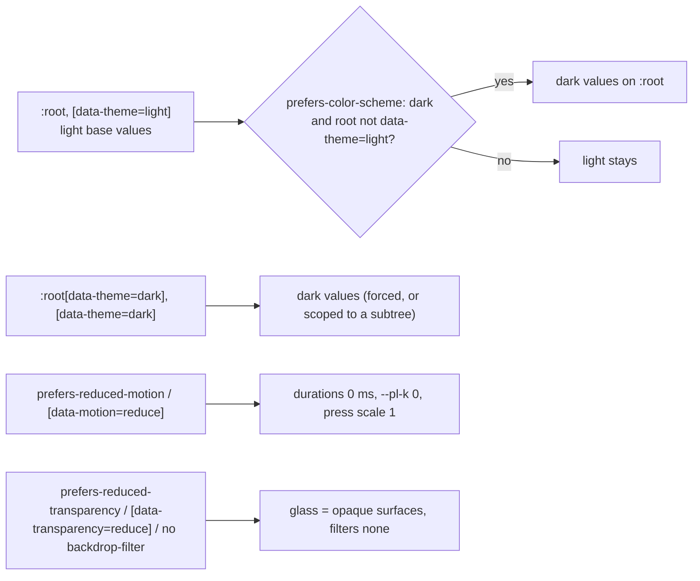

# Visual language (macOS-inspired glass)

| Field | Value |
|---|---|
| Title | Visual language: macOS-inspired Liquid Glass look for Plotinium, including principles, trademark rules, tokens, materials, typography, iconography, the component catalogue, the motion table and the performance rules |
| Status | Draft v0.1, 2026-09-25 |
| Primary owner | R3 WM/UI |
| Secondary reviewer | R5 QA/DevOps (accessibility, frame budgets and gallery build) |
| Must be demonstrable at | **P2 gate (W7, v0.2.0):** tokens, materials and motion in both themes; the primitives in the gallery; window open, close, minimise and focus motion with 10 windows inside the WM-03 budget. **P3 gate (W11, v0.3.0):** Control Centre, notifications, Search and Overview motion; reduced-motion and reduced-transparency modes on every screen. **P4 gate (W14, v0.4.0):** the agent sheet and AI surfaces. **Final defence:** the whole desktop on the examiner's machine. |
| Requirement IDs covered | Spec: §5.2 design tokens (PLT-ID-06), WM-03 and PROC-05 (their animation part), WM-07, BOOT-13 (motion and progress parts), SYS-01 (the presentational boundary). Plotinium design: DSN-21 … DSN-39. Supersedes DSN-01 (palette part), DSN-06 and DSN-10 (tokens-size part) of ui-design-system.md |
| Related specs | [UI design system](./ui-design-system.md) · [Window manager](./window-manager.md) · [Identity and branding](../00-product/identity-and-branding.md) · [Boot and services](../02-boot/boot-and-services.md) · [Shell and terminal](../07-shell/shell-and-terminal.md) · [Testing and performance](../13-quality/testing-and-performance.md) · [Architecture](../01-architecture/architecture.md) |

**Conventions.** RFC 2119 keywords as in the capstone specification (p. 3). **Spec** marks an obligation from the capstone specification; **Plotinium design** marks our own choice. Contrast ratios were computed with the WCAG 2.x relative-luminance formula from the token values, compositing translucent colours over the surface under them. They are calculations that the unit tests of §8 repeat on every run, not measurements. The design references are in [docs/design/](../../docs/design/README.md).

---

## 1. Purpose and scope

Plotinium's interface is inspired by the latest macOS, the "Liquid Glass" era: a glass menu bar, a floating glass dock with magnification, traffic-light window controls on the left, vibrant sidebars, large soft shadows, spring animations and careful small details. The identity is our own: a violet accent, the Bohr P mark (an atom that is also a P), our own app icons and our own names. This spec fixes that look precisely enough to implement and to defend in the viva:

- the design principles and the **trademark rules** (§3.1, §3.2);
- the **token system** in `ui/src/tokens/tokens.css`, the single source of every colour, material, radius, shadow, spacing step, type role, layer and duration (§3.3);
- the **materials catalogue** with CSS recipes (§3.4);
- **typography** (§3.5) and **iconography** (§3.6);
- the **motion system** and the **motion table**, which lists every animation with its trigger, properties, duration, easing and reduced-motion fallback (§3.7);
- the **component catalogue**, with the states and keyboard behaviour of every primitive (§3.8);
- the **performance rules** that keep animation inside the WM-03 and PROC-05 frame budget, and how to measure them (§3.10).

**What this file supersedes.** Where this file and [ui-design-system.md](./ui-design-system.md) disagree on colour, material, type, icon style or motion, this file wins. The earlier file keeps its screen specs (layout, content and exact strings in §3.8), its accessibility rules and axe matrix, and DSN-02, DSN-03, DSN-05, DSN-07, DSN-08, DSN-09 and DSN-11 … DSN-20.

| ui-design-system.md | Status | Replacement |
|---|---|---|
| §3.1 identity direction (orbit-blue accent; "no gradients, glows") and the palette part of DSN-01 | Superseded | §3.1–§3.3 here. The accent is violet. Gradients are allowed on the wallpaper, app icons and the primary-button sheen (the Bohr P mark itself is flat fills, §3.6.2). The DSN-01 bans on hazard symbols and on weapons, war or radiation wording still apply. |
| §3.2 token architecture: file path `wm/tokens/tokens.css` | Superseded | `ui/src/tokens/tokens.css` (§3.3). The rules still apply: one file, semantic tokens only, themes, reduced motion, forced colours and cascade layers. |
| §3.3 `tokens.css` values | Superseded | The values in `ui/src/tokens/tokens.css`, summarised in §3.3. |
| §3.4 contrast table | Replaced by tests | The DSN-03 tests in `ui/src/tokens/tokens.test.ts` (§8) compute the table on every run. |
| §3.5 typography and DSN-06 (system fonts only) | Superseded | Self-hosted Inter 4 and JetBrains Mono, both variable (§3.5, DSN-27, D15). No third-party font request is made, so C10 still holds. |
| §3.6 elevation, motion table and icon rules | Superseded | §3.3.6, §3.6 and §3.7 here. |
| §3.7 component rules (visual parts) | Superseded | §3.8 here. The ARIA and keyboard rules are unchanged and are restated there. |
| DSN-10: `tokens.css` ≤ 4 KB gzip | Amended | `tokens.css` minified ≤ 5 KB gzip (DSN-39). The boot-ui budget of 5 KB gzip is unchanged. |

Out of scope, owned elsewhere: window behaviour (focus, z-order, gestures, the secure prompt) in [window-manager.md](./window-manager.md); the boot stages and progress computation in [boot-and-services.md](../02-boot/boot-and-services.md); the name, wordmark and `uname` in [identity-and-branding.md](../00-product/identity-and-branding.md); the frame-trace parser in [testing-and-performance.md §3.11.3](../13-quality/testing-and-performance.md).

---

## 2. Requirements table

| ID | Summary | Spec § | How verified |
|---|---|---|---|
| PLT-ID-06 | Spec: MUST, §5.2. Colours, typography, spacing and motion values live in one tokens file used by every system screen, in a light and a dark theme. | §5.2 | DSN-02, DSN-23 and DSN-26 tests; gallery in both themes |
| WM-03, PROC-05 (animation part) | Spec: MUST, §9.4 and §9.1. p95 frame time ≤ 16.7 ms with 10 windows, while dragging and resizing and under CPU load; no long task over 50 ms from OS code. | §9.1, §9.4 | Chrome-trace method of TST-05 (§3.10.2); the WM-03 CSS tests of §8 |
| WM-07 | Spec: SHOULD, §9.4. WCAG 2.2 AA for contrast and keyboard operation. | §9.4 | DSN-03 contrast tests; keyboard tests of every primitive; axe (DSN-20) |
| DSN-21 | Plotinium design. The interface follows the macOS Liquid Glass language of §3.1: glass chrome, content-first windows, one accent, springs and meticulous small details. | — | Design review against docs/design; gallery |
| DSN-22 | Plotinium design. Trademark rules (§3.2): no Apple logo or apple silhouette, no Apple product or app names in the UI, no SF Pro, SF Mono or SF Symbols, and no Apple wallpapers or icon replicas. Our names are used throughout. | — | Review checklist; identity lint (strings) |
| DSN-23 | Plotinium design. One tokens file, `ui/src/tokens/tokens.css`. Light is the base; dark applies through `prefers-color-scheme` unless `[data-theme="light"]` is set, and `[data-theme]` also scopes a theme to a subtree. The system-dark and forced-dark blocks are identical. | §5.2 | `DSN-23 the system-dark and forced-dark blocks define identical values`; `PLT-ID-06` block tests |
| DSN-24 | Plotinium design. A live `backdrop-filter` is used only on the menu bar, dock, popovers and menus, Control Centre, notifications, the Search palette, sheets and HUDs. Window frames and sidebars use static tinted glass. | WM-03 | `DSN-24 …` CSS test; review of shell CSS |
| DSN-25 | Plotinium design. Under `prefers-reduced-transparency: reduce`, `[data-transparency="reduce"]` or no `backdrop-filter` support, every glass material becomes an opaque surface and every blur is removed. | WCAG 1.4.3 | `DSN-25 …` test; gallery toggle |
| DSN-26 | Plotinium design. One accent: violet `#5856D6` (light) and `#5E5CE6` (dark). Status colours always come with text or an icon (DSN-08). | §5.2 | `DSN-26 …` test; DSN-03 tests |
| DSN-27 | Plotinium design (supersedes DSN-06). Inter 4 (variable, opsz + wght) and JetBrains Mono (variable) are self-hosted from `@fontsource-variable`, under OFL-1.1 (D15). No third-party font request is made (C10), and boot-ui uses the fallback stack. | C10 | e2e network log (no font request to another origin); bundle review |
| DSN-28 | Plotinium design. UI glyphs are lucide-solid icons. App icons and the Bohr P mark are our own SVGs, legible from 16 px to 256 px, and the Solid component and the raw SVG string come from one element tree. | — | `UI-icons …` tests; gallery Icons section |
| DSN-29 | Plotinium design. Only `transform` and `opacity` animate. Every animation uses a named motion class or motion token. Springs are CSS `linear()` easings with `cubic-bezier` fallbacks. | WM-03 | `WM-03 every @keyframes …`, `WM-03 every transition …`, `DSN-29 …` tests |
| DSN-30 | Plotinium design (extends DSN-05). Every animation has a reduced-motion fallback: duration tokens drop to 0 ms, one-shot classes finish at once, loops stop, and presence exits unmount immediately. | BOOT-13, WCAG 2.3.3 | `DSN-05 …`, `DSN-30 …` tests; reduced-motion e2e |
| DSN-31 | Plotinium design. Windows: `contain: layout paint`; static glass; `will-change` only while animating; the dragging state drops the heavy shadow tier; shadows change by crossfading a pseudo-element's opacity. | WM-03, PROC-05 | `DSN-31 …` test; WM trace |
| DSN-32 | Plotinium design (SYS-01). `@plotinium/ui` is presentational: data comes in through props and intents go out through callbacks. It never touches storage, workers or the network, and imports only protocol types. | SYS-01 | ESLint boundary rules (`ui` scope) |
| DSN-33 | Plotinium design. Every interactive primitive has hover, pressed, visible-focus, disabled and (where relevant) selected states in both themes, and follows the WAI-ARIA APG keyboard pattern named in §3.8. | WM-07 | Primitive tests (§8); gallery |
| DSN-34 | Plotinium design. Overlays (menus, pop-up lists, popovers, tooltips, dialogs) are portalled to `<body>` so window containment never clips them. They form a stack: Escape and outside clicks close only the topmost, and focus returns to the invoker. | WM-07 | `UI-Popover …`, `UI-Menu …`, `UI-Dialog …` tests |
| DSN-35 | Plotinium design. The gallery (`ui/gallery`) shows every component in both themes, with theme, reduce-motion and reduce-transparency toggles, and builds in CI. | — | `pnpm --filter @plotinium/ui gallery:build` |
| DSN-36 | Plotinium design. Under `forced-colors: active`, shadows become 1 px `CanvasText` borders, the selection uses `Highlight` and `HighlightText`, and the focus ring uses `Highlight`. | WCAG 1.4.11 | Review in Chrome's forced-colours emulation |
| DSN-37 | Plotinium design. Animation performance is measured with the Chrome-trace frame p95 and LoAF attribution of TST-05, on the animation soak of §3.10.2. | WM-03, PROC-05 | Perf job; run notes |
| DSN-38 | Plotinium design. The durations, easings and properties in the motion table (§3.7.3) are normative; a change updates that table, `motion.css` and the gallery Motion page in the same PR. | — | Review; `DSN-30 motion.css guards every pl-anim class …` test |
| DSN-39 | Plotinium design (amends DSN-10). `tokens.css`, minified, is ≤ 5 KB gzip, because it is inlined on the boot path. | BOOT-10 | `DSN-39 …` test; bundle-budget job |

---

## 3. Design (normative)

### 3.1 Principles (DSN-21)

Plotinium design:

1. **Content first, chrome in glass.** App content sits on calm, near-opaque window surfaces. Glass is kept for the system chrome that floats above content (menu bar, dock, menus, Control Centre, notifications, Search, sheets and HUDs), where refraction tells the user "this layer is transient".
2. **Depth through light, not lines.** Hierarchy comes from elevation (the shadow tiers), translucency and a 1 px specular top edge. Hairlines are 0.5 px and only separate rows and panes.
3. **One accent.** Violet marks the focus ring, selection, primary buttons, switches that are on, progress and the logo. Status colours (success, warning, danger, info) never appear without text or an icon.
4. **Motion explains.** Every animation shows where something came from or went: the window grows from its dock icon, a sheet drops from its title bar, a menu opens from its anchor. Springs settle with at most one small overshoot, so nothing wobbles.
5. **Meticulous details.** Traffic lights show their glyphs on hover; the toggle knob stretches while pressed; the segmented highlight slides; sort arrows rotate; tables use tabular figures; the unfocused selection turns grey; buttons press to 97%.
6. **Fast and honest.** Only `transform` and `opacity` animate (§3.10). Progress is real (DSN-07). Reduced motion and reduced transparency are first-class themes, not afterthoughts.

### 3.2 Identity and trademark rules (DSN-22)

Plotinium design. We borrow a design language, not a brand. Allowed and forbidden:

| Area | Allowed | Forbidden |
|---|---|---|
| Marks | The Plotinium atom (§3.6.2); the wordmark from the identity spec | The Apple logo or any apple silhouette; any mark placed where macOS puts the Apple menu that could be mistaken for it |
| Names in the UI | Files, Terminal, Editor, Task Manager, Settings, Search, Overview, Control Centre, Notifications, Dock, Trash, About Plotinium | Finder, Spotlight, Mission Control, Launchpad, System Settings, Activity Monitor, TextEdit, Safari, and "macOS", "Aqua" or "Liquid Glass" as product names in UI strings (documents may say "macOS-inspired") |
| Type | Inter 4, JetBrains Mono (§3.5) | SF Pro, SF Mono, New York, or any Apple-licensed font |
| Glyphs | lucide-solid icons; our own SVGs | SF Symbols, or glyphs traced from them |
| Imagery | Our generated gradient wallpapers (`--pl-wallpaper`); our app icons | Apple wallpapers, photographs or icon replicas (for example a two-tone face for Files) |
| Shortcuts | `Ctrl`, `Shift`, `Alt` and the symbols ⇧ ↵ ⌫ with spoken names | The ⌘ key cap as our primary modifier (Plotinium runs in every desktop browser) |
| Controls | Traffic-light window controls (red close, amber minimise, green zoom) on the left; they are generic affordances with glyph and label | — |

The DSN-01 and PLT-ID-16 bans remain: no radiation trefoil, hazard stripes, mushroom-cloud shapes, or weapons, war or radiation wording.

### 3.3 Tokens (PLT-ID-06, DSN-23, DSN-26)

#### 3.3.1 Architecture

- **One file:** `ui/src/tokens/tokens.css`, exported as `@plotinium/ui/tokens.css`. The web entry inlines it for boot-ui (DSN-14) and imports it for the shell. Components use CSS Modules that read only `--pl-*` tokens; a unit test fails on any undefined token or raw hex colour in component CSS (DSN-02).
- **Cascade layers:** `@layer reset, tokens, shell, apps;`. Tokens live in `tokens`, the motion classes in `shell`.
- **Naming:** `--pl-<family>-<role>[-<variant>]`, for example `--pl-glass-popover-bg`, `--pl-shadow-win-drag`, `--pl-type-headline`. Component inputs that are set at run time (`--pl-seg-index`, `--pl-genie-x` and so on) are not tokens; they are listed in the token test.
- **Theme resolution:**



`[data-theme]` on any element scopes a theme to its subtree (always-dark HUDs, the gallery's side-by-side panes). A scoped container sets its own `color` and `background` from tokens, because inherited `color` is resolved on the root.

- **JavaScript readers** (the xterm theme, CodeMirror, canvas sparklines) resolve colours through a probe element (`getComputedStyle(probe).color`), as in [ui-design-system.md §3.2](./ui-design-system.md).

#### 3.3.2 Colour roles

| Role family | Tokens | Light | Dark |
|---|---|---|---|
| Accent | `--pl-accent`, `-hover`, `-pressed`, `-text`, `-subtle`, `-glow`; `--pl-on-accent`; `--pl-focus-color` | `#5856D6`; accent as text `#4F4DC9`; focus `#5856D6` | `#5E5CE6`; accent as text `#A5A4FF`; focus `#8B89FF` |
| Labels | `--pl-text`, `-muted`, `-tertiary`, `-disabled` | black at 86 / 64 / 56 / 36% | white at 92 / 66 / 55 / 36% |
| Lines | `--pl-hairline`, `--pl-separator`, `--pl-border-subtle`, `--pl-border` | black at 9 / 10 / 12 / 44% | white at 10 / 10 / 12 / 40% |
| Surfaces (opaque; also the reduced-transparency fallbacks) | `--pl-bg`, `--pl-surface`, `-2`, `-3`, `--pl-scrim` | `#EEF0F8`, `#FFFFFF`, `#F5F5F9`, `#E8E8EF` | `#0B0D1F`, `#1E1E26`, `#26262F`, `#31313C` |
| Status | `--pl-success`, `-warning`, `-danger`, `-info` and each `-subtle`; `--pl-danger-fill` | `#1E7D34`, `#9A4F00`, `#C4000F`, `#00679A`; fill `#D70015` | `#30D158`, `#FF9F0A`, `#FF6961`, `#64D2FF`; fill `#C9342B` |
| Controls | `--pl-control-bg`, `-hover`, `-pressed`, `-raised`, `--pl-toggle-off`, `--pl-selection`, `--pl-selection-idle`, `--pl-row-alt` | tints of black; raised `#FFFFFF`; selection violet at 92% | tints of white; raised white at 24%; selection violet at 85% |
| Tints (icon tiles, tag dots; decorative) | `--pl-tint-{indigo, blue, teal, green, yellow, orange, red, pink, purple, gray}` | — | — |
| Window controls | `--pl-traffic-close`, `-minimise`, `-zoom`, `-idle`, `-glyph` | `#FF5F57`, `#FEBC2E`, `#28C840` | same |
| Wallpaper (decorative, `aria-hidden`) | `--pl-wallpaper` | lavender-to-lilac radial blend | indigo-to-violet radial blend on `#0B0D1F` |

**Contrast (DSN-03, computed by the tests).** Every label role, the accent text and the status text reach 4.5:1 on `--pl-bg`, `--pl-surface` and `--pl-surface-2` in both themes. `--pl-border` and `--pl-focus-color` reach 3:1. `--pl-on-accent` reaches 4.5:1 on the accent, on `--pl-danger-fill`, on the selection and on the menu highlight. Each status colour reaches 4.5:1 on its `-subtle` chip, and text and muted text reach 4.5:1 on the static window glass. Three light values were darkened to meet these ratios when the tests were written: `--pl-text-tertiary` (52% → 56%), `--pl-border` (42% → 44%) and `--pl-danger` (`#D70015` → `#C4000F`, which keeps `#D70015` as the fill).

#### 3.3.3 Shape

| Token | Value | Used by |
|---|---|---|
| `--pl-radius-xs` / `-sm` / `-ctl` | 4 / 6 / 7 px | keycaps and checkboxes / small controls, menu rows / buttons and fields |
| `--pl-radius-md` / `-lg` | 10 / 12 px | cards, grouped lists / popovers, menus, app icons at 52 px |
| `--pl-radius-win` / `-sheet` / `-tile` | 14 / 16 / 14 px | windows / sheets and dialogs / Control Centre tiles |
| `--pl-radius-dock` / `-pill` / `-icon` | 22 px / 999 px / 23% | the dock / capsules / app-icon squircle, relative to its size |

#### 3.3.4 Spacing and sizes

A 4-point scale (`--pl-space-1` … `--pl-space-12`: 4, 8, 12, 16, 20, 24, 32, 40, 48 px) plus a 2 px half step. Fixed sizes: menu bar 28 px, title bar 38 px, toolbar 52 px, control 28 px (small 22, large 34), row 28 px, minimum target 24 px (WCAG 2.5.8), traffic light 12 px with an 8 px gap, dock icon 52 px, sidebar 210 px, toggle 38 × 22 px with an 18 px knob, menu row 24 px.

#### 3.3.5 Layers

`--pl-z-desktop 0` < `windows 100` (renumbered 1 … n inside) < `snap-preview 9000` < `dock 10000` < `menubar 10010` < `overview 10020` < `dialog 10040` < `popover 10050` < `search 10060` < `notify 10100` < `hud 10120` < `meter 10150` < `tooltip 10180` < `secure 10200` < `boot 10300`. App-modal dialogs sit below popovers, so a pop-up list opened inside a dialog shows above it. Nothing but the secure prompt uses `--pl-z-secure` (DSN-16).

#### 3.3.6 Elevation: the three window tiers

| Token | Light | Dark | When |
|---|---|---|---|
| `--pl-shadow-win-focus` | `0 30px 70px rgb(40 30 90 / .24), 0 8px 22px rgb(40 30 90 / .12)` | `0 30px 80px rgb(0 0 0 / .55), 0 10px 28px rgb(0 0 0 / .35)` | The focused window |
| `--pl-shadow-win` | `0 12px 30px rgb(40 30 90 / .14)` | `0 14px 38px rgb(0 0 0 / .40)` | Unfocused windows |
| `--pl-shadow-win-drag` | `0 10px 24px rgb(40 30 90 / .18)` | `0 12px 28px rgb(0 0 0 / .42)` | Any window while it is dragged or resized (one blur layer, smaller radius) |
| `--pl-shadow-pop`, `-dialog`, `-dock`, `-tooltip`, `-1` | — | — | Popovers and menus; sheets and dialogs; the dock; tooltips; small raised controls |

Light-theme shadows are tinted with the wallpaper's indigo (`rgb(40 30 90)`), not grey, which keeps glass edges clean on lilac.

### 3.4 Materials catalogue (DSN-24, DSN-25)

| Material | Tokens | Live blur | Recipe (the tokens resolve in both themes) | Used by |
|---|---|---|---|---|
| Menu bar | `--pl-glass-menubar-bg`, `-filter` | yes, 30 px, saturation 180% | `background: var(--pl-glass-menubar-bg); backdrop-filter: var(--pl-glass-menubar-filter); box-shadow: inset 0 -1px 0 var(--pl-hairline-subtle), var(--pl-glass-specular);` | Menu bar |
| Dock | `--pl-glass-dock-bg`, `-filter`, `-edge` | yes, 40 px, saturation 190% | `border-radius: var(--pl-radius-dock); background: var(--pl-glass-dock-bg); backdrop-filter: var(--pl-glass-dock-filter); box-shadow: var(--pl-shadow-dock), var(--pl-glass-dock-edge);` | Dock |
| Window (static) | `--pl-glass-window-bg`, `-bg-idle`, `-dim` | **no** | `background: var(--pl-glass-window-bg); box-shadow: <tier>, var(--pl-glass-specular); contain: layout paint;` Unfocused windows use `-bg-idle`. | Window frames, the table header strip |
| Sidebar (vibrancy) | `--pl-glass-sidebar-bg`, `-edge` | **no** | `background: var(--pl-glass-sidebar-bg); box-shadow: var(--pl-glass-sidebar-edge);` | Source lists in windows |
| Popover and menu | `--pl-glass-popover-bg`, `-filter` | yes, 30 px | `border-radius: var(--pl-radius-lg); background: var(--pl-glass-popover-bg); backdrop-filter: var(--pl-glass-popover-filter); box-shadow: var(--pl-shadow-pop), var(--pl-glass-specular), inset 0 0 0 .5px var(--pl-hairline);` | Menus, context menus, pop-up lists, popovers, notifications, the Search palette |
| Sheet and dialog | `--pl-glass-sheet-bg`, `-filter` | yes, 40 px | `border-radius: var(--pl-radius-sheet); background: var(--pl-glass-sheet-bg); backdrop-filter: var(--pl-glass-sheet-filter); box-shadow: var(--pl-shadow-dialog), var(--pl-glass-specular);` | Sheets, dialogs, the agent confirmation |
| HUD | `--pl-glass-hud-bg`, `-filter` | yes, 24 px | as for popovers, with the HUD tokens | Control Centre, volume and brightness HUDs, Overview labels |
| Card | `--pl-glass-card-bg` | **no** | `border-radius: var(--pl-radius-md); background: var(--pl-glass-card-bg); box-shadow: inset 0 0 0 .5px var(--pl-hairline);` | Grouped lists, stat tiles, Control Centre tiles |

Rules:
- A live blur is never used inside a window: sidebars and cards there use a static tint (DSN-24). This keeps the compositor's per-frame cost independent of how many windows are open.
- Blur radii are at most 40 px. A glass surface is **flat while it animates** (it animates only opacity and transform), and a screen SHOULD show at most four live-blur regions at once (menu bar, dock, one popover or Control Centre, one notification group).
- **Fallbacks (DSN-25).** `@media (prefers-reduced-transparency: reduce)`, `:root[data-transparency="reduce"]` (the Settings override) and `@supports not (backdrop-filter: …)` all swap each `--pl-glass-*-bg` to an opaque surface token and each `-filter` to `none`. Components never branch on this: they read the same tokens.

### 3.5 Typography (DSN-27)

- **Faces** (decision D15: [docs/design/fonts/DECISION.md](../../docs/design/fonts/DECISION.md), short record in `specs/15-decisions/stack-decisions.md`).
  - UI: **Inter 4, variable, with the optical-size axis** (opsz 14–32, wght 100–900; `@fontsource-variable/inter`). With `font-optical-sizing: auto` the 13 px UI gets the Text design and the clock and headlines the tighter Display design, the way SF Pro Text and Display split.
  - Mono: **JetBrains Mono, variable** (wght 100–800; `@fontsource-variable/jetbrains-mono`) for the Terminal, the Editor, paths, pids and keycaps. D15 first chose Geist Mono; its reversal trigger fired on 2026-09-30 (UI-004: at 12–14 px on a 1x screen Geist Mono draws `r` like `ɪ`, so `drwxr-xr-x` read `drwxɪ-xɪ-x`). Its contextual alternates are off (`'calt' 0` in the `@font-face` rules), so `->`, `!=` and `==` stay the characters that were typed. The fontsource subsets have no box-drawing glyphs: `tree` rules come from the system mono face in the fallback stack.
  - Both are under the SIL Open Font License 1.1 and listed in `THIRD_PARTY.md`. The files are bundled and served from our origin: no request goes to Google Fonts or any CDN (C10, COEP). The Stitch reference HTML links Google Fonts for convenience only; the product never does.
- **Loading.** `ui/src/tokens/fonts.css` declares only the Latin and Latin Extended subsets, each with its `unicode-range`, so a woff2 is fetched only when a character in its range is on screen; other scripts fall back to the system stack character by character. `font-display: swap` shows the fallback stack (`system-ui`, Segoe UI, Roboto, Ubuntu, Noto Sans; `ui-monospace`, Cascadia Mono, Consolas, DejaVu Sans Mono) first, so text is never invisible. Fonts are not boot-critical JavaScript and the boot splash uses the fallback stack. There is **no font preload** in `web/index.html`: it did not help and it broke `pnpm dev` (D15 §8).
- **Features.** `--pl-font-features: normal`: the fontsource Inter build has no `cv`/`ss` features, so the old `'cv11', 'ss01'` were no-ops. Tracking follows the size, as SF does (`--pl-tracking-open` +0.005em at 11 px, none at 12–16 px, `-title` −0.008em at 20–22 px, `-tight` −0.01em at 28–36 px, `-display` −0.02em at 64 px and up). Tables and meters use `font-variant-numeric: tabular-nums`.
- **Type roles** (use `font: var(--pl-type-<role>)`):

| Role | Size / weight / leading | Used for |
|---|---|---|
| `display` | 64 / 700 / 1 | The lock-screen clock |
| `large-title` | 28 / 700 / 1.2 | Settings pane titles, About |
| `title` | 20 / 600 / 1.2 | Dialog titles, section headings, stat values |
| `headline` | 14 / 600 / 1.45 | Window titles, card titles |
| `body` | 13 / 400 / 1.45 | Default UI text, table cells, menus |
| `callout` | 13 / 500 / 1.45 | Buttons, segment labels, field labels |
| `caption` | 12 / 400 / 1.45 | Secondary lines, status bars, badges |
| `section` | 12 / 600 / 1.45 | Sidebar and list section headers (upper-cased by CSS) |
| `mono` | 13 / 400 / 1.6, JetBrains Mono (variable) | Paths, pids, code; the Terminal defaults to 14 px |

UI text is never below 12 px (ui-design-system §3.5). All-caps comes only from `text-transform`, so screen readers read sentence case.

### 3.6 Iconography (DSN-28)

#### 3.6.1 UI glyphs

`lucide-solid` (ISC), imported per icon (`lucide-solid/icons/<name>`) so only the glyphs used are bundled. Sizes are 14, 16 or 20 px in controls, with a stroke of about 1.75–2 and `currentColor`. Decorative glyphs are `aria-hidden`; icon-only buttons carry `aria-label` (the `IconButton` primitive requires it).

#### 3.6.2 The mark: the Bohr P

An electron shell around a dense nucleus, open at 1:30 where the one electron sits; the shell grows a stem on its left, so the atom is also the P of Plotinium (decision record: [docs/design/logo/DECISION.md](../../docs/design/logo/DECISION.md); normative brief: identity-and-branding.md §3.6). It replaced the two-orbit "luminous atom", whose 1 px orbits merged into a smudge at 16–20 px.

- **Construction.** Four **filled** shapes on a 24-unit grid, no strokes: a stem (x 4.5–7.5, y 9–22.5, round ends), a shell (ring round (12, 9), outer radius 7.5, inner 4.5, round ends, open 93° round the electron), a nucleus (disc r 2.8 at (12, 9)) and an electron (disc r 2 on the shell's centre line at −45°). At 16 px the outline is two shapes (the P body and the electron) and the shell and stem are 2 px wide. A filled mark cannot be thinned by any stylesheet.
- **Hinting.** The master's edges fall on multiples of 1.5 units (whole pixels at 16, 32 and 48 px). `atomLogoFor(size)` switches to a drawing hinted for 20 px at multiples of 20 and to one hinted for 24 px at other multiples of 24; the favicon has its own 16-unit drawing.
- **Colour.** The shapes read `--pl-logo-orbit-a` (shell and stem), `--pl-logo-core` (nucleus) and `--pl-logo-electron`, so the inline mark follows the theme: light #5856D6 with a #4F4DC9 nucleus; dark #B3B1FF with a white nucleus and a #CFCEFF electron. `glyph-mono.svg` is the same four shapes in `currentColor`.
- **Motion.** Only the boot splash animates the mark: the electron and the shell's gap step round the nucleus per real boot event, and the nucleus flashes when a service starts (still under reduced motion). Elsewhere the mark fades or scales in and never rotates: the stem is the P.
- **Components.** Every inline use goes through `AtomLogo` (`ui/src/icons`); the boot screens use `logoSvg` (`ui/src/boot/logo.ts`). The gallery shows the mark at 16, 24, 32, 64, 128 and 256 px.

#### 3.6.3 App icons

Our own rounded squares on a 52-unit grid with radius 12 (23%, `--pl-radius-icon`). Each has a vertical gradient, a top gloss (white from 35% to 0% over the top half) and one bold glyph, so its silhouette still reads at 16 px:

| App | Gradient | Glyph |
|---|---|---|
| Files | `#7C95FF` → `#4B3FD6` | White folder with a tab line |
| Terminal | `#2B2B33` → `#0C0C10`, hairline edge, no gloss | Lavender `>` prompt with a green cursor bar |
| Editor | `#FFFFFF` → `#DAD7FF`, no gloss | Text lines and a violet pencil |
| Task Manager | `#2FE0C4` → `#0B8B86` | White pulse line |
| Settings | `#9A9AA6` → `#46464F` | White cog |
| Search | `#8F8DFF` → `#4527C9` | Magnifier with a sparkle (semantic search) |
| Trash (empty / full) | Translucent glass tile with a white outline | Bin; the full bin shows a crumpled sheet |

**One source.** Each icon is stored once as an element tree (`ui/src/icons/*.ts`). The Solid components (`AtomLogo`, `AppIcon`, `FilesAppIcon` and the rest) and the raw SVG strings (`rawIcon(id, size)`, for the favicon, the manifest and the inlined boot-ui) are both generated from it, so they cannot drift apart. Gradient ids get a per-instance prefix, so two icons on one page never collide.

### 3.7 Motion (DSN-29, DSN-30, DSN-38)

#### 3.7.1 Rules

1. **Only `transform` and `opacity` animate** (keyframes and transitions). Hover and pressed tints do not transition `background-color`: they crossfade a `::before` overlay's opacity. Shadows change by crossfading a pseudo-element that carries the heavier shadow. Unit tests enforce both rules on every stylesheet in `ui/src`.
2. **Named motion only.** Durations and easings come from tokens, and one-shot animations are the `pl-anim-*` classes of `ui/src/tokens/motion.css`. A component adds a class for the length of one animation and removes it on `animationend`, or re-mounts the element. The window compositor, which is framework-free, may run the same keyframes through the Web Animations API with the same token durations ([window-manager.md §3.7](./window-manager.md)).
3. **Springs.** `--pl-ease-spring` and `--pl-ease-spring-bouncy` are CSS `linear()` curves sampled from a damped spring. Browsers without `linear()` get the `cubic-bezier` fallbacks declared under `@supports not (transition-timing-function: linear(0, 1))`. `--pl-ease-spring-soft` is a gentle overshooting `cubic-bezier`.
4. **Timing tokens.** `--pl-motion-press` 90 ms, `-fast` 120 ms, `-med` 200 ms, `-slow` 320 ms, `-xslow` 480 ms. Keyframe classes write other durations as `calc(<ms> * var(--pl-k))`, where `--pl-k` is 1, or 0 under reduced motion.
5. **Caller inputs** (custom properties): `--pl-genie-x` and `--pl-genie-y` (dock-icon centre minus window centre, read at animation start); `--pl-flip-x`, `-y`, `-sx`, `-sy` (the FLIP start frame for maximise and restore); `--pl-stagger-index`; `--pl-stack-index`; `--pl-sweep-count` (default 3).

| Easing token | Curve | Use |
|---|---|---|
| `--pl-ease` | `cubic-bezier(.2, .8, .2, 1)` | Standard movement, crossfades |
| `--pl-ease-out` | `cubic-bezier(0, 0, .2, 1)` | Entrances without overshoot |
| `--pl-ease-in` | `cubic-bezier(.4, 0, 1, 1)` | Exits |
| `--pl-ease-genie` | `cubic-bezier(.5, 0, .7, .4)` | Minimise (accelerates into the dock) |
| `--pl-ease-spring` | `linear(…)`, about 9% overshoot, settles by 50% of the duration; fallback `cubic-bezier(.34, 1.36, .64, 1)` | Windows, sheets, dialogs, panels, sliding highlights |
| `--pl-ease-spring-bouncy` | `linear(…)`, about 19% overshoot; fallback `cubic-bezier(.34, 1.7, .64, 1)` | Toggle knob, checkbox mark |
| `--pl-ease-spring-soft` | `cubic-bezier(.32, 1.28, .5, 1)` | Popovers, press release, small pops |

#### 3.7.2 Reduced motion (DSN-30)

`@media (prefers-reduced-motion: reduce)` and `:root[data-motion="reduce"]` (Settings → Accessibility → Reduce motion: Follow system or Always) set every duration token to 0 ms, `--pl-k` to 0 and `--pl-press-scale` to 1. The motion.css guard also forces `animation-duration: .01ms`, `animation-delay: 0` and one iteration on every `pl-anim-*` class, and zero transition time on the spring utilities. Component stylesheets add their own `prefers-reduced-motion` blocks for loops (the spinner stops) and transforms that would still jump. The overlay presence helper unmounts at once instead of waiting for an exit animation. The meaning is always kept: a minimised window disappears, a shaken password field also says "Incorrect password", and a bounce is replaced by the badge.

#### 3.7.3 Motion table

All properties are `transform` (T) and `opacity` (O). "Reduced" is the fallback under reduced motion.

| Element | Trigger | Class or where | Properties | Duration | Easing | Reduced |
|---|---|---|---|---|---|---|
| Menu bar | Desktop mounts after login | `pl-anim-menubar-in` | T translateY(−100% → 0), O 0 → 1; delay 80 ms | slow 320 ms | ease-out | Appears |
| Dock | Desktop mounts | `pl-anim-dock-in`; icons `pl-anim-dock-item-in` | Dock T translateY(24 px) scale(.96 → 1), O; icons T translateY(8 px), O, staggered 30 ms from 180 ms | 420 ms; items 320 ms | spring; items spring-soft | Appears |
| Dock icon | Pointer moves over the dock (magnification) | Dock component (shell) | T scale by cosine fall-off over ±2.5 icon widths, up to 1.5, origin at the bottom centre; written once per frame in one rAF batch, so layout is never read on `pointermove` | Follows the pointer; returns in med 200 ms | spring-soft | Off: no magnification; the label tooltip still shows |
| Dock icon | App launches | `pl-anim-dock-bounce` | T translateY(0 → −14 px → 0), once | xslow 480 ms | spring | No bounce; the running dot appears |
| Dock icon | App needs attention | `pl-anim-dock-attention` | T two hops of −10 px, once | 720 ms | standard | Badge only |
| Dock and desktop items | Press | `pl-press` | T scale(.92) | press 90 ms; release med with spring-soft | standard, spring-soft | None |
| Window | Opens | `pl-anim-window-open` | O 0 → 1, T scale(.94) translateY(10 px) → none, origin 50% 60% | 360 ms | spring | Appears |
| Window | Closes (after the kernel's `close`) | `pl-anim-window-close` | O → 0, T scale(.96) | 160 ms | ease-in | Disappears |
| Window | Minimises (genie) | `pl-anim-window-minimise` | T translate to (`--pl-genie-x`, `--pl-genie-y`) through a 45% keyframe (scale .62 × .8), ending at scale .12; O → 0; origin bottom centre | slow 320 ms | genie | Disappears; the dock indicator updates |
| Window | Restores from the dock | `pl-anim-window-restore` | The reverse path; O 0 → 1 | slow 320 ms | spring | Appears |
| Window | Maximises, un-maximises, snaps | `pl-anim-window-maximise` / `-unmaximise` | FLIP: T from translate(`--pl-flip-x`, `-y`) scale(`-sx`, `-sy`) → none; origin 0 0 | 260 ms | spring | Jumps to the final frame |
| Window | Gains or loses focus | `pl-focus-shadow` with `[data-focused]` | O of a `::before` that carries `--pl-shadow-win-focus` | med 200 ms | standard | Instant |
| Window | Is dragged or resized | `pl-focus-shadow` with `[data-dragging="true"]` | The heavy shadow's O → 0 at once; the frame uses `--pl-shadow-win-drag` | 0 | — | Same |
| Restored window | Session restore finishes | `pl-anim-restore-shimmer` (`::after`) | T translateX(−110% → 110%) of a light sheen, once | 900 ms | standard | None |
| Menu, pop-up list | Opens / closes | `pl-anim-menu-in` / `-out` | In: O, T translateY(−4 px) scale(.98) → none; out: O → 0 | 140 / 100 ms | ease-out / ease-in | Instant |
| Popover | Opens / closes | `pl-anim-popover-in` / `-out` | In: O, T translateY(−6 px) scale(.97) from the anchor side; out: O | 180 / 100 ms | spring-soft / ease-in | Instant |
| Tooltip | Shows | `pl-anim-tooltip-in` | O, T translateY(4 px) scale(.96) → none | fast 120 ms | standard | Instant |
| Sheet | Drops / retracts | `pl-anim-sheet-in` / `-out` | In: O, T translateY(−24 px) scale(.98) → none, origin top centre; out: translateY(−16 px), O → 0 | 300 / 180 ms | spring / ease-in | Instant |
| Dialog | Opens / closes | `pl-anim-dialog-in` / `-out` | In: O, T scale(.95) → 1; out: O, scale(.97) | 240 / 140 ms | spring / ease-in | Instant |
| Scrim | Behind a dialog or sheet | `pl-anim-scrim-in` / `-out` | O | med / fast | standard / ease-in | Instant |
| Notification | Arrives / is dismissed | `pl-anim-notification-in` / `-out` | T translateX(100% + 16 px) → 0, O | 420 / 220 ms | spring / ease-in | Instant |
| Notification stack | Collapses / expands | `pl-notification-stack` with `[data-expanded]` | Card i: T translateY(i × 8 px) scale(1 − .04 i), O 1 − .25 i | slow 320 ms; O med | spring | Instant |
| Control Centre | Opens | `pl-anim-cc-in`; tiles `pl-anim-cc-tile` | Panel O, T translateY(−8 px) scale(.96), origin top right; tiles O, T translateY(6 px) scale(.98), staggered 20 ms | 240 ms; tiles 220 ms | spring; tiles spring-soft | Instant, no stagger |
| Search palette | Opens / closes | `pl-anim-search-in` / `-out` | In: O, T translateY(−6 px) scale(.96), origin top centre; out: O | 220 / 120 ms | spring / ease-in | Instant |
| Overview | Enters | `pl-anim-overview-in` (window layer), `pl-anim-overview-desktop` | Windows O, T scale(1.06 → 1); the desktop T scale(.92), O .6 | 360 ms | spring | Instant |
| Boot mark | Splash appears | `pl-anim-boot-glow` | O 0 → 1, T scale(.9 → 1.04 → 1) | 900 ms | ease-out | Static mark |
| Progress bar | Value changes | ProgressBar fill | T scaleX(ratio), origin left | med 200 ms | standard | Instant |
| Progress bar | Real work in progress | `pl-anim-progress-sweep` | T translateX(−100% → 100%) of a sheen inside the fill, 3 iterations (bounded, WCAG 2.2.2) | 1400 ms each | standard | Hidden |
| Lock screen | Unlocks | `pl-anim-login-unlock` | O → 0, T scale(1.06) | 420 ms | ease-in | Instant |
| Password field | Wrong password | `pl-anim-login-shake` | T translateX ±10 px, once | 420 ms | standard | None; the error text is announced |
| Focus ring | Focus moves | `pl-anim-focus-ring` | O, T scale(1.04 → 1) | fast 120 ms | standard | Instant |
| Badge, count | Appears | `pl-anim-pop-in` | O, T scale(0 → 1) | med 200 ms | spring-soft | Instant |
| Button, icon button, pop-up button | Pressed | Component CSS | T scale(`--pl-press-scale` = .97); the hover tint is `::before` O | press 90 ms; release med | spring-soft | No scale |
| Toggle | Switched | Toggle knob | T translateX(0 ↔ 16 px); while pressed, scaleX 1.22 toward the destination; the "on" fill is `::before` O | slow 320 ms; press fast | spring-bouncy; fill standard | Instant |
| Checkbox | Checked | Check or dash mark | O, T scale(.4 → 1) | fast (O), slow (T) | spring-bouncy | Instant |
| Segmented control | Selection changes | Sliding thumb | T translateX(index × 100%) | slow 320 ms | spring | Instant |
| Tabs | Selection changes | Segmented thumb, or the underline | Thumb T translateX; underline T scaleX(0 → 1), O | slow; underline med | spring | Instant |
| Slider | Thumb pressed | Thumb | T scale(1.12) | med | spring-soft | None |
| Table | Sort direction changes | Header arrow | T rotate(180°), O | med | spring | Instant |
| Spinner | In-app wait (never on the boot path, DSN-07) | Spinner glyph | T rotate(360°) in 12 steps, looping | 1000 ms per turn | steps(12) | Stops; the text label stays |
| Terminal cursor | Idle | xterm | blink | xterm default | — | Off |

### 3.8 Component catalogue (DSN-33, DSN-34)

Every primitive lives in `ui/src/primitives/<name>/`, with its own CSS Module and a test. Shared states apply to all of them: **hover** (a `::before` tint crossfades in), **pressed** (scale .97), **focus-visible** (a 3 px `--pl-focus-color` outline, offset 2 px; never removed), **disabled** (`aria-disabled` keeps the control focusable for buttons, the native `disabled` attribute for form inputs; colour `--pl-text-disabled`), and **selected** (accent while the container has focus, `--pl-selection-idle` grey when it does not). All primitives render in both themes and under forced colours (DSN-36).

| Component | Variants and anatomy | States | Keyboard and ARIA |
|---|---|---|---|
| **Button** | primary (accent with a white sheen), secondary (raised white or glass), tinted (accent-subtle), ghost, danger (tinted red with an outline), destructive (red fill, white text); sizes sm 22, md 28, lg 34 px; leading and trailing icons (decorative) | Hover tint, press scale, focus ring, `aria-disabled` (swallows clicks) | Native `<button type="button">`; Enter and Space |
| **IconButton** | ghost, glass, bordered; sizes sm, md, lg; round | Toggle state through `aria-pressed` | `aria-label` required |
| **Toggle** | Pill track with a spring knob; label and description; sm and md | On, off, pressed (the knob stretches), disabled | `role="switch"`, `aria-checked`, labelled by its text; Space and Enter; clicking the label toggles it |
| **Checkbox** | Native input under a styled 16 px box; a check mark or a dash | Checked, unchecked, mixed (`indeterminate` property), disabled | Native checkbox; the label is a `<label for>`; the description is linked with `aria-describedby` |
| **SegmentedControl** | Equal segments over a track; neutral or accent thumb; icon-only segments keep a text name | The selection slides | APG radio group: one tab stop; arrows move and select (wrapping); Home and End |
| **SearchField** | Magnifier, input, clear button, optional trailing slot (keycap hint); md and lg; pill | Focus ring on the field; the clear button appears when there is text | `role="search"` landmark; `type="search"` with `aria-label`; Escape clears (and bubbles when already empty); Enter submits |
| **TextField** | Label, input, hint, error line with an icon; leading and trailing adornments; mono; md and lg | Invalid (red ring, `aria-invalid`), disabled, read-only | `<label for>`; hint and error in `aria-describedby`; the error is `aria-live="polite"` |
| **Select** (pop-up button) | Raised button with an up-down chevron; glass list with checkmarks and icons | Open, active option, disabled options | APG select-only combobox: `role="combobox"`, `aria-expanded`, `aria-activedescendant` (focus stays on the button); Up, Down, Home, End, type-ahead, Enter or Space to choose, Escape to close, Tab chooses |
| **Slider** | Native range input; the filled track is painted from `--pl-slider-pct`; the large variant is the Control Centre capsule; edge icons; optional value readout | Pressed thumb (scale 1.12) | Native slider (arrows, Page Up and Down, Home, End); `aria-valuetext` from `format()` |
| **ProgressBar** | 4 or 6 px track; the fill is `scaleX`; tones accent, success, warning, danger, neutral; optional sweep | Determinate only (DSN-07) | `role="progressbar"`, `aria-valuemin`, `aria-valuemax`, `aria-valuenow`, `aria-valuetext` in words |
| **ProgressRing** | SVG arc with a centre label | Tones | `role="progressbar"` with values; the arc is not animated |
| **Pill** and **Badge** | Pill: subtle, solid or outline, a dot, an icon, caps (DELETE, MOVE, CHMOD), mono. Badge: a numeric count capsule, capped at "99+" | — | A pill always has text (DSN-08). A badge is `role="status"` with a spoken label ("3 unread notifications") and renders nothing for 0 |
| **Tooltip** | A small solid capsule (not live glass); a prominent variant for dock labels | Appears after 500 ms, at once within 600 ms of the last one; stays while the pointer is on it | Shown on hover and on keyboard focus; Escape dismisses it (WCAG 1.4.13); the text is also the trigger's `aria-describedby` unless it repeats the name |
| **Popover** | Glass surface portalled to `<body>`, placed next to its anchor (flips and clamps) | In and out animations | Non-modal `role="dialog"` with a label; focus moves to `[data-autofocus]`; Escape returns focus to the anchor; an outside pointer-down closes it |
| **Menu** and **ContextMenu** | Glass, 24 px rows; icons, shortcut column, check column, headers, separators, danger rows | The active row is an accent capsule with white text; disabled rows | APG menu: arrows (wrapping), Home, End, Page Up and Down, type-ahead, Enter and Space, Escape (returns focus), Tab closes. A context menu opens on right-click, Shift+F10 or the Menu key |
| **Sheet** | Drops from the top of its window (not portalled); the window scrim; a floating variant; icon, title, description, body, actions | In and out | `role="dialog"` or `alertdialog`, `aria-modal`; focus trapped and restored; the safe action has `data-autofocus` (DSN-15) |
| **Dialog** | Centred over a scrim; sizes sm, md, lg; a centred alert layout with stacked buttons | In and out | As for the sheet; the scrim closes it unless it is an `alertdialog` |
| **ListGroup** and **ListRow** | Inset grouped card (Settings) with a caps section title and a footer; a row has a leading tile, title, subtitle, value, trailing control and chevron | A row with `onClick` is a button (so its trailing content must not be interactive); selected | `section` labelled by its title; `ul role="list"` |
| **SidebarList** | Source list with vibrancy (static tint); sections; glyph or colour-tile icons; tag dots; badges; header and footer slots; inset floating card | Selected (accent while focused, otherwise grey; the accent can be kept) | `<nav>` with a label; buttons with `aria-current="page"`; one tab stop; Up, Down, Home, End, type-ahead |
| **Table** | CSS-grid rows with a sticky header; zebra rows; sortable headers with a rotating chevron; mono and muted columns; compact density; empty slot | Selected rows (accent while focused), sort direction | `role="grid"`, `aria-multiselectable`, `aria-sort`, `aria-rowindex`. Up, Down, Home, End and Page keys move; Shift extends; Space toggles; Ctrl+A selects all; Enter and double-click activate. Mouse: click, Ctrl-click, Shift-click. Over 2,000 rows the caller windows the rows (DSN-19) |
| **Tabs** | Segmented capsule (Task Manager) or underline (Terminal sessions); icons and counts; an end slot | Sliding thumb or scaling underline | APG tabs with automatic activation; one tab stop; Left, Right, Home, End; the panel is labelled by its tab |
| **Kbd** | Keycap row (`Ctrl + K`) or a plain shortcut column | — | Outer `<kbd>` with a spoken label (↵ is read as "Enter"); the caps are hidden from assistive technology |
| **Avatar** | Initials on one of six gradients, chosen by a hash of the name; a picture from the caller; presence dot; sizes 24, 32, 48, 96 | Online, away, offline | `role="img"` named "alice, online", or decorative |
| **EmptyState** | Icon, heading (level chosen by the caller), description, actions; compact | Optionally `role="status"` | — |
| **Spinner** | Twelve-spoke glyph, 16, 24 or 36 px; the label can be visible | Stops under reduced motion | `role="status"`, polite; for in-app waits only (DSN-07) |

**Overlay stack (DSN-34).** `createDismissableLayer` keeps a module-level stack of open overlays. A layer joins when it opens and leaves as soon as it starts closing. Only the topmost layer reacts to Escape (unless an inner handler already called `preventDefault`, as the search field does when clearing) and to an outside pointer-down. Floating surfaces are portalled to `<body>` with `position: fixed`, so a window's `contain: paint` never clips them. Sheets are the exception: they belong to their window.

### 3.9 Accessibility (WCAG 2.2 AA; WM-07)

- **Contrast** as in §3.3.2, tested in both themes and over the static window glass.
- **Focus.** Every focusable element shows a 3 px outline in `--pl-focus-color` (≥ 3:1), offset 2 px, via `:focus-visible`. Sticky chrome never covers the focused element (2.4.11): menus and popovers are placed away from their anchor, never over it.
- **Targets** are at least 24 × 24 px (2.5.8); rows and controls are 28 px.
- **Keyboard.** Every primitive follows the APG pattern in §3.8. Overlays trap focus only when they are modal.
- **Not by colour alone** (1.4.1, DSN-08). Status dots come with text; the traffic lights show glyphs on hover and have labels; presence is part of the avatar's name; a toggle's state is its position and `aria-checked`.
- **Motion** (2.3.3, adopted) and **transparency**, as in §3.7.2 and §3.4.
- **Forced colours** (DSN-36): system colours replace shadows, the selection and the focus ring.

### 3.10 Performance rules (DSN-29, DSN-31, DSN-37; WM-03, PROC-05)

#### 3.10.1 Rules

| # | Rule | Enforced by |
|---|---|---|
| P1 | Animate only `transform` and `opacity`. No transition on `background`, `box-shadow`, `width`, `height`, `top`, `left`, `filter`, `backdrop-filter` or any colour. | `WM-03` CSS tests on every stylesheet in `ui/src` |
| P2 | Durations and easings come from motion tokens and classes; every animation has a reduced-motion path. | `DSN-02`, `DSN-30` tests |
| P3 | Live `backdrop-filter` only on the materials marked "live blur" in §3.4. Window frames and in-window sidebars use static tints. At most four live-blur regions on screen at once (SHOULD). | `DSN-24` test (primitives); review of shell CSS |
| P4 | The dragging state (`[data-dragging="true"]`) drops the heavy shadow tier to `--pl-shadow-win-drag` and removes shadow transitions; nothing else changes on a window during a gesture. | WM compositor; trace |
| P5 | `will-change` is set only by the one-shot `pl-anim-*` classes (removed with the class) and by the compositor during a gesture. Components never set it statically. | `DSN-31` test |
| P6 | Every window has `contain: layout paint`; floating surfaces do too. | Review; WM spec §3.5 |
| P7 | Honour `prefers-reduced-transparency`: glass becomes opaque (§3.4). | `DSN-25` test |
| P8 | Never read layout inside `pointermove` or during an animation frame; read once at gesture or animation start (window-manager R-READ). The dock's magnification computes from the pointer X and the positions cached at `pointerenter`. | Trace: no forced reflow in `pointermove` |
| P9 | One-shot animations only. The loops allowed are the Spinner (in-app waits), the Terminal cursor and the bounded progress sweep (3 iterations). | Review; motion table |
| P10 | Shadow and elevation changes crossfade a pseudo-element's opacity (`pl-focus-shadow`); the shadow value itself never animates. | `WM-03 every transition …` test |
| P11 | Overlays mount only while open (presence), and their exit timer is bounded, so hidden glass never stays in the tree. | `UI-Popover …`, `UI-Menu …` tests |
| P12 | Lists over 2,000 rows are windowed, and the Task Manager applies at most one update per frame (DSN-19). | Perf test |

#### 3.10.2 How to measure

1. **Gate metric (TST-05; [testing-and-performance.md §3.11.3](../13-quality/testing-and-performance.md)).** Record a Chrome trace with CDP (`devtools.timeline`, `disabled-by-default-devtools.timeline.frame` and the other categories listed there). Compute frame durations from `PipelineReporter` events as `(1 + dropped) · V`, and take the nearest-rank p95 over the scripted window. Pass: **p95 ≤ 16.7 ms** and **zero LoAF entries over 50 ms attributed to our origin** (a buffered `PerformanceObserver` of type `long-animation-frame`, attributed through `scripts[].sourceURL`).
2. **Animation soak (DSN-37, Plotinium design).** On top of the WM-03 drag script, a Playwright script opens 10 windows, then loops for 20 s through: open and close one window, minimise and restore with the genie, maximise and un-maximise, open and close Overview, Control Centre, the Search palette and a menu, and post three notifications. It runs once idle and once with 3 × `burn` (PROC-05). The same parser applies; the result is filed as `WM-03.animation-frame` in `budgets.json`, and the run notes list the LoAF entries.
3. **Local checks while developing.**
   - DevTools → Performance: record the interaction; the Frames track must show no red or partial frames. The Main thread shows no "Recalculate style" or "Layout" during an animation except at its first frame, and no "Paint" on windows while they are dragged.
   - DevTools → Rendering: enable "Paint flashing" (only animated layers flash), "Layer borders" (windows and glass surfaces are their own layers while animating) and "Frame rendering stats".
   - Emulate `prefers-reduced-motion`, `prefers-reduced-transparency` and `forced-colors` in the Rendering panel, or use the gallery toggles (which set `data-motion` and `data-transparency`).
   - The in-OS frame meter (WMD-19) is a live indicator for the demo, never the gate.

### 3.11 Gallery (DSN-35)

`ui/gallery` is a Vite app. `registry.ts` discovers every `ui/gallery/pages/*.tsx` with `import.meta.glob`, so a team member adds a page without editing a shared file. A page exports `meta: GalleryPageMeta` (`id`, `title`, `group`, `order`) and a default component, and may use the layout helpers in `ui/gallery/kit.tsx` (`Page`, `Section`, `Grid`, `Demo`, `Stage`, `ThemeSplit`, `Replay`). The frame has a glass sidebar of pages and a toolbar with Theme (System, Light, Dark), Reduce motion and Reduce transparency; the state is kept in the URL hash (`#/motion?theme=dark&motion=reduce`), so a view can be shared and the gallery needs no storage. The foundation pages are **Tokens**, **Motion** (every class, replayable, and the motion table) and **Primitives** (every component with realistic sample data, including both themes side by side).

---

## 4. Interfaces and data shapes

### 4.1 Files

```text
ui/src/tokens/tokens.css        tokens, themes, reduced motion and transparency, forced colours (exported as @plotinium/ui/tokens.css)
ui/src/tokens/motion.css        keyframes and pl-anim-* classes            (@plotinium/ui/motion.css)
ui/src/tokens/fonts.css         @font-face rules for the fontsource files (Inter 4 opsz, JetBrains Mono variable; Latin + Latin Ext)
ui/src/icons/                   svg-tree.ts, atom-logo.ts, app-icons.ts, SvgIcon.tsx, index.tsx
ui/src/primitives/<name>/       <Name>.tsx, <Name>.module.css, <Name>.test.tsx
ui/src/primitives/internal/     cx, focus, layers, list-nav, position, presence, motion, Floating, test-setup
ui/src/index.ts                 export * from icons and primitives
ui/gallery/                     vite.config.ts, index.html, main.tsx, GalleryApp.tsx, registry.ts, types.ts, kit.tsx, pages/
```

An app entry imports, once and in this order, `@plotinium/ui/tokens.css`, `@plotinium/ui/motion.css` and then the fonts stylesheet after desktop-interactive. Importing a component never injects global CSS.

### 4.2 Public TypeScript surface (abridged)

```ts
// Icons
export type IconId = 'atom' | 'files' | 'terminal' | 'editor' | 'task-manager' | 'settings' | 'search' | 'trash' | 'trash-full';
export function rawIcon(id: IconId, size?: number): string;                 // standalone SVG document
export function AppIcon(props: SvgIconProps & { app: IconId }): JSX.Element; // label => role="img", else aria-hidden

// Shared shapes
export type IconComponent = (props: { size?: number | string; class?: string }) => JSX.Element;
export type Placement = `${'top' | 'bottom' | 'left' | 'right'}-${'start' | 'center' | 'end'}` | 'top' | 'bottom' | 'left' | 'right';

// Selected primitives (every prop list is in the source; none destructures props)
export function Button(props: ButtonProps): JSX.Element;       // variant, size, icon, trailingIcon, fullWidth, disabled
export function Toggle(props: { checked: boolean; onChange(next: boolean): void; label: string; description?: string; hideLabel?: boolean; disabled?: boolean; size?: 'sm' | 'md' }): JSX.Element;
export function SegmentedControl<T extends string>(props: { options: readonly SegmentOption<T>[]; value: T; onChange(v: T): void; label: string; tone?: 'neutral' | 'accent' }): JSX.Element;
export function Select<T extends string>(props: { value: T | undefined; options: readonly SelectOption<T>[]; onChange(v: T): void; label: string }): JSX.Element;
export function Menu(props: { open: boolean; onClose(r: 'select' | 'escape' | 'outside' | 'tab'): void; onSelect(id: string): void; items: readonly MenuEntry[]; label: string; anchor?: HTMLElement; at?: { x: number; y: number } }): JSX.Element;
export function Popover(props: { open: boolean; onClose(r: 'escape' | 'outside'): void; anchor: HTMLElement | undefined; label: string; children: JSX.Element }): JSX.Element;
export function Sheet(props: { open: boolean; onClose(r: 'escape'): void; title: string; role?: 'dialog' | 'alertdialog'; actions?: JSX.Element }): JSX.Element;
export function Table<R>(props: { columns: readonly TableColumn<R>[]; rows: readonly R[]; rowId(r: R): string; label: string; sort?: SortState; onSortChange?(s: SortState): void; selectionMode?: 'none' | 'single' | 'multiple'; selected?: ReadonlySet<string>; onSelectionChange?(ids: ReadonlySet<string>): void; onActivate?(r: R): void }): JSX.Element;
export function Tabs<T extends string>(props: { tabs: readonly TabItem<T>[]; selected: T; onChange(id: T): void; label: string; variant?: 'segmented' | 'underline'; children(id: T): JSX.Element }): JSX.Element;

// Building blocks for shell components in @plotinium/ui
export function createPresence(open: () => boolean, exitMs: number): { mounted(): boolean; state(): 'open' | 'closing' | 'closed' };
export function createDismissableLayer(o: { active(): boolean; inside(): readonly (Element | undefined)[]; onEscape?(): void; onOutside?(e: PointerEvent): void }): void;
export function computePosition(anchor: Rect, floating: Size, placement: Placement, viewport: Size, offset?: number, margin?: number): Position;
```

### 4.3 Motion class contract

| Class | Inputs | Removed by |
|---|---|---|
| `pl-anim-window-minimise` and `-restore` | `--pl-genie-x`, `--pl-genie-y` (px) | The compositor on `animationend`, or `animation.finish()` under reduced motion |
| `pl-anim-window-maximise` and `-unmaximise` | `--pl-flip-x`, `-y`, `-sx`, `-sy` | Same |
| `pl-anim-cc-tile`, `pl-anim-dock-item-in` | `--pl-stagger-index` | The component after mount |
| `.pl-notification-stack > *` | `--pl-stack-index`; `[data-expanded]` on the stack | — (a state class) |
| `pl-anim-progress-sweep` | `--pl-sweep-count` (default 3) | — (bounded) |
| `pl-focus-shadow` | `[data-focused]`, `[data-dragging]` | — (a state class) |

### 4.4 Gallery page contract

```ts
export interface GalleryPageMeta { id: string; title: string; group: string; order?: number; description?: string }
// ui/gallery/pages/<area>.tsx
export const meta: GalleryPageMeta;
export default function Page(): JSX.Element;
```

---

## 5. Algorithms and invariants

- **Presence.** `createPresence(open, exitMs)`: when `open` becomes true the state is `open`. When it becomes false the state is `closing` for `exitMs` (a timer, not `animationend`, so an animation that never runs cannot strand an invisible overlay), then `closed`, and the element unmounts. Under reduced motion it goes straight to `closed`. O(1).
- **Placement.** `computePosition` places the surface on the requested side and alignment. If it would overflow and the opposite side fits, it flips; then it clamps into the viewport with an 8 px margin. `transform-origin` points back at the anchor, so the entrance grows out of it. Layout is read once, at mount and on resize (R-READ). O(1).
- **Dismissable layers.** A module-level stack of tokens. A layer is pushed when it becomes active and removed when it starts closing. Escape and outside pointer-downs are handled only by the top token, and Escape is skipped when `defaultPrevented`. O(1) per event; stack depth is the number of open overlays.
- **Roving focus and type-ahead.** `stepIndex` walks over disabled entries, with or without wrapping. Type-ahead keeps a buffer of printable keys that resets after 600 ms of silence. The match starts after the current item for a single or repeated letter (which cycles) and at the current item for a longer prefix; it is case-insensitive. O(n) per key.
- **Table selection.** A plain click or arrow sets the anchor and selects one row. Shift selects the contiguous range from the anchor to the focus in view order. Ctrl or Cmd toggles one row. Sorting is stable and uses a numeric-aware collator; it runs on a copy of the rows (O(n log n) per sort change).
- **Invariants.**
  - **I-VL1** No stylesheet under `ui/src` animates or transitions a property other than `transform` or `opacity`.
  - **I-VL2** At most one overlay reacts to a given Escape key press.
  - **I-VL3** When a modal sheet or dialog closes, focus returns to the element that had it before the overlay opened, if that element is still connected.
  - **I-VL4** No module in `ui/` reads or writes storage, starts a worker or uses the network (lint).
  - **I-VL5** Every token used in component CSS is defined in `tokens.css` for both themes, and the two dark blocks are identical.

---

## 6. Errors and edge cases

| Case | Behaviour |
|---|---|
| The browser lacks `linear()` | The `@supports not` block swaps each spring for its `cubic-bezier` fallback. |
| The browser lacks `backdrop-filter` | The `@supports not` block makes the glass materials opaque. |
| Reduced motion turns on mid-animation | CSS classes finish at once (the guard); the compositor calls `animation.finish()` (window-manager §6); presence exits unmount at once. |
| Reduced transparency | Opaque surfaces; no blur; shadows stay, for depth. |
| Forced colours | Shadows become `CanvasText` borders; the selection and menu highlight use `Highlight` and `HighlightText`. |
| An overlay opens inside a window that has `contain: paint` | It is portalled to `<body>` and positioned `fixed`, so it is never clipped. |
| An overlay opens inside another overlay (a pop-up list in a dialog) | The layer stack gives Escape to the inner overlay; `--pl-z-dialog` < `--pl-z-popover`. |
| An anchor near a viewport edge | The surface flips or clamps (§5). |
| Fonts fail to load or load late | The fallback stack renders; `font-display: swap`; no layout depends on font metrics. |
| A theme scoped to a subtree | Token values change in that subtree; the subtree sets its own `color` and `background`. |
| High-refresh displays (120 or 144 Hz) | Durations are in milliseconds, so the look is the same; the frame gate stays at 16.7 ms (TST-05). |

`@plotinium/ui` defines no errnos; components receive errors as display text through props.

---

## 7. Performance budgets

| Budget | Target | Source | Measured |
|---|---|---|---|
| Frame p95 while dragging and resizing 10 windows | ≤ 16.7 ms and 0 LoAF > 50 ms from our origin | Spec WM-03 | WM perf job (TST-05) |
| Frame p95 during the animation soak, idle and under 3 × `burn` | ≤ 16.7 ms and 0 LoAF > 50 ms from our origin | Spec WM-03, PROC-05 (DSN-37) | Animation soak (§3.10.2) |
| `tokens.css` minified, gzip | ≤ 5 KB (was 4 KB under DSN-10) | DSN-39 | Unit test; 4.3 KB on 2026-09-25 |
| `motion.css`, gzip | ≤ 3 KB | Plotinium design | 1.8 KB minified (2.6 KB unminified) on 2026-09-25 |
| Live-blur regions on screen at once | ≤ 4 (SHOULD) | P3 | Review |
| Main-thread work at the start of an animation (class toggle and a single layout read) | ≤ 2 ms p95 | Supports WMD-20's 4 ms per frame | Perf accumulators |
| Gallery build (all pages) | Builds in CI; about 50 KB gzip of JS on 2026-09-25 (not gated) | DSN-35 | `gallery:build` |

---

## 8. Test plan

Unit tests run in the Vitest `ui` project (happy-dom) with `pnpm exec vitest run --config ui/vitest.config.ts` until the root configuration adopts that file (§9).

| Test title | Level | File |
|---|---|---|
| `DSN-02 every var(--pl-*) used by component CSS and motion.css is a defined token` | unit | `ui/src/tokens/tokens.test.ts` |
| `DSN-02 component CSS uses no raw hex colours` | unit | same |
| `DSN-23 the system-dark and forced-dark blocks define identical values` | unit | same |
| `PLT-ID-06 no token is declared twice inside one theme block` | unit | same |
| `PLT-ID-06 every dark override exists in the light base` | unit | same |
| `DSN-39 tokens.css, minified, stays within 5 KB gzip (it is inlined on the boot path)` | unit | same |
| `DSN-26 the accent is violet #5856D6 in light and #5E5CE6 in dark` | unit | same |
| `DSN-05 reduced motion zeroes every duration token and the press scale` | unit | same |
| `DSN-25 reduced transparency removes every glass backdrop filter` | unit | same |
| `DSN-03 text roles reach 4.5:1 on every opaque surface (light, dark)` | unit | same |
| `DSN-03 control borders and the focus ring reach 3:1 (light, dark)` | unit | same |
| `DSN-03 filled controls, chips and glass pairs reach 4.5:1 (light, dark)` | unit | same |
| `WM-03 every @keyframes rule animates only transform and opacity` | unit | `ui/src/tokens/motion.test.ts` |
| `WM-03 every transition lists only transform or opacity` | unit | same |
| `DSN-24 live backdrop-filter appears in primitives only on the popover and sheet materials` | unit | same |
| `DSN-31 will-change is set only by the one-shot motion classes, never statically by components` | unit | same |
| `DSN-30 every animated component stylesheet has a reduced-motion path` | unit | same |
| `DSN-30 motion.css guards every pl-anim class under reduced motion (media query and data-motion)` | unit | same |
| `DSN-29 every linear() spring token has a cubic-bezier fallback for browsers without linear()` | unit | same |
| `PLT-ID-06 UI-icons ship the atom mark and every app icon`, and the other `UI-icons …` tests | unit | `ui/src/icons/icons.test.tsx` |
| `BOOT-13 UI-ProgressBar exposes role=progressbar with live values and a text value` | unit | `ui/src/primitives/progress/Progress.test.tsx` |
| `DSN-15 UI-Dialog is a labelled modal that focuses the safe action`, `UI-Dialog traps Tab inside the panel`, `UI-Dialog Escape closes and returns focus to the invoker` | unit | `ui/src/primitives/dialog/Dialog.test.tsx` |
| `DSN-08 UI-Pill always carries text next to its colour and dot`, `DSN-08 UI-Avatar puts the presence status in the accessible name` | unit | badge and avatar tests |
| `UI-<Component> …` (the rendering, role, keyboard and callback tests of all 25 primitives; 101 tests in total with the above) | unit | `ui/src/primitives/**` |
| `DSN-35 the gallery builds` | CI | `pnpm --filter @plotinium/ui gallery:build` |
| `DSN-27 no font request leaves the origin` (proposed) | e2e | `tests/e2e/fonts.spec.ts` |
| `DSN-30 with reduced motion every overlay opens and closes without an animation frame` (proposed) | e2e | `tests/e2e/reduced-motion.spec.ts` |
| `DSN-37 animation soak p95 ≤ 16.7 ms with 10 windows, idle and under burn` (proposed) | perf | `tests/performance/frame/animation-soak.spec.ts` |
| `DSN-20 axe reports no serious or critical issue on the gallery pages in both themes` (proposed) | e2e | `tests/e2e/gallery-axe.spec.ts` |

---

## 9. Open questions and cross-spec requests

**Open questions**
- Q1 (R3, W6): the dock magnification maximum (1.5 proposed) and falloff width need a comfort check on 1366 × 768 lab screens.
- Q2 (R3 with R5, W7): the live-blur cap of four regions is a SHOULD until the animation soak has lab numbers. If blur costs more on the lab GPU, the popover blur drops from 30 px to 20 px first.
- Q3 (R3, W7): should a Settings accent picker (the Appearance reference shows seven accents) be offered? The tokens support it by overriding the `--pl-accent*` roles on `:root`, but each accent needs its own contrast check.

**Cross-spec requests**
- To [ui-design-system.md](./ui-design-system.md): mark §3.1 (palette), §3.2 (file path), §3.3, §3.5, §3.6 and the visual parts of §3.7 "Superseded by visual-language-macos.md"; amend DSN-06 (self-hosted fonts) and DSN-10 (tokens budget 5 KB); keep the screen specs and the axe matrix.
- To [window-manager.md](./window-manager.md): minimise and restore animate toward the dock icon (the genie, `--pl-genie-x`/`-y`), not a taskbar button; use the motion-table durations (window open 360 ms spring, minimise slow with genie easing, close 160 ms ease-in) in place of §3.7's `--pl-motion-fast`/`-med` values; set `data-dragging` during gestures and `data-focused` on the focused window for `pl-focus-shadow`.
- To [identity-and-branding.md](../00-product/identity-and-branding.md): done 2026-09-30. Its §3.6 describes the Bohr P of §3.6.2, which keeps the "plotted point on an orbit" concept (the electron in the shell's gap) and PLT-ID-16.
- To [requirements-traceability.md §3.13](../00-product/requirements-traceability.md): add DSN-21 … DSN-39 to the DSN rows, and decide how `tools/traceability.ts` treats component-test titles that begin with `UI-<Component>` (the token is not ID-shaped, so today it is reported as a title without an ID). Proposed: accept them as untraced component tests.
- To [testing-and-performance.md](../13-quality/testing-and-performance.md) and the root `vitest.config.ts` (R5): make the `ui` project use `ui/vitest.config.ts`. The root project has no vite-plugin-solid, so Solid JSX cannot compile there; the package config also adds the cleanup setup file, inlines `lucide-solid` (its `solid` export is raw JSX) and lets `?raw` CSS through for the token tests. Also add the animation soak (§3.10.2) to the perf job and `WM-03.animation-frame` to `budgets.json`.
- To `THIRD_PARTY.md` (R5): done 2026-09-30. It lists Inter (`@fontsource-variable/inter`) and JetBrains Mono (`@fontsource-variable/jetbrains-mono`) under OFL-1.1.
- To the owner of `ui/package.json`: export `./fonts.css` (`./src/tokens/fonts.css`), so the web entry need not import a source path.
