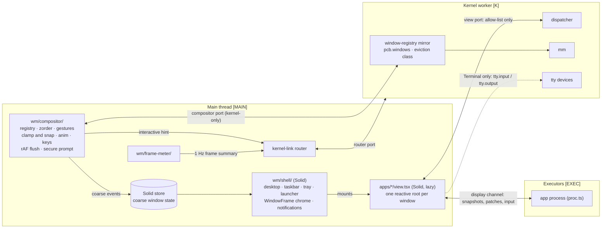
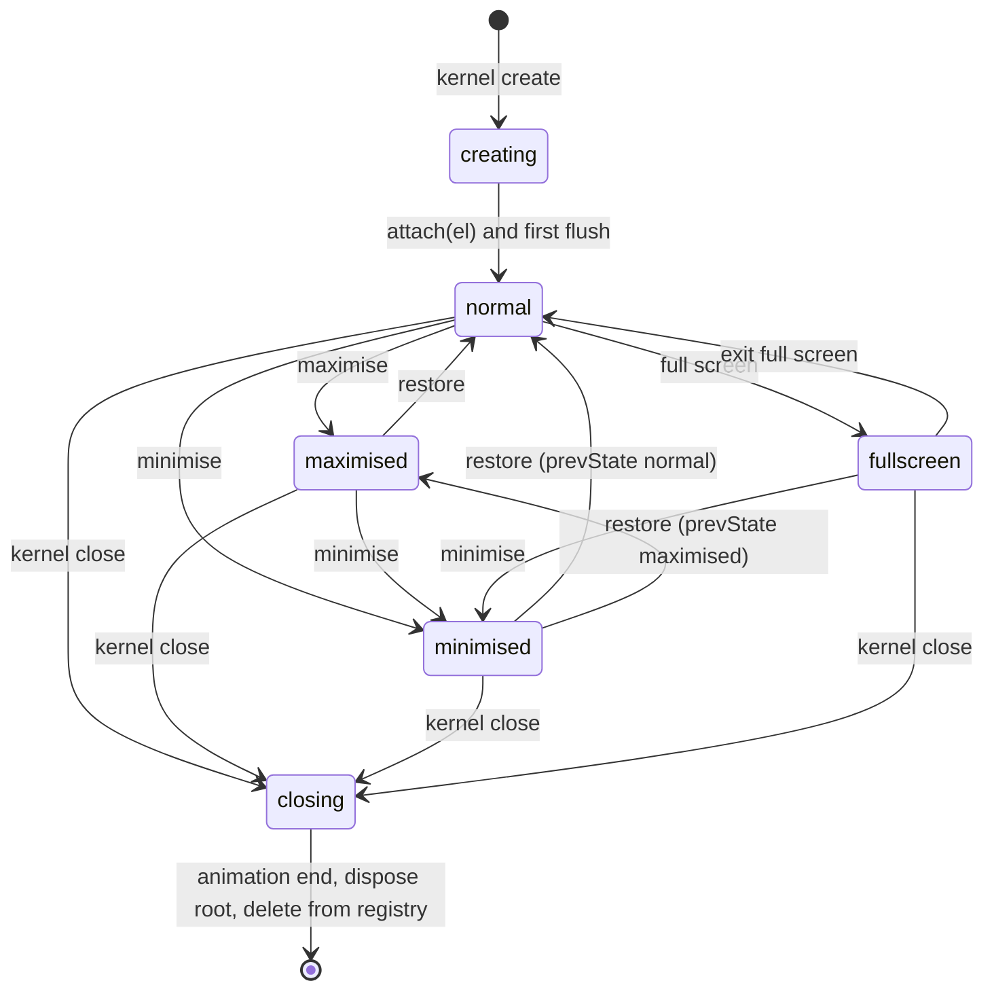
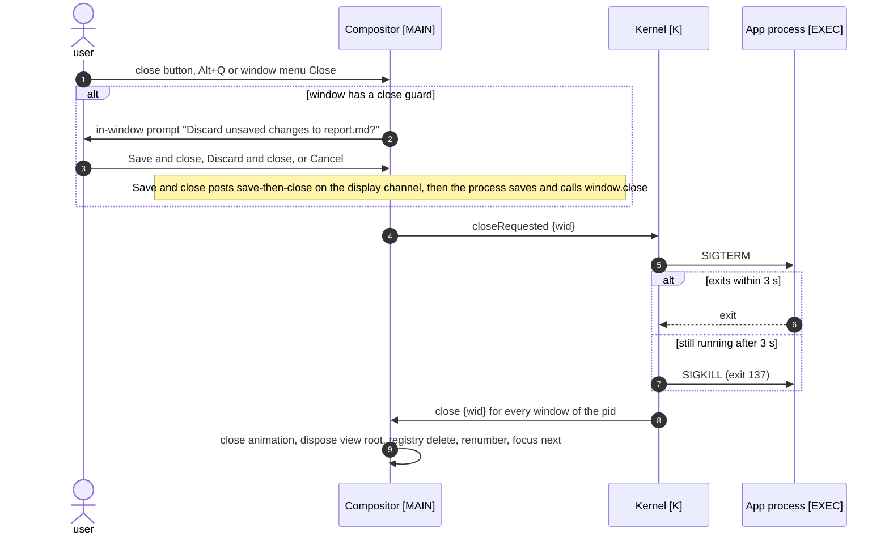
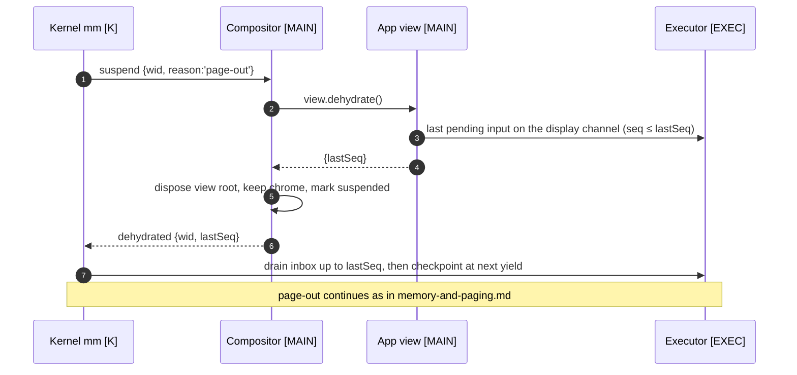
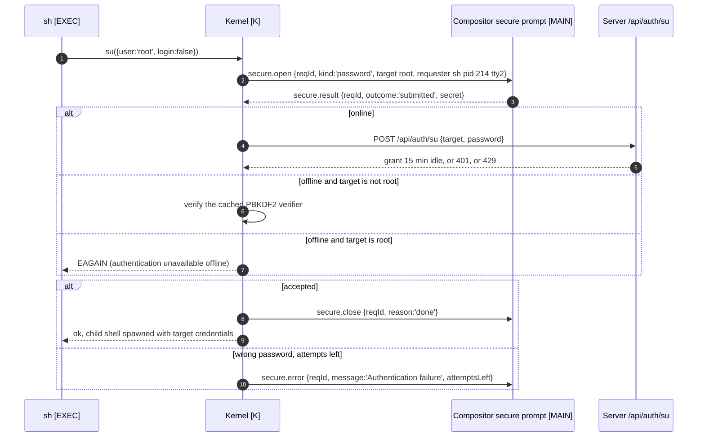

# Window manager

| Field | Value |
|---|---|
| Title | Window manager: compositor, window registry, focus and z-order, gestures, snapping, taskbar and tray, window–process coupling, display channel, session layout, secure prompt, notifications, frame meter |
| Status | Draft v0.1, 2026-09-24 |
| Primary owner | R3 WM/UI |
| Secondary reviewer | R1 Kernel (main-thread budget, window–process coupling, paging) |
| Must be demonstrable at | **P2 gate (W7, v0.2.0):** WM-01, WM-02, WM-04, WM-06 live; 10 windows dragged with the frame meter on (WM-03); title-bar double-click; keyboard window switching (WM-07). **P3 gate (W11, v0.3.0):** frame time under CPU load (PROC-05); minimised windows paged first and "Restoring…" on restore (WM-05, MEM-03/05); taskbar connectivity and degraded badges (OFF-04); "Restart to update" (OFF-05). **P4 gate (W14, v0.4.0):** secure indicator during agent confirmation (AGT-03). **Final defence (W17–18, v1.0.0):** all of the above on the examiner's machine. |
| Requirement IDs covered | Spec: WM-01, WM-02, WM-03, WM-04, WM-05, WM-06, WM-07; frame part of PROC-05; OFF-04; the badge part of OFF-05; the window part of MEM-03, MEM-05 and MEM-07; the surface part of AGT-03. Plotinium design: WMD-01 … WMD-24 |
| Related specs | [Architecture](../01-architecture/architecture.md) · [System-call ABI](../01-architecture/syscall-abi.md) · [UI design system](./ui-design-system.md) · [Shell and terminal](../07-shell/shell-and-terminal.md) · [Boot and services](../02-boot/boot-and-services.md) · [Processes and scheduling](../03-kernel/processes-and-scheduling.md) · [Memory and paging](../03-kernel/memory-and-paging.md) · [Offline and sync](../06-sync/offline-and-sync.md) · [Data structures](../08-dsa/data-structures.md) · [Security model](../12-security/security-model.md) · [Testing and performance](../13-quality/testing-and-performance.md) · [Agentic shell](../10-ai/agentic-shell.md) · [Predictive pre-fetch](../10-ai/predictive-prefetch.md) · [Identity and branding](../00-product/identity-and-branding.md) · [Requirements traceability](../00-product/requirements-traceability.md) |

**Conventions.** RFC 2119 keywords (MUST, SHOULD, MAY) as in the capstone spec's Conventions section (p. 3). **Spec** marks an obligation copied from the capstone specification with its section and ID. **Plotinium design** marks our own binding choice. Numbers measured by the AI-run prototype are marked *(pilot figure — re-measure on the lab machine)*. Thread tags: **[MAIN]** main thread, **[K]** kernel worker, **[EXEC]** executor worker.

---

## 1. Purpose and scope

This spec defines how Plotinium puts windows on screen and keeps them honest. It is normative for:

- the **compositor** (`wm/compositor/`), a framework-free TypeScript module on the main thread that is the single authority over window geometry and stacking (Spec §9.4, WM-01);
- the **window registry** record and its invariants;
- **focus and z-order**, including renumbering 1…n (WM-02);
- **drag and resize** with pointer capture and a `requestAnimationFrame` write batch (WM-03);
- **viewport clamping and snapping**; **minimise, maximise, restore, full-screen and close**; title-bar double-click; keyboard shortcuts (WM-04, WM-07);
- the **taskbar registry** and the **tray**: grouping by app, background activity, connectivity and degraded badges, memory meter, offline-ready and "Restart to update" (WM-04, OFF-04, OFF-05);
- **window–process coupling**, including paging of minimised windows and the "Restoring…" state (WM-05);
- the WM side of the **display channel** and the **view port** between an app view and the kernel;
- **session layout persistence and restore** (WM-06);
- the compositor-owned **secure prompt** (su password, agent-confirmation indicator);
- **notifications**, the **frame meter**, and the **accessibility** of the window system.

Out of scope, owned elsewhere:
- colours, typography, spacing, motion values and the visual layout of every screen: [ui-design-system.md](./ui-design-system.md);
- the TTY line discipline, the shell and the terminal's data path: [shell-and-terminal.md](../07-shell/shell-and-terminal.md);
- boot-ui behaviour (boot screen, boot menu, panic, recovery), the service manager and the `session` service: [boot-and-services.md](../02-boot/boot-and-services.md);
- syscall envelopes, schemas and the errno master table: [syscall-abi.md](../01-architecture/syscall-abi.md) (this spec proposes the window-related shapes in §4 and requests them in §9);
- the paging algorithm, page tables and swap tiers: [memory-and-paging.md](../03-kernel/memory-and-paging.md);
- signals, scheduling classes and the watchdog: [processes-and-scheduling.md](../03-kernel/processes-and-scheduling.md).

---

## 2. Requirements table

| ID | Summary | Spec § | How verified |
|---|---|---|---|
| WM-01 | Spec: MUST, §9.4, WM-01. The window registry is a hash map with O(1) lookup; the compositor is the only code that writes window geometry. | §9.4 | Code review; registry benchmark; lint rule and static scan (§8) |
| WM-02 | Spec: MUST, §9.4, WM-02. Dynamic z-ordering with renumbering; click to focus and raise; focus is always visible. Exactly one window has focus; background processes cannot steal focus. | §9.4 | Live demo; z-permutation property test; focus-steal test |
| WM-03 | Spec: MUST, §9.4, WM-03. Dragging and resizing with at least 10 windows open keeps the p95 frame time ≤ 16.7 ms. | §9.4, App. A | Chrome-trace frame durations on the lab-spec machine (§8.2, canonical decision C13) |
| WM-04 | Spec: MUST, §9.4, WM-04. Minimise, maximise, restore, close, snapping and a live taskbar. Double-clicking a title bar maximises. Animations respect reduced motion. Resize handles on all eight edges and corners; windows stay within the viewport; snapping to screen edges and halves. | §9.4 | e2e per action (§8) |
| WM-05 | Spec: MUST, §9.4, WM-05. Closing a window sends a termination signal to its process; killing a process closes its windows; minimised windows are the first candidates for paging; restoring one triggers a page-in. | §9.4, §9.2 | Integration tests (§8) |
| WM-06 | Spec: MUST, §9.4, WM-06. Window positions, sizes, states and z-order are restored after a reboot. | §9.4 | Reboot e2e test |
| WM-07 | Spec: SHOULD, §9.4, WM-07. WCAG 2.2 AA for contrast and keyboard operation, including a keyboard shortcut to switch windows. | §9.4 | axe in both themes; keyboard-only e2e; manual screen-reader pass per gate |
| PROC-05 (frame part) | Spec: MUST, §9.1, PROC-05. With a CPU-bound workload and 10 windows, p95 frame ≤ 16.7 ms and no long task over 50 ms from OS code. | §9.1, App. A | Same trace method as WM-03, with 3 × `burn` running |
| OFF-04 | Spec: MUST, §9.5, OFF-04. The taskbar shows connectivity status and lists degraded services. | §9.5 | Live demo; e2e driving `net.state` and `svc.*` events |
| OFF-05 (badge) | Spec: SHOULD, §9.5, OFF-05. New releases install in the background and activate on the next boot with a "restart to update" notice. | §9.5 | e2e with a hash-only build bump |
| WMD-01 | Plotinium design (C11). No code other than `wm/compositor/` writes `transform`, `left`, `top`, `width`, `height` or `z-index` of a window or its content box; no Solid component binds these properties. | supports WM-01 | ESLint rule `no-geometry-style` plus a static scan of `dist/` |
| WMD-02 | Plotinium design (C3, §8 boundary 1). The compositor accepts lifecycle commands only on the kernel compositor port. App views never receive a reference to the compositor, the registry or another window's DOM. | supports SYS-01 | SYS-01 bypass cases from a view (§8) |
| WMD-03 | Plotinium design (C16). The registry is built on the team's generic `dsa/hashtable` (the module behind PidTable) keyed by `wid`; stacking order is the team's `dsa/zorder` list. | supports WM-01, WM-02, §10 | `dsa/` unit tests and benchmarks |
| WMD-04 | Plotinium design. Geometry is written in exactly one `requestAnimationFrame` flush per frame; layout is read only at gesture start; `pointermove` handlers are O(1) and never read layout. | supports WM-03 | Trace shows no forced reflow in `pointermove`; flush p95 ≤ 1 ms |
| WMD-05 | Plotinium design (C2). On gesture start the compositor posts `interactive {active:true}` to the kernel; on gesture end `{active:false}`. The scheduler pauses background-band quanta for at most 1 s in any 2 s. | supports PROC-05 | Scheduler integration test; PROC-05 trace |
| WMD-06 | Plotinium design. The title bar of every non-minimised window stays reachable: fully inside the work area vertically and at least 96 px visible horizontally. | supports WM-04 | Clamp unit tests; e2e drag-off-screen test |
| WMD-07 | Plotinium design. Snap zones: left and right halves (pointer within 8 px of the side edges), maximise (pointer within 8 px of the top edge), plus a 12 px edge magnet. A preview is shown before release. | supports WM-04 | e2e snap tests |
| WMD-08 | Plotinium design. Documented, configurable keyboard bindings whose defaults avoid shortcuts that Chrome or the lab OS reserve (§3.9). `Alt+←`/`Alt+→` never navigate the page while the desktop is mounted. | supports WM-07 | Keyboard e2e; navigation-guard test |
| WMD-09 | Plotinium design. A new window takes focus only if its process received user input in the last 1,000 ms; otherwise it opens unfocused and its taskbar button flashes. | supports WM-02 | Focus-steal test |
| WMD-10 | Plotinium design. The taskbar groups windows by app id, shows a count badge, a background-activity dot, an attention flash, and toggles focus/minimise on click. | supports WM-04 | e2e |
| WMD-11 | Plotinium design. The tray shows connectivity, degraded services with their next retry, the memory meter, "Offline-ready", "Restart to update", the secure-prompt indicator and the clock, with the exact strings in §3.11. | supports OFF-04, OFF-05 | e2e driving kernel events |
| WMD-12 | Plotinium design. Close = SIGTERM to the window's owning process; the kernel escalates to SIGKILL after 3 s. A process MAY set a close guard, which makes the compositor ask before the signal is sent. | supports WM-05, PROC-07 | Integration tests |
| WMD-13 | Plotinium design. Minimise puts the window's owning process and its TTY session into the `minimised` eviction class. Before a windowed process is paged out its view is dehydrated and its pending input flushed; restore shows "Restoring… n / m MB" with real byte progress. | supports WM-05, MEM-03, MEM-05 | Integration and e2e tests |
| WMD-14 | Plotinium design. Display-channel traffic from a process to its view is coalesced to at most one patch per animation frame per window, at most 64 KB per message. | supports PROC-05, WM-03 | Unit test on the channel; trace |
| WMD-15 | Plotinium design. A view port accepts only the calls in the allow-list of §4.5; any other call returns `EPERM`. | supports SYS-01 | Dispatcher test from a view port |
| WMD-16 | Plotinium design. The layout is persisted after every coarse window event (debounced 500 ms, relaxed durability), at shutdown and reboot (strict), and best-effort at `pagehide`. | supports WM-06 | Reboot e2e; kill-tab e2e |
| WMD-17 | Plotinium design (C10, C12). The secure prompt is drawn only by the compositor on the `--pl-z-secure` layer inside a closed shadow root; while it is open, keystrokes go only to it; its content never reaches an app view. | supports AGT-03, §12.6, C10 | Stacking test; key-isolation test; shadow-root test |
| WMD-18 | Plotinium design. Notifications: at most 3 toasts visible, errors sticky, others auto-dismiss after 6 s with the timer paused on hover or focus; every toast is also kept in the notification centre; toasts never cover the focused control. | supports WM-07 (WCAG 2.2.1, 2.4.11, 4.1.3) | e2e and axe |
| WMD-19 | Plotinium design. The frame meter shows vsync-quantised frame intervals (p95, refresh rate, dropped share) and the count of long animation frames over 50 ms attributed to our origin. It is indicative; the gate is the Chrome trace. | supports WM-03, PROC-05 (§17.1 "frame meter visible") | Unit test on quantisation; e2e overlay test |
| WMD-20 | Plotinium design (spec Fig. 8.1 "at most 4 ms of work per frame"; ARC-04). Main-thread OS script per frame p95 ≤ 4 ms: compositor flush ≤ 1 ms, UI event apply ≤ 3 ms. | Fig. 8.1 | Perf test with manual timing accumulators |
| WMD-21 | Plotinium design (C2, ARC-02). Only the tab holding `plotinium:kernel` mounts a desktop; other tabs show the takeover screen and never create a compositor. | supports C2 | Two-tab e2e (owned by the boot spec; WM asserts no compositor) |
| WMD-22 | Plotinium design. Windows are labelled non-modal dialogs; every drag has a keyboard and single-pointer alternative; controls are at least 24 × 24 CSS px; focus is never hidden by the taskbar or notifications. | supports WM-07 (WCAG 2.5.7, 2.5.8, 2.4.11) | axe; keyboard e2e; target-size test |
| WMD-23 | Plotinium design. Each window's view runs in its own reactive root under its own error boundary; a crash shows "This app stopped" in that window only; killing a process disposes exactly that root. | supports PROC-07 | Crash-containment e2e |
| WMD-24 | Plotinium design (§10.1 extra credit). An interval structure for window hit-testing (`dsa/interval`) MAY back window-under-point queries for drag-and-drop between windows. | §10.1 | If built: unit tests and benchmark |

---

## 3. Design (normative)

### 3.1 Components and where they run



Plotinium design (C2, C11):
- **`wm/compositor/`** is framework-free (it imports no Solid; lint fixture ARC-01). It owns the registry, the z-order list, pointer and keyboard gestures, clamping, snapping, minimise/maximise/restore animations, the single rAF flush and the secure prompt. It is the ONLY writer of window geometry and `z-index` (WM-01, WMD-01).
- **`wm/shell/`** (Solid) renders the desktop, taskbar, tray, launcher, window chrome and notifications. It reads a Solid store that the compositor updates only on coarse events: `opened`, `closed`, `focused`, `state`, `snap`, `title`, `badge`, `restoring`, `suspended`, `attach`. It never receives a per-`pointermove` update.
- **App views** (`apps/<app>/view.tsx`, lazy chunks) receive only `{ sys, display, pid, wid, container }`: `sys` is a view-port client restricted to the allow-list of §4.5, `display` is the display-channel endpoint, `container` is the window's content element. Views never import `wm/`, `kernel/` or `vfs/` (ARC-01).
- **App logic runs in the app's process on an executor** (`apps/<app>/proc.ts`). The view renders and dispatches input.

### 3.2 The single-authority rules

Spec: MUST, §9.4, WM-01. Plotinium design for the mechanisms:

1. **R-GEO.** Only `wm/compositor/flush.ts` assigns `style.transform`, `style.width`, `style.height` or `style.zIndex` on a window element or its content box. No component anywhere binds `style={{ left, top, width, height, transform, 'z-index' }}` or equivalent class toggles that change geometry. Enforced by the ESLint rule `no-geometry-style` (in `tools/eslint-rules/`) and a static scan of `web/dist` for geometry writes outside the compositor chunk.
2. **R-DOM.** DOM order of window elements is creation order and never changes; stacking is expressed only by `z-index`. The compositor never re-parents or re-orders window elements, so no view is torn down by a focus change.
3. **R-READ.** Layout is read (`getBoundingClientRect`, `clientWidth`, …) only at gesture start, at animation start, and on viewport resize. Never inside `pointermove` or the flush.
4. **R-PORT.** Window lifecycle commands (`create`, `close`, `focus`, `attention`, `setTitle`, `restoring`, `suspended`, `attach`, `secure.*`, `notify`) are accepted only on the compositor port, which the router hands to the compositor once at kernel link-up and which no other module can obtain (WMD-02).
5. **R-STATE.** Geometry is never reactive state. The Solid store carries rectangles only as final values after a gesture or state change, for chrome decisions (for example, hiding rounded corners when maximised); nothing renders from them.
6. **R-MIRROR.** The kernel keeps a *mirror* of `{wid → pid, state}` for ownership checks and paging; the compositor is authoritative for geometry, focus and z, and reports final values to the kernel with `geometry` and `focused` messages (§4.3). The kernel is authoritative for ownership (`pcb.windows`).

### 3.3 The window registry

Spec §9.4: a hash map from window id to window state holding the owning pid, title and icon; position and size (x, y, w, h) and stacking order z; the window state (normal, minimised, maximised or full-screen) and the rectangle to restore to; whether the window has focus, plus its size limits.

Plotinium design:
- `registry: HashTable<number, WinRec>` from `dsa/hashtable` (generic open addressing with Fibonacci hashing and backward-shift deletion, the same module that backs PidTable; owner of the module R1, user here R3). `get`, `set`, `delete` are O(1) average (WM-01).
- `order: ZOrderList` from `dsa/zorder` (owner R3): a doubly linked list of `wid` from bottom to top plus a node index held in the `WinRec`. `raise(wid)` is O(1); `renumber()` is O(n) over at most `MAX_WINDOWS`.
- `MAX_WINDOWS = 64` per desktop session. `window.create` beyond it returns `EAGAIN`.
- The record type is in §4.1. The lifecycle is:



Flags orthogonal to the state (each shown by the chrome, visuals in [ui-design-system.md](./ui-design-system.md)): `snap` (`left` | `right` | `null`, only with `normal`), `restoring` (page-in in progress), `suspended` (process paged out, view dehydrated), `crashed` (view error boundary tripped), `notResponding`, `attention`, `closeGuard`, `secureStrip`.

### 3.4 Focus and z-order (WM-02)

Spec: MUST, §9.4. Exactly one window has focus. Focusing a window raises it. Z-indices are renumbered 1…n after each change. Background processes cannot steal focus.

Plotinium design:
1. **Focus target.** `focusedWid` is either one window or `null` (the desktop has focus: no windows, or all minimised). "Exactly one window has focus" is read as: at most one window is focused at any time, and whenever a non-minimised window exists after a user action, one of them is focused.
2. **Click to focus.** A `pointerdown` in the capture phase on any part of a window (chrome or content) calls `focus(wid)` before the event reaches the view, so a click both focuses and acts.
3. **`focus(wid)`**: if `wid` is already focused and on top, no-op. Otherwise `order.raise(wid)`, `renumber()`, set `focusedWid`, mark the previous and new windows' chrome dirty, move DOM focus into the window (its last focused element, else its first focusable control, else the window element, which has `tabindex="-1"`), push `focused` into the store and send `{t:'focused', wid, seq}` to the kernel (which pins the process and records telemetry for [predictive-prefetch.md](../10-ai/predictive-prefetch.md)).
4. **Renumber.** Walk `order` bottom to top assigning `z = 1 … n`; for each window whose `z` changed, set its `Z` dirty bit. Windows live inside the `--pl-z-windows` stacking context, so their 1…n values never interact with the taskbar or overlays.
5. **Minimise.** A minimised window keeps its place in `order`. If it was focused, focus moves to the top-most non-minimised window, else to the desktop.
6. **Close.** On removal, `order.remove(wid)`, `renumber()`, and focus moves as in 5.
7. **Focus-steal prevention (WMD-09).** The kernel stamps `activation: boolean` on `create` and on `window.requestFocus`: true only if the requesting process (or its parent, for a window opened on the user's behalf such as Files opening the Editor) received user input within the last 1,000 ms, as reported by the compositor's `input {wid}` messages. `activation:false` → the window is created under the focused window (inserted directly below the top), unfocused, and its taskbar button gets `attention`. `window.requestFocus` from a background process only sets `attention` (strategy syscall notes: "requestFocus only flashes the taskbar").
8. **Focus is always visible.** The focused window carries the accent title strip and the stronger shadow; the focused control inside it shows `--pl-focus-ring`. Unfocused windows use muted chrome. Values in [ui-design-system.md](./ui-design-system.md).
9. **Secure prompt.** While the secure prompt is open, `focus()` calls from pointer or keyboard are ignored and `focusedWid` does not change; the prompt holds DOM focus (§3.16).

### 3.5 Pointer gestures: drag and 8-handle resize (WM-03, WM-04)

Spec: MUST, §9.4. Dragging and resizing use pointer events with pointer capture; movement is applied with `translate3d` and batched per animation frame, never by re-laying out the page on every event; resize handles on all eight edges and corners.

Plotinium design:
- **Drag handle.** The title bar element (`touch-action: none`), excluding its buttons.
- **Resize handles.** Eight elements per window: `n s e w` (8 px thick hit area along each edge) and `ne nw se sw` (16 × 16 px squares at the corners), positioned inside the frame's border box, with the matching `cursor`. Handles are hidden while the window is maximised, full-screen or minimised.
- **Drag threshold.** A drag starts only after the pointer moves 4 px from the `pointerdown` point, so a double-click never starts a drag.
- **Live resize freezes content.** During a resize gesture the content box keeps `max(start size, current size)` and the frame clips it (`overflow: clip`); the app receives one `resize` event (display channel, §3.13) at gesture end, and at most every 250 ms during a gesture longer than 1 s. This keeps per-frame work to a transform and a frame size change.
- **Every window** has `contain: layout paint`. `will-change: transform` is set on the window only during a gesture.
- **Device-pixel rounding.** Positions are rounded to device pixels, `px(v) = Math.round(v * dpr) / dpr`, so text stays crisp at fractional `devicePixelRatio`.
- **Interactive hint (WMD-05).** Gesture start posts `{t:'interactive', active:true}` through the router; gesture end posts `active:false`. The scheduler contract (pause background band ≤ 1 s in any 2 s) is owned by [processes-and-scheduling.md](../03-kernel/processes-and-scheduling.md).
- **Cancellation.** `pointercancel`, `lostpointercapture`, window `blur` and `visibilitychange → hidden` end the gesture at the last applied rectangle.

Pseudocode (normative structure; names are illustrative):

```ts
// wm/compositor/flush.ts — the ONLY geometry writer (R-GEO)
const POS = 1, SIZE = 2, Z = 4, CONTENT = 8;
const dirty = new Set<WinRec>();
let rafId = 0;

export function schedule(r: WinRec, bits: number): void {
  r.dirtyBits |= bits;
  dirty.add(r);
  if (rafId === 0) rafId = requestAnimationFrame(flush);
}

function flush(): void {
  rafId = 0;
  const t0 = performance.now();
  for (const r of dirty) {
    const s = r.el.style;
    if (r.dirtyBits & POS)  s.transform = `translate3d(${px(r.x)}px, ${px(r.y)}px, 0)`;
    if (r.dirtyBits & SIZE) { s.width = `${r.w}px`; s.height = `${r.h}px`; }
    if (r.dirtyBits & Z)    s.zIndex = String(r.z);
    if (r.dirtyBits & CONTENT) { const c = r.content.style; c.width = `${r.cw}px`; c.height = `${r.ch}px`; }
    r.dirtyBits = 0;
  }
  dirty.clear();
  budget.addFlush(performance.now() - t0);     // WMD-20 accumulator, no PerformanceMeasure per frame
}
```

```ts
// wm/compositor/gestures.ts
export function onTitlePointerDown(e: PointerEvent, wid: number): void {
  const r = registry.get(wid);
  if (!r || e.button !== 0 || secure.isOpen()) return;
  focus(wid);                                             // raise + renumber (§3.4)
  const bar = e.currentTarget as HTMLElement;
  bar.setPointerCapture(e.pointerId);
  const start = { px: e.clientX, py: e.clientY, x: r.x, y: r.y };
  const work = workArea();                                // one layout read, at gesture start (R-READ)
  let dragging = false;

  const move = (ev: PointerEvent) => {                    // O(1), no layout reads
    const dx = ev.clientX - start.px, dy = ev.clientY - start.py;
    if (!dragging) {
      if (dx * dx + dy * dy < 16) return;                 // 4 px threshold
      dragging = true;
      r.el.style.willChange = 'transform';
      router.post({ t: 'interactive', active: true });    // WMD-05
      if (r.state === 'maximised' || r.snap) unsnapUnderPointer(r, ev, work);   // §3.6
    }
    const next = clampPosition(r, start.x + dx, start.y + dy, work);            // §3.6
    r.x = next.x; r.y = next.y;
    snapPreview.update(ev.clientX, ev.clientY, work);    // preview element only; no window geometry
    schedule(r, POS);
  };

  const end = () => {
    bar.removeEventListener('pointermove', move);
    if (!dragging) return;
    r.el.style.willChange = '';
    const zone = snapPreview.commit();                    // 'left' | 'right' | 'max' | null
    if (zone) applySnap(r, zone, work); else magnet(r, work);
    schedule(r, POS | SIZE);
    router.post({ t: 'interactive', active: false });
    reportGeometry(r);                                    // {t:'geometry'} to the kernel, then layout.persistSoon()
  };

  bar.addEventListener('pointermove', move);
  bar.addEventListener('pointerup', end, { once: true });
  bar.addEventListener('pointercancel', end, { once: true });
  bar.addEventListener('lostpointercapture', end, { once: true });
}
```

```ts
// resize: same capture pattern; edges = which sides move
type Edges = { l: boolean; t: boolean; r: boolean; b: boolean };   // e.g. 'nw' = {l:true, t:true, r:false, b:false}
function resizeRect(s: Rect, dx: number, dy: number, e: Edges, lim: Limits, work: Rect): Rect {
  let { x, y, w, h } = s;
  if (e.r) w = s.w + dx;
  if (e.b) h = s.h + dy;
  if (e.l) { w = s.w - dx; x = s.x + dx; }
  if (e.t) { h = s.h - dy; y = s.y + dy; }
  const cw = clamp(w, lim.minW, Math.min(lim.maxW, work.w));
  const ch = clamp(h, lim.minH, Math.min(lim.maxH, work.h));
  if (e.l) x = s.x + s.w - cw;                            // anchor the opposite edge when clamped
  if (e.t) y = s.y + s.h - ch;
  return clampRectToWork({ x, y, w: cw, h: ch }, work);   // edges may not leave the work area
}
```

Per `pointermove` the resize path sets `POS | SIZE | CONTENT` (content only when it grows beyond the frozen size).

### 3.6 Staying inside the viewport, and snapping (WM-04)

**Work area.** `work = { x: 0, y: 0, w: innerWidth, h: innerHeight − taskbarH }` where `taskbarH = --pl-taskbar-h` (44 px). Maximised windows fill the work area, never the taskbar (WCAG 2.4.11).

**Clamp rule (WMD-06).** For a non-minimised window in state `normal`:
- vertical: `0 ≤ y ≤ work.h − titlebarH` (the whole title bar is always inside the work area);
- horizontal: `−(w − V) ≤ x ≤ work.w − V`, with `V = min(96, w)` px always visible;
- size: `minW ≤ w ≤ work.w` and `minH ≤ h ≤ work.h` when the work area allows; if `work.w < minW`, then `w = minW` and `x = 0` (the window overflows to the right, but its title bar and close button are visible).

**Edge magnet.** At drag end, any window edge within 12 px of a work-area edge moves flush to it.

**Snap zones (WMD-07).** Evaluated from the pointer position during a drag:

| Pointer position (work-area coordinates) | Zone | Result on release |
|---|---|---|
| `px ≤ 8` | `left` | `{x: 0, y: 0, w: ⌊work.w / 2⌋, h: work.h}`, `snap = 'left'` |
| `px ≥ work.w − 8` | `right` | `{x: ⌊work.w / 2⌋, y: 0, w: work.w − ⌊work.w / 2⌋, h: work.h}`, `snap = 'right'` |
| `py ≤ 8` (and not in a side zone) | `max` | state `maximised` |
| otherwise | none | magnet only |

- The **snap preview** is a single compositor-owned element on its own layer (`--pl-z-snap-preview`, above windows, below the taskbar) showing the target rectangle; it fades in over `--pl-motion-fast` (0 under reduced motion). Leaving the zone before release cancels it.
- Before snapping or maximising, the compositor stores `restoreRect` (the last `normal` unsnapped rectangle).
- **Unsnap under the pointer.** Dragging a snapped or maximised window by its title bar first restores `restoreRect`'s size and places it so that the pointer keeps the same fraction of the title bar's width: `x = px − frac · restoreRect.w`, where `frac = (px − r.x) / r.w` measured at `pointerdown`.
- Snap by keyboard: `Alt+Shift+←/→/↑` (§3.9) and the window menu.

**Viewport resize.** On `resize` of the page (and when the taskbar height token changes), the compositor recomputes `work` once, then in one flush: recomputes maximised, full-screen and snapped rectangles, and re-clamps every `normal` window. Cost O(n).

**Compact mode.** If `work.w < 800` CSS px (a narrow window, or 200% zoom), every window is shown maximised and the taskbar shows icons only; the saved `normal` rectangles are kept and re-applied when the work area grows again. This keeps content usable at high zoom (WCAG 1.4.4 and 1.4.10 in spirit; a windowed desktop is a two-dimensional layout).

### 3.7 Minimise, maximise, restore, full screen and close (WM-04)

Spec: MUST, §9.4. Animations respect reduced-motion settings.

Plotinium design:
- **Only `transform` and `opacity` are animated** (Web Animations API, `el.animate(...)`), never `width`, `height`, `top` or `left`. Maximise and restore use FLIP: the compositor writes the final geometry in the flush, then animates the inverse transform (scale and translate from the old rectangle to the new one) to identity. The team MAY switch min/max/restore to same-document View Transitions after the W6 spike if the trace shows lower main-thread cost; the rule above still holds.
- **Durations** come from tokens: minimise and restore `--pl-motion-med` (200 ms), maximise and un-maximise `--pl-motion-fast` (120 ms), close `--pl-motion-fast`, easing `--pl-ease`. The compositor reads the resolved values from `:root` once, and again on `matchMedia('(prefers-reduced-motion: reduce)')` change and on theme change.
- **Reduced motion.** When the resolved duration is 0 ms, no animation object is created: the final state is applied in the next flush. If the preference flips during an animation, `animation.finish()` is called at once.
- **Minimise.** Read the taskbar button rectangle at animation start (R-READ), animate the window's transform toward it (scale 0.2, opacity 0), then set `state = 'minimised'`, `el.inert = true`, `style.visibility = 'hidden'`, `style.contentVisibility = 'hidden'`, and send `{t:'minimised', wid}` to the kernel (WM-05, §3.12).
- **Restore from minimised.** Clear `inert`, `visibility` and `content-visibility`; animate from the taskbar button back to the saved rectangle; `focus(wid)`; send `{t:'restored', wid}`. If the process is `SUSPENDED`, the restore starts a page-in and the window shows the "Restoring…" overlay at once (§3.12).
- **Maximise.** Save `restoreRect`, set rect = work area, `state = 'maximised'`, radius 0 (chrome reads `state` from the store).
- **Full screen.** Window menu → "Full screen": rect = the whole viewport (covers the taskbar), `state = 'fullscreen'`; the same command or `Esc` pressed twice within 500 ms on the window exits. It is not the browser Fullscreen API.
- **Close.** Handled by the kernel (§3.12). The compositor plays the close animation (opacity to 0, scale 0.96, `--pl-motion-fast`) only after the kernel's `close {wid}`; then it disposes the view root, deletes the record, renumbers and moves focus.

### 3.8 Title-bar double-click (WM-04)

Spec: MUST, §9.4: "Double-clicking a title bar maximises the window." Plotinium design: a `dblclick` on the title bar, outside its buttons, calls `toggleMaximise(wid)`: `normal` (snapped or not) → `maximised`; `maximised` → `normal` at `restoreRect`. `dblclick` on minimised or full-screen windows is not possible (no title bar is shown). Because a drag needs 4 px of movement (§3.5), a double-click never moves the window. Owner R3, scheduled W6 (critic fix).

### 3.9 Keyboard shortcuts (WM-07, WMD-08)

Spec: SHOULD, §9.4, WM-07 ("including a keyboard shortcut to switch windows") and §9.4 ("keyboard shortcuts are documented").

**Verification that drove the defaults.** Chrome on Windows and Linux reserves or uses `Alt+Space` (its own window menu: "Alt + Space then n" minimises the browser), `Alt+←`/`Alt+→` (history back/forward), `Alt+F` and `Alt+E` (Chrome menu), `Alt+Home`, `Shift+Alt+T`, `Alt+Shift+I`, `Alt+Shift+A`, `F6`, `F10`, `Ctrl+Tab`, `Ctrl+W`, `Ctrl+T` and `Ctrl+N` ([Chrome keyboard shortcuts](https://support.google.com/chrome/answer/157179?hl=en&co=GENIE.Platform%3DDesktop), checked 2026-09-24). GNOME's default `switch-group` binding is `['<Super>Above_Tab','<Alt>Above_Tab']`, i.e. `Alt+`` ` on a US layout ([org.gnome.desktop.wm.keybindings schema](https://github.com/GNOME/gsettings-desktop-schemas/blob/master/schemas/org.gnome.desktop.wm.keybindings.gschema.xml.in)). The research draft proposed `Alt+Space` for the window menu and `Alt+`` ` for switching, with "verify on the lab OS in W5"; this spec keeps `Alt+`` ` as primary (neither source above lists it for Chrome, and on GNOME the alternate applies) with an always-available alternate, and moves the window menu off `Alt+Space`.

**Default bindings** (Plotinium design; rebindable in Settings → Keyboard; listed in `help` and in Settings → Help):

| Action | Primary | Alternate | Notes |
|---|---|---|---|
| Next window (stacking order, includes minimised) | `Alt+`` ` | `Alt+J` | Shows the switcher overlay while `Alt` is held; releasing `Alt` focuses (and restores) the highlighted window |
| Previous window | `Alt+Shift+`` ` | `Alt+K` | |
| Window menu (move, size, snap, minimise, maximise, full screen, close) | `Alt+W` | `Shift+F10` or the context-menu key on the title bar; the title-bar menu button | Keyboard alternative to dragging (WCAG 2.5.7) |
| Snap left / right | `Alt+Shift+←` / `Alt+Shift+→` | window menu | |
| Maximise / restore toggle | `Alt+Shift+↑` | title-bar double-click | |
| Restore (un-snap, un-maximise), or minimise if already normal | `Alt+Shift+↓` | | |
| Minimise | `Alt+M` | | |
| Close (SIGTERM, §3.12) | `Alt+Q` | | Respects a close guard |
| Open Terminal | `Alt+T` | | |
| Open launcher | `Alt+L` | click the logo button | |
| Focus the taskbar | `Alt+N` | | Arrow keys move between buttons; `Esc` returns to the window |

Rules:
1. The compositor listens to `keydown` on `window` in the capture phase. While the secure prompt is open every key goes to the prompt only (§3.16). Otherwise a matching binding is handled, and `preventDefault()` plus `stopPropagation()` are called so the view never sees it.
2. **Navigation guard.** While the desktop is mounted, `Alt+ArrowLeft` and `Alt+ArrowRight` are always `preventDefault()`-ed, bound or not, so a stray keystroke cannot navigate away from the OS page.
3. Bindings take precedence over app keys (for example over an `Alt`-letter meta key in the shell's line editor); the shell spec lists which `Alt` keys the line editor uses.
4. **Keyboard move/resize mode** (window menu → Move or Size): arrow keys move the window (or its right/bottom edge) by 16 px, `Shift+arrow` by 1 px; `Enter` commits, `Esc` restores the rectangle from before the mode; the clamp rule applies; the new geometry is announced in the window's live region ("Moved to 120, 80").
5. W5 task (R3): run the binding table on the published lab OS image and record conflicts in `docs/evidence/ui/keys.md`; change a default only through a PR that updates this table.

### 3.10 The taskbar registry (WM-04, WMD-10)

Spec: MUST, §9.4: "The taskbar shows running applications grouped by app, marks background activity, and lets the user focus or minimise with a click."

Plotinium design:
- **Group key** = the app id from the app manifest `/bin/<app>.json` (`id`, `name`, `icon`), carried on the kernel's `create` message. A `HashTable<string, TaskGroup>` maps app id → group; groups are ordered by first launch in this session (stable, so buttons do not jump).
- **What counts as running.** A group exists while at least one window of that app exists. Windowless processes (a background `sleep`, `ai.indexer`) do not appear on the taskbar; they appear in the Task Manager and in the tray's service popover.
- **Button content:** app icon (24 px), label (hidden in compact mode), a **count badge** when the group has more than one window, a **background-activity dot** while any process of the group's windows' owner pids or their TTY sessions was `RUNNING` or `READY` in the last 1 s (from `proc.state` events), and an **attention** state (pulse once, then a steady accent underline until the window is focused; no pulse under reduced motion).
- **Click semantics.** One window: focused → minimise; minimised → restore and focus; otherwise → focus. Several windows: open the group popover (a keyboard-navigable `menu` listing each window's title with its state), where each item focuses or restores that window; the popover also offers "New window" and "Close all".
- **Right-click or context-menu key** on a button: the group menu (New window, Minimise all, Close all).
- **Launcher.** The left-most button (the mono logo mark) opens the launcher panel: GUI apps from `/bin/*.json` with `gui: true`, a filter box (substring over at most a few dozen names, linear is fine), and the power menu (Lock, Log out, Reboot, Shut down), which sends `{t:'power', action}` to the kernel.
- **Updates** arrive as coarse store updates; the taskbar re-renders only the affected button (Solid fine-grained updates, `reconcile` keyed by app id).

### 3.11 The tray (OFF-04, OFF-05, WMD-11)

Left to right after the task groups. Every item is a button of at least 24 × 24 px with a text label or `aria-label`, and a popover opened by click or `Enter`.

| Item | Source (kernel event) | Visible text (exact) | Popover |
|---|---|---|---|
| **Connectivity** (OFF-04) | `net.state` from `syncd` | `Online` · `Syncing n ops` (`Syncing 1 op`) · `Reconnecting in 4 s` (countdown from `retryAt`) · `Offline · n queued` · `Sign in to sync` | State, server build, queued ops count, last successful sync time, and (for `Sign in to sync`) a sign-in button that opens the login dialog |
| **Degraded services** (OFF-04) | `svc.started`, `svc.degraded`, `svc.failed`, plus `svc.status` at mount | hidden when 0; otherwise `n degraded` with a warning icon; `starting (n)` while non-critical services are still starting after `desktop-interactive` | One row per service: `sync — degraded · backend unreachable · retry in 4 s (attempt 3)`; `lockd — blocked by sync`; each with a "Retry now" button that calls `svc.control({name, action:'retry'})` (kernel decides whether the caller may) |
| **Memory meter** | `mem.pressure` (≤ 1 Hz) | `198 / 256 MB` and a bar; `--pl-warning` at ≥ 85% (reclaim threshold, C13), `--pl-danger` at ≥ 95% | Accounted, budget, reclaimable, speculative, swap local/remote; "Open Task Manager → Memory" |
| **Offline-ready** | router `sw` event `ready` (precache installed for the running version) | check icon with the text `Offline-ready` (label visible for 10 s after it first appears, then icon only with the same accessible name) | "This version (0.3.0 · a1f93c2) can boot without a network." |
| **Restart to update** (OFF-05) | `update.available` (Service Worker waiting) | `Restart to update` (accent) | "Plotinium 0.3.1 is ready. Restart now? Your windows will be restored." [Restart] [Later]. Restart sends `{t:'power', action:'reboot'}`; the kernel runs the BOOT-12 shutdown and then `SKIP_WAITING` (owned by the boot spec) |
| **Secure indicator** | compositor, while the secure prompt or a kernel TTY confirmation is active | lock icon and `Secure prompt` | Which process requested it, its pid and TTY |
| **Notifications** | notification centre (§3.17) | bell icon; count of unread | Last 50 notifications with their actions |
| **Clock** | local time (`Intl.DateTimeFormat`) | `10:12` | Date; time zone |

Countdowns in the tray (`Reconnecting in 4 s`, `retry in 4 s`) are computed from absolute timestamps in the events and redrawn at most once per second while visible. Timers in `wm/shell/` are allowed; the no-timer rule covers only `wm/boot-ui/**` and `services/**` ([boot-and-services.md](../02-boot/boot-and-services.md)).

Status changes of the connectivity and degraded items are also announced in the tray's `role="status"` live region (at most one announcement per 2 s, the latest wins).

### 3.12 Window–process coupling and paging (WM-05, WMD-12, WMD-13)

Spec: MUST, §9.4: closing a window sends a termination signal to its process, and killing a process closes its windows. Minimised windows are the first candidates for paging (§9.2), and restoring one triggers a page-in.

**Ownership.** `window.create` binds a new `wid` to the calling pid (kernel `pcb.windows`). The kernel checks `pcb.windows.has(wid)` on every window syscall (`EPERM` otherwise). A window's owner is fixed for its lifetime.

**Close path.**



- **Close guard.** A process sets it with `window.setCloseGuard({wid, reason})` while it holds unsaved state (the Editor while dirty) and clears it after saving. It only changes what happens *before* the signal: once the user confirms, SIGTERM is sent exactly as the spec requires.
- **Escalation.** SIGTERM, then SIGKILL after 3 s for windowed processes, is the kernel's kill path ([processes-and-scheduling.md](../03-kernel/processes-and-scheduling.md)). While waiting, the window shows "Closing…" and becomes `inert`.
- **Kill closes windows.** On any termination (exit, `kill`, watchdog), step 6 of the kernel kill path sends `close {wid}` for each window in `pcb.windows`.
- **Terminal windows.** The Terminal's window is owned by its `term` process; closing it sends SIGTERM to `term`, whose exit hangs up the TTY, which sends SIGHUP to the TTY session ([shell-and-terminal.md](../07-shell/shell-and-terminal.md)).
- **Not responding.** If a process has not consumed display-channel input for 5 s while the window has pending input (for example it is BLOCKED on `net:llm`), the kernel sends `notResponding {wid, since}`; the window shows "Not responding" with [Wait] and [Force quit]. Force quit sends `{t:'kill', wid, signal:'SIGKILL'}` (kernel-checked: the caller is the console user and owns the process, or is root).

**Minimise → eviction class.** On `minimised {wid}` the kernel sets the eviction class `minimised` on the window's owning pid and on every process in the same TTY session (for Terminal windows), so reclaim picks them after speculative pages and before ordinary LRU order ([memory-and-paging.md](../03-kernel/memory-and-paging.md)). On `restored` or `focused` the class returns to normal, and the focused process is pinned.

**Dehydrate before page-out.** A windowed process may be paged out only after its view has flushed its pending input and released its content:



- If `dehydrated` does not arrive within 250 ms, the kernel pages out anyway and records it in `dmesg`; the view keeps its pending input and re-sends it after the next `attach` (messages carry `seq`, so the process drops duplicates).
- A visible, unfocused window whose process is paged out shows the "Suspended — click to restore" placeholder; a click restores it like a taskbar restore.

**Restore → page-in.** `restored {wid}` or `focused {wid}` for a `SUSPENDED` process starts a page-in. The kernel streams `restoring {wid, doneBytes, totalBytes}` (at most one per animation frame, WMD-14); the window shows "Restoring… 3.1 / 5.0 MB" as a `role="progressbar"` with real byte counts, drawn in the first frame after the click. When the process is READY the kernel creates a new display channel and sends `attach {wid, display}`; the shell mounts the view in a new root; the view receives a `snapshot`; the overlay clears. On failure (checksum mismatch after retry, remote page missing) the kernel sends `restoreFailed {wid, errno}` and the window shows "Could not restore — [Restart app] [Details]" (`EIO`).

### 3.13 The display channel (WM side, WMD-14)

The display channel is a `MessageChannel` created by the kernel at `window.create` (and again after migration or page-in) between the app's process and its view (strategy syscall protocol §1; [architecture §4.1](../01-architecture/architecture.md)). It carries state out and input in. It is **not** a syscall path: nothing on it reaches the kernel dispatcher.

Plotinium design:
1. **Out (process → view):** `snapshot` (full view state on connect), `patch` (a list of path operations applied with Solid `reconcile`/`produce`), `notice` (text for a banner), `close-guard-result`. The process runtime **coalesces** patches and posts at most one `patch` per animation frame per window; the frame clock comes from the kernel's event batching (≤ 1 batch per frame, [architecture §3.5 B2](../01-architecture/architecture.md)). A single message is at most 64 KB; larger state is paginated by the app (for example 1,000 rows per page), or transferred as an `ArrayBuffer`.
2. **In (view → process):** `hello {lastSeq?}`, `input {seq, ev}` where `ev` is app-defined and validated with Valibot inside the process, `resize {cw, ch}` (after gestures, §3.5), `dehydrate-flush {lastSeq}`.
3. **What may stay in the view.** Only ephemeral UI state: scroll offset, selection, caret, hover, IME composition, open menus. The process owns everything that must survive paging or reboot (document text, current directory, sort order, the Terminal's scrollback snapshot). On `dehydrate` the view sends its ephemeral state as a final `input {ev:{kind:'ui-state', …}}` so a restore can put the caret back.
4. **Editor latency rule.** CodeMirror applies keystrokes locally for latency; the view forwards change sets to the Editor process at most once per frame; the process is authoritative for save (`write` with `expectedVersion`, VFS-10).
5. **Input boost.** On the first input event per 100 ms per window, the compositor also posts `input {wid}` to the kernel, which uses it for activation (§3.4 rule 7) and sets the pre-empt flag on the executor running that process (kernel record: "When input reaches a view's display channel, a flag is also set in the kernel's SAB").
6. **Terminal exception.** The Terminal's byte stream does not use the display channel: keystrokes go to the kernel TTY with `tty.input` on the view port, and output comes back as `tty.output` batches ([shell-and-terminal.md §3.2](../07-shell/shell-and-terminal.md)). The display channel of the `term` process carries only `snapshot`, title and resize messages.

### 3.14 View ports (WMD-15)

A view port is bound to `(pid, wid)` at `window.create`; the kernel takes the caller's identity from the port, never from message fields (C3). Plotinium design: the port accepts **only** the calls in §4.5. The dispatcher order is unchanged (ESRCH > ENOSYS > schema EINVAL > capability > rwx > audit > handler); a call outside the allow-list fails the capability step with `EPERM`. Everything else a view needs goes through its process on the display channel.

### 3.15 Session layout persistence and restore (WM-06, WMD-16)

Spec: MUST, §9.4, WM-06: window positions, sizes, states and z-order are restored after a reboot. Spec §6.3 stage 6: restore windows and layout; if it fails, start a clean session and keep the old one for recovery.

**What is saved** (per window, §4.6): app id, argv, title, `rect`, `restoreRect`, `state`, `prevState` (for minimised windows), `snap`, `z`, `focused`, and a `proc` sub-record (old `osSessionId`, `pid`, `pageIds`) owned by [memory-and-paging.md](../03-kernel/memory-and-paging.md) for MEM-04. Per layout: the viewport size and `devicePixelRatio` at save time.

**When** (Plotinium design, C4 durability classes):
- after any coarse window event (`geometry`, open, close, focus, minimise, restore, snap): the compositor calls `layout.persistSoon()`, a 500 ms trailing debounce that sends one `{t:'layout', layout}` message to the kernel; the `session` service writes IndexedDB `os_sessions` with **relaxed** durability;
- at `shutdown` and `reboot` (BOOT-12): written with **strict** durability before services stop;
- at `pagehide`: best effort (relaxed), because `pagehide` cannot await IndexedDB (coherence coverage gap BOOT-12);
- when online, the kernel also queues a `session.layout` op on the op lane; only the latest pending layout op per `osSessionId` is kept in the outbox (last writer wins per `os_session_id`, [architecture §3.11](../01-architecture/architecture.md)); its schema is requested from [offline-and-sync.md](../06-sync/offline-and-sync.md).

**Restore** (boot stage 6, driven by the `session` service in [boot-and-services.md](../02-boot/boot-and-services.md)):
1. The kernel validates the stored layout with Valibot. Invalid → start a clean session, keep the old record under `os_sessions` key `recovery:<osSessionId>`, and show a notification "Your previous desktop could not be restored. It was kept for recovery." (spec stage 6).
2. The kernel sends one `create` per window **in ascending saved `z`**, each with `restore` set. The compositor inserts each at the top of `order`, so the final order equals the saved order, then renumbers once.
3. **Viewport changed.** If the saved viewport differs from the current work area, `normal` windows are scaled proportionally, `x' = round(x · W/W₀)`, `w' = round(w · W/W₀)` (same for y and h with the heights), then clamped (§3.6). Maximised, full-screen and snapped windows are recomputed from the new work area.
4. Frames and chrome paint immediately with an empty content area; app chunks load after `desktop-interactive` (BOOT-10). Each process is restored by page-in of its old pages when they exist (MEM-04), otherwise respawned from `argv` (for example, the Terminal starts a new shell in the saved directory).
5. Focus goes to the window saved with `focused: true`, else the top-most non-minimised window.
6. **Safe mode.** Frames are restored, but no app process starts; each frame shows "Not started in safe mode — [Start]" (spec BOOT-06: no autostart apps).
7. **New browser session (MEM-04).** When, after login, the server has a newer layout for this uid than the device, the desktop shows "Restore desktop from Nov 14, 10:12?" [Restore] [Start fresh]. [Restore] runs steps 1–5 with the server's layout.

### 3.16 The secure prompt (WMD-17)

Plotinium design (C10: "su grants last 15 min and are typed into a compositor-owned secure prompt"; C12: agent confirmation is read ONLY from kernel-owned TTY input).

**Two kinds:**

| Kind | Used for | Input | Who reads the answer |
|---|---|---|---|
| `password` | `su` (and any future re-authentication) | password field in the prompt | the kernel, over the compositor port |
| `tty-confirm` | agent destructive-plan confirmation (AGT-03) | **none in the prompt**: the answer is typed in the Terminal and read by the kernel's TTY takeover | the kernel TTY ([shell-and-terminal.md §3.11](../07-shell/shell-and-terminal.md)) |

**Rendering and isolation.**
- The prompt is built by framework-free code in `wm/compositor/secure.ts` inside a **closed** shadow root attached to a host element on the `--pl-z-secure` layer (10200). App views live inside the `--pl-z-windows` stacking context (z 100) and so cannot place anything above it; the taskbar (10000) shows the secure indicator, which no app can draw.
- While a `password` prompt is open: a capture-phase `keydown`/`keyup`/`keypress`/`paste`/`beforeinput` listener on `window` stops propagation of every event whose target is outside the prompt; the rest of the desktop is `inert`; pointer events outside the prompt are ignored.
- The password travels only prompt → compositor → kernel (compositor port, kernel-only). It is never put in the store, the DOM outside the shadow root, the event bus, logs or the audit record; the input's value is cleared when the prompt closes.
- Content: the mono logo mark and a lock glyph, the title "Authenticate as root", the requester line "Requested by `sh` (pid 214) in Terminal · tty2", a password field (paste and password managers allowed, `autocomplete="current-password"`; WCAG 3.3.8), the error line, [Cancel] and [Authenticate]. Visuals in [ui-design-system.md](./ui-design-system.md).
- Timeout 60 s → `cancelled`. `Esc` → cancelled. Only one secure prompt at a time; a second request while one is open fails with `EBUSY`.

**`tty-confirm` surface.** When the kernel takes over a TTY for an agent confirmation, it sends `secure.open {kind:'tty-confirm', wid, requester}`. The compositor draws, on the secure layer, a strip anchored over that Terminal window's title bar ("Kernel confirmation · ai.agent pid 812 · answer in this terminal") and lights the taskbar secure indicator. The strip carries no controls. It closes on `secure.close`.



### 3.17 Notifications (WMD-18)

- **Sources:** kernel `notify` messages on the compositor port, for example VFS-10 conflicted copies ("report.md changed on the server — your version was kept as 'report (conflict from alice, 2026-11-14).md'" [Open]), sync rejections that were reverted, lock lost, `update.available`, a service entering `degraded`, a new-session restore offer.
- **Toasts:** bottom-right above the taskbar, at most 3 visible, newest at the bottom; info and success auto-dismiss after 6 s, warning after 10 s, error is sticky; the timer pauses while the pointer is over the toast or focus is inside it (WCAG 2.2.1). A toast never overlaps the focused element: if it would, it is placed above the next free slot, or queued (WCAG 2.4.11).
- **Semantics:** info/success/warning toasts are `role="status"`; errors are `role="alert"`. Toasts never take focus.
- **Centre:** every notification is also stored (last 50, per desktop session, in memory) in the tray's notification centre, where its actions stay reachable by keyboard.
- **Rate:** at most one new toast per source per 2 s; repeats collapse into one with a count ("Lock lost on 3 files").

### 3.18 The frame meter (WMD-19)

Spec §17.1: "a CPU-bound process while windows are dragged, with a frame meter visible". The authoritative measure is the Chrome trace (C13, §8.2); the meter is the live, honest indicator.

Plotinium design:
- **Samples.** A `requestAnimationFrame` loop runs while the overlay is visible or a test hook is on. Each rAF delta `d` is quantised to whole refresh intervals: `k = max(1, round(d / T))`, frame interval `q = k · T`, where `T` is the median rAF delta over the first 120 frames after the overlay opens with no gesture active (re-measured when `devicePixelRatio` or the screen changes). A frame is **dropped** when `k ≥ 2`. Quantising removes vsync jitter (the pilot recorded 16.799–16.800 ms p95 for frames that were not dropped, *pilot figure — re-measure on the lab machine*).
- **Storage.** A `dsa/ringbuffer` of the last 600 quantised intervals (10 s at 60 Hz). p95 is computed over the buffer at 1 Hz.
- **Long animation frames.** `new PerformanceObserver(...).observe({ type: 'long-animation-frame', buffered: true })`; count entries with `duration > 50` whose `scripts[]` contain a `sourceURL` from our origin, separately from other entries. LoAF script attribution exists only for main-thread scripts ([Chrome LoAF docs](https://developer.chrome.com/docs/web-platform/long-animation-frames); [MDN `scripts`](https://developer.mozilla.org/en-US/docs/Web/API/PerformanceLongAnimationFrameTiming/scripts)), which is the thread boundary 2 protects.
- **Overlay** (top-right, `--pl-z-meter`): `p95 16.7 ms · 60 Hz · dropped 0.4% · LoAF>50 ours 0 / other 1`, plus a 120-sample sparkline redrawn at 1 Hz. Toggled by Settings → Developer → Frame meter, or `framemeter on|off` ([shell-and-terminal.md](../07-shell/shell-and-terminal.md)).
- **Summary.** At 1 Hz the meter posts `{t:'frame', p95Ms, loafOver50}` through the router ([architecture §4.2](../01-architecture/architecture.md)) so `top` and the Task Manager can show it.
- **Own cost.** O(1) per frame; the overlay updates once per second.

### 3.19 Accessibility (WM-07, WMD-22)

Spec: SHOULD, WM-07 (WCAG 2.2 AA for contrast and keyboard operation, including a shortcut to switch windows). Plotinium design:

| Concern | Rule |
|---|---|
| Window semantics | Each window is `<section role="dialog" aria-modal="false" aria-labelledby="t{wid}">`; the title bar's heading has `id="t{wid}"`. Minimised windows are `inert` and `visibility:hidden`, so they leave the accessibility tree. |
| Desktop landmarks | The window layer is a `region` labelled "Windows"; the taskbar is `role="toolbar"` labelled "Taskbar" with roving `tabindex`; the tray is a `group` labelled "Status". |
| Keyboard | Every WM action has a key (§3.9). `Tab` cycles within the focused window; `Alt+N` reaches the taskbar. The window switcher overlay is a `listbox` announced on open ("Switch window: Terminal — alice@plotinium:~, 1 of 6"). |
| Dragging alternative (WCAG 2.5.7) | Window menu → Move / Size (keyboard), snap commands, and the title-bar maximise button; single-click taskbar minimise and restore. |
| Target size (WCAG 2.5.8) | Title-bar buttons 28 × 28 px (≥ 24), tray items ≥ 24 × 24, resize corner handles 16 px hit area with the window menu as the alternative. |
| Focus not obscured (WCAG 2.4.11) | Focusing raises; maximised windows never cover the taskbar; toasts avoid the focused element (§3.17). |
| Focus visible (WCAG 2.4.7) | `--pl-focus-ring` on every focusable element; the focused window's chrome is also distinct. |
| Status messages (WCAG 4.1.3) | Tray and window live regions (`role="status"`) for connectivity, degraded services, restoring progress milestones (0%, 50%, done) and keyboard move/resize results. |
| Reduced motion | All WM animations use motion tokens that are 0 ms under `prefers-reduced-motion: reduce` (§3.7). |
| Forced colours | Chrome uses system colours (`CanvasText`, `Highlight`) under `forced-colors: active`; the focused window gets a 2 px `Highlight` outline. |

### 3.20 One desktop per origin (WMD-21)

Only the tab that holds the Web Lock `plotinium:kernel` creates a compositor (C2, ARC-02). A second tab shows the takeover screen from [boot-and-services.md](../02-boot/boot-and-services.md). On takeover, the old tab's kernel runs the BOOT-12 shutdown, which writes the layout with strict durability before releasing the lock, so the new tab restores the same desktop.

---

## 4. Interfaces and data shapes

All message schemas live in `protocol/` as Valibot schemas (C3). The TypeScript below is the normative shape; field names are binding.

### 4.1 Window registry record

```ts
// wm/compositor/types.ts   (Plotinium design)
export type WinState = 'normal' | 'minimised' | 'maximised' | 'fullscreen';   // same union as architecture §4.3
export type Snap = 'left' | 'right' | null;
export interface Rect { x: number; y: number; w: number; h: number }          // CSS px, work-area origin
export interface Limits { minW: number; minH: number; maxW: number; maxH: number }

export interface WinRec {
  wid: number;                 // key in dsa/hashtable; unique per desktop session
  pid: number;                 // owning process (kernel-authoritative)
  app: string;                 // manifest id, e.g. 'files'; taskbar group key
  title: string;
  icon: string;                // icon id from the manifest
  x: number; y: number; w: number; h: number;   // current geometry (Spec §9.4)
  cw: number; ch: number;      // content box size (frozen during live resize, §3.5)
  z: number;                   // 1..n after renumber (Spec §9.4)
  state: WinState;
  prevState: Exclude<WinState, 'minimised'>;    // what a restore from minimised returns to
  snap: Snap;
  restoreRect: Rect | null;    // rectangle to restore to (Spec §9.4)
  focused: boolean;            // (Spec §9.4) mirrors registry-level focusedWid
  limits: Limits;              // size limits (Spec §9.4), from the manifest, defaults 320 × 200 min
  flags: {
    restoring: boolean; suspended: boolean; crashed: boolean; notResponding: boolean;
    attention: boolean; closeGuard: string | null; secureStrip: boolean; closing: boolean;
  };
  el: HTMLElement;             // frame element, written only by flush.ts
  content: HTMLElement;        // content box, written only by flush.ts
  zNode: number;               // handle into dsa/zorder
  dirtyBits: number;           // POS | SIZE | Z | CONTENT
  createdAt: number;
}
```

### 4.2 App manifest fields used by the window manager

```ts
// /bin/<app>.json (full manifest owned by boot-and-services.md / processes-and-scheduling.md; these fields are read here)
interface AppManifestWm {
  id: string;                  // 'terminal' | 'files' | 'editor' | 'taskmgr' | 'settings' | ...
  name: string;                // 'File Explorer'
  icon: string;                // icon id ('app-files')
  gui: boolean;                // listed in the launcher
  window?: { defaultW?: number; defaultH?: number; minW?: number; minH?: number; singleInstance?: boolean };
}
```

### 4.3 Compositor port messages

The base set is fixed in [architecture §4.3](../01-architecture/architecture.md). This spec **extends** it (requested in §9):

```ts
// protocol/src/host/compositor.ts
type KernelToCompositor =
  | { t: 'create'; wid: number; pid: number; app: string; title: string; icon?: string;
      rect?: Rect; restore?: LayoutWindow; seq: number;
      activation: boolean;                         // §3.4 rule 7
      limits?: Partial<Limits>;
      ports: { view: MessagePort; display: MessagePort } }   // transferred
  | { t: 'close'; wid: number; seq: number }
  | { t: 'focus'; wid: number; seq: number }                  // only honoured with activation (§3.4)
  | { t: 'attention'; wid: number; level: 'info' | 'urgent' }
  | { t: 'setTitle'; wid: number; title: string }
  | { t: 'restoring'; wid: number; doneBytes: number; totalBytes: number }
  | { t: 'suspend'; wid: number; reason: 'page-out' | 'checkpoint' }   // asks for dehydrate (§3.12)
  | { t: 'attach'; wid: number; display: MessagePort }                 // new display channel after page-in or migration
  | { t: 'restoreFailed'; wid: number; errno: 'EIO' }
  | { t: 'notResponding'; wid: number; since: number | null }          // null clears it
  | { t: 'closeGuard'; wid: number; reason: string | null }
  | { t: 'secure.open'; reqId: string; kind: 'password'; purpose: 'su';
      target: { user: string; uid: number }; requester: Requester; attemptsLeft: number; timeoutMs: number }
  | { t: 'secure.open'; reqId: string; kind: 'tty-confirm'; purpose: 'agent'; wid: number; requester: Requester }
  | { t: 'secure.error'; reqId: string; message: string; attemptsLeft: number }
  | { t: 'secure.close'; reqId: string; reason: 'done' | 'error' | 'timeout' }
  | { t: 'notify'; n: Notification }
  | { t: 'events'; batch: KEvent[] };      // ≤ 1 per frame: net.state, svc.*, mem.pressure, proc.state (for taskbar pids), update.available

type CompositorToKernel =
  | { t: 'focused'; wid: number | null; seq: number }
  | { t: 'minimised' | 'restored' | 'closeRequested'; wid: number; seq: number }
  | { t: 'geometry'; wid: number; rect: Rect; state: WinState; z: number }   // final values only
  | { t: 'input'; wid: number }                                             // ≤ 1 per 100 ms per window
  | { t: 'dehydrated'; wid: number; lastSeq: number }
  | { t: 'kill'; wid: number; signal: 'SIGKILL' }                            // Force quit
  | { t: 'launch'; app: string; argv?: string[] }                            // launcher, taskbar "New window", Alt+T
  | { t: 'power'; action: 'lock' | 'logout' | 'reboot' | 'shutdown' }
  | { t: 'layout'; layout: SessionLayout }                                   // debounced (§3.15)
  | { t: 'secure.result'; reqId: string; outcome: 'submitted' | 'cancelled' | 'timeout'; secret?: string }
  | { t: 'viewCrashed'; wid: number; message: string }
  | { t: 'ready'; wid: number; launchToPaintMs: number };                    // first snapshot painted (PRE-03 measurement)

interface Requester { pid: number; comm: string; tty: string | null; uid: number; user: string }
```

### 4.4 Display channel messages

```ts
// protocol/src/host/display.ts   (Plotinium design)
type Patch = { op: 'set' | 'splice' | 'del'; path: (string | number)[]; value?: unknown; start?: number; deleteCount?: number; items?: unknown[] };
type ProcToView =
  | { t: 'snapshot'; seq: number; state: unknown }            // ≤ 64 KB, else paginated or transferred
  | { t: 'patch'; seq: number; ops: Patch[] }                 // ≤ 1 per frame per window
  | { t: 'notice'; level: 'info' | 'warning' | 'error'; text: string }
  | { t: 'close-guard-result'; outcome: 'saved' | 'failed'; errno?: string };
type ViewToProc =
  | { t: 'hello'; lastSeq?: number }
  | { t: 'input'; seq: number; ev: unknown }                  // app-defined; Valibot-validated in the process
  | { t: 'resize'; cw: number; ch: number }
  | { t: 'save-then-close' }
  | { t: 'dehydrate-flush'; lastSeq: number };
```

### 4.5 View-port allow-list (WMD-15)

| Call | Purpose | Constraint |
|---|---|---|
| `window.setTitle({wid, title})` | e.g. the Editor's file name | `wid` must be the port's `wid`; title ≤ 200 chars, control characters stripped |
| `window.requestFocus({wid})` | flash attention | never takes focus (§3.4 rule 7) |
| `window.close({wid})` | the view's own close action | same path as `closeRequested` |
| `tty.input({tty, data})` | Terminal keystrokes and paste | only the Terminal view bound to that TTY ([shell-and-terminal.md](../07-shell/shell-and-terminal.md)) |
| `tty.winsize({tty, cols, rows})` | Terminal resize; also signals "view ready" after an `attach` | same |
| `tty.ack({tty, seq})` | Terminal output flow control: acknowledges a `tty.output` batch once xterm has parsed it | same |
| `ai.search.focus({on})` | Files search box focus ([rag-semantic-search.md](../10-ai/rag-semantic-search.md)) | view of a process holding `fs.read` |

Any other call on a view port → `EPERM`.

### 4.6 Session layout

```ts
// protocol/src/host/layout.ts   (Plotinium design; `proc` owned by memory-and-paging.md)
interface LayoutWindow {
  app: string; argv: string[]; title: string;
  rect: Rect; restoreRect: Rect | null;
  state: WinState; prevState: 'normal' | 'maximised' | 'fullscreen'; snap: Snap;
  z: number; focused: boolean;
  proc: { osSessionId: string; pid: number; pageIds: number[] } | null;
}
interface SessionLayout {
  v: 1;
  osSessionId: string;          // UUIDv7
  uid: number;
  savedAt: number;              // epoch ms
  viewport: { w: number; h: number; dpr: number };
  windows: LayoutWindow[];      // any order; restore sorts by z
}
```

Stored in IndexedDB `os_sessions` (C4) under key `osSessionId`, and on the server in `os_sessions.window_layout` (C7) as JSON of the same schema.

### 4.7 Taskbar and tray state (Solid store)

```ts
interface TaskGroup { app: string; name: string; icon: string; wids: number[]; active: boolean; attention: boolean }
type NetView =
  | { state: 'LIVE' } | { state: 'SYNCING'; ops: number } | { state: 'RECONNECTING'; retryAt: number }
  | { state: 'OFFLINE'; queued: number } | { state: 'AUTH_REQUIRED'; queued: number };
interface SvcView { name: string; state: 'starting' | 'running' | 'degraded' | 'failed' | 'blocked'; reason?: string; attempts: number; nextRetryAt?: number; blockedBy?: string }
interface MemView { accounted: number; budget: number; reclaimable: number; speculative: number; swapLocal: number; swapRemote: number }
interface Notification { id: string; level: 'info' | 'success' | 'warning' | 'error'; title: string; body?: string;
  actions?: { id: string; label: string }[]; source: { app?: string; pid?: number; svc?: string }; at: number }
```

The payloads of `net.state`, `svc.*` and `mem.pressure` are owned by [offline-and-sync.md](../06-sync/offline-and-sync.md), [boot-and-services.md](../02-boot/boot-and-services.md) and [memory-and-paging.md](../03-kernel/memory-and-paging.md); the fields above are the ones this UI needs (requested in §9).

### 4.8 Frame meter

```ts
interface FrameStats { refreshMs: number; p95Ms: number; droppedShare: number; loafOver50Ours: number; loafOver50Other: number; samples: number }
```

---

## 5. Algorithms and invariants

| Operation | Algorithm | Complexity |
|---|---|---|
| `registry.get/set/delete` | `dsa/hashtable` open addressing | O(1) average |
| `focus(wid)` | `order.raise` + `renumber` | O(1) + O(n), n ≤ 64 |
| `pointermove` (drag or resize) | arithmetic + clamp + `schedule` | O(1), no layout reads |
| `flush()` | iterate dirty set | O(d), d = dirty windows this frame |
| snap zone test | three comparisons | O(1) |
| viewport resize | recompute work area, re-clamp all | O(n) |
| taskbar event apply | `HashTable<app, TaskGroup>` update | O(1) per event |
| layout restore | sort windows by saved z, create in order, one renumber | O(n log n) |
| frame p95 | copy ring (600) and select the 95th percentile with quickselect | O(600) per second |

**Invariants** (checked by unit and property tests, §8):
- **I-WM1** `{ z(w) }` over live windows is exactly `{1, …, n}` after every compositor operation.
- **I-WM2** At most one window has `focused = true`; if `focusedWid ≠ null` it is the top-most non-minimised window, unless the secure prompt is open.
- **I-WM3** Every non-minimised `normal` window satisfies the clamp rule (§3.6) after every flush that follows a gesture end or a viewport resize.
- **I-WM4** No code path outside `flush.ts` writes window geometry (R-GEO); at most one flush runs per animation frame.
- **I-WM5** For every live `WinRec`, the kernel mirror has `pcb.windows.has(wid)` for `pid`; after the process terminates, no `WinRec` with that `pid` exists once the close animations finish (≤ `--pl-motion-fast` + one frame).
- **I-WM6** A process whose window is `minimised` is in eviction class `minimised` until restored or focused.
- **I-WM7** Every `input` message a view sends before `dehydrated {lastSeq}` is processed by the process before its checkpoint.
- **I-WM8** A restored layout yields the same `order` (by saved z) and the same `state` per window as the saved one.
- **I-WM9** While a `password` secure prompt is open, no keyboard event reaches any element outside the prompt's shadow root.

---

## 6. Errors and edge cases

Errnos follow the master table in [syscall-abi.md](../01-architecture/syscall-abi.md) (spec errnos plus the allowed extras of C3).

| Situation | Behaviour | errno |
|---|---|---|
| `window.create` by a process without the `window` capability | refused | `EPERM` |
| `window.*` on a `wid` the caller does not own | refused | `EPERM` |
| `window.*` on an unknown `wid` | refused | `EINVAL` |
| More than `MAX_WINDOWS` (64) windows | refused; notification "Too many windows" | `EAGAIN` |
| View-port call outside the allow-list | refused | `EPERM` |
| `tty.input` from a view not bound to that TTY | refused | `EPERM` |
| Second secure prompt while one is open | refused; the requester may retry | `EBUSY` |
| Secure prompt cancelled or `Esc` | `su` prints `su: authentication cancelled` | `ECANCELED` |
| Secure prompt timed out (60 s) | closed | `ETIMEDOUT` |
| `su` wrong password | prompt stays open with "Authentication failure" and attempts left; after the last attempt it closes | `EACCES` |
| `su` rate-limited by the server | prompt closes with "Too many attempts — try again in 5 min" | `EAGAIN` |
| `su` to root while offline | no prompt; `su: authentication unavailable offline` (no root verifier is ever cached, C10) | `EAGAIN` |
| Page-in fails during restore | "Could not restore — [Restart app] [Details]" | `EIO` |
| Process ignores SIGTERM | SIGKILL after 3 s; window closes; exit 137 | — |
| View throws during render | error boundary: "This app stopped — [Restart] [Details]"; `viewCrashed` to the kernel; other windows unaffected | — |
| `pointercancel`, lost capture, page blur mid-gesture | gesture ends at the last applied rectangle; `interactive:false` sent | — |
| Double-click on a title-bar button | ignored for maximise (only the button acts) | — |
| Window larger than a shrunken viewport | scaled then clamped (§3.15), or compact mode below 800 px (§3.6) | — |
| Saved layout references an app no longer installed | that window is skipped; notification "Terminal could not be restored (app not found)" | — |
| Saved layout invalid | clean session; old layout kept under `recovery:<id>` | — |
| Reduced-motion preference changes mid-animation | `animation.finish()`; final state applied | — |
| 120 Hz or 144 Hz display | the meter's `T` is measured, so p95 is reported in that display's intervals; the gate threshold stays 16.7 ms | — |
| Fractional `devicePixelRatio` | positions rounded to device pixels | — |
| Close requested while the process is `SUSPENDED` | if a close guard is set, the guard prompt appears first and [Save and close] pages the process in so it can save; otherwise the kernel applies SIGTERM's default action without paging the process in, frees its swap pages, and the window closes | — |
| Kernel link lost (kernel worker crashed) | compositor freezes input to windows and shows the boot spec's kernel-panic screen | — |
| Two tabs | only the lock holder renders a desktop (§3.20) | — |

---

## 7. Performance budgets

All measured on the lab-spec machine in Chrome stable (C13). Budgets live in `tests/performance/budgets.json` ([testing-and-performance.md](../13-quality/testing-and-performance.md)).

| Budget | Target | Source | Measured by |
|---|---|---|---|
| Frame time while dragging and resizing, 10 windows | p95 ≤ 16.7 ms (Chrome-trace frame durations) and 0 LoAF > 50 ms attributed to our origin | Spec WM-03; method C13 | §8.2, nightly and per release |
| Frame time with 3 × `burn` and 10 windows | same thresholds | Spec PROC-05 | §8.2 variant |
| Main-thread OS script per frame (flush + event apply) | p95 ≤ 4 ms | Spec Fig. 8.1; WMD-20 | accumulators exported during the perf test |
| Compositor flush, 10 windows moving | p95 ≤ 1 ms | Plotinium design | same |
| UI event apply (store updates from one kernel batch) | p95 ≤ 3 ms | Plotinium design | same |
| Whole main-thread work per drag frame | measured and reported; the prototype saw 2.7–4.2 ms at 4× CPU throttle *(pilot figure — re-measure on the lab machine)* | evidence | trace |
| `focus()` including renumber and chrome update | ≤ 1 ms script | Plotinium design | unit perf test |
| Click on a minimised window → first "Restoring…" paint | next frame (≤ 16.7 ms) | Plotinium design (spec §9.2: "a restoring state, not a blank") | e2e trace |
| Window open (chunk cached) → chrome painted | ≤ 1 frame after `create`; content ≤ 100 ms | Plotinium design | e2e |
| Keyboard window switch → focused window visible | ≤ 50 ms | Plotinium design | e2e |
| Keystroke to paint in an app view under CPU load | p95 ≤ 50 ms | kernel record risk mitigation | M1-style perf test |
| Layout persist (kernel side, one relaxed transaction) | ≤ 5 ms | Plotinium design | integration perf test |
| Frame meter overhead | ≤ 0.1 ms per frame | Plotinium design | perf test |

---

## 8. Test plan

Levels: Vitest `unit` (U), Vitest `browser` in real Chrome (B), `integration` (I), Playwright e2e on channel `chrome` (E), performance on the lab-spec runner (P), lint/static (L). Every title begins with its requirement ID (C18).

### 8.1 Tests

| Title | Level | Runs |
|---|---|---|
| `WM-01 registry get, set and delete stay flat from 10 to 10,000 windows in the dsa/hashtable benchmark` | U (bench) | PR |
| `WM-01 lint fixture binding style.transform in a Solid component fails no-geometry-style` | L | PR |
| `WM-01 static scan finds no window geometry or z-index write outside the compositor chunk` | L | PR |
| `WM-01 compositor ignores a create command posted on any port other than the kernel compositor port` | B | PR |
| `WM-02 clicking a background window raises it and z-indices are exactly 1..n afterwards` | B | PR |
| `WM-02 after 1,000 random open, close, focus, minimise and restore operations z is a permutation of 1..n and at most one window is focused` | U (fast-check) | PR |
| `WM-02 a background process calling window.requestFocus flashes its taskbar button and does not take focus` | B | PR |
| `WM-02 the focused window shows the focus strip and its focused control shows the focus ring in both themes` | E | main |
| `WM-03 p95 frame duration is at most 16.7 ms while dragging and resizing with 10 windows open` | P | nightly, release |
| `WM-03 zero long animation frames over 50 ms are attributed to our origin during the 10-window drag trace` | P | nightly, release |
| `WM-03 the drag trace shows no forced layout inside pointermove handlers` | P | nightly |
| `WM-04 minimise, maximise, restore and close work from the title-bar buttons, the taskbar and the keyboard` | E | main |
| `WM-04 double-clicking the title bar maximises and double-clicking again restores the previous rectangle` | E | PR |
| `WM-04 dragging to the left edge snaps to the left half and dragging away restores the pre-snap size under the pointer` | E | PR |
| `WM-04 dragging to the top edge maximises and the maximised window never covers the taskbar` | E | PR |
| `WM-04 each of the 8 resize handles moves only its edges and never goes below minW or minH` | B | PR |
| `WM-04 a window cannot be dragged so that its title bar leaves the work area` | B | PR |
| `WM-04 with prefers-reduced-motion the minimise animation is skipped and the state applies in the next frame` | E | PR |
| `WM-04 the taskbar groups 3 Terminals under one button with a count badge and shows the activity dot while one runs a job` | E | main |
| `WM-05 closing a window delivers SIGTERM to its process and the process exits` | I | PR |
| `WM-05 killing a process closes all of its windows` | I | PR |
| `WM-05 a process that ignores SIGTERM is killed after 3 s and its window closes` | I | PR |
| `WM-05 under memory pressure a minimised window's process is paged out before any unminimised process` | B | PR |
| `WM-05 restoring a suspended window shows Restoring with real byte progress and the process pages back in` | E | main |
| `WM-06 after reboot the positions, sizes, states and z-order equal the saved layout` | E | main, release |
| `WM-06 a layout restored into a smaller viewport keeps every title bar inside the work area` | E | main |
| `WM-06 a corrupt layout record starts a clean session and keeps the old record for recovery` | B | PR |
| `WM-06 closing the tab and reopening restores the layout saved at pagehide or by the last debounce` | E | nightly |
| `WM-07 every window can be switched to, moved, resized, snapped, minimised and closed with the keyboard only` | E | main |
| `WM-07 Alt+J and Alt+K switch windows on a platform where Alt+backtick is captured` | E | main |
| `WM-07 axe finds zero serious or critical issues on the desktop with 3 windows, the launcher and a toast open, in both themes` | E | main |
| `WM-07 title-bar buttons and tray items have a target size of at least 24 by 24 CSS px` | B | PR |
| `PROC-05 p95 frame duration is at most 16.7 ms with 3 burn processes and 10 windows and no LoAF over 50 ms from our origin` | P | nightly, release |
| `OFF-04 the taskbar shows Online, Syncing n ops, Reconnecting in n s and Offline · n queued as net.state changes` | E | PR |
| `OFF-04 the degraded badge lists each degraded service with its next retry and hides at zero` | E | PR |
| `OFF-05 Restart to update appears when a new Service Worker is waiting and Restart reboots into the new build` | E | release |
| `AGT-03 while a kernel TTY confirmation is pending the terminal shows the secure strip and the taskbar shows the secure indicator` | E | main |
| `WMD-02 an app view cannot obtain the compositor or another window's element (SYS-01 view-origin case)` | B | PR |
| `WMD-05 gesture start and end post interactive true and false exactly once each` | B | PR |
| `WMD-08 Alt+ArrowLeft and Alt+ArrowRight inside the desktop never navigate the page` | E | PR |
| `WMD-09 a window created without user activation opens unfocused below the focused window` | B | PR |
| `WMD-12 closing an Editor with unsaved changes asks first and sends SIGTERM only after Discard or Save` | E | PR |
| `WMD-13 input typed just before page-out is processed before the checkpoint and none is lost` | B | PR |
| `WMD-14 the display channel delivers at most one patch per animation frame per window under a 1 kHz state change` | B | PR |
| `WMD-15 a view-port call outside the allow-list returns EPERM` | B | PR |
| `WMD-17 an app view cannot read the su password field and receives no keystrokes while the prompt is open` | B | PR |
| `WMD-17 no element inside a window can be stacked above the secure prompt` | B | PR |
| `WMD-18 an error toast stays until dismissed and every toast is available in the notification centre` | E | PR |
| `WMD-19 the frame meter reports p95 of one refresh interval and 0 dropped frames for jittered deltas at 60 Hz and 120 Hz` | U | PR |
| `WMD-20 main-thread OS script p95 is at most 4 ms per frame during the 10-window drag` | P | nightly |
| `WMD-21 a second tab shows the takeover screen and creates no compositor` | E | main |
| `WMD-23 an exception thrown in one app view shows This app stopped in that window only` | B | PR |

### 8.2 The 10-window drag trace method (WM-03, PROC-05)

Plotinium design, agreed with the instructor before Phase 2 (critic fix; C13). Owner of the test R3; owner of the harness R5 ([testing-and-performance.md](../13-quality/testing-and-performance.md)).

1. **Machine and browser.** The lab-spec runner (or the weekly lab slot), headed Chrome stable launched by Playwright with `channel: 'chrome'` and a persistent context, GPU rasterisation as on the lab machine, no CDP CPU throttling, laptop on AC power. Record the Chrome version, `hardwareConcurrency`, display refresh rate and `devicePixelRatio` in the result file.
2. **State.** Boot the tagged build, log in as `demo`, wait for `desktop-interactive` plus 5 s idle, open 10 windows: 4 Terminals, 3 File Explorers, 3 Editors (phase-plan P2 gate), each with content (a directory of 150 entries, a 2,000-line file, a terminal with 500 lines of scrollback).
3. **Load variant (PROC-05).** Run `burn --ms 120000 &` three times in one Terminal before tracing.
4. **Trace.** Start CDP `Tracing.start` with categories `devtools.timeline`, `disabled-by-default-devtools.timeline`, `disabled-by-default-devtools.timeline.frame`, `benchmark` and `loading`. Register a buffered `PerformanceObserver` for `long-animation-frame` in the page.
5. **Script (20 s).** For each of the 10 windows in turn: drag the title bar along a 300 × 200 px ellipse with one `mouse.move` per animation frame for 1 s; then resize from the `se` handle by ±200 px for 0.5 s and from the `nw` handle for 0.5 s. Snap one window left and one right at the end.
6. **Frame durations.** From the trace, take the per-frame `PipelineReporter` slices (Chrome's per-frame pipeline events, which DevTools uses to classify frames as presented, partially presented or dropped ([web.dev smoothness](https://web.dev/articles/smoothness), [DevTools performance reference](https://developer.chrome.com/docs/devtools/performance/reference))) during the script window; the duration of a frame is the interval between consecutive presented frames, so a dropped frame lengthens it. Compute p95 over all frames in the window. The exact parser is pinned in the testing spec and has a golden-trace unit test.
7. **Pass.** p95 ≤ 16.7 ms **and** zero LoAF entries with `duration > 50` whose `scripts[].sourceURL` is our origin. Also record ARC-04/WMD-20 accumulators (compositor flush, event apply) and report their p95.
8. **Runs.** 3 runs; the gate is the median of the three p95 values; each run's raw trace summary is committed under `docs/evidence/ui/frames/`.
9. **Not a per-PR gate.** Frame gates run nightly and per release only (headless CI containers have no representative GPU); PRs carry the deterministic budgets (bundle size, flush micro-benchmark).

---

## 9. Open questions and cross-spec requests

### 9.1 Open questions

1. **Lab OS shortcuts (R3, W5).** Which lab image (Windows or Ubuntu GNOME) will examiners use? `Alt+`` ` is taken by GNOME's default `switch-group`; the alternates `Alt+J`/`Alt+K` exist for that case. Confirm no other default binding collides (§3.9 rule 5).
2. **Instructor (before Phase 2).** Is the trace-based frame metric of §8.2 accepted as the WM-03/PROC-05 measurement, with the frame meter as a live indicator only?
3. **Lab display.** Refresh rate and GPU of the lab machine; does Chrome rasterise on the GPU there? This changes compositing cost for 10 `translate3d` layers.
4. **Spec reading of "full-screen".** We implement it as a window state covering the whole viewport (taskbar included), not the browser Fullscreen API. Confirm this satisfies §9.4's state list.
5. **View Transitions vs WAAPI FLIP** for min/max/restore: decided by the W6 spike on main-thread cost (§3.7).

### 9.2 Cross-spec requests

- **[../01-architecture/architecture.md](../01-architecture/architecture.md) and [../01-architecture/syscall-abi.md](../01-architecture/syscall-abi.md):** adopt the compositor-port extensions of §4.3 (`create` fields `app`, `activation`, `limits`, `ports`; new `suspend`, `attach`, `restoreFailed`, `notResponding`, `closeGuard`, `secure.*`, `notify`, `events`; back-channel `dehydrated`, `kill`, `launch`, `power`, `layout`, `secure.result`, `viewCrashed`, `ready`), the display-channel schema of §4.4, and the view-port allow-list of §4.5 (anything else `EPERM`). Add syscall `window.setCloseGuard({wid, reason|null})`.
- **[../03-kernel/memory-and-paging.md](../03-kernel/memory-and-paging.md):** the `minimised` eviction class covers the owning pid and its TTY session; page-out of a windowed process waits for `dehydrated {wid, lastSeq}` (250 ms timeout) and drains the process inbox up to `lastSeq` before the checkpoint; `restoring` progress at most once per frame; define the `proc` sub-record of `LayoutWindow` (§4.6) and the `mem.pressure` payload fields in §4.7.
- **[../03-kernel/processes-and-scheduling.md](../03-kernel/processes-and-scheduling.md):** confirm SIGTERM → SIGKILL after 3 s for windowed processes; the 1,000 ms user-activation window for focus and window creation; `notResponding` after 5 s of unconsumed display input; the pause of background quanta on the `interactive` hint (≤ 1 s in any 2 s); a suspended process closed by the user is terminated without page-in.
- **[../02-boot/boot-and-services.md](../02-boot/boot-and-services.md):** the `session` service restore sequence of §3.15 (create in ascending z, safe mode frames only, invalid layout → `recovery:<id>`); router `sw` event value `ready` when the precache for the running version is installed (Offline-ready badge); `svc.*` event payload fields `{name, state, reason, attempts, nextRetryAt, blockedBy}`; handling of `{t:'power'}`; the new-session restore offer.
- **[../06-sync/offline-and-sync.md](../06-sync/offline-and-sync.md):** define the `net.state` payload `{state, ops|queued, retryAt}` used in §3.11; define a coalesced last-writer-wins `session.layout` op (latest per `osSessionId` in the outbox).
- **[../08-dsa/data-structures.md](../08-dsa/data-structures.md):** `dsa/zorder` interface (`insertTop`, `insertBelowTop`, `raise`, `remove`, `renumber(cb)`, iteration bottom→top) with tests and benchmark; confirm `dsa/hashtable` is generic over key type (int32 `wid` here, int32 pid in PidTable); optional `dsa/interval` for WMD-24; `dsa/ringbuffer` used by the frame meter.
- **[../12-security/security-model.md](../12-security/security-model.md):** record the secure-prompt threat model: same-realm first-party views, closed shadow root, capture-phase key isolation, stacking-context guarantee, no password in logs or audit; residual risk that a malicious same-realm script could still hook DOM APIs before the prompt is built (v1 runs first-party code only).
- **[../13-quality/testing-and-performance.md](../13-quality/testing-and-performance.md):** implement the §8.2 harness (trace categories, `PipelineReporter` frame parser with a golden-trace unit test, LoAF origin filter, median of 3 runs) and add the §7 budgets to `budgets.json`.
- **[../10-ai/agentic-shell.md](../10-ai/agentic-shell.md):** send `secure.open {kind:'tty-confirm'}` / `secure.close` around every TTY confirmation so the compositor can show the secure strip and indicator.
- **[../10-ai/predictive-prefetch.md](../10-ai/predictive-prefetch.md):** use the compositor's `ready {wid, launchToPaintMs}` as the launch-latency end point for PRE-03, and `focused`/`closeRequested` as telemetry sources.
- **[../00-product/requirements-traceability.md](../00-product/requirements-traceability.md):** register the Plotinium design ID prefixes `WMD-` (this file), `DSN-` ([ui-design-system.md](./ui-design-system.md)) and `SHL-` ([shell-and-terminal.md](../07-shell/shell-and-terminal.md)).
