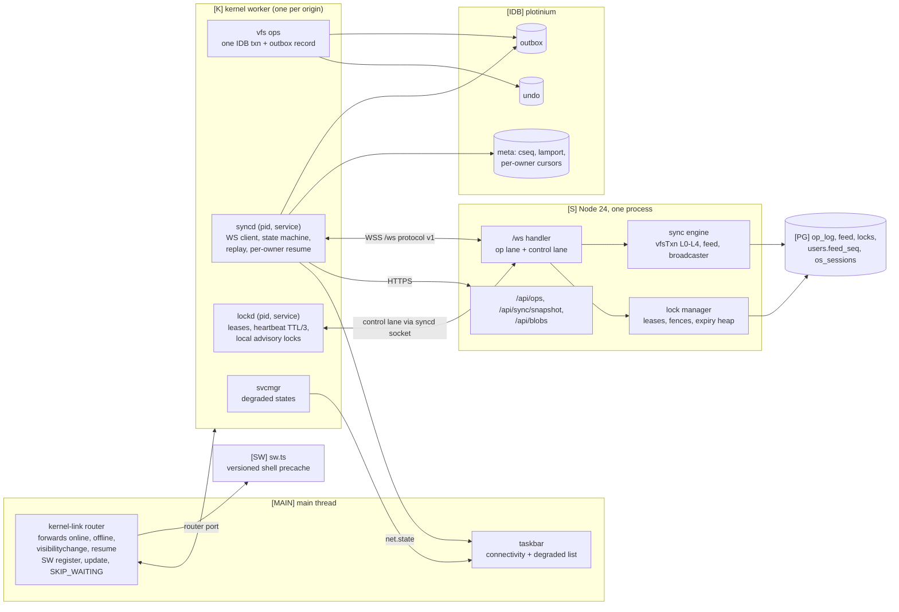
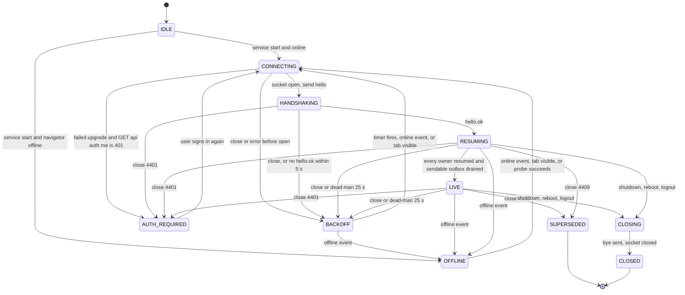
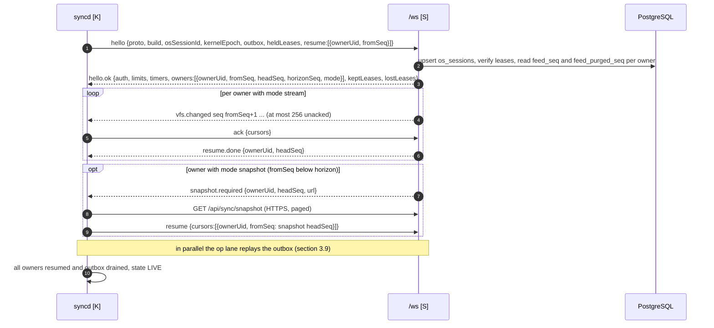
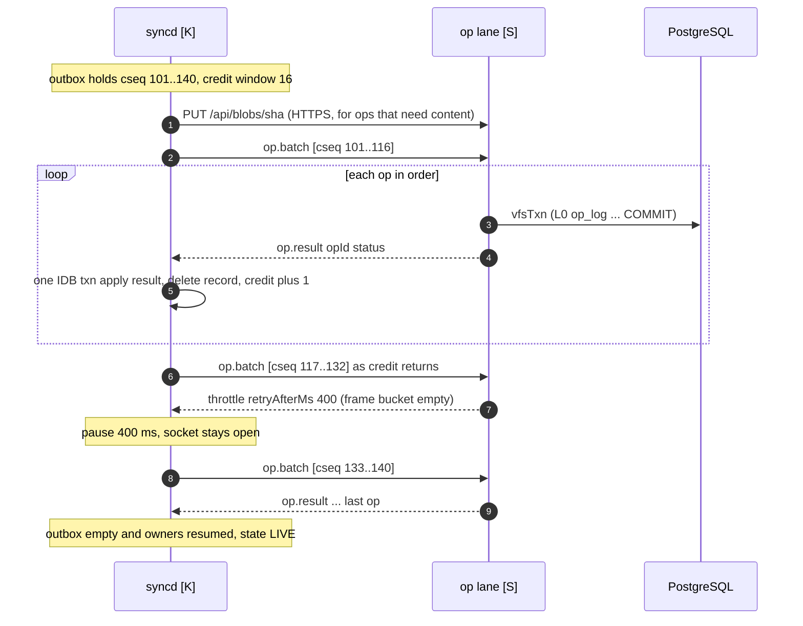
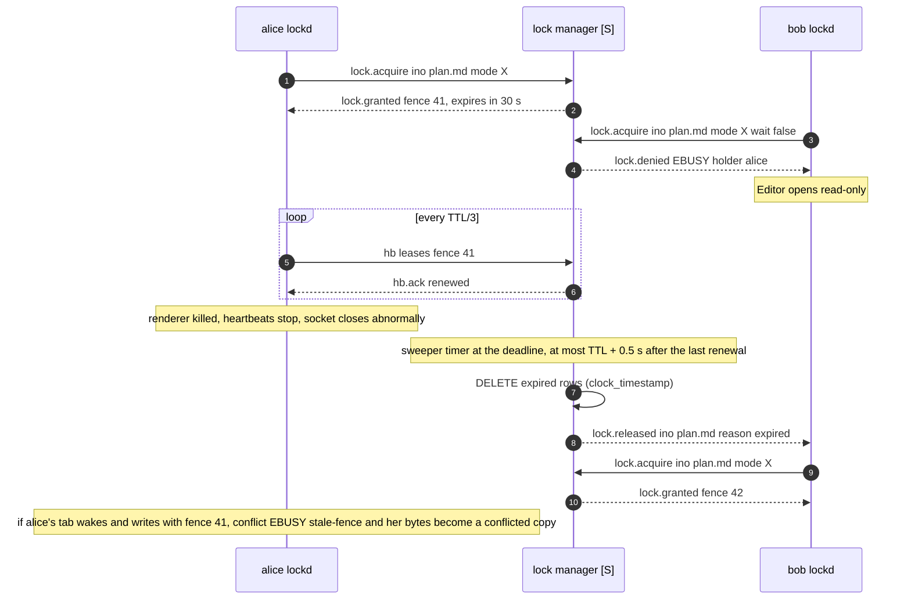
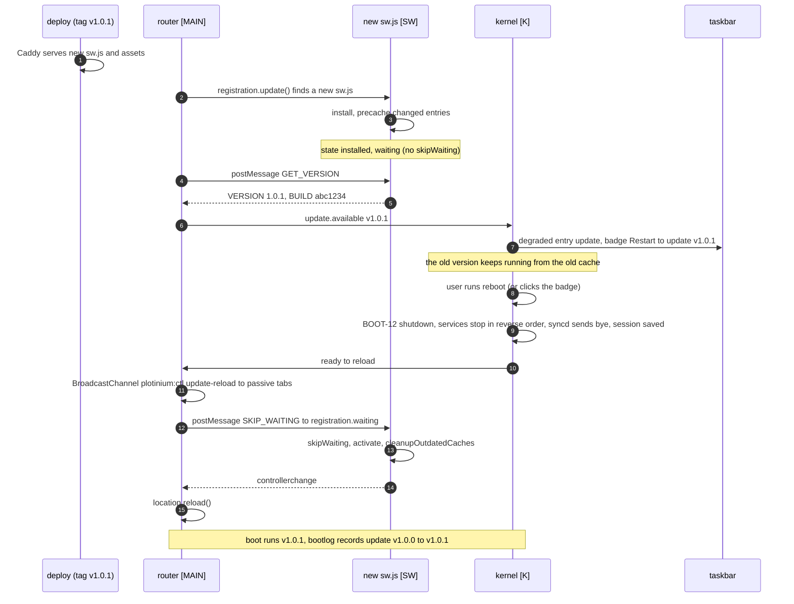

# Offline execution, synchronisation and distributed locks

| Field | Value |
|---|---|
| Title | Offline execution, synchronisation and distributed locks: local-first rules, the outbox, WebSocket protocol v1, per-owner resume, exactly-once replay, conflicts, S/X leases, connectivity status and the versioned Service Worker |
| Status | Draft v0.1, 2026-09-24 |
| Primary owner | R5 QA/DevOps & Integration: client side (`syncd`, outbox replay, `lockd` client, Service Worker and update flow, taskbar status contract). Server-side sections (§3.10, §3.11, §3.14.3–§3.14.6) are co-owned by R2 VFS/DB (sync engine, lock manager) |
| Secondary reviewer | R2 VFS/DB reviews the client sections; R5 reviews R2's server sections. Every PR touching `protocol/src/ws/` also needs R1 (protocol owner) |
| Must be demonstrable at | **P2 gate (W7, v0.2.0):** op pipeline skeleton on production (`op.submit` → `vfsTxn` → `op.result`), cookie-authenticated `/ws`, two users on the deployed URL with server-side EACCES. **P3 gate (W11, v0.3.0):** OFF-01 … OFF-05, VFS-09, VFS-10 live: offline reboot and core utilities, replay exactly once, two users contending for a lock, crash expiry within the TTL, fault-injected `rm -r` printing EIO synchronously, "Restart to update". **Final defence (W17–18, v1.0.0):** everything on the examiner's machine and the production URL |
| Requirement IDs covered | OFF-01, OFF-02, OFF-03 (client storage side; model in [security-model.md](../12-security/security-model.md)), OFF-04, OFF-05; VFS-09, VFS-10; DB-02 (§11.3 rules 4–6: one clear error, client mirror, safe retries); BOOT-07, BOOT-09, BOOT-12 (sync and lock parts); PROC-07 (leases released on kill); AGT-05, AGT-09 (sync parts); §7.1 (Puter cloud coupling), §7.2 (daedalOS orchestration), §8 boundary 3, §9.5, §14.3 (heartbeats, resumable sessions); Plotinium design IDs SYN-01 … SYN-18 |
| Related specs | [../01-architecture/architecture.md](../01-architecture/architecture.md) · [../01-architecture/syscall-abi.md](../01-architecture/syscall-abi.md) · [../02-boot/boot-and-services.md](../02-boot/boot-and-services.md) · [../03-kernel/memory-and-paging.md](../03-kernel/memory-and-paging.md) · [../04-vfs/virtual-file-system.md](../04-vfs/virtual-file-system.md) · [../05-wm/window-manager.md](../05-wm/window-manager.md) · [../09-database/database.md](../09-database/database.md) · [../10-ai/agentic-shell.md](../10-ai/agentic-shell.md) · [../11-server/backend-api.md](../11-server/backend-api.md) · [../12-security/security-model.md](../12-security/security-model.md) · [../13-quality/testing-and-performance.md](../13-quality/testing-and-performance.md) · [../14-devops/deployment-and-ci.md](../14-devops/deployment-and-ci.md) · [../00-product/glossary.md](../00-product/glossary.md) |

**Conventions used in this file.** RFC 2119 keywords (MUST, SHOULD, MAY) are used as in the spec's Conventions section (p. 3). Every normative statement is tagged **Spec** (a requirement of the capstone specification, with its section and ID, for example *Spec: MUST, §9.5, OFF-02*) or **Plotinium design** (our own binding choice, usually one of the canonical decisions C1–C18). Any number from the AI-run prototype is marked *(pilot figure — re-measure on the lab machine)*. Tags: **[MAIN]** main thread, **[K]** kernel worker, **[IDB]** IndexedDB, **[SW]** Service Worker, **[WS]** WebSocket `/ws`, **[S]** Node server, **[PG]** PostgreSQL. "Op" means one user-visible mutation: one IndexedDB transaction on the client, one outbox record, one `op_log` row and one `vfsTxn` on the server.

---

## 1. Purpose and scope

This spec is the normative source for how Plotinium keeps working without a network and how every device converges with the server afterwards. It fixes:

- the local-first rules that every mutating subsystem obeys (§3.1);
- the outbox record, the op types and their ordering keys (§3.3–§3.5, §4.7–§4.8);
- WebSocket protocol v1: the envelope, both message catalogues as JSON Schemas with field tables, the op lane and the control lane, close codes and protocol constants (§3.6, §4.1–§4.6);
- the `syncd` connection state machine, including full-jitter back-off (§3.7);
- the handshake and resume through the **per-owner feed** (§3.8), replay with `op.batch` and a credit window (§3.9);
- the server op pipeline as seen from the protocol, deduplication through `op_log` and which outcomes are persisted (§3.10), and an exactly-once proof sketch (§3.11);
- conflicts, conflicted copies, rejections reverted from `undo`, and `lost+found` (§3.12);
- online synchronous commit for bulk ops and agent batches (`SYNC_WAIT_MS`, §3.13);
- S/X leases: TTL, heartbeat, fencing, crash expiry, hidden-tab re-verification and read-only mode for the second writer (§3.14);
- offline behaviour and the taskbar connectivity status (OFF-01, OFF-04, §3.15);
- the Service Worker's versioned cache and the "Restart to update" flow (OFF-05, §3.16).

It does **not** define:

| Topic | Owner |
|---|---|
| The IndexedDB schema, the undo record format, the two-phase mutation discipline, conflicted-copy name construction (`vfs/names.ts`), the remote-apply rule for directories and `fsck` | [virtual-file-system.md](../04-vfs/virtual-file-system.md) |
| SQL DDL: `op_log`, `feed`, `locks`, `os_sessions`, `users.feed_seq` and `users.feed_purged_seq`, `inodes.lock_fence`, triggers, `vfsTxn`, `lockPlan()` and the L0–L4 lock order | [database.md](../09-database/database.md) |
| Syscall names, errnos and registered `detail.reason` values | [syscall-abi.md](../01-architecture/syscall-abi.md) |
| HTTP routes (`/api/sync/snapshot`, `/api/ops/{opId}`, `/api/blobs`), cookie authentication of `/ws`, rate-limiter internals, graceful shutdown | [backend-api.md](../11-server/backend-api.md) |
| The offline login verifier and the threat model | [security-model.md](../12-security/security-model.md) |
| Boot order of `auth`, `sync`, `lockd` and `update` (all non-critical, C17) | [boot-and-services.md](../02-boot/boot-and-services.md) |
| Remote swap pages (`/api/swap`) | [memory-and-paging.md](../03-kernel/memory-and-paging.md) and [backend-api.md](../11-server/backend-api.md) |

---

## 2. Requirements table

### 2.1 Spec requirements

| ID | Summary | Spec § | How verified |
|---|---|---|---|
| OFF-01 | Spec: MUST — boot, login, Terminal, File Explorer, Text Editor, Task Manager and Settings work fully offline | §9.5, §7.1 | `OFF-01 *` e2e with the server process killed, then a reboot (§8) |
| OFF-02 | Spec: MUST — offline changes are queued in a durable outbox and replayed exactly once on reconnection (idempotency keys) | §9.5, App. A ("0 lost, 0 duplicated") | exactly-once property test; 5,000-op replay test; `op_log` one row per `opId` (§8) |
| OFF-03 | Spec: MUST — offline login never stores plain-text passwords | §9.5 | canary-password storage inspection ([security-model.md](../12-security/security-model.md)) |
| OFF-04 | Spec: MUST — the taskbar shows connectivity status and lists degraded services | §9.5 | `OFF-04 *` e2e (§8) |
| OFF-05 | Spec: SHOULD — versioned shell updates install in the background and activate on the next boot | §9.5 | `OFF-05 *` e2e; live hash-only deploy at the P3 gate and Demo Day |
| VFS-09 | Spec: MUST — lease-based distributed locks: a second writer gets EBUSY or read-only access, and a crashed holder's lock expires within the lease time | §9.3, App. A | two-user e2e; crash-expiry test ≤ TTL + 0.5 s; hidden-tab test (§8) |
| VFS-10 | Spec: MUST — concurrent changes are detected by version numbers; conflicted copies are kept; no update is ever silently lost | §9.3 | per-owner resume convergence test; conflicted-copy and lost+found tests (§8) |
| DB-02 (rules 4–6) | Spec: MUST — one clear error code and nothing changed on failure; the client mirror is one IndexedDB transaction; retries are safe through idempotency keys | §11.3 rules 4–6 | synchronous EIO test; exactly-once property test |
| BOOT-07, BOOT-09 | Spec: MUST — boot continues when a non-critical service fails; boots with the network disabled | §6.5 | boot with `/ws` and `/api` blocked (owned by [boot-and-services.md](../02-boot/boot-and-services.md)); `sync` and `lockd` degrade (§3.15) |
| BOOT-12 | Spec: MUST — graceful shutdown flushes pending writes and restart returns to the same session | §6.5 | `BOOT-12 reboot sends bye and releases leases at once` (§8) |
| PROC-07 | Spec: MUST — `kill` releases the process's locks | §9.1 | `PROC-07 *` lease test (§8) |
| AGT-09 | Spec: MUST — killing the agent mid-plan rolls the transaction back | §12.3 | `proc.signal` cancel test (§8) |
| §8 boundary 3 | Spec: MUST — the client works alone offline; the server is the authority for multi-user data, locks and quotas | §8 | all of the above |

### 2.2 Plotinium design requirements

| ID | Summary | Source | How verified |
|---|---|---|---|
| SYN-01 | JSON protocol v1 on one same-origin `wss://…/ws`; frames ≤ 64 KB (`maxPayload`); op envelopes > 60 KB go to `POST /api/ops/{opId}` | C6 | `SYN-01 *` boundary tests |
| SYN-02 | Two lanes per connection: an ordered **op lane** and a **control lane** that never waits behind an op | C6; transport amendment 3 | `SYN-02 lock grant p95 stays within budget while a 1,000-node rm -r runs in the same session` |
| SYN-03 | Every op carries `opId` (UUIDv7), a per-OS-session `cseq`, a Lamport counter and base versions or a subtree digest; no HLC | C6 | schema tests |
| SYN-04 | Server dedup through `op_log` in the same transaction as the effect; deterministic outcomes are persisted, transient ones never are; `(op_id, status, errno)` tombstones are kept for the life of the account | C6; transport amendments 5–6 | `OFF-02 *` |
| SYN-05 | Resume through the per-owner feed `feed(owner_uid, owner_seq, op_id)`, gap-free and commit-ordered per owner; past the retention horizon, `GET /api/sync/snapshot` | C6; critic | `VFS-10 bob edits /home/shared while alice is offline …` |
| SYN-06 | Replay with `op.batch` (≤ 32 ops per frame) under a credit window of 16 unacknowledged ops; the limiter throttles a replaying session and never disconnects it | C6; coherence | `OFF-02 5,000 queued ops …` |
| SYN-07 | Online, bulk ops and agent batches wait for `op.result` up to `SYNC_WAIT_MS` = 10 s, so an injected server fault prints EIO synchronously | C6; critic | `DB-02 … prints EIO synchronously …` |
| SYN-08 | Content-write version mismatch → conflicted copy `name (conflict from <user>, <YYYY-MM-DD>).ext`; structural mismatch → rejected with nothing changed; rejected content is kept in `~/lost+found` or as a pinned local copy | C6; transport amendment 4 | `VFS-10 *` |
| SYN-09 | S/X leases, TTL 30 s (15 s demo profile), heartbeat at TTL/3 from the kernel worker, a fencing token on every grant, stale fence → EBUSY; pongs never renew a lease | C6; coherence | `VFS-09 *` |
| SYN-10 | Connection state machine with full-jitter back-off (base 0.5 s, cap 30 s) and a 25 s dead-man timer | C6; transport | `SYN-10 *` unit tests |
| SYN-11 | The principal of every op is checked by the server against the authenticated session and live `su` grants; ops the server cannot authorise are held, never dropped | C10; transport amendment 2 | `SYN-11 *` |
| SYN-12 | Backpressure: coalesce at `bufferedAmount` > 256 KB, close 4508 above 4 MB; the client resumes from the feed with nothing lost | transport | `SYN-12 *` |
| SYN-13 | Protocol version negotiation: the server accepts protocol N and N−1; `hello.ok` carries the server's build identity | deploy record; identity spec request | `SYN-13 *` |
| SYN-14 | The Service Worker precaches only the versioned shell, never `/api/*`, `/ws`, `/models`, `/ort` or per-user data; it never calls `skipWaiting` on install | C11; client record | `OFF-05 *` |
| SYN-15 | The main thread only forwards platform events (`online`, `offline`, `visibilitychange`, `resume`) and makes the Window-only Service Worker calls; all sync logic runs in the kernel worker | C2 | code review; ARC-04 frame budget |
| SYN-16 | `/tmp` (device-local `tmpfs`) and `atime` never produce outbox ops | [virtual-file-system.md](../04-vfs/virtual-file-system.md) PVFS-10 | `PVFS-10 *` |
| SYN-17 | Per-owner broadcasts are emitted in strictly increasing `owner_seq`; a connection that is streaming a backlog buffers live entries instead of dropping them | Plotinium design (this spec, §3.8.4) | `SYN-17 *` property test |
| SYN-18 | Feed entries of another owner are filtered by the receiving uid's **current** permissions (r on the parent, x on every ancestor); filtered entries are sent redacted so the cursor still advances | Plotinium design; RAG-03 analogue | `SYN-18 *` |

---

## 3. Design (normative)

### 3.1 Local-first principles

| # | Principle | Tag |
|---|---|---|
| P1 | The IndexedDB `plotinium` database of the device is the primary store for reads and writes. No read or write syscall waits for the network, except the online synchronous commit of bulk ops and agent batches (§3.13), which has a bounded wait and falls back to `sync: 'pending'`. | Spec: MUST, §9.5 ("the local VFS store is the primary source"); C4 |
| P2 | Every user-visible mutation is exactly ONE readwrite transaction across every affected store, including the quota row, the undo record and the outbox record. The in-memory tree changes only after `oncomplete`. | Spec: MUST, §11.3 rule 5; C4 |
| P3 | Every outbox record carries an idempotency key (`opId`, UUIDv7) and a logical timestamp (Lamport counter plus `cseq`). | Spec: MUST, §9.5, OFF-02; C6 |
| P4 | No network request is on the boot critical path. `auth`, `sync`, `lockd` and `update` are non-critical services; a failure degrades them and the desktop still comes up. | Spec: MUST, BOOT-07, BOOT-09, BOOT-10; C17 |
| P5 | The server is authoritative for shared multi-user state, leases and quotas. It re-derives the uid for every op, re-checks permissions with the same `vfs/perm.ts`, and its result (versions, conflicted copies, rejections) is applied back to the client. | Spec: MUST, §8 boundary 3; C9, C10 |
| P6 | Nothing is silently lost. A version conflict on content produces a conflicted copy; a rejected content write keeps its bytes (§3.12); ops the server cannot authorise yet are held, not dropped (§3.8.6). | Spec: MUST, VFS-10 |
| P7 | Conflicts are detected by inode versions, never by clocks. Clocks only order the outbox (Lamport, `cseq`) and date conflicted copies (server commit time). | Plotinium design (C6: no HLC) |
| P8 | The model of truth for "has this op happened?" is the server's `op_log`, keyed by `opId`. The client keeps the op until it has durably processed a final server result. | Plotinium design (§3.11) |

### 3.2 Components and placement



- **Plotinium design (C2).** `syncd` and `lockd` are kernel services with pids inside the kernel worker. They are visible in `ps`, are non-critical in the boot DAG, and are the only holders of the kernel-internal capability `net.sync` ([syscall-abi.md](../01-architecture/syscall-abi.md)). There is no sync worker.
- **Plotinium design (C2, SYN-15).** The main thread makes only the Window-only calls (Service Worker registration, `registration.update()`, posting `SKIP_WAITING`) and forwards the platform events `online`, `offline`, `visibilitychange` and Page Lifecycle `resume` to the kernel over the router port. It holds no protocol state.
- **Plotinium design (C9).** The server side runs in the single Node process: the `/ws` handler, the sync engine and the lock manager are Fastify plugins ([backend-api.md](../11-server/backend-api.md)). Broadcasts happen in-process after COMMIT; there is no LISTEN/NOTIFY and no broker.
- **One socket per kernel.** `lockd` has no socket of its own: its frames travel on the control lane of `syncd`'s socket. One kernel per origin (C2) means one socket per browser profile.

| Path | Primary | Secondary |
|---|---|---|
| `vfs/sync/` (`syncd`: state machine, outbox sender, replay, resume, snapshot apply) | R5 | R2 |
| `vfs/locks/` (`lockd` client) | R5 | R2 |
| `protocol/src/ws/` (frames, constants, fixtures) | R1 | R2 + R5 |
| `server/src/sync/` (ws handler, engine, feed, broadcaster, snapshot) | R2 | R5 |
| `server/src/locks/` (manager, sweeper) | R2 | R5 |
| `web/src/sw.ts`, `wm` taskbar status widget | R5 (SW), R3 (widget) | R3 (SW), R5 (widget) |

### 3.3 The op model

An **op** is the unit of replication. The kernel turns each mutating syscall into exactly one op (Spec: MUST, §11.3 rule 1: one transaction per user-visible operation). The op kinds (`VfsOp`, §4.7) are:

| Kind | Produced by | Class | Server effect |
|---|---|---|---|
| `create` | `open` with `create`, `mkdir`, `symlink`, `writeFile` of a new name | content (files with a blob), structural (directories, symlinks, empty files) | insert inode + dentry; the client-generated `ino` is kept |
| `write` | `close`/`fsync` of a write session, `truncate` | content | CAS on `version`, new `blob`, `size`, `mtime` |
| `unlink` | `unlink`, `rmdir`, `rm -r` (`recursive: true`) | structural | set-based delete; nlink and refcounts |
| `rename` | `rename`, `mv` (replace allowed only when `replace` names the victim and its version) | structural | move one dentry; L2 lock for cross-parent directory moves |
| `link` | `link` (hard links, [virtual-file-system.md](../04-vfs/virtual-file-system.md) §3.7.2) | structural | add dentry, nlink + 1 |
| `copy` | `copy`, `cp -r` | structural | set-based copy; new inodes get **derived ids** (§3.3.2) |
| `chmod`, `chown` | `chmod`, `chmod -R`, `chown`, `chown -R` | structural | set-based update |
| `utimes` | `utimes`, `touch` of an existing file | structural | set `mtime` (clamped, §3.5) |
| `batch` | `batch` syscall (agent plans, batch rename, `ln -sf`, `mv` fallback) | structural as a whole | all member ops in ONE `vfsTxn` with a fingerprint re-check; any failure rejects all |
| `audit.append` | security audit records and agent plan records that never executed ([syscall-abi.md](../01-architecture/syscall-abi.md) §3.7, [agentic-shell.md](../10-ai/agentic-shell.md) §3.17) | append-only | insert `audit_log` rows; idempotent by `opId` |
| `session.layout` | session autosave of the desktop layout (WM-06, MEM-04) | last writer wins | `UPDATE os_sessions SET window_layout, layout_rev … WHERE layout_rev < rev` for the op's `osSessionId` ([database.md](../09-database/database.md) §3.16) |

**Plotinium design (C6).** `op.batch` (the frame) and `batch` (the op kind) are different things. `op.batch` is a transport frame that carries up to 32 independent ops, each applied in its own transaction. `batch` is ONE op whose members commit or roll back together.

#### 3.3.1 Base versions (optimistic concurrency)

**Spec: MUST, §9.3.** "Every write carries the inode version it expects to replace." Each op carries `base`:

- `{kind: 'versions', entries: [{ino, version}]}` for ops on a known, small set of inodes (at most 256 entries);
- `{kind: 'digest', rootIno, digest}` for subtree ops (`rm -r`, `cp -r` source, `chmod -R`, `chown -R`, directory `rename`): `digest` is SHA-256 over the sorted lines `"<ino>:<version>\n"` of every inode in the subtree, computed by the isomorphic `vfs/digest.ts` on both sides ([virtual-file-system.md](../04-vfs/virtual-file-system.md) PVFS-16).

A `create` carries an empty `versions` base. The parent directory's version is deliberately **not** part of the base: creating a new name in a directory that changed concurrently is not a conflict unless the name itself is taken (§3.12.2).

#### 3.3.2 Client-generated and derived ids

- **Plotinium design (C5).** Every new inode id is a UUIDv7 generated by the kernel (offline too). The server keeps it. Well-known ids come from `protocol/src/wellknown.ts`.
- **Plotinium design (this spec).** `copy` with `recursive` creates many inodes. To keep the op small and let both sides agree without shipping an id map, the new id of the copy of source inode `s` is **derived**: `deriveIno(opId, s)` = a UUIDv7 whose 48-bit timestamp is the timestamp of `opId` and whose 74 remaining bits are the first 74 bits of `SHA-256(opId ‖ s)`, with the version and variant bits set as RFC 9562 requires. `protocol/src/ids.ts` exports the function; client and server call the same code. A collision with an existing inode aborts the op with EEXIST (probability negligible: 74 bits per op).

### 3.4 The outbox

**Spec: MUST, §9.5, OFF-02.** "Each change is also appended to an operation log (outbox) with an idempotency key and a logical timestamp."

- **Store.** IndexedDB store `outbox` in the device database `plotinium` (C4), key `cseq` scoped by OS session (§4.8), unique index `by_opId`, index `by_state`. Durability `strict` (C4).
- **Append.** The outbox record is added in the same readwrite transaction as the change, the quota row and the undo record (P2). The builder is synchronous (lint `no-await-in-idb-builder`). The kernel allocates `cseq` and bumps the Lamport counter in `meta` inside that transaction.
- **States.**

| State | Meaning | Leaves the state when |
|---|---|---|
| `pending` | committed locally, not yet sent on the current connection | it is sent → `sent`; or it becomes unsendable → `held` |
| `sent` | sent on the current connection, no final result yet | a final result is processed → record deleted; the connection drops → back to `pending` (in memory; nothing is written) |
| `held` | cannot be sent now: its principal has no server authorisation on this connection (§3.8.6), or its blobs are not uploaded yet | the reason clears → `pending`; the user discards it → reverted (§3.12.4) |

- **Removal.** The record is deleted in the same transaction that applies its final result (applied versions, the conflicted copy, or the revert from undo) and advances the per-owner cursors in `meta`. There is no "acked but not applied" state on disk.
- **Order.** Records are sent in `cseq` order. A record is never sent before every lower `cseq` of the same OS session has been sent on this connection (the op lane is ordered, §3.6).
- **Size.** `sizeBytes` is the serialised `op.submit` body. If it exceeds `OP_ENVELOPE_MAX` (61,440 bytes), the record is sent over `POST /api/ops/{opId}` **only when it is at the head of the outbox and no other op is in flight** (the window is drained first), which keeps `cseq` order across the two channels.
- **Coalescing.** Only `session.layout` records are coalesced: a new layout record for the same `osSessionId` replaces a pending (not yet sent) one in the same transaction. No other kind is ever rewritten.
- **Not in the outbox.** `atime` updates, `/tmp` (`tmpfs`) inodes and kernel-synthesised files never produce records (SYN-16).

### 3.5 Ordering keys and time

- **`cseq`** (Plotinium design, C6): a per-OS-session counter stored in `meta` (`sync:cseq:<osSessionId>`), allocated in the op's transaction, strictly increasing, never reused. It orders the outbox. The server records it in `op_log` but never uses it to deduplicate (only `opId` does); the database's `UNIQUE (os_session_id, cseq)` only refuses a **different** op claiming the same slot, a protocol violation answered with EINVAL ([database.md](../09-database/database.md) §3.15).
- **Lamport counter** (Plotinium design, C6; Spec §9.5 "logical timestamp"): `meta.sync:lamport`. On every local op, `L := L + 1`. On `hello.ok`, `op.result` and `vfs.changed`, `L := max(L, received)`. The server keeps one counter, `L_s := max(L_s, op.lamport) + 1` per applied op, and returns it. Lamport values order events for diagnostics and `bootlog`; they are never used for conflict detection (P7).
- **`mtime` clamp** (Plotinium design; critic): an offline edit keeps the client's `mtime`, but the server stores `min(clientMtime, commitTime + 60 s)` and returns the stored value in `op.result.versions`, which the client applies. Conflicted-copy dates use the server's commit time (§3.12.2).

### 3.6 Lanes

**Plotinium design (C6, SYN-02).** Each connection has two lanes on the server.

| Lane | Client → server frames | Processing |
|---|---|---|
| **Op lane** | `op.submit`, `op.batch` | one FIFO queue per connection; ops are applied **one at a time** in arrival order; each op is one `vfsTxn`; ops of different connections run concurrently (the database lock order L0–L4 makes that safe) |
| **Control lane** | `hello`, `hb`, `ack`, `resume`, `lock.acquire`, `lock.release`, `watch`, `unwatch`, `proc.signal`, `bye` | handled as soon as the frame arrives; never queued behind an op; each handler is short (≤ 1 DB round trip, or an in-memory update) |

- A long bulk transaction (a 1,000-node `rm -r`, a 500-file rename under retries) therefore never delays a lease renewal or a lock grant (transport amendment 3).
- On the client, `syncd` writes frames in the order it produces them; the control lane has no client-side queue beyond the socket's own send buffer.
- `statement_timeout` (10 s, [database.md](../09-database/database.md)) bounds how long one op can hold the op lane.

### 3.7 The connection state machine

**Plotinium design (C6, SYN-10).** `syncd` runs this machine in the kernel worker.



Rules:

1. **Back-off (full jitter, C6).** After the n-th consecutive failure (n starts at 0), wait `random(0, min(CAP, BASE × 2^n))` with `BASE` = 500 ms and `CAP` = 30 s (AWS full-jitter scheme, cited in the transport record: https://aws.amazon.com/blogs/architecture/exponential-backoff-and-jitter/). `n` resets to 0 on `hello.ok`. Per close code: 1012 (server restart) resets `n` to 0 before drawing; 1013 (overloaded) uses `max(5 s, draw)`; 4429 and a pending `throttle` use `max(retryAfterMs, draw)`; 4508 (slow consumer) reconnects immediately once, then normal back-off.
2. **Dead-man timer.** If no frame arrives for `DEAD_MAN_MS` = 25 s, the socket is treated as dead: `syncd` calls `close()` and goes to BACKOFF. The server answers every `hb` with `hb.ack` (every 10 s at the default TTL), so a healthy socket is never silent that long. WebSocket pings are handled by the browser and are invisible to JavaScript, so they cannot feed this timer.
3. **Fast offline signal.** The router forwards `offline` and `online`. `offline` moves any state except CLOSING, CLOSED and SUPERSEDED to OFFLINE at once, without waiting for the dead-man timer. Chrome keeps an existing WebSocket open under DevTools/Playwright `setOffline` *(pilot figure — re-measure on the lab machine: frames stopped for 7 s with no close event)*, which is why the application heartbeat and the `offline` event both exist.
4. **Probe.** In OFFLINE, `syncd` sends `GET /api/healthz` every `PROBE_MS` = 60 s (network-only; the Service Worker never answers it). Success → CONNECTING.
5. **Failed upgrade.** The server rejects a bad upgrade before the WebSocket exists (403 for Origin, 401 for no session, [backend-api.md](../11-server/backend-api.md)). The browser reports only a close with code 1006, so after a failure *before* `open`, `syncd` calls `GET /api/auth/me` once: 401 → AUTH_REQUIRED; anything else → BACKOFF.
6. **AUTH_REQUIRED.** The outbox is kept. The taskbar shows "Sign in to sync". Signing in again (Settings or the taskbar prompt, which uses the compositor secure prompt) → CONNECTING.
7. **SUPERSEDED.** A 4409 means a newer kernel epoch of the same device connected (after a takeover). This kernel must not reconnect; its next IndexedDB transaction fails the fencing-epoch check and the kernel stops (C2, [architecture.md](../01-architecture/architecture.md)).
8. **CLOSING.** Stop sending new ops, wait up to 2 s for results of ops already sent, send `bye`, close with 1000. Leases are released by the server at once on `bye` (§3.14.5).
9. **Service start.** `sync` starts after `auth` and `vfs` (C17). It never blocks boot: `start()` only creates the state machine; the first CONNECTING happens after `desktop-interactive` ([boot-and-services.md](../02-boot/boot-and-services.md)).

**Mapping to `NetStatus`** ([syscall-abi.md](../01-architecture/syscall-abi.md) §4.4.8): LIVE → `online`; CONNECTING, HANDSHAKING, BACKOFF → `connecting`; RESUMING → `resuming`; OFFLINE → `offline`; AUTH_REQUIRED → `auth-required`. SUPERSEDED, CLOSING and CLOSED are never shown: the kernel is stopping.

### 3.8 Handshake and resume through the per-owner feed

#### 3.8.1 OS sessions, kernel epochs and the connection

- **Plotinium design (coherence §6, §7; [database.md](../09-database/database.md) §3.16).** An **OS session** (`os_sessions` row) is the desktop session of one kernel instance for one login uid: the kernel mints its id `osSessionId` (UUIDv7) when a user logs in (boot stage 5) and registers it in the first `hello`. It lasts as long as that kernel holds `plotinium:kernel` (C2) and the user stays logged in; a reboot, a takeover by another tab, or a new login creates a **new** OS session. Session restore (WM-06, BOOT-12) and remote swap (MEM-04) reach the **previous** session through its saved layout, which records per window the old `(osSessionId, pid, pageIds)`; the server authorises that by `owner_uid`.
- `kernelEpoch` is the fencing epoch from IndexedDB `meta` (C2); every new kernel instance of the device bumps it. `deviceId` (from `meta`, created at the first boot of the browser profile) names the device.
- The authenticated uid comes from the session cookie checked at the upgrade ([backend-api.md](../11-server/backend-api.md)), never from a frame. On the first `hello` the server registers the OS session (owner = the authenticated uid, `device_id`, `auth_session_id`, `kernel_epoch`); an `osSessionId` already owned by another uid is refused with close 1008 ([database.md](../09-database/database.md) §3.16: registration returns 0 rows → EACCES).
- **Supersession.** Because only one kernel per origin can run, a `hello` whose `(deviceId, kernelEpoch)` is newer than an open connection's for the same device means the older kernel is gone or is being taken over: the older connection gets `bye {reason: 'superseded'}` and close 4409. A `hello` with an **older** epoch than one already seen for that device is refused the same way (the stale kernel is the one that must stop).
- **Leases of dead predecessors.** On that `hello` the server also releases every lease held by an older OS session of the **same device and the same uid** (that kernel can no longer run) and broadcasts the releases, so a user whose tab crashed is not locked out of their own file for a TTL. Leases of other devices, and of other uids, are never touched by this rule.
- Ops committed under an earlier OS session keep that session's `osSessionId` and `cseq` in the outbox and are replayed as they are (their `(os_session_id, cseq)` slot stays unique in `op_log`).

#### 3.8.2 The feed

**Plotinium design (C6, critic, SYN-05).**

- `users.feed_seq` is the per-owner feed counter ([database.md](../09-database/database.md) §3.15). Inside `vfsTxn`, after taking **L1** (the `users` rows of the actor and of every affected owner, `FOR UPDATE` in uid order), the server increments `feed_seq` of each **affected owner** and inserts one row `feed(owner_uid, owner_seq, op_id, committed_at)` per affected owner. Because the users row stays locked until COMMIT, each owner's sequence is gap-free and commit-ordered: a transaction that rolls back never consumes a number, and the next transaction for that owner cannot take a number until the previous one has committed. PostgreSQL sequences are not used, because they are neither gap-free nor commit-ordered (https://www.postgresql.org/docs/current/functions-sequence.html, cited in the transport record).
- **Affected owners** of an op = the owners of every inode created, modified or deleted **∪** the owners of every directory whose entry set changed. Example: bob creates `/home/shared/plan.md` in a directory owned by alice → feed rows for bob (new inode) and alice (her directory's listing changed).
- The change payload lives in `op_log.effects`; the feed row points at it. Payloads and feed rows are kept for `FEED_RETENTION_DAYS` = 30 days. Pruning raises `users.feed_purged_seq`; the **horizon** of an owner is `feed_purged_seq + 1`, the smallest `owner_seq` still retained.

#### 3.8.3 Which owners a device mirrors

- A device mirrors **every owner that owns at least one inode in its local store**: the login user, root (the system directories), and the owners of shared directories and files the user has loaded. The kernel keeps a reference count per owner uid; a cursor `meta.sync:cursor:<ownerUid> = {seq, updatedAt}` exists for each mirrored owner.
- A directory that is not mirrored yet is loaded on demand with `GET /api/sync/snapshot?scope=dir` (online) and becomes mirrored; offline it answers EAGAIN (`offline`), never a false ENOENT ([virtual-file-system.md](../04-vfs/virtual-file-system.md) PVFS-18).
- When a new owner becomes mirrored while LIVE, `syncd` sends `resume` for it with the snapshot's `headSeq`.

#### 3.8.4 Handshake and resume algorithm



Server side, per `(connection, owner)`:

1. **Mode.** If `fromSeq ≥ feed_purged_seq` (that is, `fromSeq ≥ horizonSeq − 1`) and `fromSeq ≤ feed_seq`, the mode is `stream`; otherwise `snapshot` and the server sends `snapshot.required` for that owner (`reason: 'horizon'`, or `'reset'` when `fromSeq > feed_seq` after a database restore).
2. **Stream.** The server reads `feed` rows with `owner_seq > fromSeq` in ascending order, in pages, and sends one `vfs.changed` per row, with at most `FEED_WINDOW` = 256 entries sent but not yet covered by an `ack`. It repeats until it reaches the owner's current head, then sends `resume.done {ownerUid, headSeq}` and switches the owner to live delivery for this connection.
3. **No gap during the switch (SYN-17).** While a `(connection, owner)` is streaming, live broadcasts for that owner are **appended to a per-connection pending list** instead of being dropped. When streaming reaches head `H`, the server sends the pending entries with `seq > H` in order and discards those with `seq ≤ H`. If the pending list exceeds 1,000 entries, the server drops the list and continues streaming from the database instead. The switch happens synchronously inside one event-loop turn, so no entry can arrive between the last check and the switch.
4. **Broadcaster order (SYN-17).** Two transactions of the same owner can resolve their COMMIT promises on different pool connections. The in-process broadcaster therefore keeps `nextSeq[owner]` and holds an entry whose predecessor has not been emitted yet; after 1 s it reads the missing rows from `feed` and `op_log` and emits them in order.
5. **Filtering (SYN-18).** An entry is delivered to a connection for owner `U` only if the connection mirrors `U` (resumed it) or watches a directory in the change set. For owners other than the connection's own uid, each change is filtered by the receiving uid's **current** permissions: the change is visible only if the uid has r on the parent directory and x on every ancestor; `blob` is included only if the uid also has r on the inode. If every change of an entry is filtered, the entry is sent with `redacted: true` and no changes, so the cursor still advances. The originating connection does not receive `vfs.changed` for its own op; `op.result.ownerSeqs` tells it which sequence numbers the op consumed.

Client side:

1. `syncd` applies `vfs.changed` entries **per owner in strictly increasing seq**. An entry with `seq = cursor + 1` is applied; a later one is held in a per-owner reorder buffer; if the gap is not filled within `FEED_GAP_MS` = 2 s, `syncd` sends `resume` for that owner from its cursor. An entry with `seq ≤ cursor` is ignored.
2. Applying an entry is one IndexedDB transaction that applies every change whose `version` is newer than the local one **and** that no pending local op touches (the remote-apply rule, [virtual-file-system.md](../04-vfs/virtual-file-system.md)), and advances the cursor. Applying is idempotent: the same op may arrive through two owners' feeds.
3. After applying, `syncd` sends `ack {cursors}` (at most every 100 ms or every 64 entries, whichever comes first) during a stream. In LIVE, `ack` is optional; the envelope's `ack` field may piggy-back it on any frame.
4. `op.result.ownerSeqs` advances cursors for the op's own entries through the same reorder buffer (the change itself is already local).

#### 3.8.5 Snapshots

- **Plotinium design.** `GET /api/sync/snapshot` (shape in [backend-api.md](../11-server/backend-api.md)) returns inode and dentry rows for a scope (`owner`, `dir` or `subtree`) filtered by the requester's permissions, paged by key, plus `headSeq` per owner **captured at the first page** in the same read transaction as that page.
- Later pages may reflect state newer than `headSeq`. That is safe: the client then resumes each owner from `headSeq`, and the version-guarded apply skips changes the pages already contained, while any change a page missed (a row that moved between pages, a later delete) is replayed from the feed. Completeness follows because every change after `headSeq` is in the feed.
- First login on a device: snapshot `scope=owner` for the login uid and root (system tree), then resume both.

#### 3.8.6 Principals and held ops

**Plotinium design (C10, SYN-11).**

- Every op carries `principal`, the effective uid of the process that issued it. The server accepts an op only if `principal` equals the connection's authenticated uid, or the connection's auth session holds a live `su` grant for `principal` ([backend-api.md](../11-server/backend-api.md), [security-model.md](../12-security/security-model.md)).
- `syncd` never sends an op it knows the server cannot authorise: before sending, it checks `principal` against `hello.ok.auth.uid` and `hello.ok.auth.suGrants`. Such ops are set to `held` (`heldReason: 'principal-auth'`) and the taskbar says "N changes wait for sign-in as <user>". Signing in (for example `su` again) creates a grant and the ops become `pending`.
- If a held op still reaches the server (a grant expired in flight), the server replies `op.result {status: 'retry', errno: 'EACCES', reason: 'principal'}`: **not** persisted, so the op can apply later. The client sets it back to `held`.
- A user can discard held ops from the taskbar popover; discarding reverts them from undo and keeps their content as a pinned local unsynced copy (§3.12.4).
- **Logout with pending ops.** Logout warns: "3 changes are not synced yet. They stay on this device and sync the next time you sign in here." The ops stay in the outbox bound to their `osSessionId` and `principal`; another user's session on the same device never sends them.

### 3.9 Replay with `op.batch` and a credit window

**Spec: MUST, §9.5, OFF-02.** "When the connection returns, the outbox is replayed to the server in order. The server acknowledges each operation." **Plotinium design (C6, SYN-06).**

1. **Blobs first.** Before an op is sent, every sha in its `blobs` list must be on the server. `syncd` uploads missing blobs with `PUT /api/blobs/{sha256}` (idempotent, the server verifies the hash while streaming, [backend-api.md](../11-server/backend-api.md)), at most 2 uploads at a time, and marks `blobs.uploaded = true` locally. While an upload runs the op is `held` (`blob-upload`). An op is never sent before its blobs.
2. **Credit window.** At most `CREDIT_WINDOW` ops (default 16, advertised in `hello.ok.limits.creditWindow`) may be sent without a result. Every `op.result` (any status) returns one credit.
3. **Framing.** When several ops are sendable, `syncd` packs them, in `cseq` order, into `op.batch` frames of at most `min(MAX_BATCH = 32, available credit)` ops and at most `MAX_PAYLOAD` bytes. `MAX_BATCH` is the schema limit of one frame; the window is what limits ops in flight, so with the default window a frame carries at most 16 ops. A single op larger than `OP_ENVELOPE_MAX` goes over HTTPS as described in §3.4.
4. **Server processing.** The ops of an `op.batch` enter the connection's op lane in order and are applied one at a time, each in its own transaction (§3.10). Each produces its own `op.result`.
5. **Throttling, never disconnection.** The server's per-connection frame bucket (50 frames/s, burst 200, [backend-api.md](../11-server/backend-api.md)) counts replay frames. When it is empty the server sends `throttle {retryAfterMs, scope: 'frames'}` and delays reading; it **never** closes a connection because of replay traffic, because the credit window already bounds it. `syncd` pauses sending for `retryAfterMs`.
6. **Head-of-line on `retry`.** If an op gets `status: 'retry'` (§3.10), the server also answers every op queued behind it on that lane with `retry` (`reason: 'predecessor-retry'`) **without executing them**, and nothing is persisted. The client resends from the first retried op after `max(retryAfterMs, fullJitter(attempts))`. This keeps later ops (for example a `write` into a file that the retried `create` makes) from running out of order.
7. **Done.** RESUMING ends when every mirrored owner has sent `resume.done` (or been re-snapshotted) and no `pending` op remains (`held` ops do not block LIVE).



*Throughput, derived from the canonical window, not measured:* with window W = 16 and round-trip time r, replay is bounded by about W / r ops per second when server apply time is small. At r = 150 ms (the critic's Lahore–Falkenstein estimate; measure it from the LGU network in spike S8) that is about 100 ops/s, so 5,000 queued ops need about 50 s. The 5,000-op test (§8) records the real figure.

### 3.10 The server op pipeline, dedup and persisted outcomes

**Plotinium design (C6, C7, SYN-04).** For each op taken from a connection's op lane (or from `POST /api/ops/{opId}`), the server runs:

| Step | Check or action | On failure |
|---|---|---|
| 0 | Valibot schema of the op (`protocol/src/ws/ops.ts`) | invalid `opId` → `error` frame; valid `opId` with an invalid body → `rejected` EINVAL (persisted) |
| 1 | `osSessionId` of the op belongs to the authenticated uid and to this device | close 1008 (a correct client never does this) |
| 2 | Principal: `principal` = authenticated uid, or a live `su` grant for it | `retry` EACCES (`reason: 'principal'`), not persisted (§3.8.6) |
| 3 | Inside `vfsTxn`, every sha in `blobs` has a `blobs` row (`UPDATE blobs SET refcount = refcount + 1 … RETURNING`, [database.md](../09-database/database.md) §3.13) | 0 rows → `retry` EAGAIN (`reason: 'blob-missing'`), not persisted; the client re-uploads (for example after the 1 h GC of an unreferenced blob) |
| 4 | `vfsTxn` under READ COMMITTED with the canonical lock order ([database.md](../09-database/database.md)): **L0** `INSERT INTO op_log … ON CONFLICT (op_id) DO NOTHING RETURNING op_id`; **L1** `users` rows of the actor and of every affected owner `FOR UPDATE` in uid order (quota, `feed_seq`); **L2** `pg_advisory_xact_lock` for cross-parent directory moves; **L3** directory inodes `FOR UPDATE` in ino order (plan, lock, re-plan for recursive ops); **L4** version compare-and-swap of file inodes | see below |
| 5 | Inside the transaction: rwx with `vfs/perm.ts` for the principal's credentials; leases and fences on the target and every descendant (§3.14.4); `base` versions or subtree digest (§3.3.1); quota; the change as set-based SQL; `mtime` clamp (§3.5); conflicted copy or salvage (§3.12); `feed` rows per affected owner (§3.8.2); `op_log.result` | deterministic failure → ROLLBACK then step 6; transient failure → step 7 |
| 6 | **Deterministic rejection.** A second short transaction: `INSERT INTO op_log (…, status 'rejected', errno, result) ON CONFLICT DO NOTHING` (the reason is stored in `result`), plus the salvage copy and its `feed` rows if §3.12.5 applies | if the insert conflicts (a concurrent duplicate committed first), reply with the stored result instead |
| 7 | **Transient failure.** Nothing is persisted; reply `retry` with `retryAfterMs`; lane reset (§3.9 step 6) | – |
| 8 | After COMMIT resolves: `op.result` to the originating connection (or the HTTP response); renew every lease of the originating OS session (§3.14.2); hand the entry to the broadcaster (§3.8.4) | – |

**Duplicates.** If L0 returns no row, an `op_log` row for `opId` already exists (committed earlier, or committed by a concurrent attempt this insert waited for on the unique index). The server reads it and replies with the stored result and `duplicate: true`, without executing anything. If the waited-for transaction rolled back instead, the insert succeeds and the op runs normally. If the stored row belongs to another uid, the reply is `rejected` EINVAL (an op id collision) and the other user's result is never revealed ([database.md](../09-database/database.md) §3.9.3).

**Which outcomes are persisted.** The rule: **every outcome after which the client reverts or finishes is persisted; every outcome after which the client sends the same op again is not.**

| Outcome | `status` | Persisted in `op_log` | Client action |
|---|---|---|---|
| applied | `applied` | yes, in the op transaction | apply versions, delete record |
| content version conflict, conflicted copy kept | `conflict` (no errno) | yes, in the op transaction | apply the copy (§3.12.2), delete record |
| content op (a `write`, or a `create` with a blob, sent on its own) blocked by another session's live lease, or carrying a stale fence; the bytes are kept as a conflicted copy. Inside a `batch` any member failure rejects the whole batch instead | `conflict` with EBUSY (`lease`, `stale-fence`) | yes, in the op transaction ([database.md](../09-database/database.md) §3.13) | apply the copy, delete record |
| EACCES, EPERM, ENOENT, ENOTDIR, EISDIR, ENOTEMPTY, EEXIST (rename onto a taken name), EINVAL, ELOOP, ENAMETOOLONG, EXDEV, EDQUOT | `rejected` | yes, step 6 | revert (§3.12.4) |
| EBUSY (`lease`, `subtree-busy`) on a structural op (a foreign lease on the target or any descendant) | `rejected` | yes, step 6 | revert (nothing to salvage) |
| EAGAIN `stale-version` (structural version or digest mismatch), `stale-plan` (batch fingerprint changed) | `rejected` | yes, step 6 | revert |
| EIO `injected` (fault trigger `P0001`; the harness is one-shot) | `rejected` | yes, step 6 | revert; the waiting caller prints EIO |
| ECANCELED `killed` (`proc.signal`, §3.13.3) | `rejected` | yes, step 6 | revert |
| EAGAIN `retry-exhausted` (`40001`/`40P01` after 5 retries with full jitter) | `retry` | no | resend later |
| EBUSY `lock-timeout` (`55P03` still failing after the 5 retries of `vfsTxn`) | `retry` | no | resend later |
| ETIMEDOUT (`57014` from `statement_timeout`, without a cancel flag) | `retry` | no | resend later |
| EIO `server` (lost DB connection, FsBlobStore I/O error) | `retry` | no | resend later |
| EAGAIN `blob-missing`, EACCES `principal`, EAGAIN `predecessor-retry` | `retry` | no | re-upload / hold / resend |

- `57014` is raised both by `statement_timeout` and by `pg_cancel_backend`. The server tells them apart with the op's cancel flag in its cancel registry, which it sets before it calls `pg_cancel_backend` (§3.13.3; [database.md](../09-database/database.md) §3.9.5): with the flag it is ECANCELED `killed`, without it ETIMEDOUT.
- **Why ECANCELED and structural EBUSY are persisted.** After a kill the client reverts; if the reply were lost and the rejection not recorded, a resend would re-execute an op the user killed (AGT-09). A structural op blocked by a lease is final so that one long-held lease cannot stall every later op of the session behind a retrying head (§3.9 step 6). A `lock-timeout` is ordinary row-lock contention and is retried.
- **Tombstones (transport amendment 6; [database.md](../09-database/database.md) §3.15).** After `FEED_RETENTION_DAYS`, a job sets `op_log.args`, `base` and `effects` to NULL (`purged_at`) and deletes old `feed` rows, raising `users.feed_purged_seq`, but keeps `(op_id, uid, os_session_id, status, errno, result)` forever; `result` holds the reason and the owner sequence numbers. A very late resend therefore still gets its original outcome (with `pruned: true`), and is never applied twice. For a pruned `applied` or `conflict` result the client re-reads the affected inodes with `GET /api/sync/snapshot?scope=dir` instead of applying versions.

### 3.11 Exactly-once: proof sketch

**Claim (OFF-02, §11.3 rule 6).** For every op `o` committed locally on a device, the server applies the effect of `o` exactly once, and the client ends in the state that matches the server's final outcome for `o`, provided the device is eventually online for long enough.

**Invariants.**

- **C1 (client durability).** `o` is in the outbox from the local commit until a transaction that applies `o`'s *final* result also deletes `o`'s record (§3.4). The outbox uses `strict` durability (C4), so a crash or tab close at any point leaves `o` either absent (local transaction never committed, nothing to replay) or present.
- **C2 (stable key).** Every send of `o`, on any connection or over HTTP, carries the same `opId`.
- **S1 (effect and key together).** Any committed effect of `o` is in the same transaction as the insertion of `op_log(op_id = opId)` (L0). `op_log.op_id` is the primary key.
- **S2 (final outcomes persist).** An `applied` or `conflict` outcome commits with `o`'s effect (S1). A `rejected` outcome is inserted into `op_log` before the reply is sent (step 6). A `retry` outcome is sent only when `o`'s transaction rolled back and nothing about `o` was persisted.
- **S3 (lookup before execute).** Receiving an `opId` that exists in `op_log` returns the stored outcome and executes nothing.
- **S4 (tombstones).** The `op_log` row of `o` is never deleted while the account exists.

**At most once.** Suppose two attempts of `o` both commit an effect. By S1 each commit inserts `op_log(opId)`. The primary key admits one row, and a concurrent second insert waits on the unique index until the first transaction ends: if the first commits, the second's `ON CONFLICT DO NOTHING` returns no row and S3 applies; if the first rolls back, it committed no effect. A rejection record (step 6) uses the same key, so a rejected op can never later be applied either. By S4 this holds for any delay between attempts. Hence at most one effect.

**At least once (eventually).** By C1, while `o` has no processed final result it stays in the outbox, and `syncd` sends every `pending` record after each (re)connection. Each attempt ends in exactly one of: (a) a final result that reaches the client, which then processes it (done); (b) a final result persisted on the server whose reply is lost (socket closed after COMMIT, server killed after COMMIT, client crashed before processing): `o` is still in the outbox (C1) and the next attempt gets the stored result by S3, which is case (a); (c) `retry`, or no reply because the server crashed before COMMIT: nothing was persisted (S2), so the next attempt is a fresh execution. Only (c) repeats, and each repeat is caused by a transient condition, so on a connection that stays up `o` reaches (a).

**Same final state on both sides.** For `applied` the client applies the server's versions; for `conflict` it adds the same conflicted copy (the id is `deriveIno(opId, ino)`, so both sides name the same inode); for `rejected` it reverts `o` from undo and the server changed nothing except a salvage copy that reaches the client as a normal feed entry. Later ops that depended on a rejected op are reverted by the cascade (§3.12.4) or are themselves rejected by the server's version checks; either way no op applies on one side only.

The property test in §8 (dropped acks, duplicated frames, random closes, a server kill after COMMIT) checks exactly these three statements.

### 3.12 Conflicts, rejections, conflicted copies and `lost+found`

#### 3.12.1 Detection

**Spec: MUST, §9.3, VFS-10.** "If the version does not match, the write is a conflict. Conflicts are never resolved by silently overwriting file content." The server compares `base` with the current rows at L4 (versions) or after L3 (subtree digest). Detection never uses clocks (P7).

#### 3.12.2 Content conflicts → conflicted copy

**Spec: MUST, §9.3** ("The losing write is kept as a conflicted copy (*report (conflict from student, 2026-11-14).md*) and the user is notified").

- **When.** A `write` whose base version differs from the current version; a `create` of a regular file or a directory whose name is already taken in the parent by another inode.
- **What the server does, in the same `vfsTxn`:**
  - `write`: the current file is left unchanged. The losing content becomes a **new** inode with id `deriveIno(opId, ino)`, the op's blob, owner = the principal, group = the principal's primary group, mode = the original file's mode.
  - `create`: the new inode keeps its client id; only its name changes.
  - **Name** (built by the isomorphic `vfs/names.ts`, [virtual-file-system.md](../04-vfs/virtual-file-system.md)): `<stem> (conflict from <username>, <YYYY-MM-DD>)<ext>`, where `<ext>` is the part from the last `.` if that dot is not the first character, `<username>` is the principal's username, and the date is the server commit time in `PLOTINIUM_TZ` (default Asia/Karachi). If the name is taken, ` 2`, ` 3`, … is appended after the closing parenthesis. If the name would exceed 255 bytes, the stem is truncated at a UTF-8 boundary. The result is NFC.
  - **Where.** Next to the original if the principal has w and x on the parent; otherwise in the principal's `~/lost+found` (created 0700 on demand).
  - **Quota.** Charged to the principal inside the same transaction; if it does not fit, the op is `rejected` EDQUOT instead and §3.12.5 applies.
  - **Reply.** `op.result {status: 'conflict', keptAs: {ino, parentIno, name}, versions}`.
- **Client.** One transaction: set the original inode to the server's version (content fetched lazily), add the conflicted copy, delete the outbox record. Notification: "Your offline edit of report.md conflicted with bob's change. Both versions are kept: report (conflict from alice, 2026-11-14).md". An open Editor shows a "Reload / Keep both" banner. The syscall reports `conflict: {keptAs}`, which is a success, not an errno (Spec: VFS-10; [syscall-abi.md](../01-architecture/syscall-abi.md) §4.3).

#### 3.12.3 Structural conflicts → rejection

`unlink`, `rename`, `link`, `copy`, `chmod`, `chown`, `utimes` and `batch` never produce copies. If the base does not match (someone changed the file, or anything in the subtree, since the client planned the op), the op is `rejected` with EAGAIN `stale-version` (`stale-plan` for `batch`) and nothing changes on the server. Rationale: deleting or moving a subtree that someone else has just edited could lose their update, and a copy of a structural change has no meaning.

#### 3.12.4 Client handling of a rejection

One IndexedDB transaction:

1. Apply `o`'s undo record ([virtual-file-system.md](../04-vfs/virtual-file-system.md)). Reverting is idempotent per `opId`: a second revert of the same op is a no-op.
2. **Cascade.** Every *not yet sent* op with a higher `cseq` that depends on `o` is reverted too, in reverse `cseq` order, and its record deleted. `o2` depends on `o` if the inode sets `created ∪ modified ∪ base` of the two ops intersect. Ops already sent are left to the server, which rejects them if they no longer make sense; their revert is then a no-op or its own revert.
3. Content of a reverted content op that the server did not salvage is kept as a **parked** local copy: a local file in `~/lost+found` marked "not synced", backed by an outbox record in state `held` (`heldReason: 'parked'`). The user can retry it (for example after freeing quota) or discard it from the notification. Nothing is deleted without a user action.
4. Delete `o`'s record; advance cursors from `ownerSeqs`; emit the kernel event `vfs.rejected {opId, errno, reason, keptAs?}`.

After the transaction, the in-memory tree and trie are updated, a notification states the reason (for example "Sync rejected removal of ~/old-drafts: EACCES — restored"), and a caller that is still waiting (§3.13) receives the errno. If the originating terminal is still open it also prints one line (walk-through step 6 of §8.1).

#### 3.12.5 Server-side salvage of rejected content

**Plotinium design (transport amendment 4; SYN-08).** When a content op (`write`, or `create` of a file with a blob) is rejected with EACCES, EPERM or ENOENT (its parent is gone), the rejection transaction of step 6 also creates the content as a new inode `deriveIno(opId, ino)`, named as in §3.12.2, in the principal's `~/lost+found`, and writes the `feed` rows for it. The reply is `rejected` with `keptAs`. A content op blocked by a lease or a stale fence is not a rejection: the op transaction itself keeps the bytes as a conflicted copy and replies `conflict` with errno EBUSY (§3.10). If the salvage itself does not fit the principal's quota, it is skipped and the client parks the content (§3.12.4 step 3). A rejected EDQUOT write is never salvaged on the server (it cannot fit).

#### 3.12.6 Scenarios

| Scenario | Outcome |
|---|---|
| alice edits `report.md` offline (base 7); bob saved version 8 meanwhile | `conflict`; `report (conflict from alice, 2026-11-14).md` next to it; bob's version stays |
| alice and bob both create `notes.md` in `/home/shared` offline | the second to sync gets `conflict`; its file becomes `notes (conflict from bob, …).md` |
| alice deletes `~/old` offline; bob (with rights) added a file inside meanwhile | `rejected` EAGAIN `stale-version`; alice's deletion is reverted; bob's file survives |
| alice writes into `/home/shared/x.md` offline; the owner revoked her w access meanwhile | `rejected` EACCES; her bytes salvaged to `~/lost+found/x (conflict from alice, …).md` |
| alice writes offline; bob holds the X lease now | `conflict` EBUSY `lease`; her bytes kept as a conflicted copy |
| alice's frozen tab wakes and saves with an expired fence; bob holds X now | `conflict` EBUSY `stale-fence`; her bytes kept as a conflicted copy next to the original (or in `~/lost+found`) |
| alice writes offline into a directory someone deleted | `rejected` ENOENT; salvaged to `~/lost+found` |
| alice's offline writes exceed her quota | `rejected` EDQUOT; parked locally in `~/lost+found` (not synced), user notified |
| root fault-injects `rm -r` at node 500 | `rejected` EIO `injected`; the waiting `rm` prints EIO; both sides unchanged |

### 3.13 Online synchronous commit (`SYNC_WAIT_MS`)

**Plotinium design (C6, critic, SYN-07).** When online, bulk ops and agent batches wait for the server's `op.result` before reporting success, so an injected fault prints EIO synchronously (Spec: §11.3 rule 4, "one clear error code").

#### 3.13.1 Which calls wait

The kernel sets `syncMode: 'wait'` on the outbox record for: every class-X call (`unlink` with `recursive`, `copy` with `recursive`, `chmod`/`chown` with `recursive`, `rename` of a directory to another parent), every `batch`, and every mutating call issued by an agent-class process. All other calls use `async`. The shell MAY expose `sync -w <cmd>` for tests; nothing else changes the mode.

#### 3.13.2 The wait

- The wait applies only if `syncd` is LIVE or RESUMING when phase 2 commits. Otherwise the call returns at once with `sync: 'pending'`.
- The caller stays BLOCKED with `waitingOn = 'sync:result'` until one of:

| Event | Result returned to the caller |
|---|---|
| `op.result` `applied` | `ok`, `sync: 'applied'` |
| `op.result` `conflict` | `ok`, `sync: 'applied'`, `conflict: {keptAs}` |
| `op.result` `rejected` | after the revert transaction (§3.12.4): the errno and `detail.reason` (for example EIO `injected`) |
| `op.result` `retry` | keep waiting (the op is resent) |
| `SYNC_WAIT_MS` = 10 s elapse | `ok`, `sync: 'pending'`, plus a notification if it is later rejected |
| the connection leaves LIVE/RESUMING | `ok`, `sync: 'pending'` |

- Other syscalls on the affected subtree stay queued behind the in-kernel intent lock until the wait ends ([virtual-file-system.md](../04-vfs/virtual-file-system.md) PVFS-03), so no other process observes an op that may still be reverted within the wait.

#### 3.13.3 Kill while waiting (AGT-09)

- If the waiting process is killed, the kernel sends `proc.signal {target: {kind: 'op', opId}, sig: 'SIGTERM'}` on the control lane (Spec: MUST, AGT-09; [syscall-abi.md](../01-architecture/syscall-abi.md) §3.4).
- **Server.** The op must belong to this OS session. If the op is still queued on the lane, it is removed and recorded as `rejected` ECANCELED `killed`. If its transaction is running, the server sets the op's cancel flag (checked between op groups in `batch`), then calls `pg_cancel_backend(backend_pid)` for a statement in progress; the transaction raises `57014` and rolls back, and the outcome is recorded as ECANCELED `killed` (deterministic, so a resend returns the same outcome). If the op already committed, the signal has no effect and the normal `op.result` has been or will be sent.
- **Client.** On ECANCELED it reverts from undo (§3.12.4). The audit outcome is `killed_rolled_back` ([agentic-shell.md](../10-ai/agentic-shell.md) §3.16).
- If the op was never sent, the kernel reverts it locally and deletes the record in one transaction; nothing reaches the server.

### 3.14 Leases: distributed S/X locks

**Spec: MUST, §9.3, VFS-09.** "The backend runs a lock manager that supports shared (read) and exclusive (write) locks. Locks are leases: each has a time-to-live that the holder renews with heartbeats, so a crashed client cannot hold a lock forever. Lock grants and releases are pushed over the WebSocket." VFS-09: "a second writer gets EBUSY or read-only access, and a crashed holder's lock expires within the lease time."

#### 3.14.1 Semantics

| Rule | Detail | Tag |
|---|---|---|
| Lockable objects | Regular files only. A directory → EISDIR; a symlink path is resolved by the kernel first, so the target is locked. | Plotinium design ([syscall-abi.md](../01-architecture/syscall-abi.md) `lock.acquire`) |
| Permission | S needs r on the file, X needs w, both need x on every ancestor, checked for the principal on the server with `vfs/perm.ts`. | Plotinium design |
| Compatibility | Many S, or exactly one X. Enforced by `EXCLUDE USING gist (ino WITH =, mode WITH <>)` plus a partial `UNIQUE (ino) WHERE mode = 'X'` on `locks` ([database.md](../09-database/database.md)). One row per `(ino, os_session_id)`; a session that holds S and is the only holder may upgrade to X. | C7 |
| Identity | Each grant has a `leaseId` (UUIDv7, server-generated) and a **fence**: a number from a monotonic sequence, never reused. An X grant also sets `inodes.lock_fence = fence`. | C6 |
| Fairness | Waiters (`wait: true`) queue FIFO per inode in server memory. A new S request queues behind a waiting X, so writers are not starved. Waiters are dropped when their connection closes or their `timeoutMs` expires (`lock.denied` ETIMEDOUT). | Plotinium design |
| Limit | At most `MAX_LEASES` = 256 leases per OS session; the 257th → `lock.denied` EAGAIN `lease-limit`. | transport amendment 10 |
| Scope of enforcement | Leases are **mandatory against writers**: any mutation of a leased inode by another OS session fails with EBUSY (§3.14.4). Reads are never blocked. | Plotinium design |

#### 3.14.2 Timing, heartbeat and renewal

**Plotinium design (C6, SYN-09).**

- `LEASE_TTL_MS` = 30,000 by default; the demo profile sets 15,000 (server env, [backend-api.md](../11-server/backend-api.md)); allowed range 15,000–120,000.
- `HB_MS` = `LEASE_TTL_MS / 3` (10 s by default, 5 s in the demo profile). The two are configured as a pair: the server advertises both in `hello.ok.timers` and the client uses the advertised values.
- `lockd` sends `hb {t, leases}` every `HB_MS` from the kernel worker while it holds at least one lease, and `syncd` sends it anyway every `HB_MS` as the connection heartbeat. The server renews the listed leases with `lease_expires_at = clock_timestamp() + TTL`, re-validates the auth session, and answers `hb.ack {renewed, lost}`.
- **Any applied op of an OS session renews all its leases** (critic fix), so a busy writer never loses a lease between heartbeats.
- **Pongs never renew a lease.** The browser answers WebSocket pings itself even when the page's JavaScript is hung or the tab is frozen, so a pong proves only that the socket is alive (coherence §5; Chrome freezing on Energy Saver: https://developer.chrome.com/blog/freezing-on-energy-saver, cited in the transport record).
- The database clock (`clock_timestamp()`) is the only time source for leases. The client shows a countdown (for example in `lsof` and the Editor banner) using the server time offset it measures from `hb.ack.serverTime`.

#### 3.14.3 Acquire (server)

One short transaction per `lock.acquire` on the control lane:

1. `SELECT … FROM inodes WHERE ino = $1 FOR UPDATE` (the inode row serialises the acquire with writes to that file, which take the same row at L4; the acquire holds no other lock, so it cannot join a deadlock cycle).
2. Delete this inode's expired rows (`lease_expires_at <= clock_timestamp()`), and for each deleted row notify as in §3.14.5.
3. Check the file type (EISDIR) and the principal's permission (EACCES).
4. If compatible with the remaining rows and no earlier waiter exists: insert `locks(ino, os_session_id, lease_id, holder_uid, mode, fence = nextval('lock_fence_seq'), lease_expires_at = clock_timestamp() + TTL)`; for X, `UPDATE inodes SET lock_fence = fence`. COMMIT. Push the deadline into the expiry heap. Reply `lock.granted`.
5. Otherwise: `wait: true` → enqueue and reply `lock.queued {position}`; `wait: false` → `lock.denied` EBUSY `lease` with `holder {username, mode, expiresAt}`.
6. A `23P01` exclusion violation (a race the queue did not see) maps to EBUSY `lease` ([syscall-abi.md](../01-architecture/syscall-abi.md) §4.9).

#### 3.14.4 Writes under leases (inside `vfsTxn`)

| Situation at L4 (or for any descendant of a bulk op) | Result |
|---|---|
| no live lease rows | allowed (the version CAS still applies) |
| a live lease (S or X) held by **another** OS session | content op: `conflict` EBUSY `lease`, bytes kept as a conflicted copy; structural op: `rejected` EBUSY `lease`, or `subtree-busy` for a bulk op |
| this OS session holds X, the op carries its fence, the lease is live, and `fence ≥ inodes.lock_fence` | allowed |
| the op carries a fence that is below `inodes.lock_fence`, or whose lease has expired | `conflict` EBUSY `stale-fence` with the bytes kept as a conflicted copy (Kleppmann's fencing tokens: https://martin.kleppmann.com/2016/02/08/how-to-do-distributed-locking.html; [database.md](../09-database/database.md) §3.13) |
| this OS session holds only S and no other session holds a lease | allowed |

#### 3.14.5 Release and expiry

- **Explicit.** `lock.release {leaseId}` deletes the row.
- **Kill (Spec: MUST, PROC-07).** The kill path releases every lease held by the process: `lockd` sends `lock.release` for each.
- **Clean close.** `bye`, or a close with 1000 or 1001: the server releases every lease of that OS session at once.
- **Abnormal close** (1006, dead socket, network loss): leases stay until their TTL, so a quick reconnect of the same OS session keeps them (§3.14.6) (backend amendment d, transport amendment 9).
- **Dead predecessor on the same device.** A `hello` from a newer kernel epoch of the same device releases the leases of that uid's older OS sessions on the device at once (§3.8.1).
- **Auth session revoked** (logout, password change, admin): the lock manager releases every lease of every OS session bound to that auth session and broadcasts the releases; foreign-key cascades are never used for this (coherence §7).
- **Expiry.** The sweeper keeps an in-memory min-heap of deadlines (the team's `dsa/heap` with its index map, so a renewal is `changePriority`, O(log n)) and **one** timer set to the earliest deadline, not a polling tick. When it fires, it runs `DELETE FROM locks WHERE lease_expires_at <= clock_timestamp() RETURNING …` for the due inodes (the heap is only an index; the database decides), then sends `lock.expired` to the holder if connected, `lock.released` to watchers and waiters of the inode, and grants the next FIFO waiters. The heap is rebuilt from the `locks` table at server start, so leases survive a deploy (C9).
- **Guarantee (VFS-09).** A lease expires at most `TTL + 0.5 s` after its last renewal (timer lateness plus one delete transaction), and `acquire` also deletes expired rows itself (§3.14.3 step 2), so a waiting user never sees an expired holder.

#### 3.14.6 Reconnect

`hello.heldLeases` lists the leases the client believes it holds. For each, the server checks for a row with the same `(ino, os_session_id, fence)` that has not expired: kept leases are renewed and returned in `keptLeases`; the others are returned in `lostLeases`. `lockd` tells the owning processes (`lock.lost` kernel event); an Editor then switches to read-only (§3.14.7).

#### 3.14.7 Client behaviour: read-only mode, hidden tabs, degraded mode

- **Second writer (VFS-09).** The Editor opens a file for writing with `lock.acquire {mode: 'X', wait: false}`. On EBUSY it opens the file **read-only** with the banner "Locked by alice — read-only" and subscribes to `lock.released` for that inode; when it arrives the banner offers "Available — open for writing". A Terminal command that writes the file without a lock (`echo x > plan.md`) gets EBUSY `lease` from the server (and locally from `open` when `lockd` knows a foreign X lease: [syscall-abi.md](../01-architecture/syscall-abi.md) `open`).
- **`lsof`** shows holder, mode and the remaining lease time; the server returns `holder` only to callers who pass the permission check of §3.14.1.
- **Hidden tabs.** Heartbeats run from the kernel worker, not a page timer. Chrome's intensive throttling is documented for page timers only (https://developer.chrome.com/blog/timer-throttling-in-chrome-88); that dedicated-worker timers are exempt is **UNVERIFIED** (coherence §5). The test `VFS-09 a tab hidden for 6 minutes still holds its lease` (§8) decides; if it fails, the reversal is a longer TTL plus the fencing and conflicted-copy path, never a Service Worker (Chrome ends idle page Service Workers after about 30 s; transport examiner correction).
- **`visibilitychange` and `resume`.** The router forwards both to the kernel. `lockd` then sends an immediate `hb`; any lease reported in `hb.ack.lost` is lost: the Editor becomes read-only with the banner "Your lock expired while this tab was in the background", and unsaved text is kept in the buffer; a save then follows the stale-fence path (`conflict` EBUSY `stale-fence`, the bytes kept as a conflicted copy). `syncd` also reconnects at once if nothing has arrived for more than `2 × HB_MS`.
- **Scheduler.** "Tab hidden" is not "user idle": background AI work is throttled while `document.hidden` is true, because Chrome 133+ freezes a hidden, CPU-intensive tab under Energy Saver after 5 minutes (transport extra risk).
- **Degraded mode (offline or not LIVE).** `lockd` is DEGRADED and grants **local advisory locks** through `navigator.locks` with names `plotinium:vfs:<ino>` in `shared` or `exclusive` mode, requested by the kernel on behalf of processes ([virtual-file-system.md](../04-vfs/virtual-file-system.md) PVFS-13). `lock.acquire` returns `scope: 'local'`. On reconnect `lockd` asks the server for every local lock still held (`wait: false`); a denied one is reported as lost. Offline writes are reconciled by versions on replay (§3.12).



### 3.15 Offline behaviour and the taskbar status

#### 3.15.1 What works offline (OFF-01)

**Spec: MUST, §9.5, OFF-01; §7.1 response to Puter.**

| Component | Offline behaviour |
|---|---|
| Boot | From the Service Worker precache and local IndexedDB state (BOOT-09); no network on the critical path |
| Login | Against the per-uid PBKDF2 verifier cached on this device, never for root ([security-model.md](../12-security/security-model.md)); guest login creates the local-only guest (uid 65534) |
| Terminal and core utilities | Every file, process, memory and system command in §9.6 works on local state. `su` works only to a non-root user with a cached verifier. `ai` answers "agent unavailable (offline) — nothing was run". `semsearch` searches the local index; foreign-owned results are hidden ([rag-semantic-search.md](../10-ai/rag-semantic-search.md)). `fsck --server` and `lsof` holders on other devices are unavailable |
| File Explorer, Text Editor | Full create, read, update, delete on mirrored directories; unmirrored directories show "Not available offline" (EAGAIN `offline`); locks are local only |
| Task Manager, Settings | Fully local. Settings → Privacy shows, clears and exports telemetry locally; opt-in sync waits for the network |
| Paging | Tier-1 swap only; remote write-behind resumes when online ([memory-and-paging.md](../03-kernel/memory-and-paging.md)) |
| Content | Files whose content was never fetched on this device return EIO `server` on read with the message "content not available offline" |

#### 3.15.2 Connectivity indicator (OFF-04)

**Spec: MUST, §9.5, OFF-04.** "The taskbar shows connectivity status and lists degraded services." **Plotinium design.** `syncd` publishes `net.state` (`NetStatus`, [syscall-abi.md](../01-architecture/syscall-abi.md) §4.4.8) on every change; the taskbar renders it.

| `syncd` state | Condition | Label |
|---|---|---|
| LIVE | outbox empty | "Online" |
| RESUMING, or LIVE with pending ops | | "Syncing · n ops" |
| CONNECTING, HANDSHAKING, BACKOFF | fewer than 3 consecutive failures | "Reconnecting…" |
| CONNECTING, HANDSHAKING, BACKOFF | 3 or more consecutive failures | "Offline · n queued (retry in s s)" |
| OFFLINE | | "Offline · n queued" |
| AUTH_REQUIRED | | "Sign in to sync · n queued" |
| any | held ops exist | suffix "· n waiting for sign-in" or "· n parked" |

- **Degraded services list.** Clicking the indicator opens a popover that lists every non-critical service in a degraded or failed state, with its reason and since-time, from `svcmgr` ([boot-and-services.md](../02-boot/boot-and-services.md)). The entries this spec produces: `sync: offline`, `sync: sign-in required`, `lockd: local locks only`, `update: restart to update v<X>` (§3.16), `storage: best-effort (not persisted)` when `navigator.storage.persist()` returned false. Other specs add theirs (for example `ai.agent: unavailable (offline)`).
- **Timing.** The label changes within 1 s of the `offline` event, and within `DEAD_MAN_MS` + 1 s of a silent loss.
- **Accessibility (WM-07).** The indicator is a button with an accessible name equal to the label, updates are announced through an `aria-live="polite"` region at most once per 5 s, and colour is never the only signal.
- **"Offline-ready" badge.** Shown once the Service Worker is active with a complete precache (§3.16.2). The Demo Day script waits for it before the network is cut.

### 3.16 The Service Worker: versioned cache and "Restart to update" (OFF-05)

**Spec: SHOULD, §9.5, OFF-05.** "A Service Worker caches the shell with a versioned cache. New releases install in the background and activate on the next boot, like an OS update with a 'restart to update' notice." **Plotinium design (C11, SYN-14).**

#### 3.16.1 Construction

- `web/src/sw.ts` is hand-written and uses only `workbox-precaching` and `workbox-routing`, compiled by `vite-plugin-pwa` in `injectManifest` mode (versions pinned in the catalog). It embeds `VERSION`, `BUILD` (short git sha) and `BUILD_DATE`.
- **Versioned precache.** `precacheAndRoute(self.__WB_MANIFEST)`: every entry carries a content revision, so a new build installs only changed entries; `cleanupOutdatedCaches()` runs on activate.
- **Precached:** `index.html`, the boot-ui assets, the main entry, the kernel, executor and blkio worker bundles, the app view chunks of Terminal (including xterm), Files, Editor (including CodeMirror), Task Manager and Settings, `tokens.css`, icons, `manifest.webmanifest`, `version.json`. These are everything OFF-01 needs.
- **Never precached:** `/models/*`, `/ort/*` and the Transformers.js chunk (loaded after desktop-interactive, cached at runtime by the AI runtime's own route, [rag-semantic-search.md](../10-ai/rag-semantic-search.md)); `/api/*`; `/ws` (a Service Worker never sees WebSocket traffic); any per-user data. Cache Storage is shared by every OS user of the browser profile, so it may hold only versioned shell and model assets ([security-model.md](../12-security/security-model.md)).
- **Routes.** Navigations → the precached `/index.html` (`NavigationRoute` with a denylist of `^/api/` and `^/ws`). `/api/*` is not routed: the request goes to the network untouched (network-only), so a stale health or auth response is never served.
- **Headers survive.** Precache entries are the full network `Response`s, so COOP, COEP, CORP and CSP headers survive an offline boot; code never builds `new Response(body)` for a navigation or worker script. An e2e test asserts `crossOriginIsolated` in the window and in a worker after an offline reboot (ARC-03).
- `sw.js` itself is served with `Cache-Control: no-cache` by Caddy ([deployment-and-ci.md](../14-devops/deployment-and-ci.md)); hashed assets are immutable.
- **No `skipWaiting` on install and no `clients.claim`.** The only way a new worker activates during a session is the `SKIP_WAITING` message sent at reboot.

#### 3.16.2 Registration

- The router registers `/sw.js` (scope `/`, `updateViaCache: 'none'`) only after `desktop-interactive` and an idle callback, so the precache download never competes with a cold boot (BOOT-10, coherence §21).
- The first install activates immediately (there is no previous worker) but controls pages only from the next navigation. When `registration.active.state === 'activated'`, the router emits `sw.ready`, and the taskbar shows "Offline-ready".
- The router calls `registration.update()` at each boot (after registration exists) and every 60 minutes while running.

#### 3.16.3 The update flow



Rules:

1. Until the reboot, the running version keeps loading its lazy chunks from the old precache, which the waiting worker has not touched. This is why activation waits for a reboot.
2. If `controllerchange` does not arrive within 5 s after `SKIP_WAITING`, the router reloads anyway.
3. Closing every tab of the origin also activates the waiting worker at the next open (browser default); the boot then logs the version change the same way.
4. **Client/server skew (SYN-13).** The server accepts protocol N and N−1 in `hello`. For an older client it sends `bye {reason: 'upgrade-required'}` and closes with 1008; the client stays usable offline and the taskbar shows "Restart to update required to sync". The server's build identity is in `hello.ok.server`; a difference is logged in `bootlog`, not shown as an error.
5. **Demo (critic).** The P3 gate script and the Demo Day rehearsal deploy a build that differs only in its build hash (a patch tag with no feature change), show the badge, run `reboot`, and show `uname -a` with the new version. The instructor's agreement that a hash-only patch tag after the freeze is allowed is an open question (§9).

### 3.17 Sessions, revocation and `su` expiry as seen by sync

- **Revocation (C10).** When an auth session ends (logout, password change, admin action, expiry), the server closes every socket of that auth session with `bye {reason: 'revoked'}` and code 4401 within 1 s, and releases its leases (§3.14.5). `syncd` → AUTH_REQUIRED; the outbox is kept ([backend-api.md](../11-server/backend-api.md)).
- **Periodic re-validation.** Every `hb` re-validates the auth session (one primary-key lookup, [backend-api.md](../11-server/backend-api.md)), so an expired session is noticed within `HB_MS` even without an explicit revocation.
- **`su` grant expiry.** A `su` grant lasts 15 minutes (C10). When a grant ends (expiry, `exit` of the elevated shell, revocation), the server sends `proc.signal {target: {kind: 'principal', uid}, sig: 'SIGHUP', reason: 'su-expired' | 'su-revoked'}`. The kernel delivers SIGHUP to every process of this OS session whose effective uid is that principal and that was elevated through the grant (the shell spawned by `su`); ops such processes already queued stay `held` until a new grant exists (§3.8.6).

---

## 4. Interfaces and data shapes

**Plotinium design (C3).** Valibot schemas in `protocol/src/ws/` (`frames.ts`, `ops.ts`, `constants.ts`) are the single source of truth; the kernel (`syncd`) and the server import the same module. The JSON Schemas below (draft 2020-12) are the normative *documentation* of those schemas. Conformance is tested without a JSON Schema validator: `protocol/fixtures/ws/{valid,invalid}/*.json` hold example frames, and a unit test asserts that every valid fixture parses and every invalid one fails with the documented issue (§8). No other schema library is used (C3).

### 4.1 Envelope

```ts
// protocol/src/ws/frames.ts (types inferred from the Valibot schemas)
export type Frame<T extends string, B> = {
  v: 1;                 // protocol major version; hello.proto negotiates minor compatibility
  t: T;                 // message type, e.g. 'op.submit'
  id: number;           // per-connection, per-direction frame counter, starts at 1, +1 per frame
  ack?: FeedCursor[];   // client -> server only: piggy-backed feed acknowledgement (same meaning as the ack frame)
  body: B;
};
export type FeedCursor = { ownerUid: number; seq: number };
```

- Text frames only, UTF-8 JSON, at most `MAX_PAYLOAD` = 65,536 bytes (larger → close 1009). `permessage-deflate` is off.
- Unknown `t`, a non-object body or a schema failure → `error {code, refId}`. Three protocol errors within 60 s → `bye {reason: 'protocol-error'}` and close 1008.
- Frame ids let both sides refer to a frame in `error.refId`; they are not an ordering mechanism (the TCP stream orders frames).

### 4.2 Common definitions

```json
{
  "$schema": "https://json-schema.org/draft/2020-12/schema",
  "$id": "urn:plotinium:ws:v1:common",
  "$defs": {
    "Uuid":   { "type": "string", "pattern": "^[0-9a-f]{8}-[0-9a-f]{4}-[0-9a-f]{4}-[89ab][0-9a-f]{3}-[0-9a-f]{12}$" },
    "UuidV7": { "type": "string", "pattern": "^[0-9a-f]{8}-[0-9a-f]{4}-7[0-9a-f]{3}-[89ab][0-9a-f]{3}-[0-9a-f]{12}$" },
    "Ino":    { "$ref": "#/$defs/UuidV7", "$comment": "well-known ids are UUIDv7-shaped with timestamp 0 (C5)" },
    "Uid":    { "type": "integer", "minimum": 0, "maximum": 2147483647 },
    "Seq":    { "type": "integer", "minimum": 0, "maximum": 9007199254740991 },
    "Version":{ "type": "integer", "minimum": 0, "maximum": 9007199254740991 },
    "Fence":  { "type": "integer", "minimum": 1, "maximum": 9007199254740991 },
    "Ms":     { "type": "integer", "minimum": 0, "maximum": 9007199254740991 },
    "Sha256": { "type": "string", "pattern": "^[0-9a-f]{64}$" },
    "Mode":   { "type": "integer", "minimum": 0, "maximum": 4095 },
    "Name":   { "type": "string", "minLength": 1, "maxLength": 255, "pattern": "^[^/\\u0000]+$", "not": { "enum": [".", ".."] },
                "$comment": "also: UTF-8 length <= 255 bytes and NFC-normalised (Valibot custom checks)" },
    "Timestamp": { "type": "string", "format": "date-time" },
    "Errno": { "enum": ["ENOENT","EEXIST","ENOTDIR","EISDIR","ENOTEMPTY","EINVAL","EACCES","EPERM","ELOOP","EDQUOT","EBUSY","ENAMETOOLONG",
                        "ESRCH","ENOSYS","EIO","EAGAIN","ECANCELED","ETIMEDOUT","EBADF","EMFILE","ENOTTY","EPIPE","EXDEV","EAIUNAVAIL","EAIREFUSED"] },
    "Reason": { "type": "string", "pattern": "^[a-z][a-z0-9-]{0,39}$", "$comment": "registered detail.reason values (syscall-abi.md 4.3.1)" },
    "FeedCursor":   { "type": "object", "additionalProperties": false, "required": ["ownerUid", "seq"],
                      "properties": { "ownerUid": { "$ref": "#/$defs/Uid" }, "seq": { "$ref": "#/$defs/Seq" } } },
    "ResumeCursor": { "type": "object", "additionalProperties": false, "required": ["ownerUid", "fromSeq"],
                      "properties": { "ownerUid": { "$ref": "#/$defs/Uid" }, "fromSeq": { "$ref": "#/$defs/Seq" } } },
    "LeaseRef": { "type": "object", "additionalProperties": false, "required": ["leaseId", "ino", "fence"],
                  "properties": { "leaseId": { "$ref": "#/$defs/UuidV7" }, "ino": { "$ref": "#/$defs/Ino" }, "fence": { "$ref": "#/$defs/Fence" } } },
    "BuildIdentity": { "type": "object", "additionalProperties": false, "required": ["name", "version", "build", "date"],
                       "properties": { "name": { "const": "Plotinium" }, "version": { "type": "string", "pattern": "^\\d+\\.\\d+\\.\\d+(-[0-9A-Za-z.]+)?$" },
                                       "build": { "type": "string", "pattern": "^[0-9a-f]{7,12}$" }, "date": { "type": "string", "format": "date" } } },
    "Base": { "oneOf": [
      { "type": "object", "additionalProperties": false, "required": ["kind", "entries"],
        "properties": { "kind": { "const": "versions" },
                        "entries": { "type": "array", "maxItems": 256, "items": { "type": "object", "additionalProperties": false, "required": ["ino", "version"],
                                     "properties": { "ino": { "$ref": "#/$defs/Ino" }, "version": { "$ref": "#/$defs/Version" } } } } } },
      { "type": "object", "additionalProperties": false, "required": ["kind", "rootIno", "digest"],
        "properties": { "kind": { "const": "digest" }, "rootIno": { "$ref": "#/$defs/Ino" }, "digest": { "$ref": "#/$defs/Sha256" } } } ] },
    "ModeChange": { "oneOf": [
      { "type": "object", "additionalProperties": false, "required": ["absolute"], "properties": { "absolute": { "$ref": "#/$defs/Mode" } } },
      { "type": "object", "additionalProperties": false, "required": ["symbolic"], "properties": { "symbolic": { "type": "string", "minLength": 1, "maxLength": 64 } },
        "$comment": "parsed by the isomorphic vfs/modeparse.ts on both sides" } ] },
    "MemberOp": { "oneOf": [
      { "$ref": "#/$defs/OpCreate" }, { "$ref": "#/$defs/OpWrite" }, { "$ref": "#/$defs/OpUnlink" }, { "$ref": "#/$defs/OpRename" },
      { "$ref": "#/$defs/OpLink" }, { "$ref": "#/$defs/OpCopy" }, { "$ref": "#/$defs/OpChmod" }, { "$ref": "#/$defs/OpChown" }, { "$ref": "#/$defs/OpUtimes" } ] },
    "VfsOp": { "oneOf": [ { "$ref": "#/$defs/MemberOp" }, { "$ref": "#/$defs/OpBatch" }, { "$ref": "#/$defs/OpAuditAppend" }, { "$ref": "#/$defs/OpSessionLayout" } ] },
    "OpCreate": { "type": "object", "additionalProperties": false, "required": ["kind", "parentIno", "name", "ino", "type", "mode", "mtime"],
      "properties": { "kind": { "const": "create" }, "parentIno": { "$ref": "#/$defs/Ino" }, "name": { "$ref": "#/$defs/Name" }, "ino": { "$ref": "#/$defs/Ino" },
                      "type": { "enum": ["f", "d", "l"] }, "mode": { "$ref": "#/$defs/Mode" }, "blob": { "$ref": "#/$defs/Sha256" }, "size": { "$ref": "#/$defs/Seq" },
                      "symlinkTarget": { "type": "string", "minLength": 1, "maxLength": 4096 }, "mtime": { "$ref": "#/$defs/Ms" } } },
    "OpWrite": { "type": "object", "additionalProperties": false, "required": ["kind", "ino", "blob", "size", "mtime"],
      "properties": { "kind": { "const": "write" }, "ino": { "$ref": "#/$defs/Ino" }, "blob": { "$ref": "#/$defs/Sha256" }, "size": { "$ref": "#/$defs/Seq" }, "mtime": { "$ref": "#/$defs/Ms" } } },
    "OpUnlink": { "type": "object", "additionalProperties": false, "required": ["kind", "parentIno", "name", "ino", "recursive"],
      "properties": { "kind": { "const": "unlink" }, "parentIno": { "$ref": "#/$defs/Ino" }, "name": { "$ref": "#/$defs/Name" }, "ino": { "$ref": "#/$defs/Ino" }, "recursive": { "type": "boolean" } } },
    "OpRename": { "type": "object", "additionalProperties": false, "required": ["kind", "ino", "fromParentIno", "fromName", "toParentIno", "toName"],
      "properties": { "kind": { "const": "rename" }, "ino": { "$ref": "#/$defs/Ino" }, "fromParentIno": { "$ref": "#/$defs/Ino" }, "fromName": { "$ref": "#/$defs/Name" },
                      "toParentIno": { "$ref": "#/$defs/Ino" }, "toName": { "$ref": "#/$defs/Name" },
                      "replace": { "type": "object", "additionalProperties": false, "required": ["ino", "version"],
                                   "properties": { "ino": { "$ref": "#/$defs/Ino" }, "version": { "$ref": "#/$defs/Version" } } } } },
    "OpLink": { "type": "object", "additionalProperties": false, "required": ["kind", "ino", "parentIno", "name"],
      "properties": { "kind": { "const": "link" }, "ino": { "$ref": "#/$defs/Ino" }, "parentIno": { "$ref": "#/$defs/Ino" }, "name": { "$ref": "#/$defs/Name" } } },
    "OpCopy": { "type": "object", "additionalProperties": false, "required": ["kind", "srcIno", "toParentIno", "toName", "recursive"],
      "properties": { "kind": { "const": "copy" }, "srcIno": { "$ref": "#/$defs/Ino" }, "toParentIno": { "$ref": "#/$defs/Ino" }, "toName": { "$ref": "#/$defs/Name" },
                      "recursive": { "type": "boolean" }, "preserve": { "type": "boolean" } },
      "$comment": "new ids are deriveIno(opId, srcIno) for every copied node (section 3.3.2)" },
    "OpChmod": { "type": "object", "additionalProperties": false, "required": ["kind", "ino", "change", "recursive"],
      "properties": { "kind": { "const": "chmod" }, "ino": { "$ref": "#/$defs/Ino" }, "change": { "$ref": "#/$defs/ModeChange" }, "recursive": { "type": "boolean" } } },
    "OpChown": { "type": "object", "additionalProperties": false, "required": ["kind", "ino", "recursive"],
      "properties": { "kind": { "const": "chown" }, "ino": { "$ref": "#/$defs/Ino" }, "uid": { "$ref": "#/$defs/Uid" }, "gid": { "$ref": "#/$defs/Uid" },
                      "recursive": { "type": "boolean" }, "noFollow": { "type": "boolean" } }, "anyOf": [ { "required": ["uid"] }, { "required": ["gid"] } ] },
    "OpUtimes": { "type": "object", "additionalProperties": false, "required": ["kind", "ino", "mtime"],
      "properties": { "kind": { "const": "utimes" }, "ino": { "$ref": "#/$defs/Ino" }, "mtime": { "$ref": "#/$defs/Ms" } } },
    "OpBatch": { "type": "object", "additionalProperties": false, "required": ["kind", "ops"],
      "properties": { "kind": { "const": "batch" }, "ops": { "type": "array", "minItems": 1, "maxItems": 2000, "items": { "$ref": "#/$defs/MemberOp" } },
                      "fingerprint": { "$ref": "#/$defs/Sha256" } },
      "$comment": "all members commit in one vfsTxn or none; fingerprint = dry-run hash re-checked by the server (agentic-shell.md)" },
    "OpAuditAppend": { "type": "object", "additionalProperties": false, "required": ["kind", "records"],
      "properties": { "kind": { "const": "audit.append" }, "records": { "type": "array", "minItems": 1, "maxItems": 64, "items": { "type": "object" } } },
      "$comment": "record shape: protocol/src/audit.ts (syscall-abi.md 3.7)" },
    "OpSessionLayout": { "type": "object", "additionalProperties": false, "required": ["kind", "layout", "rev"],
      "properties": { "kind": { "const": "session.layout" }, "layout": { "type": "object" }, "rev": { "$ref": "#/$defs/Seq" } },
      "$comment": "window_layout shape: window-manager.md and memory-and-paging.md; serialised size <= 32 KiB" },
    "OpAudit": { "type": "object", "additionalProperties": false, "required": ["actor"],
      "properties": { "actor": { "enum": ["user", "agent", "system"] }, "pid": { "type": "integer", "minimum": 1 }, "promptId": { "$ref": "#/$defs/UuidV7" },
                      "planHash": { "$ref": "#/$defs/Sha256" }, "records": { "type": "array", "maxItems": 2000, "items": { "type": "object" } } } },
    "OpSubmit": { "type": "object", "additionalProperties": false,
      "required": ["opId", "osSessionId", "cseq", "lamport", "principal", "clientTime", "op", "base"],
      "properties": { "opId": { "$ref": "#/$defs/UuidV7" }, "osSessionId": { "$ref": "#/$defs/UuidV7" }, "cseq": { "$ref": "#/$defs/Seq" },
                      "lamport": { "$ref": "#/$defs/Seq" }, "principal": { "$ref": "#/$defs/Uid" }, "clientTime": { "$ref": "#/$defs/Timestamp" },
                      "op": { "$ref": "#/$defs/VfsOp" }, "base": { "$ref": "#/$defs/Base" },
                      "fences": { "type": "array", "maxItems": 256, "items": { "type": "object", "additionalProperties": false, "required": ["ino", "fence"],
                                  "properties": { "ino": { "$ref": "#/$defs/Ino" }, "fence": { "$ref": "#/$defs/Fence" } } } },
                      "blobs": { "type": "array", "maxItems": 1024, "items": { "$ref": "#/$defs/Sha256" } },
                      "audit": { "$ref": "#/$defs/OpAudit" } } },
    "Change": { "type": "object", "additionalProperties": false, "required": ["kind", "ino", "version"],
      "properties": { "kind": { "enum": ["upsert", "unlink", "move"] }, "ino": { "$ref": "#/$defs/Ino" }, "version": { "$ref": "#/$defs/Version" },
                      "parentIno": { "$ref": "#/$defs/Ino" }, "name": { "$ref": "#/$defs/Name" }, "fromParentIno": { "$ref": "#/$defs/Ino" }, "fromName": { "$ref": "#/$defs/Name" },
                      "type": { "enum": ["f", "d", "l"] }, "mode": { "$ref": "#/$defs/Mode" }, "uid": { "$ref": "#/$defs/Uid" }, "gid": { "$ref": "#/$defs/Uid" },
                      "size": { "$ref": "#/$defs/Seq" }, "nlink": { "$ref": "#/$defs/Seq" }, "blob": { "$ref": "#/$defs/Sha256" },
                      "symlinkTarget": { "type": "string", "maxLength": 4096 }, "mtime": { "$ref": "#/$defs/Ms" }, "ctime": { "$ref": "#/$defs/Ms" },
                      "subtree": { "type": "boolean", "$comment": "unlink of a directory: the whole subtree is gone" } } }
  }
}
```

### 4.3 Client → server messages

| `t` | Lane | Sent when | Server reply |
|---|---|---|---|
| `hello` | control | first frame, within `HELLO_TIMEOUT_MS` = 5 s of `open` | `hello.ok`, or close 4408 / 4409 / 1008 |
| `op.submit` | op | one sendable op | `op.result` |
| `op.batch` | op | several sendable ops (replay) | one `op.result` per op |
| `ack` | control | after applying streamed feed entries | none |
| `lock.acquire` | control | a process asks for a lease | `lock.granted`, `lock.queued` then `lock.granted`/`lock.denied`, or `lock.denied` |
| `lock.release` | control | release a lease, or cancel a queued request | release: `lock.released` to watchers and waiters, nothing to the sender; cancel: `lock.denied` ECANCELED to the sender |
| `hb` | control | every `HB_MS`; also on `visibilitychange`/`resume` | `hb.ack` (this is the lease renewal: there is no separate `lock.renew` frame) |
| `watch` / `unwatch` | control | a Files, Terminal or Editor view opens or closes a directory | none (errors via `error`) |
| `resume` | control | a new owner becomes mirrored, a feed gap outlives `FEED_GAP_MS`, or after a snapshot | `vfs.changed` stream then `resume.done`, or `snapshot.required` |
| `proc.signal` | control | a process waiting for its op is killed (§3.13.3) | the op's `op.result` (ECANCELED) |
| `bye` | control | CLOSING (shutdown, reboot, logout, takeover, update) | server releases leases, closes 1000 |

```json
{
  "$schema": "https://json-schema.org/draft/2020-12/schema",
  "$id": "urn:plotinium:ws:v1:c2s",
  "type": "object", "additionalProperties": false, "required": ["v", "t", "id", "body"],
  "properties": {
    "v": { "const": 1 }, "t": { "type": "string" }, "id": { "type": "integer", "minimum": 1, "maximum": 4294967295 },
    "ack": { "type": "array", "maxItems": 64, "items": { "$ref": "urn:plotinium:ws:v1:common#/$defs/FeedCursor" } },
    "body": { "type": "object" }
  },
  "oneOf": [
    { "properties": { "t": { "const": "hello" },        "body": { "$ref": "#/$defs/Hello" } } },
    { "properties": { "t": { "const": "op.submit" },    "body": { "$ref": "urn:plotinium:ws:v1:common#/$defs/OpSubmit" } } },
    { "properties": { "t": { "const": "op.batch" },     "body": { "$ref": "#/$defs/OpBatchFrame" } } },
    { "properties": { "t": { "const": "ack" },          "body": { "$ref": "#/$defs/Ack" } } },
    { "properties": { "t": { "const": "lock.acquire" }, "body": { "$ref": "#/$defs/LockAcquire" } } },
    { "properties": { "t": { "const": "lock.release" }, "body": { "$ref": "#/$defs/LockRelease" } } },
    { "properties": { "t": { "const": "hb" },           "body": { "$ref": "#/$defs/Hb" } } },
    { "properties": { "t": { "const": "watch" },        "body": { "$ref": "#/$defs/Watch" } } },
    { "properties": { "t": { "const": "unwatch" },      "body": { "$ref": "#/$defs/Watch" } } },
    { "properties": { "t": { "const": "resume" },       "body": { "$ref": "#/$defs/Resume" } } },
    { "properties": { "t": { "const": "proc.signal" },  "body": { "$ref": "#/$defs/ProcSignalUp" } } },
    { "properties": { "t": { "const": "bye" },          "body": { "$ref": "#/$defs/ByeUp" } } }
  ],
  "$defs": {
    "Hello": { "type": "object", "additionalProperties": false,
      "required": ["proto", "build", "osSessionId", "deviceId", "kernelEpoch", "lamport", "outbox", "heldLeases", "resume"],
      "properties": {
        "proto": { "type": "integer", "minimum": 1 },
        "build": { "$ref": "urn:plotinium:ws:v1:common#/$defs/BuildIdentity" },
        "osSessionId": { "$ref": "urn:plotinium:ws:v1:common#/$defs/UuidV7" },
        "deviceId": { "$ref": "urn:plotinium:ws:v1:common#/$defs/UuidV7" },
        "kernelEpoch": { "type": "integer", "minimum": 1 },
        "lamport": { "$ref": "urn:plotinium:ws:v1:common#/$defs/Seq" },
        "outbox": { "type": "object", "additionalProperties": false, "required": ["pending", "held"],
                    "properties": { "pending": { "type": "integer", "minimum": 0 }, "held": { "type": "integer", "minimum": 0 } } },
        "heldLeases": { "type": "array", "maxItems": 256, "items": { "$ref": "urn:plotinium:ws:v1:common#/$defs/LeaseRef" } },
        "resume": { "type": "array", "maxItems": 64, "items": { "$ref": "urn:plotinium:ws:v1:common#/$defs/ResumeCursor" } } } },
    "OpBatchFrame": { "type": "object", "additionalProperties": false, "required": ["ops"],
      "properties": { "ops": { "type": "array", "minItems": 1, "maxItems": 32, "items": { "$ref": "urn:plotinium:ws:v1:common#/$defs/OpSubmit" } } } },
    "Ack": { "type": "object", "additionalProperties": false, "required": ["cursors"],
      "properties": { "cursors": { "type": "array", "minItems": 1, "maxItems": 64, "items": { "$ref": "urn:plotinium:ws:v1:common#/$defs/FeedCursor" } } } },
    "LockAcquire": { "type": "object", "additionalProperties": false, "required": ["reqId", "ino", "mode", "wait", "principal"],
      "properties": { "reqId": { "$ref": "urn:plotinium:ws:v1:common#/$defs/UuidV7" }, "ino": { "$ref": "urn:plotinium:ws:v1:common#/$defs/Ino" },
                      "mode": { "enum": ["S", "X"] }, "wait": { "type": "boolean" }, "timeoutMs": { "type": "integer", "minimum": 1, "maximum": 600000 },
                      "principal": { "$ref": "urn:plotinium:ws:v1:common#/$defs/Uid" } } },
    "LockRelease": { "type": "object", "additionalProperties": false,
      "properties": { "leaseId": { "$ref": "urn:plotinium:ws:v1:common#/$defs/UuidV7" }, "reqId": { "$ref": "urn:plotinium:ws:v1:common#/$defs/UuidV7" } },
      "oneOf": [ { "required": ["leaseId"] }, { "required": ["reqId"] } ] },
    "Hb": { "type": "object", "additionalProperties": false, "required": ["t", "leases", "lamport"],
      "properties": { "t": { "$ref": "urn:plotinium:ws:v1:common#/$defs/Ms" },
                      "leases": { "type": "array", "maxItems": 256, "items": { "$ref": "urn:plotinium:ws:v1:common#/$defs/LeaseRef" } },
                      "lamport": { "$ref": "urn:plotinium:ws:v1:common#/$defs/Seq" } } },
    "Watch": { "type": "object", "additionalProperties": false, "required": ["ino"],
      "properties": { "ino": { "$ref": "urn:plotinium:ws:v1:common#/$defs/Ino" } } },
    "Resume": { "type": "object", "additionalProperties": false, "required": ["cursors"],
      "properties": { "cursors": { "type": "array", "minItems": 1, "maxItems": 64, "items": { "$ref": "urn:plotinium:ws:v1:common#/$defs/ResumeCursor" } } } },
    "ProcSignalUp": { "type": "object", "additionalProperties": false, "required": ["target", "sig"],
      "properties": { "target": { "type": "object", "additionalProperties": false, "required": ["kind", "opId"],
                                  "properties": { "kind": { "const": "op" }, "opId": { "$ref": "urn:plotinium:ws:v1:common#/$defs/UuidV7" } } },
                      "sig": { "enum": ["SIGINT", "SIGTERM", "SIGKILL"] } } },
    "ByeUp": { "type": "object", "additionalProperties": false, "required": ["reason"],
      "properties": { "reason": { "enum": ["shutdown", "reboot", "logout", "takeover", "update"] } } }
  }
}
```

**Field tables.**

`hello`

| Field | Type | Req. | Meaning |
|---|---|---|---|
| `proto` | int | yes | protocol version the client speaks (1 for v1). The server accepts N and N−1 (§3.16.3) |
| `build` | BuildIdentity | yes | client build, logged and compared with the server's |
| `osSessionId` | UUIDv7 | yes | the OS session of this kernel instance and login (§3.8.1) |
| `deviceId` | UUIDv7 | yes | from `meta.deviceId`, created at the first boot of the profile |
| `kernelEpoch` | int ≥ 1 | yes | fencing epoch from `meta`; with `deviceId`, decides which connection supersedes which and which older sessions of this device are dead |
| `lamport` | int | yes | the client's Lamport counter |
| `outbox` | `{pending, held}` | yes | counts, for logs and the server's replay metrics |
| `heldLeases` | LeaseRef[] ≤ 256 | yes | leases the client believes it holds (§3.14.6) |
| `resume` | ResumeCursor[] ≤ 64 | yes | `{ownerUid, fromSeq}` for every mirrored owner; `fromSeq` is the last applied seq (0 = never) |

`op.submit` (body = `OpSubmit`; `op.batch` carries 1–32 of them)

| Field | Type | Req. | Meaning |
|---|---|---|---|
| `opId` | UUIDv7 | yes | idempotency key; `op_log.op_id` |
| `osSessionId` | UUIDv7 | yes | the OS session that committed the op (an earlier session of the same user on this device for replayed ops) |
| `cseq` | int | yes | outbox order within that OS session |
| `lamport` | int | yes | logical timestamp |
| `principal` | uid | yes | effective uid of the issuing process; authorised per §3.8.6 |
| `clientTime` | date-time | yes | local wall clock at commit; diagnostics only |
| `op` | VfsOp | yes | the change (§4.7) |
| `base` | Base | yes | expected versions or subtree digest (§3.3.1) |
| `fences` | `{ino, fence}`[] | no | fences of the X leases this op writes under |
| `blobs` | sha256[] | no | content that must exist on the server first |
| `audit` | OpAudit | no | actor, pid, prompt id, plan hash and audit rows inserted in the same `vfsTxn` (AGT-08) |

`ack` — `cursors`: `FeedCursor[]` (1–64), the highest seq applied per owner. `lock.acquire` — `reqId` (UUIDv7, echoed in replies), `ino`, `mode` (`S` or `X`), `wait` (queue if busy), `timeoutMs` (1–600,000, only with `wait`), `principal`. `lock.release` — exactly one of `leaseId` (release a held lease) or `reqId` (cancel a queued request). `hb` — `t` (client monotonic ms, echoed), `leases` (to renew), `lamport`. `watch`/`unwatch` — `ino` of a directory; at most 256 watches per connection; the login uid needs r and x on it (EACCES via `error` otherwise). `resume` — `cursors`: `ResumeCursor[]`. `proc.signal` — `target: {kind: 'op', opId}`, `sig` (`SIGINT`, `SIGTERM` or `SIGKILL`; all three cancel). `bye` — `reason`.

### 4.4 Server → client messages

| `t` | Sent when |
|---|---|
| `hello.ok` | after a valid `hello` |
| `op.result` | once per op (each attempt), on the origin connection only |
| `vfs.changed` | a feed entry: streamed during resume, or live after COMMIT to mirroring and watching connections |
| `resume.done` | an owner's stream reached its head |
| `snapshot.required` | an owner's `fromSeq` is below the horizon, or the server's head is below `fromSeq` (restored database) |
| `lock.granted`, `lock.queued`, `lock.denied` | replies to `lock.acquire`; a queued request later gets `lock.granted` or `lock.denied` |
| `lock.released` | a lease on a watched or waited-for inode ended |
| `lock.expired` | a lease of this connection's OS session ended without a release (TTL, revocation) |
| `hb.ack` | reply to every `hb` |
| `proc.signal` | a `su` grant ended (SIGHUP to elevated processes) |
| `throttle` | the frame, op or lock bucket is empty |
| `error` | a frame could not be processed |
| `bye` | before the server closes with 1008, 1012, 4401, 4408, 4409, 4429 or 4508 |

```json
{
  "$schema": "https://json-schema.org/draft/2020-12/schema",
  "$id": "urn:plotinium:ws:v1:s2c",
  "type": "object", "additionalProperties": false, "required": ["v", "t", "id", "body"],
  "properties": { "v": { "const": 1 }, "t": { "type": "string" }, "id": { "type": "integer", "minimum": 1, "maximum": 4294967295 }, "body": { "type": "object" } },
  "oneOf": [
    { "properties": { "t": { "const": "hello.ok" },          "body": { "$ref": "#/$defs/HelloOk" } } },
    { "properties": { "t": { "const": "op.result" },         "body": { "$ref": "#/$defs/OpResult" } } },
    { "properties": { "t": { "const": "vfs.changed" },       "body": { "$ref": "#/$defs/VfsChanged" } } },
    { "properties": { "t": { "const": "resume.done" },       "body": { "$ref": "#/$defs/ResumeDone" } } },
    { "properties": { "t": { "const": "snapshot.required" }, "body": { "$ref": "#/$defs/SnapshotRequired" } } },
    { "properties": { "t": { "const": "lock.granted" },      "body": { "$ref": "#/$defs/LockGranted" } } },
    { "properties": { "t": { "const": "lock.queued" },       "body": { "$ref": "#/$defs/LockQueued" } } },
    { "properties": { "t": { "const": "lock.denied" },       "body": { "$ref": "#/$defs/LockDenied" } } },
    { "properties": { "t": { "const": "lock.released" },     "body": { "$ref": "#/$defs/LockEnded" } } },
    { "properties": { "t": { "const": "lock.expired" },      "body": { "$ref": "#/$defs/LockEnded" } } },
    { "properties": { "t": { "const": "hb.ack" },            "body": { "$ref": "#/$defs/HbAck" } } },
    { "properties": { "t": { "const": "proc.signal" },       "body": { "$ref": "#/$defs/ProcSignalDown" } } },
    { "properties": { "t": { "const": "throttle" },          "body": { "$ref": "#/$defs/Throttle" } } },
    { "properties": { "t": { "const": "error" },             "body": { "$ref": "#/$defs/Error" } } },
    { "properties": { "t": { "const": "bye" },               "body": { "$ref": "#/$defs/ByeDown" } } }
  ],
  "$defs": {
    "HelloOk": { "type": "object", "additionalProperties": false,
      "required": ["proto", "osSessionId", "server", "serverTime", "lamport", "auth", "limits", "timers", "owners", "keptLeases", "lostLeases"],
      "properties": {
        "proto": { "type": "integer", "minimum": 1 },
        "osSessionId": { "$ref": "urn:plotinium:ws:v1:common#/$defs/UuidV7" },
        "server": { "$ref": "urn:plotinium:ws:v1:common#/$defs/BuildIdentity" },
        "serverTime": { "$ref": "urn:plotinium:ws:v1:common#/$defs/Timestamp" },
        "lamport": { "$ref": "urn:plotinium:ws:v1:common#/$defs/Seq" },
        "auth": { "type": "object", "additionalProperties": false, "required": ["uid", "username", "gids", "kind", "suGrants"],
                  "properties": { "uid": { "$ref": "urn:plotinium:ws:v1:common#/$defs/Uid" }, "username": { "type": "string", "maxLength": 32 },
                                  "gids": { "type": "array", "maxItems": 64, "items": { "$ref": "urn:plotinium:ws:v1:common#/$defs/Uid" } },
                                  "kind": { "enum": ["user", "guest", "demo", "examiner"] },
                                  "suGrants": { "type": "array", "maxItems": 4, "items": { "type": "object", "additionalProperties": false, "required": ["uid", "expiresAt"],
                                                "properties": { "uid": { "$ref": "urn:plotinium:ws:v1:common#/$defs/Uid" }, "expiresAt": { "$ref": "urn:plotinium:ws:v1:common#/$defs/Timestamp" } } } } } },
        "limits": { "type": "object", "additionalProperties": false, "required": ["maxPayload", "opEnvelopeMax", "maxBatch", "creditWindow", "feedWindow", "maxLeases", "maxWatches"],
                    "properties": { "maxPayload": { "const": 65536 }, "opEnvelopeMax": { "const": 61440 }, "maxBatch": { "const": 32 },
                                    "creditWindow": { "type": "integer", "minimum": 1, "maximum": 32 }, "feedWindow": { "type": "integer", "minimum": 16, "maximum": 1024 },
                                    "maxLeases": { "type": "integer", "minimum": 1, "maximum": 256 }, "maxWatches": { "type": "integer", "minimum": 1, "maximum": 256 } } },
        "timers": { "type": "object", "additionalProperties": false, "required": ["leaseTtlMs", "hbMs", "deadManMs"],
                    "properties": { "leaseTtlMs": { "type": "integer", "minimum": 15000, "maximum": 120000 }, "hbMs": { "type": "integer", "minimum": 5000, "maximum": 40000 },
                                    "deadManMs": { "type": "integer", "minimum": 10000, "maximum": 120000 } } },
        "owners": { "type": "array", "maxItems": 64, "items": { "type": "object", "additionalProperties": false,
                    "required": ["ownerUid", "fromSeq", "headSeq", "horizonSeq", "mode"],
                    "properties": { "ownerUid": { "$ref": "urn:plotinium:ws:v1:common#/$defs/Uid" }, "fromSeq": { "$ref": "urn:plotinium:ws:v1:common#/$defs/Seq" },
                                    "headSeq": { "$ref": "urn:plotinium:ws:v1:common#/$defs/Seq" }, "horizonSeq": { "$ref": "urn:plotinium:ws:v1:common#/$defs/Seq" },
                                    "mode": { "enum": ["stream", "snapshot"] } } } },
        "keptLeases": { "type": "array", "maxItems": 256, "items": { "$ref": "#/$defs/LeaseInfo" } },
        "lostLeases": { "type": "array", "maxItems": 256, "items": { "$ref": "urn:plotinium:ws:v1:common#/$defs/LeaseRef" } } } },
    "LeaseInfo": { "type": "object", "additionalProperties": false, "required": ["leaseId", "ino", "fence", "mode", "expiresAt"],
      "properties": { "leaseId": { "$ref": "urn:plotinium:ws:v1:common#/$defs/UuidV7" }, "ino": { "$ref": "urn:plotinium:ws:v1:common#/$defs/Ino" },
                      "fence": { "$ref": "urn:plotinium:ws:v1:common#/$defs/Fence" }, "mode": { "enum": ["S", "X"] }, "expiresAt": { "$ref": "urn:plotinium:ws:v1:common#/$defs/Timestamp" } } },
    "OpResult": { "type": "object", "additionalProperties": false, "required": ["opId", "status", "duplicate", "lamport"],
      "properties": {
        "opId": { "$ref": "urn:plotinium:ws:v1:common#/$defs/UuidV7" },
        "status": { "enum": ["applied", "conflict", "rejected", "retry"] },
        "duplicate": { "type": "boolean" }, "pruned": { "type": "boolean" },
        "errno": { "$ref": "urn:plotinium:ws:v1:common#/$defs/Errno" }, "reason": { "$ref": "urn:plotinium:ws:v1:common#/$defs/Reason" },
        "retryAfterMs": { "type": "integer", "minimum": 0, "maximum": 600000 },
        "versions": { "type": "array", "maxItems": 256, "items": { "type": "object", "additionalProperties": false, "required": ["ino", "version"],
                      "properties": { "ino": { "$ref": "urn:plotinium:ws:v1:common#/$defs/Ino" }, "version": { "$ref": "urn:plotinium:ws:v1:common#/$defs/Version" },
                                      "mtime": { "$ref": "urn:plotinium:ws:v1:common#/$defs/Ms" }, "ctime": { "$ref": "urn:plotinium:ws:v1:common#/$defs/Ms" } } } },
        "keptAs": { "type": "object", "additionalProperties": false, "required": ["ino", "parentIno", "name"],
                    "properties": { "ino": { "$ref": "urn:plotinium:ws:v1:common#/$defs/Ino" }, "parentIno": { "$ref": "urn:plotinium:ws:v1:common#/$defs/Ino" },
                                    "name": { "$ref": "urn:plotinium:ws:v1:common#/$defs/Name" } } },
        "ownerSeqs": { "type": "array", "maxItems": 64, "items": { "$ref": "urn:plotinium:ws:v1:common#/$defs/FeedCursor" } },
        "commitTime": { "$ref": "urn:plotinium:ws:v1:common#/$defs/Timestamp" },
        "lamport": { "$ref": "urn:plotinium:ws:v1:common#/$defs/Seq" },
        "quota": { "type": "object", "additionalProperties": false, "required": ["uid", "usedBytes", "usedInodes", "quotaBytes", "quotaInodes"],
                   "properties": { "uid": { "$ref": "urn:plotinium:ws:v1:common#/$defs/Uid" }, "usedBytes": { "$ref": "urn:plotinium:ws:v1:common#/$defs/Seq" },
                                   "usedInodes": { "$ref": "urn:plotinium:ws:v1:common#/$defs/Seq" }, "quotaBytes": { "$ref": "urn:plotinium:ws:v1:common#/$defs/Seq" },
                                   "quotaInodes": { "$ref": "urn:plotinium:ws:v1:common#/$defs/Seq" } } } },
      "allOf": [
        { "if": { "properties": { "status": { "enum": ["rejected", "retry"] } } }, "then": { "required": ["errno"] } },
        { "if": { "properties": { "status": { "const": "retry" } } }, "then": { "required": ["retryAfterMs"] } },
        { "if": { "properties": { "status": { "const": "conflict" } } }, "then": { "required": ["keptAs"] } } ] },
    "VfsChanged": { "type": "object", "additionalProperties": false, "required": ["ownerUid", "seq", "opId", "commitTime", "lamport", "redacted", "changes"],
      "properties": {
        "ownerUid": { "$ref": "urn:plotinium:ws:v1:common#/$defs/Uid" }, "seq": { "$ref": "urn:plotinium:ws:v1:common#/$defs/Seq" },
        "opId": { "$ref": "urn:plotinium:ws:v1:common#/$defs/UuidV7" }, "commitTime": { "$ref": "urn:plotinium:ws:v1:common#/$defs/Timestamp" },
        "lamport": { "$ref": "urn:plotinium:ws:v1:common#/$defs/Seq" }, "redacted": { "type": "boolean" },
        "changes": { "type": "array", "maxItems": 200, "items": { "$ref": "urn:plotinium:ws:v1:common#/$defs/Change" } },
        "refetch": { "type": "object", "additionalProperties": false, "required": ["dirs"],
                     "properties": { "dirs": { "type": "array", "minItems": 1, "maxItems": 64, "items": { "$ref": "urn:plotinium:ws:v1:common#/$defs/Ino" } } },
                     "$comment": "an op that changed more than 200 inodes (cp -r of a large tree): the client re-reads these directories with a snapshot" } } },
    "ResumeDone": { "type": "object", "additionalProperties": false, "required": ["ownerUid", "headSeq"],
      "properties": { "ownerUid": { "$ref": "urn:plotinium:ws:v1:common#/$defs/Uid" }, "headSeq": { "$ref": "urn:plotinium:ws:v1:common#/$defs/Seq" } } },
    "SnapshotRequired": { "type": "object", "additionalProperties": false, "required": ["ownerUid", "reason", "headSeq", "url"],
      "properties": { "ownerUid": { "$ref": "urn:plotinium:ws:v1:common#/$defs/Uid" }, "reason": { "enum": ["horizon", "reset", "gap-unrecoverable"] },
                      "headSeq": { "$ref": "urn:plotinium:ws:v1:common#/$defs/Seq" }, "url": { "type": "string", "pattern": "^/api/sync/snapshot\\?" } } },
    "LockGranted": { "type": "object", "additionalProperties": false, "required": ["reqId", "leaseId", "ino", "mode", "fence", "expiresAt", "ttlMs"],
      "properties": { "reqId": { "$ref": "urn:plotinium:ws:v1:common#/$defs/UuidV7" }, "leaseId": { "$ref": "urn:plotinium:ws:v1:common#/$defs/UuidV7" },
                      "ino": { "$ref": "urn:plotinium:ws:v1:common#/$defs/Ino" }, "mode": { "enum": ["S", "X"] }, "fence": { "$ref": "urn:plotinium:ws:v1:common#/$defs/Fence" },
                      "expiresAt": { "$ref": "urn:plotinium:ws:v1:common#/$defs/Timestamp" }, "ttlMs": { "type": "integer", "minimum": 15000, "maximum": 120000 } } },
    "LockQueued": { "type": "object", "additionalProperties": false, "required": ["reqId", "position"],
      "properties": { "reqId": { "$ref": "urn:plotinium:ws:v1:common#/$defs/UuidV7" }, "position": { "type": "integer", "minimum": 1 } } },
    "LockDenied": { "type": "object", "additionalProperties": false, "required": ["reqId", "errno"],
      "properties": { "reqId": { "$ref": "urn:plotinium:ws:v1:common#/$defs/UuidV7" },
                      "errno": { "enum": ["EBUSY", "EACCES", "ENOENT", "EISDIR", "EAGAIN", "ETIMEDOUT", "ECANCELED"] },
                      "reason": { "$ref": "urn:plotinium:ws:v1:common#/$defs/Reason" },
                      "holder": { "type": "object", "additionalProperties": false, "required": ["username", "mode", "expiresAt"],
                                  "properties": { "username": { "type": "string", "maxLength": 32 }, "mode": { "enum": ["S", "X"] },
                                                  "expiresAt": { "$ref": "urn:plotinium:ws:v1:common#/$defs/Timestamp" } } } } },
    "LockEnded": { "type": "object", "additionalProperties": false, "required": ["ino", "leaseId", "reason"],
      "properties": { "ino": { "$ref": "urn:plotinium:ws:v1:common#/$defs/Ino" }, "leaseId": { "$ref": "urn:plotinium:ws:v1:common#/$defs/UuidV7" },
                      "reason": { "enum": ["released", "expired", "revoked", "session-closed", "process-killed"] } } },
    "HbAck": { "type": "object", "additionalProperties": false, "required": ["t", "serverTime", "renewed", "lost"],
      "properties": { "t": { "$ref": "urn:plotinium:ws:v1:common#/$defs/Ms" }, "serverTime": { "$ref": "urn:plotinium:ws:v1:common#/$defs/Timestamp" },
                      "renewed": { "type": "array", "maxItems": 256, "items": { "$ref": "urn:plotinium:ws:v1:common#/$defs/UuidV7" } },
                      "lost": { "type": "array", "maxItems": 256, "items": { "$ref": "urn:plotinium:ws:v1:common#/$defs/LeaseRef" } } } },
    "ProcSignalDown": { "type": "object", "additionalProperties": false, "required": ["target", "sig", "reason"],
      "properties": { "target": { "type": "object", "additionalProperties": false, "required": ["kind", "uid"],
                                  "properties": { "kind": { "const": "principal" }, "uid": { "$ref": "urn:plotinium:ws:v1:common#/$defs/Uid" } } },
                      "sig": { "const": "SIGHUP" }, "reason": { "enum": ["su-expired", "su-revoked"] } } },
    "Throttle": { "type": "object", "additionalProperties": false, "required": ["retryAfterMs", "scope"],
      "properties": { "retryAfterMs": { "type": "integer", "minimum": 1, "maximum": 60000 }, "scope": { "enum": ["frames", "ops", "locks"] } } },
    "Error": { "type": "object", "additionalProperties": false, "required": ["code", "msg"],
      "properties": { "code": { "enum": ["bad-frame", "unknown-type", "schema", "forbidden", "limit"] }, "refId": { "type": "integer", "minimum": 1 },
                      "errno": { "$ref": "urn:plotinium:ws:v1:common#/$defs/Errno" }, "msg": { "type": "string", "maxLength": 256 } } },
    "ByeDown": { "type": "object", "additionalProperties": false, "required": ["reason"],
      "properties": { "reason": { "enum": ["restart", "shutdown", "revoked", "superseded", "upgrade-required", "idle-timeout", "protocol-error", "rate-limited", "slow-consumer", "policy"] },
                      "retryAfterMs": { "type": "integer", "minimum": 0, "maximum": 600000 } } }
  }
}
```

**Field tables.**

`hello.ok`

| Field | Meaning |
|---|---|
| `proto` | protocol version the server will speak on this connection |
| `osSessionId` | echo of the accepted OS session |
| `server` | the server's build identity (identity spec request; also in `/api/readyz`) |
| `serverTime`, `lamport` | server clock (lease countdowns) and Lamport counter (merge, §3.5) |
| `auth` | uid, username, gids and account kind from the **cookie session**, plus live `su` grants (§3.8.6) |
| `limits` | `maxPayload` 65,536; `opEnvelopeMax` 61,440; `maxBatch` 32; `creditWindow` (default 16); `feedWindow` (default 256); `maxLeases` 256; `maxWatches` 256 |
| `timers` | `leaseTtlMs`, `hbMs` = TTL/3, `deadManMs` 25,000 |
| `owners` | per resumed owner: `fromSeq` (echo), `headSeq` (`users.feed_seq`), `horizonSeq` (`users.feed_purged_seq + 1`, the smallest retained seq), `mode` |
| `keptLeases`, `lostLeases` | outcome of `heldLeases` (§3.14.6) |

`op.result`

| Field | Meaning |
|---|---|
| `opId` | the op |
| `status` | `applied`, `conflict`, `rejected` (final) or `retry` (send again later) |
| `duplicate` | true when the stored outcome of an earlier attempt is returned |
| `pruned` | true when a tombstone without details is returned (§3.10) |
| `errno`, `reason` | for `rejected` and `retry`: an errno of C3 and a registered `detail.reason` |
| `retryAfterMs` | for `retry` |
| `versions` | authoritative `{ino, version, mtime, ctime}` of every inode the op changed (≤ 256; larger ops rely on the feed) |
| `keptAs` | the conflicted or salvaged copy (§3.12) |
| `ownerSeqs` | feed sequence numbers this op consumed, per affected owner |
| `commitTime`, `lamport` | server commit time and Lamport value |
| `quota` | the principal's quota row after the op (keeps the local quota mirror exact) |

`vfs.changed` — `ownerUid` and `seq` (the feed position), `opId`, `commitTime`, `lamport`, `redacted` (true when every change was filtered, §3.8.4), `changes` (≤ 200 `Change` objects: `upsert` carries the full inode row and its dentry, `unlink` the removed entry, `move` the old and new dentry), `refetch.dirs` (instead of `changes` for ops that changed more than 200 inodes). `resume.done` — `ownerUid`, `headSeq`. `snapshot.required` — `ownerUid`, `reason`, `headSeq`, `url` (`/api/sync/snapshot?scope=owner&owner=<uid>`). `lock.granted` — `reqId`, `leaseId`, `ino`, `mode`, `fence`, `expiresAt`, `ttlMs`. `lock.queued` — `reqId`, `position` (1 = next). `lock.denied` — `reqId`, `errno` (EBUSY `lease` with `holder`, EACCES, ENOENT, EISDIR, EAGAIN `lease-limit`, ETIMEDOUT for a waiter whose `timeoutMs` passed, ECANCELED for a cancelled waiter). `lock.released` / `lock.expired` — `ino`, `leaseId`, `reason`. `hb.ack` — `t` (echo), `serverTime`, `renewed` (lease ids), `lost` (leases that no longer exist). `proc.signal` — `target: {kind: 'principal', uid}`, `sig: 'SIGHUP'`, `reason`. `throttle` — `retryAfterMs`, `scope`. `error` — `code`, `refId` (the offending frame id), optional `errno`, `msg`. `bye` — `reason`, optional `retryAfterMs`.

### 4.5 Close codes

| Code | Name | Sent by | Meaning | Client reaction |
|---|---|---|---|---|
| 1000 | normal | either | after `bye` | CLOSED (client-initiated) or BACKOFF |
| 1001 | going away | browser | tab closed or navigated | server: clean close, releases leases at once |
| 1008 | policy violation | server | repeated protocol errors, a forbidden `osSessionId`, or an unsupported protocol (`bye.reason` says which) | BACKOFF; for `upgrade-required`, stay offline and show "Restart to update required to sync" |
| 1009 | message too big | server (ws `maxPayload`) | a frame over 65,536 bytes | BACKOFF; the client bug is logged; oversized ops must use `POST /api/ops/{opId}` |
| 1012 | service restart | server | graceful shutdown or deploy ([backend-api.md](../11-server/backend-api.md)) | BACKOFF with `n` reset (fast jittered reconnect) |
| 1013 | try again later | server | overloaded (event-loop or pool saturation) | BACKOFF with a 5 s minimum |
| 4401 | auth required | server | no valid session, session expired or revoked | AUTH_REQUIRED; no automatic retry |
| 4408 | timeout | server | no `hello` within 5 s, or no application frame for `leaseTtlMs` | BACKOFF |
| 4409 | superseded | server | a newer kernel epoch of the same device connected (§3.8.1) | SUPERSEDED; never reconnect |
| 4429 | rate limited | server | non-replay abuse: `throttle` ignored 3 times within 10 s | BACKOFF with `max(retryAfterMs, draw)` |
| 4508 | slow consumer | server | `bufferedAmount` above 4 MiB | reconnect at once, then resume from the feed; nothing is lost |

The server never closes a socket because of replay traffic (§3.9). An upgrade rejected before the WebSocket exists has no close code (§3.7 rule 5).

### 4.6 Protocol constants (`protocol/src/ws/constants.ts`)

| Constant | Value | Where it is enforced |
|---|---|---|
| `PROTO` | 1 | both |
| `MAX_PAYLOAD` | 65,536 bytes | server `ws` option `maxPayload`; client refuses to send larger |
| `OP_ENVELOPE_MAX` | 61,440 bytes (60 KB) | client routing to `POST /api/ops/{opId}` |
| `MAX_BATCH` | 32 ops per `op.batch` | schema |
| `CREDIT_WINDOW` | 16 ops in flight (server may advertise up to 32) | client; server rejects more with `error {code: 'limit'}` |
| `FEED_WINDOW` | 256 unacknowledged streamed entries | server |
| `HELLO_TIMEOUT_MS` | 5,000 | server (4408) and client (BACKOFF) |
| `LEASE_TTL_MS` | 30,000 default; 15,000 demo profile; range 15,000–120,000 | server env |
| `HB_MS` | `LEASE_TTL_MS / 3` | advertised; client timer |
| `DEAD_MAN_MS` | 25,000 | client |
| `SERVER_PING_MS` | 20,000; terminate after one missed pong | server (`ws` ping, socket liveness only) |
| `BACKOFF_BASE_MS`, `BACKOFF_CAP_MS` | 500, 30,000 | client |
| `PROBE_MS` | 60,000 | client (OFFLINE) |
| `FEED_GAP_MS` | 2,000 | client |
| `SYNC_WAIT_MS` | 10,000 | kernel (§3.13) |
| `MAX_LEASES`, `MAX_WATCHES` | 256, 256 per OS session / connection | server |
| `COALESCE_AT`, `CLOSE_AT` | `bufferedAmount` 256 KiB, 4 MiB | server (§4.6.1) |
| `FRAME_BUCKET` | 50 frames/s, burst 200 per connection | server rate limiter |
| `FEED_RETENTION_DAYS` | 30 | server job |
| `PENDING_LIVE_MAX` | 1,000 entries per streaming connection and owner | server (§3.8.4) |

#### 4.6.1 Backpressure (SYN-12)

**Plotinium design (transport).** Before each send the server checks the socket's `bufferedAmount`. Above `COALESCE_AT` it stops sending live `vfs.changed` entries for that connection and marks the affected owners for **resume from the database** (the per-owner cursor state already allows this; nothing is lost because the entries are in `feed`); control replies (`op.result`, `lock.*`, `hb.ack`) are still sent. Above `CLOSE_AT` it sends `bye {reason: 'slow-consumer'}` and closes with 4508. The client reconnects and resumes.

### 4.7 Op types (TypeScript view)

```ts
// protocol/src/ws/ops.ts — inferred from the Valibot schemas of §4.2
export type Ino = string;                                 // UUIDv7 (well-known ids have timestamp 0)
export type Sha256 = string;
export type Base =
  | { kind: 'versions'; entries: { ino: Ino; version: number }[] }   // <= 256 entries
  | { kind: 'digest'; rootIno: Ino; digest: Sha256 };                 // vfs/digest.ts over "ino:version\n", sorted
export type ModeChange = { absolute: number } | { symbolic: string }; // vfs/modeparse.ts on both sides
export type MemberOp =
  | { kind: 'create'; parentIno: Ino; name: string; ino: Ino; type: 'f' | 'd' | 'l'; mode: number;
      blob?: Sha256; size?: number; symlinkTarget?: string; mtime: number }
  | { kind: 'write'; ino: Ino; blob: Sha256; size: number; mtime: number }
  | { kind: 'unlink'; parentIno: Ino; name: string; ino: Ino; recursive: boolean }
  | { kind: 'rename'; ino: Ino; fromParentIno: Ino; fromName: string; toParentIno: Ino; toName: string;
      replace?: { ino: Ino; version: number } }
  | { kind: 'link'; ino: Ino; parentIno: Ino; name: string }
  | { kind: 'copy'; srcIno: Ino; toParentIno: Ino; toName: string; recursive: boolean; preserve?: boolean }
  | { kind: 'chmod'; ino: Ino; change: ModeChange; recursive: boolean }
  | { kind: 'chown'; ino: Ino; uid?: number; gid?: number; recursive: boolean; noFollow?: boolean }
  | { kind: 'utimes'; ino: Ino; mtime: number };
export type VfsOp =
  | MemberOp
  | { kind: 'batch'; ops: MemberOp[]; fingerprint?: Sha256 }           // one vfsTxn; agent plans, batch rename
  | { kind: 'audit.append'; records: AuditRecord[] }                   // protocol/src/audit.ts
  | { kind: 'session.layout'; layout: WindowLayout; rev: number };     // last writer wins per osSessionId (layout_rev)
export function deriveIno(opId: Ino, srcIno: Ino): Ino;                // protocol/src/ids.ts, section 3.3.2
```

### 4.8 Client records (IndexedDB)

```ts
// vfs/sync/types.ts — stores are defined in virtual-file-system.md (C4)
export interface OutboxRecord {
  osSessionId: string;          // key part 1
  cseq: number;                 // key part 2: store key is [osSessionId, cseq]
  opId: string;                 // UUIDv7; unique index by_opId
  deviceId: string;
  principal: number;            // effective uid of the issuing process
  loginUid: number;             // owner of the OS session (held-op policy, section 3.8.6)
  lamport: number;
  clientTime: string;           // ISO 8601
  op: VfsOp;
  base: Base;
  fences: { ino: string; fence: number }[];
  blobs: string[];              // sha256 values that must be uploaded first
  audit?: OpAudit;
  syncMode: 'wait' | 'async';   // section 3.13.1
  state: 'pending' | 'held';    // 'sent' is in memory only (section 3.4)
  heldReason?: 'principal-auth' | 'blob-upload' | 'parked';
  attempts: number;
  lastError?: { errno: string; reason?: string; retryable: boolean; at: string };
  sizeBytes: number;            // serialised op.submit body; > 61,440 => POST /api/ops/{opId}
  createdAt: string;
}
// meta keys written by syncd (one strict transaction with the op or the result):
//   'sync:cseq:<osSessionId>'  -> number        next cseq
//   'sync:lamport'             -> number
//   'sync:cursor:<ownerUid>'   -> { seq: number, updatedAt: string }
//   'sync:serverBuild'         -> BuildIdentity (last seen)
```

`NetStatus` is defined in [syscall-abi.md](../01-architecture/syscall-abi.md) §4.4.8. Kernel events published by `syncd` and `lockd`: `net.state` (NetStatus), `vfs.rejected {opId, errno, reason, keptAs?}`, `lock.granted`, `lock.lost {leaseId, ino, reason}`, `lock.released {ino}`, `update.available {version, build}` (from the router), `sw.ready`.

### 4.9 Server tables this spec relies on (normative shape; DDL owned by [database.md](../09-database/database.md))

```sql
-- DDL is in database.md §4.5; the names this spec uses:
-- op_log (op_id uuid PK, uid = server-derived principal, os_session_id, cseq, lamport, call, args, base,
--         effects, status IN ('pending','applied','conflict','rejected'), errno, result, client_ts,
--         received_at, applied_at, purged_at; UNIQUE (os_session_id, cseq))
--   'pending' never commits; result keeps {reason, versions, keptAs, ownerSeqs, lamport, commitTime} forever.
-- feed (owner_uid, owner_seq, op_id, committed_at; PK (owner_uid, owner_seq); UNIQUE (owner_uid, op_id))
-- users.feed_seq, users.feed_purged_seq     -- per-owner counter and retention horizon
-- locks (ino, os_session_id, holder_uid, mode, fence, granted_at, lease_expires_at; PK (ino, os_session_id);
--        EXCLUDE USING gist (ino WITH =, mode WITH <>); partial UNIQUE (ino) WHERE mode = 'X')
--   plus, requested here: lease_id uuid NOT NULL UNIQUE DEFAULT uuidv7()
-- lock_fence_seq; inodes.lock_fence
-- os_sessions (os_session_id, owner_uid, auth_session_id, device_label, window_layout, layout_rev, …)
--   plus, requested here: device_id uuid, kernel_epoch bigint
```

### 4.10 HTTPS endpoints used by sync

Defined in [backend-api.md](../11-server/backend-api.md): `GET /api/sync/snapshot` (§3.8.5), `POST /api/ops/{opId}` (ops over 60 KB; returns the same body as `op.result` in the HTTP response and nothing on the socket), `PUT/HEAD/GET /api/blobs/{sha256}` (§3.9 step 1), `GET /api/auth/me` (§3.7 rule 5), `GET /api/healthz` (§3.7 rule 4). The WebSocket upgrade `GET /ws` is authenticated with the session cookie and an exact Origin allowlist before the upgrade.

---

## 5. Algorithms and invariants

### 5.1 Invariants

| ID | Invariant | Enforced by |
|---|---|---|
| INV-S1 | Every locally committed op has an outbox record until the transaction that applies its final server result deletes it | P2 single transaction; §3.4 |
| INV-S2 | At most one `op_log` row per `opId`; an op's effects exist in the database iff its row has status `applied` or `conflict` | L0 primary key; §3.10 |
| INV-S3 | For every owner, `feed` holds exactly one row for each `owner_seq` in `(users.feed_purged_seq, users.feed_seq]`, and seq order equals commit order (probe P8 of [database.md](../09-database/database.md)) | increment under the L1 row lock held until COMMIT; §3.8.2 |
| INV-S4 | A connection receives each `(owner, seq)` at most once per resume and in increasing order, and never skips one | streaming then buffered switch (§3.8.4); broadcaster order |
| INV-S5 | A client cursor only increases and is advanced in the same IndexedDB transaction that applies the entry | §3.8.4 |
| INV-S6 | Per inode, either any number of S leases or exactly one X lease exist | `EXCLUDE` + partial `UNIQUE` on `locks` |
| INV-S7 | Fences are strictly increasing; an accepted write under an X lease carries a fence equal to the live lease's fence and ≥ `inodes.lock_fence` | `lock_fence_seq`; §3.14.4 |
| INV-S8 | A lease is renewed only by an `hb` or an applied op of its OS session, never by a pong | §3.14.2 |
| INV-S9 | The Service Worker never answers `/api/*`, and never sees `/ws` | §3.16.1 route table |
| INV-S10 | The main thread holds no protocol state | SYN-15; code review |
| INV-S11 | A `retry` outcome is never persisted; a `rejected` outcome is always persisted before it is sent | §3.10 steps 6–7 |

### 5.2 Client send loop (`vfs/sync/sender.ts`)

```text
on (state in {RESUMING, LIVE}) and credit > 0 and not throttled:
  q = outbox records with state = 'pending', ordered by (osSessionId-of-current-login first, cseq)
  batch = []
  for r in q:
    if r.principal not in {auth.uid} ∪ auth.suGrants.uids: mark held('principal-auth'); continue
    if some sha in r.blobs not uploaded:  startUpload(r.blobs); mark held('blob-upload'); break   // keep order
    if r.sizeBytes > OP_ENVELOPE_MAX:
      if inflight == 0 and batch == []: postOverHttp(r); inflight += 1
      break                                                                      // head-of-line keeps cseq order
    if len(batch) == min(MAX_BATCH, credit) or bytes(batch + r) > MAX_PAYLOAD: break
    batch.push(r)
  if batch: send(batch.length == 1 ? op.submit : op.batch); credit -= len(batch); mark sent (memory only)
```

Cost: O(k) per send decision for the k records examined, bounded by `MAX_BATCH`; the outbox index `by_state` makes the scan a key range.

### 5.3 Server op lane (`server/src/sync/lane.ts`)

```text
lane.enqueue(op):
  if lane.length >= advertised creditWindow: error{code:'limit'}; return
  lane.push(op); if not lane.running: run()
run():
  lane.running = true
  while lane not empty:
    op = lane.shift()
    if op.cancelled: persistRejected(op, ECANCELED, 'killed'); reply; continue
    res = applyOp(op)                     // steps 0-8 of section 3.10, vfsTxn with up to 5 retries
    reply(res)
    if res.status == 'retry':
      for q in lane: reply(retry(q, 'predecessor-retry', res.retryAfterMs))
      lane.clear()
  lane.running = false
```

Ops of one connection are serial; ops of different connections run in parallel on the pool (size about 10, C9).

### 5.4 Broadcaster and resume switch (`server/src/sync/feed.ts`)

```text
onCommitted(entry{owner, seq}):             // called after COMMIT resolves, possibly out of order
  held[owner].insert(entry)
  while held[owner].min().seq == nextSeq[owner]:
    e = held[owner].popMin(); nextSeq[owner] += 1; fanOut(e)
  if held[owner] not empty: arm 1 s timer -> readFeedRows(owner, nextSeq[owner] .. held.min-1) then drain
fanOut(e):
  for conn in mirrors[e.owner] ∪ watchers(e.changedDirs):
    if conn is origin of e.opId: continue
    if conn.stream[e.owner] == STREAMING: conn.pending[e.owner].push(e); continue   // SYN-17
    conn.send(filterFor(conn.uid, e))                                             // SYN-18
streamOwner(conn, owner, from):
  conn.stream[owner] = STREAMING
  loop:
    rows = SELECT … FROM feed JOIN op_log … WHERE owner_uid = owner AND owner_seq > from ORDER BY owner_seq LIMIT 256
    send rows (respecting FEED_WINDOW and acks); from = last seq
    if rows.length < 256:                       // caught up with head H = from
      for e in conn.pending[owner] where e.seq > from: send e; from = e.seq
      conn.stream[owner] = LIVE; send resume.done{owner, headSeq: from}; return
```

- `held[owner]` is a min-heap on seq (`dsa/heap`); insert and pop are O(log h) for h held entries, and h is normally 0 or 1.
- `filterFor` evaluates, per change, `may(uid, parent, r)` and `x` on every ancestor with the isomorphic `vfs/perm.ts` against the server's directory rows, cached per `(uid, dir)` for the duration of one fan-out: O(c · d) for c changes and depth d.

### 5.5 Back-off

```ts
// vfs/sync/backoff.ts
export function nextDelayMs(n: number, closeCode: number | null, retryAfterMs = 0, rnd = Math.random): number {
  if (closeCode === 4508 && n === 0) return 0;                       // slow consumer: reconnect once at once
  const base = closeCode === 1012 ? 0 : n;                           // 1012: reset the exponent
  const draw = rnd() * Math.min(30_000, 500 * 2 ** base);            // full jitter
  if (closeCode === 1013) return Math.max(5_000, draw);
  return Math.max(retryAfterMs, draw);
}
```

Property: for every n, `0 ≤ delay ≤ max(30 s, retryAfterMs, 5 s)`; the expected delay doubles until the cap (unit test with a seeded `rnd`).

### 5.6 Lease sweeper

```text
heap: min-heap of (deadline, leaseId) with an index map leaseId -> slot   (dsa/heap)
onGrant(l):   heap.push(l.leaseId, l.expiresAt); rearm()
onRenew(l):   heap.changePriority(l.leaseId, newExpiresAt); rearm()
onRelease(l): heap.remove(l.leaseId); rearm()
rearm():      clearTimeout(t); if heap.size: t = setTimeout(sweep, max(0, heap.peek().deadline - now()))
sweep():
  due = heap.popWhile(deadline <= now() + 50 ms)
  expired = DELETE FROM locks WHERE lease_id = ANY(due) AND lease_expires_at <= clock_timestamp() RETURNING *
  for l in due not in expired: re-read its row and push the real deadline back   // renewed in the meantime
  for l in expired: send lock.expired to holder; lock.released to watchers; grantWaiters(l.ino)
  rearm()
```

Push, renew and remove are O(log n) for n live leases; `sweep` is O(m log n) for m due leases plus one DELETE. The timer is at most one per process.

### 5.7 Rejection cascade

For a rejected op `o`, the cascade scans the not-yet-sent records with higher `cseq` of the same OS session once, keeping the union U of touched inodes: a record whose `created ∪ modified ∪ base` intersects U is reverted and its inodes join U. Cost O(r · s) for r records scanned and s inodes per record, inside one IndexedDB transaction; r is bounded by the outbox length (typically below 100).

---

## 6. Errors and edge cases

| Situation | Behaviour | Errno or close code |
|---|---|---|
| No `hello` within 5 s | server closes | 4408 |
| `hello` for an `osSessionId` owned by another uid | refused | `bye policy`, 1008 |
| `hello` from an older kernel epoch of a device that already has a newer one | the older one is refused | 4409 |
| `hello.proto` older than N−1 | client stays offline-capable, taskbar asks for a restart | `bye upgrade-required`, 1008 |
| Frame larger than 64 KB | `ws` closes the socket | 1009 |
| Unknown `t`, bad JSON, schema failure | `error` frame; three within 60 s close the socket | `error`, then 1008 |
| More ops sent than the advertised credit window | `error {code: 'limit'}`; repeated → close | `error`, then 1008 |
| Auth session expired or revoked while connected | noticed at revocation (≤ 1 s) or at the next `hb` | 4401; `net.state = auth-required`; outbox kept |
| Server restart or deploy | graceful shutdown sends `bye restart`; in-flight transactions commit or roll back; leases stay in the database; clients reconnect fast and resend unanswered ops (duplicates return stored results) | 1012 |
| Server overloaded | new upgrades refused or open sockets closed with a hint | 1013 |
| Replay burst exceeds the frame bucket | `throttle`, never a close | – |
| `bufferedAmount` > 4 MiB | close, reconnect, resume from the feed | 4508 |
| Client cursor ahead of the server head (database restored from backup) | `snapshot.required {reason: 'reset'}`; before applying the snapshot, the client copies every local row newer than it into `~/lost+found/restore-<date>/` as new `create` ops, so nothing is silently lost | – |
| Feed rows for the requested range were pruned between two pages | `snapshot.required {reason: 'horizon'}` | – |
| Local IndexedDB `QuotaExceededError` while applying a feed entry | entry not applied, cursor unchanged, sync paused; degraded entry "storage full — sync paused" | EDQUOT (internal) |
| Origin storage evicted (`meta.deviceId` missing at boot) | treated as a new device: fresh snapshot; any unsynced outbox is gone. POST requested `persist()`; if it was refused the taskbar showed "storage: best-effort" the whole time | residual risk ([security-model.md](../12-security/security-model.md)) |
| Blob garbage-collected before its op arrived (> 1 h) | `retry` `blob-missing`; the client re-uploads from local chunks | EAGAIN (not persisted) |
| `POST /api/ops/{opId}` fails in transit | the record stays at the head; resend (dedup by `opId`) | – |
| `op.result` for an `opId` not in the outbox | ignored (already processed) | – |
| `vfs.changed` for an owner no longer mirrored | applied if the inodes are local, otherwise ignored; the owner's cursor is dropped with its last inode | – |
| User deleted on the server while a device was offline (for example an expired guest) | login fails; the user's outbox records stay `held`; Settings → Storage can export and discard them | 4401 |
| `su` grant ends with ops in flight | `retry` EACCES `principal`; the ops become `held`; SIGHUP to the elevated shell | – |
| Laptop suspended longer than the TTL | dead-man → reconnect; leases reported in `lostLeases`; an Editor switches to read-only | – |
| Two tabs of one profile | one kernel per origin; the second shows the takeover screen; after a takeover the old kernel's socket gets 4409 | 4409 |
| Clock of an offline device is wrong | ordering and conflicts are unaffected; `mtime` is clamped at commit (§3.5) | – |
| `lock.acquire` while offline, then denied after reconnect | local lock → `lock.lost` → the Editor becomes read-only; offline edits reconcile by version | – |
| Server `lock_timeout` (2 s) inside `vfsTxn`, still failing after 5 retries | transient: `retry` | EBUSY `lock-timeout` |
| `statement_timeout` inside `vfsTxn` | transient | `retry` ETIMEDOUT |
| A kill arrives after the op committed | no effect; `op.result applied` is delivered; audit `completed` | – |

---

## 7. Performance budgets

| Metric | Budget | Source | Gate |
|---|---|---|---|
| Server lock-grant latency p95, 50 clients contending for the same inodes, leases in Postgres | ≤ 50 ms | backend record P1b budget | nightly k6 on the VPS |
| Lock-grant latency p95 end to end from the LGU lab network | ≤ 200 ms | transport reversal trigger (b); spec §14.3 example | spike S3 (W3), then W10 |
| Lock-grant p95 while a 1,000-node `rm -r` runs on the same connection | ≤ 50 ms server-side | SYN-02 | integration, every PR |
| Crash expiry after the last renewal | ≤ TTL + 0.5 s | Spec VFS-09; §3.14.5 | integration and e2e, every PR |
| Replay of 5,000 queued ops | 0 disconnects, 1 `op_log` row per `opId`; duration recorded (target ≤ 120 s on the lab LAN) | coherence §16 | nightly |
| Reconnect after a deploy (close 1012) to LIVE | p95 ≤ 3 s | deploy rehearsal target | release rehearsal |
| Offline indicator after the `offline` event | ≤ 1 s | OFF-04; §3.15.2 | e2e |
| Offline indicator after a silent loss (server killed without FIN) | ≤ `DEAD_MAN_MS` + 1 s = 26 s | §3.7 | e2e |
| Online `rm -r` of 1,000 nodes, end to end with synchronous commit | ≤ 500 ms + one RTT, p95 on the lab machine. Components: local phase p95 57–102 ms *(pilot figure — re-measure on the lab machine)*; server set-based delete about 33 ms per 1,000 nodes *(pilot figure — re-measure on the lab machine)* | SYN-07 | nightly |
| JSON parse per frame on the lab machine | ≤ 1 ms (reversal to msgpackr above that). Frame sizes: a 5-change `vfs.changed` 825 B, a `lock.granted` 117 B, encode + decode 5.0 µs *(pilot figures — re-measure on the lab machine)* | transport reversal trigger (d) | spike, then release |
| Server memory per idle WebSocket | ≤ 16 KB measured through Fastify; `ws` alone measured 6.8 KB RSS *(pilot figure — re-measure on the lab machine)* | backend record P1a | spike S3 |
| Event-loop delay p99 during the 5,000-op replay | ≤ 20 ms | backend record | nightly |
| Main-thread cost of sync | only the router's event forwarding (≤ 0.1 ms per event); no per-frame work | Spec §8 boundary 2; ARC-04 | WM-03 frame trace |
| WebSocket event latency on loopback | p50 0.26 ms, p95 0.52 ms *(pilot figure — re-measure on the lab machine; excludes network RTT, so it is not lock-grant evidence)* | transport record | not a gate |

---

## 8. Test plan

Vitest projects: `unit` (Node), `browser` (real Chrome channel, disk-backed via Playwright `launchPersistentContext` where durability matters), `integration` (Node plus `docker compose up -d --wait db`), `bench`; Playwright `e2e` on channel `chrome` (C14). Every title begins with its requirement ID (C18). Fault injection on the socket uses Playwright `routeWebSocket` (https://playwright.dev/docs/api/class-websocketroute, cited in the transport record).

| Test title | Project | Notes |
|---|---|---|
| OFF-02 exactly-once property: 200 random ops with dropped acks, duplicated frames, random socket closes and one server kill after COMMIT leave the server tree checksum equal to the reference model, one op_log row per opId and an empty outbox | integration + e2e | fast-check, fixed seed in CI, 10× seeds nightly; `routeWebSocket`; the server kill happens between COMMIT and the reply |
| OFF-02 replay of 5,000 queued ops completes with zero disconnects and exactly one op_log row per opId | integration | asserts `throttle` frames were sent and no close code occurred |
| OFF-02 a client crash between the local commit and the send delivers the op exactly once after reboot | e2e | persistent context; the page is killed after `oncomplete` |
| OFF-02 a resent op whose first attempt was rejected returns the same errno and is never applied | integration | |
| OFF-02 a transient 40001 exhaustion returns retry, persists nothing, and the resent op applies once | integration | serialization failures forced with a test hook |
| OFF-02 ops behind a retried op on the same lane are answered retry without executing | integration | create + write pair |
| OFF-02 a tombstone older than the retention horizon still returns the original status for a late resend | integration | clock and pruning job driven by the test |
| OFF-02 an op larger than 60 KB goes through POST /api/ops/{opId} only at the head of an empty window | browser | |
| OFF-01 with the server process killed, a reboot reaches the desktop and ls, cat, mkdir, mv, rm, Files, Editor save, Task Manager and Settings work | e2e | `docker compose stop app`; also a `setOffline` variant |
| OFF-01 an unmirrored directory answers EAGAIN offline and never ENOENT | browser | PVFS-18 |
| OFF-04 the taskbar shows Offline within 1 s of the offline event and lists sync and lockd as degraded | e2e | |
| OFF-04 with the server killed without a close, the label becomes Offline · n queued within 26 s | e2e | |
| OFF-04 the queued count follows the outbox and drops to zero after replay, then shows Online | e2e | |
| OFF-05 a new build installs in the background, waits, shows Restart to update, and activates only after reboot | e2e | two builds differing only in BUILD; asserts no `skipWaiting` before `SKIP_WAITING` |
| OFF-05 after the update reboot, uname shows the new version and crossOriginIsolated is true online and after an offline reboot | e2e | ARC-03 |
| OFF-05 /api/* and /ws are never answered by the Service Worker | e2e | network log shows every `/api` request reaching the server |
| OFF-05 the precache contains no /models, /ort, transformers chunk or /api entry | unit | reads the injected manifest |
| VFS-09 a second writer gets EBUSY from write and a read-only Editor with the holder named | e2e | two Chrome profiles |
| VFS-09 after the holder's renderer is killed, the waiter acquires within TTL + 0.5 s | e2e | demo profile TTL 15 s; measured from the last renewal |
| VFS-09 a tab hidden for 6 minutes still holds its lease | e2e | the coherence §5 unverified assumption; failure triggers the reversal of §3.14.7 |
| VFS-09 a write with a stale fence returns conflict EBUSY and its bytes are kept as a conflicted copy | integration | frozen-tab simulation |
| VFS-09 an application pong does not renew a lease: a client that stops sending hb loses the lease at TTL | integration | socket kept open, JavaScript paused |
| VFS-09 a clean bye releases leases immediately and an abnormal close keeps them until the TTL | integration | |
| VFS-09 hello.heldLeases returns kept leases within the TTL and lost leases after it | integration | |
| VFS-09 after a crash and reboot on the same device, the new OS session's hello releases the old session's leases at once, but never another device's or another user's | integration | |
| VFS-09 visibilitychange sends an immediate hb and a lost lease switches the Editor to read-only | e2e | |
| VFS-10 bob edits /home/shared while alice is offline; after resume the tree checksums are equal | integration + e2e | the critic's per-owner feed test |
| VFS-10 an offline content write against a newer version becomes report (conflict from alice, date).md and bob's version stays | integration | name built by `vfs/names.ts`; date in PLOTINIUM_TZ |
| VFS-10 two offline creates of the same name keep both files | integration | |
| VFS-10 an offline rm -r of a subtree that changed meanwhile is rejected stale-version and reverted locally | integration | |
| VFS-10 a rejected offline write keeps its content in ~/lost+found | integration | EACCES and parent-deleted cases |
| VFS-10 an offline write to a file another session holds an X lease on returns conflict EBUSY and keeps both versions | integration | |
| VFS-10 an offline write rejected EDQUOT is parked locally and not deleted | browser | |
| DB-02 rm -r of 1,000 nodes with a server fault at node 500 prints EIO synchronously and leaves checksum, orphans and quota unchanged on both sides | integration + e2e | `FAULT_INJECTION=1` local stack only |
| DB-02 when the server does not answer within SYNC_WAIT_MS, rm returns sync pending and a later rejection reverts with a notification | integration | |
| AGT-09 killing a process waiting on its batch sends proc.signal, the server records ECANCELED and the client reverts | integration | uses the `debug.delay` harness |
| PROC-07 kill of a lease holder releases its leases and notifies waiters | integration | |
| BOOT-12 reboot sends bye and the server releases the OS session's leases at once | e2e | |
| SYN-01 a 64 KB + 1 byte frame closes with 1009 | integration | |
| SYN-02 lock grant p95 stays within budget while a 1,000-node rm -r runs on the same connection | integration | |
| SYN-05 the per-owner feed is gap-free and commit-ordered under 8 concurrent writers of one owner | integration | fast-check; asserts seq = 1..n and commit order |
| SYN-10 back-off delays stay within bounds and 1012 resets the exponent | unit | seeded `rnd` |
| SYN-10 hello timeout closes with 4408 and a stale kernel epoch of the same device gets 4409 | integration | |
| SYN-11 an op whose principal has no su grant is held, not applied, and applies after a new grant | integration | |
| SYN-11 a forged principal on op.submit returns retry EACCES principal and never applies | integration | |
| SYN-12 a slow consumer is closed with 4508 and resumes with no missing feed entry | integration | client reads throttled |
| SYN-13 protocol N−1 is accepted and N−2 gets upgrade-required | integration | |
| SYN-17 entries committed while a connection streams its backlog are delivered once and in order | integration | fast-check interleavings |
| SYN-18 a feed entry about a file the receiver cannot read arrives redacted and still advances the cursor | integration | chmod 700 on the parent |
| SYN-03 protocol fixtures: every valid frame parses and every invalid frame fails with the documented issue | unit | `protocol/fixtures/ws/` |

---

## 9. Open questions and cross-spec requests

### 9.1 Open questions

1. **Hidden-tab heartbeats.** Are dedicated-worker timers exempt from Chrome's intensive throttling on the lab machine's Chrome stable? Unverified (coherence §5); the 6-minute test decides in W3. If not, which TTL does the instructor accept for VFS-09 ("expires within the lease time")?
2. **OFF-05 demo after the freeze.** Does the instructor accept a hash-only patch tag (for example v1.0.1 with no feature change) deployed during Demo Day, as the critic proposes?
3. **Where the two-user lock demo runs.** The examiner's local bring-up (no proxy in the path) or the production URL (campus network in the path)? The transport record requires both to be rehearsed; the Week-3 campus WebSocket test (1 failure in 20 attempts triggers the SSE+POST adapter) is decision-critical.
4. **Credit window.** C6 names both 32 (ops per `op.batch`) and 16 (credit window). This spec reads 16 as ops in flight and 32 as the per-frame schema limit, which satisfies both statements. Confirm, or raise the default window to 32 if the 5,000-op replay test is too slow from campus.
5. **Frame bucket.** Is 50 frames/s with a burst of 200 right? OWASP's example is 100 messages per minute (transport examiner correction); the value must be justified from the measured replay burst in W10.
6. **Restore from backup.** Is the `reset` path (§6: local rows newer than a restored server copied into `~/lost+found/restore-<date>/`) required for v1, or is the nightly backup RPO documented as a limitation instead?

### 9.2 Cross-spec requests

- **[syscall-abi.md](../01-architecture/syscall-abi.md):** register the `detail.reason` values `blob-missing`, `predecessor-retry` and `lease-limit` (EAGAIN), and `principal` (EACCES, used only in `op.result` of status `retry`); confirm `waitingOn = 'sync:result'` for §3.13 (architecture.md uses `net:op:<opId>`); state that the JSON body's `errno` takes precedence over the HTTP-status mapping of §4.9.
- **[architecture.md](../01-architecture/architecture.md):** rename the server reply to `hello` from `welcome` to `hello.ok`, and `welcome.owners` to `hello.ok.owners` (this spec's catalogue is normative, and §4.6 there already defers to it); the handshake carries `resume` inside `hello` exactly as requested.
- **[virtual-file-system.md](../04-vfs/virtual-file-system.md):** use `deriveIno(opId, ino)` (§3.3.2) for copies and for conflicted and salvaged copies; implement the rejection cascade of §3.12.4 and the `parked` hold state; store the outbox under the key `[osSessionId, cseq]`; export `vfs/digest.ts` for the subtree digest; confirm that `session.layout` records are the only coalesced outbox records.
- **[database.md](../09-database/database.md):** (1) align §3.9.3 with the outcome classification of §3.10 here: classify by errno **and** reason, so ECANCELED `killed`, EAGAIN `stale-version`/`stale-plan` and EBUSY `lease`/`subtree-busy` on structural ops are persisted rejections, while EBUSY `lock-timeout`, EAGAIN `retry-exhausted`/`blob-missing`, ETIMEDOUT and EIO `server` are transient (the agentic spec §3.16 already records ECANCELED as deterministic); (2) add `locks.lease_id uuid NOT NULL UNIQUE DEFAULT uuidv7()` (the ABI's `leaseId`), and `os_sessions.device_id uuid` and `kernel_epoch bigint` (§3.8.1); (3) keep the reason and `ownerSeqs` inside `op_log.result`; (4) compute the affected owners in `lockPlan()` as the owners of every changed inode plus the owners of every directory whose entry set changed (§3.8.2); (5) the salvage copy for rejected content ops (EACCES, EPERM, ENOENT parent) in the rejection transaction, with its `feed` rows (§3.12.5); (6) conflicted and salvaged copies of an existing inode get the id `deriveIno(opId, ino)` (§3.3.2).
- **[backend-api.md](../11-server/backend-api.md):** mount `/ws` with the lanes and constants of §4.6; `GET /api/sync/snapshot` with scopes `owner`, `dir` and `subtree` and a per-owner `headSeq` captured at the first page; `POST /api/ops/{opId}` returning the `op.result` body; revocation closes sockets with 4401 within 1 s. (Handled in the same drafting pass as this file.)
- **[agentic-shell.md](../10-ai/agentic-shell.md):** use `sig: 'SIGTERM'` (the ABI `SignalName`) in `proc.signal`, not `'TERM'`; the batch's audit rows travel in `OpSubmit.audit.records`.
- **[memory-and-paging.md](../03-kernel/memory-and-paging.md) and [window-manager.md](../05-wm/window-manager.md):** define `WindowLayout` for the `session.layout` op (including per window the old `(osSessionId, pid, pageIds)` for MEM-04), and keep it under 32 KiB serialised.
- **[boot-and-services.md](../02-boot/boot-and-services.md):** `sync` and `lockd` `start()` do no network I/O; the first connection starts after `desktop-interactive`; the `update` service owns the `update.available` degraded entry; `bootlog` records version changes after an update reboot.
- **[testing-and-performance.md](../13-quality/testing-and-performance.md):** add the §7 budgets to `budgets.json`; the 6-minute hidden-tab test runs nightly on the lab-spec runner.
- **[deployment-and-ci.md](../14-devops/deployment-and-ci.md):** Caddy serves `sw.js`, `index.html` and `version.json` with `Cache-Control: no-cache` and hashed assets as immutable; `LEASE_TTL_MS=15000` in the demo profile; the OFF-05 hash-only patch release is scripted.
- **[requirements-traceability.md](../00-product/requirements-traceability.md):** register the Plotinium ID prefix `SYN-` so `tools/traceability.ts` accepts it.
