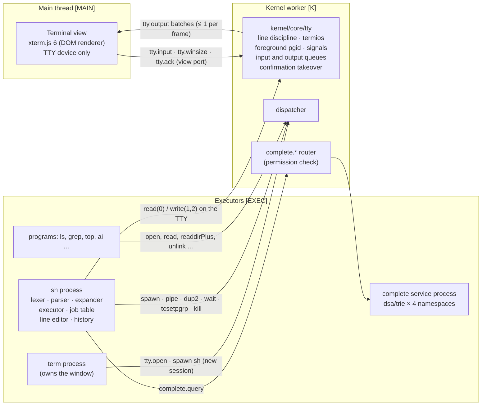
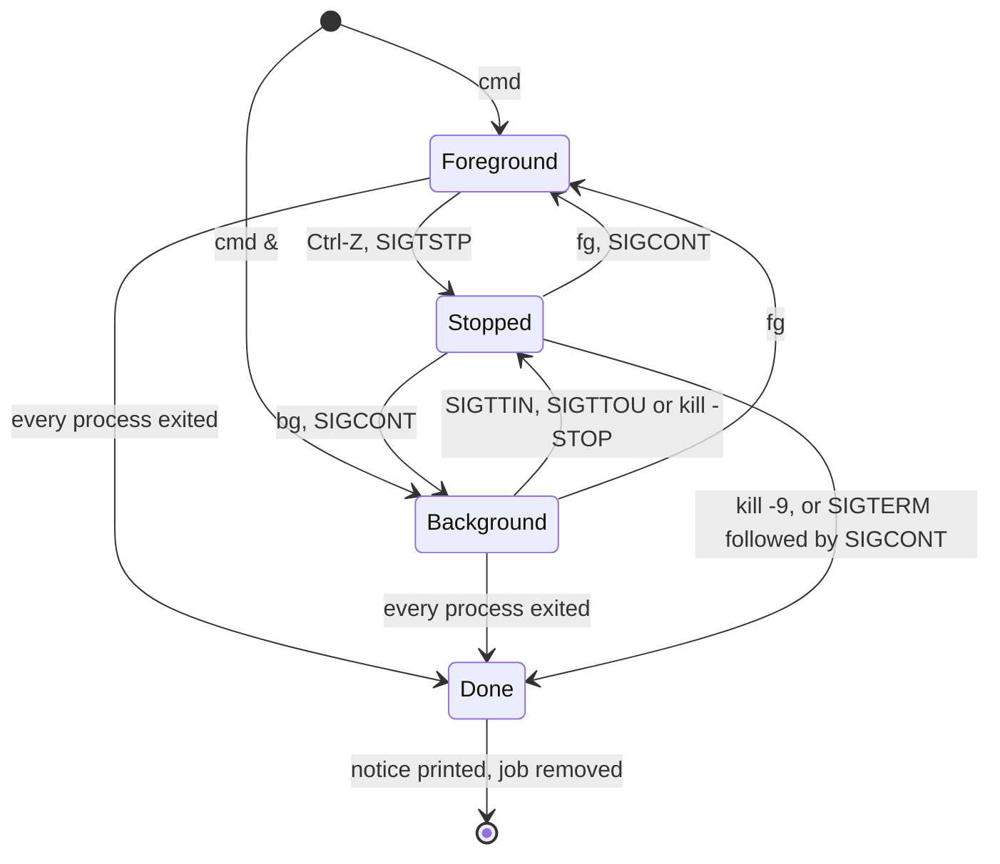

# Shell and terminal

| Field | Value |
|---|---|
| Title | Shell and terminal: the xterm TTY device, the kernel line discipline, the `sh` process, grammar and execution, history and job control, tab completion, man pages, and the complete command reference |
| Status | Draft v0.1, 2026-09-24 |
| Primary owner | R3 WM/UI (Terminal, line discipline, shell lexer/parser/executor, completion; canonical decision C15) |
| Secondary reviewer | R4 AI (terminal integration, per CODEOWNERS for `apps/terminal`); `kernel/core/tty` is also reviewed by R1 Kernel. Each command section is reviewed by its command owner (R1, R2, R4, R5) |
| Must be demonstrable at | **P2 gate (W7, v0.2.0):** Terminal with the file commands, pipes, redirection, `;` `&&`, environment variables, history, `help`, `man`, `uname`, `whoami`, `id`; trie tab completion with `complete --bench` printing p95 over a 10,000-entry directory (SYS-03). **P3 gate (W11, v0.3.0):** process and memory commands, job control (`&`, Ctrl-Z, `jobs`, `bg`, `fg`), `su`, `bootlog`, `fsck`, `lsof`, `shutdown`, `reboot`, `svcctl`, `debug`, `swapctl`. **P4 gate (W14, v0.4.0):** `ai`, `semsearch`, `predict`. **Final defence:** the SYS-02 scripted session and the Demo Day commands. |
| Requirement IDs covered | Spec: SYS-01 (for the shell and commands), SYS-02, SYS-03; the command parts of PROC-07, PROC-08, MEM-07, VFS-05, VFS-06, VFS-07, VFS-09, VFS-11, BOOT-04, BOOT-06, BOOT-11, BOOT-12, DB-02, MEM-04, MEM-05, RAG-01, RAG-06, AGT-03, AGT-08, AGT-09, AGT-10, PRE-06; §5.2 `uname` (PLT-ID-07). Plotinium design: SHL-01 … SHL-18 |
| Related specs | [Architecture](../01-architecture/architecture.md) · [System-call ABI](../01-architecture/syscall-abi.md) · [Window manager](../05-wm/window-manager.md) · [UI design system](../05-wm/ui-design-system.md) · [Processes and scheduling](../03-kernel/processes-and-scheduling.md) · [Memory and paging](../03-kernel/memory-and-paging.md) · [Virtual file system](../04-vfs/virtual-file-system.md) · [Boot and services](../02-boot/boot-and-services.md) · [Offline and sync](../06-sync/offline-and-sync.md) · [Data structures](../08-dsa/data-structures.md) · [RAG semantic search](../10-ai/rag-semantic-search.md) · [Agentic shell](../10-ai/agentic-shell.md) · [Predictive pre-fetch](../10-ai/predictive-prefetch.md) · [Security model](../12-security/security-model.md) · [Identity and branding](../00-product/identity-and-branding.md) · [Testing and performance](../13-quality/testing-and-performance.md) |

**Conventions.** RFC 2119 keywords as in the capstone spec (p. 3). **Spec** marks an obligation from the capstone specification with its section and ID; **Plotinium design** marks our own choice. Numbers from the AI-run prototype are marked *(pilot figure — re-measure on the lab machine)*. Output shown in examples is illustrative unless marked "exact". Thread tags: **[MAIN]** main thread, **[K]** kernel worker, **[EXEC]** executor worker.

---

## 1. Purpose and scope

Spec §9.6: "The terminal is a real shell on top of this interface. It supports quoting, pipes (`|`), redirection (`>`, `>>`, `<`), sequencing (`;` and `&&`), background jobs (`&`), environment variables (`$HOME`, `$PATH`, `$USER`), history, and `help` and `man` pages." This spec defines:

- the layering: **xterm.js is the TTY device only**; the **line discipline** is kernel code; the **shell** is an ordinary process on an executor (C11);
- the TTY device, its modes, signals and flow control;
- the shell: lexer and grammar (EBNF), expansion, execution, exit codes, environment, history and job control;
- builtins versus programs;
- **tab completion** backed by the team's trie with the namespaces `cmd`, `path`, `flag` and `hist` (SYS-03, critic fix);
- **man pages** as `apps/bin/man/*.md` whose front matter seeds the flag trie (coherence gap "SYS (man, help, uname)");
- the **complete command reference** for every command §9.6 requires, plus `svcctl`, `debug`, `swapctl` and `complete --bench`;
- the tests, including the SYS-02 scripted terminal session.

Out of scope: syscall schemas and the errno master table ([syscall-abi.md](../01-architecture/syscall-abi.md)); the VFS, process, memory, boot, sync, agent, RAG and predictor semantics behind each command (their specs); the Terminal window's chrome ([ui-design-system.md §3.8.10](../05-wm/ui-design-system.md)).

---

## 2. Requirements table

| ID | Summary | Spec § | How verified |
|---|---|---|---|
| SYS-01 | Spec: MUST, §9.6. All applications, built-in or not, use only the system-call interface; the kernel checks permissions on every call. The shell and every command run as processes on executors and reach the OS only through `ctx.sys`. | §8 (1), §9.6 | SYS-01 bypass suite ([syscall-abi.md](../01-architecture/syscall-abi.md)); lint; SHL-16 test |
| SYS-02 | Spec: MUST, §9.6. The required command set, with pipes, redirection, background jobs and history. | §9.6 | Scripted terminal session (§8.2) |
| SYS-03 | Spec: MUST, §9.6. Tab completion of commands, paths and flags backed by our own trie, p95 prefix lookup ≤ 1 ms over ≥ 10,000 entries, updated incrementally as the VFS changes. | §9.6, §10.1, App. A | `complete --bench`; live demo; incremental-update test |
| SHL-01 | Plotinium design (C11). xterm.js renders and turns keys into bytes; the line discipline lives in `kernel/core/tty`; the shell lexer, parser, executor and completion are the team's own code. | C11 | Code review; import-boundary lint |
| SHL-02 | Plotinium design. The TTY supports canonical and raw modes, echo, `ISIG` (Ctrl-C → SIGINT, Ctrl-Z → SIGTSTP to the foreground process group), EOF, foreground process groups, SIGTTIN for background readers, SIGWINCH on resize and SIGHUP on hang-up. | §9.1 PROC-08 | Unit tests on `kernel/core/tty`; job-control e2e |
| SHL-03 | Plotinium design. Terminal output is delivered to the view in at most one batch per animation frame of at most 64 KiB; the TTY output queue holds 256 KiB and writers block when it is full; the view acknowledges each batch after xterm parses it. | PROC-05, WM-03 | Flood test (`yes \| head -n 100000`) with LoAF check |
| SHL-04 | Plotinium design. The shell grammar is exactly §3.5; unsupported constructs produce an explicit error and nothing on the line runs. | §9.6 | Parser unit and property tests |
| SHL-05 | Plotinium design. Expansion order: tilde, parameter, field splitting of unquoted results, pathname (glob), quote removal. | §9.6 | Expansion unit tests |
| SHL-06 | Plotinium design. Builtins run inside the shell process; a builtin in a multi-command pipeline, and any backgrounded list that is not a single pipeline of programs, runs in a child `sh -c` (subshell semantics). | §9.6 | Unit and e2e tests |
| SHL-07 | Plotinium design. Exit status and error-message conventions of §3.7.6 and §3.13 hold for every command. | §9.6 | Per-command tests |
| SHL-08 | Plotinium design. Job control: `&`, Ctrl-Z, `jobs`, `bg`, `fg`, `wait`, `%n` job specs, done/stopped notices before the prompt. | PROC-08 | Job-control e2e |
| SHL-09 | Plotinium design. History is persisted in `~/.sh_history` (mode 0600), capped at 1,000 lines; `history -c` clears the list, the file and the `hist` completion namespace. | §9.6 | History tests |
| SHL-10 | Plotinium design. Completion never returns names from a directory the caller cannot list (`r` on it and `x` on every ancestor), because the kernel checks the directory before the query reaches the trie. | SYS-01, VFS-04 | Completion permission test |
| SHL-11 | Plotinium design. A VFS change (create, unlink, rename) is reflected in completion within 100 ms when the system is idle. | SYS-03 | Incremental-update test |
| SHL-12 | Plotinium design. Every program in `/bin` has a man page; the page's front matter is the single source of the command's flags for both its option parser and the `flag` completion namespace. | §9.6 | `tools/manpages.ts` CI check |
| SHL-13 | Plotinium design. Commands that print file names or command lines to a TTY replace control and bidirectional-override characters; the kernel's confirmation block always escapes them. | AGT-06, security | Escaping tests |
| SHL-14 | Plotinium design (C12). A destructive agent plan is confirmed only through a kernel TTY takeover: pending input is discarded, one key is read, default `N`, pastes are ignored, 120 s timeout; with no controlling TTY the plan is refused with `ENOTTY`. | AGT-03 | Confirmation tests |
| SHL-15 | Plotinium design. Common option syntax: short options cluster (`-la`), `--` ends options, long options take `=value`, options may follow operands, `--help` prints the synopsis and flags from the man front matter. | §9.6 | Argument-parser unit tests |
| SHL-16 | Plotinium design. Shell and command code imports only `protocol/` and the sys client; executors shadow storage, worker and network globals before program code runs. | SYS-01 | Lint; bypass cases |
| SHL-17 | Plotinium design. If the `complete` service is not running, completion falls back to a directory scan with a one-time notice. | BOOT-07 | Degraded-mode test |
| SHL-18 | Plotinium design (§3.4 litmus, C12). In the AI-off build, `ai`, `semsearch` and `predict` are not installed: the shell reports `command not found` (127) and `help` omits the AI row. | §3.4 | Litmus CI job |

---

## 3. Design (normative)

### 3.1 Architecture



| Part | Where | Owner (reviewer) | Code |
|---|---|---|---|
| Terminal view | [MAIN] | R3 (R4) | `apps/terminal/view.tsx`, `apps/terminal/theme.ts` |
| `term` process | [EXEC] | R3 (R4) | `apps/terminal/proc.ts` |
| TTY line discipline | [K] | R3 (R1) | `kernel/core/tty/` |
| `sh` | [EXEC] | R3 (R4) | `apps/shell/` (`lexer.ts`, `parser.ts`, `expand.ts`, `exec.ts`, `jobs.ts`, `editor.ts`, `history.ts`, `builtins/`) |
| Programs | [EXEC] | per command (§3.14) | `apps/coreutils/`, `apps/demo/`, `ai/…` |
| `complete` service | [EXEC] | R3 (R1) | `apps/complete/` + `dsa/trie` |
| Man pages and manifests | VFS seed | per command | `apps/bin/<name>.json`, `apps/bin/man/<name>.md` |

The `rm -r` walk-through of the spec (§8.1) runs through exactly these parts: [architecture §5.2](../01-architecture/architecture.md) steps 1–3 and 11–12.

### 3.2 The TTY device and the line discipline (SHL-02, SHL-03)

**Devices.** The kernel allocates a TTY per Terminal window with `tty.open({wid})`; names are `tty1`, `tty2`, … (shown in `ps` and `lsof`). A TTY is bound to exactly one view port, so `tty.input`, `tty.winsize` and `tty.ack` are accepted only from the Terminal view of that window ([window-manager.md §4.5](../05-wm/window-manager.md)). A TTY is not a VFS path in v1 (there is no `/dev`); processes reach it only through inherited file descriptors of type `tty`.

**termios subset** (§4.1): `icanon`, `echo`, `isig`, `icrnl`, `onlcr`, `vmin`, and the control characters `VINTR` (0x03, Ctrl-C), `VSUSP` (0x1a, Ctrl-Z), `VEOF` (0x04, Ctrl-D), `VERASE` (0x7f, Backspace), `VKILL` (0x15, Ctrl-U), `VWERASE` (0x17, Ctrl-W). Defaults: canonical mode on, echo on, `isig` on, `icrnl` on, `onlcr` on.

**Input path** (`tty.input({tty, data})` from the view; `data` is xterm's `onData` string, UTF-8 encoded by the kernel):
1. If a confirmation takeover is active (§3.11), the bytes go to the takeover and nowhere else.
2. If `isig` and the byte is `VINTR`: discard the input queue, echo `^C` and CR LF (if `echo`), send SIGINT to the foreground process group. If `VSUSP`: echo `^Z` CR LF, send SIGTSTP to the foreground process group.
3. If `icrnl`, CR (0x0d) becomes LF.
4. **Canonical mode:** edit the current line in place (`VERASE` removes one character, `VWERASE` one word, `VKILL` the line), echo; on LF the line (with its LF) becomes readable; `VEOF` on an empty line makes the next `read` return 0 bytes. Line length limit 4,096 bytes (further bytes are dropped and the bell `\x07` is echoed).
5. **Raw mode** (`icanon` off): bytes are appended to the input queue as they arrive and readers wake when at least `vmin` (1) bytes are queued.
6. The input queue holds 64 KiB. The view splits pastes into chunks of at most 16 KiB; when the queue is full, `tty.input` returns `EAGAIN` and the view retries on its next animation frame.

**Output path** (`write` on a `tty` fd):
1. If `onlcr`, LF becomes CR LF.
2. Bytes are appended to the output queue (256 KiB). When it is full, the writer becomes BLOCKED with `waitingOn = 'tty:output'` until space is freed.
3. The kernel posts at most one `tty.output {seq, data}` batch per animation frame to the view, at most 64 KiB each (C2 "at most one batch per frame"). It keeps at most 2 batches unacknowledged; the view calls `tty.ack({tty, seq})` from xterm's `write(data, callback)` callback, i.e. after xterm has parsed the batch. This caps main-thread terminal work per frame and is what keeps a flood from producing long animation frames (SHL-03).
4. While the Terminal window is suspended (its `term` process paged out, [window-manager.md §3.12](../05-wm/window-manager.md)), delivery pauses; output keeps queueing up to 256 KiB. After `attach`, the view applies the `term` snapshot, then calls `tty.winsize`, which also resumes delivery.

**Process groups and sessions.** Each TTY has one session (the login shell is its leader) and one foreground process group (`tcsetpgrp`). A process in a background group of the TTY's session that reads from the TTY receives SIGTTIN (default action: stop). Background writes are allowed (no `TOSTOP`). `tcsetpgrp` by a background process sends SIGTTOU unless the caller ignores it (the interactive shell ignores SIGTTOU, SIGTTIN and SIGTSTP for itself).

**Window size.** `tty.winsize({tty, cols, rows})` stores the size and sends SIGWINCH to the foreground process group. The view calls it after xterm's fit addon computes a new grid at the end of a resize gesture.

**Hang-up.** When the `term` process exits or calls `tty.hangup(tty)`, the kernel sends SIGHUP to every process group of the session, then SIGCONT to the stopped ones, and closes the TTY; later reads return 0 and writes fail with `EIO`.

**Signals used by the shell and commands** (numbers follow Linux so exit statuses match what examiners expect; the process spec owns delivery and default actions):

| No. | Name | Default action | Sent by |
|---|---|---|---|
| 1 | SIGHUP | terminate | TTY hang-up; `su` expiry |
| 2 | SIGINT | terminate | Ctrl-C |
| 9 | SIGKILL | terminate (uncatchable) | `kill -9`, watchdog, close escalation |
| 13 | SIGPIPE | terminate | write to a pipe with no reader |
| 15 | SIGTERM | terminate | `kill`, window close |
| 17 | SIGCHLD | ignore | child state change |
| 18 | SIGCONT | continue | `fg`, `bg` |
| 19 | SIGSTOP | stop (uncatchable) | `kill -STOP` |
| 20 | SIGTSTP | stop | Ctrl-Z |
| 21 | SIGTTIN | stop | background read from the TTY |
| 22 | SIGTTOU | stop | background `tcsetpgrp` |
| 28 | SIGWINCH | ignore | TTY resize |

### 3.3 The `term` process and the Terminal window

Plotinium design:
1. Launching Terminal spawns `/bin/terminal.json` → `term`. `term` calls `window.create({title:'Terminal'})`, then `tty.open({wid})`, then `spawn({path:'/bin/sh', argv:['-sh'], fds:{0:tty, 1:tty, 2:tty}, session:'new', ctty:tty, cwd})`, where `cwd` is `$HOME`, or the directory saved in the session layout on restore ([window-manager.md §3.15](../05-wm/window-manager.md)).
2. `term` waits for the shell. When the shell exits, `term` exits and the window closes.
3. Closing the window sends SIGTERM to `term` ([window-manager.md §3.12](../05-wm/window-manager.md)); `term` calls `tty.hangup` (SIGHUP to the session), waits up to 1 s, and exits.
4. `term`'s state is `{tty, shPid, title, snapshot}`. `snapshot` is up to the last 2,000 lines of plain text (≤ 512 KiB) that the view sends on `dehydrate` (xterm `buffer.active.getLine(i).translateToString(true)`), so a restored window shows its previous text before live output resumes. Styles are not preserved in the snapshot.
5. The window title follows the shell's working directory, `alice@plotinium: ~/notes`. `term` owns the window, so `term` sets the title with `window.setTitle`, driven by the `proc.cwd` events of its TTY session's foreground shell.

### 3.4 The shell process

**Start-up.** `argv[0]` beginning with `-` marks a login shell. An interactive shell (stdin is a TTY) does, in order:
1. set the TTY's foreground group to its own pgid; ignore SIGINT, SIGTSTP, SIGTTIN, SIGTTOU for itself;
2. build the environment (below); `cd` to `$HOME` if login;
3. load history from `$HISTFILE` (§3.9) and send it to the completion service (`complete.hist.load`);
4. print the banner exactly as the identity spec fixes it: `Plotinium 0.3.0 shell — type 'man <command>'` ([identity-and-branding.md §3.10 row 15](../00-product/identity-and-branding.md));
5. enter the read–eval loop with the line editor (§3.9).

A non-interactive shell (`sh -c COMMAND`, `sh FILE [ARG…]`, or stdin not a TTY) skips 1, 3 and 4 and exits with the status of the last command.

**Prompt.** `PS1` default `\u@\h:\w\$ ` → `alice@plotinium:~/notes$ `; `\$` is `#` for uid 0. `PS2` (continuation) `> `. Supported escapes: `\u` user, `\h` host, `\w` cwd with `$HOME` shown as `~`, `\W` basename, `\$`, `\\`. Colours: [ui-design-system.md §3.8.10](../05-wm/ui-design-system.md).

**Environment** set at start (exported unless marked):

| Variable | Value |
|---|---|
| `HOME` | the user's home from `id()`, e.g. `/home/alice` (`/root` for uid 0) |
| `USER`, `LOGNAME` | user name |
| `PATH` | `/bin` |
| `PWD`, `OLDPWD` | from `getcwd()`; `OLDPWD` unset until the first `cd` |
| `SHELL` | `/bin/sh` |
| `TERM` | `xterm-256color` |
| `COLUMNS`, `LINES` | from the TTY size; updated on SIGWINCH |
| `HOSTNAME` | `plotinium` |
| `LANG` | `C.UTF-8` |
| `TZ` | the time zone reported by the kernel's `time.now` (e.g. `Asia/Karachi`) |
| `HISTFILE`, `HISTSIZE` | `$HOME/.sh_history`, `1000` |
| `PS1`, `PS2` | as above (not exported) |
| `UID` | numeric uid (read-only, not exported) |

**Variables.** `NAME=value` alone sets a shell variable (not exported); `export NAME[=value]` exports; `unset NAME` removes; a prefix assignment `NAME=value cmd` exports `NAME` to `cmd` only. Special parameters: `$?` (last exit status), `$$` (shell pid), `$!` (pid of the last background job's last process), `$0` (shell name or script path), `$1`–`$9` and `$#` and `$@` (positional parameters in `sh -c`/`sh FILE` mode). `$HOME`, `$PATH` and `$USER` are the variables the spec names (§9.6).

### 3.5 Lexer, grammar and AST (SHL-04)

**Lexer** (`apps/shell/lexer.ts`, hand-written state machine, O(n) in the input length). It produces tokens with source spans: `WORD`, `ASSIGNMENT_WORD`, `IO_NUMBER`, `NEWLINE`, and the operators `|`, `||`, `&`, `&&`, `;`, `>`, `>>`, `<`, `>&`, `!`. Quote states: unquoted, single-quoted, double-quoted, escape. `#` at the start of a word begins a comment to the end of the line. A backslash before a newline is a line continuation and is removed. Incomplete input (open quote, trailing `|`, `&&`, `||` or backslash) is reported as `incomplete` so the interactive editor asks for more with `PS2`.

**Grammar** (ISO 14977 EBNF; tokens in capitals come from the lexer):

```ebnf
program          = linebreak , [ list , linebreak ] ;
list             = and_or , { separator , and_or } , [ separator ] ;
separator        = ";" | "&" | newline_list ;
and_or           = pipeline , { ( "&&" | "||" ) , linebreak , pipeline } ;
pipeline         = [ "!" ] , simple_command , { "|" , linebreak , simple_command } ;
simple_command   = cmd_prefix , [ WORD , [ cmd_suffix ] ]
                 | WORD , [ cmd_suffix ] ;
cmd_prefix       = ( ASSIGNMENT_WORD | io_redirect ) , { ASSIGNMENT_WORD | io_redirect } ;
cmd_suffix       = ( WORD | io_redirect ) , { WORD | io_redirect } ;
io_redirect      = [ IO_NUMBER ] , ( ">" | ">>" | "<" ) , WORD
                 | [ IO_NUMBER ] , ">&" , IO_NUMBER ;
linebreak        = [ newline_list ] ;
newline_list     = NEWLINE , { NEWLINE } ;
```

**Word syntax** (lexical):

```ebnf
WORD             = word_part , { word_part } ;
word_part        = plain_char | escaped_char | single_quoted | double_quoted | parameter ;
plain_char       = ? any character except space, tab, newline, "|", "&", ";", "<", ">",
                     "(", ")", "`", "'", '"', "\", "$" ; "#" only when not at the start of a word ? ;
escaped_char     = "\" , ? any character except newline ? ;
single_quoted    = "'" , { ? any character except "'" ? } , "'" ;
double_quoted    = '"' , { dq_char | dq_escape | parameter } , '"' ;
dq_char          = ? any character except '"', "\" and "$" ? ;
dq_escape        = "\" , ( '"' | "\" | "$" | "`" )
                 | "\" , ? any other character, kept together with the backslash ? ;
parameter        = "$" , ( name | special_param | digit )
                 | "${" , ( name | special_param | digit ) , "}" ;
name             = ( letter | "_" ) , { letter | digit | "_" } ;
special_param    = "?" | "$" | "!" | "#" | "@" | "0" ;
ASSIGNMENT_WORD  = name , "=" , { word_part } ;        (* recognised only in cmd_prefix position *)
IO_NUMBER        = digit ;                             (* only when directly followed by "<", ">" or ">&" *)
```

Precedence: `|` binds tightest, then `&&`/`||` (left-associative, equal precedence), then `;`/`&`/newline. `&` applies to the whole `and_or` before it (`make && echo ok &` backgrounds both).

A `$` not followed by a name, digit, special parameter or `{` is a literal `$`.

**Not supported in v1**, each rejected with an explicit error and **nothing on the line runs** (SHL-04):

| Construct | Error (exact) |
|---|---|
| `$( … )` | `sh: command substitution is not supported` |
| `` `…` `` (unquoted or in double quotes) | `sh: backquote substitution is not supported` |
| `( … )`, `{ … }` | `sh: syntax error: subshells and groups are not supported` |
| `<<`, `<<<` | `sh: here-documents are not supported` |
| `${VAR:-x}` and other operators inside `${}` | `sh: ${VAR:-x}: bad substitution` |
| `if`, `for`, `while`, `case`, functions | treated as ordinary command words; `sh: if: command not found` |
| `!` history expansion | not a feature; `!` is only pipeline negation at the start of a pipeline |

Other syntax errors print `sh: syntax error near unexpected token 'X' (column N)` and set `$?` to 2.

**AST** (§4.3): `List` → `AndOr` → `Pipeline` → `SimpleCommand` with `assigns`, `words` and `redirs`; words keep their parts and quoting so expansion can apply quoting rules.

### 3.6 Expansion (SHL-05)

Applied to each word of a simple command, in this order:
1. **Tilde** at the start of a word, or right after `=` in an assignment: `~` → `$HOME`; `~/x` → `$HOME/x`; `~user` → that user's home from `id({user})` (unknown user: left unchanged). Quoted tildes are literal.
2. **Parameter** `$NAME`, `${NAME}` and the special parameters; unset names expand to the empty string.
3. **Field splitting** of the results of *unquoted* expansions on spaces, tabs and newlines (`IFS` is fixed). Quoted expansions are never split. `"$@"` yields one field per positional parameter.
4. **Pathname expansion** of unquoted `*`, `?` and `[…]` (with `!` or `^` negation and ranges), matched per path component against `readdirPlus` listings as the caller. Names beginning with `.` match only a pattern component beginning with `.`. Matches are sorted in code-point order. A pattern with no match stays unchanged (it is passed literally, as in POSIX shells). `**` is an ordinary `*`.
5. **Quote removal.**

A redirection target must expand to exactly one field; otherwise `sh: FILE*: ambiguous redirect` and the command is not run (`$?` = 1).

### 3.7 Execution semantics (SHL-06, SHL-07)

#### 3.7.1 Builtins versus programs

| Kind | Commands | Runs |
|---|---|---|
| **State builtins** (change the shell itself) | `cd`, `export`, `unset`, `exit`, `history`, `jobs`, `fg`, `bg`, `wait` | inside the shell process |
| **Convenience builtins** (also installed as programs) | `pwd`, `echo`, `kill`, `help`, `type`, `true`, `false` | inside the shell when alone; `/bin/<name>` or a child `sh -c` elsewhere |
| **Programs** | every other command (§3.14) | a new process from `/bin/<name>.json` |

Rules:
1. A builtin that is part of a multi-command pipeline runs in a child `sh -c '<builtin text>'` (subshell semantics: `cd /tmp | cat` changes nothing; `history | grep ls` reads `$HISTFILE`; `jobs | cat` prints nothing).
2. A backgrounded item (`… &`) that is a single pipeline of programs is spawned directly in a new process group. Any other backgrounded item (an `&&`/`||` list, or one containing a builtin) runs in a child `sh -c '<source text of that item>'` in a new process group. The child inherits the shell's variables as its environment (so non-exported variables are visible to it, but become exported there); this is documented as a difference from forking shells.
3. `type NAME` prints `cd is a shell builtin`, `ls is /bin/ls`, or `sh: type: foo: not found`.

#### 3.7.2 Command lookup

A command word without `/`:
1. builtin → run it;
2. else, for each directory `D` in `$PATH` (colon-separated, empty entries ignored): if `D/<name>.json` exists, spawn it. The shell caches `name → manifest path` and clears the cache when `PATH` changes or when a spawn from the cache fails with `ENOENT` (then it looks up once more);
3. else `sh: <name>: command not found`, status 127.

A command word containing `/`: if `<word>.json` exists, spawn that manifest; else if `<word>` is a regular file with an `x` bit whose first line is `#!/bin/sh`, run `sh <word> ARG…`; else `sh: <word>: cannot execute` (status 126) or `No such file or directory` (127).

A manifest the caller may not execute (`x` missing on it or an ancestor) makes `spawn` fail with `EACCES`: `sh: ls: Permission denied`, status 126. Program code comes from the build (the manifest names a module); what `x` on the manifest controls is who may start it ([processes-and-scheduling.md](../03-kernel/processes-and-scheduling.md)).

#### 3.7.3 Spawning and pipelines

For a pipeline of `n` commands the shell:
1. creates `n − 1` pipes with `pipe()` (kernel ring buffers of 64 KiB);
2. applies redirections left to right per command (§3.7.4), after connecting pipes, so `cmd 2>&1 | less` works as in POSIX shells;
3. spawns each command with `spawn({path, argv, env, cwd, fds, pgid, fg})`: the first process's pid becomes the pipeline's process group; the group is made foreground with `tcsetpgrp` unless the pipeline is backgrounded;
4. closes its own copies of the pipe ends;
5. for a foreground pipeline, waits with `wait({pgid, untraced:true})` until every process has exited or one has stopped;
6. takes the TTY back (`tcsetpgrp` to its own group) and restores its saved termios.

The status of a pipeline is the status of its last command; with a leading `!` it is inverted (0 ↔ 1). A writer whose reader has exited gets `EPIPE` and SIGPIPE (status 141), which the shell does not report (`yes | head -n 3` prints three lines and no error).

#### 3.7.4 Redirections

| Form | Meaning | Syscalls |
|---|---|---|
| `> FILE`, `n> FILE` | open for writing, create with mode `0666 & ~umask`, truncate | `open({write, create, truncate})` |
| `>> FILE`, `n>> FILE` | open for appending, create if missing | `open({write, create, append})` |
| `< FILE`, `n< FILE` | open for reading | `open({read})` |
| `n>&m` | make fd `n` a copy of fd `m` | `dup2(m, n)` |

The default `n` is 1 for output and 0 for input. Files are opened by the shell before `spawn` and passed in `fds`; for a builtin run inside the shell, the shell saves and restores its own descriptors with `dup`. When an open fails, the shell prints `sh: out.txt: Permission denied` (or the errno's text), sets status 1 and does not run the command. How file content writes become durable (per `write` or at `close`) is defined by [virtual-file-system.md](../04-vfs/virtual-file-system.md).

#### 3.7.5 Sequencing

`a ; b` runs `a` then `b`. `a && b` runs `b` only if `a`'s status is 0; `a || b` only if it is not 0. A syntax error anywhere on the line means nothing on the line runs.

#### 3.7.6 Exit statuses (SHL-07)

| Status | Meaning |
|---|---|
| 0 | success |
| 1 | general failure: at least one operand failed, or the operation was refused |
| 2 | usage or syntax error (unknown option, missing operand, parse error) |
| 126 | command found but cannot be executed |
| 127 | command not found |
| 128 + n | terminated by signal n: 129 SIGHUP, 130 SIGINT, 137 SIGKILL (including the watchdog), 141 SIGPIPE, 143 SIGTERM |

Command-specific exceptions (documented in §3.14): `grep` (0 match, 1 no match, 2 error), `semsearch` (0 results, 1 none, 2 error), `fsck` (0 clean or repaired, 1 problems left, 2 error), `ai` (0 committed or nothing to do, 1 declined, rejected, failed or unavailable, 2 usage). When a foreground job ends by a signal other than SIGINT and SIGPIPE, the shell prints the reason on its own line: `Killed`, `Terminated`, `Hangup`, and for kernel-initiated kills `Killed (watchdog)` or `Killed (collateral: executor restarted)` from the wait result's `exitReason` ([processes-and-scheduling.md](../03-kernel/processes-and-scheduling.md)).

### 3.8 Job control (SHL-08, PROC-08)



**Job table** (in the shell): `{id, pgid, pids, text, state: 'running' | 'stopped' | 'done', status?, notified}`. Ids are the smallest free positive integers. `%+` (or `%%`) is the current job (most recent), `%-` the previous one, `%n` job n, `%str` the job whose text starts with `str`.

| Event or command | Behaviour and exact output |
|---|---|
| `cmd &` | new group, not foreground; prints `[1] 312` (job id, pid of the last process); `$!` = that pid |
| Ctrl-Z on a foreground job | SIGTSTP to the group; the shell's wait sees "stopped"; it saves the job's termios, takes the TTY back and prints `[1]+  Stopped                 top` |
| background job reads the TTY | SIGTTIN stops it; notice `[1]+  Stopped (tty input)     cat` |
| `jobs` | `[1]-  Running                 sleep 100 &` and `[2]+  Stopped                 top` |
| `fg [%n]` | prints the job text, `tcsetpgrp` to its group, restores its saved termios, SIGCONT to the group, waits |
| `bg [%n]` | SIGCONT to the group, keeps it in the background; prints `[2]+ top &` |
| `wait [%n \| pid]` | waits for the job or all background jobs; Ctrl-C interrupts the wait (status 130) |
| job finishes in the background | collected with `wait({any:true, nohang:true, untraced:true})` before each prompt and after each foreground wait; prints `[1]-  Done                    sleep 100` or `[1]-  Exit 1                  grep x y` before the next prompt |
| `exit` with stopped jobs | first time prints `There are stopped jobs.` and stays; a second `exit` directly after exits, and the TTY hang-up sends SIGHUP and SIGCONT to them |
| Ctrl-C at the prompt | the line editor discards the line, prints `^C`, shows a new prompt; `$?` = 130 |

### 3.9 Line editor and history (SHL-09)

**Line editor** (`apps/shell/editor.ts`). While reading a command line the interactive shell sets the TTY to raw mode with `echo` and `isig` off and edits the line itself; it restores canonical mode with `isig` on before running a foreground job, so Ctrl-C and Ctrl-Z reach the job. Keys (xterm sends the escape sequences):

| Key | Action |
|---|---|
| printable text | insert at the cursor |
| `←` `→`, `Home` `End`, `Ctrl-A` `Ctrl-E` | move |
| `Ctrl-←` `Ctrl-→` | move by word (Alt-letter word keys are not used: `Alt+F` opens Chrome's menu, and several `Alt` letters are window-manager bindings) |
| `Backspace`, `Delete`, `Ctrl-D` on a non-empty line | delete |
| `Ctrl-U`, `Ctrl-K`, `Ctrl-W` | delete to start, to end, previous word |
| `↑` `↓` | history; with text typed, only entries starting with that text (the `hist` trie, most recent first) |
| `Ctrl-R` | reverse incremental search (substring, linear over at most 1,000 entries) |
| `Tab` | completion (§3.10) |
| `Ctrl-L` | clear the screen (`ESC[H ESC[2J`) and redraw the line |
| `Ctrl-C` | cancel the line (status 130) |
| `Ctrl-D` on an empty line | end of input: exit the shell (subject to the stopped-jobs rule) |
| `Enter` | if the input is incomplete, continue with `PS2`; else run it |

Bracketed paste is enabled (`ESC[?2004h`): pasted text is inserted literally, including newlines, and nothing runs until `Enter`. Cursor positioning uses a small own `wcwidth` table (East Asian wide characters are 2 columns, combining marks 0).

**History.**
- In memory: the last `HISTSIZE` (1,000) lines. A line is added after it is run if it is non-empty, does not start with a space, and differs from the previous entry.
- On disk: `$HISTFILE` (`~/.sh_history`, created with mode 0600), one entry per line, appended with one `write` after each command. When the file exceeds 1,200 lines the shell rewrites it with the last 1,000.
- Each added line is also sent to the completion service with `complete.hist.add({line})` (the kernel stamps the uid; §3.10).
- `history [N]` prints numbered entries: `  501  ls -la ~` (number right-aligned in 5 columns, two spaces).
- `history -c` clears the in-memory list, truncates `$HISTFILE`, and calls `complete.hist.clear()`, which removes this uid's whole `hist` namespace (critic fix: "remove on `history -c`").
- Shells of the same user each keep their own in-memory list and share the file.

### 3.10 Tab completion (SYS-03, SHL-10, SHL-11, SHL-17)

Spec: MUST, §9.6 and §10.1: tab completion of commands, paths and flags is backed by our own trie (commands, paths and history per §10.1), with p95 prefix lookup ≤ 1 ms over at least 10,000 entries, updated incrementally as the VFS changes. Insert and remove are O(L); completing a prefix is O(P + k).

**The `complete` service.** A non-critical system service (manifest `complete`: requires `vfs, desktop`, priority 36, C17) running as a process on an executor. It owns four instances of the team's `dsa/trie` (struct-of-arrays radix trie, owner R3; [data-structures.md](../08-dsa/data-structures.md)):

| Namespace | Key | Meta | Filled from | Updated by |
|---|---|---|---|---|
| `cmd` | command name | `builtin` or `program` | builtins list + `readdir` of each `$PATH` directory (names ending in `.json`, suffix removed) | `vfs.create/unlink/rename` in `$PATH` directories |
| `path` | `dirKey + U+0000 + basename` | `d`, `f` or `l` | a directory's listing (`readdirPlus`, paged), indexed on first query and for each shell's `$HOME` and working directory (`proc.cwd` events) | `vfs.create/unlink/rename` for indexed directories |
| `flag` | `command + U+0000 + flag` | description | `/usr/share/man/index.json` (§3.12) | `vfs.write` on `/usr/share/man/**` |
| `hist` | `uidKey + U+0000 + line` | sequence number | `complete.hist.load` / `add` from shells | `add`, `clear` |

- `dirKey` is a dense directory slot (uint32) assigned through a `dsa/hashtable` from the directory's inode UUID, encoded as two UTF-16 code units. Keying by the parent **directory inode**, not by full path, means renaming or moving a directory changes one key in its old and new parent and nothing below it (kernel record: "index basenames or per-directory entries … so an mv of a directory stays an incremental update").
- `uidKey` encodes the uid the same way.
- Bounding: when the `path` namespace exceeds 200,000 entries, the least recently queried indexed directory (a `dsa/lru` over directory slots) is dropped with `removePrefix(dirKey)` and re-indexed on its next query.
- The trie interface used: `insert(key, meta)` O(L), `remove(key)` O(L), `complete(prefix, limit)` O(P + k), `removePrefix(prefix)` O(P) to detach the subtree (the freed slots are reclaimed lazily) ([data-structures.md](../08-dsa/data-structures.md)).

**Query path and permissions (SHL-10).** The shell calls `complete.query({ns, dir?, cmd?, prefix, limit})`. For `ns = 'path'`, the **kernel** resolves `dir` with the caller's credentials, requires `x` on every ancestor and `r` on `dir` (else `EACCES`, and the shell completes nothing), and forwards only the directory inode to the service. For `hist`, the kernel stamps the caller's uid from the port (C3). The service never sees credentials and never needs them: every name it returns comes from a directory the caller may list.

**What gets completed** (the line is lexed up to the cursor in tolerant mode):

| Position of the current word | Namespace |
|---|---|
| first word of a simple command (after start, `\|`, `;`, `&`, `&&`, `\|\|`, skipping assignments), without `/` | `cmd` |
| starts with `-` and the command word is known | `flag` for that command |
| starts with `$` | shell variable names (linear over the shell's variables, not the trie) |
| anything else, including after a redirection operator | `path` (the directory part is expanded for `~` and resolved against `$PWD`) |
| `↑` with a typed prefix | `hist` |

**Behaviour.** One candidate: insert the rest of it, then `/` for a directory or a space otherwise. Several: insert their longest common prefix; if that adds nothing, a second `Tab` lists them in columns sorted in code-point order (flags with their descriptions, one per line); more than 100 candidates asks `Display all 312 possibilities? (y or n)`. Inserted text escapes spaces and shell-special characters with `\`. Candidates are limited to 100 per query.

**Freshness (SHL-11).** The service handles each `vfs.*` event for an indexed directory by one `insert` or `remove` (a rename: one `remove` and one `insert`), so a new file is completable within 100 ms when the system is idle. Changes that arrive from the server (`vfs.changed` re-emitted by `syncd`) are handled the same way.

**Degraded mode (SHL-17).** If the service is not running or times out (200 ms), the shell falls back: `path` → one `readdirPlus` of the directory and a linear prefix filter; `cmd` → builtins plus a `readdir` of `$PATH`; `flag` → none; `hist` → the shell's own list. It prints `complete: service unavailable — using a directory scan` once per shell. The fallback is not what SYS-03 is measured on.

**Benchmark** (`complete --bench`, §3.14.52): times `complete(prefix, 20)` inside the service with `performance.now()`. Under cross-origin isolation the timer resolution is 5 µs, so results below it are printed as `< 0.005 ms`. The prototype measured completion p95 of 30–50 µs, flat from 10³ to 10⁵ entries, and 24 MB at 10⁵ entries for a struct-of-arrays trie against 493 MB for a Map-per-node trie *(pilot figures — re-measure on the lab machine)*.

### 3.11 Kernel TTY takeover for confirmations (SHL-14, AGT-03)

Plotinium design (C12: confirmation is "read ONLY from kernel-owned TTY input; destructive plans are refused without a TTY"). The agent pipeline itself is owned by [agentic-shell.md](../10-ai/agentic-shell.md); the TTY rules are here:
1. `ai.agent.confirm({planId})` finds the agent process's **controlling TTY**. If there is none, the plan is refused with `ENOTTY` and nothing runs.
2. If the agent's process group is not the TTY's foreground group (it was started with `&`), the kernel stops it with SIGTTIN until the user brings it to the foreground with `fg`; the prompt then appears.
3. The kernel suspends reads by the foreground group, saves the termios, **discards all pending input** (so type-ahead cannot answer), switches to raw mode without echo, and asks the compositor to show the kernel-confirmation strip ([window-manager.md §3.16](../05-wm/window-manager.md)).
4. The kernel writes the confirmation block itself ([ui-design-system.md §3.8.15](../05-wm/ui-design-system.md)); every file name in it is escaped (control and bidirectional characters as `\u{…}`, SHL-13).
5. It reads **one key** from TTY input: `y`/`Y` = yes, `n`/`N`/`Enter`/`Ctrl-C` = no, `e`/`E` = edit (opens the plan in the Editor and re-validates). Bytes inside a bracketed paste are ignored. Other keys ring the bell and are ignored.
6. The agent's stdin is irrelevant: `yes | ai "…"` still gets the prompt on the TTY, and the piped `y` cannot confirm.
7. Timeout 120 s (the confirm token's lifetime) → `N`.
8. The kernel restores the termios, resumes the foreground group's reads, clears the strip, and returns the answer to the agent pipeline.

### 3.12 Man pages and `help` (SHL-12)

**Files.** One Markdown page per program in the repository at `apps/bin/man/<name>.md` (section 1), next to its manifest `apps/bin/<name>.json`. Section 2 pages (`<call>.2`) are generated at build time from the `protocol/` schemas (call name, arguments, result, errnos, capability), which satisfies the syscall contract test's "a doc line in `man 2`" (strategy syscall protocol §11). The VFS seed installs them read-only (files 0444, directories 0755, owner root) at `/usr/share/man/1/<name>.md`, `/usr/share/man/2/<call>.md` and `/usr/share/man/index.json` (coherence gap "SYS (man, help, uname)": "seeded read-only into /usr/share/man").

**Front matter.** JSON between a first line `---json` and a line `---`, validated by a Valibot schema (§4.7). JSON is chosen so no YAML parser is needed:

```text
---json
{
  "name": "ls",
  "section": 1,
  "summary": "list directory contents",
  "synopsis": "ls [-a] [-l] [-h] [-d] [-R] [-1] [-i] [-t] [-r] [--color[=WHEN]] [PATH...]",
  "owner": "R2",
  "requirements": ["SYS-02", "VFS-07"],
  "flags": [
    { "short": "-a", "long": "--all", "arg": null, "desc": "include names that begin with ." },
    { "short": "-l", "long": null, "arg": null, "desc": "long listing: mode, links, owner, group, size, mtime" },
    { "short": null, "long": "--color", "arg": "WHEN", "desc": "colour output: auto (default) or never" }
  ],
  "seeAlso": ["stat", "find", "tree"]
}
---
# NAME
ls — list directory contents
# SYNOPSIS
…
```

Body sections, in order: `NAME`, `SYNOPSIS`, `DESCRIPTION`, `OPTIONS`, `EXIT STATUS`, `ERRORS`, `EXAMPLES`, `SEE ALSO`.

**Single source of flags.** `tools/manpages.ts` runs in CI and (a) fails if a `/bin` manifest has no page or a page has no manifest, (b) fails if a flag is missing from the `OPTIONS` section, (c) generates `index.json` (name, section, summary, synopsis, flags) and `apps/coreutils/lib/argspec.gen.ts`, which each command's option parser imports. The same `index.json` seeds the `flag` namespace, so completion, `--help` and parsing cannot disagree (SHL-12, SHL-15).

**`man` rendering.** Headings in bold (SGR 1); paragraphs wrapped to `COLUMNS − 4` with a 4-space indent; code blocks indented and not wrapped; list bullets `•`; inline code in bold; link text only. The last line is `Plotinium 0.3.0` right-aligned (identity spec). If stdout is a TTY and the page is longer than `LINES − 1`, a built-in pager runs on the alternate screen: `Space`/`PgDn` next page, `b`/`PgUp` previous, `↓`/`j`/`Enter` next line, `↑`/`k` previous, `g`/`G` top/bottom, `/text` search, `n` next match, `q` quit. Otherwise the text is printed as is.

**`help`.** Prints the banner line, then the builtins and command groups, the syntax summary and the keys (§3.14.44). It lives in the same place on every screen (Settings → Help mirrors it; WCAG 3.2.6).

### 3.13 Output conventions (SHL-07, SHL-13)

- **stdout** carries results; **stderr** carries diagnostics.
- **Error format:** `<cmd>: <operand>: <text>` with an optional ` (<detail>)` from the syscall's `msg`/`detail` (e.g. `(server)`, `(injected fault at node 500)`, `(locked by bob until 10:12:31)`), and for bulk operations the suffix ` — rolled back` (nothing changed) or ` — restored` (a server rejection was undone locally). Usage errors: `<cmd>: invalid option -- 'x'` then `Usage: <synopsis>` then `Try 'man <cmd>'.`
- **errno texts** (the exact strings used everywhere):

| errno | Text | errno | Text |
|---|---|---|---|
| `ENOENT` | No such file or directory | `ESRCH` | No such process |
| `EEXIST` | File exists | `ENOSYS` | Function not implemented |
| `ENOTDIR` | Not a directory | `EIO` | Input/output error |
| `EISDIR` | Is a directory | `EAGAIN` | Resource temporarily unavailable |
| `ENOTEMPTY` | Directory not empty | `ECANCELED` | Operation canceled |
| `EINVAL` | Invalid argument | `ETIMEDOUT` | Timed out |
| `EACCES` | Permission denied | `EBADF` | Bad file descriptor |
| `EPERM` | Operation not permitted | `EMFILE` | Too many open files |
| `ELOOP` | Too many levels of symbolic links | `ENOTTY` | Not a terminal |
| `EDQUOT` | Disk quota exceeded | `EPIPE` | Broken pipe |
| `EBUSY` | Resource busy | `EXDEV` | Invalid cross-device link |
| `ENAMETOOLONG` | File name too long | `EAIUNAVAIL` | AI service unavailable |
| | | `EAIREFUSED` | AI model refused the request |

- **TTY detection:** a command treats fd 1 as a terminal when `fstat(1).type === 'tty'`. Colours, columns, `ls` classification marks and the man pager apply only then.
- **Name escaping (SHL-13):** when printing file names or command lines to a TTY, `ls`, `find`, `tree`, `stat`, `du`, `lsof`, `ps`, `top`, `jobs` and `grep` (its file-name prefix) replace C0 and C1 control characters and the bidirectional controls U+202A–U+202E and U+2066–U+2069 with `?`. Output to a pipe or file is unchanged. `cat` prints content raw (use `cat -v` to see control characters); xterm.js does not implement clipboard-writing OSC sequences by default, but a crafted file can still change the terminal title or colours, which is recorded as a residual risk in [security-model.md](../12-security/security-model.md).
- **Sizes:** bytes by default where the command says so; `-h` uses base 1024 with suffixes `K M G T`, one decimal below 10 (`4.0K`, `18M`, `1.9G`).
- **Times:** `YYYY-MM-DD HH:MM` in `$TZ`; `stat` prints milliseconds and the offset.
- **Collation:** code-point order (C.UTF-8), the same as the server's `COLLATE pg_c_utf8` (C7).

### 3.14 Command reference

Every command below is a real program in `/bin` with a man page (or a builtin also documented by `man`), runs as a process with the caller's credentials, and uses only the listed system calls (SYS-01). Common rules from §3.7.6, §3.13 and SHL-15 apply unless an entry says otherwise. Syscall names follow the strategy catalogue and [architecture §5](../01-architecture/architecture.md); names marked † are requested from [syscall-abi.md](../01-architecture/syscall-abi.md) in §9.

**Owners at a glance** (C15): file commands R2 (except `echo`, R3); process and memory commands R1 (job builtins implemented in the shell by R3 with R1 review); `uname`, `uptime` R1; `whoami`, `id`, `su` R5 (secure prompt R3); `bootlog`, `shutdown`, `reboot`, `svcctl`, `debug` R5; `fsck`, `lsof` R2; `history`, `help`, `man`, `complete` R3; `swapctl` R1; `ai`, `semsearch`, `predict` R4 (`semsearch` citations R3).

#### 3.14.1 `ls` — list directory contents
- **Synopsis:** `ls [-a] [-l] [-h] [-d] [-R] [-1] [-i] [-t] [-r] [--color[=auto|never]] [PATH...]` · **Owner:** R2 · **IDs:** SYS-02, VFS-02, VFS-05, VFS-07
- **Flags:** `-a` include names beginning with `.` and the entries `.` and `..`; `-l` long format; `-h` human sizes (with `-l`); `-d` list directories themselves; `-R` recurse; `-1` one name per line; `-i` print the first 8 hex digits of the inode id; `-t` sort by mtime, newest first; `-r` reverse the sort; `--color` colour on a TTY (default `auto`).
- **Output:** short format in columns sized to `$COLUMNS` on a TTY (one per line otherwise); on a TTY, directories get a trailing `/` and symlinks `@` so type is not shown by colour alone (directories ANSI bold blue, symlinks cyan). Long format per entry: `<mode> <nlink> <owner> <group> <size> <YYYY-MM-DD HH:MM> <name>[ -> <target>]`, e.g. `drwxr-x---  2 alice team   4096 2026-11-14 10:12 reports`; the mode string shows `d`, `l` or `-`, the nine permission bits, and `t`/`T` for the sticky bit. Sort: code-point order of names. No `total` line. With several operands, each directory is headed `path:`.
- **Syscalls:** `lstat` (operands), `readdirPlus` (pages of ≤ 1,000 entries), `readlink` (targets in `-l`).
- **Errors:** `ls: cannot access 'x': No such file or directory` (`ENOENT`); `ls: cannot open directory 'x': Permission denied` (`EACCES`); `ELOOP`; `ENOTDIR`. Exit 1 if any operand failed.
- **Example:** `ls -la ~` → `drwx------  5 alice alice   4096 2026-11-14 10:12 .` …

#### 3.14.2 `cd` — change directory (builtin)
- **Synopsis:** `cd [DIR | -]` · **Owner:** R2 (in `apps/shell/builtins`, reviewer R3) · **IDs:** SYS-02, VFS-03
- **Behaviour:** no operand → `$HOME`; `-` → `$OLDPWD` and prints it. Sets `OLDPWD` and `PWD` (from `getcwd`). The kernel emits `proc.cwd`, which the completion service uses to index the directory.
- **Output:** none (except for `cd -`).
- **Syscalls:** `chdir`† (resolves the path, requires `x` on every component, the target must be a directory), `getcwd`.
- **Errors:** `cd: x: No such file or directory`, `cd: x: Not a directory`, `cd: x: Permission denied`, `cd: x: Too many levels of symbolic links`; `cd: HOME not set`; `cd: OLDPWD not set`; `cd: too many arguments`. Exit 1.
- **Example:** `cd ~/notes && pwd` → `/home/alice/notes`

#### 3.14.3 `pwd` — print working directory (builtin and program)
- **Synopsis:** `pwd [-L | -P]` · **Owner:** R2 · **IDs:** SYS-02
- **Behaviour:** `-P` (default) prints the kernel's `getcwd` (the first reachable path of the cwd inode); `-L` prints `$PWD` if it names the same directory.
- **Syscalls:** `getcwd`, `stat` (for `-L`).
- **Errors:** `pwd: cannot determine current directory: No such file or directory` when the working directory was deleted. Exit 1.
- **Example:** `pwd` → `/home/alice`

#### 3.14.4 `mkdir` — make directories
- **Synopsis:** `mkdir [-p] [-m MODE] [-v] DIR...` · **Owner:** R2 · **IDs:** SYS-02, VFS-06, VFS-07, VFS-08
- **Flags:** `-p` create missing parents, no error if the directory exists; `-m MODE` octal or symbolic mode (relative to `a=rwx`); `-v` report each created directory.
- **Behaviour:** mode `0777 & ~umask` (0755 with the default umask 022). With `-p`, the missing components of one operand are created in one `batch` transaction (all or nothing).
- **Output:** none; with `-v`: `mkdir: created directory 'a/b'`.
- **Syscalls:** `mkdir`, `batch` (`-p`), `stat`.
- **Errors:** `mkdir: cannot create directory 'x': File exists` (`EEXIST`), `ENOENT` (missing parent without `-p`), `EACCES`, `ENOTDIR`, `EDQUOT` (inode quota), `ENAMETOOLONG`, `EINVAL` (bad mode). Exit 1 if any failed.
- **Example:** `mkdir -p ~/projects/os/notes`

#### 3.14.5 `rmdir` — remove empty directories
- **Synopsis:** `rmdir [-p] [-v] DIR...` · **Owner:** R2 · **IDs:** SYS-02, VFS-07
- **Flags:** `-p` also remove each parent that becomes empty; `-v` report.
- **Syscalls:** `rmdir`.
- **Errors:** `rmdir: failed to remove 'x': Directory not empty` (`ENOTEMPTY`), `ENOTDIR`, `ENOENT`, `EACCES` (needs `w+x` on the parent), `EPERM` (sticky `/tmp`, not the owner), `EBUSY` (a system directory or a locked entry). Exit 1.
- **Example:** `rmdir ~/empty`

#### 3.14.6 `touch` — create files or set times
- **Synopsis:** `touch [-c] [-a] [-m] [-d DATE] FILE...` · **Owner:** R2 · **IDs:** SYS-02, VFS-06, VFS-07
- **Flags:** `-c` do not create; `-a` access time only; `-m` modification time only; `-d DATE` ISO date `YYYY-MM-DD[THH:MM[:SS]]` instead of now.
- **Behaviour:** a missing file is created empty with mode `0666 & ~umask` in one transaction; an existing file (or directory) gets new times.
- **Syscalls:** `open({write, create})`, `close`, `utimes`.
- **Errors:** `EACCES`, `ENOENT` (parent), `ENOTDIR`, `EDQUOT`, `EINVAL` (bad date). Exit 1.
- **Example:** `touch notes.md`

#### 3.14.7 `cat` — concatenate files
- **Synopsis:** `cat [-n] [-v] [FILE | -]...` · **Owner:** R2 · **IDs:** SYS-02, VFS-07
- **Flags:** `-n` number lines (`     1\t…`); `-v` show control characters as `^X` and bytes ≥ 0x80 as `M-x`.
- **Behaviour:** reads each operand (stdin for `-` or none) in 64 KiB chunks and writes them to stdout.
- **Syscalls:** `open`, `read`, `close`, `write`.
- **Errors:** `cat: x: Is a directory` (`EISDIR`), `ENOENT`, `EACCES`; a closed pipe ends it quietly (SIGPIPE, 141). Exit 1 if any failed.
- **Example:** `cat notes.md | grep -n LRU`

#### 3.14.8 `echo` — print arguments (builtin and program)
- **Synopsis:** `echo [-n] [-e] [ARG...]` · **Owner:** R3 · **IDs:** SYS-02
- **Flags:** `-n` no trailing newline; `-e` interpret `\n`, `\t`, `\\`, `\a`, `\e` and `\0NNN` (octal).
- **Output:** the arguments joined by single spaces, then a newline.
- **Syscalls:** `write`.
- **Errors:** `echo: write error: Bad file descriptor` (`EBADF`). Exit 1.
- **Example:** `echo "home is $HOME" > where.txt`

#### 3.14.9 `cp` — copy files and directories
- **Synopsis:** `cp [-r | -R] [-n] [-f] [-p] [-v] SRC... DEST` · **Owner:** R2 · **IDs:** SYS-02, VFS-06, VFS-07, DB-02
- **Flags:** `-r`/`-R` copy directories recursively (symlinks copied as links); `-n` never overwrite; `-f` if an existing destination cannot be opened for writing, replace it (needs `w+x` on its parent); `-p` keep mode and times (and owner, for root); `-v` print `'a' -> 'b'`.
- **Behaviour:** one source and a destination that is not an existing directory → copy to that name; an existing directory → copy into it; several sources → the destination must be a directory. Existing files are overwritten by default (new version). Each operand is one **bulk, two-phase, atomic** operation: one IndexedDB transaction on the client and one server transaction; content blobs are shared by hash (refcount). Online, the call waits for the server's `op.result` so an injected fault prints `EIO` synchronously (C6).
- **Syscalls:** `copy`† (`{src, dst, recursive, noClobber, force, preserve}`), `stat`.
- **Errors:** `cp: -r not specified; omitting directory 'x'`; `cp: cannot copy a directory, 'a', into itself, 'a/b'` (`EINVAL`); `cp: cannot copy 'x': Disk quota exceeded — nothing was copied` (`EDQUOT`); `EACCES`, `ENOENT`, `ENOTDIR`, `EBUSY` (locked by another session), `EIO` (fault, `— rolled back`). Exit 1.
- **Example:** `cp -r ~/fixtures/tree1000 /tmp/copy`

#### 3.14.10 `mv` — move or rename
- **Synopsis:** `mv [-n] [-f] [-v] SRC... DEST` · **Owner:** R2 · **IDs:** SYS-02, VFS-07, DB-02, DB-03
- **Flags:** `-n` never overwrite; `-f` overwrite without error when the destination exists (default behaviour; kept for compatibility); `-v` print `renamed 'a' -> 'b'`.
- **Behaviour:** each operand is one `rename` (a single dentry change; cross-parent directory moves take the server's L2 lock and the acyclicity check, C7). An existing file destination is replaced; an existing directory destination must be empty.
- **Syscalls:** `rename`, `stat`.
- **Errors:** `mv: cannot move 'a' to a subdirectory of itself, 'a/b'` (`EINVAL`); `ENOTEMPTY`; `mv: cannot overwrite directory 'x' with non-directory` (`EISDIR`); `ENOTDIR`; `EACCES`; `EPERM` (sticky); `EBUSY` (lease); `EXDEV` (only if `/mnt` mounts exist); `EIO`. Exit 1.
- **Example:** `mv draft.md ~/reports/final.md`

#### 3.14.11 `rm` — remove files and directories
- **Synopsis:** `rm [-r | -R] [-f] [-d] [-v] PATH...` · **Owner:** R2 · **IDs:** SYS-02, VFS-07, DB-02, spec §8.1
- **Flags:** `-r`/`-R` remove directories and their contents; `-f` ignore missing operands and never report `ENOENT`; `-d` remove empty directories; `-v` print `removed 'x'`, `removed directory 'x'`, or for `-r` `removed 'x' (1,000 entries)`.
- **Behaviour:** a file → `unlink`; a directory without `-r`/`-d` → error; `-r` → `unlink({recursive:true})`, the §8.1 bulk operation: permission check of the parent and every descendant, one IndexedDB transaction, one outbox op, one server transaction; online it waits for `op.result` ([architecture §5.2](../01-architecture/architecture.md)). `rm` always refuses `/` (`rm: it is dangerous to operate recursively on '/'`) and `.`/`..` (`rm: refusing to remove '.' or '..' directory: skipping '..'`); there is no override.
- **Syscalls:** `lstat`, `unlink` (with `recursive`).
- **Errors (exact forms):** `rm: cannot remove 'x': Is a directory`; `rm: cannot remove 'x': Permission denied`; `rm: cannot remove '/home/alice/old-drafts': Permission denied (server) — restored`; `rm: cannot remove '~/fixtures/tree1000': Input/output error (injected fault at node 500) — rolled back`; `rm: cannot remove 'plan.md': Resource busy (locked by bob until 10:12:31)`. When the server did not answer within the sync wait, the removal stays committed locally and `rm` prints `rm: 'x' removed locally; server confirmation pending` to stderr and exits 0. Exit 1 on failure.
- **Example:** `rm -r ~/old-drafts`

#### 3.14.12 `ln` — make links
- **Synopsis:** `ln -s [-f] [-v] TARGET LINK` · `ln -s [-f] [-v] TARGET... DIR` · `ln [-f] [-v] TARGET LINK` · **Owner:** R2 · **IDs:** SYS-02, VFS-05, VFS-07
- **Flags:** `-s` symbolic link (stores TARGET as text; may dangle); `-f` replace an existing LINK (the unlink and the create run in one `batch`); `-v` print `'LINK' -> 'TARGET'`.
- **Behaviour:** without `-s`, a hard link, only if hard links are built (spec: may); otherwise `ln: hard links are not supported; use ln -s` (`ENOSYS`), exit 1.
- **Syscalls:** `symlink`, `link`, `batch`, `lstat`.
- **Errors:** `EEXIST`, `ENOENT` (parent), `EACCES`, `EPERM` (hard link to a directory), `ENAMETOOLONG` (target over 4,096 bytes), `ENOSYS`. Exit 1.
- **Example:** `ln -s ~/notes/today.md today`

#### 3.14.13 `find` — search a directory tree
- **Synopsis:** `find [PATH...] [EXPRESSION]` · **Owner:** R2 · **IDs:** SYS-02, VFS-07 (the agent's `find` tool uses the same syscall)
- **Tests:** `-name GLOB`, `-iname GLOB`, `-type f|d|l`, `-mtime [+|-]N` (days of 24 h: `+N` more than N, `-N` less than N, `N` exactly), `-mmin [+|-]N`, `-size [+|-]N[c|k|M|G]` (units as in GNU find: no suffix = 512-byte blocks, rounded up), `-user NAME`, `-empty`, `-newer FILE`; options `-maxdepth N`, `-mindepth N`; operators `!` / `-not`, implicit `-a`, `-o`, and grouping with escaped parentheses `\(` `\)`; action `-print` (default). No `-exec` or `-delete` in v1.
- **Behaviour:** the kernel walks each start path as the caller (pre-order, entries in code-point order, symlinks not followed) and returns matches in pages; directories the caller cannot read are reported and skipped.
- **Output:** one path per line, starting with the start path as typed.
- **Syscalls:** `find` (paged), `stat` (for `-newer`), `id` (for `-user`).
- **Errors:** `find: 'x': Permission denied` (continues, exit 1 at the end); `find: 'x': No such file or directory`; `find: invalid expression near '-mtme'` (exit 2).
- **Example:** `find ~ -type f -name "*.pdf" -mtime -7`

#### 3.14.14 `tree` — show a directory tree
- **Synopsis:** `tree [-a] [-d] [-L LEVEL] [--noreport] [PATH]` · **Owner:** R2 · **IDs:** SYS-02, VFS-07, VFS-08
- **Flags:** `-a` include hidden names; `-d` directories only; `-L` depth limit; `--noreport` omit the summary.
- **Output:** the root path, then entries drawn with `├── `, `└── `, `│   ` and 4 spaces, in code-point order; symlinks as `name -> target`; an unreadable directory as `name  [error opening dir]`; summary `3 directories, 12 files` (singular forms for 1).
- **Syscalls:** `readdirPlus` per directory.
- **Errors:** `ENOENT`, `ENOTDIR`, `EACCES` on the root. Exit 1 if the root failed.
- **Example:** `tree -L 2 ~/projects`

#### 3.14.15 `stat` — show inode metadata
- **Synopsis:** `stat [-L] [-t] FILE...` · **Owner:** R2 · **IDs:** SYS-02, VFS-05, VFS-07, VFS-10
- **Flags:** `-L` follow symlinks (`stat`; default is `lstat`); `-t` one terse line per file.
- **Output (exact layout):**

```text
  File: notes.md
  Type: regular file        Size: 1234         Links: 1
 Inode: 0192f0c1-7c2e-7a51-9d6f-2b1c0e7a4b10   Version: 7   Sync: synced
Access: (0644/-rw-r--r--)   Uid: ( 1001/   alice)   Gid: ( 1001/   alice)
Access: 2026-11-14 10:12:05.123 +0500
Modify: 2026-11-14 10:11:59.870 +0500
Change: 2026-11-14 10:11:59.870 +0500
```

  A symlink shows `  File: today -> /home/alice/notes/today.md` and `Type: symbolic link` with the size of the target text; `Sync:` is `synced`, `pending` or `pending (offline)`.
- **Syscalls:** `lstat`, `stat`, `id` (names).
- **Errors:** `stat: cannot stat 'x': No such file or directory` (`ENOENT`); `EACCES`; `ELOOP` (with `-L`). Exit 1.
- **Example:** `stat -L today`

#### 3.14.16 `chmod` — change mode
- **Synopsis:** `chmod [-R] [-v] [-c] MODE FILE...` · **Owner:** R2 · **IDs:** SYS-02, VFS-04, VFS-07, DB-02
- **MODE:** octal of up to four digits, the first being `0` or `1` (sticky); or symbolic `[ugoa]*[+-=][rwxXt]*` clauses separated by commas (`u+x,go-w`, `o+t`). `X` sets `x` only for directories or files that already have an `x` bit. Setuid and setgid are not supported (`EINVAL`).
- **Flags:** `-R` recursive, one bulk transaction (every node must be owned by the caller, or the caller is root; otherwise `EPERM` and nothing changes; symlinks are not traversed); `-v` report every file; `-c` report only changes: `mode of 'x' changed from 0644 (rw-r--r--) to 0600 (rw-------)`.
- **Syscalls:** `chmod` (with `recursive`), `lstat`.
- **Errors:** `chmod: changing permissions of 'x': Operation not permitted` (`EPERM`); `chmod: invalid mode: 'u+z'` (`EINVAL`, exit 1); `ENOENT`, `EACCES`, `EBUSY`, `EIO` (`— rolled back`).
- **Example:** `chmod -R o-w ~/reports`

#### 3.14.17 `chown` — change owner and group
- **Synopsis:** `chown [-R] [-v] [-c] OWNER[:GROUP] FILE...` · `chown [-R] :GROUP FILE...` · **Owner:** R2 · **IDs:** SYS-02, VFS-04, VFS-06, VFS-07, DB-02
- **Behaviour:** root only (spec §9.3). Names or numeric ids. `-R` is one bulk transaction; the quota usage moves to the new owner in the same server transaction (both users' rows locked, C7), so `EDQUOT` leaves nothing changed. Audited as a security event.
- **Syscalls:** `chown` (with `recursive`), `id` (lookup), `lstat`.
- **Errors:** `chown: changing ownership of 'x': Operation not permitted` (`EPERM`); `chown: invalid user: 'bob2'` (`EINVAL`); `ENOENT`, `EDQUOT`, `EBUSY`, `EIO`. Exit 1.
- **Example:** `su -c 'chown -R bob:team /home/shared/plan.md'`

#### 3.14.18 `du` — disk usage
- **Synopsis:** `du [-s] [-h] [-a] [-c] [-d N] [PATH...]` · **Owner:** R2 · **IDs:** SYS-02, VFS-06
- **Flags:** `-s` one total per operand; `-h` human sizes; `-a` include files; `-c` add a `total` line; `-d N` depth limit.
- **Output:** `<size>\t<path>` post-order; size = the sum of file sizes (the bytes the quota counts, not deduplicated), in KiB rounded up unless `-h`.
- **Syscalls:** `du` (kernel walk as the caller).
- **Errors:** `du: cannot read directory 'x': Permission denied` (continues); `ENOENT`. Exit 1 if any error.
- **Example:** `du -sh ~` → `18M	/home/alice`

#### 3.14.19 `df` — usage and quota of the file system
- **Synopsis:** `df [-h] [-i] [PATH]` · **Owner:** R2 · **IDs:** SYS-02, VFS-06
- **Output:**

```text
Filesystem          Size   Used  Avail Use% Mounted on
plotinium (quota)   100M    18M    82M  18% /home/alice
browser storage     2.1G   212M   1.9G  10% (this device)
```

  Row 1 is the caller's byte quota (`-i`: inode quota, columns `Inodes IUsed IFree IUse%`); for root, `Size` and `Avail` are `-` (root is exempt). While offline, row 1 is labelled `plotinium (quota, offline)` and uses the local mirror. Row 2 is the origin's `navigator.storage.estimate()`.
- **Syscalls:** `statfs`.
- **Errors:** `ENOENT` for PATH. Exit 1.
- **Example:** `df -h`

#### 3.14.20 `quota` — show quotas
- **Synopsis:** `quota [-h] [-u USER]` · **Owner:** R2 · **IDs:** SYS-02, VFS-06
- **Output:**

```text
Disk quotas for user alice (uid 1001):
  bytes used   18.2M   of 100M
  inodes used    412   of 10000
  source: server (confirmed 10:12:05)
```

  Offline: `source: local mirror (offline; the server value may differ)`. Guests show their guest quota.
- **Syscalls:** `statfs` (self), `quota.get`† (`-u`, root only).
- **Errors:** `quota: permission denied for other users` (`EPERM`); `quota: no such user 'bob2'`. Exit 1.
- **Example:** `quota -h`

#### 3.14.21 `grep` — search text
- **Synopsis:** `grep [-i] [-v] [-n] [-c] [-l] [-r] [-F] [-w] [-H | -h] [-e PATTERN]... [PATTERN] [FILE...]` · **Owner:** R2 · **IDs:** SYS-02
- **Pattern syntax:** ECMAScript regular expressions with the `u` flag (not POSIX BRE); `-i` adds `i`; `-F` fixed strings; `-w` whole words; several `-e` patterns are alternatives.
- **Flags:** `-v` invert; `-n` line numbers; `-c` count per file; `-l` names of matching files; `-r` recurse into directories (skipping binary files: a NUL byte in the first 8 KiB prints `Binary file x matches` instead of lines); `-H`/`-h` force/suppress the file-name prefix.
- **Output:** `path:line` when several files or `-r` (`path:N:line` with `-n`); matches highlighted in bold red on a TTY; lines up to 1 MiB.
- **Syscalls:** `open`, `read`, `close`, `readdirPlus` (`-r`).
- **Errors and status:** 0 if any line was selected, 1 if none, 2 on any error (`grep: x: No such file or directory`, `grep: invalid regular expression: …`). A pathological pattern on a single long line cannot yield, so the watchdog may kill it: `Killed (watchdog)`, 137. The agent's content predicate is a different, kernel-run `grep` syscall (names or counts only) defined in [agentic-shell.md](../10-ai/agentic-shell.md).
- **Example:** `grep -rn "memory leak" ~/notes`

#### 3.14.22 `ps` — process status
- **Synopsis:** `ps [-e | -A] [-f] [-l] [-u USER] [-p PID[,PID...]] [-o FIELD[,FIELD...]] [--sort [-]FIELD] [--no-headers]` · **Owner:** R1 · **IDs:** SYS-02, PROC-06, PROC-08, RAG-01, AGT-09, PRE-06
- **Selection:** default = processes with the caller's effective uid on the caller's TTY; `-e` all processes; `-u`, `-p` filters.
- **Formats:** default `PID TTY TIME CMD`; `-f` `UID PID PPID C STIME TTY TIME CMD`; `-l` `S UID PID PPID CLS PRI EPRI NI ACCT SWAP WCHAN TTY TIME CMD`; `-o` any of `pid ppid pgid sid user uid stat s cls pri epri ni pcpu acct swap flt hit tty wchan time stime comm args`.
- **Columns:** `S`/`STAT` letters: `R` ready or running, `S` blocked, `T` stopped, `W` suspended (paged out), `Z` terminated and not yet reaped, `X` new; suffixes `+` foreground group, `s` session leader, `<` interactive band, `N` background band. `PRI` = priority + nice (0–39); `EPRI` = effective priority with aging; `CLS` = `int`, `norm` or `bg`; `ACCT` = accounted memory; `WCHAN` = `waitingOn` (`tty:input`, `net:llm`, `tty:confirm`, `page:12`, `mem`, `ai:search-focus`, …). AI processes (`ai.indexer`, `ai.agent`, `prefetch:editor`) are listed like any other.
- **Syscalls:** `proc.list`†.
- **Errors:** `ps: unknown field 'foo'` (exit 2); `ps: no such user 'x'` (exit 1).
- **Example:** `ps -el | grep ai.` → `S     0    23     1 bg    39  39  10  18.4M   0  ai:embed  ?  00:00:04 ai.indexer` (priority 32 + nice 10, clamped to 39)

#### 3.14.23 `top` — live process view
- **Synopsis:** `top [-b] [-n N] [-d SECS] [-u USER] [-p PID...]` · **Owner:** R1 · **IDs:** SYS-02, PROC-05, PROC-08, MEM-07
- **Flags:** `-b` batch mode (plain text, no alternate screen); `-n N` iterations; `-d SECS` delay (≥ 0.5, default 1); `-u`, `-p` filters.
- **Screen:** alternate screen (`ESC[?1049h`), cursor hidden, raw mode; redraws every delay and on SIGWINCH:

```text
top - 10:12:05 up 12 min, 1 user, load average: 1.20, 0.80, 0.51 · frame p95 16.7 ms
Tasks: 41 total, 3 running, 35 blocked, 1 stopped, 2 suspended
Cpu:   executors 2 busy / 2 run tokens · 78% work, 22% idle
Mem:   budget 256.0M · accounted 198.4M · free 57.6M · reclaimable 31.2M · speculative 4.1M
Swap:  local 812.0M · remote 804.3M · faults 12/s · hit 97.4%
  PID USER     PRI  NI S  %CPU    ACCT    SWAP   FLT     TIME+ COMMAND
  301 alice     20   0 R  48.2    0.4M      0M     0   1:02.31 burn --ms 120000
```

  Load average = exponentially weighted averages of READY + RUNNING processes sampled every 5 s with 1, 5 and 15 min time constants. `frame p95` comes from the frame meter summary. Keys: `q` quit, `k` kill (prompts for pid and signal), `r` renice, `P` sort by CPU, `M` sort by memory, `u` user filter, `h` help, `Space` refresh now.
- **Syscalls:** `proc.list`†, `mem.stat`, `uptime`, `kill`, `setpriority`, `tcgetattr`†/`tcsetattr`†.
- **Errors:** as `kill`/`renice` for the interactive keys, shown on the message line.
- **Example:** `top -b -n 1 | head -n 12`

#### 3.14.24 `kill` — send a signal (builtin and program)
- **Synopsis:** `kill [-s SIGNAL | -SIGNAL | -n NUM] PID | -PGID | %JOB...` · `kill -l [NUM]` · **Owner:** R1 (builtin wrapper R3) · **IDs:** SYS-02, PROC-07, AGT-09
- **Behaviour:** default SIGTERM; names with or without `SIG`; a negative pid is a process group (write `kill -- -312` or `kill -TERM -312`); `%n` resolves through the job table (builtin only). When the builtin sends SIGTERM or SIGHUP to a stopped job, it also sends SIGCONT so the signal takes effect. Sending to another user's process needs root; pid 1 cannot be signalled.
- **Output:** none; `kill -l` prints `1) SIGHUP 2) SIGINT 9) SIGKILL 13) SIGPIPE 15) SIGTERM 17) SIGCHLD 18) SIGCONT 19) SIGSTOP 20) SIGTSTP 21) SIGTTIN 22) SIGTTOU 28) SIGWINCH`.
- **Syscalls:** `kill`.
- **Errors:** `kill: (999) - No such process` (`ESRCH`); `kill: (1) - Operation not permitted` (`EPERM`); `kill: invalid signal 'FOO'` (exit 2). Exit 1 on failure.
- **Example:** `kill %1`

#### 3.14.25 `nice` — run with changed niceness
- **Synopsis:** `nice [-n N] [COMMAND [ARG...]]` · **Owner:** R1 · **IDs:** SYS-02, PROC-08
- **Behaviour:** no COMMAND → print the current nice value. Otherwise run COMMAND with nice = current + N (default N = 10), clamped to −20…19; `PRI` = clamp(priority + nice, 0, 39). A negative N needs root: without it, `nice: cannot set niceness: Permission denied` is printed and COMMAND runs unchanged.
- **Syscalls:** `spawn` (with `nice`), `getpriority`/`setpriority`.
- **Errors:** as above; COMMAND not found → 127.
- **Example:** `nice -n 15 burn --ms 60000 &`

#### 3.14.26 `renice` — change the niceness of running processes
- **Synopsis:** `renice [-n] N [-p] PID...` · `renice [-n] N -g PGID...` · `renice [-n] N -u USER...` · **Owner:** R1 · **IDs:** SYS-02, PROC-02, PROC-08
- **Behaviour:** sets the absolute nice value N. Lowering nice (raising priority) or touching another user's process needs root. The scheduler applies it with `changePriority` on the ready heap, O(log n) (PROC-02).
- **Output:** `312 (process ID) old priority 0, new priority 10`.
- **Syscalls:** `setpriority`, `proc.list`† (for `-u`/`-g`).
- **Errors:** `renice: failed to set priority for 312 (process ID): Permission denied` (`EACCES`/`EPERM`); `ESRCH`. Exit 1.
- **Example:** `renice 19 -p 301`

#### 3.14.27 `jobs` — list jobs (builtin)
- **Synopsis:** `jobs [-l] [-p] [%JOB...]` · **Owner:** R1 (implemented in `apps/shell/jobs.ts` by R3) · **IDs:** SYS-02, PROC-08
- **Output:** `[1]-  Running                 sleep 100 &`; `-l` adds the pgid (`[1]-   312 Running …`); `-p` prints pgids only.
- **Syscalls:** `wait` (`nohang`) to refresh states.
- **Errors:** `jobs: %5: no such job`. Exit 1.
- **Example:** `sleep 100 & jobs`

#### 3.14.28 `bg` — resume a job in the background (builtin)
- **Synopsis:** `bg [%JOB...]` · **Owner:** R1/R3 · **IDs:** SYS-02, PROC-08
- **Output:** `[2]+ top &`.
- **Syscalls:** `kill` (SIGCONT to the group).
- **Errors:** `bg: no current job`; `bg: %5: no such job`; `bg: job 1 already in background`. Exit 1.
- **Example:** Ctrl-Z, then `bg`

#### 3.14.29 `fg` — bring a job to the foreground (builtin)
- **Synopsis:** `fg [%JOB]` · **Owner:** R1/R3 · **IDs:** SYS-02, PROC-08
- **Behaviour:** prints the job text, gives it the TTY (`tcsetpgrp`), restores its saved termios, sends SIGCONT, waits (§3.8).
- **Syscalls:** `tcsetpgrp`, `tcsetattr`†, `kill`, `wait`.
- **Errors:** `fg: no current job`; `fg: %5: no such job`. Exit 1.
- **Example:** `fg %1`

#### 3.14.30 `free` — memory summary
- **Synopsis:** `free [-h] [-b | -k | -m] [-s SECS] [-c COUNT]` · **Owner:** R1 · **IDs:** SYS-02, MEM-01, MEM-07
- **Output** (MiB with one decimal by default; `-b`, `-k`, `-m` fix the unit, `-h` picks one per value):

```text
            budget  accounted      free  reclaimable  speculative   kernel
Mem:        256.0M     198.4M     57.6M        31.2M         4.1M    14.2M
Swap:    local 812.0M · remote 804.3M (write-behind) · device OPFS
Paging:  faults 1,204 · hit ratio 97.4% · in 38.2M · out 412.6M
```

  `-s SECS` repeats; `-c COUNT` limits repeats.
- **Syscalls:** `mem.stat`.
- **Errors:** usage only. Exit 2.
- **Example:** `free -h`

#### 3.14.31 `vmstat` — paging and scheduler statistics
- **Synopsis:** `vmstat [-p] [-w] [DELAY [COUNT]]` · **Owner:** R1 · **IDs:** SYS-02, MEM-05, MEM-06, MEM-07
- **Output** (system mode; the first line is the average since boot, then one line per DELAY):

```text
procs     memory (MiB)            swap (KiB/s)              paging        cpu
 r  b  w    acct    free  spec    si     so   rsi    rso  flt/s  hit%   us  id
 2 35  2   198.4    57.6   4.1     0   5120     0   4980     12  97.4   78  22
```

  `r` ready or running, `b` blocked, `w` suspended; `si`/`so` local page-in/out, `rsi`/`rso` remote; `hit%` = resident hits / (hits + faults) in the interval; `us`/`id` executor work and idle. `-p` prints one line per process instead: `PID COMMAND RES SWAP_L SWAP_R FLT HIT% IN OUT` (the spec's "for each process … vmstat", MEM-07). `-w` wide columns.
- **Syscalls:** `mem.stat` (`perProcess` for `-p`), `proc.list`†.
- **Errors:** usage only.
- **Example:** `vmstat 1 5`

#### 3.14.32 `pmap` — page table of a process
- **Synopsis:** `pmap [-x] PID` · **Owner:** R1 · **IDs:** SYS-02, MEM-02, MEM-03, MEM-07
- **Output:**

```text
812:   memhog --total 512M --procs 8
PAGE   SIZE     LOCATION     DIRTY  PINNED  SPEC  LAST ACCESS    SHA-256
0      5.0M     RESIDENT     yes    no      no    10:12:04.312   3f1a09c2
1      5.0M     LOCAL_SWAP   no     no      no    10:11:58.020   a81c77e0
2      5.0M     REMOTE_SWAP  no     no      no    10:11:40.901   0b2d5f11
total  15.0M    resident 5.0M · local 5.0M · remote 5.0M
faults 14 · hit ratio 91.2% · in 10.0M · out 15.0M
```

  `-x` adds the LRU slot and whether a page has both a local and a remote copy (write-behind).
- **Permission:** own processes, or root.
- **Syscalls:** `mem.stat` (`{pid, pages:true}`).
- **Errors:** `pmap: 999: No such process` (`ESRCH`); `pmap: 23: Operation not permitted` (`EPERM`). Exit 1.
- **Example:** `pmap $$`

#### 3.14.33 `uname` — system identity
- **Synopsis:** `uname [-a] [-s] [-r] [-v] [-m]` · **Owner:** R1 (R3) · **IDs:** SYS-02, §5.2 (PLT-ID-07)
- **Behaviour and output:** exactly as [identity-and-branding.md §3.8](../00-product/identity-and-branding.md): `uname -a` → `Plotinium 0.3.0 (kernel 0.3.0-a1f93c2, built 2026-11-02) · Chrome 154 · 8 cores · uid=1001(alice)`; `-s` (default) `Plotinium`; `-r` `0.3.0-a1f93c2`; `-v` `built 2026-11-02`; `-m` `Chrome 154 · 8 cores`; combined short options print the selected fields in the order s, r, v, m separated by one space.
- **Syscalls:** `uname`.
- **Errors:** `uname: invalid option -- 'x'`, usage line, exit 2, no syscall made.
- **Example:** `uname -a`

#### 3.14.34 `whoami` — effective user name
- **Synopsis:** `whoami` · **Owner:** R5 · **IDs:** SYS-02 (critic fix: `whoami` and `id` had no owner)
- **Output:** the effective user name (`alice`; `root` inside `su`).
- **Syscalls:** `id`.
- **Errors:** `whoami: extra operand 'x'` (exit 2).
- **Example:** `su -c whoami` → `root`

#### 3.14.35 `id` — user and group identity
- **Synopsis:** `id [-u | -g | -G] [-n] [USER]` · **Owner:** R5 · **IDs:** SYS-02
- **Output:** `uid=1001(alice) gid=1001(alice) groups=1001(alice),100(users),1002(team)`; inside `su`: `uid=0(root) gid=0(root) groups=0(root)`; `-u`, `-g`, `-G` print numbers, with `-n` names.
- **Syscalls:** `id` (optionally `{user}`).
- **Errors:** `id: 'bob2': no such user` (exit 1).
- **Example:** `id -Gn` → `alice users team`

#### 3.14.36 `su` — run a shell as another user
- **Synopsis:** `su [-] [-l] [-c COMMAND] [USER]` · **Owner:** R5 (secure prompt R3) · **IDs:** SYS-02, OFF-03, AGT-04 (C10, C12)
- **Behaviour:**
  1. requires a controlling TTY (else `su: must be run from a terminal`, `ENOTTY`); guests cannot use it (`su: guests cannot use su`, `EPERM`);
  2. `su({user, login})`: the kernel opens the compositor-owned **secure prompt** ([window-manager.md §3.16](../05-wm/window-manager.md)); the password never passes through the shell or the TTY;
  3. online: the server verifies it (Argon2id) and issues a grant that expires after **15 min** idle, renewed on use (C10); offline: the target's cached PBKDF2 verifier is checked — **never for root** (no root verifier is ever cached), so `su` to root offline fails with `su: authentication unavailable offline` (`EAGAIN`);
  4. the kernel spawns a child shell whose credentials are the target's (a different uid runs on a different executor, C2); `whoami` and `id` report it; `exit` returns to the calling shell;
  5. without `-`: `HOME`, `USER`, `LOGNAME`, `SHELL` are set for the target, other variables and the working directory are kept; with `-`/`-l`: a login shell, environment reset and `cd $HOME`; `-c` runs one command and returns;
  6. when the grant expires the kernel sends SIGHUP to the `su` shell and its descendants and prints `su: session for root expired after 15 min idle`; the calling shell continues;
  7. every grant and failure is written to the audit log (security events).
- **Output:** a new prompt `root@plotinium:/home/alice# `.
- **Syscalls:** `su`, `spawn` (by the kernel), `id`.
- **Errors:** `su: Authentication failure` (`EACCES`); `su: authentication cancelled` (`ECANCELED`); `su: too many attempts, try again in 5 min` (`EAGAIN`); `su: user bob2 does not exist` (`EINVAL`). Exit 1.
- **Example:** `su -c 'fsck -y'`

#### 3.14.37 `uptime` — time since boot and load
- **Synopsis:** `uptime [-p] [-s]` · **Owner:** R1 · **IDs:** SYS-02
- **Output:** ` 10:12:05 up 12 min,  1 user,  load average: 0.42, 0.30, 0.12` (users = distinct uids with a login session on this device; `su` does not count); `-p` `up 12 minutes`; `-s` `2026-11-14 10:00:03` (kernel start of this boot).
- **Syscalls:** `uptime`.
- **Errors:** usage only.
- **Example:** `uptime -p`

#### 3.14.38 `bootlog` — boot timings
- **Synopsis:** `bootlog [--critical-path] [--services] [--list] [--boot N] [-v] [--json]` · **Owner:** R5 · **IDs:** SYS-02, BOOT-03, BOOT-11
- **Output:** default, the last boot's summary and per-stage table:

```text
boot #37 · normal · 2026-11-14 10:00:03 · 0.73 s to desktop-interactive (user wait 4.21 s excluded)
stage              start     end   duration
1 POST             0.000   0.004       4 ms
3 kernel init      0.004   0.046      42 ms
4 service start    0.046   0.731     685 ms
services: 18 · 7 levels · 2 degraded (sync, lockd)
```

  `--services`: `SERVICE LEVEL START END DURATION STATUS ATTEMPTS` rows, whose overlapping start times show concurrent levels (BOOT-03). `--critical-path`: exactly the format of [boot-and-services.md](../02-boot/boot-and-services.md) (walk back from `desktop`, latest-finishing dependency at each step, slack for the others). `--list`: the last 20 boots, `#37  2026-11-14 10:00  normal  0.73 s  ok`. `--boot N` selects a boot; `-v` prints the verbose log lines; `--json` the raw record.
- **Syscalls:** `bootlog`.
- **Errors:** `bootlog: no boot #99` (exit 1).
- **Example:** `bootlog --critical-path`

#### 3.14.39 `fsck` — check and repair the file system
- **Synopsis:** `fsck [-n | -y] [--checksum] [--server] [PATH]` · **Owner:** R2 · **IDs:** SYS-02, VFS-11, DB-02
- **Behaviour:** checks the tree under PATH (default `/`) with the caller's permissions (subtrees the caller cannot read are reported as skipped): every inode reachable, link counts correct, no directory cycles, no dangling dentries, quota totals consistent (spec VFS-11). `-n` check only (default). `-y` repair, root only, in one transaction. `--checksum` prints the deterministic tree checksum used by the DB-02 demonstration (SHA-256 over the sorted records of path, type, mode, uid, gid, size and content hash). `--server` (root, online) runs the server-side integrity probes and prints their results.
- **Output (exact layout):**

```text
fsck: checked 12,408 inodes and 3,201 directories in 0.41 s
fsck: unreachable 0 · wrong link counts 0 · directory cycles 0 · dangling dentries 0
fsck: quota totals consistent for 3 users
fsck: clean
```

  `--checksum`: `sha256:3f1a09c2…  /home/alice/fixtures/tree1000 (1,000 nodes)`.
- **Status:** 0 clean or repaired; 1 problems found and not repaired (`fsck: 2 problems found (run fsck -y as root to repair)`); 2 usage or error.
- **Syscalls:** `fsck` (`{path, repair, checksum}`), `fsck.server`†.
- **Errors:** `fsck: repair requires root` (`EPERM`); `fsck: --server needs a connection` (`EAGAIN`).
- **Example:** `fsck --checksum ~/fixtures/tree1000`

#### 3.14.40 `lsof` — open files and leases
- **Synopsis:** `lsof [-p PID] [-u USER] [PATH]` · **Owner:** R2 · **IDs:** SYS-02, VFS-09, PROC-07
- **Output:**

```text
COMMAND   PID  USER   FD  TYPE  MODE  NAME                    LEASE
editor    214  alice  3   REG   rw    /home/shared/plan.md    X · fence 17 · expires in 12 s
sh        198  alice  0   TTY   rw    tty2                    -
cat       230  alice  3   PIPE  r     pipe:[41]               -
-         -    bob    -   REG   -     /home/shared/plan.md    S · waiting (queued)
```

  Leases held by other sessions or devices appear with `COMMAND` and `PID` as `-` and the holder's user name; the countdown shows the live TTL (15 s in the demo profile, C6). Non-root callers see their own processes' descriptors plus lease holders on files they can `stat`.
- **Syscalls:** `lsof`, `lock.list`.
- **Errors:** `ESRCH` for `-p`; `ENOENT` for PATH. Exit 1.
- **Example:** `lsof /home/shared/plan.md`

#### 3.14.41 `shutdown` — stop or restart the OS
- **Synopsis:** `shutdown [-h | -r] [now | +MIN | HH:MM] [MESSAGE]` · `shutdown -c` · **Owner:** R5 · **IDs:** SYS-02, BOOT-12
- **Behaviour:** root or the console session's own user. `-r` restart, `-h` halt (the "Plotinium has shut down" screen); `now` immediately; `+MIN` or `HH:MM` schedules it with a kernel timer and prints a notice on every TTY (`Plotinium is going down for reboot in 5 minutes`); `-c` cancels. Runs the BOOT-12 sequence: stop admitting processes, SIGTERM then SIGKILL after 2 s, checkpoint and flush dirty pages, save the session layout, flush the outbox, stop services in reverse topological order, release leases, close IndexedDB, release the Web Lock, apply a waiting update. The terminal prints progress until its own process is stopped: `Shutting down: saving session · flushing 3 outbox ops · stopping 18 services`.
- **Syscalls:** `shutdown`.
- **Errors:** `shutdown: Operation not permitted` (`EPERM`, guests and other users). Exit 1.
- **Example:** `shutdown -r now`

#### 3.14.42 `reboot` — restart the OS
- **Synopsis:** `reboot [--menu] [--verbose]` · **Owner:** R5 · **IDs:** SYS-02, BOOT-05, BOOT-06, BOOT-12
- **Behaviour:** same as `shutdown -r now`, with flags for the next boot: `--menu` opens the boot menu (the critic's fix for hard-to-time `Esc`), `--verbose` shows the verbose log.
- **Syscalls:** `reboot` (`{flags}`).
- **Errors:** as `shutdown`.
- **Example:** `reboot --menu`

#### 3.14.43 `history` — command history (builtin)
- **Synopsis:** `history [-c] [N]` · **Owner:** R3 · **IDs:** SYS-02, SYS-03
- **Output:** `  501  ls -la ~` (the last N entries, or all).
- **Behaviour:** §3.9; `-c` clears the list, the file and the `hist` namespace.
- **Syscalls:** `open`, `read`, `write`, `truncate` (the history file), `complete.hist.clear`†.
- **Errors:** `history: x: numeric argument required` (exit 2).
- **Example:** `history 5`

#### 3.14.44 `help` — shell help (builtin)
- **Synopsis:** `help [NAME]` · **Owner:** R3 · **IDs:** SYS-02, WM-07 (documented shortcuts)
- **Output** (first line exact, from the identity spec; the AI row is omitted in the AI-off build, SHL-18):

```text
Plotinium 0.3.0 shell — type 'man <command>'
Builtins:   cd pwd echo export unset exit history jobs fg bg wait kill type help true false
Files:      ls cd pwd mkdir rmdir touch cat echo cp mv rm ln find tree stat chmod chown du df quota grep
Processes:  ps top kill nice renice jobs bg fg
Memory:     free vmstat pmap
System:     uname whoami id su uptime bootlog fsck lsof shutdown reboot history help man
Admin:      svcctl debug swapctl complete
AI:         ai semsearch predict
Syntax:     a | b   a > f   a >> f   a < f   a 2>&1   a ; b   a && b   a || b   a &   $VAR ${VAR}  'x' "x" \x
Keys:       Tab complete · ↑↓ history · Ctrl-R search · Ctrl-C interrupt · Ctrl-Z stop · Ctrl-D exit
Windows:    Alt+` or Alt+J next window · Alt+W window menu · Alt+T new Terminal (Settings → Keyboard)
```

  `help NAME` prints a builtin's synopsis and description (for programs it points to `man NAME`).
- **Syscalls:** `write`, `stat` (to list installed commands).
- **Example:** `help cd`

#### 3.14.45 `man` — manual pages
- **Synopsis:** `man [SECTION] NAME` · `man -k KEYWORD` · `man -f NAME` · **Owner:** R3 · **IDs:** SYS-02
- **Behaviour:** §3.12. `-k` searches names and summaries (case-insensitive substring) in `index.json` and prints `ls (1) - list directory contents`; `-f` prints the one-line summary of NAME.
- **Syscalls:** `open`, `read`, `close`, `tcgetattr`†/`tcsetattr`† (pager).
- **Errors:** `man: no manual entry for foo` (exit 1).
- **Example:** `man 2 unlink`

#### 3.14.46 `ai` — agentic shell
- **Synopsis:** `ai "INSTRUCTION"` · `ai log [-n N] [--json] [TXN]` · `ai undo TXN` · `ai status` · **Owner:** R4 · **IDs:** SYS-02, AGT-01…AGT-10 (pipeline in [agentic-shell.md](../10-ai/agentic-shell.md))
- **Shell-facing rules:** the instruction is one argument (quote it). `ai` spawns an `ai.agent` process (priority 20, its own executor, the caller's uid; from a root shell it drops to the real login uid and prints `ai: running as alice (login user), not root`, C12). The plan, dry run and blast radius are printed; destructive plans are confirmed only through the kernel TTY takeover (§3.11). The model never runs text as a command. There is no `--yes` flag.
- **Output:** the spec's example layout (§12.3); result `✓ committed in 41 ms · txn 8f2c · undo with: ai undo 8f2c`; `ai log` shows the prompt, plan, confirmation, user and outcome (AGT-08); `ai status` shows the gateway state and the remaining budget.
- **Status:** 0 committed or nothing to do; 1 declined, rejected, failed or unavailable; 2 usage; 130 interrupted.
- **Syscalls:** `ai.agent.plan`, `ai.agent.submit`, `ai.agent.confirm`, `batch`, `ai.log`†, `ai.undo`†, `ai.status`†.
- **Errors (exact):** `ai: agent unavailable (offline) — nothing was run` (`EAIUNAVAIL`); `ai: the model refused this request — nothing was run` (`EAIREFUSED`); `ai: plan rejected: <reason> — nothing was run`; `ai: plan stale — nothing changed` (`EAGAIN`); Ctrl-C or `kill` during execution: `ai: interrupted — transaction rolled back, nothing changed`.
- **Example:** `ai "move every PDF I changed last week into a new folder called reports, and make it read-only for others"`

#### 3.14.47 `semsearch` — semantic file search
- **Synopsis (owned by [rag-semantic-search.md §3.5](../10-ai/rag-semantic-search.md)):** `semsearch [-k N] [-l] [--json] [--chunks] [--keyword] [--dir PATH] QUERY` · **Owner:** R4 (citations R3) · **IDs:** SYS-02, RAG-03, RAG-05, RAG-06
- **Output:** one line per result, `path:lineStart-lineEnd  score  snippet`, then notices on stderr (for example `semsearch: 1 shared result hidden while offline`); `-l` prints paths only for pipes.
- **Status:** 0 results found, 1 none, 2 error.
- **Syscalls:** `ai.semsearch`.
- **Errors:** as in the RAG spec (keyword fallback is a notice, not an error).
- **Example:** `semsearch "how does LRU eviction work"`

#### 3.14.48 `predict` — show predictions
- **Synopsis:** `predict [-k N] [--explain] [--latency] [--json]` · **Owner:** R4 · **IDs:** SYS-02, PRE-03, PRE-06 (model in [predictive-prefetch.md](../10-ai/predictive-prefetch.md))
- **Output:**

```text
 #  app        confidence  reason
 1  editor     0.62        after terminal → files on weekday mornings (Markov-2)
 2  files      0.21        after terminal (Markov-1 back-off)
 3  taskmgr    0.07        most used at this hour (time-bucket MFU)
model markov2-wb · 214 launches · prefetch: editor (idle 2.4 s, θ 0.35, 18.2M free)
```

  `-k` (default 3); `--explain` adds the counts behind each probability; `--latency` prints median launch latency with and without pre-fetch over the last correct predictions (PRE-03); below 50 launches the model line reads `model MFU fallback (37 of 50 launches)`.
- **Syscalls:** `predict`, `ai.telemetry.read`.
- **Errors:** `predict: predictor not running` (exit 1; the AI-off build has no `predict`).
- **Example:** `predict --latency`

#### 3.14.49 `svcctl` — service control
- **Synopsis:** `svcctl status [NAME]` · `svcctl graph` · `svcctl retry NAME` · `svcctl start|stop|restart NAME` · `svcctl require NAME DEP...` · `svcctl unrequire NAME DEP...` · `svcctl restore-defaults` · **Owner:** R5 · **IDs:** BOOT-03, BOOT-04, BOOT-07
- **Output:** `status`: `SERVICE  LEVEL  CRIT  STATE     ATTEMPTS  NEXT RETRY  PID` rows (`sync  5  no  degraded  3  in 4 s  12`); `graph`: one line per level (`L0 kernel`, `L1 sched storage wm`, …) and the critical path.
- **Behaviour:** `retry` is allowed to any non-guest user; `start`, `stop`, `restart`, `require`, `unrequire` and `restore-defaults` need root. `require`/`unrequire` edit `/system/services/NAME.json` with an `expectedVersion` write and take effect at the next boot; `svcctl` does **not** reject cycles, so an examiner can create one (BOOT-04), but it warns: `svcctl: warning: this creates a dependency cycle (sync → lockd → auth → sync); the next boot will stop at a kernel panic`. `restore-defaults` rewrites the built-in manifests (the recovery fix).
- **Syscalls:** `svc.status`, `svc.control`†, `open`/`read`/`write` on manifests.
- **Errors:** `svcctl: unknown service 'x'` (`ENOENT`); `EPERM`; `svcctl: stopping a critical service is not allowed` (`EPERM`). Exit 1.
- **Example:** `su -c 'svcctl require sync lockd' && reboot`

#### 3.14.50 `debug` — fault injection and demo delays
- **Synopsis:** `debug inject OP N [--target client|server|both]` · `debug delay MS` · `debug status` · `debug clear` · **Owner:** R5 · **IDs:** DB-02, AGT-09
- **Behaviour:** root only; every use is audited. `inject` arms a **one-shot** fault that aborts the next `OP` (`rm`, `cp`, `mv`, `rename-batch`, `chmod`, `chown`) of this session after N node operations. `client` aborts the local IndexedDB transaction; `server` uses the GUC-gated trigger (`plotinium.fault_after`, SQLSTATE `P0001`), which exists only where the server runs with `FAULT_INJECTION=1` — the local Compose stack and CI, **never production** (C7); `both` arms both. `delay MS` (server with `FAULT_INJECTION=1` only) stretches the next agent batch transaction between steps so `kill` can interrupt it (AGT-09). Output: `debug: armed rm fault at node 500 (target both, one-shot)`.
- **Syscalls:** `debug.inject`, `debug.delay`†, `debug.status`†, `debug.clear`†.
- **Errors:** `debug: Operation not permitted` (`EPERM`, not root); `debug: fault injection is disabled on this server` (`EPERM`); `debug: unknown operation 'x'` (exit 2).
- **Example:** `su -c 'debug inject rm 500 --target both'`, then `rm -r ~/fixtures/tree1000`

#### 3.14.51 `swapctl` — swap tiers
- **Synopsis:** `swapctl status` · `swapctl --tier auto|remote` · `swapctl drop-local` · `swapctl bench [--size 5M] [--tier local|remote] [-n 20]` · **Owner:** R1 · **IDs:** MEM-03, MEM-04, MEM-05
- **Output:** `status`:

```text
device: OPFS (FileSystemSyncAccessHandle) · fallback: IndexedDB plotinium-swap (unused)
tier policy: auto (write-behind to the server while online)
local: 812.0M in 163 pages · remote: 804.3M in 161 pages · upload queue: 2 pages (10.0M)
```

  `--tier remote` keeps pages only on the server once the remote copy is acknowledged (the critic's demo and benchmark switch; also Settings → Memory); `drop-local` drops local copies that have acknowledged remote copies; `bench` pages N incompressible pages of SIZE out and in and prints `MEM-05 local p95 41 ms (≤ 300 ms) PASS` or the remote equivalent (≤ 2 s).
- **Permission:** `status` for anyone; the rest for non-guest console users, audited.
- **Syscalls:** `swap.stat`†, `swap.ctl`†, `swap.bench`†.
- **Errors:** `swapctl: remote tier needs a connection` (`EAGAIN`); `EACCES` for guests.
- **Example:** `swapctl bench --tier remote`

#### 3.14.52 `complete` — completion service tools
- **Synopsis:** `complete --bench [--ns path|cmd|flag|hist] [--dir DIR | --synthetic N] [--queries Q] [--k K] [--seed S]` · `complete --stats` · `complete --line TEXT` · **Owner:** R3 · **IDs:** SYS-03
- **Behaviour:** `--bench` asks the service to time `complete(prefix, K)` (default K = 20) for Q queries (default 10,000) whose prefixes (1–4 characters) are drawn from the entries with a seeded generator (mulberry32, default seed 42), either over an indexed real directory (`--dir`, the P2 gate uses one with 10,000 entries) or over N synthetic path-like names built in a private scratch trie (`--synthetic`, default 10,000; also run at 100,000). `--stats` prints entries and bytes per namespace; `--line` prints the candidates the shell would get for TEXT.
- **Output (illustrative values):**

```text
complete --bench: path · /home/alice/big (10,000 entries) · 10,000 queries · k 20 · seed 42
p50 0.012 ms · p95 0.034 ms · p99 0.051 ms · max 0.210 ms · 24.3 bytes/entry
SYS-03 PASS: p95 0.034 ms ≤ 1 ms at ≥ 10,000 entries
```

- **Status:** 0 pass, 1 if p95 > 1 ms (so CI and the gate can use it), 2 usage.
- **Syscalls:** `complete.bench`†, `complete.stats`†, `complete.query`†.
- **Example:** `complete --bench --dir ~/big`

#### 3.14.53 Additional commands

These are not in the spec's list but are used by the tests and the demonstrations (Plotinium design):

| Command | Synopsis | Owner | Notes |
|---|---|---|---|
| `exit` | `exit [N]` | R3 | builtin; stopped-jobs rule (§3.8) |
| `export`, `unset`, `env` | `export NAME[=V]...`, `unset NAME...`, `env` | R3 | `env` prints exported variables |
| `type` | `type NAME...` | R3 | builtin or path |
| `wait` | `wait [%JOB \| PID]...` | R3 | §3.8 |
| `true`, `false` | — | R3 | status 0 / 1 |
| `clear` | `clear` | R3 | writes `ESC[H ESC[2J ESC[3J` |
| `sleep` | `sleep SECONDS` | R3 | kernel timer heap (`sleep` syscall) |
| `sh` | `sh [-c COMMAND] [-x] [FILE [ARG...]]` | R3 | non-interactive shell; `-x` traces each command to stderr as `+ cmd` |
| `head`, `wc` | `head [-n N] [FILE...]`, `wc [-l] [-w] [-c] [FILE...]` | R2 | used in pipelines and the flood test |
| `yes` | `yes [STRING]` | R3 | throughput test |
| `dmesg` | `dmesg [-n N] [--follow]` | R1 | kernel trace ring (8,192 entries) |
| `framemeter` | `framemeter on \| off \| status` | R3 | toggles the frame meter ([window-manager.md §3.18](../05-wm/window-manager.md)) |
| `burn` | `burn [--ms N] [--duty P]` | R1 | CPU-bound demo process (PROC-05) |
| `memhog` | `memhog --total SIZE [--procs N]` | R1 | allocates through `mem.alloc` (MEM-06) |

### 3.15 Scripted terminal session (SYS-02 verification)

Spec SYS-02 is verified by a "scripted terminal session". Plotinium design: `tests/e2e/sys-02-session.spec.ts` drives a real Terminal with Playwright on channel `chrome` (keystrokes through `page.keyboard`), and reads the screen through a test-only hook (`__plt_test.termText(wid)`, compiled only into test builds). The root password comes from the environment variable the local stack's seed generates (`PLOTINIUM_TEST_ROOT_PASSWORD`, printed only in the app logs, never committed; C10). Each step asserts a regular expression on the new output and, where stated, on `$?`.

| # | Input | Expected (regex on output) | Covers |
|---|---|---|---|
| 1 | `cd ~; pwd` | `^/home/demo$` | `cd`, `pwd`, `;` |
| 2 | `echo "$USER $HOME $PATH"` | `^demo /home/demo /bin$` | env variables, double quotes |
| 3 | `mkdir -p t/a/b && touch t/a/b/x.txt && ls t/a/b` | `x\.txt` | `mkdir -p`, `touch`, `&&`, `ls` |
| 4 | `echo 'one $HOME' > t/f.txt; echo two >> t/f.txt; cat < t/f.txt` | `^one \$HOME\ntwo$` | single quotes, `>`, `>>`, `<` |
| 5 | `cat t/f.txt \| grep -c o` | `^2$` | pipe, `grep -c` |
| 6 | `false \|\| echo fallback; true && echo ok` | `fallback\nok` | `\|\|`, `&&` |
| 7 | `nope` then `echo $?` | `nope: command not found` then `^127$` | lookup, `$?` |
| 8 | `cp -r t t2 && mv t2 t3 && ln -s t3/f.txt link && stat link` | `File: link -> t3/f\.txt` | `cp -r`, `mv`, `ln -s`, `stat` |
| 9 | `find t3 -name "*.txt" -type f` | `t3/a/b/x\.txt` and `t3/f\.txt` | `find` |
| 10 | `tree t3` | `2 directories, 2 files` | `tree` |
| 11 | `chmod 600 t3/f.txt && ls -l t3/f.txt` | `^-rw-------` | `chmod`, `ls -l` |
| 12 | `du -sh t3; df -h; quota` | `t3$`, `plotinium \(quota\)`, `bytes used` | `du`, `df`, `quota` |
| 13 | `rm -r t t3 link && ls t 2>&1` | `No such file or directory` | `rm -r`, `2>&1` |
| 14 | `sleep 30 &` then `jobs` | `\[1\] \d+` then `Running\s+sleep 30 &` | `&`, `jobs` |
| 15 | `top` then Ctrl-Z, `jobs`, `bg`, `kill %2`, `kill %1` | `Stopped\s+top`, `\[2\]\+ top &` | Ctrl-Z, `bg`, `kill %n` |
| 16 | `sleep 5 &` then `fg` then Ctrl-C, `echo $?` | `sleep 5` then `^130$` | `fg`, Ctrl-C |
| 17 | `ps -e -o pid,stat,cmd \| grep -c sh` | `^[1-9]\d*$` | `ps` |
| 18 | `nice -n 5 sleep 20 &` then `renice 10 -p $!` | `old priority 5, new priority 10` | `nice`, `renice`, `$!` |
| 19 | `top -b -n 1 \| head -n 3` | `^top - .* load average` | `top -b` |
| 20 | `free; vmstat 1 2; pmap $$` | `budget`, `hit%`, `LOCATION` | `free`, `vmstat`, `pmap` |
| 21 | `uname -a; whoami; id; uptime` | `^Plotinium \d+\.\d+\.\d+ \(kernel`, `^demo$`, `uid=\d+\(demo\)`, `up ` | system identity |
| 22 | `bootlog --critical-path` | `desktop\s+\d` | `bootlog` |
| 23 | `fsck -n ~` | `fsck: clean` | `fsck` |
| 24 | `lsof -p $$` | `TTY` | `lsof` |
| 25 | `su -c 'id -u'` + password in the secure prompt | `^0$` | `su` |
| 26 | `help \| head -n 1; man ls \| head -n 3` | exact banner line; `ls — list directory contents` | `help`, `man` |
| 27 | `history 3` then `history -c; history` | three numbered lines, then no output | `history`, `history -c` |
| 28 | `semsearch -k 1 "lru eviction"` (AI build, cassette-backed) | `:\d+-\d+\s+0\.\d\d` | `semsearch` |
| 29 | `predict` (AI build) | `confidence` | `predict` |
| 30 | `ai "create a folder called demo-out"` (AI build, cassette) | `Plan · 1 step` and `committed` | `ai` |

Steps 28–30 are skipped in the litmus build, where instead `ai`, `semsearch` and `predict` must each print `command not found` with status 127 (SHL-18). `shutdown -r now` is covered by its own BOOT-12 test.

---

## 4. Interfaces and data shapes

### 4.1 TTY

```ts
// protocol/src/tty.ts   (Plotinium design)
export interface Termios {
  icanon: boolean; echo: boolean; isig: boolean; icrnl: boolean; onlcr: boolean;
  vmin: 1;
  cc: { VINTR: number; VSUSP: number; VEOF: number; VERASE: number; VKILL: number; VWERASE: number };
}
export interface WinSize { cols: number; rows: number }           // 1..1000 each
// view port → kernel (allow-list in window-manager.md §4.5)
type TtyInput   = { call: 'tty.input';   args: { tty: string; data: string } };          // ≤ 16 KiB per call
type TtyWinsize = { call: 'tty.winsize'; args: { tty: string } & WinSize };
type TtyAck     = { call: 'tty.ack';     args: { tty: string; seq: number } };
// kernel → view (events on the view port)
type TtyOutput  = { topic: 'tty.output'; seq: number; data: ArrayBuffer };              // ≤ 64 KiB, ≤ 1 per frame
// process calls on a tty fd
//   tcgetattr(fd) → Termios · tcsetattr(fd, Termios) · tcgetpgrp(fd) → pgid · tcsetpgrp(fd, pgid)
//   tty.open({wid}) → {tty, fd} (term only) · tty.hangup({tty})
```

### 4.2 Program model used by commands

```ts
// every command is a program as defined in processes-and-scheduling.md
export default {
  init(argv: string[]): State { /* parse options with argspec.gen.ts; serialisable state only */ },
  *run(ctx: Ctx, st: State): Generator<Yield, number> { /* yield* ctx.sys.<call>(...) ... return exitStatus */ },
};
interface Ctx { sys: SysClient; argv: string[]; env: Record<string, string>; isatty(fd: number): boolean; tick: Yield }
```

### 4.3 Shell AST

```ts
// apps/shell/ast.ts
export type Span = { start: number; end: number };
export type WordPart =
  | { t: 'lit'; v: string; quoted: boolean }
  | { t: 'param'; name: string; braced: boolean; quoted: boolean }
  | { t: 'tilde'; user: string | null }
  | { t: 'glob'; v: string };
export interface Word { parts: WordPart[]; span: Span }
export interface Redir { fd: number; op: '>' | '>>' | '<' | '>&'; target: Word | number; span: Span }
export interface Assign { name: string; value: Word | null }
export interface SimpleCommand { kind: 'cmd'; assigns: Assign[]; words: Word[]; redirs: Redir[]; span: Span }
export interface Pipeline { kind: 'pipeline'; negate: boolean; cmds: SimpleCommand[]; span: Span }
export interface AndOr { kind: 'andor'; first: Pipeline; rest: { op: '&&' | '||'; right: Pipeline }[]; span: Span }
export interface List { kind: 'list'; items: { node: AndOr; background: boolean }[] }
export type ParseResult =
  | { ok: true; list: List }
  | { ok: false; kind: 'incomplete' }
  | { ok: false; kind: 'error'; message: string; column: number };
```

### 4.4 Job table

```ts
export interface Job {
  id: number; pgid: number; pids: number[]; text: string;
  state: 'running' | 'stopped' | 'done';
  status?: number; stopReason?: 'SIGTSTP' | 'SIGSTOP' | 'SIGTTIN' | 'SIGTTOU';
  termios?: Termios; notified: boolean;
}
```

### 4.5 Completion service API

```ts
// protocol/src/complete.ts (Valibot schemas; requested syscalls marked † in §3.14)
type Namespace = 'cmd' | 'path' | 'flag' | 'hist';
interface CompleteQuery { ns: Namespace; prefix: string; limit?: number /* 1..100, default 100 */; dir?: string /* path ns */; cmd?: string /* flag ns */ }
interface CompleteItem { text: string; kind: 'builtin' | 'program' | 'd' | 'f' | 'l' | 'flag' | 'hist'; desc?: string; seq?: number }
interface CompleteResult { items: CompleteItem[]; truncated: boolean; indexed: boolean }
// complete.query(CompleteQuery) → CompleteResult   (kernel checks r on dir and x on ancestors; stamps uid for hist)
// complete.hist.load({lines: string[]}) · complete.hist.add({line}) · complete.hist.clear()
// complete.stats() → { ns: Record<Namespace, { entries: number; bytes: number }> }
// complete.bench({ns, dir?, synthetic?, queries, k, seed}) → { p50: number; p95: number; p99: number; max: number; bytesPerEntry: number; entries: number }
```

### 4.6 History file

`~/.sh_history`: UTF-8 text, one command per line (embedded newlines from multi-line input are stored as `\n` escapes), mode 0600, owner the user, at most 1,200 lines before a rewrite to 1,000.

### 4.7 Man page front matter and index

```ts
// tools/manpages.ts validates with Valibot
const Flag = v.object({ short: v.nullable(v.pipe(v.string(), v.regex(/^-[A-Za-z0-9]$/))),
                        long: v.nullable(v.pipe(v.string(), v.regex(/^--[a-z][a-z0-9-]*$/))),
                        arg: v.nullable(v.string()), desc: v.pipe(v.string(), v.maxLength(80)) });
const FrontMatter = v.object({ name: v.string(), section: v.picklist([1, 2]), summary: v.string(),
                               synopsis: v.string(), owner: v.picklist(['R1', 'R2', 'R3', 'R4', 'R5']),
                               requirements: v.array(v.string()), flags: v.array(Flag), seeAlso: v.array(v.string()) });
// /usr/share/man/index.json = Array<Pick<FrontMatter, 'name' | 'section' | 'summary' | 'synopsis' | 'flags'>>
```

### 4.8 System calls used by this spec

| Call | Status | Used by |
|---|---|---|
| `open read write close lseek stat lstat fstat readdir readdirPlus mkdir rmdir unlink rename symlink readlink link chmod chown truncate utimes statfs du find batch` | strategy catalogue | file commands, shell |
| `spawn exit wait kill getpid getppid setpgid tcsetpgrp nice setpriority sleep sigaction pipe dup dup2` | catalogue | shell, job control, process commands |
| `mem.stat getuid id su uname uptime bootlog dmesg shutdown reboot svc.status fsck lsof lock.list ai.semsearch predict debug.inject` | catalogue | system, memory and AI commands |
| `ai.agent.plan ai.agent.submit ai.agent.confirm getcwd time.now` | [architecture §5](../01-architecture/architecture.md) | `ai`, shell |
| `chdir copy proc.list tcgetattr tcsetattr tcgetpgrp tty.open tty.hangup tty.input tty.winsize tty.ack quota.get fsck.server svc.control swap.stat swap.ctl swap.bench debug.delay debug.status debug.clear ai.log ai.undo ai.status complete.query complete.hist.load complete.hist.add complete.hist.clear complete.stats complete.bench` | **requested** (§9) | as marked † in §3.14 |
| `spawn` options `session: 'new'`, `ctty`, `nice`, `fg` | **requested** | `term`, shell, `nice` |

---

## 5. Algorithms and invariants

| Algorithm | Complexity | Notes |
|---|---|---|
| Lexing | O(n) in input length | single pass, state machine |
| Parsing | O(n) tokens | recursive descent over §3.5; no backtracking |
| Expansion | O(n + m) | m = matched names; glob matching per component with the two-pointer wildcard algorithm, O(len(name) × len(pattern)) worst case, no exponential backtracking |
| Command lookup | O(\|PATH\|) `stat` calls on a miss, O(1) on a cache hit | |
| Trie insert, remove | O(L) | L = key length |
| Trie complete | O(P + k) | P = prefix length, k = results returned |
| Trie `removePrefix` | O(P) detach | `history -c`, dropping a directory |
| History prefix search | O(P + k + k log k) | k results sorted by sequence (recency) |
| Ctrl-R search | O(H × L) | H ≤ 1,000 entries |
| TTY input, output | O(bytes) | batching per frame |

**Invariants:**
- **I-SH1** A line that fails to parse runs nothing (SHL-04).
- **I-SH2** After every foreground job ends or stops, the shell's process group is the TTY's foreground group and the shell's saved termios is restored.
- **I-SH3** A builtin inside a multi-command pipeline never changes the interactive shell's state.
- **I-SH4** `$?` after a pipeline equals the last command's status (inverted by `!`).
- **I-SH5** `$HISTFILE` has at most 1,200 lines; after `history -c` it is empty and the uid's `hist` namespace holds no keys.
- **I-SH6** Every name returned by `complete.query` for a directory D was, at insertion time, an entry of D, and the caller had `r` on D and `x` on its ancestors at query time (SHL-10).
- **I-SH7** For every indexed directory, the `path` namespace equals its current entries within 100 ms of the last change when idle (SHL-11).
- **I-SH8** The kernel reads a confirmation answer only from `tty.input` of the agent's controlling TTY after discarding earlier input (SHL-14).
- **I-SH9** At most one `tty.output` batch per animation frame per TTY, at most 2 unacknowledged (SHL-03).

---

## 6. Errors and edge cases

errno texts and exit statuses: §3.13 and §3.7.6. Additional cases:

| Situation | Behaviour | errno / status |
|---|---|---|
| Unclosed quote in interactive mode | `PS2` continuation | — |
| Unclosed quote in `sh -c` or a script | `sh: syntax error: unexpected end of input (unclosed ')` | 2 |
| Input line over 8,192 bytes (line editor) | extra input rejected with the bell | — |
| Total `argv` + `env` over 128 KiB | `sh: ls: Argument list too long` | `EINVAL`, 126 |
| Redirection to a directory | `sh: t: Is a directory`, command not run | `EISDIR`, 1 |
| Redirection target expands to several fields | `sh: *.txt: ambiguous redirect` | 1 |
| Output redirection past quota | the writing command reports `write error: Disk quota exceeded` | `EDQUOT` |
| Too many open descriptors | `sh: cannot open 'x': Too many open files` | `EMFILE`, 1 |
| Write to a pipe whose reader exited | SIGPIPE, silent | 141 |
| Background job reads the TTY | stopped with SIGTTIN (§3.8) | — |
| Terminal window closed with running jobs | SIGHUP to the session; jobs end | 129 |
| `exit` with stopped jobs | warning once (§3.8) | — |
| `cd` into a directory without `x` | `cd: x: Permission denied` | `EACCES`, 1 |
| Working directory deleted by another process | prompt shows the old path; `pwd` fails (§3.14.3); `cd ~` recovers | `ENOENT` |
| `su` from a pipeline or with no TTY | `su: must be run from a terminal` | `ENOTTY`, 1 |
| `su` to root offline | `su: authentication unavailable offline` | `EAGAIN`, 1 |
| Agent plan needs confirmation, no controlling TTY | refused, nothing runs | `ENOTTY` |
| Completion service down | directory-scan fallback with a one-time notice (SHL-17) | — |
| Completion of a directory without `r` | no candidates, bell | `EACCES` (not printed) |
| Server unreachable during `rm -r` online | local commit; after the sync wait `rm: 'x' removed locally; server confirmation pending`, status 0; a later rejection is reverted with a notification | — |
| Watchdog kills a runaway command | `Killed (watchdog)` | 137 |
| Executor restarted under a co-resident command | `Killed (collateral: executor restarted)` | 137 |
| File names with control or bidi characters on a TTY | shown with `?` (SHL-13) | — |
| Output flood | writers block on `tty:output`; the UI stays within its frame budget (SHL-03) | — |
| Paste over 64 KiB | chunked by the view; `EAGAIN` back-pressure, retried per frame | `EAGAIN` (internal) |
| `man` for a page that does not exist | `man: no manual entry for foo` | 1 |
| AI-off build | `ai`, `semsearch`, `predict`: `sh: ai: command not found` | 127 |

---

## 7. Performance budgets

Measured on the lab-spec machine in Chrome stable (C13); entries go into `tests/performance/budgets.json` ([testing-and-performance.md](../13-quality/testing-and-performance.md)).

| Budget | Target | Source | Measured by |
|---|---|---|---|
| Trie prefix lookup | p95 ≤ 1 ms over ≥ 10,000 entries | Spec SYS-03 | `complete --bench` (PR micro-benchmark in `dsa/trie/bench` and gate demo) |
| Trie lookup at 100,000 entries | p95 ≤ 1 ms; memory ≤ 32 MB (kernel-record reversal trigger); the prototype measured 30–50 µs and 24 MB *(pilot figures — re-measure on the lab machine)* | Plotinium design, §10.2 "stay flat from 10³ to 10⁵" | `dsa/trie` bench, bytes/entry |
| VFS change visible to completion | ≤ 100 ms when idle | SHL-11 | integration test |
| Keystroke to echo in the Terminal | p95 ≤ 16 ms idle (UI record spike 3); p95 ≤ 50 ms with 3 × `burn` (kernel record) | Plotinium design | e2e perf |
| `Tab` to candidates shown | p95 ≤ 50 ms end to end | Plotinium design | e2e perf |
| Trivial command (`true`) from `Enter` to process exit | p95 ≤ 5 ms | Plotinium design; matches the identity spec's `uname -a` ≤ 5 ms (see §9 for the paint clarification) | shell perf test |
| Output flood `yes \| head -n 100000` | completes within 2 s and produces zero LoAF over 50 ms attributed to our origin | SHL-03, PROC-05 | e2e perf with LoAF observer |
| First prompt after a Terminal window opens (chunk cached) | ≤ 300 ms | Plotinium design | e2e |
| History append | ≤ 5 ms per command | Plotinium design | unit perf |
| `man ls` rendered | ≤ 100 ms | Plotinium design | e2e |
| `path` index build | ≤ 200 ms per 10,000 entries at idle | Plotinium design | `complete --stats` timings |
| SYS-02 scripted session (§3.15) | ≤ 120 s in CI | Plotinium design | e2e |

---

## 8. Test plan

Levels: `unit` (U, Node with the loopback kernel), `browser` (B, real Chrome), `integration` (I), e2e Playwright (E), performance (P), lint/CI tool (L). Titles begin with the requirement ID (C18).

### 8.1 Tests

| Title | Level | Runs |
|---|---|---|
| `SYS-01 the shell and every coreutil import only protocol and the sys client` | L | PR |
| `SYS-01 a command calling indexedDB, caches or new Worker in an executor throws before any storage is touched` | B | PR |
| `SYS-02 scripted terminal session covers the required commands, pipes, redirection, sequencing, background jobs, variables and history` | E | main, release |
| `SYS-03 complete --bench reports p95 at most 1 ms over a 10,000-entry directory` | P | nightly, release; live at P2 |
| `SYS-03 trie completion p95 stays at most 1 ms and flat from 1,000 to 100,000 entries` | U (bench) | PR |
| `SYS-03 Tab completes commands, paths and flags, and ↑ with a prefix completes from history` | E | PR |
| `SYS-03 a file created in an indexed directory is completable and a deleted one is not` | B | PR |
| `SHL-02 Ctrl-C sends SIGINT to the foreground group only and the shell prints a new prompt` | B | PR |
| `SHL-02 a background job that reads the terminal is stopped with SIGTTIN` | B | PR |
| `SHL-02 resizing the Terminal sends SIGWINCH and top redraws at the new size` | E | PR |
| `SHL-02 closing the Terminal window sends SIGHUP to its session and background jobs exit` | B | PR |
| `SHL-03 yes piped to head -n 100000 finishes within 2 s with no long animation frame from our origin` | P | nightly |
| `SHL-03 at most one tty.output batch per frame and at most two unacknowledged` | U | PR |
| `SHL-04 every construct in the not-supported table prints its error and runs nothing on the line` | U | PR |
| `SHL-04 parse then print then parse is the identity for 10,000 random valid programs` | U (fast-check) | PR |
| `SHL-04 operator precedence: pipe binds tighter than and-or, which binds tighter than semicolon and ampersand` | U | PR |
| `SHL-05 single quotes keep $HOME literal, double quotes expand it, and unquoted expansions split into fields` | U | PR |
| `SHL-05 a glob with no match is passed literally and dotfiles match only a leading dot` | U | PR |
| `SHL-06 cd in a pipeline does not change the shell's directory` | U | PR |
| `SHL-06 a backgrounded and-or list runs in a child sh and $! is its pid` | B | PR |
| `SHL-07 command not found is 127, not executable is 126, SIGINT is 130, SIGKILL is 137` | B | PR |
| `SHL-07 errno texts match the table for every errno a command can print` | U | PR |
| `SHL-08 Ctrl-Z stops top, jobs lists it as Stopped, bg resumes it, fg brings it back` | E | main |
| `SHL-08 Done notices appear before the next prompt and exit with stopped jobs warns once` | B | PR |
| `SHL-09 history persists across a Terminal restart and history -c empties the file and the hist namespace` | E | PR |
| `SHL-09 ~/.sh_history is created with mode 0600` | B | PR |
| `SHL-10 bob gets no path completions inside /home/alice when it is mode 0700` | I | PR |
| `SHL-11 completion reflects a rename of a directory with 10,000 entries with one remove and one insert` | U | PR |
| `SHL-12 every /bin manifest has a man page and every front-matter flag appears in OPTIONS` | L | PR |
| `SHL-12 each command's option parser accepts exactly the flags in its man front matter` | U | PR |
| `SHL-13 a file named with an escape sequence is printed with ? by ls, find and tree on a TTY and raw through a pipe` | B | PR |
| `SHL-14 yes piped into ai cannot confirm a destructive plan and the kernel prompt still appears on the TTY` | I | PR |
| `SHL-14 input typed before the confirmation prompt is discarded and a pasted y is ignored` | I | PR |
| `SHL-14 an agent plan needing confirmation with no controlling TTY is refused with ENOTTY` | I | PR |
| `SHL-15 short options cluster, -- ends options, and options after operands are accepted` | U | PR |
| `SHL-17 with the complete service stopped Tab still completes paths by directory scan and prints the notice once` | B | PR |
| `SHL-18 in the AI-off build ai, semsearch and predict exit 127 and help has no AI row` | E | litmus job |
| `PROC-07 kill closes the process's descriptors and releases its leases (lsof shows none)` | I | PR |
| `PROC-08 ps, top, kill, nice, renice, jobs, bg, fg and a trailing & work in the Terminal` | E | main |
| `MEM-07 vmstat -p and pmap show faults, hit ratio and bytes paged per process` | B | PR |
| `BOOT-04 svcctl require sync lockd then reboot stops at a kernel panic naming the cycle` | E | main |
| `BOOT-06 reboot --menu opens the boot menu on the next boot` | E | main |
| `BOOT-11 bootlog --critical-path prints the chain from kernel to desktop with durations` | E | main |
| `BOOT-12 shutdown -r now saves the layout and restarts into the same session` | E | main |
| `VFS-05 stat shows a symlink itself and stat -L its target, and a dangling link is listed by ls -l` | B | PR |
| `VFS-06 df, du and quota agree with the server's usage for alice's home` | I | PR |
| `VFS-09 lsof shows the lease holder and a countdown for a locked file` | E | main |
| `VFS-11 fsck reports clean on a fresh tree and finds an injected orphan` | I | PR |
| `DB-02 debug inject rm 500 then rm -r prints EIO with rolled back and fsck --checksum is unchanged` | I | PR |
| `MEM-05 swapctl bench reports local p95 at most 300 ms and remote p95 at most 2 s for 5 MB pages` | P | nightly |
| `AGT-09 kill during an ai batch prints interrupted and the tree is unchanged` | I | PR |
| `RAG-06 semsearch prints path:line citations and the keyword-fallback notice when the model is unavailable` | E | main |
| `PRE-06 predict prints the top 3 apps with confidence and a reason` | B | PR |
| `PLT-ID-07 uname prints each field exactly as the identity spec defines` | U | PR |

### 8.2 Per-command smoke tests

Each command in §3.14 has at least one browser test named `SYS-02 <command> <behaviour>`, for example `SYS-02 ls -l prints mode, links, owner, group, size, mtime and name`, `SYS-02 grep exits 1 when nothing matches`, `SYS-02 chown by a non-root user fails with Operation not permitted`, `SYS-02 whoami prints root inside su`. `tools/traceability.ts` fails the build if a command listed in §3.14.1–§3.14.52 has no test whose title starts with `SYS-02 <command> `.

---

## 9. Open questions and cross-spec requests

### 9.1 Open questions

1. **Instructor:** is a shell without command substitution, subshell groups, here-documents and control-flow keywords (§3.5 "not supported") an acceptable "real shell" for SYS-02? The spec lists quoting, pipes, redirection, `;`, `&&`, `&`, variables, history, `help` and `man`, which are all present.
2. **Lab OS:** which `Alt` combinations reach the page on the lab image (affects the line editor's word keys and `help`'s key list; see [window-manager.md §9.1](../05-wm/window-manager.md)).
3. **Terminal snapshot scope:** is plain-text scrollback (no colours) after a page-in or reboot acceptable, or should the snapshot keep SGR attributes (costs ≈ 2× memory)?
4. **Hard links:** the VFS team decides in W6 whether hard links are built; `ln` without `-s` follows that decision.

### 9.2 Cross-spec requests

- **[../01-architecture/syscall-abi.md](../01-architecture/syscall-abi.md):** add the calls marked **requested** in §4.8 with the argument shapes given here (`chdir`, `copy`, `proc.list`, `tcgetattr`, `tcsetattr`, `tcgetpgrp`, `tty.open`, `tty.hangup`, `tty.input`, `tty.winsize`, `tty.ack`, `quota.get`, `fsck.server`, `svc.control`, `swap.stat`, `swap.ctl`, `swap.bench`, `debug.delay`, `debug.status`, `debug.clear`, `ai.log`, `ai.undo`, `ai.status`, `complete.*`), the `spawn` options `session`, `ctty`, `nice`, `fg`, the `wait` options `{pgid, any, nohang, untraced}` with `exitReason` in the result, the `tty` fd type in `fstat`, and the event topics `tty.output` and `proc.cwd`. Confirm there is no `EINTR`: an interrupted blocking call returns `ECANCELED`.
- **[../03-kernel/processes-and-scheduling.md](../03-kernel/processes-and-scheduling.md):** define the twelve signals of §3.2 with those numbers and default actions; sessions, process groups, controlling TTYs, SIGTTIN/SIGTTOU rules and SIGHUP on hang-up; `PRI = priority + nice` and `EPRI` for `ps`; `waitingOn` values `tty:input`, `tty:output`, `tty:confirm`; the default user-process priority that `nice` adjusts.
- **[../04-vfs/virtual-file-system.md](../04-vfs/virtual-file-system.md) and [../09-database/database.md](../09-database/database.md):** add fixed well-known ids (C5 extension) for `/usr`, `/usr/share`, `/usr/share/man`, `/usr/share/man/1`, `/usr/share/man/2`, and seed the man pages and `index.json` read-only (coherence gap: "seeded read-only into /usr/share/man"); define the `copy` bulk operation (two-phase, one transaction, blob refcounts) used by `cp`; define whether content writes through an fd commit per `write` or at `close`; define the tree checksum used by `fsck --checksum`.
- **[../02-boot/boot-and-services.md](../02-boot/boot-and-services.md):** the `complete` manifest (requires `vfs, desktop`, priority 36, non-critical, safe mode true) runs the service of §3.10; `reboot --menu`/`--verbose` set the next-boot flags; `svcctl require` must not validate cycles (the boot does); `svcctl restore-defaults` matches the recovery console action.
- **[../08-dsa/data-structures.md](../08-dsa/data-structures.md):** the `dsa/trie` interface must include `removePrefix(prefix)` and per-key `meta`, and its benchmark must report bytes per entry at 10³, 10⁴ and 10⁵; explain in DSA.md why a struct-of-arrays radix trie is used instead of the glossary's one-character-per-edge trie (critic fix).
- **[../10-ai/agentic-shell.md](../10-ai/agentic-shell.md):** adopt the TTY takeover rules of §3.11 (controlling TTY, SIGTTIN for background agents, discard pending input, one key, pastes ignored, 120 s), the `ai` status codes and messages of §3.14.46, and define the `ai.log`, `ai.undo` and `ai.status` calls.
- **[../10-ai/rag-semantic-search.md](../10-ai/rag-semantic-search.md):** `semsearch` is registered with its man page at `apps/bin/man/semsearch.md` using the synopsis in its §3.5 (its request to this spec).
- **[../10-ai/predictive-prefetch.md](../10-ai/predictive-prefetch.md):** provide the `predict` output fields (confidence, reason text, model state, pre-fetch status) and the `--latency` data.
- **[../05-wm/window-manager.md](../05-wm/window-manager.md):** already includes `tty.input`, `tty.winsize` and `tty.ack` in the view-port allow-list and the `term` snapshot on dehydrate.
- **[../00-product/identity-and-branding.md](../00-product/identity-and-branding.md):** clarify that the `uname -a` budget of p95 ≤ 5 ms is measured from `Enter` to process exit; painting waits for the next animation frame's `tty.output` batch (up to one frame), so an end-to-end-to-paint measure cannot be below one frame interval.
- **[../12-security/security-model.md](../12-security/security-model.md):** record the residual risk that `cat` of a crafted file can change the terminal title and colours, and the SHL-13 escaping rule; `su` audit events.
- **[../13-quality/testing-and-performance.md](../13-quality/testing-and-performance.md):** add the §7 budgets; run the SYS-02 session per release and the litmus variant in the litmus job; the per-command coverage check of §8.2 in `tools/traceability.ts`.
- **[../06-sync/offline-and-sync.md](../06-sync/offline-and-sync.md):** define the sync-wait duration after which a bulk command reports "server confirmation pending" (the architecture proposes `SYNC_WAIT_MS` = 10 s).
