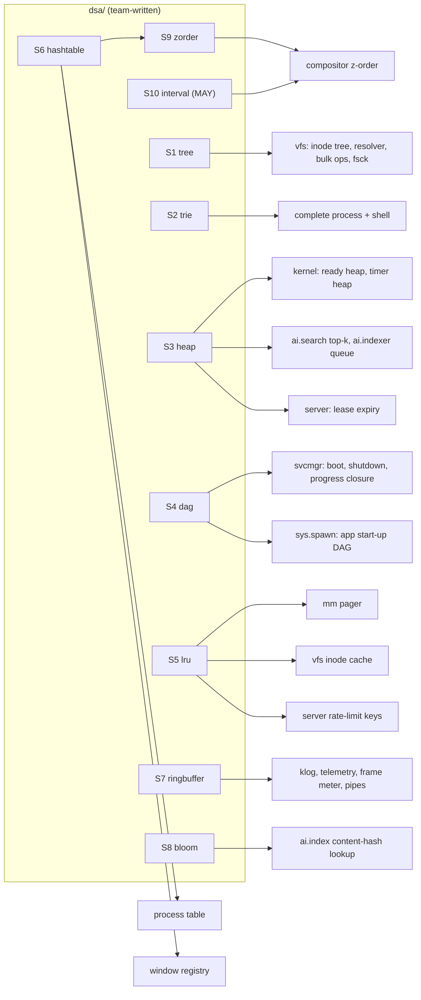
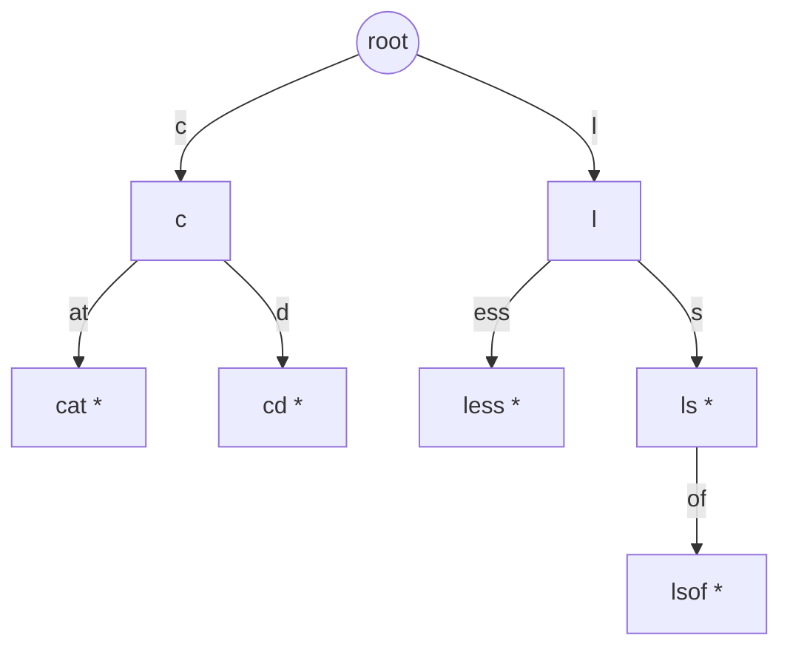

# Data structures and algorithms (`dsa/`)

| Field | Value |
|---|---|
| Title | Plotinium data structures: the hand-written `dsa/` package, its complexity proofs, tests, micro-benchmarks and `DSA.md` |
| Status | Draft v0.1, 2026-09-24 |
| Primary owner | R1 Kernel (editor of `DSA.md`; owner of S3 heap, S5 LRU, S6 hash table). Every structure also has its own owner (§3.3), who writes its code and its `DSA.md` entry |
| Secondary reviewer | R5 QA/DevOps (benchmark harness, `IMPLEMENTED` gating, coverage). Each structure additionally has a named non-owner reviewer (§3.3), as spec §4.2 and the role matrix require |
| Must be demonstrable at | **P1 defence (W4):** `DSA.md` draft mapping every structure to path, operations, complexity and proof (spec §13.1). **P2 gate (W7, v0.2.0):** S1 tree (VFS-01), S2 trie with `complete --bench` p95 ≤ 1 ms over ≥ 10,000 entries (SYS-03), S3 heap (basic scheduler), S4 DAG (boot DAG and app DAG), S6 hash table (window registry), S7 ring buffer (klog), S9 z-order list (WM-02). **P3 gate (W11, v0.3.0):** S3 heap as ready queue with aging (PROC-02), S6 as the process table (PROC-01), S5 LRU pager (MEM-02). **P4 gate (W14, v0.4.0):** S8 Bloom filter, optional S10 interval tree. **Final defence:** every benchmark re-run on the lab machine and reported in `DSA.md` |
| Requirement IDs covered | Spec §10.1 (every row), §10.2, §10.3, §15.2 (`DSA.md`), §15.3 (unit and property-based rows for DSA), §16.1 DSA rubric; PROC-01, PROC-02, MEM-02, VFS-01, VFS-08 (depth), SYS-03, WM-01, WM-02, BOOT-03, BOOT-04, DB-05 (pointer); contributes to PROC-04, RAG-05, MEM-08. Plotinium IDs DSA-GEN-01…09, DSA-TREE-01…03, DSA-TRIE-01…03, DSA-HEAP-01…02, DSA-DAG-01…03, DSA-LRU-01…02, DSA-HASH-01, DSA-RING-01, DSA-BLOOM-01, DSA-ZORD-01, DSA-IVT-01, DSA-DB-01, DSA-MAP-01 |
| Related specs | [../01-architecture/architecture.md](../01-architecture/architecture.md) · [../02-boot/boot-and-services.md](../02-boot/boot-and-services.md) · [../03-kernel/processes-and-scheduling.md](../03-kernel/processes-and-scheduling.md) · [../03-kernel/memory-and-paging.md](../03-kernel/memory-and-paging.md) · [../04-vfs/virtual-file-system.md](../04-vfs/virtual-file-system.md) · [../05-wm/window-manager.md](../05-wm/window-manager.md) · [../07-shell/shell-and-terminal.md](../07-shell/shell-and-terminal.md) · [../09-database/database.md](../09-database/database.md) · [../10-ai/rag-semantic-search.md](../10-ai/rag-semantic-search.md) · [../10-ai/predictive-prefetch.md](../10-ai/predictive-prefetch.md) · [../11-server/backend-api.md](../11-server/backend-api.md) · [../13-quality/testing-and-performance.md](../13-quality/testing-and-performance.md) · [../15-decisions/stack-decisions.md](../15-decisions/stack-decisions.md) · [../00-product/requirements-traceability.md](../00-product/requirements-traceability.md) · [../16-delivery/implementation-plan.md](../16-delivery/implementation-plan.md) |

**Conventions used in this file.** RFC 2119 keywords as in the spec's Conventions (p. 3). **Spec: MUST (§x, ID)** marks a capstone obligation; **Plotinium design** marks our own binding choice. Numbers from the AI-run prototype are marked *(pilot figure — re-measure on the lab machine)*; budget numbers without that label are targets, not measurements. The spec defines the `DSA` prefix (§10) but no numbered DSA requirements, so this file assigns Plotinium IDs of the form `DSA-<STRUCT>-nn`; tests that verify a numbered spec requirement (e.g. SYS-03) carry that ID instead.

**Structure numbering.** Each structure has one number, used in every section: **S1** n-ary tree · **S2** trie · **S3** binary heap · **S4** DAG + Kahn · **S5** LRU · **S6** hash table · **S7** ring buffer · **S8** Bloom filter · **S9** z-order list · **S10** interval tree (optional) · **S11** database B-tree and hash indexes (pointer) · **S12** built-in `Map`/`Set` registries.

---

## 1. Purpose and scope

The spec grades DSA at 20% of the project mark: "whether you used the right structure, implemented it correctly, and can prove its complexity" (§10). This file is the normative source for:

- the **first-principles rule** and the **`IMPLEMENTED`-flag convention** that keeps it verifiable (canonical decision C16);
- for every structure: purpose and mandatory location (§10.1), TypeScript interface compatible with the §10.3 sketches, complexity guarantees with proof sketches, memory layout, invariants, the exhaustive edge-case unit tests, property tests with fast-check, the micro-benchmark design, owner and users;
- the benchmark method and reporting format shared by every structure;
- the `DSA.md` entry template (§15.2).

Out of scope: the algorithms that *use* these structures (scheduling policy and aging in [processes-and-scheduling.md](../03-kernel/processes-and-scheduling.md); reclaim order in [memory-and-paging.md](../03-kernel/memory-and-paging.md); path resolution with `.`, `..`, symlinks and permissions in [virtual-file-system.md](../04-vfs/virtual-file-system.md); the completion service and its permission check in [shell-and-terminal.md](../07-shell/shell-and-terminal.md); the service manager in [boot-and-services.md](../02-boot/boot-and-services.md)). This file owns the structures and their guarantees; the linked specs own the policies.

---

## 2. Requirements table

| ID | Summary | Spec § | How verified |
|---|---|---|---|
| DSA-GEN-01 | Spec: MUST. The tree, trie, heap, DAG with topological sort and LRU list are written by the team from first principles; importing a package for these roles scores zero | §10.2 | Lint rule `dsa/no-external-imports`; non-owner review; owner explains the code in the viva; `AI_USAGE.md` |
| DSA-GEN-02 | Spec: MUST. Each structure lives in its own module under `dsa/` with unit tests for the edge cases (empty, one element, duplicates, removal of the root or head) | §10.2, §15.3 | The §8 edge-case test titles exist and pass |
| DSA-GEN-03 | Spec: MUST. Each structure has a micro-benchmark that demonstrates its claimed complexity (autocomplete flat from 10^3 to 10^5) | §10.2 | `bench/` shape assertions (§7.2) |
| DSA-GEN-04 | Spec: MUST. `DSA.md` maps every structure to file path, operations, complexity, and the proving test and benchmark | §10.2, §15.2 | Template §3.6; `tools/dsa-report.ts` fills measured tables |
| DSA-GEN-05 | Spec (§10.2): distinction credit. Built-in `Map`/`Set` are allowed as the hashing primitive; registries on top are documented; an own hash table with a declared collision strategy for at least one registry earns distinction credit | §10.2 | S6 (PidTable, window registry); S12 registry list |
| DSA-GEN-06 | Spec: SHOULD. Property-based tests: heap invariants hold after random pushes, pops and priority changes | §15.3 | S3 model-based fast-check test; similar tests for every structure |
| DSA-GEN-07 | Spec: MUST. Line coverage ≥ 85% on `dsa/` | §15.3 | CI coverage gate (implemented modules, §3.2) |
| DSA-GEN-08 | Plotinium design (C16). Each module ships interface, tests and benchmark with `export const IMPLEMENTED = false`; tests run with `describe.runIf(IMPLEMENTED)`; pilot code is never imported and is excluded from build, lint and coverage | – | `tools/dsa-status.ts`; lint; gate check at each tag |
| DSA-GEN-09 | Plotinium design. Every benchmark reports ns/op **and** bytes/entry at n = 10^3, 10^4, 10^5; no structure exceeds 32 MB at 10^5 entries (kernel record reversal trigger 6) | §10.2 | Nightly bench on the lab runner |
| DSA-TREE-01 | Spec (§10.1 tree row). Resolve O(d); add or remove a child O(1) average; walk a subtree O(k) | §10.1, §9.3 | S1 tests and bench |
| DSA-TREE-02 | Spec (§10.1 "why"). Moving a directory re-parents one node, whatever the size of its subtree; a move into its own subtree is rejected | §10.1 | S1 move bench (flat curve) and tests |
| DSA-TREE-03 | Plotinium design. No operation recurses; depth 10^4 works | – | S1 deep-tree tests |
| VFS-01 | Spec: MUST. The VFS is our own n-ary tree of inodes with hash-mapped directory entries and O(depth) path resolution | §9.3 | Code review; `DSA.md`; S1 tests |
| DSA-TRIE-01 | Spec (§10.1 trie row, §10.3). Insert and remove O(L); complete a prefix O(P + k) | §10.1, §10.3 | S2 tests and bench |
| DSA-TRIE-02 | Plotinium design (critic fix). Namespaces `cmd:`, `path:`, `flag:`, `hist:`; `path:` keys are per-directory so renaming or moving a directory is O(L) | §10.1 ("commands, paths and history"), SYS-03 ("commands, paths and flags") | S2 tests |
| DSA-TRIE-03 | Plotinium design. Struct-of-arrays radix trie; ≤ 32 MB at 10^5 entries per namespace | – | S2 memory bench |
| SYS-03 | Spec: MUST. Tab completion of commands, paths and flags backed by our own trie; p95 prefix lookup ≤ 1 ms over ≥ 10,000 entries; updated incrementally as the VFS changes | §9.6 | Micro-benchmark; live `complete --bench` |
| DSA-HEAP-01 | Spec (§10.1 heap row, §10.3). push/pop O(log n), peek O(1), changePriority O(log n) through an index map | §10.1, §10.3 | S3 tests and bench |
| DSA-HEAP-02 | Plotinium design. Bounded top-k (`replaceTop`) for RAG and a `remove` for cancelled timers and killed processes | – | S3 tests |
| PROC-02 | Spec: MUST. The ready queue is our own binary heap with O(log n) push and pop and O(log n) priority change through an index map | §9.1 | Unit tests; micro-benchmark |
| DSA-DAG-01 | Spec (§10.1 DAG row, §10.3). Kahn's topological sort O(V + E); levels for parallel start | §10.1, §6.4 | S4 tests and bench |
| DSA-DAG-02 | Spec (§10.1 "cycle detection with the cycle path reported"). Deterministic cycle path extraction | §10.1 | S4 tests |
| DSA-DAG-03 | Plotinium design. Completion-driven cursor, reversed graph (shutdown) and ancestor closure (progress, app start-up) | §6.4, §10.1 | S4 tests |
| BOOT-04 | Spec: MUST. A dependency cycle halts the boot with a panic that names the cycle | §6.5 | S4 cycle tests; boot e2e ([boot-and-services.md §8](../02-boot/boot-and-services.md)) |
| DSA-LRU-01 | Spec (§10.1 LRU row, §10.3). Touch, insert and evict O(1); pin and unpin | §10.1, §10.3 | S5 tests and bench |
| DSA-LRU-02 | Plotinium design (C16). Speculative insertion at the LRU end; demotion to the LRU end | – | S5 tests |
| MEM-02 | Spec: MUST. LRU eviction using our own hash map and doubly linked list, O(1) touch and evict; focused and pinned processes never evicted | §9.2 | Unit tests; code review |
| DSA-HASH-01 | Plotinium design (C16, distinction). Open addressing, linear probing, Fibonacci hashing, backward-shift deletion, load factor ≤ 0.5 | §10.2 | S6 differential test against `Map`; bench |
| PROC-01 | Spec: MUST. The process table is a hash map keyed by pid with O(1) average lookup, insert and delete | §9.1 | S6 tests |
| WM-01 | Spec: MUST (registry part). The window registry is a hash map with O(1) lookup | §9.4 | S6 tests; code review |
| DSA-RING-01 | Spec (§10.1 note): extra credit when justified. Ring buffer for the kernel log, telemetry, frame meter and pipes | §10.1 note | S7 tests and bench |
| DSA-BLOOM-01 | Spec (§10.1 note): extra credit when justified. Bloom filter in front of the index's content-hash lookup | §10.1 note | S8 tests and bench |
| DSA-ZORD-01 | Plotinium design. Z-order list with O(1) raise and 1..n renumbering | §9.4 | S9 tests and bench |
| WM-02 | Spec: MUST (structure part). Dynamic z-ordering with renumbering 1..n | §9.4 | S9 tests |
| DSA-IVT-01 | Spec (§10.1 note): extra credit when justified; Plotinium design MAY. Interval structure for window hit-testing; shipped only if its benchmark justifies it | §10.1 note | S10 bench crossover |
| DSA-DB-01 | Spec (§10.1 B-tree/hash row). Database metadata indexes: point lookup and range scan O(log n) | §10.1, §11.4 | [database.md](../09-database/database.md) EXPLAIN evidence; DB-05 |
| DSA-MAP-01 | Spec: MUST (§10.2 "must be documented"). Every registry built on `Map`/`Set` is listed in `DSA.md` with key, value, operations and owner | §10.2 | S12 table present in `DSA.md` |

---

## 3. Design (normative)

### 3.1 The first-principles rule (DSA-GEN-01)

**Spec: MUST (§10.2).** "The tree, trie, heap, DAG with topological sort, and LRU list must be written by your team from first principles. Importing a package that provides one of them (a heap or priority-queue library, a trie, a graph library, an LRU cache) for these roles scores zero for that item."

**Plotinium design.** We apply the rule to every structure in this file, including the extra-credit ones (S6–S10):

1. **Owner-written.** The structure's owner (§3.3) writes the implementation. Pairing is allowed and credited with `Co-authored-by:` trailers. A reviewer who is not the owner approves every PR under `dsa/` (CODEOWNERS).
2. **No external code.** `dsa/**/src` imports only relative modules and type-only imports from `@plotinium/protocol`. Local ESLint rule `dsa/no-external-imports` fails the build otherwise, with a lint fixture that must fail.
3. **Pilot code is evidence, not source.** The AI-written pilot structures under `docs/evidence/pilot/` (for example `kbench/`, `exam/soatrie.mjs`) are never imported, never copied, and are excluded from build, lint and coverage (C16). Their numbers are quoted only as labelled pilot figures.
4. **References allowed.** Owners may study textbooks and papers (CLRS; Knuth, TAOCP vol. 3; Sedgewick) and cite them in `DSA.md`. An AI assistant may explain a concept; the code is the owner's and the owner MUST be able to explain every line in the viva (spec §18).
5. **Disclosure.** The interfaces, tests and benchmarks shipped with `IMPLEMENTED = false` were drafted with AI assistance from this spec; `AI_USAGE.md` says so, and records what the owners changed and why.
6. **No temporary substitutes.** No library or pilot stand-in for S1–S5 may be merged to `main`, even temporarily (it would score zero if it shipped). A consumer that needs an unimplemented structure waits or pairs with its owner; its own tests are gated on the same flag (§3.2).

### 3.2 The `IMPLEMENTED` flag and test gating (DSA-GEN-08)

Every module starts in the repository in this state (canonical C16):

```ts
// dsa/heap/src/index.ts  (as scaffolded; the owner replaces the stub)
export const IMPLEMENTED = false;                 // flipped to true by the owner's PR
export interface IndexedMinHeap { /* §4.3 */ }
export class BinaryHeap implements IndexedMinHeap {
  constructor(_initialCapacity = 16) { throw new NotImplementedError('dsa/heap'); }
  /* … every method throws NotImplementedError … */
}
```

```ts
// dsa/heap/tests/heap.test.ts
import { describe, it, expect } from 'vitest';
import { IMPLEMENTED, BinaryHeap } from '../src/index.js';
describe.runIf(IMPLEMENTED)('dsa/heap', () => {
  it('DSA-HEAP-01 pop on an empty heap returns undefined', () => { expect(new BinaryHeap().pop()).toBeUndefined(); });
  /* … */
});
```

Rules:
- **Tests, property tests and benchmarks** all use `describe.runIf(IMPLEMENTED)`. Consumers that depend on an unimplemented structure import its flag (`import { IMPLEMENTED as HEAP_READY } from '@plotinium/dsa/heap'`) and gate their own tests the same way.
- **Coverage.** `tools/dsa-status.ts` reads each module's flag with a static parse (`export const IMPLEMENTED = true|false`), writes the Vitest coverage include and exclude lists (unimplemented modules are excluded from the 85% `dsa/**` gate), and prints a "pending structures" table in the CI job summary. The quality spec's "file count equals source count" check treats pending modules as accounted for.
- **Flipping the flag.** The owner's PR that sets `IMPLEMENTED = true` MUST: pass every gated test; commit a benchmark JSON run (§7.3); fill the structure's `DSA.md` entry (§3.6); be reviewed by the named non-owner reviewer. After the flip the flag is never set back.
- **Gate check.** The release workflow fails a gate tag if a structure due at that gate is still `false`:

| Structure | Implement by (target week) | Must be `true` at tag |
|---|---|---|
| S3 heap, S4 DAG | W3 (spike M2 and `svcmgr` v1 need them) | v0.2.0 (P2) |
| S1 tree, S2 trie, S7 ring buffer, S9 z-order | W5 | v0.2.0 (P2) |
| S6 hash table | W6 | v0.2.0 (P2) |
| S5 LRU | W10 | v0.3.0 (P3) |
| S8 Bloom filter | W10 | v0.4.0 (P4) |
| S10 interval tree (optional) | ≤ W13 | not gated |

Weeks follow the phase plan; [implementation-plan.md](../16-delivery/implementation-plan.md) is canonical if it differs.

### 3.3 Inventory, owners and users

**Spec (§4.1).** R1 owns the heap, PCB and page-table maps and the LRU list; R2 the n-ary tree, B-tree and hash indexes and the file-handle table; R3 the window registry, z-order structure and trie; R4 the vector index and telemetry model; R5 the DAG with topological sort and the ring buffer for logs. The coherence check added the Bloom filter to R4 and the optional interval structure to R3.

| # | Structure | Module | Owner | Non-owner reviewer | Mandatory location (§10.1) | Used by (paths) |
|---|---|---|---|---|---|---|
| S1 | n-ary tree | `dsa/tree` | R2 | R1 | VFS directory hierarchy (§9.3) | `vfs/tree`, `vfs/path.ts`, `vfs/ops` (mv, rm -r, cp -r walks), `vfs/fsck.ts` |
| S2 | Trie (struct-of-arrays radix, namespaced) | `dsa/trie` | R3 | R4 | Terminal autocomplete over commands, paths and history (§9.6) | `apps/shell` completion client, `complete` process (executor), `man -k` |
| S3 | Binary min-heap + index map | `dsa/heap` | R1 | R3 | Scheduler ready queue (§9.1); timer and sleep queue | `kernel/core/sched` (ready heap, timer heap), `ai/search` (top-k), `ai/indexer` (work queue), `server/locks` (lease expiry) |
| S4 | DAG + Kahn | `dsa/dag` | R5 | R2 | Service dependencies and boot order (§6.4); application start-up dependencies | `services/svcmgr`, `kernel/core/proc/spawn` (app closure), `bootlog --critical-path`, `svc.verify` |
| S5 | LRU (Map + typed-array doubly linked list) | `dsa/lru` | R1 | R5 | LRU pager (§9.2); inode cache | `kernel/core/mm` (pager), `vfs/tree` (inode cache), `server/ratelimit.ts` (key bound) |
| S6 | Hash table (open addressing) | `dsa/hashtable` | R1 | R3 | Process table; window registry (hash-maps row) | `kernel/core/proc` (PidTable), `wm/compositor` (window registry), S9 |
| S7 | Ring buffer | `dsa/ringbuffer` | R5 | R1 | extra: kernel log | `kernel/core/klog`, `ai/predictor` telemetry ring, `wm/frame-meter`, `kernel/core/ipc` pipes |
| S8 | Bloom filter | `dsa/bloom` | R4 | R2 | extra: in front of the vector index | `kernel` `ai.index.lookup` fast path ([rag-semantic-search.md §3.9](../10-ai/rag-semantic-search.md)) |
| S9 | Z-order list | `dsa/zorder` | R3 | R5 | Window z-order (R3's "z-order structure", §4.1) | `wm/compositor` |
| S10 | Interval tree (MAY) | `dsa/interval` | R3 | R1 | extra: window hit-testing | `wm/compositor` snap-target and drop-target queries |
| S11 | B-tree / hash indexes | PostgreSQL (not in `dsa/`) | R2 | R5 | Database metadata (§11.4) | `db/migrations`, `server/vfs` ([database.md](../09-database/database.md)) |
| S12 | `Map`/`Set` registries | in their subsystems | each subsystem owner | – | Hash-maps row: open-file table, memory-mapped handles, page tables, directory entries | see §3.5 S12 |



### 3.4 Common conventions (all modules)

- **Layout.** `dsa/<name>/src/index.ts` (public API, `IMPLEMENTED`), `src/*.ts`, `tests/<name>.test.ts` (edge cases), `tests/<name>.prop.test.ts` (fast-check), `bench/<name>.bench.ts` (time), `bench/<name>.mem.ts` (bytes/entry). Shared team-written helpers live in `dsa/_shared/`: `errors.ts`, `prng.ts` (mulberry32), `sampler.ts` (percentiles), `mem.ts` (bytes/entry), `grow.ts` (typed-array doubling).
- **Pure and isomorphic.** `src/` uses no DOM and no Node API, so the kernel worker, the main thread (S7 frame meter, S9, S10) and the Node server (S3, S5, S6) share one implementation. Only `bench/*.mem.ts` uses Node (`--expose-gc`).
- **Integer handles on hot paths.** Structures used per syscall or per frame (S3, S5 slots, S6, S9) store dense non-negative int32 handles (pid, wid, timer id, page slot) in typed arrays, not objects. Generic `<T>` facades exist where the §10.3 sketches use generic items (§4.3).
- **Struct-of-arrays for large structures** (kernel record amendment "DSA layout rule"): S2, S3, S5 and S6 keep their per-entry fields in parallel typed arrays, grown by doubling (amortised O(1) per insertion). Arrays never shrink implicitly, except S6's hysteresis shrink; `trim()`/`compact()` are explicit.
- **No recursion** whose depth depends on input. Walks use explicit stacks, so a depth-10^4 tree or a 4,096-character key cannot overflow the call stack.
- **Deterministic order.** Every iteration order is specified (S2 lexicographic by UTF-16 code unit; S4 ties by insertion index or name), so tests and benchmarks are reproducible.
- **Errors.** Queries return `undefined`/`false` for "absent". Contract violations throw `DsaError` with a `code` (§4.0). The kernel maps codes to errnos at its boundary (§6.0); a `DsaError` never crosses the syscall boundary raw.
- **Invariant checkers.** Every structure exports `checkInvariants(): void`, which throws with a precise message. Property tests call it after every operation; `__DEV__` builds call it at sampled points; release hot paths never call it.
- **Accounting.** Every structure exposes `stats(): DsaStats` (`size`, `capacity`, `bytesAllocated`, `bytesUsed`). `free` and the Task Manager's `kernel` line use it for the kernel baseline ([memory-and-paging.md](../03-kernel/memory-and-paging.md)).

### 3.5 Per-structure design

#### S1 n-ary tree (`dsa/tree`)

- **Purpose.** Holds the loaded part of the VFS hierarchy (spec §9.3: "an n-ary tree of inodes. Each directory stores its entries in a hash map from name to inode").
- **Shape.** Directory nodes carry `parent`, `name` and `children: Map<string, TreeNode>` (built-in `Map` as the hashing primitive, allowed by §10.2). File and symlink nodes are leaves without a parent pointer, because a file with hard links (VFS MAY) is referenced from several directories; directories are never hard-linked (UNIX rule), so the directory skeleton is a proper rooted tree.
- **Lazy loading.** `children === null` means "not loaded". The VFS loads a directory from IndexedDB and calls `setLoaded`, so a 100k-inode tree costs memory only for visited directories (the pilot measured lazy mount p95 ≤ 15 ms against 118–242 ms for a full 10k scan *(pilot figure — re-measure on the lab machine)*).
- **No path-derived fields.** No node stores its absolute path or depth. That is what makes a move O(1): descendants refer to their parent object, not to a path.
- **Why this structure.** It mirrors the hierarchy directly, and moving a directory re-parents one node (§10.1). Rejected: a materialised-path map (move = O(subtree)), nested sets (move = O(n)), a closure table (move = O(subtree × depth); that is a database technique, see S11).
- **Memory layout.** One object per loaded node `{id, payload, parent?, name?, children?}` plus one `Map` entry per directory entry. bytes/node is measured by `tree.mem.ts` (§7.1).

#### S2 Trie (`dsa/trie`): struct-of-arrays radix trie with namespaces

- **Purpose.** Backs tab completion of commands, paths, flags and history (SYS-03; §10.1 row "commands, paths and history"). It runs inside the `complete` process (executor, priority 36; [boot-and-services.md §3.3](../02-boot/boot-and-services.md)). The trie is updated incrementally from VFS events (`vfs.create`, `unlink`, `rename`, `mkdir`, `rmdir`), with one O(L) insert or remove per event.
- **Namespaces** (critic fix). Four trie instances, each keyed as follows:

| Namespace | Key | Filled from | Removed when |
|---|---|---|---|
| `cmd` | command name | executables in `$PATH` directories and shell builtins | the executable is unlinked |
| `path` | `<dirIno>/<basename>` (dirIno is the 36-char UUIDv7 of the containing directory) | `readdir` of cwd, `$HOME`, `$PATH` directories and every directory the user visits; VFS events for indexed directories | unlink or rename events; directory eviction from the completion cache |
| `flag` | `<cmd>\u0000<flag>` | front matter of `bin/man/*.md` (seeded read-only man pages) | never (static per build) |
| `hist` | `<uid>\u0000<command line>` | every command line executed | `history -c` → `removePrefix('<uid>\u0000')` |

- **Why per-directory `path` keys.** Renaming or moving a directory changes one dentry: one remove plus one insert, O(L). The keys of its descendants embed the directory's inode id, not its path, so they do not change. Full-path keys would cost O(subtree × L) per `mv`, against "updated incrementally" (kernel record amendment).
- **Radix, not one character per edge** (critic request). The glossary defines a trie as "a tree in which each edge is a character". A radix (compressed, PATRICIA-style) trie is the same tree with every chain of single-child, non-terminal nodes contracted into one edge labelled by a string; the path from the root still spells the key, so it is a trie in the §10.1 sense.
  1. **Node count** drops from up to Σ|key| to at most 2n (every non-root node is terminal or has ≥ 2 children, §5 S2). The pilot's one-character, `Map`-per-node trie needed 2.30 M nodes, 225 bytes per node and 492.7 MB at 10^5 path entries (55.6 MB at 10^4) *(pilot figure — re-measure on the lab machine)*: about twice the 256 MB memory budget (MEM-01).
  2. **Same asymptotics.** Every operation still compares the key character by character along edge labels: insert and remove O(L), locating a prefix O(P).
  3. **Smaller completion walks.** Fewer nodes between the prefix locus and the results, which is what bounds `complete`.
  4. **Cost.** Edge splitting on insert and merging on remove, which is more code; that is why S2 has the heaviest property tests.
- **Example.** The `cmd` keys `cat`, `cd`, `less`, `ls`, `lsof` need 8 nodes in the radix trie (root included) against 12 with one character per edge. `*` marks a terminal node; children are drawn in sibling (lexicographic) order.



  In the left-child/right-sibling arrays: `child[root] = c`, `next[c] = l`; `child[c] = at`, `next[at] = d`; `child[l] = ess`, `next[ess] = s`; `child[s] = of`. `complete("l", 20)` visits `l, ess, s, of` and returns `less, ls, lsof`.
- **Why struct-of-arrays.** Replacing objects and `Map`s with parallel typed arrays removes per-node object overhead and GC pressure. The pilot's struct-of-arrays trie (one character per edge, left-child/right-sibling) held the same 10^5 entries in 24 MB used (44 MB allocated) with completion p95 34 µs *(pilot figure — re-measure on the lab machine)*. Radix compression reduces it further.
- **Memory layout** (per namespace instance; node 0 is the root with an empty label):

| Array | Type | Meaning |
|---|---|---|
| `lblStart` | `Int32Array` | start offset of the node's edge label in `pool` |
| `lblLen` | `Uint16Array` | label length in UTF-16 code units (keys are ≤ 4,096 + prefix; longer labels are split) |
| `first` | `Uint16Array` | first code unit of the label (sibling scan without touching `pool`) |
| `child` | `Int32Array` | first child, −1 if none |
| `next` | `Int32Array` | next sibling, −1 if none; also the free-list link |
| `term` | `Uint8Array` | 1 if a key ends at this node |
| `meta` | `Int32Array` | index into `metas: Completion[]`, −1 if none |
| `pool` | `Uint16Array` | shared label storage; `poolLen` used, `poolGarbage` dead code units |

  This is 21 bytes per node plus 2 bytes per label code unit. Children use the left-child/right-sibling representation, with siblings kept **sorted by `first`**; in a radix trie siblings have distinct first code units, so this order is the lexicographic order and `complete` returns results sorted without a sort step. Estimate for 10^5 basenames of about 12 characters: ≤ 2·10^5 nodes ≈ 4.2 MB plus ≤ 2.4 MB of labels. The budget is ≤ 32 MB at 10^5 per namespace (DSA-GEN-09); the measured value is reported.
- **Alternative kept in reserve.** If sibling lists grow long (σ, the number of distinct first code units under one node, is bounded by the alphabet; about 60–100 for Latin file names, more for CJK names), child lookup can move to an S6 table keyed by `(node, codeUnit)`, O(1) expected, at about 24 bytes per edge. That is the reversal if the S2 benchmark on a CJK-heavy corpus misses its budget.

#### S3 Binary min-heap with index map (`dsa/heap`)

- **Purpose.** The scheduler ready queue (PROC-02) keyed by `effPrio · 2^32 + seq`, where `seq` gives FIFO order among equal priorities and therefore round-robin (spec §9.1). Also: the kernel timer heap (sleep, service timeouts, lease heartbeats), the `ai.search` bounded top-k, the `ai.indexer` work queue ([rag-semantic-search.md](../10-ai/rag-semantic-search.md)) and the server's lease-expiry heap.
- **Why.** "The scheduler repeatedly needs the most urgent process, while priorities change as processes age" (§10.1). A sorted array costs O(n) per insert; the rubric's "Developing" column names it. A balanced BST gives the same bounds with much larger constants and more code.
- **Memory layout.** `keys: Float64Array` (heap order), `hnd: Int32Array` (handle at each heap position), `pos: Int32Array` (handle → position, −1 when absent) sized to the handle space and grown by doubling. That is 16 bytes per entry (8 + 4 + 4) for dense handles.
- **Key exactness.** Keys are compared as doubles. The scheduler key is at most 39·2^32 + (2^32 − 1) = 40·2^32 − 1 ≈ 1.72·10^11 < 2^53, so it is represented exactly and distinct `(effPrio, seq)` pairs never collide. This requires `seq < 2^32`; how the scheduler renumbers before wrap-around is a cross-spec request (§9.3).
- **Ties.** The heap orders by key only; callers encode tie-breaks into the key (scheduler) or resolve them after popping (the timer module pops every due entry and runs them in service-priority order).

#### S4 DAG + Kahn (`dsa/dag`)

- **Purpose.** Boot order and shutdown order of the 18 services (§6.4, BOOT-03, BOOT-04), the ancestor closure used by truthful progress, and the application start-up closure resolved by `sys.spawn` from `/bin/<app>.json` (§10.1 row "application start-up dependencies"; [boot-and-services.md §3.12](../02-boot/boot-and-services.md)).
- **Why.** "Start-up order is a partial order. Only a DAG expresses it, and a cycle means the system cannot boot" (§10.1). Kahn's algorithm gives the order, the levels for parallel start and the cycle test in one O(V + E) pass.
- **Memory layout.** Nodes are indexed 0..V−1 in input order: `names: string[]` and `index: Map<string, number>`. Edges are stored twice in compressed sparse row (CSR) form: `outStart: Int32Array(V+1)` and `outTo: Int32Array(E)` for dependents, `inStart`/`inFrom` for requirements. Per node: `indeg: Int32Array(V)` and `level: Int32Array(V)`. Edges point from a dependency to its dependent ("A → B: B requires A", spec Figure 6.3).

#### S5 LRU (`dsa/lru`)

- **Purpose.** The global page LRU of the memory manager (MEM-02, spec Figure 9.2), the VFS inode cache, and the server's bound on rate-limit keys (C9).
- **Why.** "Neither structure alone gives O(1) recency updates and O(1) lookup" (§10.1): the hash map finds the list node, and the list keeps recency order.
- **Memory layout.** `index: Map<K, number>` (key → slot; `Map` is the allowed hashing primitive); slot arrays `keys: K[]`, `vals: V[]`, `prev: Int32Array`, `next: Int32Array`, `pins: Uint16Array` (pin count), `flags: Uint8Array` (bit 0 = speculative); `head` (MRU) and `tail` (LRU) slot indices; a free-slot stack threaded through `next`.
- **Pinned entries are unlinked** from the recency list while pinned, so the tail is always the least recently used *unpinned* entry and `evict` is O(1) worst case, not O(pinned). `unpin` to count 0 relinks the entry at the MRU end (it was just in use).
- **Speculative entries** (pre-fetched pages, C12) are inserted at the LRU end with `putAtLru`, so they are evicted first. A hit on a speculative entry promotes it (flag cleared, moved to MRU).
- **Demotion.** `moveToLru` supports "minimised windows are the first candidates for paging" (spec §9.4). The victim order across speculative, minimised and other pages is the pager's policy ([memory-and-paging.md](../03-kernel/memory-and-paging.md)); S5 provides the O(1) primitives.
- **Bounded mode.** With `capacity` set (inode cache, rate-limit keys), `put` on a full cache evicts and returns the LRU unpinned entry. The pager uses unbounded mode and evicts explicitly, because it must write a page to swap before dropping it.

#### S6 Hash table (`dsa/hashtable`)

- **Purpose.** The process table `pid → PCB` (PROC-01) and the window registry `wid → WinRec` (WM-01). One generic `IntHashTable<V>` backs both (coherence simplification: the distinction credit is earned once, with two real users).
- **Collision strategy (declared, §10.2).** Open addressing with **linear probing**; load factor kept **≤ 0.5** (grow by doubling before an insert would exceed it); **backward-shift deletion**, so there are no tombstones and probe sequences never lengthen with churn.
- **Hash function.** Fibonacci (multiplicative) hashing: `h(k) = Math.imul(k, 0x9E3779B1) >>> (32 − log2(cap))`. The constant is 2,654,435,761 ≈ 2^32/φ, and odd. PIDs and window ids are allocated sequentially but wrap and skip live ids; multiplication by 2^32/φ scatters consecutive and strided keys over the table (Knuth, TAOCP vol. 3 §6.4), so patterned key sets do not form long clusters, at the same cost as identity hashing.
- **Memory layout.** `keys: Int32Array(cap)` (−1 = empty), `vals: (V | undefined)[]`, `size`, `cap` (power of two, ≥ 8), `mask`, `shift`. At load 0.25–0.5 that is 24–48 bytes per entry excluding the value objects.
- **Keys.** Integers 0..2^31−1. The minimum capacity of 8 keeps `shift` ≤ 29; a shift of 32 would be taken mod 32 by JavaScript and would break the hash.

#### S7 Ring buffer (`dsa/ringbuffer`)

- **Purpose** (extra credit, §10.1 note). Klog: 8,192 entries, overwrite mode. Telemetry: 4,096 events, overwrite mode; the kernel mirrors each slot into the IndexedDB `telemetry` store keyed by physical slot with the head in `meta`, so the persisted ring is the same structure ([predictive-prefetch.md](../10-ai/predictive-prefetch.md)). Frame meter: `Float64Ring` of 1,024 frame durations. Pipes: `ByteRing` of 64 KiB per pipe, reject mode, where a full pipe blocks the writer in the kernel.
- **Why.** Fixed memory, O(1) append, oldest-first overwrite: exactly a log's retention policy. An array with `shift()` is O(n) per removal.
- **Memory layout.** Capacity is a power of two; `buf` is `T[]`, `Float64Array` or `Uint8Array`; `head` is the index of the oldest element (kept masked, so it never overflows); `count`; `dropped` counts overwrites. Physical slot of logical index i = `(head + i) & mask`.

#### S8 Bloom filter (`dsa/bloom`)

- **Purpose** (extra credit, "a Bloom filter in front of the vector index", §10.1 note). It covers the SHA-256 `contentHash` of every live chunk for the current model key, and lets the indexer skip the `byHash` IndexedDB lookup for hashes that are certainly new. It never participates in permission decisions (parameters fixed in [rag-semantic-search.md §3.9](../10-ai/rag-semantic-search.md)).
- **Parameters.** `m = 10 · n_design` bits rounded up to a multiple of 32; `k = 7`; `n_design` starts at 16,384 and doubles on rebuild. Positions by double hashing: `h1 = u32le(bytes[0..4])`, `h2 = u32le(bytes[4..8]) | 1`, `g_i = (h1 + i·h2) mod m` for i = 0..6.
- **Memory layout.** `bits: Uint32Array(m/32)`: 1.25 bytes per key at design load.
- **No deletions.** Stale bits after deletes only cause an extra `byHash` lookup; the filter is rebuilt at compaction and at start.

#### S9 Z-order list (`dsa/zorder`)

- **Purpose.** The compositor's stacking order (WM-02: "Focusing a window raises it. Z-indices are renumbered 1…n after each change, so they never grow without limit").
- **Design.** A doubly linked list of window ids from bottom to top over slot arrays (`prev`, `next`, `z: Int32Array`), plus an S6 `IntHashTable` from wid to slot.
  - `raise` relinks in O(1), then renumbers only the windows between the old position and the top (they are the only ones whose number changes), and returns those changes so the compositor writes `style.zIndex` only for them.
  - The compositor maps list position z to CSS `z-index = windowLayerBase + z`; system layers (taskbar, secure prompt `--pl-z-secure`, boot `--pl-z-boot`) sit above the window layer ([ui-design-system.md](../05-wm/ui-design-system.md)).
- **Why.** Stacking changes are move-to-front operations: an array needs an O(n) splice per raise, a list relinks in O(1). Renumbering is mandated by the spec, and it bounds the numbers by n (CSS `z-index` is a 32-bit integer; naive increment-on-raise would grow without limit).

#### S10 Interval tree (`dsa/interval`, MAY)

- **Purpose** (extra credit, "an interval structure for window hit-testing", §10.1 note). Window hit-testing that DOM events do not answer: during a drag, the compositor needs the windows whose vertical span overlaps the dragged window's edge band (magnetic snap to other windows' edges), and the Files drop target under the pointer. Both queries run per `pointermove`.
- **Design.** A static centred interval tree (or an augmented sorted array with max-endpoint), rebuilt at drag start from the current window rectangles: O(n log n) build, O(log n + m) stabbing and overlap queries. Intervals are half-open `[lo, hi)`.
- **Justification rule.** S10 ships, and is claimed in `DSA.md`, only if its benchmark shows a query faster than the linear scan at the window counts we support (up to 256) or at 64+ windows under 60 Hz queries. Otherwise the compositor keeps the linear scan and `DSA.md` says why. An unjustified structure earns nothing (§10.1 "when their use is justified").

#### S11 Database B-tree and hash indexes (pointer)

These are PostgreSQL's built-in B-tree and hash indexes (§10.1 row "B-tree / hash indexes: database metadata, point lookup and range scan O(log n)"). They are not in §10.2's list of structures the team must write. [database.md](../09-database/database.md) owns the index list and the before/after evidence (DB-05, Q1–Q5). The list includes: the `dentries` primary key `(parent_ino, name) INCLUDE (ino, d_type)` (point lookup and ordered `readdir` range scan), `inodes(uid, modified_at DESC)` for Q4, a hash index on `blobs(sha256)` next to the UNIQUE B-tree constraint, a C-collated or pattern-ops B-tree on the lower-cased name for prefix search, and a hash index on `file_chunks(content_hash)`. The `DSA.md` entry for S11 cites the B-tree height bound, O(log_B n) page reads, and links the EXPLAIN (ANALYZE, BUFFERS) plans.

#### S12 Registries on built-in `Map`/`Set` (DSA-MAP-01)

**Spec (§10.2).** Built-in hash tables are allowed as the hashing primitive; "the registries and tables you build on top of them are your own and must be documented". `DSA.md` lists each one:

| Registry | Key → value | Operations (all O(1) average) | Owner | Spec |
|---|---|---|---|---|
| Directory entries | name → `TreeNode` (inside S1) | lookup, add, remove | R2 | VFS-01 |
| Open-file table | open-file id → `{ino, flags, offset, refcount, versionAtOpen, fence?}` | open, dup (refcount), close | R2 | §10.1 hash-maps row |
| Per-process fd table | fd → open-file id | get, set, delete | R1 | §9.1 `fdTable` |
| Page table | pageId → PTE `{loc, dirty, lastAccess, size, sha256, speculative, pinned, lruSlot}` | get, set, delete | R1 | §9.2, MEM-02 |
| Memory-mapped handles (MEM-08, MAY) | handle → `{ino, pages}` | get, set, delete | R1 | MEM-08 |
| Resident table per executor | pid → executor-local process record | get, set, delete | R1 | §9.1 |
| Server rate-limit buckets | key → token bucket (bounded by S5) | get, set, evict | R4 | C9 |
| Server connections and leases | osSessionId → socket; lockKey → lease | get, set, delete | R2 / R5 | VFS-09 |

### 3.6 `DSA.md` entry template (DSA-GEN-04)

`DSA.md` (repository root, editor R1) has one entry per structure, written by its owner. Tables marked "generated" are filled by `tools/dsa-report.ts` between `<!-- dsa-report:<structure>:start -->` and `<!-- dsa-report:<structure>:end -->` markers from the committed benchmark JSON (§7.3).

```markdown
## S<n> <Structure name>

| Field | Value |
|---|---|
| Module | `dsa/<name>/src/index.ts` (+ files) |
| Owner / non-owner reviewer | R<x> / R<y> |
| Mandatory location (§10.1) | <row text> |
| Used by | <file paths, one per line> |
| Written by | <owner name>; first-principles statement; implementing PRs #…; co-authors |
| AI assistance | <what was asked, what was accepted or rejected; link to AI_USAGE.md entry> |

### Operations and complexity
| Operation | Complexity | Proof sketch (one line) | Proving test | Proving benchmark |
|---|---|---|---|---|

### Why this structure
<the problem, the alternatives rejected with their costs, the rubric risk avoided>

### Memory layout
<arrays or objects, bytes per entry: estimated and measured (generated)>

### Invariants
<numbered list; name of the checkInvariants() assertion for each>

### Tests
<file paths; count of edge-case tests; list of edge cases; property tests with fast-check seed policy>

### Benchmark (generated)
| op | n | p50 ns | p95 ns | mean ns | bytes/entry (measured / allocated) | shape ratio (limit) |
|---|---|---|---|---|---|---|
<chart: docs/evidence/dsa/<name>/chart.svg>

### Known limits and reversal
<what would make us change it; link to the reversal trigger>
```

Fixed skeleton rows per structure (the owner fills the rest):

| # | Module | Operations and complexity (row content) | Proving tests | Proving benchmark |
|---|---|---|---|---|
| S1 | `dsa/tree` | lookup O(1) avg; resolve O(d); attach and detach O(1) avg; move O(1) + O(depth) ancestor check; walk O(k) | `tree.test.ts`, `tree.prop.test.ts` | `tree.bench.ts` (resolve vs n, move vs subtree size), `tree.mem.ts` |
| S2 | `dsa/trie` | insert O(L); remove O(L); has O(L); complete O(P + k); removePrefix O(P + m) | `trie.test.ts`, `trie.prop.test.ts` | `trie.bench.ts` (complete p95 vs n per namespace, linear-scan baseline), `trie.mem.ts` |
| S3 | `dsa/heap` | push, pop, changePriority, remove, replaceTop O(log n); peek O(1) | `heap.test.ts`, `heap.prop.test.ts` | `heap.bench.ts` (vs sorted-array baseline) |
| S4 | `dsa/dag` | build + Kahn + levels O(V + E); cycle path O(V + E); cursor complete O(outdeg); ancestors O(V + E) | `dag.test.ts`, `dag.prop.test.ts` | `dag.bench.ts` (ns per V+E; app closure) |
| S5 | `dsa/lru` | get, put, putAtLru, touch, moveToLru, evict, delete, pin, unpin O(1) | `lru.test.ts`, `lru.prop.test.ts` | `lru.bench.ts` (vs array-LRU baseline), `lru.mem.ts` |
| S6 | `dsa/hashtable` | get, set, delete O(1) expected (α ≤ 0.5); set amortised | `hashtable.test.ts`, `hashtable.prop.test.ts` | `hashtable.bench.ts` (vs `Map`), `hashtable.mem.ts` |
| S7 | `dsa/ringbuffer` | push, shift, at, peek O(1); toArray O(n) | `ring.test.ts`, `ring.prop.test.ts` | `ring.bench.ts` |
| S8 | `dsa/bloom` | add, mayContain O(k) = O(1); rebuild O(m/32) | `bloom.test.ts`, `bloom.prop.test.ts` | `bloom.bench.ts` (+ empirical false-positive rate) |
| S9 | `dsa/zorder` | insertTop, zOf O(1); raise, lower, remove O(1) relink + O(n) renumber | `zorder.test.ts`, `zorder.prop.test.ts` | `zorder.bench.ts` |
| S10 | `dsa/interval` | build O(n log n); stab, overlap O(log n + m) | `interval.test.ts`, `interval.prop.test.ts` | `interval.bench.ts` (crossover vs linear scan) |
| S11 | PostgreSQL | point lookup and range scan O(log n) | DB-05 benchmark | Q1–Q5 before/after ([database.md](../09-database/database.md)) |
| S12 | built-in `Map`/`Set` | O(1) average | owning subsystems' tests | – |

---

## 4. Interfaces and data shapes

Signatures are normative. Names and details are ours; §10.3 says "your implementation must offer equivalent operations at the stated complexity", and each interface below states its correspondence. Lines of the form `export class X implements I { … }` are declaration sketches: each class implements every member of its interface, and only constructor signatures are shown.

### 4.0 Shared types (`dsa/_shared`)

```ts
export type DsaErrorCode =
  | 'DUPLICATE' | 'NOT_FOUND' | 'NOT_DIR' | 'NOT_LOADED'
  | 'INVALID' | 'RANGE' | 'CYCLE' | 'FULL' | 'NOT_IMPLEMENTED';
export class DsaError extends Error {
  constructor(readonly code: DsaErrorCode, message: string) { super(message); }
}
export class NotImplementedError extends DsaError {
  constructor(module: string) { super('NOT_IMPLEMENTED', `${module}: IMPLEMENTED is false`); }
}
export interface DsaStats { size: number; capacity: number; bytesAllocated: number; bytesUsed: number }
export function mulberry32(seed: number): () => number;      // team-written PRNG for tests and benches
```

### 4.1 S1 tree

```ts
export const IMPLEMENTED: boolean;
export interface TreeNode<P> { readonly id: string; payload: P }            // id = inode UUIDv7
export interface DirNode<P> extends TreeNode<P> {
  parent: DirNode<P> | null;                                               // null only for the root
  name: string;                                                            // '' for the root
  children: Map<string, TreeNode<P>> | null;                               // null = not loaded
}
export type ResolveResult<P> =
  | { ok: true; node: TreeNode<P>; parent: DirNode<P> | null; depth: number }
  | { ok: false; code: 'NOT_FOUND' | 'NOT_DIR' | 'NOT_LOADED'; at: number; dir: DirNode<P> }; // at = component index

export interface NaryTree<P> {
  readonly root: DirNode<P>;
  readonly size: number;                                                   // loaded nodes
  isDir(n: TreeNode<P>): n is DirNode<P>;
  lookup(dir: DirNode<P>, name: string): TreeNode<P> | undefined;         // O(1) avg; NOT_LOADED if children null
  attach(dir: DirNode<P>, name: string, node: TreeNode<P>): void;         // O(1) avg; DUPLICATE; sets parent/name on dirs
  detach(dir: DirNode<P>, name: string): TreeNode<P> | undefined;         // O(1) avg
  move(src: DirNode<P>, name: string, dst: DirNode<P>, newName: string): void; // O(1) + O(depth(dst)); INVALID on cycle
  isAncestor(a: DirNode<P>, b: DirNode<P>): boolean;                       // O(depth(b)); true if a === b
  depthOf(n: DirNode<P>): number;                                          // O(depth)
  pathOf(n: DirNode<P>): string;                                           // O(depth + |path|); '/' for root
  resolve(start: DirNode<P>, components: readonly string[]): ResolveResult<P>; // O(d); plain names only
  walk(from: DirNode<P>, order?: 'pre' | 'post'):
    Generator<{ node: TreeNode<P>; dir: DirNode<P> | null; name: string; depth: number }>; // O(k), iterative
  setLoaded(dir: DirNode<P>, entries: Iterable<[string, TreeNode<P>]>): void; // O(k)
  unload(dir: DirNode<P>): void;                                           // O(1); children := null
  stats(): DsaStats;
  checkInvariants(): void;
}
export function createTree<P>(rootId: string, rootPayload: P): NaryTree<P>;
```

`resolve` handles plain names only. `vfs/path.ts` composes `lookup` with `.`, `..` (via `parent`), symlink following (ELOOP after 40 hops), empty components, and the `x` permission check per component ([virtual-file-system.md](../04-vfs/virtual-file-system.md)).

### 4.2 S2 trie

```ts
export const IMPLEMENTED: boolean;
export interface Completion {                       // §10.3 "Completion"
  text: string;                                     // always the key (namespaced wrappers strip the prefix)
  kind?: 'cmd' | 'builtin' | 'file' | 'dir' | 'link' | 'flag' | 'hist';
  detail?: string;                                  // e.g. flag description from the man page
}
export interface Trie {                             // §10.3 Trie: insert, remove, complete
  insert(word: string, meta?: Completion): void;    // O(L); re-insert replaces meta
  remove(word: string): boolean;                    // O(L); prunes and merges
  has(word: string): boolean;                       // O(L)
  complete(prefix: string, limit: number): Completion[];  // O(P + k); lexicographic by UTF-16 code unit
  removePrefix(prefix: string): number;             // O(P + m); returns keys removed
  compact(): void;                                  // O(live label units); also automatic (§5 S2)
  readonly size: number;                            // number of keys
  stats(): DsaStats & { nodes: number; poolUnits: number; poolGarbage: number };
  checkInvariants(): void;
}
export class RadixTrie implements Trie { constructor(initialNodes?: number, initialPoolUnits?: number); /* … */ }

export type Namespace = 'cmd' | 'path' | 'flag' | 'hist';
export interface NamespacedTrie {
  readonly cmd: Trie; readonly path: Trie; readonly flag: Trie; readonly hist: Trie;
  addPath(dirIno: string, basename: string, kind: 'file' | 'dir' | 'link'): void;   // key `${dirIno}/${basename}`
  removePath(dirIno: string, basename: string): boolean;
  completePath(dirIno: string, prefix: string, limit: number): Completion[];       // returns basenames
  addFlag(cmd: string, flag: string, detail?: string): void;                        // key `${cmd}\u0000${flag}`
  completeFlag(cmd: string, prefix: string, limit: number): Completion[];
  addHistory(uid: number, line: string): void;                                      // key `${uid}\u0000${line}`
  completeHistory(uid: number, prefix: string, limit: number): Completion[];
  clearHistory(uid: number): number;                                                // removePrefix(`${uid}\u0000`)
}
```

### 4.3 S3 heap

```ts
export const IMPLEMENTED: boolean;
export interface IndexedMinHeap {                   // handles are dense ints ≥ 0 (pid, timer id, slot)
  push(handle: number, key: number): void;          // O(log n); DUPLICATE if present; RANGE if key not finite or handle < 0
  pop(): number | undefined;                        // O(log n); handle with the minimum key
  peek(): number | undefined;                       // O(1)
  peekKey(): number | undefined;                    // O(1)
  changePriority(handle: number, key: number): boolean;  // O(log n); false if absent
  remove(handle: number): boolean;                  // O(log n); false if absent
  replaceTop(handle: number, key: number): number | undefined; // pop + push in one sift; on empty = push
  has(handle: number): boolean;                     // O(1)
  keyOf(handle: number): number | undefined;        // O(1)
  readonly size: number;
  clear(): void;
  stats(): DsaStats;
  checkInvariants(): void;
}
export class BinaryHeap implements IndexedMinHeap { constructor(initialCapacity?: number); /* … */ }

/** §10.3 PriorityQueue<T> facade: generic items mapped to handles with a Map and a free-handle stack. */
export interface PriorityQueue<T> {
  push(item: T, priority: number): void;            // O(log n)
  pop(): T | undefined;                             // O(log n), most urgent (smallest) first
  peek(): T | undefined;                            // O(1)
  changePriority(item: T, priority: number): void;  // O(log n) via item → handle → index map
}
export class HeapPriorityQueue<T> implements PriorityQueue<T> { /* … */ }

/** Keeps the k largest scores with a min-heap of size k (RAG top-K'). */
export interface BoundedTopK {
  readonly k: number; readonly size: number;
  offer(handle: number, score: number): boolean;    // O(log k); true if kept
  minScore(): number | undefined;                   // O(1): the admission threshold once full
  drainDescending(): Array<{ handle: number; score: number }>;   // O(k log k); empties the structure
}
```

### 4.4 S4 DAG

```ts
export const IMPLEMENTED: boolean;
export interface DagNode { readonly name: string; readonly requires: readonly string[] }
export class CycleError extends DsaError { constructor(readonly path: string[]) { super('CYCLE', path.join(' → ')); } } // closed: first === last
export class UnknownNodeError extends DsaError { constructor(readonly node: string, readonly missing: string) { super('NOT_FOUND', `${node} requires unknown ${missing}`); } }

export interface Dag {
  readonly size: number; readonly edges: number;
  name(v: number): string;
  indexOf(name: string): number | undefined;
  requires(v: number): Int32Array;                  // predecessors (subarray view)
  dependents(v: number): Int32Array;                // successors
  topoOrder(): readonly number[];                   // Kahn; ties by input index
  levels(): readonly (readonly number[])[];         // levels[L] = nodes whose longest path from a source is L
  levelOf(v: number): number;
  ancestors(targets: readonly number[]): Uint8Array;   // membership mask; includes targets; O(V + E)
  reversed(): Dag;                                  // for shutdown order
  cursor(): KahnCursor;                             // completion-driven execution
  checkInvariants(): void;
}
export interface KahnCursor {
  initial(): number[];                              // nodes with in-degree 0
  complete(v: number): number[];                    // mark v done; return nodes that just became ready; O(outdeg v)
  readonly remaining: number;
}
export function buildDag(nodes: readonly DagNode[]): Dag;    // O(V + E); DUPLICATE, UnknownNodeError, CycleError
/** §10.3 signature. Kahn; throws CycleError(path). */
export function topoLevels<N extends DagNode>(nodes: readonly N[]): N[][];
```

### 4.5 S5 LRU

```ts
export const IMPLEMENTED: boolean;
export interface LRU<K, V> {                        // §10.3 LRU<K, V>: get, put, evict, pin, unpin
  get(key: K): V | undefined;                       // O(1); moves to MRU (not if pinned); promotes speculative
  peek(key: K): V | undefined;                      // O(1); no recency change
  has(key: K): boolean;
  put(key: K, value: V): [K, V] | undefined;        // O(1); insert or update at MRU; bounded: returns the evicted entry; FULL if all pinned
  putAtLru(key: K, value: V): [K, V] | undefined;   // O(1); speculative insertion at the LRU end
  touch(key: K): boolean;                           // O(1)
  moveToLru(key: K): boolean;                       // O(1); demotion
  evict(): [K, V] | undefined;                      // O(1); least recently used unpinned entry
  peekLru(): K | undefined;                         // O(1)
  delete(key: K): boolean;                          // O(1); also removes pinned entries
  pin(key: K): void;                                // O(1); counted; NOT_FOUND if absent
  unpin(key: K): void;                              // O(1); INVALID if not pinned; relinks at MRU at count 0
  isPinned(key: K): boolean; isSpeculative(key: K): boolean;
  readonly size: number; readonly evictableSize: number; readonly capacity: number | undefined;
  keysMruToLru(): IterableIterator<K>;              // O(n), evictable entries only
  stats(): DsaStats;
  checkInvariants(): void;
}
export class LruCache<K, V> implements LRU<K, V> { constructor(opts?: { capacity?: number; initialSlots?: number }); /* … */ }
```

### 4.6 S6 hash table

```ts
export const IMPLEMENTED: boolean;
export interface IntHashTable<V> {
  get(key: number): V | undefined;                  // O(1) expected
  set(key: number, value: V): void;                 // O(1) amortised expected; grows before load > 0.5
  delete(key: number): boolean;                     // O(1) expected; backward shift
  has(key: number): boolean;
  readonly size: number; readonly capacity: number;
  forEach(cb: (value: V, key: number) => void): void;   // O(capacity), slot order
  keys(): IterableIterator<number>;
  clear(): void;
  probeStats(): { maxProbe: number; meanProbe: number; loadFactor: number };
  stats(): DsaStats;
  checkInvariants(): void;
}
export class OpenAddressingTable<V> implements IntHashTable<V> { constructor(initialCapacity?: number /* rounded up to a power of two ≥ 8 */); /* … */ }
export type PidTable<P> = IntHashTable<P>;            // pid → PCB (PROC-01)
export type WindowRegistry<W> = IntHashTable<W>;      // wid → WinRec (WM-01)
```

### 4.7 S7 ring buffer

```ts
export const IMPLEMENTED: boolean;
export interface Ring<T> {
  push(x: T): void;                                 // O(1); overwrite mode drops the oldest (dropped++); reject mode throws FULL
  tryPush(x: T): boolean;                           // O(1); reject-mode friendly
  shift(): T | undefined;                           // O(1); oldest
  peekOldest(): T | undefined; peekNewest(): T | undefined;
  at(i: number): T | undefined;                     // O(1); 0 = oldest
  slotOf(i: number): number;                        // physical slot, for the persisted telemetry mirror
  readonly size: number; readonly capacity: number; readonly dropped: number; readonly head: number;
  clear(): void;
  toArray(): T[];                                   // O(n), oldest → newest
  [Symbol.iterator](): Iterator<T>;
}
export class RingBuffer<T> implements Ring<T> { constructor(capacity: number /* power of two */, mode?: 'overwrite' | 'reject'); /* … */ }
export class Float64Ring { /* same API over Float64Array; plus percentile(p) for the frame meter */ }
export interface ByteRing {                         // pipes
  write(src: Uint8Array): number;                   // bytes accepted (partial when nearly full)
  read(dst: Uint8Array): number;                    // bytes delivered (≤ dst.length, ≤ available)
  readonly available: number; readonly free: number; readonly capacity: number;
}
```

### 4.8 S8 Bloom filter

```ts
export const IMPLEMENTED: boolean;
export interface BloomFilter {                      // interface requested by rag-semantic-search.md
  add(hashBytes: Uint8Array): void;                 // O(k); needs ≥ 8 bytes (SHA-256 gives 32)
  mayContain(hashBytes: Uint8Array): boolean;       // O(k); false ⇒ certainly absent
  rebuild(nDesign: number): void;                   // clear and resize; caller re-adds live hashes
  readonly count: number;                           // adds since the last rebuild (upper bound on members)
  readonly nDesign: number; readonly mBits: number; readonly k: number;
  expectedFpr(): number;                            // (1 − e^{−k·count/m})^k
  stats(): DsaStats;
}
export class DoubleHashBloom implements BloomFilter { constructor(opts: { nDesign: number; bitsPerKey?: 10; k?: 7 }); /* … */ }
```

### 4.9 S9 z-order list

```ts
export const IMPLEMENTED: boolean;
export type ZChange = { wid: number; z: number };
export interface ZOrderList {
  insertTop(wid: number): ZChange[];                // O(1); new window gets z = n
  remove(wid: number): ZChange[];                   // O(1) unlink + renumber above
  raise(wid: number): ZChange[];                    // O(1) relink + renumber from the old position up
  lower(wid: number): ZChange[];                    // to the bottom
  zOf(wid: number): number | undefined;             // O(1)
  top(): number | undefined; bottom(): number | undefined;
  topWhere(pred: (wid: number) => boolean): number | undefined;   // O(n) from the top (focus fallback)
  bottomToTop(): number[];                          // O(n)
  readonly size: number;
  checkInvariants(): void;
}
export class LinkedZOrder implements ZOrderList { constructor(initialCapacity?: number); /* … */ }
```

### 4.10 S10 interval tree (MAY)

```ts
export const IMPLEMENTED: boolean;
export interface Interval { id: number; lo: number; hi: number }   // half-open [lo, hi)
export interface IntervalIndex {
  build(items: readonly Interval[]): void;          // O(n log n)
  stab(x: number): number[];                        // ids with lo ≤ x < hi; O(log n + m)
  overlap(lo: number, hi: number): number[];        // ids intersecting [lo, hi); O(log n + m)
  readonly size: number;
}
```

---

## 5. Algorithms, invariants and complexity proofs

### S1 tree

**Operations.** `lookup`: one `Map.get`. `attach`: `DUPLICATE` check + `Map.set`; for a directory child also set `parent` and `name`. `detach`: `Map.delete`. `move(src, name, dst, newName)`:
1. c := `lookup(src, name)`; if c is a directory and `isAncestor(c, dst)` → `INVALID` (move into its own subtree; the VFS returns EINVAL, spec error table).
2. `DUPLICATE` if `dst` already has `newName` (the VFS decides replacement semantics before calling).
3. Detach from `src`, attach to `dst` under `newName`.

`walk`: explicit stack of `(node, iterator over children)`; pre-order emits on push, post-order on pop.

**Complexity.**
- `lookup`, `attach`, `detach`: O(1) average, since each is a constant number of hash-map operations (V8 `Map` is a deterministic hash table with amortised O(1) operations).
- `resolve` over d components: d lookups, O(d).
- `isAncestor(a, b)`: follows `parent` from b to the root, O(depth(b)).
- `move`: O(depth(dst)) for the check plus O(1) for re-linking. No descendant is touched, because no node stores a path or depth; this is the "moving a directory re-parents one node" property (DSA-TREE-02).
- `walk` over a subtree of k loaded nodes: each node is pushed and popped once and each entry examined once, O(k). The generator yields per node, so a VFS bulk operation can pause it every 2 ms (phase 1 of a bulk op) with no extra cost.

**Invariants** (`checkInvariants`):
- T1 `root.parent === null`, `root.name === ''`.
- T2 For every directory d and every `(name, c)` in `d.children` with c a directory: `c.parent === d` and `c.name === name`.
- T3 Every non-root directory appears in exactly one parent's map (no directory hard links).
- T4 Following `parent` from any directory reaches the root within `size` steps (acyclic).
- T5 Every key is a valid name: 1–255 UTF-8 bytes, no `/`, no U+0000, not `.` or `..` (validated at the VFS boundary; re-asserted here).
- T6 `size` equals the number of distinct loaded nodes.

### S2 radix trie

**Descend(s, from = root).** Scan `from`'s children for c with `first[c] === s[0]`, stopping early once `first[c] > s[0]` (siblings are sorted). Compare `c`'s label with `s` code unit by code unit. Outcomes: the whole label matches → continue at c with the rest of s; s ends inside the label → **partial locus** (every key below c extends s); a mismatch → no match.

**Insert(w).**
- (a) Reach a node exactly: set `term`, store meta.
- (b) Mismatch at offset j inside child c's label: **split**. A new node `mid` takes label range `[lblStart[c], lblStart[c] + j)` (same pool storage, no copy); c's range becomes `[lblStart[c] + j, …)` and `first[c]` is updated; `mid` replaces c in the sibling list and c becomes `mid`'s only child. Then append w's remaining suffix to the pool as a new terminal leaf under `mid` in sorted position. If the suffix is empty, `mid` itself becomes terminal.
- (c) No child starts with the next code unit: append the suffix as a new leaf in sorted sibling position.

**Remove(w).**
1. Descend while recording the path of `(parent, node, previous sibling)`. If the node is not terminal → `false`.
2. Clear `term` and meta.
3. If the node has no children, unlink it (previous sibling known, O(1)) and free it.
4. If the node that is left behind (the node itself, or its parent after step 3) is non-root, non-terminal and has exactly one child, **merge** it with that child: the label becomes the concatenation. If the two label ranges are contiguous in the pool, extend in place; otherwise append the concatenation and add the old lengths to `poolGarbage`.

**Compaction.** When `poolGarbage > poolLen / 2`, copy every live label into a fresh pool by an iterative DFS: O(live units).

**complete(prefix, k).** Find the locus; if it is partial, emit relative to the full label. Run an explicit-stack pre-order DFS in sibling order, keeping a code-unit buffer that pushes and pops labels. Emit at terminal nodes and stop after k. Pre-order with siblings sorted by first code unit yields lexicographic (code-unit) order, and a key comes before its extensions.

**Complexity proofs.**
- *Node bound.* In a radix trie every non-root node is terminal or has ≥ 2 children (R1 below). A rooted tree in which every internal node either has ≥ 2 children or is itself a key has at most 2n − 1 nodes for n keys, plus the root: ≤ 2n nodes. Memory is therefore O(n + Σ|labels|) = O(n + Σ|keys|), and at most 2× more with garbage before compaction.
- *Insert and remove: O(L)* code-unit comparisons, plus sibling scans of O(σ) per level, where σ ≤ the number of distinct first code units among siblings (bounded by the alphabet and independent of n). A split or merge is O(1) node work; label appends are O(L).
- *Compaction is amortised O(1) per unit of garbage*: a compaction of cost O(poolLen) runs only after ≥ poolLen/2 garbage units have accumulated, and each unit was created by an earlier O(L) operation.
- *complete: O(σ·P + k + D) node visits*, where D is the depth in nodes (≤ the maximum key length, a constant for bounded keys), plus the output length. Proof: consider the region the DFS visits before the k-th emission. Every fully explored non-terminal node in it has ≥ 2 visited children, so outside the single root-to-frontier path the region obeys the 2·(terminals) bound. It contains k terminals, so it has at most 2k − 1 such nodes, plus at most D nodes on the frontier path. **Nothing in the bound depends on n**, which is the flat curve the spec asks the benchmark to show (§10.2). For the spec's O(P + k) statement, σ and D are treated as constants: σ is bounded by the alphabet, and D by the 4,096-byte path and 255-byte name limits.
- *removePrefix*: locus O(σ·P), then an iterative free of the m nodes below, O(m).

**Invariants** (`checkInvariants`):
- R1 Every non-root node is terminal or has ≥ 2 children (compression).
- R2 Every non-root node has `lblLen ≥ 1` and `first[n] === pool[lblStart[n]]`.
- R3 Siblings have distinct `first` values in strictly increasing order.
- R4 Every leaf is terminal.
- R5 `size` equals the number of terminal nodes.
- R6 The set of strings spelled from the root to terminal nodes equals the set of keys inserted and not removed.
- R7 Nodes on the free list are unreachable; reachable + free = allocated.
- R8 `poolLen − poolGarbage` equals the sum of reachable label lengths.

**Incremental VFS updates (SYS-03).** create or link → `addPath`; unlink → `removePath`; rename or move of any entry, including a directory → one `removePath` plus one `addPath` (descendants' keys embed the directory's ino and are unchanged); rmdir → `removePath` plus `removePrefix('<ino>/')` for the removed directory's own entries.

### S3 binary heap

- **Sift up/down with a hole.** Keep the moving element aside and shift parents or children into the hole, writing `pos` for every moved handle; write the element once at the end. This halves the array writes of swap-based sifting.
- `push`: append at `size`, sift up. `pop`: take the root, move the last element into the hole at 0, sift down, set `pos[root] = −1`.
- `changePriority(h, key)`: i := `pos[h]`; update the key; sift up if it decreased, down if it increased.
- `remove(h)`: move the last element into `pos[h]`, then sift up or down as its key requires.
- `replaceTop`: overwrite the root, sift down.

**Proofs.**
- The heap is a complete binary tree of height ⌊log₂ n⌋. Each sift step moves one level, so push, pop, changePriority, remove and replaceTop are O(log n); `peek` reads `keys[0]`, O(1).
- The index map is updated on every move, so finding a handle is O(1), which is what makes changePriority and remove O(log n) (§10.1 "change priority O(log n) with an index map").
- Correctness: after a key decrease the only possible violation is with the parent (sift up restores order); after an increase, with the children (sift down restores it).
- Aging (PROC-04) calls changePriority for the processes due at each tick: O(r log n) for r processes.

**BoundedTopK.** A min-heap of at most k entries. `offer`: if size < k push; else if score > root key, `replaceTop`; else reject. O(log k) per offer, O(N log k) for N candidates, O(k) memory.

**Invariants.**
- H1 `keys[(i−1) >> 1] ≤ keys[i]` for 0 < i < size.
- H2 `pos[hnd[i]] === i` for i < size.
- H3 `pos[h] === −1` for every handle h not in the heap.
- H4 Every key is finite.

### S4 DAG + Kahn

**build.**
1. Index names (`DUPLICATE` on a repeated name).
2. Resolve every requirement (`UnknownNodeError`); reject duplicate edges (`DUPLICATE`) and self-loops (`CycleError([a, a])`).
3. Fill the CSR arrays with two counting passes.

**Kahn with levels.**
1. Queue := sources in input order; `level[s] := 0`.
2. Pop u; for each dependent w: `level[w] := max(level[w], level[u] + 1)`; `indeg[w]--`; enqueue w when it reaches 0.
3. When w is enqueued all its predecessors have been popped, so `level[w]` is final and equals 1 + max over its predecessors: the longest path from a source (spec Figure 6.3 legend "Level = longest path from kernel").

**Cycle path (DSA-DAG-02).** If fewer than V nodes were output:
1. Every remaining node has in-degree ≥ 1 counting only remaining predecessors: popped nodes have already decremented their edges.
2. Start at the remaining node with the smallest name and repeatedly step to its smallest-named remaining predecessor. The walk stays inside a finite set, so it revisits a node (pigeonhole); the stretch between the two visits is a cycle.
3. Reverse it into dependency direction (u → v means v requires u), rotate it to start at its smallest name, and close it by repeating that name.

Step 2 is O(V + E) because each step scans one predecessor list. The choice of start and predecessor makes the reported cycle deterministic.

**Cursor.** `initial()` returns the in-degree-0 nodes; `complete(v)` decrements v's dependents and returns those reaching 0; completing a node twice, or one not yet ready, throws `INVALID`. `svcmgr` drives it with asynchronous starts, which gives the completion-driven boot ([boot-and-services.md §5.2](../02-boot/boot-and-services.md)). `reversed()` swaps the two CSR halves; shutdown runs the same cursor on it.

**ancestors(targets).** Iterative DFS over `requires`, marking a `Uint8Array`: O(V + E). Used for the progress closure A and for app start-up closures.

**Proofs.**
- *Time.* Kahn is O(V + E): each node is enqueued and dequeued once, each edge decremented once.
- *Kahn outputs all V nodes iff the graph is acyclic.* If there is a cycle, none of its nodes can reach in-degree 0 before another cycle member is output, so none is ever output. If the output is short, step 1 of the cycle-path procedure shows every remaining node has a remaining predecessor, which forces a cycle.
- *Topological order.* A node is output only after all its predecessors.

**Invariants.**
- D1 `names` and `index` are a bijection.
- D2 Σ out-degree = Σ in-degree = `edges`; both CSR halves describe the same edge set.
- D3 For every edge u→v, `level[v] ≥ level[u] + 1`, with equality for at least one predecessor; sources have level 0.
- D4 Positions in `topoOrder` respect every edge.

### S5 LRU

**Recency list.** Doubly linked over slot indices, with `head` as the MRU and `tail` as the LRU end. `link(s)` inserts at the head; `linkTail(s)` inserts at the tail; `unlink(s)` fixes the neighbours.

| Operation | Steps |
|---|---|
| `get` | `Map.get`; if not pinned, `unlink` + `link`; clear the speculative flag |
| `put` (new key) | pop a free slot (grow arrays if none); `link`; `Map.set`. Bounded and full: `evict()` first; `FULL` if nothing is evictable |
| `put` (existing key) | update the value; `unlink` + `link` if not pinned; clear the speculative flag |
| `putAtLru` | as `put`, but `linkTail` and set the speculative flag |
| `evict` | slot := `tail`; `unlink`; `Map.delete`; push the slot to the free stack; return `[key, value]` |
| `pin` | `pins[s]++`; on 0→1, `unlink` |
| `unpin` | `pins[s]--`; on 1→0, `link` at the MRU end |

**Proof of O(1).** Each operation is a constant number of `Map` operations (amortised O(1)) and pointer updates. Pinned entries are not in the list, so the tail is always evictable: `evict` is O(1) and never scans past pinned entries. This is how "focused and pinned processes are never evicted" (MEM-02) holds without an O(pinned) scan.

**Invariants.**
- L1 Walking `next` from `head` reaches `tail`, visits exactly `evictableSize` slots, and `prev`/`next` are mutually consistent.
- L2 Every indexed slot is either linked (`pins = 0`) or unlinked (`pins > 0`), never both.
- L3 `index.size === size`, and `keys[index.get(k)] === k`.
- L4 Free slots and used slots are disjoint.
- L5 In bounded mode, `size ≤ capacity`.

### S6 hash table

```text
find(k): i := h(k); while keys[i] ≠ −1: if keys[i] = k return i; i := (i+1) & mask; return −1
set(k,v): if (size+1) > cap/2: resize(2·cap); i := probe to k or first EMPTY; if new: size++; keys[i]:=k; vals[i]:=v
delete(k): i := find(k); if −1 return false
  keys[i] := −1; vals[i] := undefined; size−−; j := i
  loop: j := (j+1) & mask; if keys[j] = −1: break
        home := h(keys[j])
        if ((j − home) & mask) ≥ ((j − i) & mask):      // i lies on keys[j]'s probe path [home, j)
            keys[i] := keys[j]; vals[i] := vals[j]; keys[j] := −1; vals[j] := undefined; i := j
  if size < cap/8 and cap > 8: resize(cap/2)            // hysteresis: shrink at 1/8, grow at 1/2
```

**Proofs.**
- *Reachability invariant (HT1).* For every occupied slot j holding key k, every slot on the cyclic run from `h(k)` to j is occupied. Insert preserves it trivially. Backward-shift delete preserves it: an entry moves from j back to the emptied slot i only if i lies on its probe path, and every entry left in place still has an unbroken run to its home. Hence `find` is correct without tombstones.
- *Expected cost.* At load α ≤ ½ with linear probing under the uniform-hashing assumption, the expected probe count is about ½(1 + 1/(1−α)) ≤ 1.5 for a successful search and about ½(1 + 1/(1−α)²) ≤ 2.5 for an unsuccessful one (Knuth, TAOCP vol. 3 §6.4): O(1) expected.
- *Amortised growth.* Doubling moves each element O(1) times amortised (geometric series), so `set` is O(1) amortised expected. The hysteresis gap between ½ and ⅛ prevents grow/shrink thrashing.
- *Delete.* O(1) expected, because the scan stops at the end of the cluster and the expected cluster length is O(1) at α ≤ ½.

**Invariants.**
- HT1 Reachability (above).
- HT2 Keys are unique.
- HT3 `size` equals the number of occupied slots and `size ≤ cap/2`.
- HT4 `cap` is a power of two ≥ 8, with `shift = 32 − log2(cap)`.
- HT5 `vals[j] === undefined` iff `keys[j] === −1`.

### S7 ring buffer

- `push` in overwrite mode when full: write at `(head + count) & mask`, which equals `head`, then `head := (head + 1) & mask` and `dropped++`.
- `shift`: read at `head`, clear the slot (so the GC can reclaim it), advance `head`, decrement `count`.
- `ByteRing.write`/`read` copy at most two contiguous segments (before and after the wrap) with `Uint8Array.set`/`subarray`.
- All operations are O(1), except the byte copies, which are O(bytes).

**Invariants.**
- RB1 `0 ≤ count ≤ capacity`.
- RB2 `0 ≤ head < capacity`.
- RB3 Logical i ↦ physical `(head + i) & mask` is a bijection onto the occupied slots.
- RB4 For `ByteRing`, `available + free === capacity`.

### S8 Bloom filter

- `add`/`mayContain` compute `h1`, `h2` from the first 8 bytes (little-endian u32s; `h2 |= 1`) and positions `g_i = ((h1 mod m) + i·(h2 mod m)) mod m` for i = 0..6. Every intermediate is below 8m < 2^53, so there is no overflow.
- **False-positive rate.** At n = n_design the rate is `(1 − e^{−kn/m})^k = (1 − e^{−0.7})^7 ≈ 0.0082`. Double hashing keeps the asymptotic rate of k independent hash functions (Kirsch and Mitzenmacher, "Less Hashing, Same Performance: Building a Better Bloom Filter", ESA 2006), and SHA-256 output makes h1 and h2 effectively independent and uniform.
- **No false negatives.** `add` only sets bits and only `rebuild` clears them.

**Invariants.**
- BF1 After `add(x)`, `mayContain(x)` is true until the next `rebuild`.
- BF2 The popcount of `bits` never decreases between rebuilds.
- BF3 `mBits` is a multiple of 32 and ≥ 10 · `nDesign`.

### S9 z-order list

- `raise(w)`: p := `z[w]`; if w is the top → no changes; else unlink and link at the top, then walk from w's old successor up to the top assigning p, p+1, …, n. Only those windows change.
- `remove` renumbers the windows above the removed one downward by 1.
- **Complexity.** O(1) relink; renumbering is O(n − p), at most O(n) (inherent in the spec's renumbering rule); returned changes ≤ n − p + 1.

**Invariants.**
- Z1 The z numbers are exactly {1..n}, strictly increasing from bottom to top, after every operation.
- Z2 List membership equals S6 table membership.
- Z3 `prev`/`next` are mutually consistent.

### S10 interval tree (MAY)

- **Centred interval tree.** Choose the median endpoint x_c. Intervals containing x_c are stored at the node in two lists, sorted by `lo` ascending and by `hi` descending; the rest recurse left or right (built iteratively with an explicit stack).
- **stab(x).** At each node scan the appropriate sorted list until the first non-match, then descend one side: O(log n + m).
- **Invariant.** IV1 Every interval is stored at exactly one node, the highest node whose centre it contains.

---

## 6. Errors and edge cases

### 6.0 Error behaviour and errno mapping

`DsaError`s are internal; the owning subsystem maps them at the syscall boundary (errnos from the C3 set, master table in [syscall-abi.md](../01-architecture/syscall-abi.md)).

| Structure | Condition | `DsaError` code | Mapped by | Errno to user space |
|---|---|---|---|---|
| S1 | `attach`/`move` onto an existing name | `DUPLICATE` | VFS | `EEXIST` |
| S1 | `move` of a directory into its own subtree | `INVALID` | VFS | `EINVAL` |
| S1 | `detach` or `move` of the root | `INVALID` | VFS | `EBUSY` for mount-point-like `/` (VFS spec decides; `EINVAL` otherwise) |
| S1 | `resolve` component missing / not a directory | result `NOT_FOUND` / `NOT_DIR` | VFS resolver | `ENOENT` / `ENOTDIR` |
| S1 | `resolve` hits an unloaded directory | result `NOT_LOADED` | VFS (loads and retries; never surfaces) | – |
| S2 | label longer than 65,535 code units; non-integer or negative `limit` | `RANGE` | complete process | `EINVAL` |
| S3 | pushing a handle already present | `DUPLICATE` | kernel (a bug) | `EIO` |
| S3 | NaN or infinite key; negative handle | `RANGE` | kernel (a bug) | `EIO` |
| S4 | cycle | `CYCLE` (`CycleError.path`) | `svcmgr`: kernel panic (BOOT-04); `spawn`: app DAG | panic screen / `EINVAL` with `detail.cycle` |
| S4 | unknown requirement | `NOT_FOUND` (`UnknownNodeError`) | `svcmgr`: panic V4; `spawn` | panic / `ENOENT` |
| S4 | duplicate node name or edge | `DUPLICATE` | `svcmgr`: panic V3/V5; `spawn` | panic / `EINVAL` |
| S5 | bounded `put` when every entry is pinned | `FULL` | inode cache (falls back to uncached load); rate limiter (rejects) | none / HTTP 429 |
| S5 | `pin` of an absent key; `unpin` of an unpinned key | `NOT_FOUND` / `INVALID` | pager (a bug) | `EIO` |
| S6 | negative or non-integer key | `RANGE` | kernel (a bug) | `EIO` |
| S7 | `push` on a full reject-mode ring | `FULL` | pipes: writer BLOCKED (not an error) | – (or `EPIPE` if the reader is gone) |
| S8 | fewer than 8 hash bytes; `nDesign < 1` | `RANGE` | indexer (a bug) | `EIO` |
| S9 | inserting a wid already present; operating on a missing wid | `DUPLICATE` / result `[]` | compositor (a bug) | – |
| all | `IMPLEMENTED = false` in a release build | `NOT_IMPLEMENTED` | – | cannot happen: the gate check blocks the tag (§3.2) |

### 6.1 Edge-case catalogue

The exhaustive edge-case lists are the test titles of §8, grouped per structure. Every structure covers at least the spec's four mandatory cases: **empty structure, one element, duplicates, removal of the root or head** (§10.2). The table shows where each mandatory case lives.

| Mandatory case | S1 | S2 | S3 | S4 | S5 | S6 | S7 | S8 | S9 |
|---|---|---|---|---|---|---|---|---|---|
| Empty | root-only tree | empty trie | empty heap | V = 0 | empty cache | empty table | empty ring | empty filter | no windows |
| One element | one child | one key | one handle | one node | one entry | one key | capacity 1 | one hash | one window |
| Duplicates | same name twice | same key twice | equal keys; same handle twice | duplicate name or edge | same key put twice | same key set twice | – (FIFO) | same hash twice | same wid twice |
| Remove root / head | detach and move root | remove the key at the root's first child; remove '' (root key) | pop and remove the root | complete the source first; cycle at the source | evict and delete the MRU head and the LRU tail | delete a cluster head | shift the oldest | – (no delete; rebuild) | remove top and bottom |

---

## 7. Performance budgets and benchmark design

### 7.1 Method (every structure)

- **Harness.** Vitest bench (Tinybench underneath; the Vitest `bench` project) for ns/op curves in Node 24 with `--expose-gc`. The team-written sampler (`dsa/_shared/sampler.ts`) gives percentiles, because Vitest bench reports no p95 (quality record).
  - Per-op timing with `process.hrtime.bigint()` in Node; `performance.now()` in the browser project, where cross-origin-isolated pages quantise to 5 µs.
  - Operations far below the timer resolution (heap, hash table, LRU, ring, Bloom) are timed in batches of 1,000; p95 is taken over ≥ 1,000 batches.
  - Warm-up: 200 batches discarded.
- **Sizes.** n = 10^3, 10^4, 10^5 for S1–S8 (plus n = 256 for S3, the scheduler's realistic size). n = 10, 10^2, 10^3 for S9 and S10, where 10^5 windows would be meaningless.
- **Workloads.** Fixed seed `mulberry32(42)`, one generator per structure:
  - S1: random trees with fan-out 20 and a depth cap.
  - S2: `path:` basenames built from the pilot's word list scheme; `cmd:` synthetic command names; `flag:` commands × flags; `hist:` shell lines from a small grammar; queries are prefixes of length 1–10 of existing keys plus 10% misses.
  - S3: steady-state pop+push pairs with uniform keys; changePriority ±; random remove.
  - S4: random layered DAGs with E = 5V.
  - S5: Zipf(s = 1) accesses; put/evict churn.
  - S6: 50% get / 25% set / 25% delete, sequential (PID-like) and random keys.
  - S7: push/shift; 4 KiB `ByteRing` chunks.
  - S8: random 32-byte hashes.
- **Memory.** `dsa/_shared/mem.ts`: `gc()`, snapshot `process.memoryUsage()`, build n entries, `gc()`, snapshot again. bytes/entry *measured* = Δ(`heapUsed` + `arrayBuffers`) / n. *Allocated* (typed-array capacity) and *used* come from `stats()`.
- **Baselines for contrast.** Each benchmark also runs the naive alternative, so the curve difference is visible in the viva:
  - S2: linear-scan completion `filter(startsWith).sort().slice(0, 20)`.
  - S3: a sorted array.
  - S5: an array LRU with `indexOf` + `splice`.
  - S6: `Map`.
  - S10: a linear scan.

### 7.2 Budgets and shape assertions

Shape assertions compare the time per operation at the largest and smallest n. They run on every PR (sizes 10^3 and 10^4) and nightly (all sizes). Absolute budgets run nightly on the lab-spec runner and warn on shared GitHub runners, except the two hard limits marked **fail**.

| # | Operation | Shape assertion t(10^5)/t(10^3) | Absolute target (lab machine, Node 24) | Memory target | Spec / source |
|---|---|---|---|---|---|
| S1 | resolve at fixed depth 32 vs n | ≤ 2 (independent of n) | mean ≤ 5 µs | bytes/node reported | VFS-01 |
| S1 | move vs subtree size (10, 10^3, 10^5 descendants) | ≤ 2 (independent of subtree) | mean ≤ 2 µs | – | DSA-TREE-02 |
| S1 | attach/detach; walk per node | ≤ 2 | ≤ 0.5 µs; ≤ 100 ns/node | – | DSA-TREE-01 |
| S2 | `complete(prefix, 20)` per namespace | p95 ratio ≤ 3 (linear baseline expected ≈ 100) | **p95 ≤ 1 ms at 10^4 and 10^5 (fail)**; target p95 ≤ 100 µs | **≤ 32 MB at 10^5 per namespace (fail; reversal trigger 6)**; target ≤ 128 B/entry for `path:` | SYS-03; kernel record |
| S2 | insert / remove (L ≤ 64) | ≤ 3 | mean ≤ 5 µs | – | DSA-TRIE-01 |
| S3 | pop+push pair; changePriority; remove | ≤ 3 (log curve ≈ 1.7) | mean ≤ 1 µs at 10^5 | 16 B/entry | PROC-02 |
| S4 | build + Kahn + levels, ns per (V + E) | ≤ 2 | ≤ 100 ns per (V + E); 18 services ≤ 50 µs | reported | DSA-DAG-01 |
| S4 | app closure resolution (8, 32, 128 nodes) | linear in closure size | ≤ 1 ms at 32 nodes | – | boot spec §7 |
| S5 | get (hit), put+evict, pin/unpin | ≤ 2 | mean ≤ 0.5 µs | reported (Map-dominated) | MEM-02 |
| S6 | mixed get/set/delete | ≤ 2 | mean ≤ 0.3 µs; not slower than `Map` by more than 1.5× | ≤ 48 B/entry excluding values | PROC-01, DSA-HASH-01 |
| S7 | push/shift; ByteRing 4 KiB | ≤ 2 | ≤ 50 ns; ≥ 500 MB/s | exact | DSA-RING-01 |
| S8 | add / mayContain | ≤ 2 | ≤ 200 ns | 1.25 B/key at design load; empirical FPR ≤ 1.0% at n_design | DSA-BLOOM-01 |
| S9 | raise + renumber | linear in n (documented) | ≤ 2 µs at n = 64 | – | WM-02 |
| S10 | stab / overlap vs linear scan | crossover n reported | ships only if faster than linear at the supported window counts (§3.5) | – | DSA-IVT-01 |

**Pilot figures for context** *(all: pilot figure — re-measure on the lab machine)*:
- S3: idiomatic object heap with a `Map` index, pop+push 570–1,453 ns and changePriority 86–422 ns; struct-of-arrays TypeScript heap 92–198 ns; hand-written WASM heap 65–128 ns (n = 256 to 10^5).
- S6: PidTable 61–397 ns/op against `Map` 142–975 ns/op, and a 200,000-op differential test against `Map` passed (single noisy run on Node 24).
- S2: `Map`-per-node trie, completion p50 10–25 µs and p95 30–50 µs flat from 10^3 to 10^5, at 492.7 MB for 10^5 entries; struct-of-arrays trie 24 MB used at 10^5, with completion p95 34 µs.

### 7.3 Reporting format

Each benchmark run appends JSON lines to `docs/evidence/dsa/<structure>/<YYYY-MM-DD>-<runner>.jsonl`:

```ts
interface DsaBenchRecord {
  structure: 'tree' | 'trie' | 'heap' | 'dag' | 'lru' | 'hashtable' | 'ringbuffer' | 'bloom' | 'zorder' | 'interval';
  variant?: string;                    // e.g. 'path', 'cmd', 'baseline:linear-scan'
  op: string; n: number;
  samples: number; batch: number;      // batch = ops per timed sample
  meanNs: number; p50Ns: number; p95Ns: number; p99Ns: number;
  bytesPerEntryMeasured: number | null; bytesPerEntryAllocated: number | null; bytesPerEntryUsed: number | null;
  shape: { expected: 'O(1)' | 'O(log n)' | 'O(P+k)' | 'O(d)' | 'O(V+E)' | 'O(n)'; ratio: number; limit: number; pass: boolean } | null;
  budget: { metric: string; limit: number; value: number; pass: boolean; hard: boolean } | null;
  env: { node: string; v8: string; cpu: string; os: string; runner: 'lab' | 'gha' | 'dev'; commit: string; date: string; seed: number };
}
```

`tools/dsa-report.ts` renders, per structure, the Markdown table in `DSA.md` (§3.6) and a log–log chart `docs/evidence/dsa/<structure>/chart.svg` (ns/op against n, with the baseline). The final-defence `DSA.md` cites a lab-runner run.

---

## 8. Test plan

Test titles begin with their requirement ID (C18). Files: `dsa/<name>/tests/<name>.test.ts` (U), `<name>.prop.test.ts` (P, fast-check 4.10.2, `numRuns` 1,000 on PRs and 10,000 nightly, seed printed on failure and replayable), `bench/<name>.bench.ts` (B). Everything is gated with `describe.runIf(IMPLEMENTED)` (§3.2) and runs on every PR once the flag is true; nightly adds the full benchmark sizes.

### 8.1 General

- `DSA-GEN-01 lint fixture importing a package from dsa/heap/src fails dsa/no-external-imports` (lint)
- `DSA-GEN-01 no file under dsa/ or kernel/ imports docs/evidence/pilot` (lint)
- `DSA-GEN-08 dsa-status lists every module's IMPLEMENTED flag and the tag check fails when a structure due at the gate is false` (tool)
- `DSA-GEN-09 every bench file emits bytes-per-entry records for n = 10^3, 10^4 and 10^5` (tool)

### 8.2 S1 tree

Edge cases (U):
- `DSA-TREE-01 a root-only tree has size 1, depthOf(root) 0, pathOf(root) '/' and walk yields only the root`
- `DSA-TREE-01 lookup of any name in an empty directory returns undefined`
- `DSA-TREE-01 attach then lookup returns the node and sets parent and name on a directory child`
- `DSA-TREE-01 attaching an existing name throws DUPLICATE and leaves the tree unchanged`
- `DSA-TREE-01 detach of a missing name returns undefined and changes nothing`
- `DSA-TREE-01 detach and move of the root throw INVALID`
- `DSA-TREE-02 moving a directory into its own descendant throws INVALID and leaves the tree unchanged`
- `DSA-TREE-02 moving a directory onto the same parent and name is a no-op`
- `DSA-TREE-02 rename within one directory keeps the node identity and children`
- `DSA-TREE-02 after moving a subtree of 10^5 nodes only the moved root's parent changed and pathOf reflects the new location`
- `DSA-TREE-01 a file linked from two directories is walked under both and survives detaching one link`
- `VFS-01 resolve returns NOT_LOADED at the right component for an unloaded directory and succeeds after setLoaded`
- `VFS-01 resolve returns NOT_DIR when a middle component is a file`
- `DSA-TREE-01 unload drops the children and lookup then reports NOT_LOADED`
- `DSA-TREE-01 walk pre-order and post-order produce the expected sequences on a fixed tree`
- `VFS-08 a 32-level chain resolves, walks and computes depth 32`
- `DSA-TREE-03 a 10,000-level chain walks and checks ancestry without a stack overflow`
- `DSA-TREE-01 a 255-byte UTF-8 name is accepted and names differing only in case are distinct`
- `DSA-TREE-01 checkInvariants detects a corrupted parent pointer`

Property (P):
- `DSA-TREE-01 random mkdir, create, link, unlink, rmdir and mv sequences match a path-set model and keep invariants T1–T6`
- `DSA-TREE-02 random attempts to move an ancestor under a descendant are always rejected`

Bench (B): `DSA-TREE-01 resolve cost at depth 32 is independent of tree size` · `DSA-TREE-02 move cost is independent of subtree size` · `DSA-TREE-01 bytes per loaded node at 10^5`.

### 8.3 S2 trie

Edge cases (U):
- `DSA-TRIE-01 an empty trie completes nothing, has size 0 and remove returns false`
- `DSA-TRIE-01 the empty string can be inserted, completed first for prefix '' and removed`
- `DSA-TRIE-01 one key completes for every prefix of it and not for a longer prefix`
- `DSA-TRIE-01 inserting a key twice keeps size 1 and replaces its meta`
- `DSA-TRIE-01 a key that is a prefix of another is returned before it (ls before lsof)`
- `DSA-TRIE-01 removing the shorter of two keys merges nodes and keeps the longer one`
- `DSA-TRIE-01 inserting keys that diverge at every offset of a long label splits correctly`
- `DSA-TRIE-01 removing the only key returns the trie to a single root node and compaction empties the pool`
- `DSA-TRIE-01 removing the key under the root's first child keeps its siblings reachable`
- `DSA-TRIE-01 a prefix ending inside an edge label completes the keys under that edge`
- `DSA-TRIE-01 limit 0 returns nothing and a limit above the match count returns all matches`
- `DSA-TRIE-01 a negative or non-integer limit throws RANGE`
- `DSA-TRIE-01 completions are in UTF-16 code-unit order, including upper before lower case`
- `DSA-TRIE-01 keys with surrogate pairs and combining marks round-trip`
- `DSA-TRIE-01 a 4,136-code-unit key inserts, completes and removes`
- `DSA-TRIE-01 growth across node and pool doubling boundaries up to 2^17 keys keeps every key`
- `DSA-TRIE-01 insert-remove churn reuses free nodes and the node count stays bounded`
- `DSA-TRIE-01 removePrefix of an absent prefix returns 0 and removePrefix('') clears everything`
- `DSA-TRIE-02 path completions in one directory never return entries of another directory`
- `DSA-TRIE-02 renaming a directory with 10^4 entries costs exactly one remove and one insert`
- `DSA-TRIE-02 history -c removes only that uid's history keys`
- `DSA-TRIE-02 flag completions for ls come only from ls's man-page front matter`
- `DSA-TRIE-03 checkInvariants detects an unsorted sibling list and a non-terminal unary node`

Property (P):
- `DSA-TRIE-01 random insert, remove, removePrefix and complete over a 3-letter alphabet match a Set model (filter, sort, slice) and keep invariants R1–R8`
- `DSA-TRIE-01 after removing every key only the root remains`

Bench (B):
- `SYS-03 complete p95 is at most 1 ms at 10^4 and 10^5 entries in every namespace`
- `DSA-TRIE-01 complete p95 grows at most 3x from 10^3 to 10^5 while the linear-scan baseline grows about 100x`
- `DSA-TRIE-03 memory at 10^5 entries is at most 32 MB per namespace and bytes per entry are reported`

Browser/e2e (owned by [shell-and-terminal.md](../07-shell/shell-and-terminal.md)): `SYS-03 complete --bench over a 10,000-entry directory prints p95 at most 1 ms` and `SYS-03 creating a file makes it completable without a rescan`.

### 8.4 S3 heap

Edge cases (U):
- `DSA-HEAP-01 pop, peek and peekKey on an empty heap return undefined`
- `DSA-HEAP-01 push then pop of one handle returns it and leaves the heap empty`
- `DSA-HEAP-01 100 equal keys are all popped exactly once`
- `DSA-HEAP-01 pushing a handle already present throws DUPLICATE`
- `DSA-HEAP-01 NaN or infinite keys and negative handles throw RANGE`
- `PROC-02 changePriority on an absent handle returns false`
- `PROC-02 changePriority to the same key leaves the order unchanged`
- `PROC-02 decreasing a leaf's key to the minimum makes it the next pop`
- `PROC-02 increasing the root's key moves it below its children`
- `DSA-HEAP-02 remove of the root, the last element, a middle element and the only element keep the heap valid`
- `DSA-HEAP-02 replaceTop on an empty heap behaves as push`
- `DSA-HEAP-01 handles beyond the index-map capacity grow the map`
- `DSA-HEAP-01 growth from capacity 1 to 2^17 keeps every entry`
- `DSA-HEAP-01 clear empties the heap and handles can be reused`
- `DSA-HEAP-01 ascending, descending and random inputs pop in ascending key order`
- `PROC-02 scheduler keys effPrio·2^32 + seq stay exact and ordered at effPrio 39 and seq 2^32 − 1`
- `DSA-HEAP-02 BoundedTopK with k = 0 keeps nothing, with fewer than k offers keeps all, and drains in descending order`
- `DSA-HEAP-01 checkInvariants detects a broken index map`

Property (P):
- `PROC-02 random push, pop, changePriority, remove and replaceTop sequences match a model and keep invariants H1–H4 after every step` (the spec §15.3 SHOULD)
- `DSA-HEAP-01 pushing a random array and popping everything yields it sorted`
- `DSA-HEAP-02 BoundedTopK equals sorting descending and taking k`

Bench (B): `PROC-02 pop+push and changePriority grow at most 3x from 10^3 to 10^5` · `DSA-HEAP-01 a sorted-array queue baseline grows linearly`.

### 8.5 S4 DAG

Edge cases (U):
- `DSA-DAG-01 an empty graph has no order and no levels`
- `DSA-DAG-01 a single node is level 0`
- `DSA-DAG-01 a diamond gives levels [[a],[b,c],[d]]`
- `DSA-DAG-01 multiple sources are all level 0 and ties follow input order`
- `DSA-DAG-01 a duplicate node name or duplicate edge throws DUPLICATE`
- `DSA-DAG-01 an unknown requirement throws UnknownNodeError naming both nodes`
- `BOOT-04 a self-loop is reported as the cycle a → a`
- `BOOT-04 a 2-cycle and a 3-cycle are reported with real edges, rotated to the smallest name and closed`
- `DSA-DAG-02 a cycle reached through a tail reports only the cycle, not the tail`
- `DSA-DAG-02 two disjoint cycles report the same one on every run`
- `DSA-DAG-01 a 10^5-node chain and 10^5 independent nodes build without recursion`
- `DSA-DAG-03 the cursor rejects completing a node twice or a node that is not ready`
- `DSA-DAG-03 ancestors of a source is the source itself`
- `DSA-DAG-03 the shipped 18 service manifests have 30 edges, 7 levels and a desktop closure of 9 services with weight 25`
- `DSA-DAG-03 reversed topological order stops dependents before their requirements`
- `DSA-DAG-01 topoLevels groups manifests exactly as levels() groups indices`

Property (P):
- `DSA-DAG-01 random DAGs (500 nodes) give a topological order that respects every edge and levels equal to brute-force longest paths`
- `DSA-DAG-03 completing nodes in random ready order yields each node once and never before its requirements`
- `BOOT-04 adding a random back edge always raises CycleError whose consecutive pairs are real edges`

Bench (B): `DSA-DAG-01 build + Kahn time per (V + E) is flat from 10^3 to 10^5` · `DSA-DAG-03 app closure resolution is at most 1 ms at 32 nodes`.

### 8.6 S5 LRU

Edge cases (U):
- `DSA-LRU-01 get, evict and peekLru on an empty cache return undefined`
- `DSA-LRU-01 one entry can be put, read and evicted, leaving the cache empty`
- `DSA-LRU-01 putting an existing key updates the value and recency without changing size`
- `MEM-02 get moves an entry to the MRU end and evict returns the least recently used`
- `DSA-LRU-01 deleting the MRU head, the LRU tail and a middle entry keeps the list consistent`
- `MEM-02 a pinned entry is never evicted and evict returns undefined when all are pinned`
- `DSA-LRU-01 a bounded cache whose entries are all pinned throws FULL on put`
- `DSA-LRU-01 pin twice then unpin once keeps the entry pinned`
- `DSA-LRU-01 the last unpin relinks the entry at the MRU end`
- `DSA-LRU-01 get of a pinned entry does not reorder the other entries`
- `DSA-LRU-01 pin of an absent key throws NOT_FOUND and unpin of an unpinned key throws INVALID`
- `DSA-LRU-02 putAtLru entries are evicted before older normal entries`
- `DSA-LRU-02 a hit on a speculative entry promotes it and clears the flag`
- `DSA-LRU-02 moveToLru makes an entry the next eviction`
- `DSA-LRU-01 a bounded put on a full cache returns the evicted LRU entry`
- `DSA-LRU-01 slot arrays grow across doubling and delete churn reuses slots`
- `DSA-LRU-01 number and string keys work, and -0 and +0 are the same key`
- `DSA-LRU-01 checkInvariants detects a pinned slot that is still linked`

Property (P): `MEM-02 random get, put, putAtLru, touch, moveToLru, evict, delete, pin and unpin match an ordered-list model and keep invariants L1–L5`.

Bench (B): `MEM-02 get, put+evict and pin/unpin are flat from 10^3 to 10^5 while the array-LRU baseline grows linearly`.

### 8.7 S6 hash table

Edge cases (U):
- `PROC-01 get and delete on an empty table return undefined and false`
- `PROC-01 one key can be set, read and deleted`
- `PROC-01 setting an existing key replaces the value without changing size`
- `PROC-01 delete then re-insert of the same key works`
- `DSA-HASH-01 deleting the head, middle and tail of a colliding cluster keeps every other key reachable`
- `DSA-HASH-01 a cluster that wraps from the last slot to slot 0 survives deletions`
- `DSA-HASH-01 keys 0 and 2^31 − 1 work and negative or non-integer keys throw RANGE`
- `DSA-HASH-01 inserting past load 0.5 doubles capacity and keeps every key`
- `DSA-HASH-01 deleting below load 1/8 halves capacity with hysteresis`
- `DSA-HASH-01 minimum capacity is 8 so the shift never reaches 32`
- `PROC-01 sequential pids 1..32,768 and reuse after wrap-around stay O(1) with max probe reported`
- `WM-01 the window registry stores and finds window records by wid`
- `DSA-HASH-01 clear empties the table and forEach visits every key once`
- `DSA-HASH-01 checkInvariants detects an EMPTY slot inside a probe path`

Property (P): `DSA-HASH-01 200,000 random set, get, delete and has operations match Map after every step and keep invariants HT1–HT5`.

Bench (B): `PROC-01 mixed get/set/delete is flat from 10^3 to 10^5 for sequential and random keys and is reported next to Map`.

### 8.8 S7 ring buffer

Edge cases (U):
- `DSA-RING-01 shift and peek on an empty ring return undefined`
- `DSA-RING-01 a capacity-1 ring holds exactly the newest element in overwrite mode`
- `DSA-RING-01 filling exactly to capacity keeps every element and dropped is 0`
- `DSA-RING-01 overwrite mode replaces the oldest and counts dropped`
- `DSA-RING-01 reject mode throws FULL on push and tryPush returns false`
- `DSA-RING-01 wrapping around 10^6 times keeps head within range`
- `DSA-RING-01 at() outside the range returns undefined`
- `DSA-RING-01 a capacity that is not a power of two throws RANGE`
- `DSA-RING-01 ByteRing partial write when nearly full, short read into a small buffer, zero-length read and write, and split copies across the wrap`
- `DSA-RING-01 slotOf maps logical indices to physical slots for the telemetry mirror`

Property (P): `DSA-RING-01 random push, shift and at match an array model in both modes; ByteRing matches a concatenated-bytes model`.

Bench (B): `DSA-RING-01 push/shift is flat across capacities and ByteRing throughput is reported`.

### 8.9 S8 Bloom filter

Edge cases (U):
- `DSA-BLOOM-01 an empty filter reports every hash absent`
- `DSA-BLOOM-01 one added hash is reported present`
- `DSA-BLOOM-01 adding the same hash twice leaves the bits unchanged`
- `DSA-BLOOM-01 a hash shorter than 8 bytes and nDesign below 1 throw RANGE`
- `DSA-BLOOM-01 rebuild clears every bit and resizes to 10 bits per key rounded to 32`
- `DSA-BLOOM-01 h2 is forced odd`

Property (P):
- `DSA-BLOOM-01 no false negatives for random hash sets`
- `DSA-BLOOM-01 empirical false-positive rate over 10^5 non-members at n_design is between 0.4% and 1.3%` (nightly: 10^6 samples, 0.6–1.05%)

Bench (B): `DSA-BLOOM-01 add and mayContain are flat from 10^3 to 10^5 at 1.25 bytes per key`.

### 8.10 S9 z-order list

Edge cases (U):
- `WM-02 an empty list has no top and no bottom`
- `WM-02 raising the only window returns no changes`
- `WM-02 raising the top window returns no changes`
- `WM-02 raising the bottom of three renumbers all three to 1..3`
- `WM-02 removing the top, the bottom and a middle window renumbers the rest to 1..n`
- `DSA-ZORD-01 inserting a wid twice throws DUPLICATE`
- `DSA-ZORD-01 operating on a missing wid returns no changes`
- `WM-02 a million raises keep every z at most n`
- `DSA-ZORD-01 topWhere with no match returns undefined`

Property (P): `WM-02 random insert, remove, raise and lower match an array model, z values are exactly 1..n in list order, and the returned changes equal the before/after diff`.

Bench (B): `DSA-ZORD-01 raise plus renumber cost at n = 10, 100 and 1,000 is reported (linear by specification)`.

### 8.11 S10 interval tree (MAY)

- U: `DSA-IVT-01 an empty index stabs nothing` · `DSA-IVT-01 one interval is stabbed at lo but not at hi (half-open)` · `DSA-IVT-01 duplicate and nested intervals are all returned` · `DSA-IVT-01 zero-length intervals are rejected`
- P: `DSA-IVT-01 stab and overlap equal a linear-scan model on random rectangles`
- B: `DSA-IVT-01 the crossover window count against a linear scan is reported`

### 8.12 S11 and S12

- `DB-05 Q1–Q5 p95 is at most 10 ms at 10,000 records with the index list of database.md` (owned by [database.md](../09-database/database.md))
- `DSA-MAP-01 DSA.md lists every Map/Set registry with key, value, operations and owner` (docs check in `tools/dsa-report.ts`)

---

## 9. Open questions and cross-spec requests

### 9.1 Open questions

1. **Instructor (W4):** does a radix (compressed) trie satisfy §10.1 given the glossary's "each edge is a character"? Our argument is in §3.5 S2; we would like it accepted before W5.
2. **Instructor (W4):** are interfaces, tests and benchmarks drafted with AI assistance and implementations written by the owners acceptable under §10.2 and §18, with the disclosure of §3.1?
3. **Team (W5, R3):** is σ small enough on our demo corpora (including any Urdu or CJK file names) for sorted sibling lists, or should `path:` use the S6-backed child index from the start?
4. **Team (W6, R3):** is S10 worth building? Decide from the crossover benchmark by W13; otherwise drop it and say so in `DSA.md`.
5. **Lab machine (W2):** confirm the absolute targets of §7.2 on the reference machine; shape assertions stay as written.

### 9.2 Cross-spec requests

- **[../03-kernel/processes-and-scheduling.md](../03-kernel/processes-and-scheduling.md):** (1) keep `seq < 2^32` for the ready-heap key `effPrio·2^32 + seq`; at 10^4 dispatches per second it wraps after about 5 days, so renumber (pop all, reassign in order, O(n log n)) when `seq` reaches 2^32 − 2^20; (2) the timer module pops all due entries and runs them in priority order (S3 does not break ties); (3) PidTable is `IntHashTable<PCB>` from S6.
- **[../03-kernel/memory-and-paging.md](../03-kernel/memory-and-paging.md):** use S5's `putAtLru` for speculative pages and `moveToLru` for minimised windows' pages; specify the victim order across them (S5 provides only the primitives); report the kernel baseline with each structure's `stats()`.
- **[../04-vfs/virtual-file-system.md](../04-vfs/virtual-file-system.md):** forbid U+0000 in names (S2 uses it as a namespace separator; S1 invariant T5); define `EBUSY` or `EINVAL` for operations on `/` (S1 root `INVALID`); build the resolver on S1 `lookup` and `parent`; emit `vfs.*` events for create, unlink, rename, mkdir and rmdir with `(dirIno, name)` pairs so the completion trie can update incrementally.
- **[../07-shell/shell-and-terminal.md](../07-shell/shell-and-terminal.md):** own the `complete` query path: path completions are answered only after the kernel checks `r` on the directory and `x` on its ancestors for the caller; `hist:` completions use the caller's uid from the port; `complete --bench` prints the SYS-03 p95.
- **[../05-wm/window-manager.md](../05-wm/window-manager.md):** the window registry is S6 `IntHashTable<WinRec>` and the stacking order is S9; the compositor writes `z-index` only for returned `ZChange`s; decide by W13 whether S10 is used for snap targets.
- **[../10-ai/rag-semantic-search.md](../10-ai/rag-semantic-search.md):** the S8 interface matches your request (`add`, `mayContain`, `rebuild`); `m` is rounded up to a multiple of 32; top-K′ uses S3 `BoundedTopK` (`replaceTop`); the indexer queue uses S3 with the key `classRank · 2^40 + enqueuedAt`, where `enqueuedAt` is monotonic milliseconds since t0 (`performance.now()`, below 2^40 for 34 years; epoch milliseconds would not fit) and `classRank` 0–4 (deadline … backfill), so every key is exact below 2^53.
- **[../10-ai/predictive-prefetch.md](../10-ai/predictive-prefetch.md):** the telemetry ring is S7 `RingBuffer` with capacity 4,096 (a power of two) and `slotOf` for the IndexedDB mirror.
- **[../11-server/backend-api.md](../11-server/backend-api.md):** the lease-expiry heap is S3 (handles = lock slots; renewals use `changePriority`), and rate-limit keys are bounded by S5 in bounded mode.
- **[../09-database/database.md](../09-database/database.md):** keep the §3.5 S11 index list and EXPLAIN evidence in the form `DSA.md` can link to (one section per index with before/after plans).
- **[../13-quality/testing-and-performance.md](../13-quality/testing-and-performance.md):** add the `bench` project sizes, the shape-assertion rule and the two hard limits (SYS-03 p95; 32 MB at 10^5) to `budgets.json`; have coverage read `tools/dsa-status.ts` output; add the `dsa/no-external-imports` lint rule and fixture.
- **[../00-product/requirements-traceability.md](../00-product/requirements-traceability.md):** register the Plotinium ID family `DSA-<STRUCT>-nn` (GEN, TREE, TRIE, HEAP, DAG, LRU, HASH, RING, BLOOM, ZORD, IVT, DB, MAP) so `tools/traceability.ts` accepts it.
- **[../16-delivery/implementation-plan.md](../16-delivery/implementation-plan.md):** schedule the "implement by" weeks of §3.2 and the non-owner reviewers of §3.3; one teach-back per structure in the weekly rotation so every member can answer on every structure in the viva.
