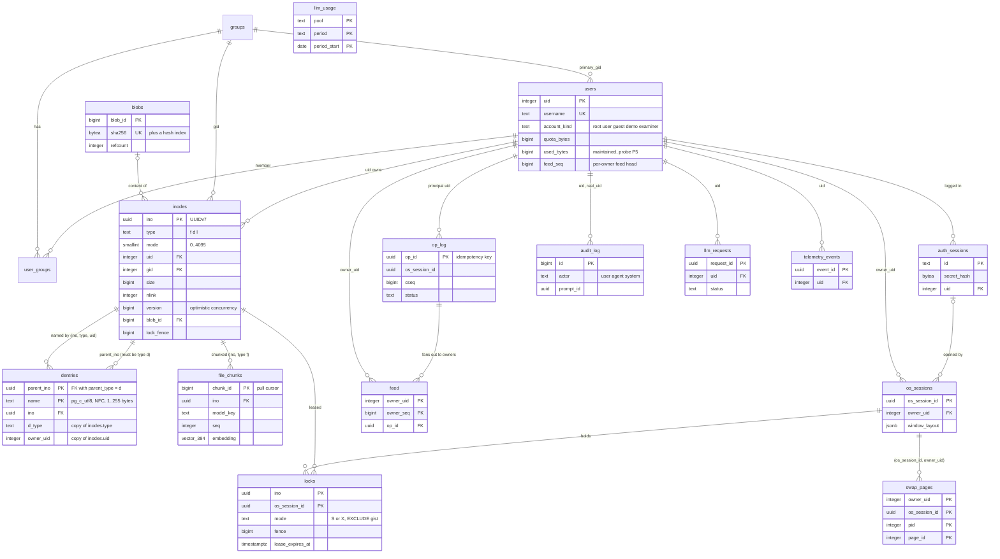
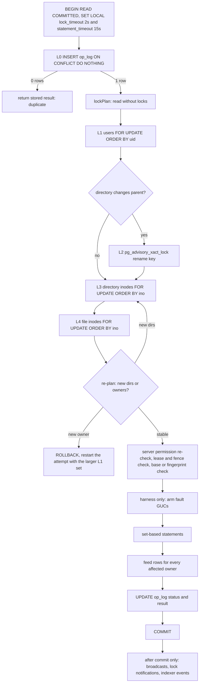

# Plotinium database

| Field | Value |
|---|---|
| Title | Plotinium database: PostgreSQL schema, tree representation, transactions, lock protocol, indexes, integrity, migrations, seed, benchmark and backup |
| Status | Draft v0.1, 2026-09-24 |
| Primary owner | R2 VFS/DB (schema, migrations, `vfsTxn`, `lockPlan`, bulk SQL, indexes, probes, benchmark, `file_chunks`, `audit_log`) |
| Secondary reviewer | R5 QA/DevOps (fault-injection harness, migration CI, backups and restore drill, seed timing in the clean bring-up). Table co-reviewers: R1 (`swap_pages`), R4 (`llm_requests`, `llm_usage`, `file_chunks` shape), R5 (`auth_sessions`) |
| Must be demonstrable at | **P1 defence (W4):** ERD, DDL, tree representation, isolation argument, lock order, index list (spec §13.1 Phase 1 deliverables). **P2 gate (W7, v0.2.0):** identity and VFS-core migrations on the production database; quota test live; client mkfs and server seed agree on system inos. **P3 gate (W11, v0.3.0):** DB-01…DB-05 live: fault-injected `rm -r` rolls back, two clients contend, constraint suite green, Q1–Q5 report with plans, restore drill. **P4 gate (W14, v0.4.0):** `file_chunks`, `audit_log`, LLM budget tables, agent batch in one transaction, kill mid-plan. **Final defence (W17–18, v1.0.0):** everything again on the examiner's clean clone |
| Requirement IDs covered | DB-01, DB-02, DB-03, DB-04, DB-05; spec §11.1–§11.4 and the seven §11.3 rules; §15.2 (DATABASE.md contents). Contributes to VFS-02, VFS-06, VFS-08, VFS-09, VFS-10, VFS-11, OFF-02, MEM-04, WM-06, RAG-02, RAG-03, RAG-05, AGT-02, AGT-05, AGT-08, AGT-09, PRE-05, §12.6 (cost accounting). Plotinium design IDs DBD-01 … DBD-18 |
| Related specs | [../01-architecture/architecture.md](../01-architecture/architecture.md) · [../01-architecture/syscall-abi.md](../01-architecture/syscall-abi.md) · [../04-vfs/virtual-file-system.md](../04-vfs/virtual-file-system.md) · [../06-sync/offline-and-sync.md](../06-sync/offline-and-sync.md) · [../03-kernel/memory-and-paging.md](../03-kernel/memory-and-paging.md) · [../05-wm/window-manager.md](../05-wm/window-manager.md) · [../08-dsa/data-structures.md](../08-dsa/data-structures.md) · [../10-ai/rag-semantic-search.md](../10-ai/rag-semantic-search.md) · [../10-ai/agentic-shell.md](../10-ai/agentic-shell.md) · [../10-ai/predictive-prefetch.md](../10-ai/predictive-prefetch.md) · [../10-ai/ai-safety-and-evaluation.md](../10-ai/ai-safety-and-evaluation.md) · [../11-server/backend-api.md](../11-server/backend-api.md) · [../12-security/security-model.md](../12-security/security-model.md) · [../13-quality/testing-and-performance.md](../13-quality/testing-and-performance.md) · [../14-devops/deployment-and-ci.md](../14-devops/deployment-and-ci.md) · [../15-decisions/stack-decisions.md](../15-decisions/stack-decisions.md) · [../16-delivery/implementation-plan.md](../16-delivery/implementation-plan.md) · [../00-product/requirements-traceability.md](../00-product/requirements-traceability.md) · [../00-product/glossary.md](../00-product/glossary.md) |

**Conventions used in this file.** RFC 2119 keywords (MUST, SHOULD, MAY) are used as in the spec's Conventions section (p. 3). Every normative statement is tagged **Spec** (a requirement of the capstone specification, with section and ID) or **Plotinium design** (our own binding choice). Numbers measured by the AI-run prototype, the examiner re-runs or the verification run of this spec (§3.32) are marked *(pilot figure — re-measure on the lab machine)*. SQL identifiers are written exactly as they appear in the migrations. `$n` in SQL are bind parameters; the application never concatenates values into SQL.

---

## 1. Purpose and scope

This document is the normative source for everything PostgreSQL holds in Plotinium. It is written so that R2 can implement `db/` and `server/src/vfs/` from it, R5 can build the CI jobs and the backup scripts from it, and every member can answer the viva questions on database design (spec §16.4: "the examiners may ask any member about any decision").

It fixes:

- the complete DDL of all 17 tables, split into five dbmate migrations, with every key, foreign key, UNIQUE, CHECK and EXCLUDE constraint, default, index, trigger and grant;
- the tree representation (adjacency list with separate `dentries`) and why;
- the transaction design: the declared isolation level (READ COMMITTED), the canonical lock order L0–L4, `lockPlan()`, `vfsTxn()`, the acyclicity trigger, the set-based SQL for every bulk operation, retries, timeouts, cancellation and the SQLSTATE → errno mapping;
- fault injection (the trigger, what a "node op" is, and the harness rules);
- `op_log` and the per-owner `feed`, retention and tombstones; `auth_sessions` vs `os_sessions`; `locks`; `swap_pages`; `blobs`; `file_chunks`; the LLM budget tables; `audit_log`; `telemetry_events`;
- the index list, Q1–Q5 SQL with expected plans, the seed scripts and the benchmark protocol (DB-05);
- integrity probes, the canonical tree checksum, the backup and restore procedure with its drill, PostgreSQL settings, migration conventions and the Kysely conventions.

**Out of scope, owned elsewhere.** The client IndexedDB schema and the client half of §11.3 rule 5 ([../04-vfs/virtual-file-system.md](../04-vfs/virtual-file-system.md)); the WS protocol frames, resume handshake and conflict UX ([../06-sync/offline-and-sync.md](../06-sync/offline-and-sync.md)); route mounting, auth flows and the LLM gateway logic ([../11-server/backend-api.md](../11-server/backend-api.md), [../12-security/security-model.md](../12-security/security-model.md)); compose files, secrets generation and CI workflow wiring ([../14-devops/deployment-and-ci.md](../14-devops/deployment-and-ci.md)); the retrieval pipeline ([../10-ai/rag-semantic-search.md](../10-ai/rag-semantic-search.md)); the agent pipeline ([../10-ai/agentic-shell.md](../10-ai/agentic-shell.md)). Where this file summarises them, the linked spec wins on detail and this file wins on anything that touches a table, a constraint, a lock or a transaction.

**DATABASE.md.** Spec §15.2 requires a repository file `DATABASE.md` with the ERD, tree representation, transaction design, isolation level, indexes, and benchmark results with query plans. **Plotinium design (DBD-01):** `DATABASE.md` is derived from §3.3–§3.8, §3.11, §3.28 and §4 of this spec plus the measured evidence in `docs/evidence/db/`. It MUST NOT contradict this file; a PR that changes one changes both.

---

## 2. Requirements table

| ID | Summary | Spec § | How verified |
|---|---|---|---|
| DB-01 | **Spec: MUST, §11.5, DB-01.** A documented schema (ERD) with normalisation reasoning; versioned migrations, each with a rollback script; a documented backup-and-restore procedure. | §11.5 | DATABASE.md (§3.3, §3.4); CI migration round trip from an empty database (§3.25); restore drill (§3.30); tests `DB-01 …` (§8) |
| DB-02 | **Spec: MUST, §11.5, DB-02.** Every bulk VFS operation is atomic; the fault-injection suite passes with zero orphans and unchanged checksums. | §11.3, §11.5 | `tests/fault-injection/*` for `rm -r`, `cp -r`, `mv`, batch rename, `chmod -R`, `chown -R` at nodes 1/500/999/1000/last; live `debug inject` at P3 and the final defence |
| DB-03 | **Spec: MUST, §11.5, DB-03.** A declared isolation level with retry logic; two clients moving overlapping subtrees at the same time always leave a consistent tree. | §11.3 rule 7, §11.5 | 2-client and 8-client overlapping-move tests; fast-check interleaving property test; probes P1–P3 after every run |
| DB-04 | **Spec: MUST, §11.5, DB-04.** Constraints are enforced by the database: foreign keys, unique (parent, name), checks on type and mode. | §11.3 rule 3, §11.5 | Constraint-violation suite (one test per constraint, asserting SQLSTATE, constraint name and errno); schema review |
| DB-05 | **Spec: MUST, §11.4, §11.5, DB-05.** The §11.4 indexes; Q1–Q5 p95 ≤ 10 ms at ≥ 10,000 records, with query plans as evidence. | §11.4, §11.5 | Benchmark harness (§3.28): before/after, 1,000 runs, committed `EXPLAIN (ANALYZE, BUFFERS)` plans; CI plan assertions; live query at the defence |
| §11.3-R1 | **Spec: MUST, §11.3 rule 1.** One transaction per user-visible operation. | §11.3 | `vfsTxn()` is the only server mutation path (§3.9); lint + review checklist; DB-02 suite |
| §11.3-R2 | **Spec: MUST, §11.3 rule 2.** Quota checked inside the transaction with the user's quota row locked. | §11.3 | L1 `users … FOR UPDATE` + CHECK `users_quota_bytes_ok`/`users_quota_inodes_ok`; `VFS-06` race test |
| §11.3-R3 | **Spec: MUST, §11.3 rule 3.** No move into its own subtree (EINVAL); unique names enforced by a unique index. | §11.3 | Trigger `dentries_acyclic` (SQLSTATE `PTC01`); `dentries_pkey` |
| §11.3-R4 | **Spec: MUST, §11.3 rule 4.** Any error rolls back; the client receives one clear errno; the database is exactly as before. | §11.3 | Errno mapping (§6); checksum before/after every injected fault |
| §11.3-R5 | **Spec: MUST, §11.3 rule 5.** The client mirror is also atomic. | §11.3 | Owned by [../04-vfs/virtual-file-system.md](../04-vfs/virtual-file-system.md); the server side of the same test is here |
| §11.3-R6 | **Spec: MUST, §11.3 rule 6.** Idempotency keys make a retried operation apply at most once. | §11.3 | L0 `op_log` insert; `OFF-02` duplicate and replay tests |
| §11.3-R7 | **Spec: MUST, §11.3 rule 7.** The isolation level is declared and justified. | §11.3 | §3.7 of this file, copied into DATABASE.md |
| §15.2-DB | **Spec: MUST, §15.2.** DATABASE.md contains the ERD, tree representation, transaction design, isolation level, indexes and benchmark results with query plans. | §15.2 | DATABASE.md review checklist (§3.1) |
| VFS-06 (contrib.) | **Spec: MUST, §9.3, VFS-06.** Quota enforced in the same transaction as the write; EDQUOT with no partial data. | §9.3 | `VFS-06 …` tests in §8 |
| VFS-08 (contrib.) | **Spec: MUST, §9.3, VFS-08.** Names up to 255 bytes. | §9.3 | CHECK `dentries_name_len` (256 bytes → ENAMETOOLONG) |
| VFS-09 (contrib.) | **Spec: MUST, §9.3, VFS-09.** Lease-based S/X locks; a second writer gets EBUSY; a crashed holder's lease expires. | §9.3 | `locks` constraints (§3.17); `VFS-09 …` tests |
| VFS-10 (contrib.) | **Spec: MUST, §9.3, VFS-10.** Concurrent changes detected by version numbers; conflicted copies kept. | §9.3 | Version CAS (§3.13); `VFS-10 …` tests |
| VFS-11 (contrib.) | **Spec: SHOULD, §9.3, VFS-11.** fsck checks reachability, link counts, cycles and quota totals. | §9.3 | Probes P1–P9 (§3.29) behind `fsck --server` |
| OFF-02 (contrib.) | **Spec: MUST, §9.5, OFF-02.** Outbox replayed exactly once. | §9.5 | L0 idempotency, stored results, permanent tombstones (§3.15) |
| MEM-04 (contrib.) | **Spec: MUST, §9.2, MEM-04.** A remotely swapped state pages in from a new browser session. | §9.2 | `swap_pages` keyed and authorised by `owner_uid` (§3.18) |
| WM-06 (contrib.) | **Spec: MUST, §9.4, WM-06.** Window layout restored after reboot. | §9.4 | `os_sessions.window_layout` (§3.16) |
| RAG-02/03/05 (contrib.) | **Spec: MUST, §12.2.** Deletes reflected; no result the user cannot read; retrieval p95 ≤ 500 ms. | §12.2 | `file_chunks` FK `ON DELETE CASCADE`; no copied permissions; `may_r`/`may_x` on the current row (§3.20) |
| AGT-05/08/09 (contrib.) | **Spec: MUST, §12.3.** Plans run as one transaction; every agent syscall audited; kill mid-plan rolls back. | §12.3 | `sys.batch` through one `vfsTxn`; `audit_log` (§3.22); cancellation path (§3.9.5) |
| PRE-05 (contrib.) | **Spec: MUST, §12.4, PRE-05.** Telemetry leaves the device only with opt-in. | §12.4 | `users.telemetry_opt_in` gate on insert (§3.23) |
| §12.6 (contrib.) | **Spec: §12.6** "Log tokens and cost for every request, set a budget cap". | §12.6 | `llm_requests`, `llm_usage` (§3.21) |
| DBD-01 | **Plotinium design.** One PostgreSQL database, one dbmate migration set owned by R2; the app role has DML only. | — | Grants test; schema review |
| DBD-02 | **Plotinium design.** Adjacency-list tree with names on a separate `dentries` table; composite FKs pin "parent is a directory" and the `d_type`/`owner_uid` copies. | — | DB-04 suite |
| DBD-03 | **Plotinium design.** READ COMMITTED plus the canonical lock order L0–L4, applied only through `lockPlan()` and `vfsTxn()`. | — | DB-03 suite; review checklist |
| DBD-04 | **Plotinium design.** Acyclicity is a database invariant (trigger, SQLSTATE `PTC01`), not only application code. | — | `DB-03 … forgets the rename lock` test |
| DBD-05 | **Plotinium design.** Bulk operations are set-based SQL, one statement per phase. | — | DB-02 suite; bulk budgets (§7) |
| DBD-06 | **Plotinium design.** Fault injection is a row-counting trigger gated by `plotinium.fault_after` and `plotinium.fault_on`, reachable only through the root-only, audited harness when `FAULT_INJECTION=1`, never on production. | — | Harness tests (§8) |
| DBD-07 | **Plotinium design.** `op_log` is the idempotency journal: stored results, deterministic rejections recorded after rollback, payload purged after 30 days, tombstones kept forever. | — | OFF-02 tests |
| DBD-08 | **Plotinium design.** One feed row per affected owner, gap-free and commit-ordered (`users.feed_seq` under the L1 lock). | — | `VFS-10 … per-owner feed` tests; probe P8 |
| DBD-09 | **Plotinium design.** S/X leases enforced by `EXCLUDE USING gist` plus a partial UNIQUE index; a fencing token on every grant. | — | `VFS-09 …` tests |
| DBD-10 | **Plotinium design.** Planner stability: `VACUUM (ANALYZE)` after every seed and bulk load; plan assertions in CI on a freshly seeded database. | — | `DB-05 … plans` tests |
| DBD-11 | **Plotinium design.** Migration round trip, normalised `schema.sql` diff and `kysely-codegen --verify` on every PR. | — | CI job |
| DBD-12 | **Plotinium design.** Snapshot-consistent backups (exported snapshot shared by the checksum and `pg_dump`) and a weekly restore drill. | — | `DB-01 … restore drill` test |
| DBD-13 | **Plotinium design.** Integrity probes P1–P9 and one canonical tree checksum shared by client and server. | — | Probes run after every DB-02/DB-03 test |
| DBD-14 | **Plotinium design.** Cancellation: AbortSignal between statements plus `pg_cancel_backend` for a running statement (AGT-09). | — | `AGT-09 …` test |
| DBD-15 | **Plotinium design.** The `file_chunks` pull cursor is commit-ordered (index writes serialised by an advisory lock). | — | `RAG-02 … cursor` test |
| DBD-16 | **Plotinium design.** LLM budget: reserve in a short transaction, call the provider outside any transaction, settle in a second short transaction. | — | `§12.6 …` tests |
| DBD-17 | **Plotinium design.** Directory `nlink` = 2 + number of child directories; file `nlink` = number of names. | — | Probe P4 |
| DBD-18 | **Plotinium design.** Deterministic seed (mulberry32, seed 42) and a reproducible benchmark harness. | — | Seed manifest checksum is identical across runs |

---

## 3. Design (normative)

### 3.1 One database, and what DATABASE.md must show

**Plotinium design (DBD-01).** PostgreSQL 18.6 with pgvector 0.8.6 is the single primary database (C7). It holds users and groups, the file tree, blob metadata, leases, the operation journal and resume feed, both kinds of session, remote-swap metadata, the audit log, opt-in telemetry, the LLM budget and the semantic-search vectors. Vectors therefore share transactions, foreign keys and permission joins with the file system: `rm -r` removes a file's chunks in the same transaction, and a search joins the live `inodes.mode`.

One migration set under `db/migrations/` is owned by R2 (C28 resolution: owners of other subsystems request columns through R2; they never write their own migration for a shared table).

**DATABASE.md review checklist** (§15.2). Before each gate, R5 checks that DATABASE.md contains: the ERD (§3.3), normalisation reasoning (§3.4), the tree-representation decision with numbers (§3.5), the transaction design and lock order (§3.6–§3.11), the declared isolation level with evidence (§3.7), the index list (§4.13), and the latest benchmark table with before/after p50/p95 and links to the committed plans (§3.28).

### 3.2 Roles, privileges and the trust boundary

**Plotinium design.** Two database roles:

| Role | Used by | Privileges |
|---|---|---|
| `plotinium_owner` | dbmate (app entrypoint), backups, restore, the bench harness | The image's bootstrap superuser (`POSTGRES_USER`). Owns every object. Never used by the running server. |
| `plotinium_app` | the Node server at run time | `USAGE` on schema `public`; DML per table as granted in §4. `audit_log`: SELECT, INSERT only. `op_log`: SELECT, INSERT, UPDATE (no DELETE: tombstones are permanent). `feed`: SELECT, INSERT, DELETE (retention). No TRUNCATE, no DDL, no superuser. |

- The roles are created by the database init step, not by migrations, because roles are cluster-wide and a migration's `down` cannot safely drop them. Migrations only `GRANT`. Credentials are generated at first start and never committed (C10; see [../14-devops/deployment-and-ci.md](../14-devops/deployment-and-ci.md)).
- **Verified (§3.32):** as `plotinium_app`, `UPDATE audit_log`, `DELETE FROM audit_log`, `DELETE FROM op_log`, `TRUNCATE inodes` and `CREATE TABLE` all fail with `42501`.
- **No row-level security on VFS tables.** Unix permissions depend on the path (x on every ancestor), so a per-row policy cannot express them without an ancestor walk per row, which would turn Q2 into N walks. **Plotinium design:** permissions are enforced by `vfs/perm.ts` in the kernel and **re-checked by the server inside the transaction after the L1–L4 locks** (§3.10). The server never trusts the browser kernel's check. Role privileges are the defence in depth.

### 3.3 Entity-relationship diagram

Key columns only; the complete columns are in §4. `llm_usage` has no foreign key (its key is a budget pool name).



### 3.4 Normalisation reasoning and deviations from the reference schema

**Normal form.** Every table has one subject and one key, every non-key attribute depends on the whole key and on nothing else, so the schema is in 3NF; the only multi-column keys (`dentries`, `user_groups`, `locks`, `feed`, `swap_pages`, `llm_usage`) have no attribute that depends on part of the key, so they are also BCNF. The central decision is that **names live on edges, not on nodes**: `inodes` holds what a file *is*, `dentries` holds where it *appears*. That is what makes hard links possible (spec §11.1: "the tree's edges are kept apart from the inodes, which makes hard links possible") and what makes a move a one-row update.

**Deliberate redundancy, each one guarded by the database or a probe.**

| Redundant column | Why | What stops it drifting |
|---|---|---|
| `dentries.d_type` | Lets the recursive walks stay on the `dentries_pkey` index (`INCLUDE (ino, d_type)`) without touching `inodes`: Q1, Q5 and the subtree CTEs are index-only | Composite FK `dentries_child_fk (ino, d_type, owner_uid) → inodes (ino, type, uid)`: a mismatch is a `23503` |
| `dentries.owner_uid` | Q3 is "prefix search across one user's files" (critic fix); the index `(owner_uid, lower(name) text_pattern_ops)` answers it without a join | Same FK, `ON UPDATE CASCADE`: `chown` rewrites the copy in the same statement (verified: the hard link outside a `chown -R` subtree got the new `owner_uid`) |
| `dentries.parent_type` | Constant `'d'`; exists only so the FK `(parent_ino, parent_type) → inodes (ino, type)` can say "a parent must be a directory" declaratively | CHECK `dentries_parent_is_dir` |
| `users.used_bytes`, `users.used_inodes` | §11.3 rule 2 needs a lockable quota row | Updated in the same statement as the change; CHECK against the quota; probe P5 |
| `blobs.refcount` | Blob GC must not scan `inodes` | Updated in the same statement; probe P6 |
| `inodes.nlink` | A Unix field that `stat` must show | Updated in the same transaction; probe P4 (DBD-17) |
| `users.feed_seq` | Gap-free per-owner feed numbering (§3.15) | Incremented under the L1 lock; probe P8 |
| `inodes.lock_fence` | High-water mark of X grants; not derivable once lease rows are deleted | Only the lease grant writes it (§3.17) |

**Documents on purpose.** `op_log.args/base/effects/result`, `audit_log.args/result`, `os_sessions.window_layout` and `telemetry_events.context` are `jsonb`. Each is an immutable journal entry or an opaque document owned by one component, never updated in place and never joined on an inner field; splitting them into tables would add joins without removing any update anomaly.

**Deviations from the §11.1 reference schema** (the spec calls it "a reference"):

| Reference | Plotinium | Reason |
|---|---|---|
| `locks: ino PK` | `PRIMARY KEY (ino, os_session_id)` + `EXCLUDE` + partial UNIQUE | Shared (S) locks need several holders; the reference key allows only one |
| `sessions (session_id PK, uid, window_layout, updated_at)` | Split into `auth_sessions` (revocable cookie session) and `os_sessions` (desktop session with `window_layout`) | Coherence C7: leases must die with a revoked login, but swap pages must outlive the browser session |
| `swap_pages (session_id, pid, page_id) PK` | `(owner_uid, os_session_id, pid, page_id)` | Lookup and authorisation by owner (MEM-04 page-in from a new session) |
| `inodes.ino` as an integer | `uuid` (UUIDv7) | C5: the client creates inodes offline; well-known fixed UUIDs for system paths |
| `op_log (op_id, uid, session_id, op, payload, client_ts, applied_at)` | Adds `cseq`, `lamport`, `base`, `effects`, `status`, `errno`, `result`, `purged_at` | C6 protocol fields; stored results for duplicates; tombstones |
| — | New table `feed` | C6/critic: resume is keyed per affected owner |
| — | New tables `llm_requests`, `llm_usage` | §12.6 cost accounting and budget cap (C9) |
| `file_chunks (chunk_id, ino, seq, text, content_hash, embedding)` | Adds `inode_version`, `model_key`, byte/line offsets, `header`, `ino_type` | C7 and the RAG spec; `ino_type` lets the FK refuse chunks on directories |

### 3.5 Tree representation

**Spec (§11.2):** "Choose a representation, justify it against your workload, and prove that your bulk operations stay atomic." **Plotinium design (DBD-02): adjacency list** (`dentries.parent_ino`) with names on a separate table.

| Representation | Move a 1,000-node directory | Read a subtree / resolve a path | Verdict for Plotinium |
|---|---|---|---|
| **Adjacency list (chosen)** | 1 dentry row + 2 parent rows | Recursive CTE on `dentries_pkey`: Q1 0.22 ms, Q5 ≈ 3.3 ms per 1,000 nodes at 100k inodes *(pilot figure — re-measure on the lab machine)* | Moves and renames are trivially atomic; hard links free; every read target met |
| Materialised path | Rewrite every descendant (1,000 rows) | Fast prefix scan | `ltree` labels allow only `[A-Za-z0-9_-]`, so real file names (spaces, dots, Unicode) cannot be labels; ino-based paths cost ≈ 500 B/row at depth 14 *(pilot figure — re-measure on the lab machine)*; one path per hard link |
| Closure table | Delete + insert ≈ 9,000 rows | Simple join | ≈ 1.4 M closure rows for a 99k seed *(pilot figure — re-measure on the lab machine)*; every move becomes a large bulk write |
| Nested sets | Renumber large ranges | Very fast range scan | Every create renumbers; unsuitable for a file system with frequent writes |

Rules that make the adjacency list a correct Unix tree:

1. **Root.** `/` is the only inode without a name. Its ino is the well-known UUID `ROOT` from `protocol/` (C5); all probes treat it as the single exception.
2. **Well-known system inodes (C5).** `/`, `/bin`, `/system`, `/system/services`, `/system/log`, `/system/branding`, `/root`, `/home`, `/tmp` and `/mnt` have fixed UUIDs defined once in `protocol/` and used by both client mkfs and the server seed. Owners and modes follow spec §9.3: `/` 0755, `/bin` 0755, `/system` and its children 0755, `/root` 0700, `/home` 0755, `/tmp` 1777, `/mnt` 0755, all `root:root`. `/home/<user>` (0700, `<user>:users`) is created only on the server when the user is created, with a server-minted UUIDv7.
3. **No directory hard links.** `dentries_dir_one_parent` (UNIQUE on `ino` WHERE `d_type = 'd'`) gives every directory exactly one name, so `..` is a single index lookup and ancestor walks are paths, not graphs. Linking a directory is refused with `EPERM`, as `link(2)` does.
4. **Directory `nlink` (DBD-17).** A directory's `nlink` is 2 + the number of child directories (its own name, its `.`, and each child's `..`), exactly as on Linux; a file's or symlink's `nlink` is its number of names. Every operation that adds or removes a directory entry of type `d` adjusts its parent by ±1.
5. **Names.** `text COLLATE pg_c_utf8`, NFC-normalised, 1–255 bytes, no `/`, not `.` or `..`. `pg_c_utf8` sorts by code point, which for UTF-8 is byte order, so `ls` order matches `LC_ALL=C ls`; and `lower()` uses Unicode simple case mapping, so Q3 finds `Ärger_*` for the prefix `ärg` (examiner finding: under `COLLATE "C"`, the same search found 1 of 1,668 such files). The client MUST normalise to NFC before sending; the CHECK rejects NFD.
6. **Path length (4,096 bytes)** and **symlink loops (ELOOP after 40 hops)** are enforced by the resolver in `vfs/path.ts`, not by the database: a path is not stored anywhere.

### 3.6 Transactions: §11.3's seven rules mapped to mechanisms

| §11.3 rule | Mechanism in Plotinium |
|---|---|
| 1. One transaction per user-visible operation | Every server mutation runs inside exactly one `vfsTxn()` (§3.9). An agent plan is one `sys.batch` op, therefore one `vfsTxn` (AGT-05). Nothing outside `vfsTxn` writes VFS tables (review checklist item; `server/src/vfs/ops/*` are the only callers). |
| 2. Quota checked inside the transaction, row locked | L1 locks the `users` rows of every affected owner `FOR UPDATE` in uid order; the quota UPDATE runs in the same transaction; CHECK `users_quota_bytes_ok`/`users_quota_inodes_ok` makes over-quota a `23514` → EDQUOT. |
| 3. Invariants checked before commit; unique names by index | `dentries_pkey` (EEXIST), acyclicity trigger (EINVAL), every CHECK and FK in §4 (DB-04). All are checked no later than the end of the statement. |
| 4. Any error rolls back, one clear errno | Any exception aborts the transaction; `toErrno()` maps it (§6). Deterministic rejections are recorded in `op_log` afterwards in a separate autocommit so a resend gets the same errno (§3.15). |
| 5. The client mirror is atomic | One IndexedDB readwrite transaction per op (C4), specified in [../04-vfs/virtual-file-system.md](../04-vfs/virtual-file-system.md). When online, bulk ops and agent batches wait for the server's `op.result`, so an injected server fault prints EIO synchronously (C6). |
| 6. Retries are safe | L0 inserts the client's `op_id` (UUIDv7) into `op_log` first; a duplicate returns the stored result. Automatic retries of `vfsTxn` re-run the whole transaction including L0. |
| 7. Isolation declared and justified | READ COMMITTED + explicit locks (§3.7). |

### 3.7 Isolation level: declaration and justification

**Declaration (Spec §11.3 rule 7, DB-03; Plotinium design DBD-03).** Every VFS mutation runs at **READ COMMITTED with explicit row locks** taken in the canonical order L0–L4 (§3.8), with `SET LOCAL lock_timeout = '2s'`, and is retried up to 5 times with full jitter on SQLSTATE `40001`, `40P01` and `55P03` (C7). Read-only queries (Q1–Q5, probes, pulls) run as single statements at READ COMMITTED; multi-statement reads that must agree (fsck probes, backup manifest) run in one `REPEATABLE READ READ ONLY` transaction.

**Why READ COMMITTED is safe for tree operations.**

1. FK, UNIQUE and CHECK constraints hold at every isolation level. Orphans, duplicate names, a file used as a parent, type/mode violations and over-quota rows are impossible regardless of interleaving.
2. The only tree invariant plain constraints cannot express is **acyclicity**, and only a **cross-parent move of a directory** can break it. Such moves are serialised system-wide by one transaction-scoped advisory lock (Linux's `s_vfs_rename_mutex` analogue), taken by the application at L2 **and** by the `dentries_acyclic` trigger itself. After the lock is granted, the trigger's ancestor walk runs in a new statement, and under READ COMMITTED a new statement sees every move that committed while it waited. So of two racing moves A→B and B→A, the second always sees the first and fails with EINVAL.
3. Every other conflict is on a specific row that we lock explicitly and in a fixed order (users by uid, then directory inodes by ino, then file inodes by ino). After a lock wait, READ COMMITTED re-reads the latest committed row, so no update is lost.
4. Quota cannot be lost: the quota row is locked at L1 and changed with `used = used + delta` in the same transaction.

**Why not SERIALIZABLE.** It is also correct, but measured retry storms make it a worse fit for a live multi-user demo on a freshly deployed database, which is exactly what the examiner brings up:

| Evidence (all figures: pilot figure — re-measure on the lab machine) | Result |
|---|---|
| READ COMMITTED, no rename lock, 2 clients cross-moving 40 dirs (prototype) | Tree corrupted: 40 directories detached into a cycle |
| READ COMMITTED, no rename lock, 50 overlapping A→B / B→A trials (examiner) | 50 of 50 trials left a detached cycle |
| READ COMMITTED + rename lock (prototype; examiner) | 0 corruption, 0 retries; p95 10.6 ms with 2 clients, 101 ms with 8 adversarial clients; examiner 0/50 cycles, loser got EINVAL on its first attempt |
| Trigger alone, application lock deliberately omitted (this spec's verification run, §3.32) | Second mover waited on the advisory lock, then failed with `PTC01`; with the trigger disabled the same race left both directories unreachable (probe P3) |
| SERIALIZABLE + retry, 2 / 8 clients (prototype) | 0 corruption, but 389 retries per 2,000 moves and 4 give-ups (2 clients); 2,348 retries per 2,400 and 24 give-ups (8 clients) |
| SERIALIZABLE, 12-user mixed workload on a compact (fresh) database (prototype) | 82–116 % retries, 12–18 % give-ups: seq scans on small tables take relation-level SIREAD locks |
| SERIALIZABLE, 10 writers + 2 workers doing 300-node `cp -r` (examiner) | 91–97 % of `cp -r` attempts aborted |
| SERIALIZABLE with `FOR UPDATE` (examiner) | Waits and then raises `40001`; row locks do not turn aborts into waits at this level |
| READ COMMITTED + lock protocol, same mixed workloads | 0 retries, 0 quota drift, 0 orphans |

**What we give up, stated for the viva.** Under READ COMMITTED, correctness depends on the lock protocol being followed. We contain that risk three ways: one `lockPlan()`/`vfsTxn()` path for every mutation, the database-level acyclicity trigger (so a forgotten L2 cannot corrupt the tree), and a fast-check interleaving test with the reachability probe on every PR. **Reversal trigger:** any probe violation in the concurrency suite that one added lock cannot fix within a sprint, or more than 1 % of mutating syscalls hitting `40P01` in the 12-user workload, moves writers to SERIALIZABLE with set-based statements and `SET LOCAL enable_seqscan = off`.

### 3.8 Canonical lock order and `lockPlan()`

**Plotinium design (C7, DBD-03).** Every mutating transaction acquires locks in this order and never in any other. A step that does not apply is skipped; a lock is never taken "late" out of order.

| Step | Lock | SQL | Taken by |
|---|---|---|---|
| **L0** | Idempotency: the `op_log` row (a unique-index insert; a concurrent duplicate waits here) | `INSERT INTO op_log (…) VALUES (…) ON CONFLICT (op_id) DO NOTHING RETURNING op_id` | Every op |
| **L1** | `users` rows of the actor and of every affected owner (quota and per-owner feed sequence) | `SELECT uid FROM users WHERE uid = ANY($1::int[]) ORDER BY uid FOR UPDATE` | Every op |
| **L2** | The rename lock (transaction-scoped advisory lock) | `SELECT pg_advisory_xact_lock(plt_rename_lock_key())` | Only when a directory changes parent (cross-parent `mv` of a directory, batch moves containing one) |
| **L3** | Directory inodes: every parent whose entries change, plus every directory of a subtree the op walks | `SELECT ino FROM inodes WHERE ino = ANY($1::uuid[]) ORDER BY ino FOR UPDATE` | Every op that changes a directory's entries; `rm -r`, `cp -r` (source and destination), `chmod -R`, `chown -R` |
| **L4** | File and symlink inodes: the target of a content write (version compare-and-swap), and every non-directory inode of a subtree the op modifies | `SELECT … FROM inodes WHERE ino = ANY($1::uuid[]) ORDER BY ino FOR UPDATE` | Writes, `rm -r`, `chmod -R`, `chown -R` |

"Affected owner" (L1) means: the owner of every inode row the op will insert, update or delete (**including parent directories**, because their entries change and their owner's devices must see it through the feed), every uid whose quota changes (for example the new owner in `chown`), and the actor.

**`lockPlan(op)`** is a pure planning function per syscall (in `server/src/vfs/lockplan.ts`). It reads without locks and returns the sets above:

- **Plan, lock, re-plan.** For subtree ops (`rm -r`, `cp -r`, `chmod -R`, `chown -R`) the plan is computed first; then L1–L4 are taken; then the subtree is collected again under the locks. Because every structural change inside a directory needs that directory's L3 lock, once the subtree's directories are locked no entry can appear, disappear or move inside it.
  - If the re-plan finds directories that were not locked (created and committed between plan and lock), `vfsTxn` locks them too (still `ORDER BY ino` within that statement) and re-plans again. This converges within the subtree depth because each round locks a strictly larger set of existing directories.
  - If the re-plan finds an **owner** that is not in the L1 set, L1 cannot be extended without breaking the order. `vfsTxn` then rolls back and restarts the attempt with the enlarged owner set (`LockSetChanged`, counted against the 5-attempt budget; metric `tx_restart_total{reason="lockset"}`).
- **Deadlock freedom.** Two transactions that follow the order can only wait in one direction per level, so they cannot deadlock on these locks. The residual cases (a re-plan that locks extra directories whose ino sorts below an already-locked one; FK `KEY SHARE` locks taken implicitly) are rare and resolve as `40P01` → retry. The risk-register trigger is more than 5 % of mutations hitting `40P01` or `55P03` in the 50-client test.
- **Consequence to accept.** All mutations of one owner serialise on that owner's `users` row. This is required anyway for the gap-free per-owner feed (§3.15), and the prototype's 12-user mixed workload showed 0 retries with it *(pilot figure — re-measure on the lab machine)*.



### 3.9 `vfsTxn()`

`server/src/vfs/tx.ts` exports the only function that opens a mutating transaction. Its TypeScript sketch is in §4.8. Behaviour:

#### 3.9.1 Transaction settings

- `db.transaction().setIsolationLevel('read committed')`. The level is set explicitly even though it is PostgreSQL's default, because it is a declared design decision.
- First statement: `SELECT set_config('lock_timeout', '2s', true), set_config('statement_timeout', '15s', true)` (the `true` makes them `SET LOCAL`). The server-wide `idle_in_transaction_session_timeout = 10s` (§3.24) kills a transaction left open by a crashed handler.
- `SELECT pg_backend_pid()` is recorded in the cancel registry under the op id (§3.9.5).

#### 3.9.2 Retries

- **Retryable:** `40001`, `40P01`, `55P03`, and `LockSetChanged`. At most **5 attempts in total**. Delay before attempt *n* (n ≥ 2) is `random(0, min(250, 10 · 2^n))` ms (full jitter).
- Every attempt is a fresh transaction, so the fault counter and every `SET LOCAL` reset automatically. The AbortSignal is checked before each attempt; a cancelled op is never retried.
- **Exhaustion:** `55P03` → **EBUSY**; `40001`/`40P01` → **EAGAIN**; `LockSetChanged` → **EAGAIN** with `detail.reason = 'lockset'`.
- Metrics: `tx_retry_total{sqlstate}`, `tx_attempts` histogram. Retries are safe because L0 makes the op idempotent.

#### 3.9.3 Duplicates and deterministic rejections (exactly once, OFF-02)

- **Duplicate:** L0 returns 0 rows when `op_id` already exists. `vfsTxn` reads `status, errno, result, uid` of that row. If `uid` differs from the principal, the reply is **EINVAL** (op id collision; the stored result of another user is never revealed). Otherwise it returns `{duplicate: true, status, errno, result}` and does nothing else. A concurrent duplicate blocks on the unique index until the first transaction ends, then sees its outcome.
- **Deterministic rejection:** when the transaction fails with an errno in the set {ENOENT, EEXIST, ENOTDIR, EISDIR, ENOTEMPTY, EINVAL, EACCES, EPERM, ELOOP, EDQUOT, ENAMETOOLONG, EXDEV, and EIO only when it came from the fault hook}, `vfsTxn` records it **after the rollback** in one autocommit statement: `INSERT INTO op_log (…, status, errno, result) VALUES (…, 'rejected', $errno, $result) ON CONFLICT (op_id) DO NOTHING`. A resend of the same `opId` then returns the same errno instead of re-executing, which matters after an injected fault: the fault is one-shot, so a re-execution would succeed. Transient outcomes (EAGAIN, EBUSY, ETIMEDOUT, ECANCELED) are **not** recorded: a resend retries.

#### 3.9.4 Side effects only after COMMIT

Nothing outside PostgreSQL happens inside the transaction. After the COMMIT promise resolves, `vfsTxn` publishes in-process events: the `op.result` to the origin session, `vfs.changed` to other sessions and watchers (with `r` re-checked at send time), lock-manager notifications, indexer notifications and blob-GC marks (C9: no LISTEN/NOTIFY, no Redis). If the process dies between COMMIT and publish, nothing is lost: clients resume from the durable feed (§3.15). The one exception inside the transaction is the fault-harness debug delay (`pg_sleep`, §3.14), which is itself a database statement.

#### 3.9.5 Cancellation (AGT-09, DBD-14)

- The op context carries the owning process's `AbortSignal`. `vfsTxn` calls `throwIfAborted()` between statements, which aborts the transaction and yields **ECANCELED**.
- For a statement already running, a `proc.signal` for the pid reaches the server on the control lane; the lock manager looks up the op's backend pid in the cancel registry and runs `SELECT pg_cancel_backend($1)` on a separate pool connection. The running statement fails with `57014`. Because the registry marks the op as cancelled, `toErrno` maps this `57014` to **ECANCELED**, while a `statement_timeout` expiry, also `57014`, maps to **ETIMEDOUT**.
- A kill that arrives after COMMIT has no effect on the database; the committed result is delivered and applied (the sync spec defines the client side).
- The audit outcome `killed_rolled_back` is written in a separate autocommit after the rollback (§3.22).

### 3.10 Permission re-check inside the transaction

**Plotinium design (security-model trust boundary).** The browser kernel is not trusted. After L1–L4 and the re-plan, the server loads the rows it is about to touch and runs the **same** `vfs/perm.ts` (isomorphic, imported by the server) against the server-derived principal (`uid`, `gids` from `user_groups` plus the primary gid, and a live `su` grant from `auth_sessions`):

| Operation | Check (spec §9.3 semantics) |
|---|---|
| Path resolution | `x` on every directory from `/` to the parent (the resolver on the server walks with Q1 and checks each row) |
| create, unlink, rename (each side) | `w` and `x` on the parent; sticky bit on the parent (`/tmp` 1777): only the file's owner, the directory's owner or root may unlink or rename |
| `rm -r` | `w` and `x` on the parent **and on every directory of the subtree** |
| `cp -r` | `r` on every file and `r` + `x` on every directory of the source; `w` + `x` on the destination parent |
| `chmod`, `chmod -R` | Owner of **every** inode touched, or root |
| `chown`, `chown -R` | Root only |
| write | `w` on the file |

**Atomic, not partial.** GNU `rm -r`, `cp -r` and `chmod -R` continue past entries they cannot handle. Plotinium does not: one failing entry fails the whole operation with that errno and nothing changes (§11.3 rule 1 wins). The dry run shows this before the agent ever executes (AGT-02).

**Leases and fences** are checked in the same place: any live X lease held by another OS session on any inode the op modifies → **EBUSY**; a write carrying a fence lower than `inodes.lock_fence` → stale fence (§3.13).

The same checks also run in the kernel before the local transaction; the matrix test (3 users × 9 modes × 8 operations) runs against both implementations ([../01-architecture/syscall-abi.md](../01-architecture/syscall-abi.md)). The SQL mirror `plt_may()` (used by the index API) implements the same truth table, including the critic's root rule: root is granted `x` on a file only if some `x` bit is set.

### 3.11 The acyclicity trigger (§11.3 rule 3, DB-03, DBD-04)

`dentries_acyclic` is a `BEFORE UPDATE OF parent_ino, ino` row trigger on `dentries`, firing only for directory entries whose parent or target changes (DDL in §4.4). It:

1. takes `pg_advisory_xact_lock(plt_rename_lock_key())`, which is re-entrant with the application's L2 and waits for any in-flight directory move;
2. walks up from `NEW.parent_ino` through directory entries (`UNION`, so it terminates even on a corrupted cycle), using `dentries_dir_one_parent`;
3. raises SQLSTATE **`PTC01`** with constraint name `dentries_acyclic` if `NEW.ino` is on that path (this includes `NEW.parent_ino = NEW.ino`).

`PTC01` is a Plotinium-defined SQLSTATE (class `PT`, outside the standard and PostgreSQL-defined classes), distinct from the fault hook's `P0001`, so `toErrno` maps a cycle to **EINVAL** and a fault to **EIO** without parsing messages (architecture cross-spec request).

**Residual rule (review checklist).** A directory move is always an `UPDATE` of its dentry, never a delete plus insert, because an INSERT does not fire the trigger. Probe P3 (unreachable nodes) in the property test would catch a violation.

### 3.12 Bulk operations (DBD-05)

**Plotinium design (C7).** `rm -r`, `cp -r`, `mv`, batch rename, `chmod -R` and `chown -R` are **set-based**: each phase is one SQL statement built on a recursive CTE over `dentries_pkey`, with the quota and blob-refcount updates in the same statement. The SQL is in §4.11 and was executed end to end in the verification run (§3.32). Semantics:

| Operation | Semantics (server) | Node ops (for fault injection) |
|---|---|---|
| `rm -r P/N` | Deletes every dentry of the subtree; deletes each inode whose last name was removed (directories always); a hard-linked file with names outside the subtree survives with `nlink` reduced; quota decreases per owner; blob refcounts decrease (a blob reaching 0 gets `zero_since`); `file_chunks` and `locks` rows go by `ON DELETE CASCADE`; parent: mtime, version, `nlink − 1` if a directory was removed | One per inode row written: N deletes/updates, then 1 parent update |
| `cp -r P/N → Q/M` | One **new inode per copied name** (GNU `cp -r` without `--preserve=links`: hard links become separate files); new UUIDv7s; owner and group = the caller; mode = `mode & 0o777 & ~umask` (setuid, setgid and sticky are not copied), symlinks 0777; symlinks copied as symlinks; content shared by blob (`refcount + k`), so a copy is O(metadata); the caller's quota is charged the full size; destination parent: mtime, version, `nlink + 1` for a directory. Refused with **EINVAL** if the destination is inside the source ("cannot copy a directory into itself") | N inserts, then 1 parent update |
| `mv P/N → Q/M` | One dentry UPDATE; parents: mtime and version; `nlink` moves between parents only when a **directory** changes parent (fixes the prototype bug the examiner found). If `Q/M` exists: file over file replaces it (the old name is unlinked in the same transaction); directory over an **empty** directory replaces it; directory over a non-empty directory → ENOTEMPTY; directory over file → ENOTDIR; file over directory → EISDIR; the same inode under both names → no-op. The moved inode's own row is not changed (POSIX allows rename not to touch ctime), so a rename never conflicts with a concurrent content write | With `fault_on = 'dentries'`: the moved dentry is node 1 (critic definition). With `fault_on = 'inodes'`: the parent updates are nodes 1–2, after the dentry already moved |
| Batch rename (agent, e.g. 500 files) | A list of renames applied as one set. If any target name equals another source name in the same parent (a swap or rotation), it runs in **two phases**: every source to a unique temporary name `.plt-mv-<opId>-<k>`, then temporaries to the final names. This is needed because `dentries_pkey` is checked per row: a single-statement swap fails with `23505` even though the final state is valid (verified). Any collision with an untouched name → EEXIST for the whole plan | `fault_on = 'dentries'`: one per dentry row (N, or 2N when two-phase) |
| `chmod -R` | `mode = (mode & ~clear) \| set \| (dirOrExecutable ? setX : 0)` for every non-symlink inode of the subtree (symbolic `X` semantics); ctime and version bumped; symlinks untouched (Linux ignores symlink modes) | One per non-symlink inode |
| `chown -R` (root only) | uid and/or gid of every inode of the subtree including symlinks (GNU `chown -R` with the default `-P` changes links themselves); quota moves from each old owner to the new owner in the same statement (new owner's CHECK applies, root exempt); `dentries.owner_uid` follows by `ON UPDATE CASCADE`, including names outside the subtree for hard-linked files | One per inode |

Every bulk op also writes one `feed` row per affected owner and updates its `op_log` row in the same transaction.

**Fingerprint and base checks.** An `unlink`/`rm -r` carries the client's base (a subtree digest of sorted `ino:version`); an agent batch carries its dry-run fingerprint (the `(ino, version)` set). Because L3/L4 lock every inode of the subtree before the check, the versions cannot change between check and write. On mismatch the op is rejected with **EAGAIN**, `detail.reason = 'stale-base'` for a structural op or `'stale-plan'` for an agent batch, with no side effects. The canonical errno set has no ESTALE (C3; architecture cross-spec request).

### 3.13 Content writes, versions, fences and conflicted copies (VFS-06, VFS-09, VFS-10)

**Plotinium design.** `inodes.version` is the optimistic-concurrency counter (spec §9.3). It is incremented by **every change to the inode's own row that clients mirror**: content (blob, size), mode, owner, group, `nlink`, symlink target. A directory's version is incremented whenever its entries change. A rename changes only the two parents.

A content write (`write`, `truncate`, `O_TRUNC` open) is:

1. L1 lock {owner, actor}; L3 lock the parent directory (needed if a conflicted copy is created); L4 `SELECT … FROM inodes WHERE ino = $1 FOR UPDATE`.
2. Checks: exists (ENOENT), `type = 'f'` (EISDIR), `w` permission, no live X lease of another session (EBUSY).
3. **Fence check:** if the op carries a fence and `fence < inodes.lock_fence`, the writer is a zombie (its lease was lost and granted to someone else). The bytes are kept as a conflicted copy and the op's status is `conflict` with errno `EBUSY` (architecture flow 6, step 7).
4. **Version compare-and-swap (L4):** if `version <> expectedVersion`, the write is a conflict: the server creates a sibling named `name (conflict from <user>, <YYYY-MM-DD>).ext` holding the incoming bytes, owned by the writer and charged to the writer's quota, and returns `status: 'conflict', keptAs`. Nothing is silently overwritten (C6).
   - The date is the server's commit date in `PLOTINIUM_TZ` (default `Asia/Karachi`). The extension is the part after the last dot that is not the first character.
   - The name is built by one shared function in `protocol/` (`conflictName(name, user, date, n)`) that truncates the stem so the result stays within 255 bytes.
   - A collision retries with `n = 2 … 9` inside the parentheses (`(conflict from alice, 2026-11-14 2)`), using `INSERT … ON CONFLICT ON CONSTRAINT dentries_pkey DO NOTHING RETURNING` so no error aborts the transaction.
5. Otherwise: take the new blob reference (`UPDATE blobs SET refcount = refcount + 1 … WHERE sha256 = $1 RETURNING blob_id, size`; 0 rows → **EAGAIN** `detail.reason = 'blob-missing'`, and the client re-uploads with `PUT /api/blobs/{sha}`), update the inode (`blob_id`, `size`, mtime, ctime, `version + 1`), decrement the old blob, and apply the quota delta `new size − old size` to the owner (EDQUOT on overflow, with no partial data).

Blobs are uploaded and verified **before** the transaction (C9), so the transaction never waits on I/O outside PostgreSQL.

### 3.14 Fault injection (DB-02, DBD-06)

**Spec (§11.3 box):** "Your test build must include a hook that throws an error after N of M node operations … repeated live at the final defence."

**The trigger** (`plt_fault_hook`, DDL in §4.4) is a `BEFORE INSERT OR UPDATE OR DELETE … FOR EACH ROW` trigger on `inodes` and on `dentries`. It ships in every build and is inert unless the current transaction sets its GUCs:

| GUC (set with `set_config(…, true)`, i.e. `SET LOCAL`) | Meaning |
|---|---|
| `plotinium.fault_after = N` | The first N node ops of the transaction succeed; node op N+1 raises SQLSTATE `P0001` with HINT `plotinium.fault`. "Fail at node k" therefore sets `fault_after = k − 1`. |
| `plotinium.fault_on = 'inodes' \| 'dentries'` | Which table's row writes count as node ops. Default `inodes`. |
| `plotinium.fault_count` | Internal counter (transaction-local). |

**Definition of a node op** (coherence C10 and critic fix):
- for `rm -r`, `cp -r`, `chmod -R` and `chown -R`, one row INSERT, UPDATE or DELETE on `inodes` (`fault_on = 'inodes'`);
- for `mv` and batch rename, one row UPDATE on `dentries` (`fault_on = 'dentries'`), because the per-node effect of a rename is a dentry. `mv` is additionally tested with `fault_on = 'inodes'` at its parent updates, which run after the dentry has moved.

**Order.** In each op the per-node statement runs first and the parent-directory update last, so for the `tree1000` fixture (1,000 inodes) the node numbers are 1…1,000 for the subtree rows and 1,001 for the parent (`rm -r`, `cp -r`). The suite injects at nodes **1, 500, 999, 1,000 and the last node M**, and once at M + 1, which must commit normally and report `fault_not_fired` (this proves the hook is inert when not reached). Verified for every op in §3.32.

**No-op cost.** The inert trigger cost 2.4 ms of a 37.3 ms `rm -r` statement over 1,000 nodes, i.e. 1.07 ms for 999 inode rows plus 1.33 ms for 1,000 dentry rows *(pilot figure — re-measure on the lab machine)*. The benchmark MUST report this figure from `EXPLAIN (ANALYZE)` trigger timing (§3.28).

**Harness rules** (`POST /api/debug/fault`, shape in §4.15):
1. The route is mounted **only** when the server starts with `FAULT_INJECTION=1`; otherwise it does not exist (404). `FAULT_INJECTION=1` is set in the local and examiner compose profile and in CI, and **never in production**. The server refuses to start when `FAULT_INJECTION=1` and the production profile are both set (C7; critic: no fault injection on the public deployment).
2. Only uid 0 may arm it: the caller's session must hold a live `su` grant to root (typed into the compositor-owned secure prompt, C10).
3. Arming is **one-shot** and **scoped to the requesting OS session**: it applies to the next op of the named kind (`unlink`, `copy`, `rename`, `batch`, `chmod`, `chown`) submitted from the same `os_session_id` within 5 minutes, then disarms. This lets root arm it, `exit`, and let alice's `rm -r` in the same desktop trip it, as in the P3 gate script, without touching other users' sessions.
4. Every arm, fire and expiry is written to `audit_log` (`actor = 'system'`, `syscall = 'debug.inject'`).
5. The server sets the GUCs inside `vfsTxn` **after** L0–L4 and the checks, immediately before the op's statements, so locks and planning are never counted.
6. **AGT-09 debug delay.** Only under `FAULT_INJECTION=1`, an arm MAY carry `delayMs` (≤ 30,000). The batch executor then runs `SELECT pg_sleep($1)` between plan steps so an examiner can `kill` the agent while the server transaction is open (critic fix). It is audited like a fault.
7. `debug inject` takes a target, `client`, `server` or `both` (critic fix). The client half aborts the IndexedDB transaction at the Nth request ([../04-vfs/virtual-file-system.md](../04-vfs/virtual-file-system.md)).

**What the examiner sees** (online, synchronous commit, C6): `rm -r ~/fixtures/tree1000` prints `EIO (injected fault at node 500) — rolled back`. `fsck --checksum` matches its before-value on client and server, the orphan probes return 0 rows and `quota` is unchanged.

### 3.15 `op_log`, the per-owner `feed`, retention and tombstones (OFF-02, VFS-10, DBD-07, DBD-08)

**`op_log`** is the server's idempotency journal and the source of stored results.

- `op_id` is the client's UUIDv7 idempotency key (C6). `uid` is the principal **derived by the server** from the session (and a live `su` grant); ops never carry a trusted uid.
- `os_session_id` and `cseq` identify the op's slot in the ordered op lane. `UNIQUE (os_session_id, cseq)` refuses a second, different op claiming the same slot (`23505` → EINVAL, a protocol violation). `lamport` is the client's Lamport counter (no HLC, C6).
- `args`, `base` (base versions or subtree digest) and `effects` hold the request and its canonical post-state. `effects` is the payload of `vfs.changed` and of resume events; its shape is defined by [../06-sync/offline-and-sync.md](../06-sync/offline-and-sync.md).
- `status`:
  - `pending` exists only inside the op's own transaction and is never committed (probe P9);
  - `applied`;
  - `conflict` (a conflicted copy was created; `errno` is NULL for a version conflict or `EBUSY` for a stale fence);
  - `rejected` (with `errno`; recorded after rollback, §3.9.3).
- `result` is the small reply body, kept forever.
- Ops larger than 60 KB arrive through `POST /api/ops/{opId}` and use the same `vfsTxn` and the same row (C6).

**`feed(owner_uid, owner_seq, op_id)`** (critic fix; C6). Inside the op's transaction, for every affected owner (the L1 set minus an actor who owns nothing touched), `vfsTxn` runs:

```sql
WITH o AS (UPDATE users SET feed_seq = feed_seq + 1 WHERE uid = ANY ($1::int[]) RETURNING uid, feed_seq)
INSERT INTO feed (owner_uid, owner_seq, op_id) SELECT uid, feed_seq, $2 FROM o;
```

Because each `users` row is locked from L1 until COMMIT, no other transaction can take the next number for that owner until this one commits or rolls back, and a rollback returns the number. So each owner's feed is **gap-free and commit-ordered** (probe P8). PostgreSQL sequences cannot give this, because their order is not commit order.

**Resume.** A client resumes every owner it mirrors (itself plus the owners of shared directories it holds) with `{ownerUid, fromSeq}`:

```sql
SELECT f.owner_seq, o.op_id, o.effects, o.applied_at
FROM feed f JOIN op_log o USING (op_id)
WHERE f.owner_uid = $1 AND f.owner_seq > $2
ORDER BY f.owner_seq
LIMIT 500;                                   -- feed_pkey range scan; the client pages
```

- The server filters each event against the requester's **current** permissions (`r` + `x` on the affected parent) before sending, like live `vfs.changed` broadcasts.
- If `fromSeq < users.feed_purged_seq` the history is gone, and the client MUST resync through `GET /api/sync/snapshot`.

**Retention (daily job, `server/src/sync/retention.ts`).**
- `op_log`: after **30 days**, set `args = base = effects = NULL, purged_at = now()` in batches of 5,000 (BRIN `op_log_applied_brin`). Rows are **never deleted**: the tombstone (`op_id`, `uid`, `status`, `errno`, `result`) lets a device that was offline for longer still get `duplicate` instead of a double apply. At about 150 bytes per tombstone, 10,000 ops a day is about 1.5 MB a day.
- `feed`: per owner, in a short transaction that locks that `users` row, delete rows with `committed_at < now() − 30 days` and raise `users.feed_purged_seq` to the highest deleted `owner_seq`.
- **Inode deletions** need no tombstone table: they are feed events within the horizon and a snapshot beyond it.

### 3.16 Sessions: `auth_sessions` vs `os_sessions` (coherence C7)

| | `auth_sessions` | `os_sessions` |
|---|---|---|
| What | The revocable login (cookie) session | The desktop session of one kernel instance (one kernel per origin, C2) |
| Key | `id` (the `<id>` half of the `<id>.<secret>` token) | `os_session_id` (UUIDv7 minted by the kernel at boot, registered in the WS hello) |
| Holds | `secret_hash` = SHA-256 of the secret (only the hash is stored, C10); `expires_at` (sliding 10 days; guests 2 h); `absolute_expires_at` (30 days; guests 2 h); `revoked_at`; `su_uid` + `su_expires_at` (15-minute su grant) | `owner_uid`, `auth_session_id` (nullable), `device_label` (shown by `lsof` as the lock holder), `window_layout` (WM-06), `layout_rev` |
| Lifetime | Until expiry or revocation; rows deleted one day after `absolute_expires_at` or `revoked_at` | Outlives the login: swap pages and the last layout must be reachable from a **new** browser session (MEM-04) |
| Referenced by | `os_sessions.auth_session_id` (`ON DELETE SET NULL`) | `locks.os_session_id`, `swap_pages (os_session_id, owner_uid)` |

- **Revocation (logout, expiry, admin).** Set `revoked_at`. The lock manager then deletes the leases of every OS session opened by that auth session and broadcasts `lock.released`. **No FK cascade is used for this** (C7), so the broadcast can never be skipped.
- **Registration.** `INSERT … ON CONFLICT (os_session_id) DO UPDATE … WHERE os_sessions.owner_uid = EXCLUDED.owner_uid`. 0 rows means the id belongs to another uid → EACCES.
- **Layout save.** Last writer wins per session: `UPDATE os_sessions SET window_layout = $2, layout_rev = $3, updated_at = now() WHERE os_session_id = $1 AND owner_uid = $4 AND layout_rev < $3`. The JSON shape, including per-window `(os_session_id, pid, page_ids)` for MEM-04, is defined by [../05-wm/window-manager.md](../05-wm/window-manager.md) and [../03-kernel/memory-and-paging.md](../03-kernel/memory-and-paging.md).
- **New-session restore.** `SELECT … FROM os_sessions WHERE owner_uid = $1 AND os_session_id <> $2 ORDER BY updated_at DESC LIMIT 1` (index `os_sessions_owner_recent`).
- **Retention.** Ended sessions older than 90 days that have no leases and no swap pages are deleted.

### 3.17 Leases: the `locks` table (VFS-09, DBD-09)

**Spec (§9.3, VFS-09):** shared (read) and exclusive (write) locks with time-to-live leases; a second writer gets EBUSY or read-only access; a crashed holder's lock expires within the lease time.

**Database guarantees** (verified, §3.32):

| Existing holder → request | Result |
|---|---|
| S → S (another session) | allowed |
| S → X | `23P01` on `locks_sx_excl` → EBUSY |
| X → S | `23P01` on `locks_sx_excl` → EBUSY |
| X → X | `23505` on `locks_one_writer` → EBUSY |
| own S → X upgrade while another S exists | `23P01` → EBUSY |

`EXCLUDE USING gist (ino WITH =, mode WITH <>)` (btree_gist, so `mode` is `text`) rejects a lease whose mode differs from an existing lease on the same inode. It does **not** reject two X (both modes are equal), which is why the partial `UNIQUE (ino) WHERE mode = 'X'` exists too; with only the partial index, the examiner's test showed S and X coexisting.

**Protocol** (C6; the lock manager in `server/src/locks/` owns the flow):
- **TTL** 30 s (15 s in the demo profile); heartbeat every TTL/3 from the kernel worker; any acknowledged op also renews the holder's leases. Pongs never renew.
- **Acquire** (short transaction, no L1–L4 because it touches only `locks` and one inode row):
  1. `DELETE FROM locks WHERE ino = $1 AND lease_expires_at <= clock_timestamp()` (a crashed holder's expired row stops blocking immediately);
  2. `INSERT … ON CONFLICT ON CONSTRAINT locks_pkey DO UPDATE` (renew or upgrade the caller's own lease) with `fence = nextval('lock_fence_seq')`;
  3. for X, `UPDATE inodes SET lock_fence = fence`.

  A `23P01`/`23505` rolls back and becomes `lock.denied {EBUSY, holder}`; the holder is read in a follow-up SELECT. `wait: true` requests queue in the lock manager's memory, not in the database.
- **Heartbeat:** `UPDATE locks SET lease_expires_at = clock_timestamp() + $2::interval WHERE os_session_id = $1 AND lease_expires_at > clock_timestamp()`. Only `lease_expires_at` changes and it is indexed by **BRIN** (`locks_expiry_brin`), so these updates stay HOT: since PostgreSQL 16, an update that changes only BRIN-indexed columns can still be HOT ([PostgreSQL 16 release notes](https://www.postgresql.org/docs/release/16.0/)). The examiner measured 0 of 40,000 HOT updates with a B-tree on this column and 9,432 with BRIN *(pilot figure — re-measure on the lab machine)*.
- **Expiry:** the server keeps an in-memory expiry heap (`dsa/heap`) with one timer at the earliest deadline. At expiry it deletes the rows and broadcasts `lock.released`. It rebuilds the heap from the table on start, so leases survive a server restart. Expiry happens within TTL + 0.5 s of the last renewal.
- **Fencing:** a write carrying `fence < inodes.lock_fence` is a zombie write (§3.13).
- **Release:** `DELETE FROM locks WHERE ino = $1 AND os_session_id = $2`. A clean WS close releases immediately; an abnormal close keeps the lease until TTL.
- **Deleting a leased file:** `locks_ino_fk … ON DELETE CASCADE` removes the lease rows with the inode. An `rm` is refused with EBUSY beforehand if **another** session holds a live X lease anywhere in the subtree (§3.10).

### 3.18 `swap_pages` (MEM-04, MEM-05; R1 co-owner)

**Plotinium design (C4 write-behind).** When online, every page-out is also uploaded to tier 2 and the local copy stays as a cache.

- **Upload.** `PUT /api/swap/{osSession}/{pid}/{page}` streams the gzip body through a SHA-256 tee into FsBlobStore under `swap/<owner_uid>/<os_session_id>/<pid>/<page_id>` with an atomic rename. Only then does it upsert the row (`ON CONFLICT ON CONSTRAINT swap_pages_pkey DO UPDATE SET storage_key, size, stored_size, checksum, updated_at`). `checksum` is the SHA-256 of the **uncompressed** bytes (MEM-03); `stored_size` is the compressed size.
- **Authorisation.** `owner_uid` is always the principal's uid. The composite FK `(os_session_id, owner_uid) → os_sessions (os_session_id, owner_uid)` makes it impossible to file a page under another user's OS session (verified: `23503` → EACCES).
- **New-session page-in (MEM-04).** The restoring kernel reads the old `(os_session_id, pid, page_ids)` from the previous layout (§3.16) and fetches each page by the full primary key; the server authorises by `owner_uid`.
- **Cap.** The sum of `stored_size` per owner is limited by `PLOTINIUM_SWAP_MAX_BYTES` (default 1 GiB), checked with an index range scan on `swap_pages_pkey` inside the upsert transaction after locking the owner's `users` row; overflow → EDQUOT. The page-size limit (`size ≤ 64 MiB`) is a sanity bound; the pager's real page size is defined in [../03-kernel/memory-and-paging.md](../03-kernel/memory-and-paging.md).
- **Retention.** Pages of OS sessions not updated for 30 days are deleted: the row first, then the storage object after commit. Swap is **not** backed up: process state is transient and a restore returns clean desktops.

### 3.19 `blobs` and garbage collection

- **Content addressing.** One row per distinct SHA-256 (`blobs_sha256_key`, B-tree UNIQUE). Upload (`PUT /api/blobs/{sha}`, idempotent) streams and verifies the hash, writes `blobs/sha256/ab/cd/<hex>` with an atomic rename, then `INSERT … ON CONFLICT ON CONSTRAINT blobs_sha256_key DO NOTHING` with `refcount = 0`, `first_ref_at = NULL`, `zero_since = now()`.
- **Why two indexes on `sha256`.** §11.4 asks for "a hash index on blobs(sha256) for de-duplication", but only B-tree indexes can be UNIQUE in PostgreSQL ([PostgreSQL 18 docs, Unique Indexes](https://www.postgresql.org/docs/18/indexes-unique.html): "Currently, only B-tree indexes can be declared unique"), and an exclusion constraint cannot be an `ON CONFLICT DO UPDATE` arbiter (prototype). So `blobs_sha256_key` (B-tree) enforces uniqueness and arbitrates upserts, and `blobs_sha256_hash` serves equality lookups. The benchmark reports the lookup through each (Qb in §3.28). Because §11.4 lists the hash index explicitly, it stays even if it is not faster, and DATABASE.md reports the measured cost honestly (open question 3).
- **References** change only inside `vfsTxn`: `refcount ± k`, `zero_since = CASE WHEN refcount = 0 THEN now() END`, `first_ref_at = coalesce(first_ref_at, now())`. CHECK `blobs_zero_since_iff` keeps `zero_since` consistent.
- **GC** (hourly, C9): `DELETE FROM blobs WHERE refcount = 0 AND ((first_ref_at IS NULL AND zero_since < now() − interval '1 hour') OR (first_ref_at IS NOT NULL AND zero_since < now() − interval '14 days')) RETURNING storage_key` uses `blobs_gc`, and storage objects are deleted only after that COMMIT.
  - A concurrent op that references the blob either locks the row first (GC's DELETE re-evaluates `refcount = 0` after the wait and skips it) or finds it gone (EAGAIN `blob-missing`, and the client re-uploads).
  - `inodes_blob` makes the FK check of each GC delete an index probe instead of a scan of `inodes`.

### 3.20 `file_chunks` and pgvector (RAG-02, RAG-03, RAG-05; R4 co-reviewer)

**Plotinium design (C12).** `file_chunks` is the authoritative multi-user vector store. The client's Float32Array index is a per-device cache hydrated from it ([../10-ai/rag-semantic-search.md](../10-ai/rag-semantic-search.md)).

- **No copied owner, group or mode.** Permission is always computed from the **current** inode rows through `may_r`/`may_x` (SQL mirrors of `vfs/perm.ts`) and the readable-set CTE in the RAG spec §4.5 (verified against this schema: as uid 1002, 0 results from another user's 0700 home). A `chmod` is effective on the next query.
- **Deletes** cascade in the same statement (`file_chunks_ino_fk … ON DELETE CASCADE`, verified). **Renames** never touch `file_chunks`: the path is resolved at query time. The composite FK `(ino, ino_type = 'f')` refuses chunks on directories and symlinks.
- **`index.put`** (idempotency key `ino:inodeVersion:modelKey`) is one short transaction:
  1. `SELECT pg_advisory_xact_lock(plt_index_put_lock_key())`, which serialises index writers so `chunk_id`s are handed out in commit order and the pull cursor `chunk_id > after` can never skip a row that commits late (DBD-15); index writes are low-rate, so the cost is negligible;
  2. check that `inodes.version = inode_version` (else 409 EAGAIN `stale`) and that the caller has `w`;
  3. `DELETE FROM file_chunks WHERE ino = $1 AND model_key = $2`;
  4. insert the new rows.
- **Uniqueness** is `(ino, model_key, seq)`, so vectors of the fallback model can coexist during a model switch (C12). Scoring never mixes model keys (RAG I-A5).
- **Search mode.** Exact scan first, HNSW only if measured necessary. The prototype measured exact p95 86 ms and HNSW p95 12 ms at 20,000 synthetic chunks, and HNSW recall of only 0.23 against exact on uniform random vectors *(pilot figures — re-measure on the lab machine with real embeddings)*.
  - **Trigger:** add HNSW when the exact server oracle's p95 exceeds 250 ms on the lab machine, or when there are more than 100,000 chunks.
  - **How:** its own migration adds `file_chunks_hnsw … USING hnsw (embedding vector_ip_ops) WITH (m = 16, ef_construction = 64)`. `vector_ip_ops` matches the `<#>` operator, because vectors are unit length and `<#>` is the negative inner product. Queries then run `SET LOCAL hnsw.iterative_scan = relaxed_order; SET LOCAL hnsw.ef_search = 100` and re-sort in an outer query.
  - **Gate:** Recall@5 ≥ 0.80 against exact on the evaluation set; the exact scan remains the correctness oracle in tests.
  - Verified: the DDL builds and the planner uses it. pgvector registers its `hnsw.*` settings when the library first loads in a session.
- **Seed vectors are precomputed** (real embeddings keyed by `(modelKey, sha256(text))`), never random.

### 3.21 LLM budget tables: `llm_usage` and `llm_requests` (§12.6, DBD-16; R4 co-reviewer)

**Plotinium design (C9, C14 coherence resolution).** No row lock and no pool connection is ever held across a provider call.

| Pool (`llm_usage.pool`) | Periods | Default limits (configurable) |
|---|---|---|
| `global` | `month`, `semester` | US$50 per month, US$250 per semester (coherence cost ceilings) |
| `uid:<uid>` | `day` | Per-user daily cap and call cap (set by the gateway config) |
| `examiners` | `day` | US$15 and 100 calls per day |

Money is stored as integer **micro-USD** (`bigint`). Per call:

1. **Reserve** (short transaction):
   - create any missing period rows with `INSERT … ON CONFLICT DO NOTHING`;
   - insert the `llm_requests` row (`status = 'reserved'`, `reserved_microusd` = the price of the maximum tokens);
   - run one conditional UPDATE over all charged rows: `reserved += est, calls += 1 WHERE spent + reserved + est ≤ limit AND (call_limit IS NULL OR calls < call_limit)`.

   If fewer rows were updated than keys charged, ROLL BACK and return **EAIUNAVAIL**, `detail.reason = 'budget'` (verified).
2. **Call the provider outside any transaction.**
3. **Settle** (short transaction): update the request (status `ok`/`error`/`refused`, tokens, `cost_microusd`, `served_model`, `stop_reason`, `latency_ms`, `settled_at`) and the pools (`reserved −= est, spent += actual`), **unconditionally**, because the money is already spent.

A sweeper marks reservations older than 10 minutes as `abandoned` and settles them at the estimate. `requested_model` and `served_model` are both recorded (critic fix: server-side fallbacks may serve another model). `stop_reason = 'refusal'` maps to EAIREFUSED. `turn` is CHECKed to 1–6, the agent observation-loop cap (C12). No prompt or response text is stored. The cost report for AI.md is a `GROUP BY` over `llm_requests`.

### 3.22 `audit_log` (AGT-08, security events)

**Spec (AGT-08):** "Every agent system call is written to the audit log with the prompt, plan, confirmation and result, and can be viewed with `ai log`."

- **Append-only.** The app role has SELECT and INSERT only (verified).
- **Rows per agent prompt:**
  - one `agent.plan` row (`args` = request text, plan JSON and dry-run summary; `plan_hash`);
  - one `agent.confirm` row (`outcome = 'confirmed' | 'declined'`);
  - one row per executed syscall, written **inside** the batch transaction (`actor = 'agent'`, `prompt_id`, `op_id`), so it commits with the plan's effect;
  - if the transaction rolls back, one autocommit transaction **after** the rollback re-inserts the plan row and adds an outcome row (`rejected`, `stale`, `killed_rolled_back` or `rolled_back`). Rejected and killed plans therefore still leave evidence (examiner spec gap).
- `uid` is the effective uid and `real_uid` the login uid. An agent spawned from a root shell runs as the real login uid (C12), so both are equal on agent rows. CHECK `audit_agent_has_prompt` makes an agent row without a `prompt_id` impossible.
- **Security events:** `su`, `chown`, cross-uid `kill`, `debug.inject` (arm, fire, expire), login failures and lease breaks, with `actor = 'user'` or `'system'`.
- **Retention:** kept for the whole semester. Indexes `audit_uid_ts` (`ai log`) and `audit_prompt`.

### 3.23 `telemetry_events` (PRE-05)

**Spec (PRE-05):** telemetry stays on the device by default; syncing it requires opt-in. The server accepts rows only for opted-in users, in the same statement:

```sql
INSERT INTO telemetry_events (event_id, uid, app_id, kind, ts, context)
SELECT e.event_id, $1, e.app_id, e.kind, e.ts, e.context
FROM jsonb_to_recordset($2::jsonb) AS e(event_id uuid, app_id text, kind text, ts timestamptz, context jsonb)
WHERE EXISTS (SELECT 1 FROM users WHERE uid = $1 AND telemetry_opt_in)
ON CONFLICT (event_id) DO NOTHING;
```

- If the user has not opted in, the route returns 403 EACCES and nothing is stored.
- **Opt-out** is one transaction that sets `telemetry_opt_in = false` and deletes every row of that uid. "Clear" in Settings → Privacy also deletes the server copy.
- The `context` shape is defined in [../10-ai/predictive-prefetch.md](../10-ai/predictive-prefetch.md).

### 3.24 PostgreSQL configuration and initdb

| Item | Value | Why |
|---|---|---|
| Image | `pgvector/pgvector:0.8.6-pg18-trixie@sha256:<digest recorded at pin time>`, mirrored to public GHCR (C7) | The `-pg18` tags are rebuilt on every PostgreSQL minor release (the examiner showed `0.8.6-pg18` will silently become 18.7 after 2026-11-12). Bump the digest deliberately, only after the Q1–Q5, fault and concurrency suites pass on the new one. The verification run used the Bookworm `0.8.6-pg18` build (`sha256:2ba9ca5f2e7d…`, PostgreSQL 18.6-1.pgdg12+2); repeat it on the trixie digest |
| Volume | Named volume mounted at **`/var/lib/postgresql`** | PG18 images use `PGDATA=/var/lib/postgresql/18/docker` (verified in the image env); mounting the old `/var/lib/postgresql/data` path makes the container exit 1 (examiner) |
| initdb | `POSTGRES_INITDB_ARGS='--locale-provider=builtin --builtin-locale=C.UTF-8'` | Code-point collation immune to glibc collation changes; Unicode simple case mapping. Data checksums are on by default in PG18 (verified `data_checksums = on`) |
| Extensions | `vector` 0.8.6, `btree_gist`, `pg_stat_statements` (migration 1); `pg_trgm` only if the optional trigram index is added | — |
| `shared_buffers` | 256MB | Fits the CX33 and a modest lab PC; the prototype container ran at 119–192 MiB RSS *(pilot figure — re-measure on the lab machine)* |
| `effective_cache_size` / `work_mem` / `maintenance_work_mem` | 1GB / 8MB / 128MB | Short OLTP statements; `VACUUM` and index builds after seeding |
| `max_connections` | 50 | One pool of 10 plus maintenance and backup connections |
| `random_page_cost` | **1.1** | SSD. At the default 4.0 the prototype's Q2 flipped to Hash Join + Seq Scan (11.7 ms instead of 0.5 ms) *(pilot figure — re-measure on the lab machine)* |
| `jit` | off | Avoids compile spikes on short queries |
| `idle_in_transaction_session_timeout` | 10s | A crashed handler cannot hold locks |
| `shared_preload_libraries` | `pg_stat_statements,auto_explain` (C7) | Server-side timings; plans of slow statements |
| `pg_stat_statements.track` | top | — |
| `auto_explain.log_min_duration` | 10ms (the DB-05 budget) | Any statement slower than the budget logs its plan |
| `auto_explain.log_analyze` | off in production, on in the nightly benchmark | ANALYZE instrumentation costs time on every statement |
| `track_io_timing`, `log_lock_waits` | on | Evidence for plans and lock waits |
| `lc_messages` | C | Stable English error messages (used as a fallback discriminator in §6) |
| `timezone` | UTC | Dates for conflicted copies are converted explicitly with `PLOTINIUM_TZ` |
| Per table | `autovacuum_vacuum_insert_scale_factor = 0.02` on `inodes` and `dentries` (in the DDL) | Sets the visibility map soon after bulk inserts, so index-only scans have 0 heap fetches |

These are passed as `-c` flags in the compose `command` ([../14-devops/deployment-and-ci.md](../14-devops/deployment-and-ci.md)); the database port is not published in production.

### 3.25 Migrations (DB-01, DBD-11)

**Plotinium design (C8).**
- **Tool:** dbmate 2.36.0, plain-SQL files `db/migrations/YYYYMMDDHHMMSS_snake_name.sql`, each with a `-- migrate:up` section and a `-- migrate:down` section. These are dbmate's default directory and schema-file paths.
- **Transactions:** dbmate wraps each migration in a transaction, and PostgreSQL DDL is transactional, so a failed migration leaves nothing behind. A migration that needs `CREATE INDEX CONCURRENTLY` marks its section `-- migrate:up transaction:false`.
- **Down scripts** drop exactly what the up created, in reverse dependency order. A merged migration is never edited; changes go into a new file.
- **Every PR that changes the schema** commits the new migration, the regenerated `db/schema.sql` and the regenerated `server/src/db/types.gen.ts`.
- **Production and examiner bring-up** (C14): the app entrypoint runs `dbmate --wait --no-dump-schema up`, then the demo seed, then the server, as `plotinium_owner`. dbmate is a production dependency of the server package. `/readyz` turns healthy only after this.

**CI round trip** (every PR; `tools/ci/migrate-roundtrip.sh`, against `docker compose up -d --wait db`):
1. `dbmate --wait up` on an empty database.
2. `N = SELECT count(*) FROM schema_migrations`; run `dbmate rollback` N times, because dbmate 2.36.0 has no "roll back all" option (examiner).
3. Assert no Plotinium objects remain: 0 relations and 0 functions in `public` apart from `schema_migrations`, and 0 extensions besides `plpgsql`.
4. `dbmate up` again.
5. Run `dbmate dump` **explicitly**, through `ghcr.io/amacneil/dbmate:2.36.0` (it ships `pg_dump` 18.6, so the client matches the server), because the automatic dump after `up` is skipped silently when `pg_dump` is missing (examiner).
6. **Normalise** the dump: delete lines matching `^\\(un)?restrict ` (PostgreSQL 18's `pg_dump` writes a random `\restrict <key>` line into every dump, so two dumps of the same schema differ; verified).
7. `git diff --exit-code db/schema.sql`.
8. Up/down/up of the newest migration alone.
9. `kysely-codegen --verify`.

The whole job budget is ≤ 90 s.

**Migration list** (timestamps illustrative; the real one is the creation time):

| File | Phase | Contents |
|---|---|---|
| `20261019090000_extensions_and_helpers.sql` | P2 (W6) | Extensions, schema grant, advisory-lock key functions, `plt_may()` |
| `20261019090100_identity.sql` | P2 (W6) | `groups`, `users`, `user_groups`, `auth_sessions`, `os_sessions` |
| `20261019090200_vfs_core.sql` | P2 (W6) | `blobs`, `inodes`, `dentries`, all tree indexes, `may_r`/`may_x`, acyclicity trigger, fault hook, `plt_tree_checksum()` |
| `20261109090000_sync_locks_swap_audit.sql` | P3 (W8–9) | `op_log`, `feed`, `lock_fence_seq`, `locks`, `swap_pages`, `audit_log` |
| `20261130090000_ai_llm_telemetry.sql` | P4 (W12) | `file_chunks`, `llm_usage`, `llm_requests`, `telemetry_events` |

**DB-05 "before indexes" state.** Rolling back a migration only works while it is the newest (examiner), so the before/after benchmark uses the toggle scripts `db/bench/perf-indexes.down.sql` and `db/bench/perf-indexes.up.sql` (§4.14). They drop and recreate exactly the §11.4 indexes, run only against the bench database (they refuse any other `current_database()`), and are checked in CI: after down then up, the normalised schema dump MUST equal `db/schema.sql` (verified).

### 3.26 Kysely and kysely-codegen conventions

**Plotinium design (C8).**
- **Versions:** Kysely 0.29.6 pinned exactly, on node-postgres 8.23.0 through Kysely's built-in `PostgresDialect`. Kysely is the query builder only; its Migrator is never used.
- **One pool** (`server/src/db/client.ts`): `max: 10`, `idleTimeoutMillis: 30_000`, `connectionTimeoutMillis: 5_000`, `application_name: 'plotinium-app'`, connecting as `plotinium_app`. Only transaction-scoped advisory locks are used, so PgBouncer in transaction mode stays possible (reversal target).
- **Type parsers** (set once, before the pool is created):
  - `int8` (OID 20) → `number`, behind a `Number.isSafeInteger` guard that throws (→ EIO) on overflow. BigInt is **not** used, because `JSON.stringify` throws on BigInt and every syscall result crosses the WebSocket as JSON (examiner).
  - `date` (OID 1082) → the raw `'YYYY-MM-DD'` string, because the default parser builds a local-midnight `Date` and shifts budget periods across time zones.
  - `timestamptz` → `Date`, converted to ISO strings at the protocol boundary.
  - `uuid` → string.
  - `bytea` → `Buffer`, hex-encoded at the protocol boundary.
  - `jsonb` → parsed objects.
- **Parameters:** node-postgres turns a JS array into a PostgreSQL array, so a **jsonb** parameter that is an array MUST be passed as `JSON.stringify(value)` with a `::jsonb` cast. Vector parameters use `pgvector.toSql(float32Array)` with a `::vector` cast (pgvector npm 0.3.0), and distance helpers come from `pgvector/kysely`.
- **Codegen:** `kysely-codegen --dialect postgres --url "$DATABASE_URL" --out-file server/src/db/types.gen.ts --exclude-pattern schema_migrations --type-mapping '{"int8":"number","date":"string","vector":"string"}'`. CI runs the same command with `--verify`. The generated file is never edited by hand and is excluded from coverage. Confirm the `--type-mapping` key names against kysely-codegen 0.20.0 in Week 5.
- **Identifiers:** column names stay snake_case in TypeScript (no CamelCasePlugin), so raw SQL and builder code read the same; camelCase starts at the protocol schemas.
- **Hand-written SQL:** hot paths (Q1–Q5, bulk ops, locks) are `sql<T>` templates in `server/src/db/sql/*.ts`, each covered by an integration test against real PostgreSQL. `sql.raw` is banned by lint outside `db/bench/`.

### 3.27 Seed scripts (DBD-18)

**Bench seed** (`db/seed/seed.ts --profile bench10k|bench100k --seed 42`), into the database named in `DATABASE_URL` (the bench database `plotinium_bench` in CI):

- **Randomness:** mulberry32 with seed 42 (C8/ORM record). UUIDv7s are generated deterministically: a timestamp of `2026-09-01T00:00:00Z` + i ms, and random bits from the generator, with the version and variant bits set. Two runs produce byte-identical data, and the seed manifest's `plt_tree_checksum` is asserted equal across runs in CI.
- **Users:** at least **50**. Root, plus `user01`…`user59` (uids 1001–1059), groups `root` (0), `users` (100) and `team` (200).
- **Size:** exactly **10,000** or **100,000** inodes. Owners follow a Zipf-like distribution (s = 1.1), so a few users own large trees.
- **Realistic depth distribution.** Each new node attaches to the most recently created directory of its owner with p = 0.35, otherwise to a uniformly random directory of that owner. The verification generator using this rule produced 11,971 directories at 100k inodes with a unimodal depth histogram peaking at depth 7–9 and a maximum depth of 24 *(pilot figure — re-measure on the lab machine)*. The seed writes the histogram into the manifest, and DATABASE.md shows it.
- **Content:** file sizes log-normal (median 4 KiB, σ = 1.5, capped at 8 MiB); 10 % of files share content (blob refcount > 1). Names are dictionary words plus a numeric suffix and an extension; 2 % are non-ASCII NFC (`Ärger`, `Übung`, `café`). Directory `nlink`, blob refcounts and `users.used_*` are computed by set-based fix-ups, and the probes must be clean before the manifest is written.
- **mtimes:** exponential with a 30-day mean back from the seed epoch `2026-09-24T12:00:00Z`, plus 10 % inside the last 7 days. Q4 takes its "now" as a parameter so the benchmark stays deterministic on later dates.
- **Fixtures** (for 20 fixture users, so the benchmark can draw parameters): `q1/a/b/c/d/e` under each home (a path of exactly 8 components from `/`), `big500` (exactly 500 entries), `fixtures/tree1000` (exactly 1,000 inodes: 1 root, 99 directories, 900 files, no symlinks or hard links, so every bulk op's node count is exact), `fixtures/flat1000` (one directory of 1,000 files for batch rename), `fixtures/treemix` (symlinks including dangling ones and an `a → b → a` loop, hard links inside and outside the subtree), `deep32` (a 32-level chain, VFS-08), and 300 `Ärger_*.md` files for Q3.
- **Vectors:** real, precomputed embeddings for the RAG corpus from `db/seed/vectors/<modelKey>/` (f32 little-endian plus a metadata JSON keyed by `sha256(text)`), at least 10,000 chunks, loaded into `file_chunks` for the corpus files.
- **Load method:** `unnest()` array inserts in batches of 5,000 rows, one transaction per phase. Then `VACUUM (ANALYZE)` over every table, run **outside** a transaction. This is mandatory (DBD-10): on an un-vacuumed table the examiner saw the Q5 walk planned as Seq Scan + Hash Join at 14.0 ms instead of an Index Only Scan at 1.2 ms *(pilot figure — re-measure on the lab machine)*.
- **Manifest:** counts, depth histogram, checksum, duration → `docs/evidence/db/seed-manifest-<profile>.json`.
- **Budget:** the bench100k profile must finish in ≤ 60 s on the lab machine (Plotinium design; not yet measured).

**Demo seed** (`db/seed/demo.ts`, run by the app entrypoint on every start as `plotinium_owner`, because `VACUUM` needs table ownership; idempotent):
- Detects its own marker (`SELECT 1 FROM users WHERE username = 'demo'`) and does nothing on a second run.
- Creates the well-known system inodes (the same UUIDs as client mkfs; test `VFS-02 …`), root, `demo`, guest and examiner accounts with **passwords generated at first start and printed only in the app log** (C10: never in the README or `compose.yaml`), `/home/shared/plan.md`, `fixtures/tree1000`, the evaluation corpus with precomputed vectors, and the demo telemetry trace.
- Loads the bench dataset so that DB-05's live query runs against at least 10,000 records on the examiner's clean bring-up: profile `PLOTINIUM_SEED_PROFILE`, default `bench10k`; `bench100k` (the rubric's "exemplary" level) SHOULD become the default if the S8 bring-up timing shows it fits in 60 s (open question 2).
- Ends with `VACUUM (ANALYZE)`.

### 3.28 Benchmark protocol (DB-05)

**Spec (§11.4):** "The benchmark report must include a reproducible seed script (at least 50 users, with a realistic spread of directory depths), p50 and p95 over 1,000 runs before and after indexing, and query plans (EXPLAIN ANALYZE or equivalent) proving that the indexes are used."

`db/bench/run.ts --profile bench10k|bench100k --state before|after`:

1. **Database:** `plotinium_bench`, freshly seeded with the profile. `before`: apply `perf-indexes.down.sql`, then `ANALYZE`. `after`: apply `perf-indexes.up.sql`, then `VACUUM (ANALYZE)`. Reset `pg_stat_statements` before each query set.
2. **Parameters:** 1,000 draws per query from the fixture pools, using mulberry32 seed 4242.
   - Q1: depth-8 paths (the fixture plus random directories at depth ≥ 8).
   - Q2: the 20 `big500` directories.
   - Q3: `(uid, prefix)` pairs with prefixes of 2–4 characters taken from that uid's real names, including non-ASCII.
   - Q4: users with at least 50 files changed in the last 7 days relative to the seed epoch.
   - Q5: the 20 `tree1000` roots.
   - Qb (blob dedup lookup): sha256 values of existing blobs.
3. **Measurement:** 100 warm-up runs, then 1,000 timed runs per query, through the real code path (`server/src/db/queries/q1.ts` … `q5.ts` via Kysely), timed client-side with `performance.now()`. p50, p95 and p99 use the nearest-rank method. Repeat 3 times and report the median of the three.
4. **Server-side** figures come from `pg_stat_statements` (mean, stddev, max). Host noise can inflate client timings: the prototype saw a client-side Q2 p95 of 11.9 ms while server execution was 0.94 ms *(pilot figure — re-measure on the lab machine)*. So both are reported, and the gate uses the client-side p95.
5. **Plans:** `EXPLAIN (ANALYZE, BUFFERS, FORMAT JSON)` and the TEXT form for the canonical parameter of each query, in both states, committed to `docs/evidence/db/plans/<state>/q1…q5.{json,txt}`.
6. **Also measured:** the no-op cost of the fault hook (the per-trigger time in `EXPLAIN (ANALYZE)` of the `tree1000` `rm -r` statement), and bulk-op server times.
7. **Environment record:** CPU, RAM, OS, Docker version, image digest, the PostgreSQL settings from §3.24, and the seed manifest checksum.
8. **Output:** `docs/evidence/db/bench/<date>-<profile>-<state>.json` plus the Markdown table in DATABASE.md.
9. **Gates:** in the `after` state, p95 ≤ 10 ms for every query at bench10k on PRs touching `db/` or `server/src/db/`, and at bench100k nightly on the lab-spec runner (C13 authoritative runs happen there). The plan assertions in §8 run on a freshly seeded database in CI.

**Expected plans** (all confirmed at 100k inodes in the verification run; timings are pilot figures, to be re-measured on the lab machine):

| Query | After indexes (plan, time) | Before indexes (time) |
|---|---|---|
| Q1 resolve a depth-8 path | Recursive union with an Index Only Scan on `dentries_pkey` (Heap Fetches 0) per level; inode rows by a unique index on `ino`; 0.22 ms | 89 ms (8 × Seq Scan on `dentries`) |
| Q2 list 500 entries by name | Index Only Scan on `dentries_pkey` (already in name order: no Sort) + Nested Loop Index Scan on `inodes_pkey`; 0.83 ms for 508 rows | 3.9 ms |
| Q3 prefix across one user's names | Index Scan on `dentries_owner_lname`, `Index Cond: owner_uid = … AND lower(name) ~>=~ 'ärg' AND lower(name) ~<~ 'ärh'`, **no Sort** thanks to `ORDER BY … USING ~<~`; 0.03 ms (440 matches) | 4.0 ms |
| Q4 recent files of one user | Index Scan on `inodes_uid_mtime` (Index Cond on uid and mtime; Filter `type = 'f'`) + LIMIT 50 + one Index Scan on `dentries_ino` per row; 0.31 ms | 50 ms |
| Q5 `du` of a subtree | Recursive union with an Index Only Scan on `dentries_pkey` (Heap Fetches 0) + Nested Loop Index Scan on `inodes_pkey`; 8.5 ms for **2,547** nodes, about 3.3 ms per 1,000 (prototype: 1.7–2.9 ms per 1,000) | 119 ms |

Q5 grows linearly with subtree size and is the closest to the budget. **Reversal (from the DB record):** if Q5 p95 exceeds 10 ms at 100k on the lab machine after tuning, first try `PRIMARY KEY (ino) INCLUDE (size)` on `inodes` for an index-only sum. Only then add a transactional per-directory size cache for large directories. Never add a maintained aggregate on every ancestor: it would make `/` and `/home` a hot row that serialises every writer.

### 3.29 Integrity probes and the canonical checksum (VFS-11, DBD-13)

`db/probes/integrity.sql` (§4.13) holds nine probes. Each MUST return zero rows. They run together in one `REPEATABLE READ READ ONLY` transaction (one snapshot for all nine) after every DB-02 and DB-03 test, in the restore drill, and behind `fsck --server` (root).

| Probe | Checks | Why it can fail even with constraints |
|---|---|---|
| P1 orphans | An inode other than `/` with no name | An inode insert without its dentry, or a delete that left the inode behind |
| P2 parentless | A dentry whose parent inode is missing (spec §11.3 probe) | Cannot, because of the FK; the probe proves it on camera |
| P3 unreachable | An inode not reachable from `/` | Detached cycles (a forgotten rename lock); P1 and P2 cannot see these |
| P4 nlink | Files and symlinks: number of names; directories: 2 + child directories | Missed ±1 in an op |
| P5 quota drift | `users.used_bytes/used_inodes` equal the owned inodes | A missed delta |
| P6 refcount | `blobs.refcount` equals the referencing inodes | A missed increment or decrement |
| P7 blob size | A file's `size` equals its blob's `size` | A write that set one and not the other |
| P8 feed | Per owner: `count(feed) = feed_seq − feed_purged_seq` and all seqs are in range | A feed row written without the L1 lock |
| P9 pending | No committed `op_log` row in `pending` | An op that committed without finishing its journal update |

**Canonical tree checksum** (`plt_tree_checksum(root)`, §4.4):
- **Line format:** one line per node, `parent|nameHex|ino|type|modeOctal|uid|gid|size|nlink|version|blobShaHex|targetHex`, with `-` for NULL. `nameHex` and `targetHex` are the hex of the UTF-8 bytes, so `|` or newlines in names cannot make two different trees collide.
- **Order:** by parent (uuid byte order), then name (code point order, which is UTF-8 byte order).
- **Result:** the hex SHA-256 of the lines joined by `\n`.
- **Scope:** timestamps are excluded on purpose, so the **same function implemented in `protocol/` on the client** gives an equal value for equal trees (the VFS-10 convergence test compares client and server). The client MUST sort names by their UTF-8 bytes, not by JavaScript's UTF-16 string order.
- **Cost:** 0.43 s for 100k inodes *(pilot figure — re-measure on the lab machine)*.
- `fsck --checksum <path>` uses it with a subtree root.

### 3.30 Backup and restore (DB-01, DBD-12; R5 runs it)

**Backup** (`ops/backup.sh`, nightly; C14):
1. In a `REPEATABLE READ READ ONLY` transaction as `plotinium_owner`, run `SELECT pg_export_snapshot()`, then compute `plt_tree_checksum(ROOT)`, the row counts, `max(schema_migrations.version)` and the blob manifest (`encode(sha256,'hex')` of every blob with `refcount > 0`). Keep the transaction open.
2. `pg_dump -Fc --snapshot=<id> -f /backups/plotinium-<UTC timestamp>.dump plotinium`, run inside the `db` container so the `pg_dump` 18.6 client matches the server. The dump and the manifest therefore describe **the same snapshot**, even while users keep writing (verified: a write made after the snapshot did not reach the dump, and the restored checksum equalled the snapshot's).
3. Write the manifest JSON: dump file name and its SHA-256, the tree checksum, counts, schema version, image digest, and the blob list. Close the transaction.
4. `rclone copy` (**never `sync`**) the dump, the manifest and the blob directory to the Cloudflare R2 bucket. The remote copy is append-only, so the local blob GC (14 days) can never remove a blob that a retained dump still references.
5. Retention: 7 daily and 4 weekly dumps. A weekly prune deletes remote blobs only when they are absent from every retained manifest.

**Restore** (`ops/restore.sh <manifest>`; RPO 24 h, RTO target ≤ 10 min):
1. `docker compose stop app`.
2. Fetch the dump and the manifest and verify the dump's SHA-256.
3. `dropdb --force plotinium && createdb plotinium`, then `pg_restore -d plotinium -j 2 --exit-on-error <dump>`, as the owner. The roles already exist, because the init step creates them.
4. `rclone copy` the manifest's blobs that are missing locally.
5. **Verify:** `plt_tree_checksum(ROOT)` equals the manifest; probes P1–P9 are empty; every blob with `refcount > 0` exists in FsBlobStore (a server tool checks the files).
6. `VACUUM (ANALYZE)`, then `docker compose start app` (dbmate applies no migrations, or newer ones).

Swap pages and expired sessions are not restored (§3.18).

**Drill.** Weekly in the nightly workflow and before every gate:
- restore the latest dump into a fresh container, run step 5 and record the duration;
- a failure blocks the next tag.

The prototype's `pg_dump -Fc` of 99k inodes plus vectors took 11.5 s (43 MB) and `pg_restore -j2` took 3.2 s. The verification run's 100k-inode dump without vectors took 0.5 s (3.9 MB) and its restore 0.8 s *(pilot figures — re-measure on the lab machine)*.

### 3.31 The client mirror

§11.3 rule 5 and the client half of DB-02 are specified in [../04-vfs/virtual-file-system.md](../04-vfs/virtual-file-system.md): one IndexedDB readwrite transaction across `inodes`, `dentries`, `users`, `undo`, `outbox` and `meta` per op, durability `strict` for the outbox, the client fault hook (abort at the Nth request), the same probes and the same canonical checksum. The client's IndexedDB stores mirror these server tables:

| Server table | Client store |
|---|---|
| `inodes`, `dentries` (key `[parent, name]`), `blobs` | `inodes`, `dentries`, `blobs`, `blob_chunks` |
| `users` (quota) | `users` (quota mirror) |
| `op_log` | `outbox` (pending ops) |
| `os_sessions` | `os_sessions` |
| `audit_log` | the audit mirror |
| `telemetry_events` | `telemetry` (per uid) |

The RAG spec's request for `ai_*` IndexedDB stores is a client-store matter and is forwarded to the VFS spec (§9).

### 3.32 Verification record for this spec

**Plotinium design (integrity, spec §18).** Before this draft was written, its DDL and SQL were executed on 2026-09-24 against `pgvector/pgvector:0.8.6-pg18` (PostgreSQL 18.6, pgvector 0.8.6, builtin `C.UTF-8`, data checksums on) in a throwaway container, by the AI-assisted spec generation. The team MUST disclose this in AI_USAGE.md and MUST re-run every item on the lab machine with its own harness in `db/` and `tests/`. No verification script from this run is part of the repository (the C16 pilot-code rule applies by analogy).

| Checked | Result |
|---|---|
| All five migrations: up, full rollback, up | Identical `pg_dump --schema-only` after normalising the random `\restrict` lines; 0 relations, functions or extensions left after the full rollback |
| DB-04 constraint probes (40 statements, as `plotinium_app`) | Every violation raised the intended SQLSTATE and constraint name (§6); grants refused UPDATE/DELETE on `audit_log`, DELETE on `op_log`, TRUNCATE and DDL |
| Fault matrix, `rm -r` of a 1,000-inode subtree (with a hard link out of it) | Fail at nodes 1, 500, 999, 1,000 and 1,001 (parent): checksum, quota, feed, `op_log` and refcounts unchanged; node 1,002 is never reached and commits; after commit probes are clean and the hard-linked file survives with `nlink` 1 |
| Fault matrix, `cp -r`, `chmod -R`, `chown -R`, `mv` (dentries and inodes), batch rename 1,000 (single and two-phase) | Every injected point rolled back to the identical checksum; committed runs left probes clean; `chown -R` moved quota exactly and cascaded `owner_uid` to an outside hard link |
| `cp -r` over quota | `23514 users_quota_bytes_ok`, state unchanged (VFS-06) |
| Batch rename swap in one statement | `23505 dentries_pkey` (hence the two-phase rule) |
| Concurrent A→B / B→A without the application lock | Trigger: second mover waited, then `PTC01`; trigger disabled: both directories unreachable (P3) |
| S/X lease matrix, expired-row takeover, fence stamp, stale-fence check | As in §3.17 |
| Q1–Q5 at 100k inodes before and after indexes; Q3 under `pg_c_utf8` | As in §3.28; the index toggle restores an identical schema |
| Snapshot-consistent dump, restore, checksum, probes | Checksum equal; probes clean |
| RAG readable-set SQL, HNSW DDL, cascade of chunks | As in §3.20 |
| Every SQL statement in §3.15, §3.23, §4.11 and §4.12 (48 statements) | Compiles with `PREPARE` against the schema, each with contiguous per-statement parameters (this caught 13 statements that shared one numbering and would have failed under node-postgres) |
| Every constraint, index, trigger and function name used in this file | Exists in the migrated schema |
| Both Mermaid diagrams | Parse with Mermaid 11.13 |

---

## 4. Interfaces and data shapes

### 4.1 Prerequisites created outside migrations

The database init step, owned by [../14-devops/deployment-and-ci.md](../14-devops/deployment-and-ci.md), MUST create the cluster-wide role before the first migration runs:

```sql
-- run once by the db container's init hook; the password is generated at first start and never committed
CREATE ROLE plotinium_app LOGIN PASSWORD :'generated_password';
```

Connection strings: dbmate, backups and the bench harness use `DATABASE_URL` (role `plotinium_owner`). The server at run time uses `APP_DATABASE_URL` (role `plotinium_app`).

### 4.2 Migration 1: `db/migrations/20261019090000_extensions_and_helpers.sql`

```sql
-- migrate:up
CREATE EXTENSION IF NOT EXISTS vector;              -- pgvector 0.8.6: vector(384) for file_chunks
CREATE EXTENSION IF NOT EXISTS btree_gist;          -- uuid/text equality inside the locks EXCLUDE constraint
CREATE EXTENSION IF NOT EXISTS pg_stat_statements;  -- server-side timings for DB-05
GRANT USAGE ON SCHEMA public TO plotinium_app;      -- the role itself is created by the db init script

-- Advisory-lock keys shared by the application (lockPlan L2) and by triggers.
-- One function per key so the application and the database can never disagree on the number.
CREATE FUNCTION plt_rename_lock_key() RETURNS bigint
  LANGUAGE sql IMMUTABLE PARALLEL SAFE
  AS $$ SELECT hashtextextended('plotinium:vfs.rename', 0) $$;
CREATE FUNCTION plt_index_put_lock_key() RETURNS bigint
  LANGUAGE sql IMMUTABLE PARALLEL SAFE
  AS $$ SELECT hashtextextended('plotinium:index.put', 0) $$;

-- Permission predicate: a line-for-line mirror of vfs/perm.ts may() (C3, syscall-abi).
-- want: 4 = r, 2 = w, 1 = x. c_gids = primary gid plus supplementary gids of the caller.
CREATE FUNCTION plt_may(p_type text, p_mode integer, p_uid integer, p_gid integer,
                        c_uid integer, c_gids integer[], want integer) RETURNS boolean
  LANGUAGE sql IMMUTABLE PARALLEL SAFE
  AS $$
    SELECT CASE
      WHEN c_uid = 0          THEN (want & 1) = 0 OR p_type = 'd' OR (p_mode & 73) <> 0  -- 73 = 0o111
      WHEN c_uid = p_uid      THEN ((p_mode >> 6) & want) = want
      WHEN p_gid = ANY (c_gids) THEN ((p_mode >> 3) & want) = want
      ELSE (p_mode & want) = want
    END
  $$;

-- migrate:down
REVOKE USAGE ON SCHEMA public FROM plotinium_app;
DROP FUNCTION plt_may(text, integer, integer, integer, integer, integer[], integer);
DROP FUNCTION plt_index_put_lock_key();
DROP FUNCTION plt_rename_lock_key();
DROP EXTENSION IF EXISTS pg_stat_statements;
DROP EXTENSION IF EXISTS btree_gist;
DROP EXTENSION IF EXISTS vector;
```

### 4.3 Migration 2: `db/migrations/20261019090100_identity.sql`

```sql
-- migrate:up
CREATE TABLE groups (
  gid        integer PRIMARY KEY CONSTRAINT groups_gid_range CHECK (gid >= 0),
  name       text NOT NULL
             CONSTRAINT groups_name_key UNIQUE
             CONSTRAINT groups_name_valid CHECK (name ~ '^[a-z_][a-z0-9_-]{0,31}$'),
  created_at timestamptz NOT NULL DEFAULT now()
);
COMMENT ON TABLE groups IS 'Unix groups (spec 11.1 groups). gid 0 = root.';

CREATE TABLE users (
  uid             integer PRIMARY KEY CONSTRAINT users_uid_range CHECK (uid >= 0),
  username        text NOT NULL
                  CONSTRAINT users_username_key UNIQUE
                  CONSTRAINT users_username_valid CHECK (username ~ '^[a-z_][a-z0-9_-]{0,31}$'),
  account_kind    text NOT NULL DEFAULT 'user'
                  CONSTRAINT users_kind_valid CHECK (account_kind IN ('root','user','guest','demo','examiner')),
  password_hash   text,                                  -- argon2id PHC string (C10); NULL only for guests
  primary_gid     integer NOT NULL CONSTRAINT users_primary_gid_fk REFERENCES groups (gid),
  quota_bytes     bigint  NOT NULL CONSTRAINT users_quota_bytes_nonneg  CHECK (quota_bytes  >= 0),
  quota_inodes    bigint  NOT NULL CONSTRAINT users_quota_inodes_nonneg CHECK (quota_inodes >= 0),
  used_bytes      bigint  NOT NULL DEFAULT 0,
  used_inodes     bigint  NOT NULL DEFAULT 0,
  feed_seq        bigint  NOT NULL DEFAULT 0,            -- last owner_seq handed out (C6 per-owner feed)
  feed_purged_seq bigint  NOT NULL DEFAULT 0,            -- feed rows with owner_seq <= this were purged
  telemetry_opt_in boolean NOT NULL DEFAULT false,       -- PRE-05: server accepts telemetry only when true
  created_at      timestamptz NOT NULL DEFAULT now(),
  CONSTRAINT users_root_kind       CHECK ((uid = 0) = (account_kind = 'root')),
  CONSTRAINT users_password_required CHECK (password_hash IS NOT NULL OR account_kind = 'guest'),
  CONSTRAINT users_used_nonneg     CHECK (used_bytes >= 0 AND used_inodes >= 0),
  CONSTRAINT users_quota_bytes_ok  CHECK (uid = 0 OR used_bytes  <= quota_bytes),    -- 23514 -> EDQUOT
  CONSTRAINT users_quota_inodes_ok CHECK (uid = 0 OR used_inodes <= quota_inodes),   -- 23514 -> EDQUOT
  CONSTRAINT users_feed_seq_order  CHECK (feed_seq >= 0 AND feed_purged_seq BETWEEN 0 AND feed_seq)
);
COMMENT ON COLUMN users.used_bytes IS 'Maintained aggregate: sum(inodes.size) owned by uid; verified by the quota-drift probe.';

CREATE TABLE user_groups (
  uid integer NOT NULL CONSTRAINT user_groups_uid_fk REFERENCES users (uid)  ON DELETE CASCADE,
  gid integer NOT NULL CONSTRAINT user_groups_gid_fk REFERENCES groups (gid) ON DELETE CASCADE,
  CONSTRAINT user_groups_pkey PRIMARY KEY (uid, gid)
);
CREATE INDEX user_groups_gid ON user_groups (gid);

CREATE TABLE auth_sessions (
  id                  text PRIMARY KEY CONSTRAINT auth_sessions_id_valid CHECK (id ~ '^[A-Za-z0-9_-]{16,64}$'),
  secret_hash         bytea NOT NULL CONSTRAINT auth_sessions_hash_len CHECK (octet_length(secret_hash) = 32),
  uid                 integer NOT NULL CONSTRAINT auth_sessions_uid_fk REFERENCES users (uid) ON DELETE CASCADE,
  created_at          timestamptz NOT NULL DEFAULT now(),
  last_used_at        timestamptz NOT NULL DEFAULT now(),
  expires_at          timestamptz NOT NULL,              -- sliding window (10 days; guests 2 h)
  absolute_expires_at timestamptz NOT NULL,              -- hard cap (30 days; guests 2 h)
  revoked_at          timestamptz,
  su_uid              integer CONSTRAINT auth_sessions_su_uid_fk REFERENCES users (uid),
  su_expires_at       timestamptz,                       -- su grant: 15 min (C10)
  user_agent          text CONSTRAINT auth_sessions_ua_len CHECK (octet_length(user_agent) <= 512),
  CONSTRAINT auth_sessions_expiry_order CHECK (expires_at <= absolute_expires_at),
  CONSTRAINT auth_sessions_su_pair      CHECK ((su_uid IS NULL) = (su_expires_at IS NULL))
);
CREATE INDEX auth_sessions_uid    ON auth_sessions (uid);
CREATE INDEX auth_sessions_expiry ON auth_sessions (absolute_expires_at);

CREATE TABLE os_sessions (
  os_session_id   uuid PRIMARY KEY,                      -- UUIDv7 minted by the kernel at boot
  owner_uid       integer NOT NULL CONSTRAINT os_sessions_owner_fk REFERENCES users (uid) ON DELETE CASCADE,
  auth_session_id text CONSTRAINT os_sessions_auth_fk REFERENCES auth_sessions (id) ON DELETE SET NULL,
  device_label    text NOT NULL DEFAULT '' CONSTRAINT os_sessions_label_len CHECK (octet_length(device_label) <= 64),
  window_layout   jsonb NOT NULL DEFAULT '{}'::jsonb,    -- WM-06 layout; per-window (os_session_id, pid, page_ids) for MEM-04
  layout_rev      bigint NOT NULL DEFAULT 0 CONSTRAINT os_sessions_rev_nonneg CHECK (layout_rev >= 0),
  created_at      timestamptz NOT NULL DEFAULT now(),
  updated_at      timestamptz NOT NULL DEFAULT now(),
  ended_at        timestamptz,
  CONSTRAINT os_sessions_id_owner_key UNIQUE (os_session_id, owner_uid)   -- FK target for swap_pages
);
CREATE INDEX os_sessions_owner_recent ON os_sessions (owner_uid, updated_at DESC);

GRANT SELECT, INSERT, UPDATE, DELETE ON groups, users, user_groups, auth_sessions, os_sessions TO plotinium_app;

-- migrate:down
DROP TABLE os_sessions;
DROP TABLE auth_sessions;
DROP TABLE user_groups;
DROP TABLE users;
DROP TABLE groups;
```

### 4.4 Migration 3: `db/migrations/20261019090200_vfs_core.sql`

```sql
-- migrate:up
CREATE TABLE blobs (
  blob_id      bigint GENERATED ALWAYS AS IDENTITY PRIMARY KEY,
  sha256       bytea  NOT NULL CONSTRAINT blobs_sha256_len CHECK (octet_length(sha256) = 32),
  size         bigint NOT NULL CONSTRAINT blobs_size_nonneg CHECK (size >= 0),
  storage_key  text   NOT NULL,                          -- FsBlobStore key: blobs/sha256/ab/cd/<hex>
  refcount     integer NOT NULL DEFAULT 0 CONSTRAINT blobs_refcount_nonneg CHECK (refcount >= 0),
  created_at   timestamptz NOT NULL DEFAULT now(),
  first_ref_at timestamptz,                              -- NULL = never referenced (GC after 1 h)
  zero_since   timestamptz DEFAULT now(),                -- set while refcount = 0 (GC after 14 days)
  CONSTRAINT blobs_sha256_key UNIQUE (sha256),           -- B-tree: integrity + ON CONFLICT target
  CONSTRAINT blobs_zero_since_iff CHECK ((refcount = 0) = (zero_since IS NOT NULL))
);
CREATE INDEX blobs_sha256_hash ON blobs USING hash (sha256);        -- spec 11.4 de-duplication lookup
CREATE INDEX blobs_gc ON blobs (zero_since) WHERE refcount = 0;      -- GC sweep

CREATE TABLE inodes (
  ino            uuid PRIMARY KEY DEFAULT uuidv7(),      -- C5: UUIDv7 everywhere; client-supplied when created offline
  type           text NOT NULL CONSTRAINT inodes_type_valid CHECK (type IN ('f','d','l')),
  mode           smallint NOT NULL CONSTRAINT inodes_mode_range CHECK (mode BETWEEN 0 AND 4095),
  uid            integer NOT NULL CONSTRAINT inodes_uid_fk REFERENCES users (uid),
  gid            integer NOT NULL CONSTRAINT inodes_gid_fk REFERENCES groups (gid),
  size           bigint  NOT NULL DEFAULT 0 CONSTRAINT inodes_size_nonneg CHECK (size >= 0),
  nlink          integer NOT NULL DEFAULT 1 CONSTRAINT inodes_nlink_nonneg CHECK (nlink >= 0),
  version        bigint  NOT NULL DEFAULT 1 CONSTRAINT inodes_version_pos CHECK (version >= 1),
  blob_id        bigint CONSTRAINT inodes_blob_fk REFERENCES blobs (blob_id),
  symlink_target text,
  lock_fence     bigint NOT NULL DEFAULT 0 CONSTRAINT inodes_fence_nonneg CHECK (lock_fence >= 0),
  created_at     timestamptz NOT NULL DEFAULT now(),
  modified_at    timestamptz NOT NULL DEFAULT now(),     -- mtime
  changed_at     timestamptz NOT NULL DEFAULT now(),     -- ctime
  accessed_at    timestamptz NOT NULL DEFAULT now(),     -- atime (relatime policy, see VFS spec)
  CONSTRAINT inodes_symlink_iff_target CHECK ((type = 'l') = (symlink_target IS NOT NULL)),
  CONSTRAINT inodes_symlink_target_nonempty CHECK (symlink_target <> ''),
  CONSTRAINT inodes_symlink_target_len CHECK (octet_length(symlink_target) <= 4096),
  CONSTRAINT inodes_blob_only_files CHECK (type = 'f' OR blob_id IS NULL),
  CONSTRAINT inodes_file_content    CHECK (type <> 'f' OR blob_id IS NOT NULL OR size = 0),
  CONSTRAINT inodes_dir_size_zero   CHECK (type <> 'd' OR size = 0),
  CONSTRAINT inodes_symlink_size    CHECK (type <> 'l' OR size = octet_length(symlink_target)),
  CONSTRAINT inodes_ino_type_key     UNIQUE (ino, type),       -- FK target: a parent must be a directory
  CONSTRAINT inodes_ino_type_uid_key UNIQUE (ino, type, uid)   -- FK target: dentries (ino, d_type, owner_uid)
) WITH (autovacuum_vacuum_insert_scale_factor = 0.02);
CREATE INDEX inodes_uid_mtime ON inodes (uid, modified_at DESC);          -- Q4, quota reports
CREATE INDEX inodes_blob ON inodes (blob_id) WHERE blob_id IS NOT NULL;   -- blob GC FK check, refcount probe

CREATE TABLE dentries (
  parent_ino  uuid NOT NULL,
  parent_type text NOT NULL DEFAULT 'd' CONSTRAINT dentries_parent_is_dir CHECK (parent_type = 'd'),
  name        text COLLATE pg_c_utf8 NOT NULL,
  ino         uuid NOT NULL,
  d_type      text NOT NULL,                             -- copy of inodes.type, pinned by dentries_child_fk
  owner_uid   integer NOT NULL,                          -- copy of inodes.uid, pinned by dentries_child_fk (Q3)
  CONSTRAINT dentries_pkey PRIMARY KEY (parent_ino, name) INCLUDE (ino, d_type),
  CONSTRAINT dentries_name_nonempty CHECK (name <> ''),
  CONSTRAINT dentries_name_len      CHECK (octet_length(name) <= 255),
  CONSTRAINT dentries_name_chars    CHECK (strpos(name, '/') = 0 AND name NOT IN ('.', '..')),
  CONSTRAINT dentries_name_nfc      CHECK (name IS NFC NORMALIZED),
  CONSTRAINT dentries_parent_fk FOREIGN KEY (parent_ino, parent_type) REFERENCES inodes (ino, type),
  CONSTRAINT dentries_child_fk  FOREIGN KEY (ino, d_type, owner_uid) REFERENCES inodes (ino, type, uid)
                                ON UPDATE CASCADE
) WITH (autovacuum_vacuum_insert_scale_factor = 0.02);
CREATE UNIQUE INDEX dentries_dir_one_parent ON dentries (ino) WHERE d_type = 'd';  -- no directory hard links; '..' and ancestor walks
CREATE INDEX dentries_ino ON dentries (ino);                                      -- reverse lookup: hard links, citations, FK checks
CREATE INDEX dentries_owner_lname ON dentries (owner_uid, lower(name) text_pattern_ops);  -- Q3

-- RAG-03 helpers used by the index API (rag-semantic-search.md 4.5): permission of the CURRENT inode row.
CREATE FUNCTION may_r(i inodes, c_uid integer, c_gids integer[]) RETURNS boolean
  LANGUAGE sql IMMUTABLE PARALLEL SAFE
  AS $$ SELECT plt_may(i.type, i.mode, i.uid, i.gid, c_uid, c_gids, 4) $$;
CREATE FUNCTION may_x(i inodes, c_uid integer, c_gids integer[]) RETURNS boolean
  LANGUAGE sql IMMUTABLE PARALLEL SAFE
  AS $$ SELECT plt_may(i.type, i.mode, i.uid, i.gid, c_uid, c_gids, 1) $$;

-- Acyclicity (spec 11.3 rule 3, DB-03): a directory may not move into its own subtree.
CREATE FUNCTION plt_dentries_no_cycle() RETURNS trigger
  LANGUAGE plpgsql
  AS $$
  BEGIN
    -- Re-entrant with lockPlan L2. After this returns, every earlier directory move has committed,
    -- and the next statement takes a fresh READ COMMITTED snapshot (VOLATILE plpgsql).
    PERFORM pg_advisory_xact_lock(plt_rename_lock_key());
    IF EXISTS (
      WITH RECURSIVE up(ino) AS (
        SELECT NEW.parent_ino
        UNION
        SELECT d.parent_ino FROM dentries d JOIN up ON d.ino = up.ino AND d.d_type = 'd'
      )
      SELECT 1 FROM up WHERE up.ino = NEW.ino
    ) THEN
      RAISE EXCEPTION USING
        ERRCODE    = 'PTC01',
        CONSTRAINT = 'dentries_acyclic',
        MESSAGE    = format('directory %s cannot become its own descendant', NEW.ino);
    END IF;
    RETURN NEW;
  END
  $$;
CREATE TRIGGER dentries_acyclic
  BEFORE UPDATE OF parent_ino, ino ON dentries
  FOR EACH ROW
  WHEN (NEW.d_type = 'd' AND (NEW.parent_ino IS DISTINCT FROM OLD.parent_ino OR NEW.ino IS DISTINCT FROM OLD.ino))
  EXECUTE FUNCTION plt_dentries_no_cycle();

-- Fault injection (spec 11.3 box, DB-02). Inert unless the transaction sets plotinium.fault_after.
-- plotinium.fault_after = N: the first N node ops succeed, node op N+1 raises P0001.
-- plotinium.fault_on selects the counted table: 'inodes' (default) or 'dentries' (mv, batch rename).
CREATE FUNCTION plt_fault_hook() RETURNS trigger
  LANGUAGE plpgsql
  AS $$
  DECLARE
    lim bigint := nullif(current_setting('plotinium.fault_after', true), '')::bigint;
    n   bigint;
  BEGIN
    IF lim IS NULL
       OR TG_TABLE_NAME <> coalesce(nullif(current_setting('plotinium.fault_on', true), ''), 'inodes') THEN
      RETURN COALESCE(NEW, OLD);
    END IF;
    n := coalesce(nullif(current_setting('plotinium.fault_count', true), ''), '0')::bigint + 1;
    PERFORM set_config('plotinium.fault_count', n::text, true);
    IF n > lim THEN
      RAISE EXCEPTION USING
        ERRCODE = 'P0001',
        MESSAGE = format('injected fault at node op %s on %s', n, TG_TABLE_NAME),
        HINT    = 'plotinium.fault';
    END IF;
    RETURN COALESCE(NEW, OLD);
  END
  $$;
CREATE TRIGGER inodes_fault   BEFORE INSERT OR UPDATE OR DELETE ON inodes
  FOR EACH ROW EXECUTE FUNCTION plt_fault_hook();
CREATE TRIGGER dentries_fault BEFORE INSERT OR UPDATE OR DELETE ON dentries
  FOR EACH ROW EXECUTE FUNCTION plt_fault_hook();

-- Canonical tree checksum (fsck --checksum, fault-injection suite, backup manifest).
-- One line per node: parent|nameHex|ino|type|modeOctal|uid|gid|size|nlink|version|blobShaHex|targetHex
CREATE FUNCTION plt_tree_checksum(p_root uuid) RETURNS text
  LANGUAGE sql STABLE
  AS $$
    WITH RECURSIVE sub(ino, parent_ino, name, d_type) AS (
      SELECT p_root, NULL::uuid, ''::text COLLATE pg_c_utf8, 'd'::text
      UNION ALL
      SELECT d.ino, d.parent_ino, d.name, d.d_type
      FROM sub s JOIN dentries d ON d.parent_ino = s.ino
      WHERE s.d_type = 'd'
    )
    SELECT encode(sha256(convert_to(coalesce(string_agg(
             concat_ws('|',
               coalesce(s.parent_ino::text, '-'),
               encode(convert_to(s.name, 'UTF8'), 'hex'),
               i.ino, i.type, lpad(to_oct(i.mode::integer), 4, '0'), i.uid, i.gid, i.size, i.nlink, i.version,
               coalesce(encode(b.sha256, 'hex'), '-'),
               coalesce(encode(convert_to(i.symlink_target, 'UTF8'), 'hex'), '-')),
             E'\n' ORDER BY s.parent_ino NULLS FIRST, s.name), ''), 'UTF8')), 'hex')
    FROM sub s
    JOIN inodes i ON i.ino = s.ino
    LEFT JOIN blobs b ON b.blob_id = i.blob_id
  $$;

GRANT SELECT, INSERT, UPDATE, DELETE ON blobs, inodes, dentries TO plotinium_app;

-- migrate:down
DROP FUNCTION plt_tree_checksum(uuid);
DROP TRIGGER dentries_fault ON dentries;
DROP TRIGGER inodes_fault ON inodes;
DROP FUNCTION plt_fault_hook();
DROP TRIGGER dentries_acyclic ON dentries;
DROP FUNCTION plt_dentries_no_cycle();
DROP FUNCTION may_x(inodes, integer, integer[]);
DROP FUNCTION may_r(inodes, integer, integer[]);
DROP TABLE dentries;
DROP TABLE inodes;
DROP TABLE blobs;
```

### 4.5 Migration 4: `db/migrations/20261109090000_sync_locks_swap_audit.sql`

```sql
-- migrate:up
CREATE TABLE op_log (
  op_id         uuid PRIMARY KEY,                        -- idempotency key: client UUIDv7 (C6)
  uid           integer NOT NULL CONSTRAINT op_log_uid_fk REFERENCES users (uid),  -- server-derived principal
  os_session_id uuid    NOT NULL,                        -- no FK: tombstones outlive sessions
  cseq          bigint  NOT NULL CONSTRAINT op_log_cseq_nonneg CHECK (cseq >= 0),
  lamport       bigint  NOT NULL CONSTRAINT op_log_lamport_nonneg CHECK (lamport >= 0),
  call          text    NOT NULL CONSTRAINT op_log_call_valid CHECK (call ~ '^[a-z][a-z0-9_.]{0,63}$'),
  args          jsonb,                                   -- purged after 30 days
  base          jsonb,                                   -- base versions / subtree digest; purged after 30 days
  effects       jsonb,                                   -- post-state for vfs.changed (sync spec); purged after 30 days
  status        text NOT NULL DEFAULT 'pending'
                CONSTRAINT op_log_status_valid CHECK (status IN ('pending','applied','conflict','rejected')),
  errno         text CONSTRAINT op_log_errno_valid CHECK (errno ~ '^E[A-Z]{2,15}$'),
  result        jsonb,                                   -- small reply body, kept forever (tombstone)
  client_ts     timestamptz,
  received_at   timestamptz NOT NULL DEFAULT now(),
  applied_at    timestamptz NOT NULL DEFAULT now(),
  purged_at     timestamptz,
  CONSTRAINT op_log_session_cseq_key UNIQUE (os_session_id, cseq),
  CONSTRAINT op_log_errno_consistent CHECK (
    (status = 'rejected' AND errno IS NOT NULL)
    OR (status IN ('pending', 'applied') AND errno IS NULL)
    OR status = 'conflict')                              -- conflict: errno NULL (version) or 'EBUSY' (stale fence)
);
CREATE INDEX op_log_applied_brin ON op_log USING brin (applied_at);   -- retention job

CREATE TABLE feed (
  owner_uid    integer NOT NULL CONSTRAINT feed_owner_fk REFERENCES users (uid),
  owner_seq    bigint  NOT NULL CONSTRAINT feed_seq_pos CHECK (owner_seq >= 1),
  op_id        uuid    NOT NULL CONSTRAINT feed_op_fk REFERENCES op_log (op_id),
  committed_at timestamptz NOT NULL DEFAULT now(),
  CONSTRAINT feed_pkey PRIMARY KEY (owner_uid, owner_seq),
  CONSTRAINT feed_owner_op_key UNIQUE (owner_uid, op_id)
);

CREATE SEQUENCE lock_fence_seq AS bigint START WITH 1;
CREATE TABLE locks (
  ino              uuid    NOT NULL CONSTRAINT locks_ino_fk REFERENCES inodes (ino) ON DELETE CASCADE,
  os_session_id    uuid    NOT NULL CONSTRAINT locks_session_fk REFERENCES os_sessions (os_session_id),
  holder_uid       integer NOT NULL CONSTRAINT locks_holder_fk REFERENCES users (uid),
  mode             text    NOT NULL CONSTRAINT locks_mode_valid CHECK (mode IN ('S','X')),
  fence            bigint  NOT NULL CONSTRAINT locks_fence_pos CHECK (fence >= 1),
  granted_at       timestamptz NOT NULL DEFAULT clock_timestamp(),
  lease_expires_at timestamptz NOT NULL,
  CONSTRAINT locks_pkey PRIMARY KEY (ino, os_session_id),
  CONSTRAINT locks_sx_excl EXCLUDE USING gist (ino WITH =, mode WITH <>),   -- S and X never coexist
  CONSTRAINT locks_lease_order CHECK (lease_expires_at > granted_at)
);
CREATE UNIQUE INDEX locks_one_writer ON locks (ino) WHERE mode = 'X';      -- at most one X holder
CREATE INDEX locks_expiry_brin ON locks USING brin (lease_expires_at);      -- keeps heartbeat updates HOT
CREATE INDEX locks_session ON locks (os_session_id);                        -- release-all on revoke

CREATE TABLE swap_pages (
  owner_uid     integer NOT NULL CONSTRAINT swap_pages_owner_fk REFERENCES users (uid),
  os_session_id uuid    NOT NULL,
  pid           integer NOT NULL CONSTRAINT swap_pages_pid_pos CHECK (pid > 0),
  page_id       integer NOT NULL CONSTRAINT swap_pages_page_nonneg CHECK (page_id >= 0),
  storage_key   text    NOT NULL,                        -- FsBlobStore key: swap/<owner_uid>/<os_session>/<pid>/<page>
  size          integer NOT NULL CONSTRAINT swap_pages_size_range CHECK (size BETWEEN 0 AND 67108864),
  stored_size   integer NOT NULL CONSTRAINT swap_pages_stored_nonneg CHECK (stored_size >= 0),
  checksum      bytea   NOT NULL CONSTRAINT swap_pages_checksum_len CHECK (octet_length(checksum) = 32),
  created_at    timestamptz NOT NULL DEFAULT now(),
  updated_at    timestamptz NOT NULL DEFAULT now(),
  CONSTRAINT swap_pages_pkey PRIMARY KEY (owner_uid, os_session_id, pid, page_id),
  CONSTRAINT swap_pages_session_fk FOREIGN KEY (os_session_id, owner_uid)
                                   REFERENCES os_sessions (os_session_id, owner_uid)
);

CREATE TABLE audit_log (
  id            bigint GENERATED ALWAYS AS IDENTITY PRIMARY KEY,
  ts            timestamptz NOT NULL DEFAULT clock_timestamp(),
  uid           integer NOT NULL CONSTRAINT audit_uid_fk REFERENCES users (uid),       -- effective uid
  real_uid      integer NOT NULL CONSTRAINT audit_real_uid_fk REFERENCES users (uid),  -- login uid (differs under su)
  actor         text    NOT NULL CONSTRAINT audit_actor_valid CHECK (actor IN ('user','agent','system')),
  os_session_id uuid,
  pid           integer,
  syscall       text    NOT NULL,
  args          jsonb   NOT NULL DEFAULT '{}'::jsonb,
  result        jsonb,
  errno         text,
  outcome       text    NOT NULL CONSTRAINT audit_outcome_valid CHECK (outcome IN
                  ('ok','error','rejected','declined','confirmed','stale','killed_rolled_back','rolled_back')),
  prompt_id     uuid,
  plan_hash     bytea CONSTRAINT audit_plan_hash_len CHECK (octet_length(plan_hash) = 32),
  op_id         uuid,                                    -- no FK: killed plans never reach op_log
  CONSTRAINT audit_agent_has_prompt CHECK (actor <> 'agent' OR prompt_id IS NOT NULL)
);
CREATE INDEX audit_uid_ts ON audit_log (uid, ts DESC);
CREATE INDEX audit_prompt ON audit_log (prompt_id) WHERE prompt_id IS NOT NULL;

GRANT SELECT, INSERT, UPDATE ON op_log TO plotinium_app;           -- no DELETE: tombstones are permanent
GRANT SELECT, INSERT, DELETE ON feed TO plotinium_app;              -- DELETE for retention only
GRANT SELECT, INSERT, UPDATE, DELETE ON locks, swap_pages TO plotinium_app;
GRANT SELECT, INSERT ON audit_log TO plotinium_app;                 -- append-only (AGT-08)
GRANT USAGE ON SEQUENCE lock_fence_seq TO plotinium_app;

-- migrate:down
DROP TABLE audit_log;
DROP TABLE swap_pages;
DROP TABLE locks;
DROP SEQUENCE lock_fence_seq;
DROP TABLE feed;
DROP TABLE op_log;
```

### 4.6 Migration 5: `db/migrations/20261130090000_ai_llm_telemetry.sql`

```sql
-- migrate:up
CREATE TABLE file_chunks (
  chunk_id      bigint GENERATED ALWAYS AS IDENTITY PRIMARY KEY,   -- pull cursor (commit-ordered, see 5.9)
  ino           uuid NOT NULL,
  ino_type      text NOT NULL DEFAULT 'f' CONSTRAINT file_chunks_files_only CHECK (ino_type = 'f'),
  inode_version bigint  NOT NULL CONSTRAINT file_chunks_version_pos CHECK (inode_version >= 1),
  model_key     text    NOT NULL CONSTRAINT file_chunks_model_key_valid CHECK (model_key ~ '^[a-z0-9._@-]{1,64}$'),
  seq           integer NOT NULL CONSTRAINT file_chunks_seq_nonneg CHECK (seq >= 0),
  byte_start    integer NOT NULL CONSTRAINT file_chunks_byte_start_nonneg CHECK (byte_start >= 0),
  byte_end      integer NOT NULL,
  line_start    integer NOT NULL CONSTRAINT file_chunks_line_start_pos CHECK (line_start >= 1),
  line_end      integer NOT NULL,
  header        text    NOT NULL DEFAULT '',             -- heading trail, embedded but never shown
  text          text    NOT NULL,
  content_hash  bytea   NOT NULL CONSTRAINT file_chunks_hash_len CHECK (octet_length(content_hash) = 32),
  embedding     vector(384) NOT NULL,                    -- unit-length, MRL-truncated (C12)
  indexed_at    timestamptz NOT NULL DEFAULT now(),
  CONSTRAINT file_chunks_bytes_order CHECK (byte_end > byte_start),
  CONSTRAINT file_chunks_lines_order CHECK (line_end >= line_start),
  CONSTRAINT file_chunks_ino_fk FOREIGN KEY (ino, ino_type) REFERENCES inodes (ino, type) ON DELETE CASCADE,
  CONSTRAINT file_chunks_ino_model_seq_key UNIQUE (ino, model_key, seq)
);
CREATE INDEX file_chunks_content_hash ON file_chunks USING hash (content_hash);

CREATE TABLE llm_usage (
  pool              text   NOT NULL CONSTRAINT llm_usage_pool_valid CHECK (pool ~ '^(global|examiners|uid:[0-9]{1,10})$'),
  period            text   NOT NULL CONSTRAINT llm_usage_period_valid CHECK (period IN ('day','month','semester')),
  period_start      date   NOT NULL,
  limit_microusd    bigint NOT NULL CONSTRAINT llm_usage_limit_nonneg CHECK (limit_microusd >= 0),
  call_limit        integer CONSTRAINT llm_usage_call_limit_nonneg CHECK (call_limit >= 0),
  reserved_microusd bigint NOT NULL DEFAULT 0 CONSTRAINT llm_usage_reserved_nonneg CHECK (reserved_microusd >= 0),
  spent_microusd    bigint NOT NULL DEFAULT 0 CONSTRAINT llm_usage_spent_nonneg CHECK (spent_microusd >= 0),
  calls             integer NOT NULL DEFAULT 0 CONSTRAINT llm_usage_calls_nonneg CHECK (calls >= 0),
  CONSTRAINT llm_usage_pkey PRIMARY KEY (pool, period, period_start)
);

CREATE TABLE llm_requests (
  request_id         uuid PRIMARY KEY DEFAULT uuidv7(),
  uid                integer NOT NULL CONSTRAINT llm_requests_uid_fk REFERENCES users (uid),
  os_session_id      uuid,
  pid                integer,
  prompt_id          uuid,                               -- joins to audit_log.prompt_id
  turn               smallint NOT NULL DEFAULT 1 CONSTRAINT llm_requests_turn_range CHECK (turn BETWEEN 1 AND 6),
  purpose            text NOT NULL CONSTRAINT llm_requests_purpose_valid CHECK (purpose IN ('plan','answer','eval')),
  requested_model    text NOT NULL,
  served_model       text,
  effort             text,
  status             text NOT NULL DEFAULT 'reserved'
                     CONSTRAINT llm_requests_status_valid CHECK (status IN ('reserved','ok','error','refused','abandoned')),
  stop_reason        text,
  input_tokens       integer CONSTRAINT llm_requests_in_nonneg    CHECK (input_tokens >= 0),
  cache_read_tokens  integer CONSTRAINT llm_requests_cr_nonneg    CHECK (cache_read_tokens >= 0),
  cache_write_tokens integer CONSTRAINT llm_requests_cw_nonneg    CHECK (cache_write_tokens >= 0),
  output_tokens      integer CONSTRAINT llm_requests_out_nonneg   CHECK (output_tokens >= 0),
  reserved_microusd  bigint  NOT NULL CONSTRAINT llm_requests_reserved_nonneg CHECK (reserved_microusd >= 0),
  cost_microusd      bigint  CONSTRAINT llm_requests_cost_nonneg CHECK (cost_microusd >= 0),
  charged_keys       text[]  NOT NULL CONSTRAINT llm_requests_charged_nonempty CHECK (cardinality(charged_keys) >= 1),
  latency_ms         integer CONSTRAINT llm_requests_latency_nonneg CHECK (latency_ms >= 0),
  error              text,
  created_at         timestamptz NOT NULL DEFAULT now(),
  settled_at         timestamptz,
  CONSTRAINT llm_requests_settled_iff CHECK ((status = 'reserved') = (settled_at IS NULL))
);
CREATE INDEX llm_requests_uid_ts ON llm_requests (uid, created_at DESC);
CREATE INDEX llm_requests_open   ON llm_requests (created_at) WHERE status = 'reserved';

CREATE TABLE telemetry_events (
  event_id    uuid PRIMARY KEY,                          -- client UUIDv7: upload is idempotent
  uid         integer NOT NULL CONSTRAINT telemetry_uid_fk REFERENCES users (uid) ON DELETE CASCADE,
  app_id      text NOT NULL CONSTRAINT telemetry_app_valid CHECK (app_id ~ '^[a-z0-9._-]{1,64}$'),
  kind        text NOT NULL CONSTRAINT telemetry_kind_valid CHECK (kind IN ('launch','focus','close')),
  ts          timestamptz NOT NULL,
  context     jsonb NOT NULL DEFAULT '{}'::jsonb,       -- time bucket, weekday, previous app, session position
  received_at timestamptz NOT NULL DEFAULT now()
);
CREATE INDEX telemetry_uid_ts ON telemetry_events (uid, ts);

GRANT SELECT, INSERT, UPDATE, DELETE ON file_chunks, llm_usage, llm_requests, telemetry_events TO plotinium_app;

-- migrate:down
DROP TABLE telemetry_events;
DROP TABLE llm_requests;
DROP TABLE llm_usage;
DROP TABLE file_chunks;
```

Optional, only when the §3.20 trigger fires: a migration adding `CREATE INDEX file_chunks_hnsw ON file_chunks USING hnsw (embedding vector_ip_ops) WITH (m = 16, ef_construction = 64);`, with `DROP INDEX file_chunks_hnsw;` as its down section. Also optional, only if `find -name '*x*'` misses its budget: `CREATE EXTENSION pg_trgm` plus a GIN index on `lower(name) gin_trgm_ops`, each with a down section.

### 4.7 Server types (`server/src/vfs/types.ts`)

```ts
import type { Errno } from '@plotinium/protocol';     // the canonical errno union (C3)

export type Uid = number;
export type Ino = string;                               // UUIDv7, canonical lowercase text

export interface Principal {
  readonly uid: Uid;                                    // effective uid (su-aware), derived by the server from the session
  readonly realUid: Uid;                                // login uid
  readonly gids: readonly number[];                     // primary gid + user_groups
}

export interface OpContext {
  readonly opId: string;                                // client UUIDv7 idempotency key
  readonly principal: Principal;
  readonly osSessionId: string;
  readonly cseq: number;
  readonly lamport: number;
  readonly call: 'mkdir' | 'create' | 'symlink' | 'link' | 'write' | 'truncate' | 'unlink' | 'rename'
               | 'copy' | 'chmod' | 'chown' | 'batch';
  readonly args: unknown;                               // already validated by Valibot in protocol/
  readonly base?: { kind: 'versions' | 'digest'; value: unknown };
  readonly clientTs?: string;                           // clamped by the server
  readonly signal: AbortSignal;                         // AGT-09
  readonly fault?: ArmedFault;                          // only under FAULT_INJECTION=1 (§3.14)
}

export interface ArmedFault { readonly after: number; readonly on: 'inodes' | 'dentries'; readonly delayMs?: number }

/** Output of lockPlan(): the L1–L4 sets (§3.8). */
export interface LockPlan {
  readonly owners: readonly Uid[];                      // L1, ascending, unique; always includes the actor
  readonly renameLock: boolean;                         // L2: a directory changes parent
  readonly dirs: readonly Ino[];                        // L3: parents whose entries change + directories of walked subtrees
  readonly files: readonly Ino[];                       // L4: content-write target; every non-directory of a modified subtree
  readonly subtreeRoots: readonly { parent: Ino; name: string }[];   // re-collected under the locks
  readonly expect?: { kind: 'base' | 'fingerprint'; digest: string }; // checked after locking (§3.12)
}

export interface Locked { readonly plan: LockPlan; readonly rows: ReadonlyMap<Ino, InodeRow> }

export interface BodyResult<R> {
  readonly status: 'applied' | 'conflict';
  readonly errno?: 'EBUSY';                             // only for a stale-fence conflict
  readonly result: R;                                   // small reply body, stored in op_log.result
  readonly effects: unknown;                            // vfs.changed payload (sync spec)
  readonly owners: readonly Uid[];                      // feed recipients: owners of every written row
}

export type TxOutcome<R> =
  | ({ kind: 'applied' | 'conflict' } & BodyResult<R>)
  | { kind: 'duplicate'; status: 'applied' | 'conflict' | 'rejected'; errno: Errno | null; result: unknown };

export class VfsError extends Error {
  constructor(readonly errno: Errno, readonly detail: Record<string, unknown> = {}) { super(errno); }
}
export class LockSetChanged extends Error {
  constructor(readonly owners: readonly Uid[]) { super('lockset'); }
}
```

### 4.8 `vfsTxn()` (`server/src/vfs/tx.ts`), normative sketch

```ts
import { sql, type Kysely, type Transaction } from 'kysely';
import type { DB } from '../db/types.gen';
import { toErrno, isDeterministic, sqlstate } from '../db/errors';
import { cancelRegistry } from './cancel';
import { lockAndReplan, recheck } from './lockplan';
import type { OpContext, LockPlan, Locked, BodyResult, TxOutcome, Uid } from './types';
import { LockSetChanged } from './types';

const RETRYABLE = new Set(['40001', '40P01', '55P03']);
const MAX_ATTEMPTS = 5;
const jitter = (attempt: number) => Math.random() * Math.min(250, 10 * 2 ** attempt);   // ms, full jitter

export async function vfsTxn<R>(
  db: Kysely<DB>,
  op: OpContext,
  plan: (tx: Transaction<DB>, extraOwners: readonly Uid[]) => Promise<LockPlan>,
  body: (tx: Transaction<DB>, locked: Locked) => Promise<BodyResult<R>>,
): Promise<TxOutcome<R>> {
  let extraOwners: readonly Uid[] = [];
  for (let attempt = 1; ; attempt++) {
    op.signal.throwIfAborted();                                        // a killed op is never (re)started
    try {
      const out = await db.transaction().setIsolationLevel('read committed').execute(async (tx) => {
        await sql`SELECT set_config('lock_timeout', '2s', true), set_config('statement_timeout', '15s', true)`.execute(tx);
        const pid = (await sql<{ pid: number }>`SELECT pg_backend_pid() AS pid`.execute(tx)).rows[0]!.pid;
        cancelRegistry.bind(op.opId, pid);                             // AGT-09: pg_cancel_backend target

        // L0 idempotency (exactly once, OFF-02)
        const fresh = await sql`
          INSERT INTO op_log (op_id, uid, os_session_id, cseq, lamport, call, args, base, client_ts)
          VALUES (${op.opId}, ${op.principal.uid}, ${op.osSessionId}, ${op.cseq}, ${op.lamport}, ${op.call},
                  ${JSON.stringify(op.args)}::jsonb, ${JSON.stringify(op.base ?? null)}::jsonb, ${op.clientTs ?? null})
          ON CONFLICT (op_id) DO NOTHING
          RETURNING op_id`.execute(tx);
        if (fresh.rows.length === 0) return readStoredResult(tx, op);  // duplicate; EINVAL if another uid owns the id

        const lp = await plan(tx, extraOwners);                        // lock-free reads
        await sql`SELECT uid FROM users WHERE uid = ANY(${lp.owners}::int[]) ORDER BY uid FOR UPDATE`.execute(tx);   // L1
        if (lp.renameLock) await sql`SELECT pg_advisory_xact_lock(plt_rename_lock_key())`.execute(tx);          // L2
        const locked = await lockAndReplan(tx, lp, op.signal);         // L3 + L4 in ino order; throws LockSetChanged
        await recheck(tx, op, locked);                                 // perms, leases, fences, base/fingerprint (§3.10–§3.13)

        if (op.fault) {                                                // harness only (§3.14)
          await sql`SELECT set_config('plotinium.fault_on', ${op.fault.on}, true),
                           set_config('plotinium.fault_after', ${String(op.fault.after)}, true)`.execute(tx);
        }
        op.signal.throwIfAborted();
        const r = await body(tx, locked);                              // set-based statements (§4.11); may pg_sleep under the harness

        await sql`
          WITH o AS (UPDATE users SET feed_seq = feed_seq + 1 WHERE uid = ANY(${r.owners}::int[]) RETURNING uid, feed_seq)
          INSERT INTO feed (owner_uid, owner_seq, op_id) SELECT uid, feed_seq, ${op.opId} FROM o`.execute(tx);
        await sql`
          UPDATE op_log SET status = ${r.status}, errno = ${r.errno ?? null},
                            result = ${JSON.stringify(r.result)}::jsonb, effects = ${JSON.stringify(r.effects)}::jsonb,
                            applied_at = now()
          WHERE op_id = ${op.opId}`.execute(tx);
        return { kind: r.status, ...r } as TxOutcome<R>;
      });
      if (out.kind !== 'duplicate') publishAfterCommit(op, out);       // broadcasts and events only after COMMIT
      return out;
    } catch (e) {
      if (e instanceof LockSetChanged && attempt < MAX_ATTEMPTS) {
        extraOwners = e.owners; await sleep(jitter(attempt)); continue;
      }
      const code = sqlstate(e);
      if (code !== undefined && RETRYABLE.has(code) && attempt < MAX_ATTEMPTS && !op.signal.aborted) {
        await sleep(jitter(attempt)); continue;
      }
      const err = toErrno(e, { call: op.call, cancelled: cancelRegistry.wasCancelled(op.opId) });
      if (isDeterministic(err)) await recordRejection(db, op, err);   // autocommit, ON CONFLICT DO NOTHING (§3.9.3)
      await auditAfterRollback(db, op, err);                                // agent plans: plan row + outcome row (§3.22)
      throw err;
    } finally {
      cancelRegistry.release(op.opId);
    }
  }
}
```

Rules for implementers:
- `body` MUST NOT await anything but SQL on `tx`: no fetch, no file I/O, no LLM call.
- Every SQL helper lives in `server/src/db/sql/*.ts` as a typed `sql<T>` template.
- `recordRejection` runs `INSERT INTO op_log (op_id, uid, os_session_id, cseq, lamport, call, args, base, status, errno, result) VALUES (…, 'rejected', $errno, $result) ON CONFLICT (op_id) DO NOTHING` on a fresh connection.

### 4.9 SQLSTATE → errno mapper (`server/src/db/errors.ts`)

```ts
import type { Errno } from '@plotinium/protocol';
import { VfsError, LockSetChanged } from '../vfs/types';

interface PgError { code?: string; constraint?: string; message?: string; hint?: string }
interface ErrCtx { call: string; cancelled: boolean }

const UNIQUE: Record<string, Errno> = {
  dentries_pkey: 'EEXIST', users_username_key: 'EEXIST', groups_name_key: 'EEXIST',
  dentries_dir_one_parent: 'EPERM',                     // link(2) on a directory
  locks_one_writer: 'EBUSY',
  op_log_session_cseq_key: 'EINVAL',                    // a different op claims an occupied cseq slot
  feed_pkey: 'EIO', feed_owner_op_key: 'EIO', file_chunks_ino_model_seq_key: 'EIO',   // invariant breach: a lock was skipped
};
const CHECK: Record<string, Errno> = {
  users_quota_bytes_ok: 'EDQUOT', users_quota_inodes_ok: 'EDQUOT',
  dentries_name_len: 'ENAMETOOLONG', inodes_symlink_target_len: 'ENAMETOOLONG',
  users_used_nonneg: 'EIO', users_feed_seq_order: 'EIO', inodes_nlink_nonneg: 'EIO',
  blobs_refcount_nonneg: 'EIO', blobs_zero_since_iff: 'EIO', op_log_errno_consistent: 'EIO',
  llm_usage_reserved_nonneg: 'EIO', llm_usage_spent_nonneg: 'EIO',
  // every other CHECK (type, mode, names, symlinks, sizes, formats) → EINVAL
};

function fkErrno(c: string | undefined, msg: string | undefined): Errno {
  const referencedSide = msg?.startsWith('update or delete on table') ?? false;   // lc_messages = C (§3.24)
  switch (c) {
    case 'dentries_parent_fk': return referencedSide ? 'ENOTEMPTY' : 'ENOENT';      // delete non-empty dir / missing parent
    case 'dentries_child_fk':  return referencedSide ? 'EIO' : 'ENOENT';            // a named inode deleted = bug
    case 'inodes_uid_fk': case 'inodes_gid_fk': case 'users_primary_gid_fk': return 'EINVAL';
    case 'swap_pages_session_fk': return 'EACCES';                                   // page filed under another user's session
    case 'inodes_blob_fk': return 'EIO';
    default: return 'ENOENT';
  }
}

export function toErrno(e: unknown, ctx: ErrCtx): VfsError {
  if (e instanceof VfsError) return e;
  if (e instanceof LockSetChanged) return new VfsError('EAGAIN', { reason: 'lockset' });
  if (e instanceof Error && e.name === 'AbortError') return new VfsError('ECANCELED');
  const p = e as PgError;
  switch (p.code) {
    case '23505': return new VfsError(UNIQUE[p.constraint ?? ''] ?? 'EEXIST', { constraint: p.constraint });
    case '23503': return new VfsError(fkErrno(p.constraint, p.message), { constraint: p.constraint });
    case '23514': return new VfsError(CHECK[p.constraint ?? ''] ?? 'EINVAL', { constraint: p.constraint });
    case '23P01': return new VfsError('EBUSY', { constraint: p.constraint });             // locks_sx_excl
    case 'PTC01': return new VfsError('EINVAL', { constraint: 'dentries_acyclic' });
    case 'P0001': return new VfsError('EIO', { injected: p.hint === 'plotinium.fault', message: p.message });
    case '55P03': return new VfsError('EBUSY', { reason: 'lock_timeout' });               // after retries
    case '40001': case '40P01': return new VfsError('EAGAIN', { reason: 'contention' });  // after retries
    case '57014': return new VfsError(ctx.cancelled ? 'ECANCELED' : 'ETIMEDOUT');
    case '23502': case '22P02': case '22003': case '22021': case '22P05': return new VfsError('EINVAL');
    default:
      if (p.code?.startsWith('08') || p.code?.startsWith('57P')) return new VfsError('EAGAIN', { reason: 'connection' });
      return new VfsError('EIO', { sqlstate: p.code });                                   // 42501, 53xxx, XX000, …
  }
}

/** Rejections a resend must reproduce (§3.9.3). EIO counts only for an injected fault: a disk-full or internal EIO is transient. */
export const isDeterministic = (err: VfsError) =>
  err.errno === 'EIO'
    ? err.detail['injected'] === true
    : ['ENOENT', 'EEXIST', 'ENOTDIR', 'EISDIR', 'ENOTEMPTY', 'EINVAL', 'EACCES', 'EPERM', 'ELOOP', 'EDQUOT',
       'ENAMETOOLONG', 'EXDEV'].includes(err.errno);
```

### 4.10 Database client (`server/src/db/client.ts`) and codegen

```ts
import pg from 'pg';
import { Kysely, PostgresDialect } from 'kysely';
import type { DB } from './types.gen';

pg.types.setTypeParser(20 /* int8 */, (v: string) => {
  const n = Number(v);
  if (!Number.isSafeInteger(n)) throw new RangeError(`int8 outside the safe range: ${v}`);   // → EIO
  return n;                                                           // never BigInt: results cross the WS as JSON
});
pg.types.setTypeParser(1082 /* date */, (v: string) => v);           // 'YYYY-MM-DD', no local-midnight shift

export const pool = new pg.Pool({
  connectionString: process.env.APP_DATABASE_URL,                    // role plotinium_app
  max: 10, idleTimeoutMillis: 30_000, connectionTimeoutMillis: 5_000,
  application_name: 'plotinium-app',
});
export const db = new Kysely<DB>({ dialect: new PostgresDialect({ pool }) });
```

```sh
# regenerate after every migration (CI adds --verify)
kysely-codegen --dialect postgres --url "$DATABASE_URL" \
  --out-file server/src/db/types.gen.ts --exclude-pattern schema_migrations \
  --type-mapping '{"int8":"number","date":"string","vector":"string"}'
```

### 4.11 Query and statement catalogue (normative SQL)

Parameters are numbered per statement, because node-postgres sends each statement on its own. Every statement below compiles against the §4 schema (checked with `PREPARE` on PostgreSQL 18.6). The data-changing ones ran end to end in the verification run (§3.32), except where marked "not executed as a unit".

#### 4.11.1 Q1: resolve a path of depth 8

```sql
-- $1 = start inode (ROOT or cwd); $2 = path components after the resolver removed '' and '.'
-- ('..' is handled by the resolver with: SELECT parent_ino FROM dentries WHERE ino = $1 AND d_type = 'd')
WITH RECURSIVE walk(depth, ino, d_type) AS (
  SELECT 0, $1::uuid, 'd'::text
  UNION ALL
  SELECT w.depth + 1, d.ino, d.d_type
  FROM walk w
  JOIN dentries d ON d.parent_ino = w.ino AND d.name = ($2::text[])[w.depth + 1]
  WHERE w.depth < cardinality($2::text[]) AND w.d_type = 'd'
)
SELECT w.depth, i.ino, i.type, i.mode, i.uid, i.gid, i.size, i.nlink, i.version, i.symlink_target
FROM walk w JOIN inodes i ON i.ino = w.ino
ORDER BY w.depth;
```

One round trip returns every resolved component, so the resolver can:
- check `x` on each directory (EACCES);
- see where the walk stopped: a missing component is ENOENT; a stop at a file is ENOTDIR;
- follow a symlink component by re-issuing Q1 from the link's directory (ELOOP after 40 hops).

#### 4.11.2 Q2: list a directory sorted by name

```sql
SELECT d.name, d.ino, d.d_type, i.mode, i.uid, i.gid, i.size, i.nlink, i.modified_at, i.version, i.symlink_target
FROM dentries d JOIN inodes i ON i.ino = d.ino
WHERE d.parent_ino = $1
ORDER BY d.name;                              -- pg_c_utf8 = code-point order = the index order: no Sort node
```

#### 4.11.3 Q3: prefix search across one user's names

```sql
-- $1 = uid; $2 = the user's prefix with \ % _ escaped by the caller (LIKE's default escape is \)
SELECT d.parent_ino, d.name, d.ino, d.d_type
FROM dentries d
WHERE d.owner_uid = $1
  AND lower(d.name) LIKE lower($2::text COLLATE pg_c_utf8) || '%'
ORDER BY lower(d.name) USING ~<~              -- the text_pattern_ops order: served by the index, no Sort
LIMIT 50;
```

- The prefix must be known at plan time for the `~>=~`/`~<~` index range. node-postgres sends unnamed statements, which are planned with the value, and the verification run showed the range even on the 7th execution of a named prepared statement.
- If a named statement is ever used for Q3, set `plan_cache_mode = force_custom_plan` for it.
- `lower()` MUST run in SQL (with the column's collation), not in JavaScript: `toLowerCase()` applies full case mapping and differs from PostgreSQL's simple mapping for some characters.

#### 4.11.4 Q4: a user's files changed in the last 7 days, newest first

```sql
-- $1 = uid; $2 = "now" (production passes now(); the benchmark passes the seed epoch)
SELECT i.ino, i.size, i.modified_at, i.version, n.parent_ino, n.name
FROM inodes i
CROSS JOIN LATERAL (SELECT d.parent_ino, d.name FROM dentries d WHERE d.ino = i.ino LIMIT 1) n
WHERE i.uid = $1 AND i.type = 'f' AND i.modified_at >= $2::timestamptz - interval '7 days'
ORDER BY i.modified_at DESC
LIMIT 50;
```

#### 4.11.5 Q5: total size of a subtree (`du`)

```sql
-- recursive CTE, not a maintained aggregate (§3.28); IN (…) counts a hard-linked inode once
WITH RECURSIVE sub(ino, d_type) AS (
  SELECT $1::uuid, 'd'::text
  UNION ALL
  SELECT d.ino, d.d_type FROM sub s JOIN dentries d ON d.parent_ino = s.ino WHERE s.d_type = 'd'
)
SELECT count(*) AS inodes, coalesce(sum(i.size), 0) AS bytes
FROM inodes i WHERE i.ino IN (SELECT ino FROM sub);
```

#### 4.11.6 Qb: blob de-duplication lookup

```sql
SELECT blob_id, refcount FROM blobs WHERE sha256 = $1;     -- blobs_sha256_hash or blobs_sha256_key
```

#### 4.11.7 Subtree locks for `rm -r`, `chmod -R` and `chown -R` (L3 then L4)

```sql
-- L3: every directory of the subtree plus the parent, in ino order
WITH RECURSIVE sub(ino, d_type) AS (
  SELECT d.ino, d.d_type FROM dentries d WHERE d.parent_ino = $1 AND d.name = $2
  UNION ALL
  SELECT c.ino, c.d_type FROM sub s JOIN dentries c ON c.parent_ino = s.ino WHERE s.d_type = 'd')
SELECT i.ino FROM inodes i
WHERE i.ino IN (SELECT ino FROM sub WHERE d_type = 'd' UNION ALL SELECT $1::uuid)
ORDER BY i.ino FOR UPDATE;
-- L4: every non-directory of the subtree, in ino order (same CTE, predicate d_type <> 'd'), returning the rows
-- (ino, type, mode, uid, gid, version) used for the permission re-check and the base digest.
```

`cp -r` locks the destination parent and the source's directories with the same L3 statement (source rows FOR UPDATE too, so the whole set is taken in one ordered statement).

#### 4.11.8 `rm -r` (unlink, recursive)

```sql
-- $1 = parent ino, $2 = name
WITH RECURSIVE sub(parent_ino, name, ino, d_type) AS (
  SELECT d.parent_ino, d.name, d.ino, d.d_type FROM dentries d WHERE d.parent_ino = $1 AND d.name = $2
  UNION ALL
  SELECT c.parent_ino, c.name, c.ino, c.d_type FROM sub s JOIN dentries c ON c.parent_ino = s.ino WHERE s.d_type = 'd'
),
del_d AS (
  DELETE FROM dentries d USING sub s
  WHERE d.parent_ino = s.parent_ino AND d.name = s.name
  RETURNING d.ino
),
links AS (SELECT ino, count(*) AS removed FROM del_d GROUP BY ino),
del_i AS (                                             -- directories always; files whose every name was inside
  DELETE FROM inodes i USING links l
  WHERE i.ino = l.ino AND (i.type = 'd' OR i.nlink = l.removed)
  RETURNING i.ino, i.uid, i.size, i.blob_id, i.version
),
kept AS (                                              -- hard-linked files that still have a name outside
  UPDATE inodes i SET nlink = i.nlink - l.removed, changed_at = now(), version = i.version + 1
  FROM links l
  WHERE i.ino = l.ino AND i.type <> 'd' AND i.nlink > l.removed
  RETURNING i.ino, i.uid
),
quota AS (
  UPDATE users u SET used_bytes = u.used_bytes - q.bytes, used_inodes = u.used_inodes - q.n
  FROM (SELECT uid, sum(size) AS bytes, count(*) AS n FROM del_i GROUP BY uid) q
  WHERE u.uid = q.uid
  RETURNING u.uid
),
refs AS (
  UPDATE blobs b SET refcount = b.refcount - r.n,
                     zero_since = CASE WHEN b.refcount - r.n = 0 THEN now() END
  FROM (SELECT blob_id, count(*) AS n FROM del_i WHERE blob_id IS NOT NULL GROUP BY blob_id) r
  WHERE b.blob_id = r.blob_id
  RETURNING b.blob_id
)
SELECT (SELECT count(*) FROM del_d) AS names_removed, (SELECT count(*) FROM del_i) AS inodes_removed,
       (SELECT count(*) FROM kept) AS links_kept;
-- file_chunks and locks rows of deleted inodes go by ON DELETE CASCADE inside this statement.

-- then the parent (the last node op), as its own statement: $1 = parent ino, $2 = type of the removed entry
UPDATE inodes SET modified_at = now(), changed_at = now(), version = version + 1,
       nlink = nlink - CASE WHEN $2::text = 'd' THEN 1 ELSE 0 END
WHERE ino = $1;
```

Single-name `unlink` and `rmdir` use the same shape without the recursion. `rmdir` of a non-empty directory fails at the end of the statement on `dentries_parent_fk` (referenced side), which maps to ENOTEMPTY (verified):

```sql
WITH d AS (DELETE FROM dentries WHERE parent_ino = $1 AND name = $2 RETURNING ino, d_type),
del AS (DELETE FROM inodes i USING d WHERE i.ino = d.ino AND (i.type = 'd' OR i.nlink = 1) RETURNING i.uid, i.size, i.blob_id),
keep AS (UPDATE inodes i SET nlink = i.nlink - 1, changed_at = now(), version = i.version + 1
         FROM d WHERE i.ino = d.ino AND i.type <> 'd' AND i.nlink > 1 RETURNING i.ino),
q AS (UPDATE users u SET used_bytes = u.used_bytes - del.size, used_inodes = u.used_inodes - 1
      FROM del WHERE u.uid = del.uid RETURNING u.uid),
b AS (UPDATE blobs b SET refcount = b.refcount - 1, zero_since = CASE WHEN b.refcount - 1 = 0 THEN now() END
      FROM del WHERE b.blob_id = del.blob_id RETURNING b.blob_id)
SELECT (SELECT d_type FROM d) AS d_type, (SELECT count(*) FROM del) AS deleted, (SELECT count(*) FROM keep) AS kept;
-- d_type IS NULL → the name did not exist → ENOENT
```

#### 4.11.9 `cp -r`

```sql
-- $1 src parent, $2 src name, $3 dst parent, $4 dst name, $5 caller uid, $6 caller gid, $7 umask
-- refuse first (EINVAL) if the destination parent is the source or inside it:
WITH RECURSIVE up(ino) AS (
  SELECT $3::uuid
  UNION
  SELECT d.parent_ino FROM dentries d JOIN up ON d.ino = up.ino AND d.d_type = 'd')
SELECT EXISTS (SELECT 1 FROM up JOIN dentries s ON s.ino = up.ino WHERE s.parent_ino = $1 AND s.name = $2) AS into_itself;

WITH RECURSIVE sub(depth, parent_ino, name, ino, d_type) AS (
  SELECT 0, d.parent_ino, d.name, d.ino, d.d_type FROM dentries d WHERE d.parent_ino = $1 AND d.name = $2
  UNION ALL
  SELECT s.depth + 1, c.parent_ino, c.name, c.ino, c.d_type FROM sub s JOIN dentries c ON c.parent_ino = s.ino WHERE s.d_type = 'd'
),
m AS MATERIALIZED (SELECT s.*, uuidv7() AS new_ino FROM sub s),        -- one new inode per copied NAME
ins_i AS (
  INSERT INTO inodes (ino, type, mode, uid, gid, size, nlink, blob_id, symlink_target)
  SELECT m.new_ino, i.type,
         CASE WHEN i.type = 'l' THEN 511 ELSE i.mode & 511 & ~ $7::int END,   -- no suid/sgid/sticky; umask applied
         $5, $6, i.size,
         CASE WHEN i.type = 'd' THEN i.nlink ELSE 1 END,                        -- same child directories, same dir nlink
         i.blob_id, i.symlink_target
  FROM m JOIN inodes i ON i.ino = m.ino
  RETURNING ino, size, blob_id
),
ins_d AS (
  INSERT INTO dentries (parent_ino, name, ino, d_type, owner_uid)
  SELECT CASE WHEN m.depth = 0 THEN $3::uuid ELSE p.new_ino END,
         CASE WHEN m.depth = 0 THEN $4 ELSE m.name END,
         m.new_ino, m.d_type, $5
  FROM m LEFT JOIN m p ON p.ino = m.parent_ino AND p.d_type = 'd'
  RETURNING ino
),
quota AS (
  UPDATE users u SET used_bytes = u.used_bytes + q.bytes, used_inodes = u.used_inodes + q.n
  FROM (SELECT coalesce(sum(size), 0) AS bytes, count(*) AS n FROM ins_i) q
  WHERE u.uid = $5
  RETURNING u.uid                                                        -- 23514 users_quota_* → EDQUOT, nothing written
),
refs AS (
  UPDATE blobs b SET refcount = b.refcount + r.n, zero_since = NULL, first_ref_at = coalesce(b.first_ref_at, now())
  FROM (SELECT blob_id, count(*) AS n FROM ins_i WHERE blob_id IS NOT NULL GROUP BY blob_id) r
  WHERE b.blob_id = r.blob_id
  RETURNING b.blob_id
)
SELECT (SELECT count(*) FROM ins_i) AS inodes_created, (SELECT count(*) FROM ins_d) AS names_created;

-- then the destination parent (last node op), as its own statement: $1 = destination parent, $2 = type of the copied root
UPDATE inodes SET modified_at = now(), changed_at = now(), version = version + 1,
       nlink = nlink + CASE WHEN $2::text = 'd' THEN 1 ELSE 0 END
WHERE ino = $1;
```

The foreign keys from the new dentries to the new inodes are checked at the end of the statement, so inodes and dentries can be inserted by one statement (verified).

#### 4.11.10 `mv` (rename)

```sql
-- after L1, L2 (directory changing parent), L3 on both parents, and the §3.12 target rules:
-- (a) if the destination exists and may be replaced: the single-name unlink of 4.11.8 on (destination parent, name)
-- (b) the move, one row: $1 source parent, $2 source name, $3 destination parent, $4 destination name;
--     the acyclicity trigger fires if a directory changes parent
UPDATE dentries SET parent_ino = $3, name = $4
WHERE parent_ino = $1 AND name = $2
RETURNING ino, d_type;                                          -- 0 rows → ENOENT
-- (c) the parents: $1 source parent, $2 destination parent, $3 moved type;
--     nlink moves only for a directory that changes parent
UPDATE inodes SET modified_at = now(), changed_at = now(), version = version + 1,
       nlink = nlink + CASE WHEN $3::text = 'd' AND $1::uuid <> $2::uuid
                            THEN CASE WHEN ino = $2::uuid THEN 1 ELSE -1 END
                            ELSE 0 END
WHERE ino IN ($1, $2);
```

When (a) replaced an empty directory, the destination parent also gets `nlink − 1` from that unlink, so a directory replacing a directory nets 0.

#### 4.11.11 Batch rename (agent)

```sql
-- the rename set as parallel arrays with an ordinal k
CREATE TEMP TABLE v ON COMMIT DROP AS
SELECT * FROM unnest($1::uuid[], $2::text[], $3::uuid[], $4::text[]) WITH ORDINALITY AS t(sp, sn, dp, dn, k);

-- single phase (no target equals another source in the same parent):
UPDATE dentries d SET parent_ino = v.dp, name = v.dn
FROM v WHERE d.parent_ino = v.sp AND d.name = v.sn;             -- row count MUST equal cardinality, else ENOENT

-- two phase (swaps or rotations), each statement with $1 = op id:
UPDATE dentries d SET name = '.plt-mv-' || $1::text || '-' || v.k
FROM v WHERE d.parent_ino = v.sp AND d.name = v.sn;
UPDATE dentries d SET parent_ino = v.dp, name = v.dn
FROM v WHERE d.parent_ino = v.sp AND d.name = '.plt-mv-' || $1::text || '-' || v.k;

-- then one UPDATE of every distinct parent in sp ∪ dp (mtime, version, nlink ± moved directories)
```

The temporary table is transaction-local and dropped at COMMIT. The temporary names are at most 49 bytes, NFC and free of `/`, so they satisfy every name CHECK. (The verification run used the same temporary-table form, filled from `generate_series` instead of `unnest`.)

#### 4.11.12 `chmod -R`

```sql
-- $1 parent, $2 name, $3 clear mask, $4 set mask, $5 setX mask (symbolic 'X')
WITH RECURSIVE sub(ino, d_type) AS (
  SELECT d.ino, d.d_type FROM dentries d WHERE d.parent_ino = $1 AND d.name = $2
  UNION ALL
  SELECT c.ino, c.d_type FROM sub s JOIN dentries c ON c.parent_ino = s.ino WHERE s.d_type = 'd')
UPDATE inodes i
   SET mode = (i.mode & ~ $3::int | $4::int | CASE WHEN i.type = 'd' OR (i.mode & 73) <> 0 THEN $5::int ELSE 0 END),
       changed_at = now(), version = i.version + 1
  FROM (SELECT DISTINCT ino FROM sub) s
 WHERE i.ino = s.ino AND i.type <> 'l';
```

The result is range-checked by `inodes_mode_range`.

#### 4.11.13 `chown -R` (root only)

```sql
-- $1 parent, $2 name, $3 new uid or NULL, $4 new gid or NULL
WITH RECURSIVE sub(ino, d_type) AS (
  SELECT d.ino, d.d_type FROM dentries d WHERE d.parent_ino = $1 AND d.name = $2
  UNION ALL
  SELECT c.ino, c.d_type FROM sub s JOIN dentries c ON c.parent_ino = s.ino WHERE s.d_type = 'd'),
old AS (SELECT i.ino, i.uid AS old_uid FROM inodes i WHERE i.ino IN (SELECT ino FROM sub)),
upd AS (
  UPDATE inodes i SET uid = coalesce($3, i.uid), gid = coalesce($4, i.gid),
                      changed_at = now(), version = i.version + 1
    FROM old WHERE i.ino = old.ino
  RETURNING i.ino, old.old_uid, i.uid AS new_uid, i.size),
moves AS (
  SELECT uid, sum(db) AS db, sum(dn) AS dn FROM (
    SELECT old_uid AS uid, -size AS db, -1 AS dn FROM upd WHERE old_uid <> new_uid
    UNION ALL
    SELECT new_uid, size, 1 FROM upd WHERE old_uid <> new_uid) x
  GROUP BY uid)
UPDATE users u SET used_bytes = u.used_bytes + m.db, used_inodes = u.used_inodes + m.dn
  FROM moves m WHERE u.uid = m.uid;
-- dentries.owner_uid follows through dentries_child_fk ON UPDATE CASCADE (also for names outside the subtree)
```

#### 4.11.14 Create (mkdir, create, symlink)

Not executed as a unit; composed of statements that were.

```sql
-- 1: $1 ino (client UUIDv7, Valibot checks version 7), $2 type, $3 mode (umask applied), $4 uid, $5 gid,
--    $6 size (symlink: octet_length(target)), $7 blob_id or NULL, $8 symlink target or NULL
INSERT INTO inodes (ino, type, mode, uid, gid, size, nlink, blob_id, symlink_target)
VALUES ($1, $2, $3, $4, $5, $6, CASE WHEN $2 = 'd' THEN 2 ELSE 1 END, $7, $8);
-- 2: $1 parent, $2 name, $3 ino, $4 type, $5 uid
INSERT INTO dentries (parent_ino, name, ino, d_type, owner_uid) VALUES ($1, $2, $3, $4, $5);    -- 23505 → EEXIST
-- 3: $1 parent, $2 type of the new entry
UPDATE inodes SET modified_at = now(), changed_at = now(), version = version + 1,
       nlink = nlink + CASE WHEN $2::text = 'd' THEN 1 ELSE 0 END
WHERE ino = $1;
-- 4: $1 owner uid, $2 size
UPDATE users SET used_bytes = used_bytes + $2::bigint, used_inodes = used_inodes + 1 WHERE uid = $1;   -- EDQUOT
```

#### 4.11.15 Content write with version compare-and-swap and conflicted copy

Not executed as a unit; composed of statements that were.

```sql
-- 1 (L4, after L1 {owner, actor} and L3 {parent}): $1 ino
SELECT ino, type, uid, size, blob_id, version, lock_fence FROM inodes WHERE ino = $1 FOR UPDATE;
-- if version equals the expected version and the fence check passes:
-- 2: $1 sha256 of the new content
UPDATE blobs SET refcount = refcount + 1, zero_since = NULL, first_ref_at = coalesce(first_ref_at, now())
WHERE sha256 = $1 RETURNING blob_id, size;                        -- 0 rows → EAGAIN reason 'blob-missing'
-- 3 (the CAS): $1 ino, $2 new blob_id, $3 new size, $4 expected version
UPDATE inodes SET blob_id = $2, size = $3, modified_at = now(), changed_at = now(), version = version + 1
WHERE ino = $1 AND version = $4;                                  -- 1 row expected under the lock
-- 4: $1 old blob_id (skipped when the file was empty)
UPDATE blobs SET refcount = refcount - 1, zero_since = CASE WHEN refcount - 1 = 0 THEN now() END
WHERE blob_id = $1;
-- 5: $1 owner uid, $2 size delta (new size − old size)
UPDATE users SET used_bytes = used_bytes + $2::bigint WHERE uid = $1;   -- EDQUOT
-- on a version mismatch or a stale fence: create the sibling (4.11.14) under the name from conflictName(),
-- inserting the dentry with ON CONFLICT ON CONSTRAINT dentries_pkey DO NOTHING RETURNING ino and retrying n = 2…9.
```

#### 4.11.16 Leases

```sql
-- acquire (no wait): one short transaction
DELETE FROM locks WHERE ino = $1 AND lease_expires_at <= clock_timestamp();
WITH g AS (
  INSERT INTO locks (ino, os_session_id, holder_uid, mode, fence, lease_expires_at)
  VALUES ($1, $2, $3, $4, nextval('lock_fence_seq'), clock_timestamp() + $5::interval)
  ON CONFLICT ON CONSTRAINT locks_pkey DO UPDATE
    SET mode = EXCLUDED.mode, fence = EXCLUDED.fence, lease_expires_at = EXCLUDED.lease_expires_at
  RETURNING fence, lease_expires_at),
f AS (UPDATE inodes i SET lock_fence = g.fence FROM g WHERE i.ino = $1 AND $4 = 'X' RETURNING i.ino)
SELECT g.fence, g.lease_expires_at FROM g;                  -- 23P01 / 23505 locks_one_writer → lock.denied EBUSY
-- heartbeat
UPDATE locks SET lease_expires_at = clock_timestamp() + $2::interval
WHERE os_session_id = $1 AND lease_expires_at > clock_timestamp();
-- release
DELETE FROM locks WHERE ino = $1 AND os_session_id = $2;
-- sweeper at an expiry deadline
DELETE FROM locks WHERE ino = $1 AND lease_expires_at <= clock_timestamp() RETURNING os_session_id;
```

A data-modifying CTE runs even when the final SELECT does not reference it, so the fence stamp happens for X grants, while S grants still get their fence from `g`.

#### 4.11.17 LLM budget

```sql
-- reserve (inside one short transaction together with the llm_requests insert)
WITH k(pool, period, period_start) AS (SELECT * FROM unnest($1::text[], $2::text[], $3::date[])),
r AS (
  UPDATE llm_usage u SET reserved_microusd = u.reserved_microusd + $4, calls = u.calls + 1
  FROM k
  WHERE (u.pool, u.period, u.period_start) = (k.pool, k.period, k.period_start)
    AND u.spent_microusd + u.reserved_microusd + $4 <= u.limit_microusd
    AND (u.call_limit IS NULL OR u.calls < u.call_limit)
  RETURNING 1)
SELECT count(*) AS reserved FROM r;                         -- < cardinality($1) → ROLLBACK, EAIUNAVAIL 'budget'
-- settle (second short transaction, after the provider call)
UPDATE llm_usage u SET reserved_microusd = u.reserved_microusd - $4, spent_microusd = u.spent_microusd + $5
FROM unnest($1::text[], $2::text[], $3::date[]) AS k(pool, period, period_start)
WHERE (u.pool, u.period, u.period_start) = (k.pool, k.period, k.period_start);
```

#### 4.11.18 Index API writes and the pull cursor (DBD-15)

Not executed as a unit.

```sql
-- index.put, one short transaction; parameters are numbered per statement
SELECT pg_advisory_xact_lock(plt_index_put_lock_key());     -- chunk_ids are handed out in commit order
SELECT version FROM inodes WHERE ino = $1 AND type = 'f';   -- $1 ino; must equal the put's inode_version, else 409 EAGAIN 'stale'
DELETE FROM file_chunks WHERE ino = $1 AND model_key = $2;  -- its own statement: $1 ino, $2 model_key
-- $1 ino, $2 inode_version, $3 model_key, $4 the chunks as a JSON array
INSERT INTO file_chunks (ino, inode_version, model_key, seq, byte_start, byte_end, line_start, line_end,
                         header, text, content_hash, embedding)
SELECT $1, $2, $3, c.seq, c.byte_start, c.byte_end, c.line_start, c.line_end, c.header, c.text, c.content_hash,
       c.embedding::vector
FROM jsonb_to_recordset($4::jsonb) AS c(seq int, byte_start int, byte_end int, line_start int, line_end int,
                                        header text, text text, content_hash bytea, embedding text);
-- pull (readable rows only; the readable-set CTE is in rag-semantic-search.md §4.5)
SELECT c.chunk_id, c.ino, c.inode_version, c.seq, c.line_start, c.line_end, c.text, c.content_hash, c.embedding
FROM file_chunks c JOIN readable r USING (ino)
WHERE c.model_key = $1 AND c.chunk_id > $2
ORDER BY c.chunk_id
LIMIT $3;
```

### 4.12 `op_log`/`feed` retention statements

```sql
-- op_log payload purge (daily, batches of 5,000)
UPDATE op_log SET args = NULL, base = NULL, effects = NULL, purged_at = now()
WHERE op_id IN (SELECT op_id FROM op_log
                WHERE purged_at IS NULL AND applied_at < now() - interval '30 days' LIMIT 5000);
-- feed purge, per owner, in its own short transaction
SELECT feed_seq FROM users WHERE uid = $1 FOR UPDATE;
WITH d AS (DELETE FROM feed WHERE owner_uid = $1 AND committed_at < now() - interval '30 days' RETURNING owner_seq)
UPDATE users SET feed_purged_seq = greatest(feed_purged_seq, (SELECT coalesce(max(owner_seq), 0) FROM d))
WHERE uid = $1;
```

### 4.13 Complete index list

| Index (constraint) | Table | Definition | Purpose | §11.4 / toggled for DB-05 "before" |
|---|---|---|---|---|
| `dentries_pkey` | dentries | `PRIMARY KEY (parent_ino, name) INCLUDE (ino, d_type)` | Unique names per directory (EEXIST); every path step (Q1); listings in name order (Q2); subtree walks (Q5, bulk ops) as index-only scans | §11.4 "unique B-tree on dentries(parent_ino, name)"; toggled |
| `dentries_dir_one_parent` | dentries | `UNIQUE (ino) WHERE d_type = 'd'` | No directory hard links; `..`; acyclicity and ancestor walks | Toggled |
| `dentries_ino` | dentries | `(ino)` | File → names (hard links, citations, Q4 names); FK checks when inodes are deleted or chowned | Toggled |
| `dentries_owner_lname` | dentries | `(owner_uid, lower(name) text_pattern_ops)` | Q3 prefix search within one user's names, served in index order | §11.4 "B-tree on the lower-cased name with a pattern operator class"; toggled |
| `inodes_pkey` | inodes | `PRIMARY KEY (ino)` | Inode by id everywhere | — |
| `inodes_ino_type_key` | inodes | `UNIQUE (ino, type)` | FK target: parent must be a directory; `file_chunks` must reference a file | — |
| `inodes_ino_type_uid_key` | inodes | `UNIQUE (ino, type, uid)` | FK target for the `d_type`/`owner_uid` copies | — |
| `inodes_uid_mtime` | inodes | `(uid, modified_at DESC)` | Q4 "my recent files", quota reports, P5 per-uid sums | §11.4 "index on inodes(uid, modified_at)"; toggled |
| `inodes_blob` | inodes | `(blob_id) WHERE blob_id IS NOT NULL` | FK check of blob GC deletes; P6 | — |
| `blobs_pkey` | blobs | `PRIMARY KEY (blob_id)` | — | — |
| `blobs_sha256_key` | blobs | `UNIQUE (sha256)` (B-tree) | Integrity; upsert arbiter | — |
| `blobs_sha256_hash` | blobs | `USING hash (sha256)` | De-duplication lookup (Qb) | §11.4 "hash index on blobs(sha256)"; toggled |
| `blobs_gc` | blobs | `(zero_since) WHERE refcount = 0` | GC sweep | — |
| `users_pkey`, `users_username_key`, `groups_pkey`, `groups_name_key`, `user_groups_pkey`, `user_groups_gid` | identity | — | Identity lookups; group membership both ways | — |
| `auth_sessions_pkey`, `auth_sessions_uid`, `auth_sessions_expiry` | auth_sessions | — | Token lookup; revoke all of a user; cleanup | — |
| `os_sessions_pkey`, `os_sessions_id_owner_key`, `os_sessions_owner_recent` | os_sessions | — | Session lookup; FK target for swap; latest layout of a user | — |
| `op_log_pkey`, `op_log_session_cseq_key`, `op_log_applied_brin` | op_log | — | L0 idempotency; one op per lane slot; retention scan | — |
| `feed_pkey`, `feed_owner_op_key` | feed | — | Resume range scan per owner; one row per (owner, op) | — |
| `locks_pkey`, `locks_sx_excl` (gist), `locks_one_writer`, `locks_expiry_brin` (BRIN), `locks_session` | locks | — | Lease identity; S/X compatibility; one writer; HOT-friendly expiry index; release-all on revoke | — |
| `swap_pages_pkey` | swap_pages | `(owner_uid, os_session_id, pid, page_id)` | Page lookup and per-owner cap sums; FK checks | — |
| `file_chunks_pkey` | file_chunks | `(chunk_id)` | Pull cursor | — |
| `file_chunks_ino_model_seq_key` | file_chunks | `UNIQUE (ino, model_key, seq)` | One chunk per slot; cascade lookup by `ino` | — |
| `file_chunks_content_hash` | file_chunks | `USING hash (content_hash)` | Skip-unchanged and recorded-embedding lookups | — |
| `file_chunks_hnsw` (optional) | file_chunks | `USING hnsw (embedding vector_ip_ops)` | ANN only if §3.20's trigger fires | §11.4 "vector index … once exact search no longer meets the target" |
| `audit_uid_ts`, `audit_prompt` | audit_log | — | `ai log`; per-prompt view | — |
| `llm_usage_pkey`, `llm_requests_uid_ts`, `llm_requests_open` | LLM | — | Budget rows; per-user history; sweeper | — |
| `telemetry_uid_ts` | telemetry_events | `(uid, ts)` | Export, clear and training reads | — |

### 4.14 Perf-index toggle scripts (DB-05 before/after)

```sql
-- db/bench/perf-indexes.down.sql  (bench database only)
DO $$ BEGIN
  IF current_database() <> 'plotinium_bench' THEN
    RAISE EXCEPTION 'perf-index toggle runs only on plotinium_bench';
  END IF;
END $$;
ALTER TABLE dentries DROP CONSTRAINT dentries_pkey;
DROP INDEX dentries_dir_one_parent, dentries_ino, dentries_owner_lname, inodes_uid_mtime, blobs_sha256_hash;
```

```sql
-- db/bench/perf-indexes.up.sql  (same guard first)
ALTER TABLE dentries ADD CONSTRAINT dentries_pkey PRIMARY KEY (parent_ino, name) INCLUDE (ino, d_type);
CREATE UNIQUE INDEX dentries_dir_one_parent ON dentries (ino) WHERE d_type = 'd';
CREATE INDEX dentries_ino ON dentries (ino);
CREATE INDEX dentries_owner_lname ON dentries (owner_uid, lower(name) text_pattern_ops);
CREATE INDEX inodes_uid_mtime ON inodes (uid, modified_at DESC);
CREATE INDEX blobs_sha256_hash ON blobs USING hash (sha256);
-- then, outside the transaction: VACUUM (ANALYZE);
```

The "before" state is read-only: with `dentries_pkey` dropped, uniqueness is not enforced, so no write workload may run against it.

### 4.15 Integrity probes (`db/probes/integrity.sql`)

```sql
-- db/probes/integrity.sql : every probe must return zero rows. :root = well-known ino of '/'.
-- P1 orphan inodes: an inode with no name (root excluded)
SELECT 'P1_orphan' AS probe, i.ino::text AS detail FROM inodes i
 WHERE NOT EXISTS (SELECT 1 FROM dentries d WHERE d.ino = i.ino) AND i.ino <> :'root'
UNION ALL
-- P2 parentless dentries (spec 11.3 probe 2; the FK makes this impossible, the probe proves it)
SELECT 'P2_parentless', d.parent_ino::text || '/' || d.name FROM dentries d
 WHERE NOT EXISTS (SELECT 1 FROM inodes p WHERE p.ino = d.parent_ino)
UNION ALL
-- P3 unreachable: not reachable from / (catches detached cycles that P1 and P2 cannot see)
(WITH RECURSIVE reach(ino) AS (
   SELECT :'root'::uuid
   UNION
   SELECT d.ino FROM dentries d JOIN reach r ON d.parent_ino = r.ino)
 SELECT 'P3_unreachable', i.ino::text FROM inodes i WHERE NOT EXISTS (SELECT 1 FROM reach r WHERE r.ino = i.ino))
UNION ALL
-- P4 nlink: files and symlinks = number of names; directories = 2 + number of child directories
SELECT 'P4_nlink', i.ino::text || ' has ' || i.nlink || ' expected ' ||
       CASE WHEN i.type = 'd' THEN 2 + (SELECT count(*) FROM dentries c WHERE c.parent_ino = i.ino AND c.d_type = 'd')
            ELSE (SELECT count(*) FROM dentries n WHERE n.ino = i.ino) END
  FROM inodes i
 WHERE i.nlink <> CASE WHEN i.type = 'd' THEN 2 + (SELECT count(*) FROM dentries c WHERE c.parent_ino = i.ino AND c.d_type = 'd')
                       ELSE (SELECT count(*) FROM dentries n WHERE n.ino = i.ino) END
UNION ALL
-- P5 quota drift: users.used_* equals the owned inodes
SELECT 'P5_quota', u.uid::text || ' used ' || u.used_bytes || '/' || u.used_inodes || ' actual ' ||
       coalesce(a.bytes, 0) || '/' || coalesce(a.n, 0)
  FROM users u LEFT JOIN (SELECT uid, sum(size) AS bytes, count(*) AS n FROM inodes GROUP BY uid) a ON a.uid = u.uid
 WHERE u.used_bytes <> coalesce(a.bytes, 0) OR u.used_inodes <> coalesce(a.n, 0)
UNION ALL
-- P6 blob refcount equals the referencing inodes
SELECT 'P6_refcount', b.blob_id::text || ' refcount ' || b.refcount || ' actual ' || coalesce(r.n, 0)
  FROM blobs b LEFT JOIN (SELECT blob_id, count(*) AS n FROM inodes WHERE blob_id IS NOT NULL GROUP BY blob_id) r
       ON r.blob_id = b.blob_id
 WHERE b.refcount <> coalesce(r.n, 0)
UNION ALL
-- P7 file size equals its blob size
SELECT 'P7_blob_size', i.ino::text FROM inodes i JOIN blobs b ON b.blob_id = i.blob_id WHERE i.size <> b.size
UNION ALL
-- P8 per-owner feed is gap-free up to users.feed_seq
SELECT 'P8_feed_gap', u.uid::text FROM users u
 WHERE (SELECT count(*) FROM feed f WHERE f.owner_uid = u.uid) <> u.feed_seq - u.feed_purged_seq
    OR EXISTS (SELECT 1 FROM feed f WHERE f.owner_uid = u.uid AND (f.owner_seq <= u.feed_purged_seq OR f.owner_seq > u.feed_seq))
UNION ALL
-- P9 no committed op is left pending
SELECT 'P9_pending_op', op_id::text FROM op_log WHERE status = 'pending';
```

### 4.16 Fault-injection harness endpoint

Mounted only when `FAULT_INJECTION=1`; requires uid 0 through a live su grant; audited. The route is not in C6's list and is requested from [../11-server/backend-api.md](../11-server/backend-api.md).

```http
POST /api/debug/fault
{ "op": "unlink" | "copy" | "rename" | "batch" | "chmod" | "chown",
  "target": "server" | "client" | "both",
  "failAtNode": 500,                       // server: fault_after = failAtNode − 1
  "on": "inodes" | "dentries",             // default by op: rename and batch → dentries, others → inodes
  "delayMs": 0 }                           // optional, ≤ 30000, AGT-09 only
→ 200 { "armed": true, "osSessionId": "…", "expiresAt": "…" }
→ 403 { "errno": "EPERM" } | 404 (FAULT_INJECTION unset)
```

The next matching op from the same OS session consumes the arm and reports `{ injected: true, node: k }`, or `fault_not_fired` if it finished with fewer than `failAtNode` node ops.

---

## 5. Algorithms and invariants

### 5.1 Invariants (hold after every committed transaction)

| ID | Invariant | Enforced by | Checked by |
|---|---|---|---|
| INV-DB1 | The directory graph is a tree rooted at `ROOT`: every inode except `ROOT` has at least one name, every directory exactly one, and every inode is reachable from `ROOT` | `dentries_parent_fk`, `dentries_dir_one_parent`, acyclicity trigger | P1, P2, P3 |
| INV-DB2 | Names are unique per directory, NFC, 1–255 bytes, no `/`, not `.` or `..` | `dentries_pkey`, `dentries_name_*` | DB-04 suite |
| INV-DB3 | A parent is a directory; `d_type` equals the inode's type; `owner_uid` equals the inode's uid | Composite FKs | DB-04 suite |
| INV-DB4 | `nlink` is correct (DBD-17) | Same-transaction updates | P4 |
| INV-DB5 | `users.used_*` equals the owned inodes and is ≤ quota for every non-root user | L1 lock + CHECK | P5 |
| INV-DB6 | `blobs.refcount` equals the referencing inodes; a file's size equals its blob's size | Same-statement updates | P6, P7 |
| INV-DB7 | At most one committed effect per `op_id`; each committed op has one feed row per affected owner; each owner's feed is gap-free and commit-ordered | L0, L1 | P8, P9, OFF-02 tests |
| INV-DB8 | No inode has an S and an X lease, or two X leases; fences only grow | `locks_sx_excl`, `locks_one_writer`, `lock_fence_seq` | VFS-09 tests |
| INV-DB9 | Every committed change to an inode's mirrored fields increases its `version` | Statement discipline (§3.13) | Property test |
| INV-DB10 | A chunk never outlives its file and never carries a copy of permissions | FK `ON DELETE CASCADE`; schema | DB-02, RAG-03 tests |
| INV-DB11 | Audit rows are never changed or removed by the application | Grants | DB-04 grants test |

### 5.2 Complexity

n = number of dentries (about the number of inodes); d = path depth; k = entries in a directory; s = subtree size; o = number of affected owners. B-tree probes cost O(log n).

| Operation | Cost | Note |
|---|---|---|
| Q1 resolve | O(d log n) | d index-only probes plus d + 1 inode probes |
| Q2 list | O(log n + k log n) | One range scan in name order plus k inode probes; no sort |
| Q3 prefix | O(log n + 50) | Index range in the returned order; LIMIT stops the scan |
| Q4 recent | O(log n + 50 log n) | Index range in mtime order; 50 name probes |
| Q5 du | O(s log n) | Recursive index-only walk plus s inode probes |
| `mv` | O(d log n) | The trigger's ancestor walk (directories only) plus 3 row updates |
| `rm -r`, `cp -r`, `chmod -R`, `chown -R` | O(s log n) | One statement; FK checks add O(s log n): in the verification run they were about 24 ms of a 37 ms `rm -r` over 1,000 nodes *(pilot figure — re-measure on the lab machine)* |
| Batch rename | O(k log n), 2k if two-phase | |
| Lease acquire, heartbeat, release | O(log n) | Plus one GiST probe on acquire |
| Feed write | O(o log n) | |
| Probes P1–P9, checksum | O(n log n) | Maintenance paths only: fsck, tests, backups |

### 5.3 Proof sketch: acyclicity under READ COMMITTED (DB-03)

1. **Which writes can create a cycle.** Only an UPDATE that gives an existing directory a new parent (or re-points a directory entry) can create one. Inserting names for **new** inodes cannot, because a new inode has no descendants before its statement, and `cp -r` inserts a fresh copy attached at a single point. Deletes cannot create cycles.
2. **These writes are serialised.** Every such UPDATE fires `dentries_acyclic`, which holds the single rename advisory lock until its transaction ends. Order the cycle-capable transactions by lock acquisition: T1, T2, …
3. **Each one checks the real current state.** When Ti acquires the lock, every Tj with j < i has committed or rolled back. Ti's ancestor walk is a new statement inside a VOLATILE function, so under READ COMMITTED it takes a new snapshot that includes every earlier Tj's committed moves. It also sees Ti's own earlier changes, including rows processed earlier in the same UPDATE: PostgreSQL's trigger visibility rules make the effects of previously processed rows visible to SQL in a row-level BEFORE trigger ([Visibility of Data Changes](https://www.postgresql.org/docs/18/trigger-datachanges.html)).
4. **Induction.** If the committed state before Ti is acyclic, Ti either commits an acyclic state or raises `PTC01` and rolls back. The empty tree is acyclic.
5. **No deadlock among movers.** There is one lock, and it is taken before any row a mover writes (L2 precedes L3 in the application; the trigger re-acquires it re-entrantly).

### 5.4 Proof sketch: no lost quota update and no over-quota commit

The quota row is locked at L1 before any change and held until COMMIT. Every change is written as `used = used + delta` in the same transaction. A concurrent transaction on the same owner waits at L1 and then reads the committed value, so no update is lost. `users_quota_*_ok` is evaluated on the new row version inside the statement, so an over-quota result aborts before COMMIT and nothing is written (EDQUOT with no partial data, VFS-06).

### 5.5 Proof sketch: exactly once (OFF-02) and feed order

- **At most one committed effect per `op_id`.** `op_id` is a primary key, and L0 is the first write of every attempt. A concurrent duplicate blocks on the unique index. If the first transaction commits, the duplicate's `DO NOTHING` returns the stored result. If it rolls back, the duplicate executes, which is correct because the first left no effect. A deterministic rejection is recorded after the rollback, so later duplicates get the same errno.
- **Feed.** For one owner, `feed_seq` is read-modify-written under that owner's row lock, which is held until COMMIT. So two committed transactions receive consecutive numbers in commit order, and a rolled-back one returns its number.

### 5.6 Convergence of plan, lock, re-plan

After L3 locks a set D of existing directories, no entry can be created, removed or moved inside any directory of D without first locking it. A re-plan therefore finds only directories that already existed when the plan ran and whose entries were committed before the lock: the unlocked set shrinks each round, bounded by the subtree depth. The owner set can grow only through such late directories or through a committed `chown` before L1. That is detected by comparing the re-plan's owners with the L1 set, and resolved by one restart with the union.

---

## 6. Errors and edge cases

### 6.1 SQLSTATE → errno mapping

This is the canonical mapping (C3 errnos only), implemented in §4.9. Each row's constraint name and SQLSTATE were observed in the verification run, except those marked *(by construction)*.

| SQLSTATE | Condition / constraint | Errno | Retried by `vfsTxn` |
|---|---|---|---|
| `23505` | `dentries_pkey`, `users_username_key`, `groups_name_key` | EEXIST | no |
| `23505` | `dentries_dir_one_parent` (hard link to a directory) | EPERM | no |
| `23505` | `locks_one_writer` | EBUSY | no |
| `23505` | `op_log_session_cseq_key` *(by construction)* | EINVAL | no |
| `23505` | `feed_*`, `file_chunks_ino_model_seq_key` *(by construction; a lock was skipped)* | EIO | no |
| `23503` | `dentries_parent_fk`, insert side (missing parent, or parent is not a directory) | ENOENT | no |
| `23503` | `dentries_parent_fk`, delete side (directory still has entries) | ENOTEMPTY | no |
| `23503` | `dentries_child_fk`, insert side (type or owner copy mismatch, missing inode) | ENOENT | no |
| `23503` | `dentries_child_fk`, delete side *(by construction; a named inode deleted)* | EIO | no |
| `23503` | `inodes_uid_fk`, `inodes_gid_fk`, `users_primary_gid_fk` | EINVAL | no |
| `23503` | `swap_pages_session_fk` | EACCES | no |
| `23503` | `inodes_blob_fk` *(by construction)* | EIO | no |
| `23503` | any other FK (`locks_ino_fk`, `file_chunks_ino_fk`, …) | ENOENT | no |
| `23514` | `users_quota_bytes_ok`, `users_quota_inodes_ok` | EDQUOT | no |
| `23514` | `dentries_name_len`, `inodes_symlink_target_len` | ENAMETOOLONG | no |
| `23514` | `users_used_nonneg`, `users_feed_seq_order`, `inodes_nlink_nonneg`, `blobs_refcount_nonneg`, `blobs_zero_since_iff`, `op_log_errno_consistent`, `llm_usage_*_nonneg` (accounting invariants) | EIO | no |
| `23514` | every other CHECK (`inodes_type_valid`, `inodes_mode_range`, `dentries_name_nonempty`, `dentries_name_chars`, `dentries_name_nfc`, `inodes_symlink_*`, `inodes_*_size*`, format checks) | EINVAL | no |
| `23P01` | `locks_sx_excl` | EBUSY | no |
| `PTC01` | `dentries_acyclic` (move into its own subtree) | EINVAL | no |
| `P0001` | fault hook (HINT `plotinium.fault`) | EIO | no (recorded as a deterministic rejection) |
| `55P03` | `lock_timeout` (2 s) | EBUSY after the 5th attempt | yes |
| `40001`, `40P01` | serialization failure, deadlock | EAGAIN after the 5th attempt | yes |
| `57014` | cancelled by `pg_cancel_backend` (cancel registry set) | ECANCELED | no |
| `57014` | `statement_timeout` (15 s) | ETIMEDOUT | no |
| `23502`, `22P02`, `22003`, `22021`, `22P05` | NULL, bad text representation, out of range, bad encoding | EINVAL | no |
| `08xxx`, `57P0x` | connection lost, server shutdown | EAGAIN (the client resends; L0 resolves the ambiguity) | no |
| `42501`, `53xxx`, `XX000`, anything else | privilege (our bug), resources, internal | EIO (and an alert) | no |
| — | `LockSetChanged` after the 5th attempt | EAGAIN (`reason: 'lockset'`) | yes |
| — | AbortSignal fired | ECANCELED | no |

Application-level errnos from the in-transaction checks (§3.10–§3.13):
- **EACCES** / **EPERM:** permissions, sticky bit, chown by a non-root user.
- **ENOTDIR** / **EISDIR:** type mismatch.
- **ENOTEMPTY:** rename onto a non-empty directory.
- **EINVAL:** copying a directory into itself; an op id owned by another uid.
- **EBUSY:** a foreign live X lease.
- **EAGAIN**, with `detail.reason` of `stale-base`, `stale-plan`, `blob-missing` or `stale` (index put).

### 6.2 Edge cases

| Case | Behaviour |
|---|---|
| `mv d d/sub` or `mv d d` into itself | EINVAL (`PTC01`); `mv x x` (same parent and name) is a no-op success |
| Rename over an existing name | File over file: replace atomically. Directory over an empty directory: replace. Directory over a non-empty directory: ENOTEMPTY. Directory over a file: ENOTDIR. File over a directory: EISDIR |
| Swap two names in one batch | Two-phase rename (§3.12); a single statement would fail with EEXIST |
| `rm -r` of a subtree containing another session's live X lease | EBUSY, nothing removed |
| Hard-linked file inside and outside an `rm -r` subtree | Survives with `nlink` reduced (verified) |
| `cp -r` of a subtree with an unreadable file | EACCES, nothing copied (atomic, unlike GNU) |
| `cp -r` of hard links | Separate copies (GNU default without `--preserve=links`) |
| `chmod -R` over symlinks | Symlinks unchanged |
| `chown -R` of a hard-linked file | Its outside names get the new `owner_uid` through the cascade |
| Quota exactly at the limit | Allowed (`≤`); one byte more → EDQUOT |
| Root over quota | Allowed (root exempt, spec §9.3) |
| Server crash during a transaction | PostgreSQL rolls back; the client resends; L0 finds no row, so the op executes once |
| Connection lost during COMMIT | Outcome unknown to the client; the resend gets the stored result (committed) or executes (rolled back) |
| Resend after an injected fault | Same EIO from the recorded rejection; no re-execution |
| Fault armed but not reached | Commits; harness reports `fault_not_fired` |
| Two moves in one batch that together would form a cycle | The second row's trigger sees the first row's change and raises `PTC01`; the whole batch rolls back |
| Deep trees (VFS-08, at least 32 levels) | Walks are bounded by the path length: at most 2,048 components fit in 4,096 bytes; recursion over 32–100 levels was not a problem at 100k (maximum depth 24 plus the 32-level fixture) |
| Non-ASCII names | `pg_c_utf8` lowering and code-point ordering; the client sends NFC |
| int8 beyond 2^53 | Parser throws → EIO (sizes and counts never approach it) |
| Bench database in the "before" state | Uniqueness not enforced; read-only by rule |
| Demo seed on a populated database | No-op (marker check) |
| Resume below the purge horizon | The server refuses; the client takes `GET /api/sync/snapshot` |
| LLM over budget / model refusal | EAIUNAVAIL (`budget`) / EAIREFUSED |
| Telemetry without opt-in | 403 EACCES; nothing stored |

---

## 7. Performance budgets

Targets are **Spec** where marked, otherwise **Plotinium design**. Pilot figures are from the prototype, the examiner re-runs or this spec's verification run, on developer hardware — re-measure on the lab machine.

| Budget | Target | Source | Measured by | Pilot figure |
|---|---|---|---|---|
| Q1–Q5 p95 | ≤ 10 ms at ≥ 10k records; also at 100k (rubric "exemplary") | Spec DB-05 | §3.28 harness | Q1 0.22, Q2 0.83, Q3 0.03, Q4 0.31 ms; Q5 about 3.3 ms per 1,000 nodes |
| Q1–Q5 p99 | ≤ 5 ms per query on the lab machine (else swap to the postgres.js dialect) | ORM record reversal trigger (c) | Same harness | Q2 p99 8–9 ms through Kysely+pg on a noisy host (examiner) |
| `rm -r`, `cp -r`, `chmod -R`, `chown -R` of 1,000 nodes, server transaction p95 | ≤ 150 ms | Plotinium design | Bench | 33 / 37 / 15 ms (prototype); `rm -r` statement 37 ms (verification) |
| Batch rename of 1,000 (two-phase) p95 | ≤ 100 ms | Plotinium design | Bench | 12 ms for 500 (prototype) |
| `mv` p95 (2 clients) | ≤ 20 ms | Plotinium design | DB-03 suite | 10.6 ms |
| Cross-directory moves, 8 adversarial clients p95 | ≤ 200 ms | Risk trigger (shard the rename lock by home above it) | DB-03 suite | 101 ms |
| Retries | `40P01` < 1 % of mutations (12-user workload); < 5 % `40P01` + `55P03` at 50 clients | Reversal triggers | Metrics `tx_retry_total` | 0 retries |
| Lease acquire, server p95 | ≤ 20 ms (50 contending clients ≤ 50 ms) | Spike S3 thresholds | k6 lock soak | — |
| Lease expiry after a crash | ≤ TTL + 0.5 s | Plotinium design (VFS-09) | Crash test | — |
| Exact server vector search at 10k chunks p95 | ≤ 250 ms (above it: HNSW) | Plotinium design (RAG-05 is 500 ms end to end) | ai-eval bench | 86 ms at 20k synthetic chunks |
| Fault hook, inert | ≤ 10 % of the `tree1000` `rm -r` statement | Plotinium design | `EXPLAIN (ANALYZE)` trigger time | 2.4 of 37.3 ms (6.4 %) |
| Canonical checksum at 100k | ≤ 2 s | Plotinium design | Bench | 0.43 s |
| Seed bench100k | ≤ 60 s | Plotinium design | CI timer | not measured |
| Migration round-trip job | ≤ 90 s | Plotinium design | CI | not measured |
| Backup (dump) at 100k | ≤ 60 s; restore RTO ≤ 10 min; RPO 24 h | Plotinium design (DB record) | Restore drill | Dump 11.5 s / restore 3.2 s with vectors (prototype); 0.5 s / 0.8 s without vectors (verification) |
| Clean bring-up including migrations and demo seed | ≤ 5 min total, CI fails above 240 s | Spec §17.1; C14 | Release job | — |

All budgets are entered in `tests/performance/budgets.json` ([../13-quality/testing-and-performance.md](../13-quality/testing-and-performance.md)) and fail the build.

---

## 8. Test plan

Every title begins with its requirement ID (C18); `tools/traceability.ts` builds the matrix from the titles. Levels:
- **integration:** Vitest `integration` project against `docker compose up -d --wait db`;
- **property:** fast-check;
- **bench:** Vitest bench and the `db/bench` harness;
- **e2e:** Playwright.

All DB-02/DB-03 tests run probes P1–P9 and compare the canonical checksum afterwards.

| Test title | Level | Runs |
|---|---|---|
| `DB-01 every migration applies to an empty database and schema_migrations lists all of them` | integration | every PR |
| `DB-01 rolling back every migration one at a time leaves no Plotinium relation, function or extension` | integration | every PR |
| `DB-01 re-applying after a full rollback reproduces db/schema.sql once restrict lines are normalised` | integration | every PR |
| `DB-01 the newest migration survives up, down and up again` | integration | every PR |
| `DB-01 kysely-codegen --verify reports no drift from the migrated schema` | build | every PR |
| `DB-01 DATABASE.md's ERD names every table in db/schema.sql` | build | every PR |
| `DB-01 restore drill: the latest dump restores into a fresh database with the manifest checksum and zero probe rows` | integration | weekly, before each gate |
| `DB-01 a write committed after the exported snapshot is absent from the dump` | integration | weekly |
| `DB-02 <op> of tree1000 with a fault at node <k> rolls back: checksum, quota, feed and op_log unchanged, zero orphans`, with op ∈ {rm -r, cp -r, chmod -R, chown -R} and k ∈ {1, 500, 999, 1000, last} (20 cases) | integration | every PR |
| `DB-02 mv of a directory with a fault at dentry node 1 and at inode nodes 1 and 2 rolls back` | integration | every PR |
| `DB-02 batch rename of flat1000 with a fault at dentry node 1, 500, 999 and 1000 rolls back in single-phase and two-phase form` | integration | every PR |
| `DB-02 a fault armed beyond the last node op lets the op commit and reports fault_not_fired` | integration | every PR |
| `DB-02 resending an op that failed with an injected fault returns the recorded EIO without re-executing` | integration | every PR |
| `DB-02 rm -r removes file_chunks and locks of deleted inodes in the same transaction and keeps them on rollback` | integration | every PR |
| `DB-02 the harness route does not exist without FAULT_INJECTION=1 and refuses callers without a root su grant` | integration | every PR |
| `DB-02 an armed fault applies only to the next matching op of the arming OS session` | integration | every PR |
| `DB-02 the inert fault hook costs at most 10 % of the tree1000 rm -r statement` | bench | nightly |
| `DB-03 two clients moving A into B and B into A concurrently get exactly one EINVAL per trial and zero unreachable inodes over 50 trials` | integration | every PR |
| `DB-03 eight clients doing 2,000 random cross-directory moves among 40 directories leave every probe empty` | integration | every PR |
| `DB-03 the acyclicity trigger rejects a cycle with PTC01 even when the application skips the rename lock` | integration | every PR |
| `DB-03 random interleavings of mv, rm -r, cp -r, create, write and chmod -R across 2 to 8 clients keep every probe empty` | property | every PR (100 runs), nightly (1,000) |
| `DB-03 a 12-user mixed workload under READ COMMITTED shows zero quota drift and 40P01 retries below 1 % of mutations` | integration | nightly |
| `DB-03 the concurrency suite gives the same result on a freshly migrated and seeded database` | integration | every PR |
| `DB-03 vfsTxn retries 40P01 with jitter for at most 5 attempts and maps exhaustion to EAGAIN` | integration | every PR |
| `DB-03 a row lock held longer than lock_timeout maps to EBUSY after 5 attempts` | integration | every PR |
| `DB-03 a new owner found by the re-plan restarts the attempt with the larger L1 set` | integration | every PR |
| `DB-03 two batches that together form a cycle leave the second rolled back with EINVAL` | integration | every PR |
| `DB-04 a duplicate name in one directory fails with 23505 dentries_pkey and maps to EEXIST` | integration | every PR |
| `DB-04 a file used as a parent and a missing parent fail on dentries_parent_fk and map to ENOENT` | integration | every PR |
| `DB-04 inode type 'x' fails on inodes_type_valid and maps to EINVAL` | integration | every PR |
| `DB-04 modes 4096 and -1 fail on inodes_mode_range and mode 4095 is accepted` | integration | every PR |
| `DB-04 a symlink without a target and a file with a target fail on inodes_symlink_iff_target` | integration | every PR |
| `DB-04 a 4,097-byte symlink target fails on inodes_symlink_target_len and maps to ENAMETOOLONG` | integration | every PR |
| `DB-04 nlink -1, a directory with a size, a file with a size but no blob and a symlink whose size differs from its target all fail` | integration | every PR |
| `DB-04 names '', '.', '..' and 'a/b' map to EINVAL, 256 bytes to ENAMETOOLONG, and 255 bytes is accepted` | integration | every PR |
| `DB-04 a 128-character 'ä' name of 256 bytes fails because the limit counts bytes` | integration | every PR |
| `DB-04 an NFD-normalised name fails on dentries_name_nfc` | integration | every PR |
| `DB-04 a dentry whose owner or type copy disagrees with its inode fails on dentries_child_fk` | integration | every PR |
| `DB-04 a hard link to a directory fails on dentries_dir_one_parent and maps to EPERM` | integration | every PR |
| `DB-04 deleting the inode of a non-empty directory fails on dentries_parent_fk and maps to ENOTEMPTY` | integration | every PR |
| `DB-04 exceeding the byte or inode quota fails with EDQUOT while root is exempt` | integration | every PR |
| `DB-04 a non-guest user without a password hash and a blob hash that is not 32 bytes are rejected` | integration | every PR |
| `DB-04 S and X leases cannot coexist and a second X lease fails on locks_one_writer` | integration | every PR |
| `DB-04 a swap page filed under another user's OS session fails on swap_pages_session_fk and maps to EACCES` | integration | every PR |
| `DB-04 a file chunk on a directory fails on file_chunks_ino_fk` | integration | every PR |
| `DB-04 an agent audit row without prompt_id fails on audit_agent_has_prompt` | integration | every PR |
| `DB-04 the app role gets 42501 for UPDATE or DELETE on audit_log, DELETE on op_log, TRUNCATE and DDL` | integration | every PR |
| `DB-04 every constraint name in db/schema.sql is covered by the errno mapper or its documented default` | unit | every PR |
| `DB-05 Q1 resolving a depth-8 path has p95 of at most 10 ms at 10k and at 100k inodes` | bench | PR (10k), nightly (100k) |
| `DB-05 Q2 listing a 500-entry directory by name has p95 of at most 10 ms at 10k and at 100k inodes` | bench | PR, nightly |
| `DB-05 Q3 prefix search across one user's names has p95 of at most 10 ms at 10k and at 100k inodes` | bench | PR, nightly |
| `DB-05 Q4 a user's 50 most recent files from the last 7 days has p95 of at most 10 ms at 10k and at 100k inodes` | bench | PR, nightly |
| `DB-05 Q5 du of a 1,000-node subtree has p95 of at most 10 ms at 10k and at 100k inodes` | bench | PR, nightly |
| `DB-05 after-index plans use dentries_pkey, dentries_owner_lname and inodes_uid_mtime and never seq-scan dentries or inodes` | integration | every PR |
| `DB-05 Q2 and Q3 plans contain no Sort node` | integration | every PR |
| `DB-05 a freshly seeded database plans Q5 as an Index Only Scan with 0 heap fetches` | integration | every PR |
| `DB-05 perf-indexes down then up restores a schema identical to db/schema.sql` | integration | every PR |
| `DB-05 the perf-index toggle refuses to run outside plotinium_bench` | integration | every PR |
| `DB-05 two bench-seed runs produce the same manifest checksum` | integration | nightly |
| `DB-05 the bench seed has at least 50 users and writes its depth histogram to the manifest` | integration | nightly |
| `VFS-02 client mkfs and the server seed agree on ino, owner and mode for every system path` | integration | every PR |
| `VFS-06 cp -r beyond the byte quota fails with EDQUOT and leaves no inode, dentry or blob reference` | integration | every PR |
| `VFS-06 two concurrent writes near the quota leave exactly one EDQUOT and used_bytes equal to the owned total` | integration | every PR |
| `VFS-09 an expired lease row is purged on acquire and the new holder gets a higher fence` | integration | every PR |
| `VFS-09 an S grant returns a fence without stamping the inode and an X grant stamps inodes.lock_fence` | integration | every PR |
| `VFS-09 a heartbeat renews only live leases and remains a HOT update` | integration | nightly |
| `VFS-09 a write with a fence below inodes.lock_fence is recorded as conflict with EBUSY and keeps the bytes as a conflicted copy` | integration | every PR |
| `VFS-10 a content write with a stale expectedVersion creates name (conflict from user, date).ext and never overwrites` | integration | every PR |
| `VFS-10 an op on alice's file in bob's directory writes one gap-free feed row for each of alice and bob` | integration | every PR |
| `VFS-10 a resume from below feed_purged_seq is refused so the client takes a snapshot` | integration | every PR |
| `VFS-10 a rename changes the versions of both parents and not the version of the moved inode` | integration | every PR |
| `VFS-11 fsck --server runs probes P1 to P9 in one snapshot and reports each violation it is shown` | integration | every PR |
| `OFF-02 a duplicate opId returns the stored result and creates no second op_log or feed row` | integration | every PR |
| `OFF-02 an opId owned by another uid returns EINVAL without revealing the stored result` | integration | every PR |
| `OFF-02 op_log payloads are purged after 30 days and the tombstone still answers duplicates` | integration | every PR |
| `MEM-04 a swap page stored by one OS session is readable by a new OS session of the same owner and by no other user` | integration | every PR |
| `MEM-04 the per-owner swap cap returns EDQUOT` | integration | every PR |
| `WM-06 a layout save carrying an older layout_rev is ignored` | integration | every PR |
| `RAG-02 index.put for a stale inode_version is rejected with EAGAIN` | integration | every PR |
| `RAG-02 concurrent index.put calls hand out chunk_ids in commit order so the pull cursor never skips a row` | integration | every PR |
| `RAG-03 may_r and may_x agree with vfs/perm.ts on the 3-user by 9-mode truth table for r and x` | unit + integration | every PR |
| `RAG-03 after alice runs chmod 600 bob's readable-set query returns none of her chunks` | integration | every PR |
| `RAG-05 the exact server search oracle has p95 of at most 250 ms at 10k chunks` | bench | nightly |
| `AGT-05 a multi-step agent batch commits as one transaction with one op_log row` | integration | every PR |
| `AGT-05 a changed dry-run fingerprint rejects the batch with EAGAIN stale-plan and no side effects` | integration | every PR |
| `AGT-08 a rolled-back agent plan still leaves its plan row and its outcome row in audit_log` | integration | every PR |
| `AGT-09 pg_cancel_backend during a debug-delayed batch rolls back, maps to ECANCELED and audits killed_rolled_back` | integration | every PR |
| `AGT-09 a statement_timeout maps to ETIMEDOUT and not to ECANCELED` | integration | every PR |
| `PRE-05 telemetry from a user without opt-in is rejected with EACCES and nothing is stored` | integration | every PR |
| `PRE-05 opting out deletes the user's server-side telemetry in the same transaction` | integration | every PR |
| `DBD-13 the server checksum equals the client checksum for the same tree, including names outside the BMP` | integration (browser + compose) | every PR |
| `DBD-16 a reservation that would exceed any charged pool reserves nothing and returns EAIUNAVAIL budget` | integration | every PR |
| `DBD-16 settlement succeeds even when the actual cost exceeds the estimate` | integration | every PR |
| `DBD-16 reservations older than 10 minutes are marked abandoned and settled at the estimate` | integration | every PR |
| `DBD-10 the demo seed ends with VACUUM ANALYZE and a second start does not reseed` | integration | every PR |

---

## 9. Open questions and cross-spec requests

### 9.1 Open questions

1. **Versions and metadata changes (VFS-10).** A `chmod` or `chown` bumps `version`, so a content write based on the pre-chmod version becomes a conflicted copy. That is safe (never a silent overwrite) but may create spurious copies. Should content writes compare a separate content version instead? This needs agreement with [../06-sync/offline-and-sync.md](../06-sync/offline-and-sync.md) before W9.
2. **Default dataset in the examiner bring-up.** bench10k meets DB-05; bench100k reaches the rubric's "exemplary" level but adds seed time. Decide after S8 measures the seed step on the lab machine (target ≤ 60 s).
3. **The hash index on `blobs(sha256)`.** §11.4 lists it, and it is kept even though a B-tree must also exist for uniqueness. Confirm with the instructor that "kept and measured" satisfies DB-05 if the hash index turns out no faster.
4. **The lab workstation spec (Week 2)** fixes `shared_buffers`, `work_mem` and the realism of every pilot figure. Re-run §3.32 on it.
5. **Atomic bulk semantics.** One unreadable entry fails a whole `cp -r` (GNU would copy the rest). §11.3 rule 1 implies atomicity; confirm that the examiners accept the difference from GNU.
6. **Fault injection on the tagged release.** Faults are armed only on the local/examiner compose profile, never on the public deployment (C7). Confirm with the instructor that the examiner's clean clone of the tagged release counts as "the tagged release" for the live demonstration (§13.2).
7. **RPO of 24 hours** for the production database. Is that acceptable for the semester, or should WAL archiving be added (not planned)?
8. **Trixie image digest.** The verification ran on the Bookworm `-pg18` build. Record the `-pg18-trixie` digest in THIRD_PARTY.md and repeat §3.32 on it in Week 5.

### 9.2 Cross-spec requests

- **[../04-vfs/virtual-file-system.md](../04-vfs/virtual-file-system.md):**
  - adopt directory `nlink = 2 + child directories` (DBD-17);
  - implement the canonical checksum line format with hex UTF-8 names and UTF-8 byte-order sorting (not JS string order);
  - mirror the name CHECKs in the client (NFC, 1–255 bytes, no `/`, not `.`/`..`);
  - define the well-known UUID values in `protocol/` for the ten C5 paths;
  - implement `cp -r` as per-name copies, the rename-over rules of §3.12, and two-phase batch renames;
  - specify the client fault hook ("abort at request N");
  - own the IndexedDB stores `ai_files`, `ai_chunks`, `ai_vecseg` and `ai_lex` that the RAG spec asked this file to add (they are client stores).
- **[../06-sync/offline-and-sync.md](../06-sync/offline-and-sync.md):**
  - define the JSON of `op_log.effects` (the `vfs.changed` payload);
  - define resume as `[{ownerUid, fromSeq}]` answered from `feed` with a per-event permission filter, and refused below `users.feed_purged_seq` (the client then takes a snapshot);
  - define how the client applies a recorded deterministic rejection;
  - adopt the EAGAIN reasons `stale-base`, `blob-missing` and `lockset`;
  - make a stale-fence write a `conflict` with errno EBUSY and `keptAs`;
  - use conflicted-copy collision numbering `n = 2 … 9`;
  - resolve open question 1.
- **[../01-architecture/syscall-abi.md](../01-architecture/syscall-abi.md):**
  - add the `detail.reason` values `stale-base`, `stale-plan`, `blob-missing`, `lockset`, `lock_timeout`, `contention`, `connection`, `budget` and `stale`;
  - map `57014` to ECANCELED (killed) or ETIMEDOUT (statement timeout);
  - use EPERM for a hard link to a directory;
  - there is no ESTALE.
- **[../11-server/backend-api.md](../11-server/backend-api.md):**
  - mount `POST /api/debug/fault` only when `FAULT_INJECTION=1` (a new route beyond C6's list) and refuse to start with `FAULT_INJECTION=1` in the production profile;
  - place `vfsTxn`, `lockPlan`, the cancel registry, the retention job and the SQLSTATE mapper as in §4.7–§4.12;
  - use `APP_DATABASE_URL` for the app role;
  - apply the pg type parsers of §4.10 and the jsonb stringify rule;
  - take `plt_index_put_lock_key()` in `index.put`;
  - enforce the per-owner swap cap in `/api/swap`;
  - route `proc.signal` to `pg_cancel_backend`.
- **[../14-devops/deployment-and-ci.md](../14-devops/deployment-and-ci.md):**
  - set `POSTGRES_INITDB_ARGS`, mount the volume at `/var/lib/postgresql` and pass the §3.24 `-c` flags;
  - create role `plotinium_app` (LOGIN, generated password) in the db init hook, because migrations only GRANT;
  - pass `DATABASE_URL` (owner, dbmate/backups) and `APP_DATABASE_URL` (app);
  - build the migration round-trip job with restrict-line normalisation;
  - write `ops/backup.sh` with an exported snapshot and a manifest, and `ops/restore.sh`;
  - use `rclone copy`, never `sync`, for blobs;
  - run the weekly restore drill;
  - set `FAULT_INJECTION=1` only in `compose.yaml` (local/examiner) and CI, never in `compose.prod.yaml`;
  - pin the `-pg18-trixie` digest.
- **[../10-ai/rag-semantic-search.md](../10-ai/rag-semantic-search.md):**
  - uniqueness is `(ino, model_key, seq)`, not `(ino, seq)`, and `index.put` deletes `WHERE ino = $1 AND model_key = $2`;
  - `file_chunks` has an `ino_type` column pinned to `'f'`;
  - the pull cursor is commit-ordered by the `index.put` advisory lock;
  - HNSW uses `vector_ip_ops` to match `<#>`;
  - `may_r`/`may_x` take `(inodes, int, int[])`;
  - seed vectors are loaded from `db/seed/vectors/<modelKey>/`.
- **[../10-ai/agentic-shell.md](../10-ai/agentic-shell.md):**
  - adopt the `audit_log` rows and outcome values of §3.22, including the post-rollback plan and outcome rows;
  - adopt the fingerprint check of §3.12 (EAGAIN `stale-plan`) and the `delayMs` debug delay for the AGT-09 demo;
  - `llm_requests.turn` is capped at 6.
- **[../10-ai/predictive-prefetch.md](../10-ai/predictive-prefetch.md):** define `telemetry_events.context`; the opt-in flag is `users.telemetry_opt_in`, and clearing or opting out deletes the server rows.
- **[../12-security/security-model.md](../12-security/security-model.md):**
  - record the two roles and their grants, the append-only `audit_log`, the no-RLS rationale and the server-side permission re-check inside the transaction;
  - confirm the `auth_sessions` columns (`su_uid`, `su_expires_at`) and `users.account_kind`, with guests the only accounts without a password hash.
- **[../03-kernel/memory-and-paging.md](../03-kernel/memory-and-paging.md):** confirm the `swap_pages` columns (checksum over uncompressed bytes, `stored_size`), the page-size bound, the per-owner cap, and the `os_sessions.window_layout` entries `(os_session_id, pid, page_ids)` used for MEM-04.
- **[../05-wm/window-manager.md](../05-wm/window-manager.md):** define the `window_layout` JSON and when `layout_rev` increases.
- **[../13-quality/testing-and-performance.md](../13-quality/testing-and-performance.md):**
  - add the §7 budgets to `budgets.json`;
  - add the CI jobs: migration round trip, codegen verify, plan assertions on a fresh seed, weekly restore drill, nightly bench100k.
- **[../00-product/requirements-traceability.md](../00-product/requirements-traceability.md):** register the Plotinium design prefixes `DBD-` and `INV-DB` so test titles such as `DBD-16 …` are accepted.
- **[../15-decisions/stack-decisions.md](../15-decisions/stack-decisions.md):**
  - record that ORM-record reversal trigger 4 (SERIALIZABLE retries) is superseded by the READ COMMITTED decision and its reversal trigger in §3.7;
  - record the examiner's corrections: pin by digest, the volume path, `pg_c_utf8`, VACUUM after seeding, EXCLUDE for S/X.
