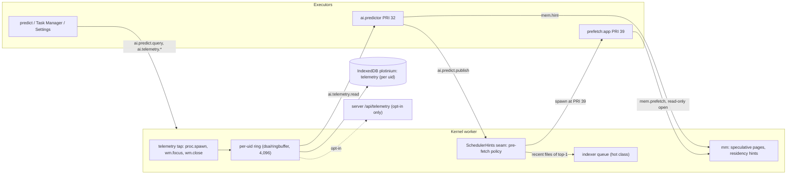

# Subsystem C: Predictive Pre-fetch

| Field | Value |
|---|---|
| Title | Subsystem C: predictive process pre-fetching (telemetry, Markov predictor, `prefetch:*` jobs) |
| Status | Draft v0.1, 2026-09-24 |
| Primary owner | R4 AI (telemetry schema, predictor model, evaluation) |
| Secondary reviewer | R1 Kernel (prefetch jobs, speculative pages, residency hints, launch-latency measurement; R1's AI scheduling hooks, C15) |
| Contributors | R3 WM/UI (Settings → Privacy, Task Manager predictions panel, `window.ready` signal); R5 QA/DevOps (stage-6 boot pre-fetch in the session service, PRE-01 and PRE-04 budgets, the PRE-03 Playwright harness) |
| Must be demonstrable | Week-12 AI checkpoint (skeleton: the predictor predicts and runs a pre-fetch job); **Phase 4 gate, Week 14, tag v0.4.0** (`predict`, launch with and without pre-fetch, speculative pages in the Task Manager); Demo Day pre-fetch demonstration (§17.1) |
| Requirement IDs covered | PRE-01, PRE-02, PRE-03, PRE-04, PRE-05, PRE-06; contributes to §6.3 stage 6 (pre-fetched apps), BOOT-06, BOOT-10, MEM-02, MEM-06, MEM-07, PROC-05, WM-03, SYS-02 (`predict`), §10.1 DAG row (application start-up dependencies); Plotinium IDs AIN-C1..C4 and CPL-C-* (defined in [ai-safety-and-evaluation.md](ai-safety-and-evaluation.md)) |
| Related specs | [ai-safety-and-evaluation.md](ai-safety-and-evaluation.md) · [rag-semantic-search.md](rag-semantic-search.md) · [agentic-shell.md](agentic-shell.md) · [../01-architecture/architecture.md](../01-architecture/architecture.md) · [../01-architecture/syscall-abi.md](../01-architecture/syscall-abi.md) · [../02-boot/boot-and-services.md](../02-boot/boot-and-services.md) · [../03-kernel/processes-and-scheduling.md](../03-kernel/processes-and-scheduling.md) · [../03-kernel/memory-and-paging.md](../03-kernel/memory-and-paging.md) · [../05-wm/window-manager.md](../05-wm/window-manager.md) · [../05-wm/ui-design-system.md](../05-wm/ui-design-system.md) · [../08-dsa/data-structures.md](../08-dsa/data-structures.md) · [../09-database/database.md](../09-database/database.md) · [../11-server/backend-api.md](../11-server/backend-api.md) · [../12-security/security-model.md](../12-security/security-model.md) · [../13-quality/testing-and-performance.md](../13-quality/testing-and-performance.md) |

Conventions: **Spec: MUST (§x, ID)** marks an obligation copied from the capstone specification. **Plotinium design** marks our own choice; RFC 2119 keywords in a Plotinium design item bind the team. Every number taken from the pilot is labelled *(pilot figure — re-measure on the lab machine)*; example command output is labelled *(illustrative output)*.

---

## 1. Purpose and scope

Subsystem C learns, on the device, which application the user will open next and warms it before it is opened, so the launch feels instant. Spec (§12.4): "A local machine-learning model analyses the user's telemetry to predict which applications they will use next. It loads their assets into memory before they are opened." It is the subsystem that most directly makes "AI informs the system" (§3.2 property 4) true: its predictions change what the scheduler runs, which pages the memory manager keeps, and which files the indexer processes first. It is never dropped ([ai-safety-and-evaluation.md §3.13](ai-safety-and-evaluation.md#313-descoping-rule-and-the-week-12-checkpoint)).

In scope: the telemetry event schema and ring buffer; Settings → Privacy (view, clear, export, opt-in); the Witten-Bell interpolated Markov-2 model and its O(1) update; the naive-Bayes challenger rule; the pre-fetch policy and `prefetch:*` jobs; speculative pages; residency hints and indexer ordering; stage-6 boot pre-fetch; `predict` and the Task Manager view; the launch-latency measurement; the evaluation; tests per PRE ID.

Out of scope (linked): the LRU, page tables and reclaim ([memory-and-paging.md](../03-kernel/memory-and-paging.md)); bands, aging and the interactive hint ([processes-and-scheduling.md](../03-kernel/processes-and-scheduling.md)); the session service and bootlog ([boot-and-services.md](../02-boot/boot-and-services.md)); the ring buffer, hash table, heap and DAG implementations ([data-structures.md](../08-dsa/data-structures.md)); the `telemetry_events` DDL ([database.md](../09-database/database.md)).

## 2. Requirements

| ID | Summary | Spec § | How verified |
|---|---|---|---|
| PRE-01 | Spec: MUST — the model trains and runs locally in a worker; one prediction takes ≤ 5 ms | §12.4 | benchmark in an executor worker |
| PRE-02 | Spec: MUST — top-3 accuracy beats the better of the MFU and MRU baselines on the held-out trace | §12.4 | evaluation report (chronological split) |
| PRE-03 | Spec: MUST — for correctly predicted launches, pre-fetching cuts median launch latency by ≥ 30 % | §12.4 | latency comparison, Playwright on the lab machine |
| PRE-04 | Spec: MUST — pre-fetching never slows the foreground: it runs only when idle, at the lowest priority, within free memory, and its pages are evicted first | §12.4 | frame-time trace during pre-fetch; eviction-order tests |
| PRE-05 | Spec: MUST — telemetry stays on the device by default and can be viewed and cleared; syncing it requires opt-in | §12.4 | Settings demonstration; network and storage inspection |
| PRE-06 | Spec: MUST — predictions are visible: `predict` and the Task Manager show current predictions with confidence, and pre-fetch processes appear in `ps` | §12.4 | live demonstration |
| §12.4 Learning | Spec: MUST — the model updates incrementally after each launch; until it has enough data it falls back to most-frequently-used | §12.4 | unit tests of the update rule and cold start |
| §12.4 Evaluation | Spec: MUST — ≥ 500 launch events, chronological train/test split; top-1 and top-3 vs MFU and MRU; launch latency with and without; wasted pre-fetch bytes | §12.4 | evaluation report in AI.md |
| §6.3 stage 6 | Spec: session restore "start pre-fetched applications, record boot timings" | §6.3 | bootlog line, browser test |
| §10.1 DAG | Spec: the DAG covers application start-up dependencies | §10.1 | pre-fetch warms the app's dependency closure resolved by `dsa/dag` |
| AIN-C1..C4 | Plotinium IDs — the four AI-native properties for Subsystem C | §3.2 | [ai-safety-and-evaluation.md §3.1](ai-safety-and-evaluation.md#31-the-four-ai-native-properties-per-subsystem) |

## 3. Design (normative)

### 3.1 Topology and processes



| Name | Kind | PRI | Capabilities | Notes |
|---|---|---|---|---|
| telemetry tap | kernel code (registered by `ai/` through the `SchedulerHints` seam) | — | — | writes events; no network |
| `ai.predictor` | ordinary daemon process on an executor (C2), running as the login uid | 32 (background band) | `ai.telemetry`, `ai.predict` | BLOCKED on `ai:telemetry` between events; service manifest `ai.predictor` requires `sched, storage, login`, non-critical (C17) |
| `prefetch:<app>` | short-lived process spawned by the kernel's pre-fetch policy | **39** (lowest) | `mm.speculative`, `fs.read` (read-only `open`) | never writes; visible in `ps` (PRE-06) |

Spec: MUST (PRE-01): the model trains and runs locally in a worker. Plotinium design: `ai.predictor` runs on an executor worker; there is no dedicated predictor worker (C2 consolidation), and no ML library (the model is ~400 lines of our own code).

### 3.2 Telemetry events and the ring buffer

Spec: MUST (§12.4 Telemetry): "Application launch, focus and close events, with time of day, day of week, the previous application and the position in the session. Events are stored locally in a bounded ring buffer." Plotinium design:

- **What an application is.** A program with a window manifest `/bin/<app>.json` (Terminal, Files, Editor, Task Manager, Settings, and any other windowed app). Shell commands are not applications.
- **Who writes.** The kernel's telemetry tap, from its own events: `proc.spawn` of an application by the user (`launch`), `wm.focus` (`focus`, coalesced: at most one per 1 s and only when the focused app changes), `wm.close` of an application's last window (`close`). Spawns by `prefetch:*` jobs are **never** recorded. Session-restore relaunches are recorded with `origin: 'restore'` and excluded from training.
- **Per uid.** One ring per login uid (C4: the `telemetry` store is per uid). A process can read only its own uid's ring.
- **Ring.** `dsa/ringbuffer` (written by R5, C16) with capacity 4,096 events per uid in memory; each event is also written to the IndexedDB `telemetry` store at key `[uid, 'e:' + (seq mod 4096)]` with durability `relaxed` (C4), so the on-disk copy is bounded too and overwrites the oldest slot.
- **No content.** Events hold application ids only: no file names, paths, window titles or document content (PRE-05; schema test).

```ts
type AppId = string;                         // manifest id, e.g. 'terminal', 'files', 'editor'
type TelemetryEvent = {
  v: 1; seq: number; ts: number;             // ms since epoch
  tzOffsetMin: number;                       // local offset when recorded
  kind: 'launch' | 'focus' | 'close';
  app: AppId;
  prev: AppId | null;                        // previous launched app in this OS session (launch only)
  hourBucket: 0 | 1 | 2 | 3 | 4 | 5;         // floor(localHour / 4)
  dow: 0 | 1 | 2 | 3 | 4 | 5 | 6;            // local day of week, 0 = Sunday
  weekend: boolean;                          // Saturday or Sunday (configurable in Settings)
  sessionPos: number;                        // 1-based launch index within the OS session
  origin: 'user' | 'restore';
  osSessionId: string;
};
```

Two further per-uid rings live in the same store, used only by this subsystem and cleared with the telemetry:
- **recent files per app**: the last 8 inode ids opened for reading by each app's processes (`[uid, 'r:' + app]`); no names are stored, names are resolved at display time;
- **launch latencies**: the last 256 launch measurements (`[uid, 'l:' + (n mod 256)]`, §3.9).

### 3.3 Settings → Privacy

Spec: MUST (PRE-05): viewable and clearable; syncing requires opt-in. Canonical C12: "can be viewed, cleared and exported in Settings > Privacy, with opt-in sync via POST /api/telemetry". Plotinium design (R3 view, R4 syscalls):

| Control | Behaviour |
|---|---|
| Summary | "Usage telemetry stays on this device." Event count, oldest and newest time, predictor mode (`cold start n/50 launches` or `Markov-2`), θ |
| View | table of events, newest first (time, event, app, previous app, position), paginated 100 per page; recent-files lists with names resolved at display time |
| Clear | deletes the ring, the recent-files rings, the latency ring and the model counts for this uid; the predictor restarts in cold start. When sync is on, a checkbox "also delete the copy on the server" (default on) calls `DELETE /api/telemetry` |
| Export | writes `~/telemetry-<YYYYMMDD-HHmm>.jsonl` (mode 600) through the VFS, one event per line; no main-thread download is needed |
| Share with the Plotinium server | **off by default**. Turning it on explains what is sent (the events above, nothing else) and why (restore the predictor on a new device), then calls `PUT /api/telemetry/consent {optIn: true}`. Turning it off stops uploads and offers deletion of the server copy |
| Pre-fetch applications | on by default; turning it off stops `prefetch:*` jobs and residency hints (predictions are still shown). Used by the PRE-03 harness for the "without pre-fetch" runs |

Upload (only when the consent flag is stored locally **and** on the server): the kernel batches new events every 5 min or 100 events with `POST /api/telemetry`; the server returns 403 unless `users.telemetry_opt_in` is true (coherence coverage gap 10). On a new device, after login, an opted-in user's events are fetched with `GET /api/telemetry` and replayed into the model at PRI 39, so the predictor is trained immediately (this is how the demo account's recorded trace reaches a fresh browser on Demo Day).

### 3.4 The model: Witten-Bell interpolated Markov-2 with back-off

Spec: MUST (§12.4 Model): train and run locally; "Justify any model more complex than a Markov chain by showing that it beats one." Canonical C12: Witten-Bell interpolated Markov-2, backing off to Markov-1, then time-bucket MFU, then global MFU; MFU until 50 launches. Implementation `ai/predictor/markov.ts`, written by R4 from first principles.

#### 3.4.1 Notation

- `V`: installed applications (|V| ≤ 32 in practice). Training uses `launch` events with `origin = 'user'` only.
- Contexts for the next launch `a_t`: `c2 = (a_{t−2}, a_{t−1})`, `c1 = a_{t−1}` (both within the OS session; `BOS` pads the session start), `c0 = (hourBucket, weekend)` (12 contexts), and the global context `g`.
- `N(c, a)`: decayed count of launches of `a` in context `c`; `N(c) = Σ_a N(c, a)`; `T(c)` = number of distinct apps with `N(c, a) > ε`, ε = 0.05.

#### 3.4.2 Lazy exponential decay

Every count is stored as `(value, t)`. Its value at time `now` is `value · 2^(−(now − t)/H)` with half-life `H = 14 days` (tuned on the validation slice, §3.10). Because every count in one context decays at the same rate, `N(c)` stored as its own decayed pair equals the sum of its members exactly, so no rescan is ever needed.

#### 3.4.3 Probabilities

```
λ(c)   = N(c) / (N(c) + T(c))                       (λ = 0 when N(c) = 0)
P_G(a) = (N(g, a) + 1) / (N(g) + |V|)               (add-one: every app keeps some mass)
P_0(a) = λ(c0)·N(c0,a)/N(c0) + (1 − λ(c0))·P_G(a)
P_1(a) = λ(c1)·N(c1,a)/N(c1) + (1 − λ(c1))·P_0(a)
P_2(a) = λ(c2)·N(c2,a)/N(c2) + (1 − λ(c2))·P_1(a)
```

Witten-Bell sets the weight of a context from how many different followers it has seen: a context that has led to many different apps (large `T`) trusts its own counts less and backs off more.

Candidates: `C = V \ running apps` (pre-fetching an open app is pointless). The prediction is `P(a) = P_2(a) / Σ_{b∈C} P_2(b)` for `a ∈ C`; the **confidence** of a prediction is its `P(a)`. The top 3 are found in one pass over `C`.

**Cold start** (Spec: "until it has enough data, it falls back to most-frequently-used"): while the uid has fewer than 50 training launches, the ranking is `P_0` (time-bucketed MFU backing off to global MFU) and the reported confidence is 0, so no pre-fetch fires.

**Reason string** (PRE-06): the component with the largest share of `P(top-1)` among `λ2·ML2`, `(1−λ2)λ1·ML1`, the time-bucket term and the global term, e.g. `after Terminal → Files (markov-2, 14 obs)`, `after Files (markov-1, 40 obs)`, `weekday 08:00–12:00 (time bucket, 22 obs)`, `most used overall (cold start 12/50)`.

#### 3.4.4 Update rule, O(1)

On each training launch `a_t` at time `now`:
```
for c in [c2, c1, c0, g]:
    x = counts[c].get(a_t)            // dsa/hashtable (open addressing), O(1) expected
    if x is absent or decayed(x) ≤ ε: T[c] += 1
    counts[c].set(a_t, decayed(x) + 1, now)
    N[c] = decayed(N[c]) + 1 at now
launches += 1
```
Four hash-map updates per launch: O(1) expected, independent of history length (§12.4 Learning: "updates incrementally after each launch"). Prediction reads at most 4·|C| counts: O(|V|), bounded by the installed apps. Counts that decay below ε are pruned when read (T decremented). The model is snapshotted per uid to `[uid, 'model']` (relaxed) every 20 updates and at shutdown; if the snapshot is missing it is rebuilt from the ring.

Memory: at most `(|V|² + |V| + 13)` contexts × |V| counts; ≤ 1 MB budget at |V| = 32.

#### 3.4.5 Naive-Bayes challenger

Plotinium design (RAG record recommendation (c) and reversal trigger 5): categorical naive Bayes over the features `prev1`, `prev2`, `hourBucket`, `weekend`, `sessionPos` bucket {1, 2, 3, 4+}, with Laplace smoothing α = 1 and the same decay:
`score(a) = log P(a) + Σ_i log P(f_i | a)`.
It runs only in the evaluation harness (shadow mode). It **ships only if** its top-3 accuracy on the chronological held-out split beats the Markov model's by **at least 2 percentage points** and it clears PRE-02. It is the third item on the descoping list.

### 3.5 Prefetch policy

Spec: MUST (§12.4 Pre-fetch policy; PRE-04): "When a prediction's confidence passes a threshold *and* the system is idle *and* there is free memory, the scheduler starts a pre-fetch process at the lowest priority. It loads the application's code, warms its caches and pages in its last state. Pre-fetched pages are marked *speculative* and are the first to be evicted." Plotinium design, implemented in the kernel's `SchedulerHints` seam (registered by `ai/`; no-op in the AI-off build):

**When evaluated.** After each `ai.predict.publish`, and when the kernel's idle detector fires.

**Conditions (all must hold):**
1. Pre-fetch is enabled in Settings; not safe mode; the predictor is not in cold start.
2. The top-1 candidate `a` has confidence ≥ θ (θ starts at 0.4 and is tuned on the validation slice, §3.10); `a` is not running; no `prefetch:a` is alive; `a` was not pre-fetched and wasted in the last 10 min.
3. **Idle ≥ 2 s**: no input event (the router's `interactive` hint, pointer, key) for 2 s; no pointer gesture in progress; no process of the interactive band READY or RUNNING.
4. **Free memory**: `budget − accounted − reserved ≥ declaredBytes(a) + 16 MB`, reclaim is not running (accounted below the 85 % mark, C13) and the thrashing guard is off. `declaredBytes(a)` = code chunk sizes + the size of `a`'s last saved state + up to 8 MiB of file warming.
5. At most one `prefetch:*` job at a time (stage-6 jobs run one after another).

**The job.** The kernel spawns `prefetch:<a>` at priority 39 with capabilities `{mm.speculative, fs.read}` as the login uid. Each step below is one quantum; the job yields between steps:
1. **Code.** `mem.prefetch({app: a, kind: 'code'})`: the kernel resolves `a`'s dependency closure from `/bin/<a>.json` with `dsa/dag` (Kahn's algorithm; the same resolver `spawn` uses, §10.1 critic fix), asks an idle executor of the uid's isolation class to `import()` the program chunks (module map warm; no program code runs), and asks the router to add `<link rel="modulepreload">` for the view chunks inside `requestIdleCallback` (fetch and compile, no evaluation). Bytes fetched are counted.
2. **State.** `mem.prefetch({app: a, kind: 'state'})`: pages `a`'s last saved state in from swap (tier 1, or tier 2 on a new device) as **SPECULATIVE** pages tagged with `a`. Admission is reservation-based (C13) but **non-blocking** for pre-fetch: if the reservation cannot be granted without reclaiming non-speculative pages, the call returns `EAGAIN` and the job ends. Checksums are verified as for any page-in (MEM-03).
3. **Files.** For up to 8 inodes in `a`'s recent-files ring: `open(path, 'r')` and `mem.prefetch({kind: 'file', ino})`, which reads the inode and its first blob chunk (≤ 1 MiB) into the kernel cache as speculative pages. `EACCES` or `ENOENT` skips the file.
4. Exit 0. The speculative pages stay in the pool tagged with `a`.

**Speculative pages** ([memory-and-paging.md](../03-kernel/memory-and-paging.md)):
- inserted at the **LRU end**, so reclaim takes them first (victim order: speculative, then minimised windows, then LRU);
- clean by construction (read from swap or the blob store), so eviction is a drop with no swap write;
- **discarded after 5 min** if not adopted (kernel timer heap);
- **adopted** when the user launches `a`: `spawn` finds pages tagged `a`, clears the speculative flag, moves them to the MRU end, and counts them as hit bytes.

**Never slows the foreground (PRE-04).** Priority 39 is the background band: it is pre-empted by every other band at its next yield and paused while the compositor's `interactive` hint is set (at most 1 s in any 2 s window). If accounted memory crosses 85 % while a job runs, the kernel ends the job and discards its speculative pages. A job never writes (`mm.speculative` has no write rights; `fs.read` opens read-only).

**Wasted bytes.** Speculative bytes discarded or evicted without adoption, plus code bytes fetched for an app not launched within 5 min, are counted per job and reported (§3.10).

### 3.6 Residency hints and indexer ordering

Spec: MUST (§3.2 property 4: "Predictions feed back into OS decisions: which applications to pre-load, which memory pages to keep resident, and which background jobs to run first"). Plotinium design (AIN-C4):
- **Residency hint.** After each publish with top-1 confidence ≥ θ, the predictor calls `mem.hint({app: top1, until: now + 60 s})`. While the hint is live, reclaim skips pages belonging to that app's processes (including suspended ones) **once per reclaim pass**, so they are evicted later but never protected forever.
- **Indexer ordering.** The kernel moves pending index work for the files in top-1's recent-files ring into the indexer's `hot` class ([rag-semantic-search.md §3.2.6](rag-semantic-search.md#32-ingestion-pipeline)), so the documents the user is about to open become searchable first.
- **Background job order.** Pre-fetch jobs themselves are ordered by confidence when more than one is eligible (stage 6).

### 3.7 Stage-6 boot pre-fetch

Spec (§6.3 stage 6 Session restore: "Restore windows and layout, start pre-fetched applications, record boot timings"; the reference boot log shows a pre-fetch line). Critic fix. Plotinium design:
- After `desktop-interactive` (the moment BOOT-10 is measured) and once the idle rule holds, the `session` service calls `ai.predict.query({k: 2})`.
- For each prediction in order, if the §3.5 conditions hold, it spawns `prefetch:<app>`; the jobs run one after another.
- Each outcome is written to the boot log, e.g. `session: pre-fetch Terminal (0.62), Files (0.44)`, or `session: pre-fetch skipped (cold start: 12/50 launches)`, `(below θ)`, `(memory)`, `(disabled)`, `(safe mode)`.
- None of this sits on the boot critical path; the boot timing is recorded before it starts.

### 3.8 `predict` and the Task Manager view

Spec: MUST (PRE-06; SYS-02 AI row: `predict`). Command owned here, registered with [shell-and-terminal.md](../07-shell/shell-and-terminal.md):

```
predict [-n N] [--why] [--json] [--latency [APP]] [--eval]
  -n N        number of predictions (default 3, max 10)
  --why       per-component probabilities for each prediction
  --latency   launch latency with and without pre-fetch from the on-device latency ring (§3.9)
  --eval      prequential top-1/top-3 of the model, MFU and MRU on the caller's own trace (runs at PRI 39)
exit: 0 predictions shown · 1 cold start (MFU ranking shown, confidence 0) · 2 error
```

*(illustrative output)*
```
$ predict
MODEL  markov-2 (witten-bell) · 612 launches · θ = 0.40 · updated 10:12
  1  Editor        0.58  after Terminal → Files (markov-2, 14 obs)          pre-fetched
  2  Terminal      0.21  after Files (markov-1, 40 obs)
  3  Task Manager  0.07  weekday 08:00–12:00 (time bucket, 22 obs)
prefetch:editor (pid 311) exited 0 · 6.2 MB speculative · expires 10:17
```

**Task Manager** (R3): a "Predictions" panel shows the top 3 with confidence bars and reasons, θ, the mode, live `prefetch:*` processes (pid, state, bytes), total speculative bytes with their expiry, and today's adopted and wasted bytes. `prefetch:*` processes also appear in the normal process list and in `ps` with PRI 39 (PRE-06).

### 3.9 Launch latency measurement (PRE-03)

Plotinium design:
- **Definition.** `latency = t1 − t0`, where `t0` is the timestamp of the user's launch input (the launcher or taskbar click forwarded by the compositor, or the Enter key of a shell command that opens an app) and `t1` is the app's first interactive frame, signalled by its view with `window.ready` after the first render with state restored (cross-spec request to [window-manager.md](../05-wm/window-manager.md)).
- **On device.** Every launch is recorded in the latency ring with `{app, ms, prefetch: 'hit' | 'miss' | 'none', top1, inTop3}`; `predict --latency` prints medians for pre-fetch hits and for launches without pre-fetch.
- **The PRE-03 claim** comes from a controlled harness, not from the on-device ring: Playwright (`channel: 'chrome'`, `launchPersistentContext`, lab-spec machine) replays the held-out trace twice with the same seed and the same simulated idle gaps (≥ 3 s) and closes, once with pre-fetch on (run A) and once with the Settings switch off (run B). For the launches that were pre-fetched hits in run A, `reduction = 1 − median(A) / median(B)`; target ≥ 30 %. p90 and the all-launch medians are reported too.
- Reversal (Plotinium): if the reduction is < 30 % because code is already served from the Service Worker cache, the next levers are evaluating the view module during idle and paging in state from tier 2 earlier; any lever that adds main-thread work must still pass PRE-04.

### 3.10 Evaluation

Spec: MUST (§12.4 Evaluation). Plotinium design (harness `ai/eval/pre/`, `pnpm eval:pre`):

| Item | Definition |
|---|---|
| Data | ≥ 500 real `launch` events: the team uses Plotinium daily from Week 9 and exports traces with consent (Settings → Export) into `ai/eval/pre/traces/<member>-<date>.jsonl`; the demo account's recorded 600-launch trace. A seeded 3-persona generator produces traces for unit tests only and is never used for the PRE-02 claim |
| Split | per trace, chronological 70 / 30; the last 15 % of the training part is the validation slice for θ and H; the test part is not looked at until the final report |
| Protocol | test-then-train (prequential) on the test part: each method predicts, then learns from the event, so no method sees the future; the same candidate rule (exclude running apps) for every method |
| Baselines | **MFU**: apps ranked by launch count so far; **MRU**: apps ranked by most recent launch time; both updated online |
| Metrics | top-1 and top-3 accuracy (micro-averaged over all held-out launches, plus a per-trace table and bootstrap 95 % intervals by session); prequential curve over the whole trace; PRE-01 prediction latency; PRE-03 medians (§3.9); wasted bytes per hour and per job; pre-fetch precision (adopted ÷ fired) |
| Target | PRE-02: top-3(model) > max(top-3(MFU), top-3(MRU)) on the held-out 30 %; PRE-03: ≥ 30 %; PRE-01: ≤ 5 ms |
| Report | `docs/evidence/ai-eval/<version>/pre.json` and a table in AI.md, per [ai-safety-and-evaluation.md §3.6](ai-safety-and-evaluation.md#36-evaluation-datasets-and-harness) |

### 3.11 Offline behaviour and degradation

Spec: MUST (§12.6: "a local pre-fetch model is unaffected" offline). Plotinium design:

| Situation | Behaviour |
|---|---|
| Offline | fully working; opted-in uploads wait and are sent later |
| Safe mode (BOOT-06) | no `ai.predictor`, no telemetry tap, no `prefetch:*`; `predict` prints `AI services are disabled in safe mode` and exits 2 |
| AI-off litmus build | `predict` is not installed (`command not found`); zero `prefetch:*` processes; Settings → Privacy says no telemetry is collected in this build |
| `ai.predictor` killed or crashed | the service manager restarts it with back-off; while it is down no pre-fetch or hint is issued and `predict` shows the last published prediction marked `stale` |
| IndexedDB `QuotaExceededError` on a telemetry write | the event is kept in memory only; a notice appears in Settings |

### 3.12 AI-native properties of Subsystem C (summary)

Spec: MUST (§3.2; critic fix: C must also "act through typed syscalls"). Full table with named tests: [ai-safety-and-evaluation.md §3.1](ai-safety-and-evaluation.md#31-the-four-ai-native-properties-per-subsystem).

| Property | Mechanism in C |
|---|---|
| Sees via the kernel | the kernel's telemetry tap records `proc.spawn` and `wm.*` events; `ai.predictor` reads them with `ai.telemetry.read` |
| Acts via typed syscalls | `ai.predict.publish`, `mem.hint`; `prefetch:*` jobs call `mem.prefetch` and read-only `open` under `mm.speculative` |
| Scheduled as a process | `ai.predictor` PRI 32; `prefetch:*` PRI 39, only when idle ≥ 2 s, confidence ≥ θ and memory free; killable; visible in `ps` |
| Informs the OS | pre-loads the next app (code, state, files); residency hint for top-1; reorders the indexer queue; stage-6 boot pre-fetch |

## 4. Interfaces and data shapes

### 4.1 System calls (Valibot schemas in `protocol/ai/predict.ts`)

```ts
type Prediction = { app: AppId; confidence: number /* 0..1 */; reason: string; component: 'markov2' | 'markov1' | 'time' | 'global' };
type PredictionSet = { mode: 'coldstart' | 'markov2'; launches: number; theta: number; at: number; predictions: Prediction[] };

// ai.telemetry.read({after: number, limit: number /* ≤ 500 */}) -> TelemetryEvent[]      cap ai.telemetry; BLOCKING when nothing new (ai:telemetry)
// ai.telemetry.list({before?: number, limit: number}) -> TelemetryEvent[]                caller's own uid
// ai.telemetry.clear({server: boolean}) -> { cleared: number }                           caller's own uid
// ai.telemetry.export() -> { path: string; events: number }                              caller's own uid; writes a file
// ai.telemetry.consent({optIn: boolean}) -> { optIn: boolean }                           caller's own uid; calls the server
// ai.predict.publish(PredictionSet) -> void                                              cap ai.predict
// ai.predict.query({k: number /* 1..10 */}) -> PredictionSet                             any user process (own uid)
// ai.predict.latency({app?: AppId}) -> { hit: {n: number; medianMs: number}; none: {n: number; medianMs: number} }
// mem.hint({app: AppId, until: number}) -> void                                          cap ai.predict
// mem.prefetch({app: AppId, kind: 'code' | 'state'} | {kind: 'file', ino: string}) -> { bytes: number; pages: number }   cap mm.speculative
```

### 4.2 Events

| Topic | Emitted by | Data |
|---|---|---|
| `ai.predict` | kernel, on each publish | `PredictionSet` |
| `mem.speculative` | mm | `{app, bytes, event: 'added' \| 'adopted' \| 'discarded' \| 'evicted'}` |
| `window.ready` | view via the kernel (cross-spec) | `{wid, pid, app, t}` |

### 4.3 HTTP (mounted by [backend-api.md](../11-server/backend-api.md); `AI=0` removes them)

```http
PUT    /api/telemetry/consent {optIn: boolean}            → 200 {optIn}
POST   /api/telemetry         {events: TelemetryEvent[] /* ≤ 500 */}
       → 200 {accepted, lastSeq} | 403 {errno:'EACCES', reason:'no-consent'} | 422 {errno:'EINVAL'}
GET    /api/telemetry?after=<seq>&limit=500               → 200 {events, nextAfter} | 403 (no consent)
DELETE /api/telemetry                                     → 200 {deleted}
```
Only the session's own uid is ever read or written; the uid comes from the session.

### 4.4 SQL (normative shape; DDL owned by [database.md](../09-database/database.md))

```sql
ALTER TABLE users ADD COLUMN telemetry_opt_in boolean NOT NULL DEFAULT false;
CREATE TABLE telemetry_events (
  uid          int NOT NULL REFERENCES users(uid) ON DELETE CASCADE,
  seq          bigint NOT NULL,
  ts           timestamptz NOT NULL,
  kind         text NOT NULL CHECK (kind IN ('launch','focus','close')),
  app          text NOT NULL,
  prev         text,
  hour_bucket  smallint NOT NULL CHECK (hour_bucket BETWEEN 0 AND 5),
  dow          smallint NOT NULL CHECK (dow BETWEEN 0 AND 6),
  weekend      boolean NOT NULL,
  session_pos  int NOT NULL CHECK (session_pos >= 1),
  origin       text NOT NULL CHECK (origin IN ('user','restore')),
  PRIMARY KEY (uid, seq)
);
```
Inserts are accepted only when `users.telemetry_opt_in` is true for the session uid (checked in the same statement's transaction).

## 5. Algorithms and invariants

### 5.1 Invariants

- **I-C1 (local by default).** No telemetry byte leaves the device unless the consent flag is stored both locally and on the server (PRE-05).
- **I-C2 (no feedback loop).** Spawns by `prefetch:*` jobs are never recorded as launches, and session-restore launches never train the model.
- **I-C3 (read-only jobs).** A `prefetch:*` job never writes to the VFS, swap or any store.
- **I-C4 (evicted first).** No non-speculative page is evicted while a speculative page is resident (PRE-04).
- **I-C5 (never blocking).** A pre-fetch reservation never blocks and never causes reclaim of non-speculative pages.
- **I-C6 (no content).** Telemetry holds app ids and times only.
- **I-C7 (one uid).** A process reads only its own login uid's telemetry, model and predictions.

### 5.2 Complexity

| Operation | Cost |
|---|---|
| Record an event (ring push + one relaxed IndexedDB put) | O(1) |
| Model update per launch | O(1) expected (4 hash-map updates) |
| Prediction (top-3) | O(\|V\|), with \|V\| ≤ 32 installed apps |
| Policy decision | O(1) |
| Dependency closure for `a` | O(V_a + E_a) with Kahn's algorithm (`dsa/dag`) |
| Speculative discard timer | O(log n) timer-heap push/pop |

### 5.3 Prequential evaluation

```
for e in trace (chronological):
  if e is a training launch:
    if e in test part: for m in methods: record(m.predictTop3(context(e)) contains e.app, top-1 hit)
    for m in methods: m.update(e)            // learn only after predicting
```

## 6. Errors and edge cases

| Situation | errno / outcome |
|---|---|
| `ai.telemetry.read` from a process without `ai.telemetry` | `EPERM` |
| `mem.prefetch` from a process without `mm.speculative` | `EPERM` |
| `mem.prefetch` state reservation cannot be granted without evicting non-speculative pages | `EAGAIN`; the job ends |
| App has no saved state | `mem.prefetch` state step returns `{bytes: 0}`; code and files still warm |
| Recent file removed or no longer readable | `ENOENT` / `EACCES`; skipped |
| `predict` in cold start | exit 1, MFU ranking with confidence 0 |
| `k` or `limit` out of range | `EINVAL` |
| Telemetry upload without server consent | 403 → `EACCES`; uploads stop, the Settings toggle shows "not enabled on the server" |
| Clock jumps backwards (manual change) | decay uses `max(0, now − t)`; events keep their recorded `ts` |
| AI-off build | `ENOSYS` for `ai.telemetry.*`, `ai.predict.*`; `mem.hint` and `mem.prefetch` remain kernel calls with no caller |
| Safe mode | `EAIUNAVAIL` with `detail.reason = 'safe-mode'` for `ai.predict.query` |

## 7. Performance budgets

| Metric | Budget | Source | Gate |
|---|---|---|---|
| One prediction (top-3), p95, in an executor worker | ≤ 5 ms (internal target ≤ 0.1 ms) | Spec PRE-01; RAG record pass criterion | bench, every PR (deterministic) |
| Model update per launch, p95 | ≤ 1 ms | Plotinium | bench |
| Frame p95 with 10 windows while a `prefetch:*` job runs | ≤ 16.7 ms and 0 LoAF > 50 ms from our scripts | PRE-04, C13 | nightly, lab-spec runner |
| Pre-fetch job CPU per quantum | ≤ 20 ms (background band quantum) | PROC-03 bands | trace |
| Median launch latency reduction on correct predictions | ≥ 30 % | Spec PRE-03 | release, lab machine |
| Model memory with 32 installed apps | ≤ 1 MB | Plotinium | unit |
| Telemetry ring in memory (4,096 events) | ≤ 512 KB | Plotinium | unit |
| Wasted pre-fetch bytes | measured and reported per hour; no gate | §12.4 | release |
| Boot time with stage-6 pre-fetch | unchanged (it starts after desktop-interactive) | BOOT-10 | nightly |

## 8. Test plan

Vitest projects: `unit`, `browser`, `bench`, `ai-eval`; the PRE-03 harness is a Playwright performance test. Every title starts with its requirement ID (C18).

| Test title | Project | Notes |
|---|---|---|
| PRE-01 one prediction takes at most 5 ms p95 in an executor worker with 32 apps and 5,000 events of history | bench | also reports the 0.1 ms internal target |
| PRE-01 the incremental model equals a model rebuilt in batch from the same events | unit (fast-check) | |
| PRE-01 Witten-Bell probabilities over the candidate set sum to 1 | unit (fast-check) | |
| PRE-01 decayed counts halve after 14 days and context totals equal the sum of their members | unit | |
| PRE-01 with fewer than 50 launches the ranking is time-bucketed MFU with confidence 0 | unit | cold start |
| PRE-01 ai.predictor runs on an executor worker and appears in ps with PRI 32 | browser | |
| PRE-02 top-3 accuracy beats the better of MFU and MRU on the chronological held-out 30 % | ai-eval | real traces |
| PRE-02 the evaluation never trains any method on an event before predicting it | unit | leakage guard |
| PRE-02 naive Bayes ships only if it beats Markov top-3 by at least 2 points | ai-eval | shadow mode |
| PRE-03 median launch latency of correctly predicted launches drops by at least 30 % with pre-fetch | perf (lab machine) | runs A/B, §3.9 |
| PRE-03 launch latency is measured from the input event to window.ready | browser | |
| PRE-04 frame p95 stays at or under 16.7 ms with no LoAF over 50 ms from our scripts while a prefetch job runs with 10 windows | perf (nightly) | |
| PRE-04 no prefetch job starts within 2 s of user input | browser | |
| PRE-04 no prefetch job starts when free memory is below the app's bytes plus 16 MB | unit | |
| PRE-04 speculative pages are evicted before any non-speculative page | unit | I-C4 |
| PRE-04 speculative pages not adopted within 5 minutes are discarded | unit (fake clock) | |
| PRE-04 a prefetch job runs at PRI 39 and is paused during a pointer gesture | browser | |
| PRE-04 a prefetch state reservation that would evict non-speculative pages returns EAGAIN | unit | I-C5 |
| PRE-04 a prefetch job cannot write: a write syscall from it fails with EPERM | unit | I-C3 |
| PRE-05 with sync off no request is made to /api/telemetry | browser | network log |
| PRE-05 POST /api/telemetry is refused with 403 unless the server-side opt-in is stored | integration | |
| PRE-05 Settings Privacy lists the events and Clear empties the ring and resets the model to cold start | browser | |
| PRE-05 export writes a JSON Lines file with mode 600 | browser | |
| PRE-05 telemetry events contain no file names, paths or content | unit | schema; I-C6 |
| PRE-05 one uid cannot read another uid's telemetry | browser | I-C7 |
| PRE-05 pre-fetch spawns and session-restore launches are not used for training | unit | I-C2 |
| PRE-06 predict prints the top 3 with confidence and a reason | browser | |
| PRE-06 the Task Manager shows current predictions and live prefetch processes | browser | |
| PRE-06 prefetch:app appears in ps while it runs | browser | |
| BOOT-10 stage-6 pre-fetch starts after desktop-interactive and does not change the measured boot time | browser | |
| AIN-C4 after desktop-interactive the session service pre-fetches the top-k apps and logs them in bootlog | browser | §3.7 |
| AIN-C4 a live residency hint makes reclaim skip the predicted app's pages once per pass | unit | |
| CPL-C-VFS pre-fetch warms the predicted app's recent files and raises the inode-cache hit ratio at launch | browser | warm-cache hit ratio |
| CPL-C-SCHED the pre-fetch job warms the app's whole dependency closure resolved by dsa/dag | unit | §10.1 |
| AIN-C2 prefetch jobs act only through mem.prefetch and read-only open | unit | capability test |

## 9. Open questions and cross-spec requests

Open questions:
1. Does "start pre-fetched applications" in §6.3 stage 6 require actually opening windows, or is warming code, state and files (our reading, matching §12.4 "loads their assets into memory before they are opened") enough?
2. Is the weekend Saturday–Sunday for the lab's users, or Sunday only? The flag is configurable; the default affects the time-bucket context.
3. Can the demo account's 600-launch trace be recorded from genuine team use (not generated), so the PRE-02 claim on Demo Day rests on real data?
4. θ = 0.4 is a starting value; if the validation slice favours a very low θ, is the resulting wasted-bytes figure acceptable to the examiners?

Cross-spec requests:
- [syscall-abi.md](../01-architecture/syscall-abi.md): add `ai.telemetry.read|list|clear|export|consent`, `ai.predict.publish|query|latency`, `mem.hint`, `mem.prefetch` (§4.1); capabilities `ai.telemetry`, `ai.predict`, `mm.speculative`; event topics `ai.predict`, `mem.speculative`, `window.ready`; `waitingOn` value `ai:telemetry`.
- [memory-and-paging.md](../03-kernel/memory-and-paging.md): speculative pages tagged with an app id, inserted at the LRU end, discarded after 5 min, adopted by `spawn`; non-blocking reservation for `mem.prefetch` (`EAGAIN` instead of reclaim); `mem.hint` skips the hinted app's pages once per reclaim pass; wasted and adopted byte counters exposed to `vmstat` and the Task Manager.
- [processes-and-scheduling.md](../03-kernel/processes-and-scheduling.md): an idle detector (no input for 2 s, no interactive-band process READY or RUNNING) that the `SchedulerHints` seam can subscribe to; `prefetch:*` spawned at priority 39.
- [boot-and-services.md](../02-boot/boot-and-services.md): the `session` service's stage-6 step (§3.7) and its bootlog line format; safe mode skips `ai.predictor`.
- [window-manager.md](../05-wm/window-manager.md): views signal `window.ready` after the first interactive frame; the compositor forwards the launch input timestamp `t0`.
- [virtual-file-system.md](../04-vfs/virtual-file-system.md): the `telemetry` store key scheme `[uid, 'e:'|'r:'|'l:'|'model'…]`, durability `relaxed`.
- [database.md](../09-database/database.md): `users.telemetry_opt_in` and the `telemetry_events` DDL in §4.4, with a down migration.
- [backend-api.md](../11-server/backend-api.md): mount the telemetry routes in §4.3; own uid only; removed when `AI=0`.
- [data-structures.md](../08-dsa/data-structures.md): `dsa/ringbuffer` (R5) used for the telemetry ring; `dsa/dag` exposes the application-closure resolver shared by `spawn` and `mem.prefetch`.
- [shell-and-terminal.md](../07-shell/shell-and-terminal.md): register `predict` and its man page.
- [ui-design-system.md](../05-wm/ui-design-system.md): Settings → Privacy and the Task Manager "Predictions" panel components (confidence bar, event table).
