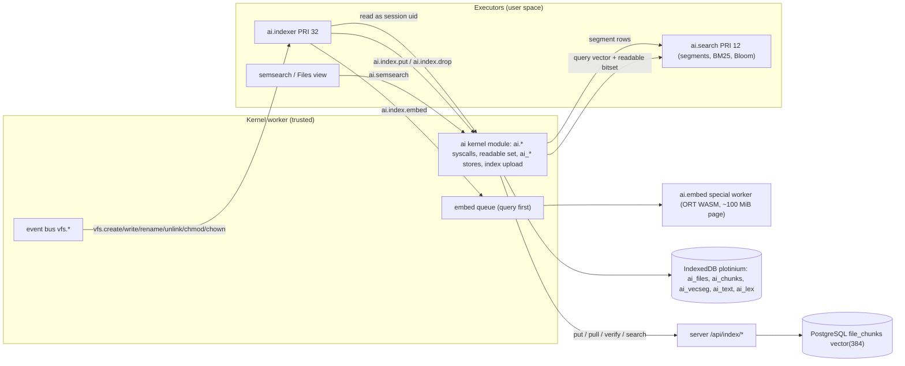
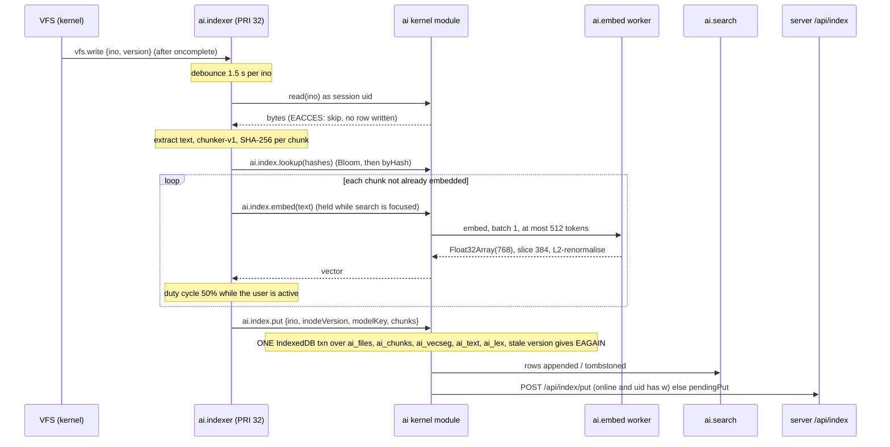
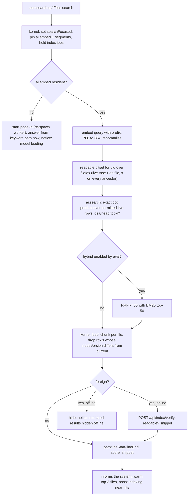

# Subsystem A: RAG Semantic Search

| Field | Value |
|---|---|
| Title | Subsystem A: semantic VFS search (RAG pipeline) |
| Status | Draft v0.1, 2026-09-24 |
| Primary owner | R4 AI (embedding pipeline, indexer, vector search, Bloom filter) |
| Secondary reviewer | R2 VFS/DB (`file_chunks`, index API, readable-set SQL) |
| Contributors | R3 WM/UI (BM25 keyword index, snippets and citations, Files search UI; R3's second subsystem, C15); R1 Kernel (ai.embed page accounting, indexer throttling, segment paging; R1's AI scheduling hooks, C15); R5 QA/DevOps (`rag-leak` gate, RAG-05 budget, ai-eval CI project) |
| Must be demonstrable | Week-12 AI checkpoint (skeleton: one file indexed and answered by `semsearch`); **Phase 4 gate, Week 14, tag v0.4.0**; Demo Day hidden semantic query (§17.1) |
| Requirement IDs covered | RAG-01, RAG-02, RAG-03, RAG-04, RAG-05, RAG-06; contributes to MEM-01, MEM-06, MEM-07, BOOT-06, BOOT-07, BOOT-10, OFF-04, SYS-01, SYS-02, DB-02; Plotinium IDs AIN-A1..A4 and CPL-A-* (defined in [ai-safety-and-evaluation.md](ai-safety-and-evaluation.md)) |
| Related specs | [ai-safety-and-evaluation.md](ai-safety-and-evaluation.md) · [agentic-shell.md](agentic-shell.md) · [predictive-prefetch.md](predictive-prefetch.md) · [../01-architecture/architecture.md](../01-architecture/architecture.md) · [../01-architecture/syscall-abi.md](../01-architecture/syscall-abi.md) · [../02-boot/boot-and-services.md](../02-boot/boot-and-services.md) · [../03-kernel/processes-and-scheduling.md](../03-kernel/processes-and-scheduling.md) · [../03-kernel/memory-and-paging.md](../03-kernel/memory-and-paging.md) · [../04-vfs/virtual-file-system.md](../04-vfs/virtual-file-system.md) · [../06-sync/offline-and-sync.md](../06-sync/offline-and-sync.md) · [../07-shell/shell-and-terminal.md](../07-shell/shell-and-terminal.md) · [../08-dsa/data-structures.md](../08-dsa/data-structures.md) · [../09-database/database.md](../09-database/database.md) · [../11-server/backend-api.md](../11-server/backend-api.md) · [../12-security/security-model.md](../12-security/security-model.md) · [../13-quality/testing-and-performance.md](../13-quality/testing-and-performance.md) · [../14-devops/deployment-and-ci.md](../14-devops/deployment-and-ci.md) · [../15-decisions/stack-decisions.md](../15-decisions/stack-decisions.md) |

Conventions: **Spec: MUST (§x, ID)** marks an obligation copied from the capstone specification. **Plotinium design** marks our own choice; RFC 2119 keywords in a Plotinium design item bind the team, not the examiners. Every number taken from the pilot is labelled *(pilot figure — re-measure on the lab machine)*.

---

## 1. Purpose and scope

Subsystem A lets a user find files by meaning (`semsearch "where did I discuss the memory leak in the UI component"`) and returns ranked chunks with `path:line` citations and snippets. It is an operating-system service, not an app: it is fed by VFS change events, indexes as a scheduled background process, reads files only through system calls as the user, filters by the user's **current** permissions before ranking, and stores its authoritative vectors next to the inode table in PostgreSQL.

In scope:
- ingestion: VFS events → `ai.indexer` → text extraction → `chunker-v1` → embedding in the `ai.embed` worker → client index + `file_chunks`;
- incremental updates (content hash, rename without re-embedding, delete);
- the client vector index (Float32 segments as pageable pages), BM25 keyword index, Bloom filter;
- the query path (query embedding, readable set, exact top-k with `dsa/heap`, hybrid/fallback, citations);
- server verification of foreign-owned results, `index put/pull/search/verify`, precomputed seed vectors;
- model configuration, self-hosting, memory accounting of `ai.embed`;
- offline behaviour and graceful degradation;
- tests per RAG ID.

Out of scope (owned elsewhere, linked): the `file_chunks` DDL and migrations ([database.md](../09-database/database.md)), route mounting and auth ([backend-api.md](../11-server/backend-api.md)), the pager ([memory-and-paging.md](../03-kernel/memory-and-paging.md)), the four AI-native properties table, coupling map, eval harness and litmus job ([ai-safety-and-evaluation.md](ai-safety-and-evaluation.md)). The optional LLM answer with `path:line` claims (§12.2 "Answering") is an extra; it is specified briefly in §3.11 and is the first item on the descoping list ([ai-safety-and-evaluation.md §3.13](ai-safety-and-evaluation.md#313-descoping-rule-and-the-week-12-checkpoint)).

## 2. Requirements

| ID | Summary | Spec § | How verified |
|---|---|---|---|
| RAG-01 | Spec: MUST — the indexer is a scheduled background process: visible in `ps`, low priority, throttled while the user is active | §12.2 | e2e: `ps`/`top` during typing show `ai.indexer` PRI 32, throttled duty cycle, paused on search focus |
| RAG-02 | Spec: MUST — create, modify, rename and delete of a 50 KB text file are reflected within 30 s | §12.2 | timed browser test under a typing simulator |
| RAG-03 | Spec: MUST — no result ever includes content the querying user cannot read (current permissions, zero leaks) | §12.2, Fig. 12.1 | `rag-leak` suite (client + server), 0 leaks, CI gate |
| RAG-04 | Spec: MUST — Recall@5 ≥ 0.80 on the team's evaluation set, MRR reported; hidden set at defence | §12.2 | ai-eval project (recorded embeddings), evaluation report |
| RAG-05 | Spec: MUST — retrieval latency p95 ≤ 500 ms over ≥ 10,000 chunks, excluding answer generation | §12.2 | nightly benchmark on the lab-spec runner (warm model; also with the indexer active; cold reload reported separately, C13) |
| RAG-06 | Spec: MUST — integrated into the shell (`semsearch`) and File Explorer; falls back to keyword search with a clear notice when the model is unavailable | §12.2 | live and offline e2e |
| MEM-01/06/07 (contrib.) | Spec: MUST — WebAssembly memory is declared (§9.2); accounted memory never exceeds the budget for > 1 s; per-process memory is shown | §9.2 | `ai.embed` declared page; `mem-evict-embed` test; `free` line |
| BOOT-06/07 (contrib.) | Spec: MUST — safe mode starts no AI services; a failing non-critical AI service degrades the boot instead of halting it | §6.5 | safe-mode e2e; boot with `/models` blocked |
| BOOT-10 (contrib.) | Spec: MUST — warm ≤ 1.5 s / cold ≤ 3.0 s; model weights load only after the desktop is interactive | §6.5 | boot test asserts no `/models` or `/ort` request before desktop-interactive |
| OFF-04 (contrib.) | Spec: MUST — degraded services are listed in the taskbar | §9.5 | taskbar degraded badge when the model cannot load |
| SYS-01/02 (contrib.) | Spec: MUST — AI reaches files only through syscalls; `semsearch` is part of the command set | §9.6 | SYS-01 bypass suite (executor shadowing); scripted session |
| DB-02 (contrib.) | Spec: MUST — vectors are removed inside the same transaction as `rm -r` | §11.5 | fault-injected `rm -r` leaves no stray `file_chunks` rows |
| AIN-A1..A4 | Plotinium IDs — the four AI-native properties (§3.2) for Subsystem A | §3.2 | see [ai-safety-and-evaluation.md §3.1](ai-safety-and-evaluation.md#31-the-four-ai-native-properties-per-subsystem) |

## 3. Design (normative)

### 3.1 Topology



Processes and special workers (Plotinium design, applying canonical C2):

| Name | Kind | Where | PRI (priority + nice) | Capabilities | Visible in `ps` |
|---|---|---|---|---|---|
| `ai.embed` | kernel-service entry with a pid, owning the **special** `ai.embed` worker | its own worker (ORT WASM, `numThreads = hwc >= 8 ? 2 : 1`, and 1 when not cross-origin isolated) | n/a (not scheduled; one job at a time) | kernel-only port | yes, with the declared ~100 MiB page as RSS; `kill` evicts the model (`worker.terminate()`) and the kernel re-spawns it on the next query |
| `ai.search` | ordinary daemon process | executor | 12 + 0 = 12 (normal band) | `ai.search.serve` | yes |
| `ai.indexer` | ordinary daemon process | executor | 22 + 10 = **32** (background band, niced) | `ai.index`, `fs.read` | yes |
| `semsearch` | command process | executor | inherits the shell | `ai.search`, `fs.read` (user defaults) | yes (short-lived) |

- Spec: MUST (§3.2 property 3, RAG-01): indexing and inference run as processes with IDs, priorities and memory budgets, appear in `ps`, can be killed, and are throttled while the user is active.
- Plotinium design: `ai.indexer` and `ai.search` run as the **logged-in session uid** (never root; after `su` the indexer keeps the login uid). One kernel per origin (C2) means one indexer per origin; no leader election is needed.
- Plotinium design: the priority/nice split (22 + 10) is our encoding of "priority 32, niced"; `ps` shows `PRI 32 NI 10`. Bands, quanta and aging are owned by [processes-and-scheduling.md](../03-kernel/processes-and-scheduling.md).

Service manifests (C17, owned by [boot-and-services.md](../02-boot/boot-and-services.md)): `ai.runtime` (requires `sched, mm`; non-critical; its `start()` only registers the ai syscall table and the `FsSemanticSearch` seam and spawns `ai.search`; < 50 ms, no network); `ai.indexer` (requires `ai.runtime, vfs, session`; non-critical). Spec: MUST (BOOT-06): safe mode starts neither; §3.12 defines what `semsearch` does then.

### 3.2 Ingestion pipeline



**3.2.1 Triggers.** Plotinium design:
- `ai.indexer` subscribes with `sys.subscribe` to `vfs.create`, `vfs.write`, `vfs.rename`, `vfs.unlink`, `vfs.chmod`, `vfs.chown` (Spec: MUST, §3.2 property 1: events reach AI on the kernel's event bus). The bus delivers an event only if the subscriber's uid has `r` on the parent and `x` on its ancestors ([syscall-abi.md](../01-architecture/syscall-abi.md)).
- A 1.5 s debounce per ino coalesces bursts (editor autosave).
- **Reconciliation at start** (durable consumers never rely on the bus alone): the indexer reads `ai.index.status({files:true})` and compares each `(ino, inodeVersion, modelKey)` with the current tree through chunked read-only `readdirPlus` scans; it enqueues stale or missing files, enqueues own files whose per-uid text rows (`ai_text`, `ai_lex`) are missing (re-tokenise only, no re-embedding), and calls `ai.index.drop` for inos that no longer exist.
- Files the session uid cannot read are skipped and no row is written; a later session whose uid can read them indexes them during its own reconciliation.

**3.2.2 Eligibility.** Plotinium design. A file is indexed when all hold:
1. it is a regular file (`type='f'`), reachable under `/home/**` or `/mnt/**`, not under a dot-directory (`.trash`, `.cache`, `.config`);
2. size ≤ 2 MiB;
3. no NUL byte in the first 8 KiB and valid UTF-8 (lossy decoding is not allowed);
4. the extension is in the text/Markdown/source list (`.txt .md .markdown .rst .ts .tsx .js .jsx .mjs .py .c .h .cpp .hpp .java .go .rs .css .html .json .yaml .yml .toml .sql .sh`) or the file has no extension and passes rule 3.

Files failing rules 2–4 are not embedded; they remain findable by **name** because the BM25 name field is computed from the live tree at query time (§5.4). Files failing rule 1 are ignored.

**3.2.3 Text extraction.** Spec: MUST (§12.2 Ingestion): plain text, Markdown and source code at minimum. Plain text and source code: the decoded text as is. Markdown: the raw text (headings are kept because `chunker-v1` uses them; front matter is kept). HTML: tags are stripped with a tokenizer-level strip (no DOM parsing, no `innerHTML`, lint rule `no-html-sinks`). Line numbers are counted on the original text so citations point to real lines.

**3.2.4 `chunker-v1`.** Plotinium design, `ai/indexer/chunker.ts`. Spec: MUST (§12.2): overlapping chunks that respect paragraph and heading boundaries.
- Token counting uses the embedding model's own uncased BERT WordPiece tokenizer (30,522 tokens; identical vocabulary for the primary and fallback models), via `AutoTokenizer` loaded in the indexer from the same self-hosted `tokenizer.json`.
- **Blocks.** Markdown: ATX and setext headings start sections; fenced code blocks, tables and list items are atomic blocks; paragraphs split on blank lines. Code: split at blank lines at brace or indentation depth 0 and before declaration lines (`function`, `class`, `def`, `fn`, `export`, `interface`, `struct`). Plain text: paragraphs.
- **Packing.** Greedy within a section. Target 400 tokens, minimum 120 (a smaller tail merges into the previous chunk of the same section), maximum 480. A block over 480 tokens is split at sentence boundaries (prose) or line boundaries (code).
- **Overlap.** The trailing 40–80 tokens (whole sentences or whole lines) of the previous chunk, only inside the same section.
- **Header.** The in-file heading trail only (e.g. `LRU > Eviction`), at most 24 tokens. It contains **no file name**, so a rename never changes a chunk's hash (Spec: MUST, §12.2 "a rename updates path metadata without re-embedding"). The header is embedded but never shown in snippets.
- **Invariant.** `[CLS] + header + chunk + [SEP] ≤ 512` tokens (unit-tested; the Embedder also truncates defensively and logs if truncation ever triggers).
- **Chunk record.** `{seq, byteStart, byteEnd, lineStart, lineEnd, header, text, contentHash}` where `contentHash = SHA-256(modelKey ‖ 0x00 ‖ header ‖ 0x00 ‖ text)` via `crypto.subtle`.
- `chunkerVersion = 'chunker-v1'` is part of `modelKey`; any change to the rules above bumps it and triggers a background re-index.

**3.2.5 Embedding.** Plotinium design, applying canonical C12:
- The indexer calls `ai.index.embed({text, header, kind:'doc'})`; the kernel queues the job for `ai.embed`. The kernel's embed queue is a two-level queue: **query jobs always go first**; at most one job is in flight (Transformers.js serialises inference). A query therefore waits at most one in-flight index chunk, and none while search is focused (§3.2.6).
- Batch size is always 1 and input ≤ 512 tokens (unit-tested). A batched call grows ORT's WebAssembly memory permanently: 397 MiB after one 8×512 batch *(pilot figure — re-measure on the lab machine)*.
- Output: 768-d unit vector (`sentence_embedding`); `v.slice(0, 384)` then L2-renormalise (MRL truncation). Stored as Float32 (little-endian).
- Documents get no prefix. Queries get the prefix `Represent this sentence for searching relevant passages: `.

**3.2.6 Scheduling and throttling (RAG-01).** Plotinium design:
- One **quantum** of indexing work is one chunk embedding. The indexer is BLOCKED (`waitingOn: 'ai:embed'`) while `ai.embed` computes, so the executor is free; ORT threads are accounted by the run-token clamp `clamp(hwc − 2 − (embedActive ? ortThreads : 0), 1, 6)` (C2).
- **Active user throttle.** If the router reported user input in the last 1 s, the indexer sleeps (`sleep`, timer heap) after each chunk for as long as the last embedding took: a 50 % duty cycle. When idle for ≥ 1 s, 100 %.
- **Search-focus pause.** While any search UI has focus or a `semsearch` is running, the kernel holds index embed jobs (`waitingOn: 'ai:search-focus'`). Query embeds proceed immediately.
- **Deadline-aware aging.** A file pending more than 15 s is exempt from the duty-cycle sleep, and its job moves to the head of the indexer's queue, so RAG-02's 30 s holds under continuous typing. The main thread is never involved, so frame time is unaffected (PROC-05).
- **Queue.** The indexer's work queue is a `dsa/heap` keyed by `(class, enqueuedAt)`. Classes, highest first:
  1. `deadline`: pending > 15 s;
  2. `hot`: a file written by the user in the last 60 s; a file in the recent-files ring of the app predicted next ([predictive-prefetch.md §3.6](predictive-prefetch.md#36-residency-hints-and-indexer-ordering)); a file touched by a committed agent plan ([agentic-shell.md §3.15](agentic-shell.md#315-informs-the-system));
  3. `hit`: a pending file in a directory that produced a search hit in the last 5 min (§3.5 step 9);
  4. `normal`;
  5. `backfill`: reconciliation and re-index after a model change.

**3.2.7 RAG-02 budget.** `T = 1.5 s debounce + read + chunk + N × t_chunk / duty + commit`. For a 50 KB source file (46 chunks) the pilot measured 5.9 s at 100 % duty with 2 threads and 9.8 s with 1 thread *(pilot figures — re-measure on the lab machine)*; at 50 % duty with deadline aging after 15 s the worst case is about 20 s, inside 30 s *(derived from pilot figures — re-measure on the lab machine)*. Reversal (RAG record, trigger 2): if 50 KB takes > 15 s at 100 % duty on the lab machine, move to 256-token chunks or bulk indexing on the server.

### 3.3 Incremental updates

Plotinium design, satisfying Spec: MUST (§12.2 "Incremental updates"):

| Event | Action | Re-embeds |
|---|---|---|
| `vfs.write` (content change) | re-read, re-chunk; for each chunk, reuse the stored vector when `contentHash` is already present (Bloom filter first, then the `byHash` index); embed only new hashes; `ai.index.put` replaces the file's chunk set atomically | only changed chunks |
| `vfs.rename` / move | nothing stored changes: chunks are keyed by `ino`, the header has no file name, and both the path (citations) and the BM25 name field are read from the live tree at query time | none |
| `vfs.unlink` (last link) | the indexer calls `ai.index.drop({ino})`, which tombstones the file's rows and deletes its `ai_text`/`ai_lex` rows in one IndexedDB transaction. Before that runs, the file can never appear in a result because the readable set is built from the live tree (I-A9). On the server, `ON DELETE CASCADE` removes `file_chunks` rows inside the same `vfsTxn` as the unlink (DB-02) | none |
| `vfs.chmod` / group change | nothing to re-index: the filter reads the current tree at query time; the kernel bumps its `permEpoch`, which invalidates cached readable bitsets | none |
| `vfs.chown` | as chmod, plus the old owner's `ai_text`/`ai_lex` rows for that ino are deleted (the text now belongs to a foreign-owned file for them, I-A3); the new owner's rows are rebuilt by the next reconciliation of the new owner's session | none |
| model or chunker change (`modelKey` differs) | background re-index in class `backfill`; queries filter on the current `modelKey`, so mixed indexes never mix vectors | all, in the background |

Compaction: when tombstoned rows exceed 20 % of a segment set, the kernel rewrites segments (new `generation`), rebuilds the row map and the Bloom filter, in a background job at PRI 39.

### 3.4 Client index layout

Plotinium design. One IndexedDB database `plotinium` per device (C4). Vectors and chunk metadata are **per device**, keyed by ino; permission filtering happens at query time, so one index serves every user on the device. Chunk **text** is **per uid** and exists only for files the uid owns (critic fix for RAG-03: "for foreign-owned chunks, store vectors only"). Requested stores (cross-spec request, §9):

| Store | Key | Holds |
|---|---|---|
| `ai_files` | `ino` | `{ino, inodeVersion, modelKey, fileIdx, rowIds[], state: 'indexed'\|'skipped'\|'stale', localOnly: boolean, pendingPut: boolean, indexedAt}` |
| `ai_chunks` | `[ino, seq]`, index `byHash` on `contentHash`, index `byRow` | `{ino, seq, inodeVersion, byteStart, byteEnd, lineStart, lineEnd, contentHash, modelKey, segId, row}`, with **no text** |
| `ai_vecseg` | `segId` | `{segId, generation, dims:384, rows:1024, vectors: ArrayBuffer(1024·384·4), rowFile: ArrayBuffer(Int32 1024), rowSeq: ArrayBuffer(Int32 1024), live: ArrayBuffer(bitset), sha256}` |
| `ai_text` | `[uid, ino, seq]` | `{preview (≤ 240 chars), modelKey}`, written only when `uid` owns `ino` at index or pull time |
| `ai_lex` | `[uid, shard]` (shard = term-hash mod 64) | BM25 body postings `{term → [(row, tf)]}` and per-row lengths, only for rows of files owned by `uid` |

- The `uid` component of `ai_text` and `ai_lex` is a storage partition, never a permission input: every permission decision uses the live tree (I-A1, I-A2).
- Plotinium design: the stores exist in every build (including the litmus AI-off build), so turning AI on or off needs no IndexedDB schema migration; with `__AI__=false` nothing reads or writes them.

Segments as pages:
- A segment is 1,024 rows × 384 dims × 4 bytes = 1.5 MiB of vectors plus row maps. Segments are **pages in `ai.search`'s page table** ([memory-and-paging.md](../03-kernel/memory-and-paging.md)), declared with `mem.declare`, each with its SHA-256.
- Because `ai_vecseg` is the durable backing copy, a clean segment is evicted by dropping it (no swap write) and paged in by reading `ai_vecseg` and verifying the checksum. A paged-in segment must be byte-identical to the evicted one (test `CPL-A-MEM`).
- Segments are **pinned** while a search UI is focused or a `semsearch` runs.
- Memory: 10k chunks ≈ 10 segments ≈ 14.6 MB resident *(pilot figure — re-measure on the lab machine)*. Above 30k chunks, int8 quantised segments with float re-scoring of the top 50 are the reversal (RAG record trigger 3).
- `fileIdx` is a dense per-device index into the kernel-held **file table** (`fileIdx → {ino, inodeVersion}`), so the readable set is a bitset over `fileIdx` (C7 coherence: the kernel maps UUIDs to dense slots).

### 3.5 Query path



Normative steps for `ai.semsearch({q, k = 5, scope?, mode = 'auto'})`, executed with the caller's credentials:

1. **Focus and residency.** The kernel sets `searchFocused` (reference-counted per caller), pins `ai.embed` and the segments, and holds index embed jobs. If `ai.embed` is not resident it starts page-in (worker re-spawn, weights from the Cache API) and, without waiting, answers from the keyword path with the notice `semantic model loading — showing keyword matches` (RAG-06). A Files search box calls `ai.search.focus({on:true})` when it **gains focus**, so the model is warming before the first keystroke.
2. **Query embedding.** Prefix + query, ≤ 512 tokens (longer queries are truncated with a notice), 768 → 384, L2-renormalised. Query embed p95 7–70 ms *(pilot figure — re-measure on the lab machine)*.
3. **Readable set (RAG-03).** Spec: MUST (Fig. 12.1): the permission filter uses the **current** permissions at query time. Plotinium design: the kernel computes a bitset `R[fileIdx]` for the caller from the current in-memory tree **before ranking** (§5.2). Rows whose file is not readable, or no longer exists, are never scored. If `scope` is given, `R` is intersected with the subtree of `scope` (resolved as the caller: `ENOENT`, `ENOTDIR`, `EACCES`).
4. **Scoring.** `ai.search` (a daemon BLOCKED on `ai.search.serve`) receives `{qvec, R (transferred), K'}` with `K' = 4k` (oversampling for per-file collapse and later drops), scans permitted live rows of every segment (non-resident segments fault in), keeps a bounded min-heap of size K' (`dsa/heap`) and returns `[(row, fileIdx, seq, score)]`.
5. **Hybrid (optional).** If the Week-11 eval shows a Recall@5 gain, the kernel fuses vector top-50 and BM25 top-50 with Reciprocal Rank Fusion, `score = Σ 1/(60 + rank)`. Otherwise vector-only. RRF is the second item on the descoping list.
6. **Per-file collapse and freshness.** Keep the best chunk per file; drop any row whose stored `inodeVersion` differs from the current inode's version (the file changed and is pending re-index). Take the top k files.
7. **Foreign-result verification.** Spec: MUST (RAG-03) via canonical C12. A result is **foreign** if the file's owner ≠ caller uid, or any ancestor directory on its resolved path is owned by someone other than the caller and is not one of the well-known system directories (`/`, `/home`, `/tmp`, `/mnt`, whose UUIDs are fixed in `protocol/`, C5). uid 0 has no foreign results (root may read everything).
   - Online: the kernel sends the candidate `(ino, seq, inodeVersion)` list to `POST /api/index/verify` (§4.4). Only items the server reports `readable` at the current version are shown, with the **server-supplied snippet**. Timeout 1.5 s → foreign results are hidden with a notice.
   - Offline: foreign results are hidden with the notice `n shared result(s) hidden while offline`.
   - This rule is stricter than canonical C12 ("inodes the querying uid does not own") and satisfies it.
8. **Citations.** For each shown result: resolve the **current** path (first readable link) and render `path:lineStart-lineEnd  score  snippet`. The snippet is, in order of preference: the caller's own `ai_text` preview; for an own file without an `ai_text` row (indexed during another user's session), the byte range read with `read` as the caller from the local blob; the verified server snippet (foreign results, or an own file whose blob is not local). A snippet is ≤ 240 characters, whitespace-collapsed and never contains the header. Rendering uses text nodes only (no HTML sinks).
9. **Informs the system (AIN-A4).** After replying, the kernel (a) issues `mem.hint` residency hints and speculative warm reads for the top-3 result files (inode and first blob chunk, at PRI 39 through `mem.prefetch`, [predictive-prefetch.md §3.5](predictive-prefetch.md#35-prefetch-policy)), because a result is usually opened next, and (b) marks the result directories as `hit` so pending files there are indexed first (§3.2.6).
10. **Release.** `searchFocused` is released when the search UI blurs or the command exits; index jobs resume.

`semsearch` command (owned here; wiring in [shell-and-terminal.md](../07-shell/shell-and-terminal.md)):

```
semsearch [-k N] [-l] [--json] [--chunks] [--keyword] [--dir PATH] QUERY
  -k N       number of files (default 5, max 50)
  -l         print paths only (pipe-friendly, like grep -l)
  --json     one JSON object per line
  --chunks   do not collapse per file (all matching chunks)
  --keyword  BM25 only
  --dir      restrict to a subtree (sets scope; still permission-filtered)
exit: 0 results found, 1 no results, 2 error (errno printed)
```

With no `--dir`, the whole tree readable by the caller is searched (no `scope`).

Default output (one line per result, then notices on stderr) *(illustrative output)*:
```
~/notes/os/memory.md:41-67   0.83  The LRU list keeps pages in recency order; eviction takes the least…
~/src/wm/compositor.ts:210-244  0.79  // leak: listeners registered on every drag were never removed…
semsearch: 1 shared result hidden while offline
```

Files search (R3): the search box in the File Explorer calls the same syscall with `scope` = the current folder, shows the same citations, and shows the same notices as a banner. Selecting a result opens the file at `lineStart`.

### 3.6 Server authoritative index

Plotinium design, applying C7 and the RAG examiner amendment. `file_chunks` (DDL owned by [database.md](../09-database/database.md)) holds `chunk_id` (identity, cursor), `ino uuid FK → inodes ON DELETE CASCADE`, `inode_version`, `seq`, byte and line offsets, `text`, `content_hash`, `model_key`, `embedding vector(384)`.

- Spec (§12.2 Ingestion, Fig. 12.1): each chunk is stored "with its inode, offset, content hash and owner". Plotinium design: the owner (and mode) are held **by reference** through the `ino` foreign key and joined at query time; they are **never copied**, because a copy goes stale and leaks (Fig. 12.1 itself requires current permissions).
- **`POST /api/index/put`** (idempotency key `ino:inodeVersion:modelKey`):
  1. accepted only if the session uid has **w** on the file (`vfs/perm.ts`), else 403 → `EACCES` (the client marks the file `localOnly`, no retry);
  2. **before** any transaction: verify each chunk's `text` equals the blob slice `[byteStart, byteEnd)`, `content_hash` recomputes, `dims = 384`, `|‖v‖ − 1| < 1e-3`;
  3. one short transaction: re-check `inodes.version = inode_version` (else 409 → `EAGAIN`, dropped), `DELETE FROM file_chunks WHERE ino = $1`, insert the new rows, commit.
  No row lock is held across blob I/O (examiner fix).
- **`GET /api/index/pull?modelKey&after&limit`**: returns chunks with `chunk_id > after` **only for inodes readable by the requester** (readable set computed once per request with a top-down recursive CTE that prunes on `x`, then joined). `text` is included **only for chunks of files the requester owns**; foreign-owned readable chunks come as vectors and metadata only (critic fix). Pages are binary (§4.4).
- **`POST /api/index/search`**: server exact search with the same readable-set CTE, used (a) as the CI oracle, (b) online while the local index is still hydrating on a fresh device (local coverage < the server manifest), (c) by the optional RAG answer. The client sends the query **vector** (no server-side embedding in production, coherence simplification 14).
- **`POST /api/index/verify`**: per-item readability and version check for ≤ 50 items (§3.5 step 7), returning the snippet for readable items; for so few items an ancestor walk per item is acceptable.
- **Search mode.** Exact scan until our own benchmark shows HNSW is needed; if added: HNSW `m=16, ef_construction=64`, `SET LOCAL hnsw.iterative_scan = relaxed_order`, `hnsw.ef_search = 100`, and a materialised CTE to restore strict order. HNSW is the fifth item on the descoping list.

**Upload queue.** After a successful `ai.index.put`, the kernel uploads the chunk set if online and the session uid has `w`; otherwise it sets `ai_files.pendingPut = true` (or `localOnly = true` when the uid has no `w`). On reconnect it re-reads each pending file with `read` as the current session uid and uploads if `inodeVersion` still matches; otherwise the pending flag is dropped because a newer version will be indexed. Uploads never use the VFS outbox: they are derived data, not user mutations, and must not delay op replay.

**Hydration (fresh device, examiner machine).** After login and desktop-interactive, the kernel pulls pages in the background at PRI 39 until the cursor reaches the end, inserting rows with **precomputed** vectors — no re-embedding — and writing `ai_text`/`ai_lex` rows for the requester's own chunks. The seed script loads the demo corpus with precomputed vectors keyed by `(modelKey, sha256(text))` (shared with the CI recorded embeddings), so a clean bring-up searches ≥ 10k chunks within the §17.1 five minutes. Model weights and `/ort` are baked into the published web image (never fetched from the Hugging Face Hub at run time).

### 3.7 Model configuration and self-hosting

Plotinium design, applying canonical C12 and the coherence resolution on self-hosting. Spec (§12.2 Model, §12.6): a local embedding model in a worker is acceptable; the choice is justified on cost, latency, privacy and offline behaviour in [stack-decisions.md](../15-decisions/stack-decisions.md).

```ts
// ai/embed/config.ts
export const PRIMARY = {
  id: 'MongoDB/mdbr-leaf-ir', revision: '4262131b32c3182bd06e67e92ae69d7bd66e0c5c',
  dtype: 'q8', output: 'sentence_embedding', nativeDims: 768, storeDims: 384,
  queryPrefix: 'Represent this sentence for searching relevant passages: ',
} as const;
export const FALLBACK = {
  id: 'Xenova/bge-small-en-v1.5', revision: 'ea104dacec62c0de699686887e3f920caeb4f3e3',
  dtype: 'q8', pooling: 'cls', normalize: true, nativeDims: 384, storeDims: 384,
  queryPrefix: 'Represent this sentence for searching relevant passages: ',
} as const;
export const modelKey = (m) => `${m.id}@${m.revision.slice(0, 8)}:q8:d384:chunker-v1`;

// inside the ai.embed worker, after a dynamic import('@huggingface/transformers')
env.allowRemoteModels = false;
env.allowLocalModels = true;
env.localModelPath = '/models/';
env.useBrowserCache = true;
env.useWasmCache = true;
env.backends.onnx.wasm.wasmPaths = {            // MUST be an OBJECT: a string prefix silently disables useWasmCache
  wasm: '/ort/ort-wasm-simd-threaded.asyncify.wasm',
  mjs:  '/ort/ort-wasm-simd-threaded.asyncify.mjs',
};
env.backends.onnx.wasm.numThreads = (self.crossOriginIsolated && hwc >= 8) ? 2 : 1;
```

- Versions: `@huggingface/transformers` 4.3.0 pinned exactly; `onnxruntime-web` is locked through the lockfile; the documented rollback for an ORT regression is a pnpm override to stable `onnxruntime-web` 1.30.0, tested in CI (not Transformers.js 4.2.0, which also pins a dev ORT).
- Budget 26.9 MB for the asyncify WASM unless a prototype proves the 14.3 MB plain build works with the webgpu JS bundle.
- Switching to the fallback is a configuration change plus a background re-index (both 384-d, same tokenizer vocabulary and prefix). Switch rule (RAG record trigger 1): switch if leaf's Recall@5 on our set is < 0.80 or more than 0.03 below bge-small's.
- **Load timing (BOOT-10).** Nothing is fetched before desktop-interactive. The `ai.embed` worker starts and imports Transformers.js on the first of: desktop-interactive + 2 s of idle; a search UI gaining focus; the first `semsearch`. `/models/*`, `/ort/*` and the transformers chunk are excluded from the Service Worker precache and cached at runtime (C11).
- Load progress is reported truthfully from Transformers.js `progress_callback` bytes to the Task Manager and `ai.index.status`.
- Cross-origin isolation is required for 2 threads; `bootlog --verbose` logs `crossOriginIsolated` and the ORT thread count.
- WebGPU is not used in v1 (last item on the descoping list); it may be enabled only where the lab machine exposes it and a cross-backend check (cosine ≥ 0.999 on 10 fixture chunks) passes.

### 3.8 Memory accounting of `ai.embed`

Spec: MUST (§9.2): the accounting model counts declared large assets including WebAssembly memory. Plotinium design (C2, coherence conflict 18):
- `ai.embed` is declared to the pager as **one page of about 100 MiB** (measured in Chrome with `performance.measureUserAgentSpecificMemory()` through the router, and re-declared from the measurement; the model error is reported). ORT linear memory was 36 MiB after session creation and 83 MiB after one 512-token inference *(pilot figures — re-measure on the lab machine)*. WebAssembly memory never shrinks and `session.release()` frees nothing, so **eviction is `worker.terminate()`**.
- It is a candidate for eviction like any page (LRU order), except while pinned (search focus or a running query).
- Page-in = re-spawn the worker, compile the cached WASM, create the session. Its latency is reported as "first query after eviction" (RAG-05, cold) with a target of ≤ 2 s (reversal trigger 8: if exceeded, keep the model pinned while the Files window or a Terminal is focused).
- Reversal trigger 7: resident `ai.embed` > 120 MiB at batch 1 → 256-token chunks, or query-only on the client with bulk indexing on the server.
- `free` and the Task Manager show `ai.embed` on its own line with its declared bytes (MEM-07).
- Admission is reservation-based (C13): the page-in reserves its ~100 MiB with the memory manager before the worker is spawned and blocks until reclaim frees space.

### 3.9 Bloom filter

Plotinium design (extra-credit DSA, C16; implementation written by R4 in `dsa/bloom`, interface in [data-structures.md](../08-dsa/data-structures.md)):
- Covers the `contentHash` of every live chunk for the current `modelKey`.
- `m = 10 · n_design` bits, `k = 7` hash functions → false-positive rate ≈ 0.8 %. `n_design` starts at 16,384 and doubles (rebuild) when live chunks exceed it.
- Hashes by double hashing from the SHA-256 bytes: `h1 = u32(bytes[0..4])`, `h2 = u32(bytes[4..8]) | 1`, `g_i = (h1 + i·h2) mod m`, `i = 0..6`.
- Used only to skip the `byHash` IndexedDB lookup for hashes that are certainly new. It has no deletions; stale bits after deletes only cause an extra lookup. Rebuilt at compaction and on start from the `byHash` index.
- It never participates in permission decisions.

### 3.10 AI-native properties of Subsystem A (summary)

Spec: MUST (§3.2). Full table with named tests: [ai-safety-and-evaluation.md §3.1](ai-safety-and-evaluation.md#31-the-four-ai-native-properties-per-subsystem).

| Property | Mechanism in A |
|---|---|
| Sees via the kernel | `vfs.*` events on the bus; file text only through `read` as the session uid |
| Acts via typed syscalls | `ai.index.put` / `ai.index.drop` (capability `ai.index`), `ai.semsearch`, `mem.hint` / `mem.prefetch` warm hints; nothing in `ai/` touches IndexedDB directly |
| Scheduled as a process | `ai.indexer` PRI 32, `ai.search` PRI 12, `ai.embed` pid with a declared page; killable; throttled |
| Informs the OS | query hits warm the top-3 result files and give residency hints; result directories reorder the indexer queue (`hit` class); pending-index state is published as `ai.index.progress` and orders background jobs |

### 3.11 Optional LLM answer (extra; first to be cut)

Plotinium design, SHOULD NOT block the gate. `semsearch --answer QUERY`: the top chunks that already passed the readable filter and foreign verification are sent, datamarked, to `POST /api/llm/answer` (tool-less call, structured output via `output_config.format` with the shape `{sentences:[{text, chunk_ids[]}]}`); the kernel checks `chunk_ids ⊆ retrieved set` and renders every claim with `path:line`; a sentence citing no retrieved chunk is dropped and counted. RAG-05 excludes this latency (Spec: §12.2). Same gateway, budget and model as the agent ([ai-safety-and-evaluation.md §3.9](ai-safety-and-evaluation.md#39-model-configuration-and-pricing)). Injection handling: [ai-safety-and-evaluation.md §3.5](ai-safety-and-evaluation.md#35-prompt-injection-defence-layers).

### 3.12 Offline behaviour and graceful degradation

Spec: MUST (RAG-06, §12.6 "semantic search falls back to keyword search"; §3.4 graceful absence).

| Situation | Behaviour | Notice |
|---|---|---|
| Offline, model cached | full semantic search over own files; foreign results hidden; uploads queued (`pendingPut`) | `n shared result(s) hidden while offline` |
| Offline, model never downloaded | BM25 keyword path; taskbar lists `ai.runtime` as degraded (OFF-04) | `Semantic search unavailable — showing keyword matches` |
| Model loading / evicted and paging in | keyword path now, semantic on the next query | `semantic model loading — showing keyword matches` |
| `ai.embed` crashed or failed checksum | keyword path; one automatic retry after 30 s; then degraded | `Semantic search unavailable — showing keyword matches` |
| Safe mode (BOOT-06: no AI services) | `ai.semsearch` returns `EAIUNAVAIL` with `detail.reason = 'safe-mode'`; `semsearch` exits 2; Files search matches file names through `find -name` | `AI services are disabled in safe mode — showing file-name matches` |
| AI-off litmus build (`__AI__=false`, `AI=0`) | `semsearch` is not installed (`command not found`); Files search matches file names through `find -name` | `Semantic search not installed` |
| Server unreachable during verify | foreign results hidden | `some shared results hidden (permissions could not be verified)` |

## 4. Interfaces and data shapes

### 4.1 System calls (Valibot schemas in `protocol/ai/rag.ts`)

```ts
type SemsearchArgs = { q: string; k?: number /* 1..50, default 5 */; scope?: string;
                       mode?: 'auto' | 'semantic' | 'keyword'; chunks?: boolean };
type SemsearchResult = {
  mode: 'semantic' | 'hybrid' | 'keyword';
  model: { key: string; state: 'ready' | 'loading' | 'unavailable' };
  results: Array<{ path: string; ino: string; lineStart: number; lineEnd: number;
                   score: number; snippet: string; verified: 'own' | 'server'; }>;
  notices: string[];              // human-readable, rendered as text
  timings: { embedMs: number; filterMs: number; scanMs: number; verifyMs: number; totalMs: number };
};
// ai.semsearch(args) -> SemsearchResult                         cap: ai.search (user default)
// ai.search.focus({ on: boolean }) -> void                     view ports only (Files search box), cap: ai.search
// ai.index.status({ files?: boolean }) -> IndexStatus           cap: ai.search
// ai.index.lookup({ hashes: string[] }) -> { known: boolean[] } cap: ai.index
// ai.index.embed({ text: string; header: string; kind: 'doc' }) -> Float32Array(384)   cap: ai.index, BLOCKING
// ai.index.put(IndexPut) -> { rows: number }                    cap: ai.index
// ai.index.drop({ ino: string }) -> { rows: number }            cap: ai.index
// ai.search.serve() -> SearchJob  /  ai.search.done(SearchReply) -> void              cap: ai.search.serve
type IndexPut = { ino: string; inodeVersion: number; modelKey: string;
  chunks: Array<{ seq: number; byteStart: number; byteEnd: number; lineStart: number; lineEnd: number;
                  header: string; contentHash: string /* hex */; vector?: Float32Array /* transferred */;
                  reuseOf?: string /* contentHash already stored */; preview?: string /* own files only */;
                  terms?: Array<[term: string, tf: number]> /* BM25, own files only */ }> };
type IndexStatus = { state: 'idle' | 'indexing' | 'paused' | 'throttled' | 'degraded';
  pending: number; indexedFiles: number; chunks: number; modelKey: string;
  modelState: 'absent' | 'loading' | 'ready' | 'evicted' | 'failed'; loadedBytes?: number; totalBytes?: number;
  lastError?: string; files?: Array<{ ino: string; inodeVersion: number; state: string }> };
```

The kernel rejects `preview` and `terms` in an `ai.index.put` when the caller's uid does not own `ino` (`EPERM`), so foreign text can never be written (I-A3).

### 4.2 Events

| Topic | Emitted by | Data |
|---|---|---|
| `ai.index.progress` | ai kernel module, ≤ 1/s | `{pending, indexedFiles, chunks, state}` |
| `ai.model` | ai kernel module | `{state, bytes?, loadedBytes?, totalBytes?}` |

### 4.3 Kernel seam (`kernel/core/hooks`, no-op default)

```ts
interface FsSemanticSearch {
  semsearch(cred: Cred, args: SemsearchArgs): Promise<SemsearchResult>;      // default: ENOSYS
}
```
`ai/` registers the implementation at `ai.runtime` start. With `__AI__=false` the registration is tree-shaken and `ai.semsearch` returns `ENOSYS` (ARC-06 litmus).

### 4.4 HTTP (routes mounted by [backend-api.md](../11-server/backend-api.md); `AI=0` removes them)

```http
POST /api/index/put            Content-Type: application/vnd.plotinium.chunks
  → 200 {applied:true, rows} | 200 {duplicate:true} | 403 {errno:'EACCES'} | 409 {errno:'EAGAIN', reason:'stale'} | 422 {errno:'EINVAL'}
GET  /api/index/pull?modelKey=…&after=<chunk_id>&limit=2000
  → 200 application/vnd.plotinium.chunks, header X-Next-After, X-Manifest-Files
POST /api/index/search         {modelKey, vector:number[384], k, scope?}
  → 200 {results:[{ino, path, seq, lineStart, lineEnd, score, snippet}]}
POST /api/index/verify         {modelKey, items:[{ino, seq, inodeVersion}] /* ≤ 50 */}
  → 200 {items:[{ino, seq, readable:boolean, path?, inodeVersion?, snippet?}]}
```

`application/vnd.plotinium.chunks` framing (binary, little-endian):
```
repeat: u32 metaLen | meta: UTF-8 JSON {ino, inodeVersion, seq, byteStart, byteEnd, lineStart, lineEnd,
                                         header, contentHash, modelKey, chunkId?, owned?: boolean, text?}
        | 384 × f32 embedding
```
On `pull`, `text` is present only when `owned = true`.

### 4.5 Server SQL (normative shape; DDL owned by database.md)

Readable set for a requester, computed once per request (top-down, pruning on `x`):
```sql
WITH RECURSIVE me AS (SELECT $1::int AS uid, $2::int[] AS gids),
walk AS (                                       -- directories the requester can traverse
  SELECT i.ino FROM inodes i, me WHERE i.ino = $root_ino AND may_x(i, me.uid, me.gids)
  UNION ALL
  SELECT d.ino FROM walk w JOIN dentries d ON d.parent_ino = w.ino
  JOIN inodes i ON i.ino = d.ino, me
  WHERE d.d_type = 'd' AND may_x(i, me.uid, me.gids)
),
readable AS (
  SELECT d.ino FROM walk w JOIN dentries d ON d.parent_ino = w.ino
  JOIN inodes i ON i.ino = d.ino, me
  WHERE d.d_type = 'f' AND may_r(i, me.uid, me.gids)
)
SELECT c.ino, c.seq, c.line_start, c.line_end, left(c.text, 240) AS snippet,
       -(c.embedding <#> $3::vector) AS score
FROM file_chunks c JOIN (SELECT DISTINCT ino FROM readable) r USING (ino)
WHERE c.model_key = $4
ORDER BY c.embedding <#> $3::vector, c.ino, c.seq
LIMIT $5;
```
`may_r`/`may_x` are IMMUTABLE SQL functions over the passed row, mirroring `vfs/perm.ts` (root bypass; `x` on a file requires some x bit). EXPLAIN (ANALYZE, BUFFERS) plans at 10k and 100k chunks go into DATABASE.md. The `pull` query joins the same `readable` CTE and returns `text` only where `i.owner_uid = me.uid`.

## 5. Algorithms and invariants

### 5.1 Invariants

- **I-A1 (filter before rank).** No row whose file is not in `R` is ever scored; `R` is computed from the current tree at query time. (RAG-03)
- **I-A2 (no stale copy of permissions).** Neither the `ai_*` stores nor `file_chunks` hold owner, group or mode used for a decision. The `uid` key of `ai_text`/`ai_lex` is a storage partition only. (RAG-03)
- **I-A3 (no foreign text at rest).** The client stores chunk text (`ai_text` previews, `ai_lex` postings) only under the uid that owns the file; the server `pull` never returns text of a file the requester does not own. (RAG-03, critic fix)
- **I-A4 (version match).** A result is shown only if the chunk's `inodeVersion` equals the current inode version.
- **I-A5 (one model space).** Every scored row has `modelKey = current`. Vectors of different models are never compared.
- **I-A6 (atomic replace).** `ai.index.put` replaces a file's whole chunk set in one IndexedDB transaction; readers see the old set or the new set, never a mix.
- **I-A7 (batch 1).** `ai.embed` never receives more than one input per call and never more than 512 tokens.
- **I-A8 (no boot-path AI).** No `/models`, `/ort` or transformers request happens before desktop-interactive.
- **I-A9 (live tree).** A result's ino exists in the current tree and is reachable through at least one traversable link; deleted inodes are excluded even before `ai.index.drop` runs.

### 5.2 Readable bitset

```
readable(cred, fileIdx):
  f = fileTable[fileIdx]; node = tree.get(f.ino)            // undefined → false (deleted, I-A9)
  if !may(cred, node, R): return false
  for each link (parent p) of node:                          // hard links if built; else one
     if traversable(cred, p): return true
  return false
traversable(cred, dir):  memo[dir] ??= (dir == ROOT ? may(cred, ROOT, X)
                                        : traversable(cred, parent(dir)) && may(cred, dir, X))
```
- Complexity: O(F + D) per computation, F = indexed files, D = distinct ancestor directories (memoised). Cached per `(uid, groupsHash, permEpoch, fileTableGeneration)`; the kernel bumps `permEpoch` on any chmod, chown, rename, unlink or group change.
- Budget: ≤ 20 ms p95 at F = 10k files, D = 2k directories.

### 5.3 Exact top-k scan

```
scan(qvec, R, K'):
  heap = MinHeap(capacity K')                      // dsa/heap, keyed by score
  for seg in segments (fault in if needed; pinned while query runs):
    for row in 0..seg.rows-1:
      if !seg.live[row] or !R[seg.rowFile[row]]: continue
      s = dot(qvec, seg.vectors[row*384 .. row*384+383])   // unit vectors: cosine = dot
      if heap.size < K': heap.push(s,row) else if s > heap.peek(): heap.replaceTop(s,row)
  return heap.drainDescending()
```
- Spec (§12.2 Index): exact brute-force search is acceptable while it meets the latency target, proven by measurement.
- Complexity: O(N·d + N·log K'), N = live permitted rows, d = 384. Pilot: 10k rows p50 2.2 ms / p95 3.2 ms; 50k p95 13.9 ms; 100k p95 28.1 ms *(pilot figures — re-measure on the lab machine)*.
- Ties are broken by `(ino, seq)` ascending so the client and the server oracle agree.
- Property test: for random vectors and bitsets, `scan` equals a sort of the full permitted list truncated to K'.

### 5.4 BM25 (R3)

- Tokenizer: Unicode `[\p{L}\p{N}_]+`, lower-cased, camelCase and snake_case split (`getUserName` → `get user name`), terms of 1–64 chars; no stemming in v1.
- Fields: `body` (chunk text; postings in `ai_lex`, so only for files the caller owns) and `name` (basename tokens of the **current** name, read from the live tree at query time for every file in `R`; weight 2.0). Computing the name field at query time costs O(F·|q|) and makes renames free.
- `score(q, row) = Σ_t IDF(t) · tf·(k1+1) / (tf + k1·(1 − b + b·len/avgLen))`, `k1 = 1.2`, `b = 0.75`, `IDF = ln(1 + (N − n_t + 0.5)/(n_t + 0.5))`, with `N` and `n_t` computed over the rows the caller can read.
- The readable bitset is applied **before** scoring, exactly as for vectors; foreign results (name matches only) follow the same verify/hide rule.

### 5.5 Metrics (RAG-04)

For a query q with relevant file set Rel_q and the top-5 **distinct files** L5_q returned by `semsearch`:
- `Recall@5 = mean_q |Rel_q ∩ L5_q| / |Rel_q|`;
- `MRR = mean_q 1/rank_q`, `rank_q` = rank of the first relevant file in the top 10 (contributes 0 if none).
The corpus and query sets are specified in [ai-safety-and-evaluation.md §3.6](ai-safety-and-evaluation.md#36-evaluation-datasets-and-harness).

## 6. Errors and edge cases

| Situation | errno / outcome | Notes |
|---|---|---|
| `q` empty or > 4,096 bytes, `k` out of range | `EINVAL` | dispatcher schema check |
| `scope` does not exist / not a directory / not traversable | `ENOENT` / `ENOTDIR` / `EACCES` | resolved as the caller |
| model unavailable | not an error: `mode:'keyword'` + notice | RAG-06 |
| safe mode | `EAIUNAVAIL`, `detail.reason = 'safe-mode'` | BOOT-06; Files search falls back to names |
| `ai.index.put` for a file whose version changed | `EAGAIN` | indexer re-enqueues |
| `ai.index.put` from a process without `ai.index` | `EPERM` | capability check |
| `ai.index.put` carrying `preview`/`terms` for a file the uid does not own | `EPERM` | I-A3 |
| `ai.index.embed` input > 512 tokens | `EINVAL` | the chunker invariant makes this a bug; logged |
| `ai.embed` worker crash / OOM | `EIO` inside the kernel, surfaced as keyword fallback | degraded after the retry |
| segment checksum mismatch on page-in | `EIO`; segment discarded and rebuilt from `ai_chunks` + re-pull/re-embed in `backfill` | never scored while invalid |
| verify timeout / server 5xx | foreign results hidden + notice | never shown unverified |
| IndexedDB `QuotaExceededError` on put | `EDQUOT` to the indexer; indexing pauses; notice in Settings | the VFS is unaffected |
| any `ai.*` call in the AI-off build | `ENOSYS` | litmus |
| file is a symlink | not indexed; its target is indexed by its own ino | |
| hard link with one readable and one unreadable path | readable (at least one traversable link, POSIX semantics); citation shows the readable path | `rag-leak` case |
| file deleted between scan and citation | dropped by the live-tree check (I-A9) | |
| NFC-different but visually identical names | paths are rendered as stored (NFC enforced by the VFS, C7) | |

Server mapping: 403 → `EACCES`, 409 → `EAGAIN`, 422 → `EINVAL`, 429 → `EAGAIN` (with `retryAfterMs`), 5xx / network → `EIO` (upload retried with back-off; query paths degrade).

## 7. Performance budgets

| Metric | Budget | Source | Gate |
|---|---|---|---|
| Retrieval p95, warm model, ≥ 10k chunks, indexer idle | ≤ 500 ms (internal target ≤ 250 ms) | Spec RAG-05, C13 | nightly, lab-spec runner |
| Same, indexer active (paused on focus) | ≤ 500 ms | RAG examiner amendment | nightly |
| Same, with foreign verification | ≤ 500 ms when RTT ≤ 250 ms; reported separately | Plotinium | release |
| First query after `ai.embed` eviction | reported separately, never as RAG-05; target ≤ 2 s | C13, reversal 8 | release |
| Internal split (p95) | embed ≤ 150 ms · readable set ≤ 20 ms · scan ≤ 50 ms · resolve + snippets ≤ 50 ms | Plotinium | nightly |
| Index freshness, 50 KB file, typing simulator | ≤ 30 s (internal ≤ 20 s) | Spec RAG-02 | nightly |
| Frame p95 while indexing, 10 windows | ≤ 16.7 ms, 0 LoAF > 50 ms from our scripts | PROC-05/WM-03, C13 | nightly |
| `ai.embed` resident | ≤ 120 MiB | reversal 7 | release |
| Hydration of 10k chunks after login (production) | measured and reported; no user-visible blocking | Plotinium | release |

Demo-day note (critic): the 2× memory workload can evict `ai.embed`. The Demo Day run order puts the hidden semantic query **before** the memory test, or the presenter kills `memhog` and focuses the Files search box before typing the query ([ai-safety-and-evaluation.md §3.14](ai-safety-and-evaluation.md#314-demo-day-ordering-for-the-ai-segment)). RAG-05 is claimed on the warm-model figure; the cold reload latency is reported separately and never presented as RAG-05.

## 8. Test plan

Vitest projects: `unit` (Node, loopback kernel), `browser` (real Chrome), `integration` (compose Postgres), `bench`, `ai-eval` (recorded embeddings). Every title starts with its requirement ID (C18).

| Test title | Project | Notes |
|---|---|---|
| RAG-01 ai.indexer appears in ps with PRI 32 NI 10 and state BLOCKED on ai:embed while indexing | browser | |
| RAG-01 indexer duty cycle drops to about 50 % while the typing simulator runs and returns to 100 % after 1 s idle | browser | measured from `cpuTimeMs` and embed timestamps |
| RAG-01 index embed jobs are held while a search box has focus and resume on blur | browser | |
| RAG-01 kill of ai.indexer frees its executor slot and the service manager restarts it with back-off | browser | |
| RAG-02 a created 50 KB markdown file is findable by semsearch within 30 s under the typing simulator | browser | timed; also logs the actual seconds |
| RAG-02 a modified 50 KB file returns the new text and never the old snippet within 30 s | browser | |
| RAG-02 a renamed file is returned under its new path within 30 s with zero embedding calls | browser | spy on `ai.index.embed` |
| RAG-02 a deleted file never appears in results after the unlink transaction commits, even before ai.index.drop runs | browser | I-A9 |
| RAG-02 a file pending more than 15 s bypasses the duty-cycle sleep | unit | |
| RAG-03 rag-leak: 3 users × modes 600/640/644 × directories 700/711/755 × 30 queries return zero unreadable results | integration + browser | CI gate: any leak fails the build |
| RAG-03 chmod 600 by alice after indexing hides the file from bob on the next query | browser | |
| RAG-03 removing x from an ancestor directory hides every file below it | browser | |
| RAG-03 removing bob from group team hides group-readable files on bob's next online query | integration | server verify path |
| RAG-03 chmod while bob is offline: bob's offline search shows no foreign result at all | browser | offline hide rule |
| RAG-03 chmod while bob does not watch the directory: online search verifies with the server and hides the file | integration | |
| RAG-03 hard link and symlink cases follow POSIX readability of at least one traversable link | unit | |
| RAG-03 index pull never returns chunks of unreadable inodes and never returns text of files the requester does not own | integration | |
| RAG-03 the client stores no text for chunks of files owned by another uid | browser | storage inspection of `ai_text`, `ai_lex` |
| RAG-03 ai.index.put with preview text for a foreign-owned file is rejected with EPERM | unit | I-A3 |
| RAG-03 chown to another user deletes the old owner's stored text for that file | browser | |
| RAG-03 a chunk whose inodeVersion differs from the current inode is never shown | unit | |
| RAG-03 server verify returns readable=false for a file chmodded after indexing | integration | |
| RAG-04 Recall@5 on the team evaluation set is at least 0.80 and MRR is reported | ai-eval | recorded embeddings keyed by (modelKey, sha256) |
| RAG-04 leaf-384 is not more than 0.03 below bge-small-384 or the fallback switch rule fires | ai-eval | |
| RAG-04 client top-k equals server exact top-k on the seeded corpus with ties broken by (ino, seq) | integration | oracle |
| RAG-04 queries never score rows of a different modelKey during a background re-index | unit | I-A5 |
| RAG-05 retrieval p95 at 10,000 chunks with a warm model is at most 500 ms | bench (lab runner) | |
| RAG-05 retrieval p95 at 10,000 chunks with the indexer active is at most 500 ms | bench | |
| RAG-05 first query after ai.embed eviction is measured and reported separately | bench | not gated at 500 ms; reversal at 2 s |
| RAG-05 exact scan equals a full sort on random vectors and bitsets | unit (fast-check) | |
| RAG-06 semsearch prints path:line citations, scores and snippets as plain text | browser | |
| RAG-06 Files search shows the same results and opens a result at lineStart | browser | |
| RAG-06 with the model unavailable semsearch returns keyword results and the notice "Semantic search unavailable — showing keyword matches" | browser | offline, weights never cached |
| RAG-06 while the model pages in semsearch returns keyword results labelled model loading | browser | |
| RAG-06 semsearch -l output pipes into head and grep | browser | |
| BOOT-06 in safe mode semsearch exits 2 with the safe-mode notice and Files search matches names | browser | |
| MEM-06 ai.embed is declared as one page and evicting it terminates the worker | browser | `mem-evict-embed` |
| MEM-06 the Embedder rejects batches larger than 1 and inputs above 512 tokens | unit | I-A7 |
| MEM-01 ai.embed declared bytes are within 25 % of measureUserAgentSpecificMemory | browser | calibration report |
| BOOT-10 no request to /models, /ort or the transformers chunk happens before desktop-interactive | browser | throttled cold boot; I-A8 |
| DB-02 fault-injected rm -r leaves no file_chunks rows for removed inodes and none are lost on rollback | integration | |
| CPL-A-MEM a vector segment paged out and paged in is byte-identical | browser | |
| CPL-A-DB index.put with text not matching the blob slice is rejected with EINVAL | integration | vector-poisoning defence |
| CPL-A-DB index.put from a uid without w on the file is rejected with EACCES | integration | |
| AIN-A2 the indexer writes the index only through ai.index.put and never opens IndexedDB | unit | executor global shadowing + lint |
| AIN-A4 a semsearch warms the top-3 result files and moves pending files near hits to the hit class | browser | |

## 9. Open questions and cross-spec requests

Open questions:
1. Does the examiners' hidden RAG set contain Urdu or Roman-Urdu documents? Both models are English-only (RAG record trigger 6). Ask at the Week-4 defence.
2. Does the instructor accept that foreign-owned results are hidden offline (a truthful notice) as meeting RAG-03 and RAG-06 together?
3. Is the optional LLM answer (§3.11) expected, or is retrieval with citations enough (RAG-05 excludes generation)?
4. Exact lab workstation spec (cores, GPU, OS, Chrome version): it sets `numThreads` and the real RAG-02 headroom.
5. Should leaf vectors stay MRL-truncated at 384 or be stored at 768? The Week-3 eval decides; 384 keeps parity with the fallback.

Cross-spec requests:
- [syscall-abi.md](../01-architecture/syscall-abi.md): add `ai.semsearch`, `ai.search.focus`, `ai.index.status`, `ai.index.lookup`, `ai.index.embed`, `ai.index.put`, `ai.index.drop`, `ai.search.serve`, `ai.search.done` (§4.1); capabilities `ai.search` (default for user processes), `ai.search.serve` (the `ai.search` daemon only) and `ai.index` (the `ai.indexer` only); event topics `ai.index.progress`, `ai.model`; `EAIUNAVAIL` with `detail.reason = 'safe-mode'`.
- [architecture.md](../01-architecture/architecture.md) §5.5: the `semsearch` walkthrough passes no `scope` by default (only `--dir` or the Files search box set it), so the whole readable tree is searched.
- [virtual-file-system.md](../04-vfs/virtual-file-system.md) (owner of the IndexedDB store list, C4): add stores `ai_files`, `ai_chunks` (indexes `byHash`, `byRow`), `ai_vecseg`, `ai_text` (key `[uid, ino, seq]`), `ai_lex` (key `[uid, shard]`) to database `plotinium`, present in every build.
- [database.md](../09-database/database.md): `file_chunks.chunk_id bigint GENERATED ALWAYS AS IDENTITY PRIMARY KEY` (pull cursor), `UNIQUE (ino, seq)`, a hash index on `content_hash`, a `dentries(ino)` reverse index; SQL functions `may_r`, `may_x` mirroring `vfs/perm.ts`; seed loader for precomputed vectors from `db/seed/vectors/<modelKey>/`.
- [backend-api.md](../11-server/backend-api.md): mount `POST /api/index/put`, `GET /api/index/pull`, `POST /api/index/search`, `POST /api/index/verify` with the shapes in §4.4; the binary content type `application/vnd.plotinium.chunks`; `pull` returns `text` only for requester-owned files; all removed when `AI=0`.
- [memory-and-paging.md](../03-kernel/memory-and-paging.md): support clean store-backed pages (drop on evict, page-in from an IndexedDB store with checksum) for `ai.search` segments; `ai.embed` as a declared evictable page whose eviction callback is `worker.terminate()`, with reservation before re-spawn; pinning by the kernel while `searchFocused`; `mem.hint` and `mem.prefetch` as used in §3.5 step 9.
- [processes-and-scheduling.md](../03-kernel/processes-and-scheduling.md): confirm that `ps` shows PRI = priority + nice and that `waitingOn` values `ai:embed`, `ai:search-focus`, `ai:query` are allowed.
- [boot-and-services.md](../02-boot/boot-and-services.md): `ai.runtime.start()` does no network I/O and finishes < 50 ms; `ai.embed` weights load only after desktop-interactive + idle; safe mode skips `ai.runtime` and `ai.indexer`.
- [deployment-and-ci.md](../14-devops/deployment-and-ci.md): bake `/models` (both pinned models) and `/ort` into the web image with sha256 pins; exclude them from the SW precache; Caddy serves them with CORP same-origin and long cache headers.
- [data-structures.md](../08-dsa/data-structures.md): `dsa/bloom` interface (`add(hashBytes)`, `mayContain(hashBytes)`, `rebuild(n)`) and `dsa/heap` bounded top-k (`replaceTop`).
- [shell-and-terminal.md](../07-shell/shell-and-terminal.md): register the `semsearch` command and its man page; `-l` output format for pipes.
- [requirements-traceability.md](../00-product/requirements-traceability.md): register the Plotinium IDs `AIN-*`, `CPL-*` and `AIS-*` used in test titles (defined in [ai-safety-and-evaluation.md](ai-safety-and-evaluation.md)).
