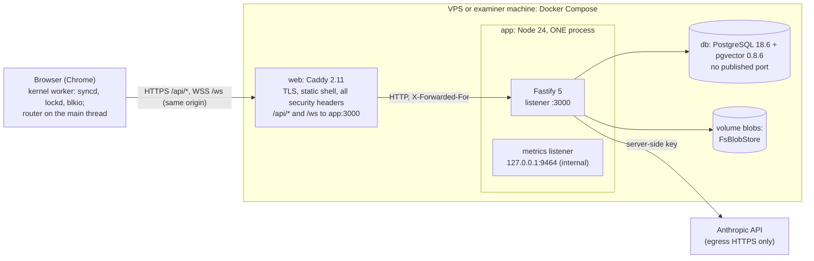
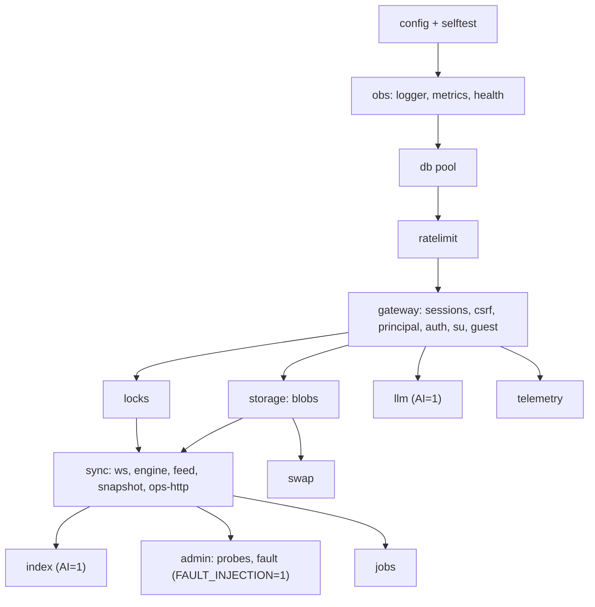
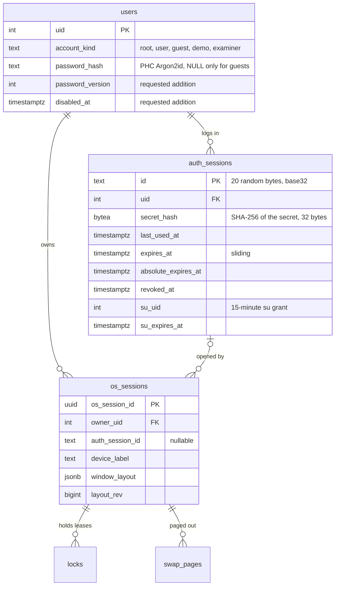

# Backend API and server runtime

| Field | Value |
|---|---|
| Title | Backend API and server runtime: the Fastify modular monolith, configuration, every REST endpoint, WebSocket upgrade authentication, sessions and revocation, the token-bucket rate limiter, FsBlobStore, the swap and index APIs, the LLM gateway, observability, graceful shutdown and startup self-tests |
| Status | Draft v0.1, 2026-09-24 |
| Primary owner | R2 VFS/DB (sync engine, lock manager, `vfsTxn`, snapshot, index API; overall editor of this spec). Plugin owners are listed in §3.2 |
| Secondary reviewer | R5 QA/DevOps & Integration (configuration, auth sessions, rate limiter, observability, shutdown, fault harness) |
| Must be demonstrable at | **P2 gate (W7, v0.2.0):** production deploy; `/api/auth/*`, cookie-authenticated `/ws`, `/api/sync/snapshot`, `/api/ops`, `/api/blobs`, `/api/healthz`, `/api/readyz`; two users on the deployed URL. **P3 gate (W11, v0.3.0):** lock manager, `/api/swap` (MEM-04/05), the fault harness on the local stack, graceful shutdown with close 1012, revocation. **P4 gate (W14, v0.4.0):** `/api/index/*`, `/api/llm/*`, telemetry opt-in, the cost report from `llm_requests`. **Final defence (W17–18, v1.0.0):** everything, on the examiner's machine and the production URL |
| Requirement IDs covered | §8 boundary 3; §9.3 (server-side permissions and quotas, VFS-04, VFS-06, VFS-09, VFS-10); OFF-02, OFF-03 (server side); MEM-04, MEM-05 (remote swap); DB-02 (fault harness), DB-03; RAG-02, RAG-03 (index API); AGT-04, AGT-08, AGT-09 (server executor, audit, cancel); PRE-05 (telemetry opt-in); BOOT-14 (guest and demo accounts); §12.6 (keys on the server, per-user rate limits, cost logging, budget cap, reproducible tests); §14.2 deployment row; §17.1; §18 (secrets); Plotinium design IDs SRV-01 … SRV-20 |
| Related specs | [../06-sync/offline-and-sync.md](../06-sync/offline-and-sync.md) · [../12-security/security-model.md](../12-security/security-model.md) · [../09-database/database.md](../09-database/database.md) · [../01-architecture/architecture.md](../01-architecture/architecture.md) · [../01-architecture/syscall-abi.md](../01-architecture/syscall-abi.md) · [../03-kernel/memory-and-paging.md](../03-kernel/memory-and-paging.md) · [../04-vfs/virtual-file-system.md](../04-vfs/virtual-file-system.md) · [../10-ai/rag-semantic-search.md](../10-ai/rag-semantic-search.md) · [../10-ai/agentic-shell.md](../10-ai/agentic-shell.md) · [../10-ai/predictive-prefetch.md](../10-ai/predictive-prefetch.md) · [../10-ai/ai-safety-and-evaluation.md](../10-ai/ai-safety-and-evaluation.md) · [../13-quality/testing-and-performance.md](../13-quality/testing-and-performance.md) · [../14-devops/deployment-and-ci.md](../14-devops/deployment-and-ci.md) · [../15-decisions/stack-decisions.md](../15-decisions/stack-decisions.md) |

**Conventions used in this file.** RFC 2119 keywords as in the spec's Conventions section (p. 3). **Spec** marks a requirement of the capstone specification (with section and ID); **Plotinium design** marks our own binding choice (usually one of the canonical decisions C1–C18). Numbers from the AI-run prototype are marked *(pilot figure — re-measure on the lab machine)*. Every route is under `/api/*`, plus `/ws` (C6). "Principal" means the uid an operation runs as: the session uid, or a uid for which the session holds a live `su` grant (§3.8).

---

## 1. Purpose and scope

This spec is the normative source for the server process: how it is built, configured, started and stopped, and the exact contract of every HTTP endpoint. It fixes:

- the plugin and module layout of the single Node 24 process (§3.1–§3.2);
- the request lifecycle and hook order (§3.3), the configuration and environment variables (§3.4), and the error model (§3.5);
- every REST endpoint: method, path, authentication, request and response shapes, errors and rate class (§3.6, §4);
- authentication of the WebSocket upgrade (§3.7); the session model and revocation (§3.8); the token-bucket rate limiter (§3.9);
- FsBlobStore (§3.10), the swap API (§3.11), the index API with the readable-set CTE (§3.12), the LLM gateway (§3.13), telemetry opt-in (§3.14) and the fault harness (§3.15);
- observability (§3.16), graceful shutdown (§3.17), startup and self-tests (§3.18).

Owned elsewhere:

| Topic | Owner |
|---|---|
| WebSocket protocol v1 frames, lanes, close codes, replay, resume, conflicts and leases | [offline-and-sync.md](../06-sync/offline-and-sync.md) |
| SQL DDL, migrations, `vfsTxn`, `lockPlan()`, the L0–L4 lock order, `may_r`/`may_x`, the fault trigger, seed scripts | [database.md](../09-database/database.md) |
| Threat model, permission model, cookie rules, CSP and headers, secrets and the leaked-key runbook | [security-model.md](../12-security/security-model.md) |
| Shapes of `/api/index/*` bodies and the binary chunk format | [rag-semantic-search.md](../10-ai/rag-semantic-search.md) §4.4 |
| Shapes of `/api/llm/*` bodies, the transcript, strict tools, prompts | [agentic-shell.md](../10-ai/agentic-shell.md) §3.8, §4.3; model pricing and eval in [ai-safety-and-evaluation.md](../10-ai/ai-safety-and-evaluation.md) |
| Compose files, Caddyfile, images, CI, backups, UptimeRobot | [deployment-and-ci.md](../14-devops/deployment-and-ci.md) |

---

## 2. Requirements table

### 2.1 Spec requirements

| ID | Summary | Spec § | How verified |
|---|---|---|---|
| §8 boundary 3 | Spec: MUST — the backend is authoritative for multi-user data, locks and quotas | §8 | server re-derives the uid for every op; permission matrix run against the server (§8) |
| VFS-04 | Spec: MUST — rwx enforced for owner, group and others on every system call (server side: every op, snapshot, blob and index read) | §9.3 | `VFS-04 perm truth table is identical on kernel and server` |
| VFS-06 | Spec: MUST — hard quotas enforced inside the same transaction as the write; EDQUOT with no partial data | §9.3, §11.3 rule 2 | quota race test; blob pre-check test |
| VFS-09, VFS-10 | Spec: MUST — lease-based locks and version conflicts (server half) | §9.3 | [offline-and-sync.md](../06-sync/offline-and-sync.md) §8 |
| OFF-02 | Spec: MUST — replay applied exactly once | §9.5 | `POST /api/ops/{opId}` dedup test; sync suite |
| OFF-03 | Spec: MUST — no plain-text passwords stored (server stores only Argon2id hashes) | §9.5 | `OFF-03 the users table holds only PHC Argon2id strings` |
| MEM-04, MEM-05 | Spec: MUST — remote swap works and can be paged in from a new browser session; 5 MB remote page-in p95 ≤ 2 s | §9.2 | `/api/swap` tests; remote page-in benchmark |
| DB-02 | Spec: MUST — mandatory fault-injection hook in the test build | §11.3 box | fault harness tests (§8) |
| RAG-03 | Spec: MUST — no result includes content the querying user cannot read | §12.2 | `rag-leak` server cases; `/api/index/verify` tests |
| AGT-04, AGT-08, AGT-09 | Spec: MUST — agent never escalates; every agent call audited; kill rolls the transaction back | §12.3 | privilege tests; audit inspection; cancel test |
| PRE-05 | Spec: MUST — telemetry stays on the device unless the user opts in | §12.4 | `PRE-05 POST /api/telemetry is refused without a stored opt-in` |
| BOOT-14 | Spec: SHOULD — several users and a guest or demo account for examiners | §6.5 | guest and demo tests |
| §12.6 | Spec: MUST — API keys never in the client or repository; every model call through the backend with per-user rate limits; tokens and cost logged per request with a budget cap; CI uses recorded responses | §12.6 | gitleaks; bundle scan; `llm_requests` tests; cassette replay with no key |
| §18 | Spec: MUST — secrets never in the repository; a leaked key is revoked and reported in SECURITY.md | §18 | [security-model.md](../12-security/security-model.md) |
| §14.2, §17.1 | Spec: MUST — the deployment supports WebSockets and comes up in three commands or fewer within five minutes | §14.2, §17.1 | clean bring-up job ([deployment-and-ci.md](../14-devops/deployment-and-ci.md)); `/api/readyz` gates `--wait` |

### 2.2 Plotinium design requirements

| ID | Summary | Source | How verified |
|---|---|---|---|
| SRV-01 | One Node 24 LTS process, a modular monolith of Fastify 5 plugins; no Redis, no broker, no LISTEN/NOTIFY; broadcasts in-process after COMMIT | C9 | architecture review; `SRV-01 *` |
| SRV-02 | Configuration is one Valibot-validated object built from environment variables at startup; no secret has a default; production refuses unsafe settings | C9, C10, critic | `SRV-02 *` startup tests |
| SRV-03 | Every route lives under `/api/*` plus `/ws`; Caddy owns static files and all security headers; no `@fastify/static`, no helmet | C6, C9 | route inventory test |
| SRV-04 | Every error response has the body `{errno, reason?, msg, reqId, retryAfterMs?}`; `errno` is one of the C3 set | C3 | contract test over every route |
| SRV-05 | Request bodies are validated by Valibot in a `preValidation` hook; there is no type provider and no other schema library | C3 | contract test |
| SRV-06 | CSRF defence: `SameSite=Strict` cookie plus `Sec-Fetch-Site: same-origin` (or an allowlisted `Origin`) on every non-GET request | C10 | `SRV-06 cross-site POST is refused` |
| SRV-07 | WebSocket upgrade authenticated before the upgrade: exact Origin allowlist plus a valid session cookie | C10 | `SRV-07 cross-origin upgrade is refused` |
| SRV-08 | Opaque server-side sessions (`<id>.<secret>`, SHA-256 of the secret stored), 10-day sliding, 30-day absolute, guests 2 h; revocation closes the session's sockets with 4401 within 1 s | C10 | auth suite |
| SRV-09 | Own token-bucket limiter with keys bounded by `dsa/lru`, for HTTP routes and WebSocket frames; replay is throttled, never disconnected | C9; coherence | `SRV-09 *` |
| SRV-10 | FsBlobStore: content-addressed, streaming SHA-256, atomic rename, blobs uploaded before the DB transaction, GC after 1 h (never referenced) and 14 days (dereferenced) | C9 | `SRV-10 *` |
| SRV-11 | Swap API authorised by `owner_uid`, never by the current session; write-behind uploads accepted idempotently | C4; critic | `MEM-04 *` |
| SRV-12 | Index API computes the readable set from the current tree in SQL before ranking; foreign snippets only through `verify` | C12; critic | `RAG-03 *` |
| SRV-13 | LLM gateway: key only in the server env; reserve budget in a short transaction, call the provider outside any transaction, settle; one `llm_requests` row per call; cassettes in CI | C9, C12 | `§12.6 *` tests |
| SRV-14 | Fault harness: root-only, audited, one-shot, only when `FAULT_INJECTION=1` and never in production | C7; critic | `DB-02 fault harness is absent in production` |
| SRV-15 | pino JSON logs with `reqId`, `uid`, `osSessionId`, `opId`, `pid` and redaction; prom-client metrics on an internal listener only | C9 | `SRV-15 *` |
| SRV-16 | Graceful shutdown: drain, `bye {reason: 'restart'}` and close 1012 for every socket, finish in-flight transactions, exit within the grace period | C6, C9 | `SRV-16 *` |
| SRV-17 | Startup self-tests: Argon2id known-answer vector, SHA-256 vector, FsBlobStore probe, database version, extension and migration checks; fail fast | C10; coherence | `SRV-17 *` |
| SRV-18 | `AI=0` removes `/api/index/*` and `/api/llm/*` (they answer 404 ENOSYS); everything else still works (litmus) | C12 | litmus CI job |
| SRV-19 | The effective principal of an HTTP request is the session uid, or the uid named in `X-Plotinium-Principal` when the session holds a live `su` grant for it | C10 | `SRV-19 *` |
| SRV-20 | First-start credentials are generated by the seed and printed only in the app logs; the server never has default passwords | C10; critic | `SRV-20 *` |

---

## 3. Design (normative)

### 3.1 Process topology



- **Plotinium design (C9, SRV-01).** One process serves every route and the WebSocket. One process makes lock ordering linearizable and lets broadcasts run in memory after COMMIT. The capacity argument (thousands of idle sockets at a few KB each) is in the backend record; the P1a spike re-measures it.
- **Plotinium design (C9, SRV-03).** Caddy serves the static shell (`/`, `/assets/*`, `/models/*`, `/ort/*`, `sw.js`, `version.json`) and sets every security header ([security-model.md](../12-security/security-model.md)). Fastify serves only `/api/*` and `/ws`. `/metrics` is on a separate listener that Caddy never routes.
- The database has no published port; the app reaches it on the compose network ([deployment-and-ci.md](../14-devops/deployment-and-ci.md)).

### 3.2 Plugin and module layout

**Plotinium design (C9).** Each backend component is one Fastify plugin with its own routes, decorators and hooks. Plugins communicate through typed decorators (for example `app.locks.releaseSession()`), never through HTTP.

```text
server/src/
├── main.ts                 process entry: config → self-tests → buildApp → listen; signal handlers (§3.17)
├── app.ts                  buildApp(cfg): registers plugins in dependency order; tests use fastify.inject/injectWS
├── config.ts               Valibot schema of the environment (§3.4); production guards
├── selftest/               argon2-kat.ts, sha256-kat.ts, blobstore-probe.ts, db-checks.ts (§3.18)
├── obs/                    logger.ts (pino, redaction), metrics.ts (prom-client), health.ts (/api/healthz, /api/readyz)
├── db/                     pool.ts (pg Pool), kysely.ts, errors.ts (SQLSTATE → errno), types.gen.ts (kysely-codegen)
├── ratelimit/              bucket.ts (token bucket), classes.ts, hook.ts (onRequest), ws.ts (frame buckets)
├── gateway/                auth.ts (login, logout, me, password), session.ts (Lucia-derived), su.ts, guest.ts,
│                           csrf.ts, principal.ts, argon2.ts (semaphore), registry.ts (auth session → sockets)
├── sync/                   ws.ts (/ws upgrade, lanes), engine.ts (applyOp), lane.ts, feed.ts (broadcaster),
│                           snapshot.ts (/api/sync/snapshot), ops-http.ts (/api/ops/{opId})
├── locks/                  manager.ts (acquire, release, renew), sweeper.ts (dsa/heap expiry index)
├── vfs/                    tx.ts (vfsTxn), lockplan.ts, ops/*.ts (set-based SQL per op kind), fault.ts (arming)
├── storage/                blobstore.ts (interface), fs-blobstore.ts, faulty-blobstore.ts (tests), gc.ts, blobs-routes.ts
├── swap/                   routes.ts, gc.ts
├── index/                  routes.ts (put, pull, search, verify), readable.sql.ts, chunks-codec.ts   (AI=1 only)
├── llm/                    gateway.ts (routes), anthropic.ts (only provider adapter), budget.ts (reserve/settle),
│                           pricing.ts, cassette.ts, transcripts.ts (dsa/lru), prompts/                  (AI=1 only)
├── telemetry/              routes.ts, retention.ts
├── admin/                  fault-routes.ts (/api/debug/fault, FAULT_INJECTION=1 only), probes.ts (/api/admin/probes)
├── jobs/                   scheduler.ts (in-process timers): blob GC, swap GC, feed pruning, guest cleanup,
│                           stale LLM reservations
└── cli/                    admin.ts (reset-password, list-sessions, revoke-sessions) — run with docker compose exec
```

Isomorphic modules imported unchanged from the client packages (C9, [virtual-file-system.md](../04-vfs/virtual-file-system.md) PVFS-16): `vfs/perm.ts`, `vfs/path.ts`, `vfs/names.ts`, `vfs/modeparse.ts`, `vfs/digest.ts`; all Valibot schemas from `protocol/`; `dsa/heap` (lease expiry, broadcaster order) and `dsa/lru` (rate-limit keys, LLM transcripts).



| Plugin (path) | Primary | Secondary | Routes |
|---|---|---|---|
| `gateway/` (sessions, auth, `su`, guest, CSRF, principal) | R5 | R2 | `/api/auth/*`; hooks for every route |
| `ratelimit/` | R5 | R1 (owner of `dsa/lru`) | hook only |
| `sync/`, `locks/`, `vfs/` | R2 | R5 | `/ws`, `/api/sync/snapshot`, `/api/ops/{opId}` |
| `storage/`, `swap/` | R1 | R2 | `/api/blobs/*`, `/api/swap/*` |
| `index/` | R2 | R4 | `/api/index/*` |
| `llm/` | R4 | R5 | `/api/llm/*` |
| `telemetry/` | R4 | R2 | `/api/telemetry*` |
| `admin/` (fault harness, probes) | R5 | R2 | `/api/debug/fault`, `/api/admin/probes` |
| `obs/`, `jobs/`, `main.ts`, `config.ts`, `selftest/`, `cli/` | R5 | R2 | `/api/healthz`, `/api/readyz`; internal `/metrics` |

### 3.3 Request lifecycle and hook order

**Plotinium design.** The order is part of the contract: a request that would fail several checks gets the error of the first failing step.

| # | Fastify hook | Step | Failure |
|---|---|---|---|
| 1 | `onRequest` | assign `reqId` (UUIDv7; echoed as `X-Request-Id`); bind the child logger | – |
| 2 | `onRequest` | client IP from `X-Forwarded-For` only if the direct peer is in `TRUST_PROXY_CIDRS` (Caddy on the compose network), else the socket address | – |
| 3 | `onRequest` | **IP-keyed rate classes** (login, guest-create, ws-upgrade, health) (§3.9) | 429 EAGAIN `rate` |
| 4 | `onRequest` | session resolution from the cookie (§3.8): sets `req.auth` or `null`; never fails by itself | – |
| 5 | `preValidation` | **CSRF** for every method other than GET and HEAD: `Sec-Fetch-Site` must be `same-origin`; if the header is absent (non-browser client), `Origin` must be in the allowlist; if both are absent → refuse. Bodies must be `application/json`, `application/octet-stream` or a declared `application/vnd.plotinium.*` type | 403 EACCES `csrf` / 415 EINVAL |
| 6 | `preValidation` | route authentication: `public`, `session`, `root` (§3.6) | 401 EACCES (no session) / 403 EPERM `root-only` |
| 7 | `preValidation` | principal (SRV-19): `X-Plotinium-Principal` absent → session uid; present → must equal the session uid or a live `su` grant | 403 EACCES `principal` |
| 8 | `preValidation` | **uid-keyed rate classes** (§3.9) | 429 EAGAIN `rate` |
| 9 | `preValidation` | Valibot `safeParse` of params, query and JSON body (SRV-05); body size limits per route (§3.6) | 400 EINVAL (`detail.field`) / 413 EINVAL |
| 10 | handler | the route; every mutation goes through `vfsTxn` or a short transaction; non-DB side effects (broadcasts, file deletes, sweeper updates) only after COMMIT | route errors |
| 11 | `onSend` | `Cache-Control: no-store` on every `/api` response that carries user data; JSON errors in the SRV-04 shape | – |
| 12 | `onResponse` | log line and metrics (`route`, `status`, `durMs`, `errno`) | – |

### 3.4 Configuration

**Plotinium design (C9, C10, SRV-02).** `server/src/config.ts` parses `process.env` with one Valibot schema into a frozen `Config` object at startup. Invalid or unsafe configuration stops the process with exit code 78 and a list of the problems, **never** printing a secret's value. Values that are secrets can also be given as `*_FILE` paths (read once, trailing newline stripped); the file form is required in production.

| Variable | Required | Default | Meaning and validation |
|---|---|---|---|
| `PLOTINIUM_ENV` | no | `local` | `local` (examiner and developer stack), `ci`, `production`. Production guards below |
| `PORT` / `HOST` | no | `3000` / `0.0.0.0` | Fastify listener (reached only through Caddy) |
| `PLOTINIUM_PORT` | no | `4717` | host port published by Caddy (C1); used to build the default `APP_ORIGIN` |
| `APP_ORIGIN` | production: yes | `http://localhost:${PLOTINIUM_PORT}` | exact origin of the shell; `https://` required in production; drives the Origin allowlist and the cookie name (`__Host-plt_sid` on https, `plt_sid` on `http://localhost`) |
| `ALLOWED_ORIGINS` | no | empty | extra exact origins, comma-separated (for example the Vite dev server); must be empty in production |
| `TRUST_PROXY_CIDRS` | no | `172.30.47.0/24` | the compose network Caddy uses ([deployment-and-ci.md](../14-devops/deployment-and-ci.md)); `X-Forwarded-For` is ignored from any other peer |
| `DATABASE_URL` | yes | – | `postgres://plotinium_app@db:5432/plotinium`; must not contain a password in production |
| `DATABASE_PASSWORD_FILE` | production: yes | – | secret; generated at first start into the secrets volume ([deployment-and-ci.md](../14-devops/deployment-and-ci.md)); ≥ 32 bytes |
| `DB_POOL_MAX` | no | `10` | pg pool size (C9) |
| `DB_STATEMENT_TIMEOUT_MS` / `DB_LOCK_TIMEOUT_MS` | no | `10000` / `2000` | `SET LOCAL` in every transaction; lock timeout 2 s maps to EBUSY (C7) |
| `BLOB_DIR` | no | `/var/lib/plotinium/blobs` | FsBlobStore root on the `blobs` volume |
| `BLOB_MAX_BYTES` | no | `134217728` (128 MiB) | largest single blob |
| `PLOTINIUM_SWAP_MAX_BYTES` / `SWAP_PAGE_MAX_RAW_BYTES` | no | `1073741824` (1 GiB) / `16777216` | per-user remote swap cap on the stored (compressed) bytes ([database.md](../09-database/database.md) §3.18); largest uncompressed page accepted by the API |
| `LEASE_TTL_MS` | no | `30000` | 15,000 in the demo profile; range 15,000–120,000; `HB_MS` is TTL/3 (C6) |
| `FEED_RETENTION_DAYS` | no | `30` | op_log payload and feed retention (tombstones kept) |
| `SESSION_SLIDING_DAYS` / `SESSION_ABSOLUTE_DAYS` / `GUEST_SESSION_HOURS` | no | `10` / `30` / `2` | C10 |
| `GUEST_ENABLED` / `GUEST_MAX_ACTIVE` | no | `1` / `20` | guest accounts (BOOT-14) |
| `AUTH_PEPPER_FILE` | no | – | optional secret mixed into Argon2id as `secret`; if set it must be kept forever (losing it invalidates every password); ≥ 32 bytes |
| `ARGON2_MAX_CONCURRENCY` / `LOGIN_MAX_CONCURRENCY` | no | `2` / `4` | C10; quality record |
| `AI` | no | `1` | `0` removes `/api/index/*` and `/api/llm/*` (SRV-18) |
| `ANTHROPIC_API_KEY` (or `_FILE`) | no | – | secret; absent → the LLM gateway is degraded (`no-key`) and the rest works |
| `LLM_MODE` | no | `live` (production), `replay` (ci) | `live`, `record`, `replay`; `record` refused in production; `ci` refuses anything but `replay` |
| `LLM_RECORD_BUDGET_USD` | with `record` | – | hard cap for a recording session |
| `LLM_PROVIDER` | no | `anthropic` | the warm-standby switch named in the LLM record |
| `LLM_MODEL` / `LLM_EFFORT` / `LLM_FALLBACK_MODEL` | no | `claude-opus-5-5` / `medium` / `claude-opus-5` | provisional until the Week-3 bake-off (C12) |
| `LLM_TEMPERATURE` | no | unset | only for a model that accepts sampling parameters (for example `claude-sonnet-4-6`), used if the instructor requires literal temperature 0 (§3.13.6) |
| `LLM_MAX_TOKENS` / `LLM_TIMEOUT_MS` / `LLM_MAX_INFLIGHT` | no | `8000` / `45000` / `4` | agentic spec; LLM record |
| `LLM_BUDGET_USD_MONTH` / `LLM_BUDGET_USD_TOTAL` | no | `50` / `250` | hard ceilings (coherence cost section) |
| `LLM_USER_USD_DAY` / `LLM_DEMO_USD_DAY` / `LLM_DEMO_CALLS_DAY` | no | `2` / `3` / `20` | per-user cap; shared pool for guests and the public demo account |
| `LLM_EXAMINER_USD_DAY` / `LLM_EXAMINER_CALLS_DAY` | no | `15` / `100` | per examiner account (members of group `examiners`) |
| `LLM_UPSTREAM_URL`, `LLM_UPSTREAM_TOKEN_FILE` | no | – | MAY: a local stack forwards `/api/llm/*` to the production gateway with a revocable server-side token (§3.13.8) |
| `LLM_UPSTREAM_ACCEPT_FILE` | no | – | production: SHA-256 hashes of accepted upstream tokens, one per line |
| `FAULT_INJECTION` | no | `0` | `1` registers the fault harness (§3.15); refused when `PLOTINIUM_ENV=production` |
| `TELEMETRY_RETENTION_DAYS` | no | `180` | server copies of opted-in telemetry |
| `PLOTINIUM_TZ` | no | `Asia/Karachi` | dates in conflicted-copy names and daily budget rollover |
| `LOG_LEVEL` | no | `info` | pino level |
| `METRICS_HOST` / `METRICS_PORT` | no | `127.0.0.1` / `9464` | internal metrics listener; the optional `ops` compose profile sets `0.0.0.0` on the internal network; never published |
| `SHUTDOWN_GRACE_MS` | no | `10000` | §3.17 |
| `BUILD_VERSION`, `BUILD_SHA`, `BUILD_DATE` | baked into the image | – | build identity for `/api/readyz` and `hello.ok.server` |

**Production guards (`PLOTINIUM_ENV=production`).** The process refuses to start if: `APP_ORIGIN` is not `https://`; `ALLOWED_ORIGINS` is not empty; `FAULT_INJECTION` is not `0`; `LLM_MODE` is not `live`; `DATABASE_URL` contains a password; any secret is missing, shorter than 32 bytes or equal to a value in `server/src/config/known-dev-values.ts` (the deploy record's rule); `ANTHROPIC_API_KEY` is given inline rather than as a file. Each refusal names the variable, never its value.

**No default secrets (C10, SRV-20).** There is no default password anywhere: not in `compose.yaml`, not in `.env.example` (names only), not in the README. The local stack's database password is generated at first start into a volume; user passwords are generated by the seed (§3.18.3).

### 3.5 Error model

**Plotinium design (C3, SRV-04).** Every error response is JSON:

```ts
export type ApiError = {
  errno: Errno;            // one of the C3 set (syscall-abi.md §4.3)
  reason?: string;         // a registered detail.reason (syscall-abi.md §4.3.1)
  msg: string;             // short English message, safe to show; never contains a secret or another user's data
  reqId: string;           // UUIDv7; also the X-Request-Id header; logged
  retryAfterMs?: number;   // with 429 and 503; Retry-After (seconds, rounded up) is also set
  detail?: Record<string, unknown>;   // e.g. {field} for schema errors, {category} for EAIREFUSED
};
```

The body's `errno` is authoritative. The status code is chosen to agree with the fallback mapping of [syscall-abi.md](../01-architecture/syscall-abi.md) §4.9, which clients use only when there is no JSON body (for example a proxy error page):

| Status | Used for | `errno` |
|---|---|---|
| 400 | schema failure | EINVAL (`detail.field`) |
| 401 | no session, expired session, wrong login credentials | EACCES |
| 403 | permission denied, CSRF, Origin, principal not granted; root-only or guest-forbidden actions | EACCES; EPERM (`root-only`, `owner`) |
| 404 | resource not found; route disabled (`AI=0`, harness off) | ENOENT; ENOSYS |
| 409 | stale version or plan, expired transcript, name exists, locked | EAGAIN (`stale-version`, `stale-plan`, `expired`); EEXIST; EBUSY |
| 413 | body too large; quota would be exceeded | EINVAL; EDQUOT |
| 415 | unsupported content type | EINVAL |
| 422 | checksum mismatch; text not matching the blob; model refusal | EIO (`checksum`); EINVAL; EAIREFUSED |
| 429 | rate limit; LLM budget exhausted | EAGAIN (`rate`); EAIUNAVAIL (`rate`, `budget`) on `/api/llm/*` |
| 503 | overloaded, draining, LLM unavailable | EIO (`server`); EAIUNAVAIL (`no-key`, `upstream`, `disabled`) on `/api/llm/*` |
| 504 | LLM deadline | EAIUNAVAIL (`timeout`) |
| 500 | bug or unexpected failure | EIO (`server`); logged at `error` with `reqId` |

SQLSTATE → errno mapping follows [syscall-abi.md](../01-architecture/syscall-abi.md) §4.9 (`server/src/db/errors.ts`). One rule is added here: `57014` is ECANCELED `killed` only when the server itself set the op's cancel flag before calling `pg_cancel_backend`; otherwise it is a `statement_timeout` and maps to ETIMEDOUT (retryable; [database.md](../09-database/database.md) §3.9.5) ([offline-and-sync.md](../06-sync/offline-and-sync.md) §3.10).

### 3.6 Endpoint catalogue

**Plotinium design (C6, SRV-03).** Authentication levels: **public** (no session needed), **session** (a valid cookie session; the principal rules of §3.3 step 7 apply), **root** (principal uid 0: a root session is impossible at the greeter, so in practice a live `su` grant for uid 0 plus `X-Plotinium-Principal: 0`). Rate classes are defined in §3.9. Body limits apply before parsing. Detailed shapes follow in §4.

| Method | Path | Auth | Rate class | Body limit | Success | Main errors |
|---|---|---|---|---|---|---|
| POST | `/api/auth/login` | public | `login-ip`, `login-user` | 4 KiB | 200 `AuthMe` + `Set-Cookie` | 401 EACCES, 429 |
| POST | `/api/auth/logout` | session (or none) | `api` | 1 KiB | 204 + expired cookie | – |
| GET | `/api/auth/me` | session | `api` | – | 200 `AuthMe` | 401 |
| POST | `/api/auth/su` | session | `su` | 4 KiB | 200 `{grant}` | 403 EACCES / EPERM, 429 |
| DELETE | `/api/auth/su/{uid}` | session | `api` | – | 204 | 404 ENOENT |
| POST | `/api/auth/guest` | public | `guest-ip`, `guest-global` | 1 KiB | 201 `AuthMe` + `Set-Cookie` | 403 EPERM (disabled), 429 |
| POST | `/api/auth/password` | session | `su` | 4 KiB | 204 + rotated cookie | 403 EACCES, 400 EINVAL |
| GET | `/ws` (upgrade) | session + Origin | `ws-upgrade` | frames ≤ 64 KB | 101 | 401, 403, 429, 503 (before the upgrade) |
| GET | `/api/sync/snapshot` | session | `snapshot` | – | 200 `SnapshotPage` | 403 EACCES, 404 ENOENT |
| POST | `/api/ops/{opId}` | session | `ops` | 4 MiB | 200 `OpResult` (op outcomes are never HTTP errors) | 400, 409 EINVAL (id mismatch) |
| PUT | `/api/blobs/{sha256}` | session | `blob` (requests and bytes) | `BLOB_MAX_BYTES`, streamed | 201 stored / 200 existing | 411, 413 EDQUOT, 422 EIO `checksum` |
| GET | `/api/blobs/{sha256}?ino=` | session | `blob` | – | 200 / 206 stream | 403 EACCES, 404 ENOENT, 416 EINVAL |
| HEAD | `/api/blobs/{sha256}[?ino=]` | session | `blob` | – | 200 iff readable | 404 |
| PUT | `/api/swap/{osSession}/{pid}/{pageId}` | session (owner) | `swap` | 16 MiB raw, streamed | 200 `{stored}` | 403, 413 EDQUOT, 422 EIO `checksum` |
| GET | `/api/swap/{osSession}/{pid}/{pageId}` | session (owner) | `swap` | – | 200 stream | 403, 404 |
| GET | `/api/swap?osSession=&pid=&after=` | session (owner) | `swap` | – | 200 `{pages, next?}` | 403 |
| DELETE | `/api/swap/{osSession}[/{pid}[/{pageId}]]` | session (owner) | `swap` | – | 204 | 403 |
| POST | `/api/index/put` | session | `index` | 4 MiB | 200 `{applied, rows}` / `{duplicate}` | 403 EACCES, 409 EAGAIN `stale-version`, 422 EINVAL |
| GET | `/api/index/pull` | session | `index` | – | 200 chunk stream | 400 |
| POST | `/api/index/search` | session | `index` | 16 KiB | 200 `{results}` | 400 |
| POST | `/api/index/verify` | session | `verify` | 16 KiB | 200 `{items}` | 400 |
| POST | `/api/llm/plan` | session | `llm` | 64 KiB | 200 plan turn | 409, 413, 422 EAIREFUSED, 429, 503, 504 |
| POST | `/api/llm/extract` | session | `llm` | 64 KiB | 200 `{items}` | same as `plan` |
| POST | `/api/llm/answer` | session | `llm` | 64 KiB | 200 answer (MAY, RAG optional answer) | same as `plan` |
| GET | `/api/llm/health` | session | `api` | – | 200 health | – |
| GET / PUT | `/api/telemetry/consent` | session | `api` | 1 KiB | 200 `{optIn, since}` | – |
| POST | `/api/telemetry` | session | `telemetry` | 256 KiB | 202 `{accepted, duplicates}` | 403 EPERM `opt-in` |
| GET | `/api/telemetry` | session | `telemetry` | – | 200 `{events, next?}` | 403 EPERM `opt-in` |
| DELETE | `/api/telemetry` | session | `api` | – | 204 | – |
| POST | `/api/debug/fault` | root | `admin` | 4 KiB | 200 `{armed, osSessionId, expiresAt}` | 403 EPERM, 404 ENOSYS when disabled |
| GET | `/api/debug/fault` | root | `admin` | – | 200 `{armed: [...]}` | same |
| DELETE | `/api/debug/fault` | root | `admin` | – | 204 (disarms this OS session's arm) | same |
| GET | `/api/admin/probes?root=` | root | `admin` | – | 200 `Probes` | 403 EPERM, 404 ENOENT |
| GET | `/api/healthz` | public | `health` | – | 200 `{status: 'ok'}` | – |
| GET | `/api/readyz` | public | `health` | – | 200 / 503 `Readiness` | – |
| GET | `/metrics` (internal listener only) | none; not reachable through Caddy | – | – | Prometheus text | – |

#### 3.6.1 Authentication routes

**`POST /api/auth/login`** (C10; quality record).

1. `login-ip` and `login-user` buckets (§3.9); then the login-concurrency semaphore (`LOGIN_MAX_CONCURRENCY` = 4; full → 429 EAGAIN `rate`, `retryAfterMs` 1000).
2. Look up the user. Unknown username, `root`, a guest account and a disabled account are all treated as "not found", and a **dummy verification** with the same Argon2id parameters runs so the response time does not reveal which case happened.
3. Verify the password with Argon2id (§3.8.5) under the hashing semaphore (`ARGON2_MAX_CONCURRENCY` = 2). Failure → 401 EACCES "invalid username or password"; audit `login.failure` with the attempted username and IP.
4. Success: if the stored hash uses older parameters, rehash it in the same transaction. Create a **new** auth session (a client-supplied or previous session id is never reused: fixation defence); if the request carried a cookie for another session, revoke that session. Set the cookie (§3.8.2). Audit `login.success`.
5. Reply 200 `AuthMe`, with `offlineVerifier.allowed = (uid ≠ 0 && kind ∉ {guest})`. The client derives its PBKDF2 verifier locally ([security-model.md](../12-security/security-model.md)); the server never sees or stores it.

**`POST /api/auth/logout`** revokes the current session (§3.8.4): its sockets get `bye {reason: 'revoked'}` and close 4401, its OS sessions' leases are released, the cookie is expired. Idempotent: 204 even without a session.

**`GET /api/auth/me`** returns `AuthMe` for the current session; 401 without one. `syncd` also calls it after a failed WebSocket upgrade ([offline-and-sync.md](../06-sync/offline-and-sync.md) §3.7 rule 5).

**`POST /api/auth/su`** `{target: username, password}` (C10). The password was typed into the compositor-owned secure prompt; the kernel sends it here and zeroes its copy. Rules: guests cannot `su` and no one can `su` to a guest (403 EPERM `guest`); an unknown target and a wrong password give the same 403 EACCES; `su` bucket: 5 attempts per 15 min per `(auth session, target)`. Success sets the session's grant (`auth_sessions.su_uid`, `su_expires_at = now + 15 min`; [database.md](../09-database/database.md) §3.16); a new `su` replaces any previous grant. It schedules the expiry notification (§3.8.6), audits `su.grant`, and returns `{grant: {uid, username, expiresAt}}`. Grants have a fixed 15-minute lifetime; they are not extended by use.

**`DELETE /api/auth/su/{uid}`** clears the grant if it names `uid` (404 ENOENT otherwise) (the kernel calls it when the elevated shell exits); the server sends `proc.signal SIGHUP` with reason `su-revoked` to the session's sockets and audits `su.revoke`.

**`POST /api/auth/guest`** (BOOT-14). Disabled when `GUEST_ENABLED=0` (403 EPERM). Buckets: `guest-ip` (3 per hour per IP) and `guest-global` (at most `GUEST_MAX_ACTIVE` live guests; 429 when full). Creates, in one transaction, user `guest-<4 random base32 chars>` with uid in 60000–60999, primary group `guests`, `/home/guest-XXXX` (mode 0700), quota 20 MB / 500 inodes, kind `guest`, and a guest auth session with a 2-hour absolute lifetime. Audits `guest.create`. A nightly job (03:00 `PLOTINIUM_TZ`) removes expired guests in one transaction each: the home subtree (set-based, as `rm -r`), vectors (by cascade), swap pages, blob references, telemetry and the user row.

**`POST /api/auth/password`** `{current, next}` (SHOULD). `next` is 12–1,024 characters (400 EINVAL `detail.field = 'next'` otherwise). Verifies `current` (403 EACCES on failure, `su` bucket), stores the new Argon2id hash, increments `users.password_version`, revokes every **other** auth session of the uid (their sockets close 4401), rotates the current session, and audits `password.change`. Devices invalidate their offline verifier when they see the new `passwordVersion` in `AuthMe` ([security-model.md](../12-security/security-model.md)).

#### 3.6.2 Sync routes

**`GET /api/sync/snapshot?scope=&owner=&ino=&after=&limit=`** ([offline-and-sync.md](../06-sync/offline-and-sync.md) §3.8.5). `scope` is `owner` (needs `owner`), `dir` (needs `ino`) or `subtree` (needs `ino`); `limit` 1–2,000, default 1,000; `after` is the opaque cursor from the previous page.

- **Visibility.** A row is returned only if the principal can see its directory entry: r on the parent directory and x on every ancestor, evaluated in SQL with the same rules as `vfs/perm.ts` (`may_r`, `may_x`, [database.md](../09-database/database.md)). `blob` is included only if the principal also has r on the inode. For `dir` and `subtree` the principal needs r and x on the requested directory (403 EACCES otherwise; 404 ENOENT if it does not exist).
- **`scope=owner`** returns the inodes owned by `owner` plus the entries of directories owned by `owner`, which is exactly the set that owner's feed describes ([offline-and-sync.md](../06-sync/offline-and-sync.md) §3.8.2).
- **Consistency.** The first page (no `after`) is read in one `REPEATABLE READ READ ONLY` transaction that also reads `users.feed_seq` of the owners involved and returns them as `owners: [{ownerUid, headSeq}]`. Later pages use keyset pagination on `ino` in ordinary transactions and may show newer state; the client then resumes the feed from `headSeq` with a version-guarded apply, which makes the result complete.

**`POST /api/ops/{opId}`** — ops whose envelope exceeds 60 KB (C6). The body is an `OpSubmit` ([offline-and-sync.md](../06-sync/offline-and-sync.md) §4.2), and `body.opId` must equal the path parameter (409 EINVAL otherwise). The op joins the op lane of its OS session if that session has a live socket, so HTTP and WebSocket ops of one session never run concurrently; otherwise it runs directly. The reply is the `OpResult` body with status 200 for every op outcome (`applied`, `conflict`, `rejected`, `retry`); HTTP errors mean only that the request itself was not processed. The result is not repeated on the socket.

#### 3.6.3 Blob routes

**`PUT /api/blobs/{sha256}`**. `sha256` is 64 lowercase hex characters (400 otherwise). `Content-Length` is required (411 EINVAL) and must be ≤ `BLOB_MAX_BYTES` (413 EINVAL). Before reading the body the server compares `Content-Length` with the principal's remaining byte quota and refuses early with 413 EDQUOT (root is exempt); the authoritative quota check is still in the transaction of the op that references the blob (Spec: VFS-06, §11.3 rule 2). The body streams into FsBlobStore (§3.10), which hashes it; a digest or length mismatch → 422 EIO `checksum` and nothing is kept. If the content already exists the server still reads and hashes the whole body (proof of possession), discards it and replies 200 `{sha256, size, existing: true}`; otherwise 201 `{sha256, size, stored: true}`. Blobs are uploaded **before** the op transaction that references them (C9). The upload then records the blob with `INSERT INTO blobs … refcount 0 … ON CONFLICT DO NOTHING` ([database.md](../09-database/database.md) §3.19), under the blob's advisory lock (§3.10).

**`GET /api/blobs/{sha256}?ino=`**. The principal must have r on `ino` and x on its ancestors, and the current `inodes.blob` of `ino` must equal `sha256` (403 EACCES or 404 ENOENT otherwise). Supports a single `Range: bytes=a-b` (206; 416 EINVAL for an invalid range). Headers: `Content-Length`, `ETag: "<sha256>"`, `Cache-Control: no-store`.

**`HEAD /api/blobs/{sha256}[?ino=]`** answers 200 with `Content-Length` only if the principal can read some inode (or the given `ino`) whose current blob is `sha256`; otherwise 404, even when the blob exists. The endpoint therefore never confirms that someone else holds a given content hash ([security-model.md](../12-security/security-model.md)).

### 3.7 WebSocket upgrade authentication

**Plotinium design (C9, C10, SRV-07; OWASP WebSocket cheat sheet: https://cheatsheetseries.owasp.org/cheatsheets/WebSocket_Security_Cheat_Sheet.html, cited in the transport record).** `GET /ws` is a `@fastify/websocket` route whose `preValidation` hook runs **before** the upgrade. The checks, in order:

1. **Draining** (§3.17) → 503.
2. `ws-upgrade` bucket per IP (30 per minute, burst 10) → 429.
3. **Origin allowlist.** `Origin` must equal `APP_ORIGIN` or one of `ALLOWED_ORIGINS` exactly (scheme, host and port; no wildcard, no suffix match). Missing or different → 403. This stops cross-site WebSocket hijacking; the `SameSite=Strict` cookie is the second layer.
4. If `Sec-Fetch-Site` is present it must be `same-origin` → else 403.
5. **Session.** A valid session cookie (§3.8) → else 401.
6. At most 4 open sockets per auth session (one kernel per origin normally needs one; the margin covers reconnect overlap) → else 429.

A refused upgrade never becomes a WebSocket, so it has no close code; the browser reports close 1006 and `syncd` asks `GET /api/auth/me` to tell 401 apart ([offline-and-sync.md](../06-sync/offline-and-sync.md) §3.7).

After the upgrade: the message listener is attached **synchronously** in the route handler (`@fastify/websocket` drops messages that arrive before a listener exists); the connection is registered by auth session id and uid; the 5 s `hello` timer starts; `ws` runs with `maxPayload` 65,536 and `perMessageDeflate: false`; the server pings every 20 s and terminates a socket that missed one pong (socket liveness only; pongs never renew leases). Each connection holds only `{authSessionId, uid, gids, osSessionId, kernelEpoch, lane, streams, buckets, watches, lastAppFrameAt}`; per-socket child loggers are disabled to keep memory per idle socket small (backend record). Every `hb` re-validates the auth session with one primary-key lookup (§3.8.3).

### 3.8 The session model

**Plotinium design (C10; coherence §7; quality record).** Three concepts that the spec's single `sessions` table conflated are kept apart:



- **`auth_sessions`**: the revocable cookie session. Revoking it ends access at once.
- **`os_sessions`**: the desktop session of one kernel instance for one login uid ([offline-and-sync.md](../06-sync/offline-and-sync.md) §3.8.1). It outlives the auth session (its `auth_session_id` becomes NULL), because remote swap pages (MEM-04) and the window layout (WM-06) must be reachable from a later session and a new browser session. Leases and `op_log` reference the OS session.
- **`su` grants**: stored on the auth session (`su_uid`, `su_expires_at`, one grant at a time), so they die with it. No separate table is needed, which keeps the C7 table list unchanged.

DDL is owned by [database.md](../09-database/database.md) §3.16 and §4.3; the two `users` columns marked as requested additions are a cross-spec request (§9).

#### 3.8.1 Tokens

Adapted from the Lucia single-file reference `code/auth_session.ts` (0BSD; attribution in THIRD_PARTY.md; Node 24 lacks `Uint8Array.fromBase64`, so `Buffer` base64url is used, as the quality examiner noted). The token is `<id>.<secret>`: `id` = 20 random bytes in lowercase base32 (32 characters), `secret` = 32 random bytes in base64url (43 characters), both from `crypto.randomBytes`. Only `SHA-256(secret)` is stored. The token appears only in the cookie; it is never in a URL, a log line or a response body.

#### 3.8.2 Cookie

| Attribute | Production (`https://`) | Local (`http://localhost:4717`) |
|---|---|---|
| Name | `__Host-plt_sid` | `plt_sid` (the `__Host-` prefix needs a secure origin; the localhost exemption covers only `Secure`, coherence §23) |
| `Secure` | yes | yes (browsers treat `http://localhost` as potentially trustworthy) |
| `HttpOnly` | yes | yes |
| `SameSite` | `Strict` | `Strict` |
| `Path` | `/` | `/` |
| `Domain` | none (host-only) | none |
| `Max-Age` | until `expires_at` | until `expires_at` |

The README tells examiners to open `http://localhost:4717`, never a LAN IP: a LAN IP over plain HTTP is not a secure context (no Service Worker, no `crypto.subtle`, no OPFS, no SharedArrayBuffer) ([security-model.md](../12-security/security-model.md)).

#### 3.8.3 Validation

```text
validate(cookie):
  split at '.' into id, secret; malformed -> no session
  row = SELECT … FROM auth_sessions JOIN users USING (uid) WHERE id = $id        -- primary key
  if !row or !timingSafeEqual(sha256(secret), row.secret_hash) -> no session
  if row.revoked_at is not null -> no session
  if now >= row.expires_at or now >= row.absolute_expires_at -> revoke (§3.8.4); no session
  if row.users.disabled_at is not null -> revoke; no session
  if row.users.account_kind != 'guest' and now - row.last_used_at > 1 h:           -- bounded write amplification
     UPDATE auth_sessions SET expires_at = least(now + 10 d, absolute_expires_at), last_used_at = now
  grant = (row.su_uid, row.su_expires_at) if su_expires_at > now else none
  return {uid, gids, kind: row.users.account_kind, authSessionId: id, suGrant: grant}
```

Cost: one primary-key lookup plus a SHA-256 of 32 bytes (1.42 µs *(pilot figure — re-measure on the lab machine)*). Guests have no sliding window: `expires_at = absolute_expires_at = created_at + 2 h`.

#### 3.8.4 Revocation

**Plotinium design (C10; OWASP rule "close all of a user's sockets on logout").** The server keeps an in-memory registry `Map<authSessionId, Set<Conn>>` (valid because there is one process, C9). A revocation, whatever its trigger (logout, password change, admin CLI `revoke-sessions`, account disabled, expiry noticed at validation), runs:

1. `UPDATE auth_sessions SET revoked_at = now() WHERE id = …` (or every live id of the uid) in one transaction; audit `session.revoke`. Revoked and expired rows are deleted one day later by a job, which also nulls `os_sessions.auth_session_id` through `ON DELETE SET NULL` ([database.md](../09-database/database.md) §3.16).
2. After COMMIT, for every registered socket of those sessions: `bye {reason: 'revoked'}` then close 4401.
3. The lock manager releases every lease of the affected OS sessions and broadcasts `lock.released` ([offline-and-sync.md](../06-sync/offline-and-sync.md) §3.14.5). Foreign-key cascades are never used for this (coherence §7).

Budget: the socket is closed within 1 s of the revoking request's COMMIT (test in §8). Independently, every `hb` re-validates the session, so an expiry is noticed within `HB_MS`.

#### 3.8.5 Password hashing

**Plotinium design (C10).** `node:crypto.argon2('argon2id', {message, nonce, parallelism: 1, tagLength: 32, memory: 19456, passes: 2, secret?})` with a 16-byte random nonce, stored as a PHC string `$argon2id$v=19$m=19456,t=2,p=1$<salt>$<tag>`; `secret` is the optional pepper. These are the OWASP parameters (https://cheatsheetseries.owasp.org/cheatsheets/Password_Storage_Cheat_Sheet.html, cited in the quality record). Verification recomputes and compares with `timingSafeEqual`. At most `ARGON2_MAX_CONCURRENCY` = 2 hashes run at once (a semaphore; `UV_THREADPOOL_SIZE` stays at 4 on the VPS), because Argon2 runs on the libuv pool that FsBlobStore streams also use (backend examiner risk). Measured cost: p50 52.8 ms, p95 77.4 ms per hash; 16 concurrent hashes took 530 ms wall time with at most 1.3 ms event-loop delay *(pilot figures — re-measure on the lab machine and the VPS)*. `crypto.argon2` requires Node built against OpenSSL ≥ 3.2 (the official `node:24-trixie-slim` image), which the startup self-test checks (§3.18).

#### 3.8.6 `su` grants and the principal header

- **Principal rule (SRV-19, C10).** For HTTP requests the principal is the session uid unless `X-Plotinium-Principal: <uid>` names a uid for which the session holds a live grant (403 EACCES `principal` otherwise). For WebSocket ops the `principal` field of each op follows the same rule ([offline-and-sync.md](../06-sync/offline-and-sync.md) §3.8.6). The server re-derives the uid for every request and op; nothing a client claims is trusted.
- **Expiry.** An in-process timer per grant fires at `expiresAt`; the server removes the entry and sends `proc.signal {target: {kind: 'principal', uid}, sig: 'SIGHUP', reason: 'su-expired'}` to the session's sockets. At startup the timers are rebuilt from `auth_sessions.su_uid` and `su_expires_at`.
- **Agent.** An agent spawned from a root shell runs as the real login uid; root effects happen only through a per-plan elevation obtained with the secure prompt ([agentic-shell.md](../10-ai/agentic-shell.md) §3.19). The server sees that elevation as an ordinary grant and audits it.

### 3.9 The token-bucket rate limiter

**Plotinium design (C9, SRV-09).** One own module, `server/src/ratelimit/`, replaces `@fastify/rate-limit` and `rate-limiter-flexible` (coherence §14). It serves HTTP routes (hooks of §3.3) and WebSocket frames.

- **Bucket.** Each key has `{tokens, last}`. On a request of cost `c` at time `now`: `tokens := min(capacity, tokens + (now − last) × rate); last := now`; if `tokens ≥ c` then `tokens −= c` and allow, else deny with `retryAfterMs = ceil((c − tokens) / rate)`. O(1) time, O(1) memory per key.
- **Key store.** Keys live in the team's `dsa/lru` (hash map plus doubly linked list; get and put O(1)), capped at 10,000 keys per class. Evicting a key resets that key's bucket (fail-open for rarely used keys), so classes that must hold under a key flood also have a **global** bucket.
- **Response.** A denied HTTP request gets 429 with `{errno: 'EAGAIN', reason: 'rate', retryAfterMs}` and `Retry-After` in seconds (rounded up). `/api/llm/*` answers `EAIUNAVAIL` with reason `rate` instead ([agentic-shell.md](../10-ai/agentic-shell.md) §3.20). Every denial increments `plotinium_rate_limited_total{class}`.
- **Client IP.** Only from `X-Forwarded-For` of a direct peer inside `TRUST_PROXY_CIDRS` (Caddy); never from a header sent by the internet (quality amendment).

| Class | Key | Rate (capacity) | Notes |
|---|---|---|---|
| `login-ip` | client IP | 10 per minute (10) | plus a global 100 per minute |
| `login-user` | username + IP | 5 per 15 minutes (5) | delay only: never locks the account, so nobody can lock out the public demo account before a gate (quality amendment) |
| `guest-ip` / `guest-global` | IP / global | 3 per hour (3) / `GUEST_MAX_ACTIVE` live guests | |
| `su` | auth session + target uid | 5 per 15 minutes (5) | also used by `/api/auth/password` |
| `api` | uid | 20 per second (100) | default for session routes without their own class |
| `ops` | uid | 5 per second (20) | `POST /api/ops/{opId}` |
| `snapshot` | uid | 5 per second (20) | |
| `blob` | uid | 20 requests per second (100) and 100 MiB per minute (100 MiB), cost = bytes | two buckets; byte cost from `Content-Length` |
| `swap` | uid | 20 per second (100) | a 512 MB memhog at 5 MB pages is about 100 page-outs |
| `index` / `verify` | uid | 10 per second (50) / 20 per second (50) | |
| `llm` | uid; pool | 6 per minute (3) and 60 per hour per uid; examiner accounts 100 per day; guests and the demo account share 20 per day | plus at most `LLM_MAX_INFLIGHT` = 4 upstream calls in flight (a semaphore) |
| `telemetry` | uid | 6 per minute (3) | |
| `admin` | uid | 10 per minute (10) | |
| `health` | IP | 60 per minute (60) | UptimeRobot checks every 5 minutes |
| `ws-upgrade` | IP | 30 per minute (10) | |
| `ws-frames` | connection | 50 frames per second (200) | on exhaustion: `throttle` frame; never a close during replay; `throttle` ignored 3 times in 10 s outside replay → close 4429 ([offline-and-sync.md](../06-sync/offline-and-sync.md) §3.9) |

The values are starting points to be tuned from measurements in W10 (k6); the WebSocket frame rate in particular must be justified from the measured replay burst, since OWASP's example is far lower (transport examiner correction). Test-only bypass: none; load tests (k6) run against a CI profile with raised capacities set through the same configuration, never through a code path.

### 3.10 FsBlobStore

**Plotinium design (C9, SRV-10).** Our own content-addressed store on the `blobs` Docker volume, behind an interface that Garage v2.4.1 could implement later (the reversal option in the coherence object-storage decision).

```ts
// server/src/storage/blobstore.ts
export interface BlobStore {
  put(key: BlobKey, body: Readable, expect: { size: number; sha256?: string; maxBytes: number }):
    Promise<{ size: number; sha256: string; existed: boolean }>;          // streams; verifies; atomic rename
  get(key: BlobKey, range?: { start: number; end: number }): Promise<Readable>;   // ENOENT if absent
  head(key: BlobKey): Promise<{ size: number; mtimeMs: number } | null>;
  delete(key: BlobKey): Promise<void>;                                     // idempotent
}
export type BlobKey =
  | { kind: 'content'; sha256: string }                                    // blobs/sha256/ab/cd/<sha256>
  | { kind: 'swap'; ownerUid: number; osSessionId: string; pid: number; pageId: number };
```

Implementations: `FsBlobStore` (production and tests) and `FaultyBlobStore` (tests: fails after N operations, for the fault suite).

**Layout** under `BLOB_DIR`:

```text
blobs/sha256/<2 hex>/<2 hex>/<sha256>          content, mode 0440, immutable
swap/<owner_uid>/<os_session_id>/<pid>/<page_id> compressed swap page, mode 0640, replaced atomically
tmp/<uuidv7>.part                                uploads in progress, mode 0600; same file system as the final paths
```

**`put` algorithm.**

1. Open `tmp/<uuidv7>.part` with `O_CREAT | O_EXCL` (mode 0600).
2. `stream.pipeline(body → byteLimiter(maxBytes) → sha256Tee → fs.createWriteStream(tmp))`: the SHA-256 is computed while streaming, so a 5 MB upload never sits in memory.
3. `fsync` the temporary file. If the byte count differs from `expect.size` → delete the file, EINVAL; if `expect.sha256` is given and differs → delete, EIO `checksum`.
4. Content keys: if the final path already exists, delete the temporary file and return `existed: true` (content addressing makes this correct). Otherwise `mkdir -p` the parent (0750), `rename(tmp, final)` (atomic on one file system), `fsync` the parent directory, `chmod 0440`.
5. Swap keys: `rename` replaces the old page atomically; then `fsync` the directory.

A crash at any step leaves either no final file or a complete one; leftover `tmp/*.part` files older than 1 hour are deleted by the GC.

**Ordering with the database (no two-phase commit).** A blob is uploaded, and its `blobs` row recorded with `refcount = 0`, before the op that references it; the op's `vfsTxn` then increments `refcount` (C9; [database.md](../09-database/database.md) §3.13, §3.19). A rolled-back op leaves only an unreferenced blob, which the GC removes after 1 hour.

**Garbage collection** (`server/src/storage/gc.ts`, hourly, C9; row rules in [database.md](../09-database/database.md) §3.19):

- **Rows.** `DELETE FROM blobs WHERE refcount = 0 AND ((first_ref_at IS NULL AND zero_since < now() − 1 h) OR (first_ref_at IS NOT NULL AND zero_since < now() − 14 days)) RETURNING storage_key`: never-referenced uploads go after 1 hour; dereferenced blobs after 14 days, which is longer than twice the backup interval, so any dump from the last week still finds its blobs. A concurrent op that references the blob either locks the row first (the DELETE re-evaluates `refcount = 0` after the wait and skips it) or finds it gone (`retry` EAGAIN `blob-missing`; the client re-uploads).
- **Race with a concurrent re-upload (Plotinium design, this spec; a refinement of [database.md](../09-database/database.md) §3.19, which deletes files after COMMIT).** If the file were removed after the GC's COMMIT, a `PUT` of the same content could find the old file in between, record a new row, and then lose the file. So the GC processes one blob per short transaction: it takes `pg_advisory_xact_lock(blobKey(sha256))`, runs the DELETE for that blob, **unlinks the file inside the transaction** while still holding the lock, and commits. `PUT` holds the same lock from its existence check through its rename and row insert. The GC holds no other lock and `PUT` holds no row locks, so neither can join a deadlock with `vfsTxn`. The key function is a cross-spec request to [database.md](../09-database/database.md).
- **Failure after the unlink.** If the GC's COMMIT fails after the unlink, a row with `refcount = 0` and no file remains; the next run deletes it. To cover that window, an op whose reference raises a blob's `refcount` from 0 also checks that the file exists (one `stat`) and otherwise answers `retry` EAGAIN `blob-missing`.
- **Leftovers.** `tmp/*.part` files older than 1 hour are deleted.
- Swap pages are **not** backed up; content blobs are copied to Cloudflare R2 nightly with `rclone` ([deployment-and-ci.md](../14-devops/deployment-and-ci.md)).

### 3.11 The swap API (remote swap, tier 2)

**Spec: MUST, §9.2, MEM-04, MEM-05.** "Remote swap to backend storage works, and a remotely swapped state can be paged in from a new browser session"; 5 MB remote page-in p95 ≤ 2 s. **Plotinium design (C4, critic, SRV-11).** The client uploads every page-out while online (write-behind; the local copy stays as a cache) ([memory-and-paging.md](../03-kernel/memory-and-paging.md)).

- **Authorisation by owner.** Every swap route requires that the session uid (not a `su` principal: process memory is private to its owner, and even root cannot read another user's swap) equals `os_sessions.owner_uid` of the path's `osSession`; otherwise 403 EACCES. Lookup and listing go by `owner_uid`, so a **new** browser session of the same user lists and pages in the pages of an older OS session (MEM-04).
- **`PUT /api/swap/{osSession}/{pid}/{pageId}`.** Path: `osSession` UUIDv7, `pid` 1–2,147,483,647, `pageId` 0–65,535. Headers: `Content-Length` (compressed size), `X-Plotinium-Checksum` (SHA-256 of the **uncompressed** bytes, MEM-03), `X-Plotinium-Raw-Size` (≤ `SWAP_PAGE_MAX_RAW_BYTES`), `X-Plotinium-Encoding: gzip | identity` (pages are compressed in the pager with `CompressionStream('gzip')`). The server streams the body through `zlib.createGunzip()` into a SHA-256 tee and a byte counter while writing the **compressed** bytes to FsBlobStore; a checksum or size mismatch → 422 EIO `checksum` and nothing is kept. Then one short transaction ([database.md](../09-database/database.md) §3.18): lock the owner's `users` row `FOR UPDATE`, sum the owner's `stored_size` with an index range scan on `swap_pages_pkey` and check it against `PLOTINIUM_SWAP_MAX_BYTES` (413 EDQUOT otherwise, file removed), and upsert `swap_pages (owner_uid, os_session_id, pid, page_id, storage_key, size = uncompressed bytes, stored_size = compressed bytes, checksum, updated_at)`. The composite foreign key `(os_session_id, owner_uid)` makes filing a page under another user's OS session impossible. Re-uploading the same checksum is a no-op 200. Reply `{stored: true, checksum}`.
- **`GET /api/swap/{osSession}/{pid}/{pageId}`** streams the compressed bytes with `X-Plotinium-Checksum`, `X-Plotinium-Raw-Size`, `X-Plotinium-Encoding`. The client decompresses with `DecompressionStream` and verifies the checksum before the page is used (MEM-03).
- **`GET /api/swap?osSession=&pid=&after=`** lists the owner's pages (optionally filtered), newest session first, at most 1,000 per page with a cursor: `{pages: [{osSessionId, pid, pageId, size, storedSize, checksum, updatedAt}], next?}`.
- **`DELETE`** of a page, of every page of a pid, or of every page of an OS session → 204 (rows first, storage objects after COMMIT).
- **Retention.** Pages of OS sessions not updated for 30 days are deleted, rows first and storage objects after COMMIT ([database.md](../09-database/database.md) §3.18); a guest's pages go with the guest.

### 3.12 The index API and the readable-set CTE

**Plotinium design (C12, SRV-12).** Routes, bodies and the binary chunk framing (`application/vnd.plotinium.chunks`) are specified in [rag-semantic-search.md](../10-ai/rag-semantic-search.md) §4.4; this spec mounts them, authenticates them and fixes the server-side rules. All four routes exist only when `AI=1` (404 ENOSYS otherwise, SRV-18).

| Route | Server rules |
|---|---|
| `POST /api/index/put` | Principal must have **w** on the file (403 EACCES; the RAG spec's test and the research data flow; see the cross-spec request about the ABI's wording). `inodeVersion` must be the current version (409 EAGAIN `stale-version`). Every chunk's `text` must equal the UTF-8 slice `[byteStart, byteEnd)` of the file's current blob, read from FsBlobStore (422 EINVAL): this stops index poisoning with text that is not in the file. Idempotency key `(ino, inodeVersion, modelKey)`: a repeat returns 200 `{duplicate: true}`. The file's whole chunk set for that `modelKey` is replaced in one transaction. Body ≤ 4 MiB |
| `GET /api/index/pull` | Returns only chunks of files in the requester's readable set; text only for files the requester owns (vectors only for foreign files, RAG invariant I-A3); keyset pagination on `chunk_id`, `limit` ≤ 2,000; headers `X-Next-After`, `X-Manifest-Files` |
| `POST /api/index/search` | The server exact-search oracle: the readable set is computed **before** ranking (the CTE below); `k` ≤ 50; ties broken by `(ino, seq)` |
| `POST /api/index/verify` | At most 50 items. For each `(ino, seq, inodeVersion)`: `readable` from the current tree (r on the file and x on every ancestor of at least one link), plus the current path, version and a snippet (≤ 240 characters) when readable. Used online for every foreign-owned result before it is shown (C12) |

The readable set of a requester, computed top-down with pruning on x (normative shape shared with [rag-semantic-search.md](../10-ai/rag-semantic-search.md) §4.5; single source `server/src/index/readable.sql.ts`):

```sql
WITH RECURSIVE me AS (SELECT $1::int AS uid, $2::int[] AS gids),
walk AS (                                            -- directories the requester can traverse
  SELECT i.ino FROM inodes i, me WHERE i.ino = $root_ino AND may_x(i, me.uid, me.gids)
  UNION ALL
  SELECT d.ino FROM walk w JOIN dentries d ON d.parent_ino = w.ino
  JOIN inodes i ON i.ino = d.ino, me
  WHERE d.d_type = 'd' AND may_x(i, me.uid, me.gids)
),
readable AS (
  SELECT DISTINCT d.ino FROM walk w JOIN dentries d ON d.parent_ino = w.ino
  JOIN inodes i ON i.ino = d.ino, me
  WHERE d.d_type = 'f' AND may_r(i, me.uid, me.gids)
)
SELECT c.ino, c.seq, c.line_start, c.line_end, left(c.text, 240) AS snippet,
       -(c.embedding <#> $3::vector) AS score
FROM file_chunks c JOIN readable r USING (ino)
WHERE c.model_key = $4
ORDER BY c.embedding <#> $3::vector, c.ino, c.seq
LIMIT $5;
```

For `verify`, the set of candidate inodes is small, so the check walks **upward** from each candidate instead, once per link (hard links exist, [virtual-file-system.md](../04-vfs/virtual-file-system.md) §3.7.2; directories have exactly one entry):

```sql
WITH RECURSIVE cand AS (SELECT DISTINCT unnest($3::uuid[]) AS ino),
up AS (                     -- one chain per link (leaf, lp, ln) of each candidate, from its parent up to /
  SELECT c.ino AS leaf, d.parent_ino AS lp, d.name AS ln, d.parent_ino AS dir, 1 AS depth
  FROM cand c JOIN dentries d ON d.ino = c.ino
  UNION ALL
  SELECT u.leaf, u.lp, u.ln, p.parent_ino, u.depth + 1
  FROM up u JOIN dentries p ON p.ino = u.dir
  WHERE u.depth < 2048
),
blocked AS (                -- links with an ancestor the requester cannot traverse
  SELECT DISTINCT u.leaf, u.lp, u.ln FROM up u JOIN inodes di ON di.ino = u.dir
  WHERE NOT may_x(di, $1::int, $2::int[])
)
SELECT c.ino,
       may_r(i, $1::int, $2::int[])
       AND EXISTS (SELECT 1 FROM up u WHERE u.leaf = c.ino
                   AND NOT EXISTS (SELECT 1 FROM blocked b
                                   WHERE b.leaf = u.leaf AND b.lp = u.lp AND b.ln = u.ln)) AS readable
FROM cand c JOIN inodes i ON i.ino = c.ino;
```

- The root directory `/` has no entry, so each chain ends when `dir` is `/`, and `/` itself is checked for x as the last `dir` of every chain.
- Complexity: top-down O(D + F) rows for D traversable directories and F files; upward O(n · d) for n candidates of depth d (d ≤ 2,048 because paths are ≤ 4,096 bytes). `may_r` and `may_x` are IMMUTABLE SQL functions mirroring `vfs/perm.ts`, including the root rule that x on a file needs some x bit ([database.md](../09-database/database.md)). EXPLAIN (ANALYZE, BUFFERS) plans at 10k and 100k chunks go into DATABASE.md.

### 3.13 The LLM gateway

**Spec: MUST, §12.6.** "API keys never appear in the client bundle or the repository. Every model call goes through your backend, with per-user rate limits." "Log tokens and cost for every request, set a budget cap." "CI uses recorded model responses." **Plotinium design (C9, C12, SRV-13).** Routes and bodies (`POST /api/llm/plan`, `POST /api/llm/extract`, `GET /api/llm/health`) are defined in [agentic-shell.md](../10-ai/agentic-shell.md) §4.3; `POST /api/llm/answer` (the optional RAG answer) in [rag-semantic-search.md](../10-ai/rag-semantic-search.md) §3.11. All exist only when `AI=1`.

#### 3.13.1 Pipeline of one call

| # | Step | Failure |
|---|---|---|
| 1 | Session cookie → uid. A uid in the body is never trusted | 401 |
| 2 | Body ≤ 64 KiB; Valibot parse | 413 / 400 |
| 3 | `llm` buckets (per uid; examiner or shared demo pool); the in-flight semaphore (4) | 429 EAIUNAVAIL `rate` with `retryAfterMs` |
| 4 | Gateway state: `AI=0` → route absent; no key → 503 `no-key`; `LLM_MODE=replay` → cassette lookup (§3.13.5) | 503 EAIUNAVAIL |
| 5 | **Reserve** in a short transaction (§3.13.2) | 429 EAIUNAVAIL `budget` (`retryAfterMs` until the next budget day) |
| 6 | Load or create the transcript (server-side, append-only, in a `dsa/lru` map keyed by `requestId`, bound to the uid, TTL 10 minutes, at most 1,000 entries; [agentic-shell.md](../10-ai/agentic-shell.md) §3.8.1) | 409 EAIUNAVAIL `expired` |
| 7 | **Call the provider outside any transaction** with an `AbortSignal` tied to the client connection and a 45 s deadline; streaming with `finalMessage()`; `maxRetries: 1` | 504 `timeout`; 503 `upstream` |
| 8 | Check `stop_reason` **before** reading `content`: `refusal` → 422 EAIREFUSED with `detail.category` from `stop_details`; `max_tokens` and a text-only reply get the single retries defined in the agentic spec | 422 |
| 9 | Re-parse the tool input with its Valibot schema (model output is data, never code) | 422 EINVAL |
| 10 | **Settle** in a second short transaction; insert the `llm_requests` row | – |
| 11 | Reply the turn as data with `{model: {requested, served}, requestIdUpstream, usage, costMicroUsd, latencyMs}` | – |

A killed agent aborts its fetch; the gateway sees the disconnect, aborts the SDK call through the signal, and settles at the reserved amount if no usage came back.

#### 3.13.2 Budget: reserve and settle

**Plotinium design (coherence §14).** Holding a `FOR UPDATE` row lock and a pool connection across a multi-second provider call would serialise every LLM request and exhaust the pool, so the budget uses two short transactions.

- **`llm_usage`** rows keyed `(pool, period, period_start)` with `limit_microusd`, `call_limit`, `reserved_microusd`, `spent_microusd`, `calls` ([database.md](../09-database/database.md) §3.21). Pools and periods: `global` (month: `LLM_BUDGET_USD_MONTH`; semester: `LLM_BUDGET_USD_TOTAL`), `uid:<uid>` (day: `LLM_USER_USD_DAY`), `examiners` (day: `LLM_EXAMINER_USD_DAY`, `LLM_EXAMINER_CALLS_DAY`), and — requested from database.md — `demo` (day: `LLM_DEMO_USD_DAY`, `LLM_DEMO_CALLS_DAY`) shared by guests and the public demo account. Days are calendar days in `PLOTINIUM_TZ`.
- **Reserve** (one short transaction): create any missing period rows with `INSERT … ON CONFLICT DO NOTHING`; insert the `llm_requests` row (`status = 'reserved'`, `reserved_microusd` = input tokens counted from the request × input price + `LLM_MAX_TOKENS` × output price, `charged_keys` = the pools charged); run **one** conditional `UPDATE` over the charged rows: `reserved += est, calls += 1 WHERE spent + reserved + est ≤ limit AND (call_limit IS NULL OR calls < call_limit)`. If fewer rows were updated than keys charged, roll back and refuse with `budget`.
- **Settle** (a second short transaction, unconditional because the money is spent): actual cost = `input × p_in + cache_write × p_cw + cache_read × p_cr + output × p_out` from the response's `usage`; update the request (status, tokens, `cost_microusd`, `served_model`, `stop_reason`, `latency_ms`, `settled_at`) and the pools (`reserved −= est, spent += actual`). With no usage (abort, timeout, crash) the reservation is charged.
- **Crash recovery.** A sweeper marks reservations older than 10 minutes as `abandoned` and settles them at the estimate.
- **Alerts.** At 50, 80 and 100 % of the month cap the gateway logs at `warn` and sets `plotinium_llm_budget_used_ratio`; at 100 % every call is refused with `budget`. A Demo Day preflight fails if less than US$20 of budget remains (LLM record).

**Price table** (`server/src/llm/pricing.ts`, versioned, US$ per million tokens; checked against the Claude API reference on 2026-09-24):

| Model | Input | Output | Cache read | Cache write (5-minute TTL) |
|---|---|---|---|---|
| `claude-opus-5-5` | 4.00 | 20.00 | 0.20 | 5.00 (1.25 × input) |
| `claude-opus-5` | 5.00 | 25.00 | 0.50 | 6.25 (1.25 × input) |
| `claude-sonnet-4-6` | 3.00 | 15.00 | 0.30 (0.1 × input) | 3.75 (1.25 × input) |

The cost report (§12.6) is a SQL view over `llm_requests` grouped by day, served model, `purpose` and the caller's account kind, which separates development, evaluation runs and the examiners' demo use ([ai-safety-and-evaluation.md](../10-ai/ai-safety-and-evaluation.md)).

#### 3.13.3 `llm_requests` logging

One row per provider call, including aborted, timed-out and refused calls, evaluation runs and recordings. The columns are those of [database.md](../09-database/database.md) §3.21: `request_id`, `uid`, `os_session_id`, `pid`, `prompt_id` (links to the `audit_log` plan record, AGT-08), `turn` (1–6), `purpose`, `requested_model`, `served_model` (the response's `model`, which differs when a server-side refusal fallback ran), `effort`, `status` (`reserved`, `ok`, `error`, `refused`, `abandoned`), `stop_reason`, the four token counts, `reserved_microusd`, `cost_microusd`, `charged_keys`, `latency_ms`, `error`, `created_at`, `settled_at`. Requested additions (§9): `provider_request_id`, `refusal_category`, purpose `extract`, and status `replayed` for cassette hits. Prompts, plans and responses are stored in `audit_log` (AGT-08), never here.

#### 3.13.4 Provider call

- **Model** (C12, provisional until the Week-3 AGT-40/INJ-20 bake-off): `claude-opus-5-5` with `output_config: {effort: 'medium'}` set explicitly (its default is medium, one step below Opus 5's high); `claude-opus-5` is the same-provider fallback, switched by configuration (`LLM_MODEL`). Verified against the Claude API reference: Opus 5.5 rejects `temperature` and other sampling parameters (HTTP 400), rejects forced `tool_choice` (`any` or `tool`) with HTTP 400, and cannot disable thinking; so the gateway sends no sampling parameters, uses `tool_choice: {type: 'auto', disable_parallel_tool_use: true}` with `strict: true` on every tool, and an append-only transcript.
- **Refusal fallbacks.** `betas: ['server-side-fallback-2026-07-01']` with `fallbacks: 'default'` on interactive calls (not accepted on the Batches API, so it is omitted for batch evaluations). The served model is read from the response's `model` and logged; a final `stop_reason: 'refusal'` means the whole chain refused → EAIREFUSED.
- **Prompt caching.** The frozen system prompt and the tool list are serialised byte-stably (sorted keys, tools sorted by name) with `cache_control: {type: 'ephemeral'}` on the system block; volatile content (the envelope with its nonce and clock) comes after the breakpoint. A nightly live check asserts `usage.cache_read_input_tokens > 0` on the second identical call; the minimum cacheable prefix is model-dependent (512–4,096 tokens), so the check also guards against a prefix that became too short.
- **Key handling.** `ANTHROPIC_API_KEY` is read once from its file into the SDK client in `server/src/llm/anthropic.ts`; ESLint `no-restricted-imports` forbids `@anthropic-ai/sdk` anywhere else; pino redacts it; it never reaches a response, a log, a cassette or the client (§12.6; [security-model.md](../12-security/security-model.md)).
- **Warm standby.** `LLM_PROVIDER` selects the runner-up adapter named in the LLM record for a provider outage during a gate; it is configuration only (frozen stack).

#### 3.13.5 Cassettes (record and replay)

**Spec: MUST, §12.6** ("CI uses recorded model responses"). `server/src/llm/cassette.ts`:

- `LLM_MODE=replay` (CI, and any run without a key): key = SHA-256 of the canonical JSON of the request **body** (model, system, tools, messages, `output_config`, `max_tokens`, betas, fallbacks, and `temperature` when present). A hit returns the stored response, usage and served model; `llm_requests.status = 'replayed'`, cost 0. A miss throws `CassetteMiss(key, preview)` and never reaches the network.
- `LLM_MODE=record` (developer machine only, never production or CI): runs live under `LLM_RECORD_BUDGET_USD` and writes `ai/eval/cassettes/<key>.json` = `{request, response, usage, costMicroUsd, requestedModel, servedModel, recordedAt}`.
- **Scrubbing (critic).** The recorder stores only the request body, never HTTP headers, so `x-api-key` and `authorization` cannot be captured; before writing, it fails if the serialised cassette contains the key's value or matches `sk-ant-`. gitleaks scans `ai/eval/cassettes/` in CI.
- Determinism: nonces and the clock come from seeded fixtures in test mode ([agentic-shell.md](../10-ai/agentic-shell.md) §3.8), so envelopes hash identically.

#### 3.13.6 Temperature-0 rule

§12.6 asks for "fixed seeds and temperature 0". The provisional models reject temperature (verified). Before the Week-4 defence the team asks the instructor, in writing, to accept cassettes plus fixed seeds, a frozen clock and three live runs (min, median, max reported) instead (C12). If the instructor refuses, the bake-off includes `claude-sonnet-4-6`, which accepts sampling parameters, and `LLM_TEMPERATURE=0` is sent only to such a model.

#### 3.13.7 Degradation

| Condition | Reply | Client message ([agentic-shell.md](../10-ai/agentic-shell.md) §3.20) |
|---|---|---|
| `AI=0` | 404 ENOSYS (route absent) | agent and semantic search absent (litmus) |
| no key | 503 EAIUNAVAIL `no-key` | "agent unavailable (model service)" |
| rate limit | 429 EAIUNAVAIL `rate` + `retryAfterMs` | "agent busy — retry in N s" |
| budget | 429 EAIUNAVAIL `budget` | "today's AI budget is used up" |
| provider error | 503 EAIUNAVAIL `upstream` | "agent unavailable (model service)" |
| deadline | 504 EAIUNAVAIL `timeout` | same |
| refusal | 422 EAIREFUSED + category | "the model declined this request" |
| transcript expired | 409 EAIUNAVAIL `expired` | "conversation expired — please retry" |

`GET /api/llm/health` returns `{ok, model, degradedReason?, budgetLeftMicroUsd}` for the taskbar's degraded list (OFF-04). The ABI's registered reason is `no-key`; the agentic spec's `nokey` is aligned by a cross-spec request (§9).

#### 3.13.8 Upstream forwarding for the local stack (MAY)

Only if the instructor wants the hidden AI prompts run on the examiner's local stack (critic gap): the local gateway MAY forward `/api/llm/*` to the production gateway with `Authorization: Bearer <token>` read from `LLM_UPSTREAM_TOKEN_FILE`. The production gateway accepts only tokens whose SHA-256 appears in `LLM_UPSTREAM_ACCEPT_FILE`, charges them to the examiner pool, and logs them in `llm_requests`. The token is server-side only (never entered in a browser, critic), scoped to `/api/llm/*`, and revoked by removing its hash. Default: disabled, and the AI prompts run on the production URL.

### 3.14 Telemetry opt-in (PRE-05)

**Spec: MUST, §12.4, PRE-05.** "Telemetry stays on the device by default and can be viewed and cleared; syncing it requires opt-in." **Plotinium design (coherence gap PRE-05).**

- `users.telemetry_opt_in boolean NOT NULL DEFAULT false` and `telemetry_opt_in_at`. `PUT /api/telemetry/consent {optIn}` sets them (audited); opting **out** also deletes the uid's server-side events in the same transaction.
- `POST /api/telemetry {events}` (1–500 events, ≤ 256 KiB) is accepted only while opted in (403 EPERM `opt-in` otherwise); rows are inserted into `telemetry_events` with `ON CONFLICT (event_id) DO NOTHING`; reply 202 `{accepted, duplicates}`. The event shape is owned by [predictive-prefetch.md](../10-ai/predictive-prefetch.md).
- `GET /api/telemetry?after=&limit=` (≤ 2,000) returns the uid's own events, so a new device can train the predictor after login (demo readiness plan); only while opted in.
- `DELETE /api/telemetry` deletes the uid's server-side events at any time (204).
- Retention: `TELEMETRY_RETENTION_DAYS` (180), enforced by a nightly job. No other user, and no admin route, can read another uid's telemetry.

### 3.15 The fault-injection harness

**Spec: MUST, §11.3** ("Your test build must include a hook that throws an error after N of M node operations … It is repeated live at the final defence"). **Plotinium design (C7, critic, SRV-14).**

- **Registration.** `/api/debug/fault` is registered only when `FAULT_INJECTION=1`, and the process refuses to start with that setting in production (§3.4). Otherwise it answers 404 ENOSYS. The local compose stack, which the examiner starts, enables it; production never does ([deployment-and-ci.md](../14-devops/deployment-and-ci.md)).
- **Authority.** Root only: the principal must be uid 0 (a live `su` grant for root and `X-Plotinium-Principal: 0`). Every arm, fire and expiry is written to `audit_log` (`actor = 'system'`, `syscall = 'debug.inject'`).
- **`POST /api/debug/fault`** (shape from [database.md](../09-database/database.md) §4.16): `{op: 'unlink' | 'copy' | 'rename' | 'batch' | 'chmod' | 'chown', target: 'server' | 'client' | 'both', failAtNode?: 1..1000000, on?: 'inodes' | 'dentries', delayMs?: 0..30000}` (`failAtNode` is required unless the arm is a pure delay: `op: 'batch'` with `delayMs` > 0) with header `X-Plotinium-OS-Session` naming the caller's OS session (which must belong to the session uid). Reply 200 `{armed: true, osSessionId, expiresAt}`.
  - The arm is **one-shot** and **scoped to that OS session**: it applies to the next op of the named kind submitted from the same `os_session_id` within 5 minutes, then disarms. Root can arm it, `exit`, and let alice's `rm -r` in the same desktop trip it (the P3 gate script) without touching other users' sessions.
  - `target: 'server'` (or `both`): that op's `vfsTxn` sets `plotinium.fault_after = failAtNode − 1` and `plotinium.fault_on` after L0–L4 and the checks; the row-counting trigger raises `P0001` at node `failAtNode`; the op is rejected EIO `injected` and recorded deterministically ([offline-and-sync.md](../06-sync/offline-and-sync.md) §3.10). If the op finishes with fewer node ops it reports `fault_not_fired`. `target: 'client'` is handled by the kernel ([virtual-file-system.md](../04-vfs/virtual-file-system.md)); the server only records the arm.
  - `delayMs` (AGT-09): the next agent `batch` op of that OS session runs `SELECT pg_sleep(delayMs / 1000.0)` between plan steps inside its transaction, so a kill can be aimed at it live. The kernel's `debug.delay({target: 'agent-batch', stepMs})` syscall ([agentic-shell.md](../10-ai/agentic-shell.md) §3.16) is sent as `{op: 'batch', target: 'server', delayMs: stepMs}`.
- **`GET /api/debug/fault`** lists this OS session's arm; **`DELETE /api/debug/fault`** disarms it.
- **`GET /api/admin/probes?root=<ino>`** (root only; registered in every environment because it is read-only) runs the integrity probes of [database.md](../09-database/database.md) §4.15 (P1–P9) and the canonical subtree checksum (§3.29 there; the same definition as `fsck --checksum`). `fsck --server` shows the result next to the client's, so DB-02 is visible on both sides.

### 3.16 Observability

**Plotinium design (C9, SRV-15).**

**Logs.** pino JSON to stdout (Docker's `local` log driver rotates them, [deployment-and-ci.md](../14-devops/deployment-and-ci.md)). Base fields on every line: `ts`, `level`, `msg`, `build` (version and short sha). Correlation fields where known: `reqId`, `uid`, `authSessionIdHash` (first 8 hex characters of SHA-256 of the id, never the id), `osSessionId`, `opId`, `pid` (the client process from `OpSubmit.audit.pid`), `route`, `status`, `durMs`, `errno`, `reason`. Redaction paths (replaced with `[redacted]`): `req.headers.cookie`, `req.headers.authorization`, `res.headers["set-cookie"]`, `*.password`, `*.current`, `*.next`, `*.secret`, `*.token`, `*.apiKey`, and any body field of `/api/auth/*`. File contents, chunk text and LLM prompts are never logged (prompts go to `audit_log` only).

**Metrics** (prom-client on the internal listener; Caddy never routes `/metrics`):

| Metric | Type | Labels | Purpose |
|---|---|---|---|
| Node defaults (`process_*`, `nodejs_*` incl. event-loop lag) | various | – | RSS, heap, event-loop delay (nightly budget p99 ≤ 20 ms) |
| `plotinium_http_requests_total`, `plotinium_http_request_duration_seconds` | counter, histogram | `route`, `method`, `status` | API health |
| `plotinium_ws_connections` | gauge | – | sockets |
| `plotinium_ws_frames_total` | counter | `dir`, `t` | protocol traffic |
| `plotinium_ws_closes_total` | counter | `code` | close codes of §4.5 of the sync spec |
| `plotinium_op_apply_seconds` | histogram | `kind`, `status` | op pipeline latency |
| `plotinium_op_results_total` | counter | `status`, `errno` | outcomes |
| `plotinium_op_replay_batch_size` | histogram | – | `op.batch` sizes |
| `plotinium_db_tx_seconds`, `plotinium_db_tx_retries_total` | histogram, counter | `op`; `sqlstate` | `vfsTxn` cost and retries |
| `plotinium_db_pool_waiting` | gauge | – | pool saturation |
| `plotinium_lock_grant_seconds` | histogram | `mode` | the §14.3 lock-grant evidence |
| `plotinium_lease_active`, `plotinium_lease_expired_total`, `plotinium_lock_waiters` | gauge, counter, gauge | – | leases |
| `plotinium_feed_fanout_seconds`, `plotinium_broadcaster_held` | histogram, gauge | – | broadcaster |
| `plotinium_blob_io_seconds`, `plotinium_blob_bytes_total`, `plotinium_blob_gc_deleted_total` | histogram, counter, counter | `op`; `dir`; `reason` | FsBlobStore |
| `plotinium_swap_bytes_total`, `plotinium_swap_pages` | counter, gauge | `dir` | remote swap |
| `plotinium_auth_logins_total`, `plotinium_argon2_seconds`, `plotinium_auth_revocations_total` | counter, histogram, counter | `result` | auth |
| `plotinium_rate_limited_total` | counter | `class` | limiter |
| `plotinium_llm_requests_total`, `plotinium_llm_tokens_total`, `plotinium_llm_cost_usd_total`, `plotinium_llm_latency_seconds`, `plotinium_llm_budget_used_ratio` | counter, counter, counter, histogram, gauge | `model`, `status`; `kind`; `scope` | §12.6 cost and budget |
| `plotinium_index_requests_total`, `plotinium_index_verify_seconds` | counter, histogram | `route` | index API |
| `plotinium_disk_free_bytes` | gauge | `volume` | blobs volume headroom |

**Health.** `GET /api/healthz` → 200 `{status: 'ok'}` whenever the process runs (no database call): the client's offline probe and the container's liveness. `GET /api/readyz` → 200 only when startup is complete (§3.18), the database answers `SELECT 1` within 1 s, the migration version equals the build's, and FsBlobStore is writable; the body is `{status, build, migrations: {version}, checks: {db, blobStore}, ai: {enabled, llm}}` (the build identity is also what `hello.ok.server` carries, identity spec request); otherwise 503 with `status` `starting`, `draining` or `degraded` and the failing checks. Results are cached for 2 s. The compose healthcheck (so `docker compose up -d --wait` returns only when the app is ready) and UptimeRobot (every 5 minutes) use `/api/readyz`.

### 3.17 Graceful shutdown

**Plotinium design (C6, C9, SRV-16).** A roughly 20-line handler replaces `close-with-grace` (coherence simplification). On `SIGTERM` or `SIGINT`:

1. **Drain.** `/api/readyz` answers 503 `draining`; new WebSocket upgrades get 503; `fastify.close()` stops accepting connections, and keep-alive HTTP responses carry `Connection: close`.
2. **Sockets.** Each connection stops taking new ops from its lane; the op in progress (if any) is allowed to finish for up to `SHUTDOWN_GRACE_MS / 2`; then the server sends `bye {reason: 'restart', retryAfterMs: 0}` and closes with **1012**. Leases are **not** released (1012 is not a clean client close); they stay in the database, so clients that reconnect within the TTL keep them ([offline-and-sync.md](../06-sync/offline-and-sync.md) §3.14.6). Unanswered ops are resent after reconnect and deduplicated by `op_log`.
3. **In-flight work.** HTTP requests and transactions finish; LLM calls still running at the deadline are aborted and settled at their reservation.
4. **Stop.** Timers (sweeper, `su` expiry, jobs) stop; pino is flushed; `pool.end()`; exit 0. If anything is still running at `SHUTDOWN_GRACE_MS` (10 s), exit 1. The compose `stop_grace_period` is 15 s ([deployment-and-ci.md](../14-devops/deployment-and-ci.md)).

A deploy therefore causes a gap of a few seconds; the rehearsal target is 0 lost ops, 0 lost leases and WebSocket resume p95 under 3 s, not zero failed HTTP requests (coherence §22).

### 3.18 Startup, self-tests and first-start credentials

#### 3.18.1 Container entrypoint

**Plotinium design (C14).** The app container runs `dbmate --wait --no-dump-schema up && node dist/seed.js --demo && exec node dist/main.js`. Migrations and the idempotent demo seed finish before the server starts, and `/api/readyz` becomes healthy only after the self-tests, so `docker compose up -d --wait` watches only long-lived services.

#### 3.18.2 `main.ts` startup sequence

1. **Configuration** (§3.4): parse and validate; production guards; exit 78 on any problem.
2. **Self-tests (SRV-17)**, exit 70 on any failure, with a log line naming the failed test:
   - `crypto.argon2` exists (it needs Node ≥ 24.7 built against OpenSSL ≥ 3.2; distribution builds on OpenSSL 3.0 throw `ERR_CRYPTO_ARGON2_NOT_SUPPORTED`, quality examiner correction).
   - **Argon2id known-answer test**: the RFC 9106 test vector for Argon2id — password 32 bytes of `0x01`, salt 16 bytes of `0x02`, secret 8 bytes of `0x03`, associated data 12 bytes of `0x04`, 3 passes, 32 KiB memory, 4 lanes, 32-byte tag — must produce `0d640df58d78766c08c037a34a8b53c9d01ef0452d75b65eb52520e96b01e659`. (Reproduced with `crypto.argon2Sync` on Node 24.13.1 on 2026-09-24.)
   - **SHA-256 known-answer test**: `SHA-256("abc") = ba7816bf8f01cfea414140de5dae2223b00361a396177a9cb410ff61f20015ad` (FIPS 180-2 example).
   - **FsBlobStore probe**: write, `fsync`, rename and delete a probe file under `BLOB_DIR/tmp`, and check that `tmp/` and `blobs/` are on the same file system (atomic rename).
   - **Database checks**: `server_version_num` is 18.x; extension `vector` is version 0.8.6; the database's locale provider is `builtin` (C7); the newest applied migration equals the build's newest migration; a clock-skew check between `clock_timestamp()` and the process clock (warning above 2 s; leases use only the database clock, so skew affects only logs).
3. **State rebuild**: the lease expiry heap from `locks`; `su` expiry timers from `auth_sessions.su_uid`/`su_expires_at`; stale LLM reservations marked `abandoned` and settled; the broadcaster's `nextSeq` from `users.feed_seq`.
4. **Plugins** registered (§3.2); AI routes only if `AI=1`; fault routes only if `FAULT_INJECTION=1` and not production.
5. **Jobs** scheduled: blob GC (hourly), swap retention (daily), revoked-session cleanup (daily), feed and `op_log` payload pruning (nightly), guest cleanup (03:00 `PLOTINIUM_TZ`), telemetry retention (nightly).
6. **Listen** on `PORT` and the metrics listener; `/api/readyz` turns 200.

#### 3.18.3 First-start credentials

**Plotinium design (C10, critic, SRV-20).** No credentials exist in the repository, the README or `compose.yaml`.

- The seed creates the accounts on first start only: `root` (uid 0; no greeter login), `demo`, `alice` and `bob` (group `team`, for the lock and permission demos), and `examiner1`…`examinerN` (group `examiners`, separate LLM pool). Each password is 20 random base32 characters from `crypto.randomBytes`, stored only as an Argon2id hash, and printed **once** to the app log in a block titled `FIRST-START CREDENTIALS (shown once)`. Examiners of the local stack read them with `docker compose logs app`.
- Production credentials for examiners are handed over **on paper** at the defence and rotated afterwards (critic).
- `docker compose exec app node dist/cli.js reset-password <user>` prints a new random password to the operator's terminal only, bumps `password_version` and revokes the user's sessions; `revoke-sessions <user>` revokes without a reset. Both are audited.

---

## 4. Interfaces and data shapes

All request and response schemas are Valibot modules under `protocol/src/http/` (one per route group), imported by the kernel's HTTP client and by the server's `preValidation` hook (C3). The TypeScript types below are inferred from them.

### 4.1 Authentication

```ts
// protocol/src/http/auth.ts
export type Username = string;                       // ^[a-z_][a-z0-9_-]{0,31}$
export type LoginReq = { username: Username; password: string /* 1..1024 */ };
export type SuReq = { target: Username; password: string /* 1..1024 */ };
export type PasswordReq = { current: string; next: string /* 12..1024 */ };
export type BuildIdentity = { name: 'Plotinium'; version: string; build: string; date: string };
export type AuthMe = {
  uid: number;
  username: Username;
  kind: 'user' | 'guest' | 'demo' | 'examiner';
  gid: number;
  groups: { gid: number; name: string }[];
  home: string;                                      // e.g. '/home/alice'
  quota: { quotaBytes: number; quotaInodes: number; usedBytes: number; usedInodes: number };
  suGrants: { uid: number; username: Username; expiresAt: string }[];   // 0 or 1 entries (one grant per session)
  session: { expiresAt: string; absoluteExpiresAt: string };
  passwordVersion: number;                           // a change invalidates offline verifiers
  offlineVerifier: { allowed: boolean };             // false for uid 0 and guests
  telemetryOptIn: boolean;
  server: BuildIdentity;
};
export type SuRes = { grant: { uid: number; username: Username; expiresAt: string } };
```

### 4.2 Sync

```ts
// protocol/src/http/sync.ts
export type SnapshotQuery =
  | { scope: 'owner'; owner: number; after?: string; limit?: number }
  | { scope: 'dir' | 'subtree'; ino: string; after?: string; limit?: number };   // limit 1..2000, default 1000
export type SnapshotRow = {
  parentIno: string | null; name: string | null;     // null only for '/'
  ino: string; type: 'f' | 'd' | 'l'; mode: number; uid: number; gid: number;
  size: number; nlink: number; version: number;
  blob?: string;                                     // only if the principal has r on the inode
  symlinkTarget?: string; mtime: number; ctime: number; btime: number;
};
export type SnapshotPage = {
  owners?: { ownerUid: number; headSeq: number }[];  // first page only
  rows: SnapshotRow[];
  next?: string;                                     // opaque keyset cursor
  complete: boolean;
};
// POST /api/ops/{opId}: request = OpSubmit, response = OpResult body (offline-and-sync.md §4.2, §4.4)
```

### 4.3 Blobs, swap, telemetry, admin, health

```ts
// protocol/src/http/storage.ts
export type BlobPutRes = { sha256: string; size: number; stored?: true; existing?: true };
export type SwapPutHeaders = {
  'content-length': string; 'x-plotinium-checksum': string;   // sha256 of the uncompressed page
  'x-plotinium-raw-size': string; 'x-plotinium-encoding': 'gzip' | 'identity';
};
export type SwapPage = { osSessionId: string; pid: number; pageId: number; size: number /* uncompressed */;
                         storedSize: number /* compressed */; checksum: string; updatedAt: string };
export type SwapList = { pages: SwapPage[]; next?: string };

// protocol/src/http/telemetry.ts
export type ConsentRes = { optIn: boolean; since?: string };
export type TelemetryUpload = { events: TelemetryEvent[] /* 1..500; shape in predictive-prefetch.md */ };
export type TelemetryUploadRes = { accepted: number; duplicates: number };

// protocol/src/http/admin.ts
export type FaultArm = {                  // header X-Plotinium-OS-Session names the scope (database.md §4.16)
  op: 'unlink' | 'copy' | 'rename' | 'batch' | 'chmod' | 'chown';
  target: 'server' | 'client' | 'both';
  failAtNode?: number;                     // server: plotinium.fault_after = failAtNode - 1; required unless a pure delay arm
  on?: 'inodes' | 'dentries';              // default: rename and batch -> dentries, others -> inodes
  delayMs?: number;                        // 0..30000, AGT-09 only
};
export type FaultArmRes = { armed: true; osSessionId: string; expiresAt: string };
export type Probes = { rootIno: string; checksum: string; orphanInodes: number; danglingEntries: number;
                       quotaDrift: { uid: number; bytes: number; inodes: number }[];
                       refcountDrift: { sha256: string; stored: number; actual: number }[] };

// protocol/src/http/health.ts
export type Readiness = {
  status: 'ready' | 'starting' | 'draining' | 'degraded';
  build: BuildIdentity;
  migrations: { version: string };
  checks: { db: 'ok' | 'fail'; blobStore: 'ok' | 'fail' };
  ai: { enabled: boolean; llm: 'available' | 'no-key' | 'budget' | 'disabled' | 'upstream' };
};
```

Index and LLM shapes: [rag-semantic-search.md](../10-ai/rag-semantic-search.md) §4.4 and [agentic-shell.md](../10-ai/agentic-shell.md) §4.3 (normative there).

### 4.4 Tables this spec relies on (normative shape; DDL owned by [database.md](../09-database/database.md))

```sql
-- DDL is in database.md §4.3–§4.6. The names this spec uses, and the requested additions (marked +):
-- users: uid, username, account_kind ('root','user','guest','demo','examiner'), password_hash (PHC Argon2id;
--   NULL only for guests), primary_gid, quota_*, used_*, feed_seq, feed_purged_seq, telemetry_opt_in
--   + password_version int NOT NULL DEFAULT 1   -- bumped by a password change; AuthMe.passwordVersion
--   + disabled_at timestamptz NULL              -- a disabled account cannot log in; its sessions are revoked
--   + telemetry_opt_in_at timestamptz NULL
-- auth_sessions: id (PK), secret_hash (32 bytes), uid, created_at, last_used_at, expires_at,
--   absolute_expires_at, revoked_at, su_uid, su_expires_at, user_agent
-- os_sessions: os_session_id, owner_uid, auth_session_id (ON DELETE SET NULL), device_label, window_layout,
--   layout_rev, created_at, updated_at, ended_at   (+ device_id, kernel_epoch: offline-and-sync.md §4.9)
-- swap_pages: PK (owner_uid, os_session_id, pid, page_id), storage_key, size (uncompressed),
--   stored_size (compressed), checksum (32 bytes), created_at, updated_at; FK (os_session_id, owner_uid)
-- blobs: blob_id, sha256 (UNIQUE), size, storage_key, refcount, first_ref_at, zero_since
-- llm_usage: PK (pool, period, period_start), limit_microusd, call_limit, reserved_microusd, spent_microusd, calls
--   + pool 'demo'
-- llm_requests: columns of §3.13.3   + provider_request_id, refusal_category, purpose 'extract', status 'replayed'
-- telemetry_events: event_id (PK), uid, app_id, kind, ts, context
-- audit_log: INSERT and SELECT only for plotinium_app. Server-written events: login.success, login.failure,
--   logout, session.revoke, su.grant, su.fail, su.revoke, guest.create, password.change, telemetry.consent,
--   debug.inject (arm, fire, expire), admin.probe, cli.reset-password, cli.revoke-sessions
```

---

## 5. Algorithms and invariants

### 5.1 Invariants

| ID | Invariant | Enforced by |
|---|---|---|
| INV-SRV-1 | No HTTP handler or op runs without a principal derived by the server from the cookie session and live grants | hooks 4–7 of §3.3; `principal.ts` |
| INV-SRV-2 | No secret value is ever written to a log, a metric label, a response body or a cassette | pino redaction; cassette scrubber; tests |
| INV-SRV-3 | Every database transaction ends before any network call to the LLM provider starts, and no transaction is open across an `await` of a non-DB promise | code review; `idle_in_transaction_session_timeout` 5 s |
| INV-SRV-4 | A blob file referenced by a committed row exists; a file without a row is deleted only after 1 h | §3.10 advisory locks and GC |
| INV-SRV-5 | The sum of an owner's `swap_pages.stored_size` never exceeds `PLOTINIUM_SWAP_MAX_BYTES` | check under the owner's `users` row lock in the upsert transaction |
| INV-SRV-6 | `llm_usage.reserved_microusd` of a period returns to 0 once every request charged to it is settled | reserve/settle; abandoned-reservation sweeper |
| INV-SRV-7 | Revoking an auth session closes all of its sockets and releases the leases of its OS sessions | §3.8.4 |
| INV-SRV-8 | The fault harness routes do not exist when `FAULT_INJECTION ≠ 1` or `PLOTINIUM_ENV = production` | registration; startup guard; test |

### 5.2 Token bucket

```ts
// server/src/ratelimit/bucket.ts — O(1) per call; keys held in dsa/lru (O(1) get/put)
type Bucket = { tokens: number; last: number };
export function take(lru: Lru<string, Bucket>, key: string, rate: number /* tokens per ms */,
                     capacity: number, cost: number, now: number): { ok: true } | { ok: false; retryAfterMs: number } {
  const b = lru.get(key) ?? { tokens: capacity, last: now };
  b.tokens = Math.min(capacity, b.tokens + (now - b.last) * rate);
  b.last = now;
  lru.put(key, b);
  if (b.tokens >= cost) { b.tokens -= cost; return { ok: true }; }
  return { ok: false, retryAfterMs: Math.ceil((cost - b.tokens) / rate) };
}
```

Property tests: the number of allowed calls in any window of length T is at most `capacity + rate × T`; a key that waits `capacity / rate` is full again.

### 5.3 Session validation and revocation

Validation is one primary-key lookup, one SHA-256 of 32 bytes and one constant-time comparison: O(1). Revocation of one auth session is O(s + l) for s sockets and l leases of its OS sessions; revoking all sessions of a uid (password change) is O(sessions of that uid).

### 5.4 Reserve and settle

```text
reserve(keys, estimate):                        -- short transaction, READ COMMITTED
  INSERT INTO llm_usage (pool, period, period_start, limit_microusd, call_limit) VALUES … ON CONFLICT DO NOTHING
  INSERT INTO llm_requests (…, status 'reserved', reserved_microusd = estimate, charged_keys = keys)
  n = UPDATE llm_usage SET reserved_microusd = reserved_microusd + estimate, calls = calls + 1
      WHERE (pool, period, period_start) IN keys
        AND spent_microusd + reserved_microusd + estimate <= limit_microusd
        AND (call_limit IS NULL OR calls < call_limit)
  if n < |keys|: ROLLBACK; refuse 'budget'
  COMMIT
settle(request, usage | null):                  -- short transaction, unconditional
  actual = usage ? price(usage) : request.reserved_microusd
  UPDATE llm_usage SET reserved_microusd = reserved_microusd - estimate, spent_microusd = spent_microusd + actual
      WHERE (pool, period, period_start) IN request.charged_keys
  UPDATE llm_requests SET status, tokens, cost_microusd = actual, served_model, stop_reason, latency_ms, settled_at = now()
```

The reservation is one statement over at most four rows (global month, global semester, the user's day, and the examiner or demo pool's day), so concurrent reservations serialise on those rows without a separate lock order; the WHERE clause is re-evaluated after any wait, which is what makes the cap exact. Cost O(k) for k charged keys.

### 5.5 Shutdown

The handler is idempotent (a second signal during draining is ignored except that a third forces exit 1). Its cost is O(s) for s open sockets; with the deploy record's scale (tens of sockets) it completes in well under a second plus the in-flight transaction time.

---

## 6. Errors and edge cases

| Situation | Behaviour | Status / errno |
|---|---|---|
| Invalid or unsafe configuration at startup | exit 78 with the list of problems (names only) | – |
| A self-test fails (no `crypto.argon2`, wrong vector, blob store not writable, wrong DB version or migration) | exit 70; `/api/readyz` never turns ready, so `docker compose up --wait` fails loudly | – |
| Database down after startup | `/api/readyz` 503 `degraded`; requests that need the database get 503 EIO `server`; sockets stay open; ops get `retry` | 503 |
| Pool exhausted (all 10 connections busy longer than 2 s) | 503 EIO `server` with `retryAfterMs`; WebSocket connections may be closed with 1013 | 503 |
| Request body larger than the route limit | refused before parsing | 413 EINVAL |
| `PUT /api/blobs` larger than the remaining quota | refused before reading the body | 413 EDQUOT |
| Blob digest or size mismatch | temporary file deleted | 422 EIO `checksum` |
| Client disconnects during an upload | the stream errors; the temporary file is deleted; nothing is stored | – |
| Two uploads of the same content at the same time | both hash fully; the first rename wins; the second finds the final file and returns `existing` | 201 / 200 |
| `GET /api/blobs` for a blob that is not the inode's current content | refused (only current content is served) | 404 ENOENT |
| Swap page from another user's OS session | refused, also for root | 403 EACCES |
| Swap quota exceeded | the page stays local only; the pager logs it | 413 EDQUOT |
| `POST /api/ops/{opId}` with a body `opId` that differs from the path | refused | 409 EINVAL |
| Login for `root`, a guest or a disabled user | same answer and timing as a wrong password | 401 EACCES |
| Guest limit reached | refused | 429 EAGAIN `rate` |
| `su` to a guest, or by a guest | refused | 403 EPERM `guest` |
| `X-Plotinium-Principal` names a uid without a live grant | refused | 403 EACCES `principal` |
| Session expired while a socket is open | the next `hb` notices it; `bye revoked`, close 4401 | 4401 |
| LLM provider returns HTTP 400 | treated as a bug: logged at `error`, alert metric, reply 503 `upstream` | 503 |
| LLM provider times out after the reservation | aborted; reservation charged | 504 EAIUNAVAIL `timeout` |
| Cassette miss in replay mode | `CassetteMiss` with the key and a preview; never a network call | 503 EAIUNAVAIL `upstream` in the app; a failed test in CI |
| `FAULT_INJECTION=1` with `PLOTINIUM_ENV=production` | the process refuses to start | – |
| Fault armed but never triggered | expires after 5 minutes; audited | – |
| Clock skew between the app and the database over 2 s | warning at startup; leases unaffected (database clock only) | – |
| SIGTERM during a long `rm -r` | the op finishes or rolls back; the client gets its result or resends | 1012 |
| Two server processes started by mistake (scale-out) | unsupported: in-process broadcasts and the revocation registry assume one process (C9); the deploy scripts start exactly one `app` replica | – |

---

## 7. Performance budgets

| Metric | Budget | Source | Gate |
|---|---|---|---|
| Event-loop delay p99 under the nightly load (1,000 sockets, 50 at 20 msg/s) | ≤ 20 ms | backend record | nightly k6 on the VPS |
| Memory per idle WebSocket, measured through Fastify at 5,000 sockets | ≤ 16 KB (reversal trigger above 32 KB); `ws` alone measured 6.8 KB RSS *(pilot figure — re-measure on the lab machine)* | backend record P1a | spike S3, then nightly |
| Lock-grant p95 server-side, 50 contending clients, leases in Postgres | ≤ 50 ms | backend record P1b | nightly |
| Login p95 on the VPS (Argon2id m=19456, t=2, p=1) | ≤ 250 ms; hash alone p50 52.8 ms, p95 77.4 ms *(pilot figures — re-measure on the lab machine and the VPS)* | Plotinium target | spike S9, nightly |
| Event-loop delay p99 during a 50-login burst | < 5 ms | spike S9 threshold | spike S9 |
| Session validation (lookup + hash) p95 | ≤ 2 ms | Plotinium target | integration |
| Revocation to socket close | < 1 s | C10; spike S9 | integration, every PR |
| 5 MB remote swap page-in p95 from the lab network (incompressible page, critic) | ≤ 2 s (Spec MEM-05); reversal at 1.5 s after compression | Spec MEM-05; deploy record | release benchmark |
| `POST /api/index/verify` with 50 items p95 | ≤ 100 ms server-side | Plotinium target (keeps RAG-05 ≤ 500 ms with foreign results) | nightly |
| `GET /api/sync/snapshot` first page of 1,000 rows p95 | ≤ 150 ms server-side | Plotinium target | nightly |
| `/api/readyz` p95 | ≤ 50 ms (cached 2 s) | Plotinium target | integration |
| Graceful shutdown | ≤ `SHUTDOWN_GRACE_MS` (10 s); WebSocket resume p95 < 3 s after a deploy | coherence §22 | release rehearsal |
| App container memory | ≤ 1.5 GB (compose limit) | deploy record | nightly |
| Clean bring-up to `/api/readyz` 200 | ≤ 240 s in CI (examiner limit 5 min, §17.1) | deploy record | release job |

---

## 8. Test plan

Vitest `integration` project (Node plus `docker compose up -d --wait db`; `fastify.inject` and `injectWS` against `buildApp(cfg)`), `unit`, `bench`; Playwright `e2e` on channel `chrome`; k6 for load (C14). Every title begins with its requirement ID (C18).

| Test title | Project | Notes |
|---|---|---|
| SRV-02 startup refuses production with FAULT_INJECTION=1, a missing secret, a secret shorter than 32 bytes or a known development value, naming the variable but not its value | unit | log capture asserts no secret appears |
| SRV-02 startup refuses LLM_MODE=record in production and anything but replay in ci | unit | |
| SRV-03 the route inventory contains only /api/* and /ws and no static file route | unit | walks `app.printRoutes()` |
| SRV-04 every error response on every route has errno, msg and reqId, and errno is in the C3 set | integration | table-driven over the catalogue |
| SRV-05 a schema-invalid body is refused with 400 EINVAL and detail.field before the handler runs | integration | |
| SRV-06 a cross-site POST without Sec-Fetch-Site same-origin is refused with 403 EACCES csrf | integration | also a real browser page on another origin in e2e |
| SRV-07 a WebSocket upgrade with a foreign or missing Origin is refused before the upgrade | integration | `injectWS` and k6 |
| SRV-07 a WebSocket upgrade without a session is refused with 401 and GET /api/auth/me returns 401 | integration | |
| SRV-08 logout closes the session's sockets with 4401 within 1 s and releases its leases | integration | spike S9 threshold |
| SRV-08 a password change revokes every other session of the user and rotates the current one | integration | |
| SRV-08 the session id changes at every login and a pre-set cookie value is never accepted | integration | fixation |
| SRV-08 the sliding expiry is written at most once per hour and never passes the 30-day absolute cap | unit | fake clock |
| SRV-08 a guest session ends 2 hours after creation regardless of activity | unit | |
| SRV-09 the token bucket never allows more than capacity plus rate times T calls in any window of length T | unit | fast-check |
| SRV-09 the login-user class delays but never locks an account | integration | |
| SRV-09 the rate-limit key store stays at 10,000 keys under a flood of distinct IPs and the global login bucket still holds | integration | |
| SRV-10 a blob upload with a wrong digest leaves no file and returns 422 EIO checksum | integration | |
| SRV-10 a crash between write and rename leaves only a tmp file that the GC removes after 1 hour | integration | kill during upload |
| SRV-10 the GC never deletes a blob that a concurrent op references | integration | fast-check interleavings with the advisory lock |
| SRV-10 HEAD of a blob the principal cannot read returns 404 even though the blob exists | integration | |
| VFS-06 a blob upload larger than the remaining quota is refused with 413 EDQUOT before the body is read | integration | |
| VFS-04 perm truth table is identical on kernel and server | integration | 3 users × 9 modes × 8 operations, shared with virtual-file-system.md |
| MEM-04 a page uploaded by one OS session is listed and paged in by a new OS session of the same user | integration + e2e | |
| MEM-04 a swap page of another user is refused with 403 EACCES even for root | integration | |
| MEM-05 remote page-in of an incompressible 5 MB page has p95 at most 2 s from the lab network | bench | |
| MEM-03 a swap page whose uncompressed checksum does not match is refused with 422 and not stored | integration | |
| RAG-03 index pull and search never return chunks of files outside the requester's readable set | integration | shared `rag-leak` fixtures |
| RAG-03 verify reports readable false for a file chmodded after indexing and for a file under a directory without x | integration | includes the hard-link case |
| RAG-03 index put with text that is not the blob slice is refused with 422 EINVAL | integration | |
| RAG-03 index put from a uid without w on the file is refused with 403 EACCES | integration | |
| §12.6 every provider call writes one llm_requests row with tokens, cost, requested and served model | integration | replay mode |
| §12.6 the budget refuses a call that would pass the day, month or total cap and settles aborted calls at the reservation | integration | |
| §12.6 no database transaction is open while the provider call runs | integration | `pg_stat_activity` probe during a stubbed slow call |
| §12.6 CI runs with LLM_MODE=replay and without ANTHROPIC_API_KEY in the environment | unit (CI) | asserts the variable is absent |
| §12.6 the cassette recorder refuses to write a cassette containing the key or an sk-ant- string | unit | |
| §12.6 a model refusal returns 422 EAIREFUSED with the category | integration | cassette with `stop_reason: 'refusal'` |
| SRV-18 with AI=0 the index and llm routes answer 404 ENOSYS and the rest of the API works | integration | part of the litmus job |
| PRE-05 POST /api/telemetry is refused without a stored opt-in | integration | |
| PRE-05 opting out deletes the user's server-side telemetry in the same transaction | integration | |
| DB-02 fault harness is absent in production and when FAULT_INJECTION is unset | integration | 404 ENOSYS |
| DB-02 an armed fault is root-only, one-shot, scoped to the arming OS session, audited, and makes the next matching op fail with EIO injected | integration | |
| AGT-09 a delay fault stretches an agent batch so a proc.signal cancel rolls it back with ECANCELED | integration | |
| OFF-02 POST /api/ops/{opId} for an op already applied returns the stored result and applies nothing | integration | |
| OFF-03 the users table holds only PHC Argon2id strings and no password appears in any table or log | integration | canary password |
| BOOT-14 a guest can log in, has a private home and a 20 MB quota, cannot su, and is removed by the nightly cleanup | integration | |
| SRV-16 SIGTERM drains, sends bye restart and close 1012 to every socket, keeps leases in the database and exits 0 | integration | child process |
| SRV-16 clients reconnect after a deploy with 0 lost ops and 0 lost leases | e2e | release rehearsal |
| SRV-17 the Argon2id known-answer test fails startup when the tag differs | unit | injected wrong vector |
| SRV-17 readyz stays 503 until migrations and self-tests have passed | integration | |
| SRV-19 an X-Plotinium-Principal header without a live grant is refused with 403 EACCES principal | integration | |
| SRV-20 a fresh database prints first-start credentials once and never again, and compose.yaml, .env.example and README contain no password | integration + CI grep | |
| SRV-15 log lines carry reqId and never contain a cookie, a password or the API key | integration | log capture |

---

## 9. Open questions and cross-spec requests

### 9.1 Open questions

1. **Where the hidden AI prompts run on Demo Day.** On the production URL (default), or on the examiner's local stack through the optional upstream token of §3.13.8? The instructor decides; without either, the local agent degrades with an explanation.
2. **Temperature 0.** Does the instructor accept cassettes, fixed seeds, a frozen clock and three live runs in place of literal temperature 0 (§3.13.6)? The answer decides whether `claude-sonnet-4-6` joins the bake-off.
3. **Examiner accounts.** How many named examiner accounts are needed, and should the public demo account have any LLM budget at all at the final defence?
4. **Node 26.** Node 26 becomes LTS on 2026-10-28; may the team move to it before v0.2.0 if the CI matrix is green (backend and quality records)?
5. **Rate-limit values.** The §3.9 values are starting points; W10 measurements (k6) fix them.

### 9.2 Cross-spec requests

- **[database.md](../09-database/database.md):** (1) add `users.password_version` (bumped by a password change and shown in `AuthMe`, so devices invalidate offline verifiers), `users.disabled_at` and `users.telemetry_opt_in_at`; (2) add the `demo` LLM pool (guests and the public demo account, daily US$ and call caps), `llm_requests.provider_request_id` and `refusal_category`, purpose `extract` and status `replayed`; (3) define `blobKey(sha256)` for `pg_advisory_xact_lock`, held by `PUT /api/blobs` and by the blob GC around existence check, rename or unlink, and row change (§3.10), which closes the re-upload/unlink race of §3.19 there; (4) confirm that `may_r`/`may_x` serve the snapshot visibility check and the verify query of §3.12, including the per-link hard-link case; (5) the audit event names of §4.4; (6) the `op_log` outcome classification requested in [offline-and-sync.md](../06-sync/offline-and-sync.md) §9.2.
- **[syscall-abi.md](../01-architecture/syscall-abi.md):** register `detail.reason` values `csrf`, `principal`, `guest`, `opt-in`, `expired` (EACCES / EPERM / EAIUNAVAIL as used above) and `checksum` on 422; confirm that the JSON body's `errno` overrides the status-code fallback of §4.9; align the permission for `ai.index.put` with the RAG spec (w on the file, not r).
- **[agentic-shell.md](../10-ai/agentic-shell.md):** use the registered reason `no-key` (not `nokey`); budget and rate refusals are 429 with `EAIUNAVAIL`, as written there; the transcript map and its TTL are as specified there and are implemented in `server/src/llm/transcripts.ts`.
- **[rag-semantic-search.md](../10-ai/rag-semantic-search.md):** the verify query here handles hard links per link path; confirm `verify` also returns the current path; the index routes are mounted exactly with the §4.4 shapes there.
- **[predictive-prefetch.md](../10-ai/predictive-prefetch.md):** define `TelemetryEvent` (UUIDv7 `eventId`, `appId`, `kind`, `ts`, `context`) and the Settings → Privacy flow that calls `PUT /api/telemetry/consent`.
- **[memory-and-paging.md](../03-kernel/memory-and-paging.md):** the pager uploads with the §3.11 headers (checksum of the uncompressed bytes) and handles 413 EDQUOT by keeping the page local only.
- **[deployment-and-ci.md](../14-devops/deployment-and-ci.md):** a fixed compose network for Caddy (`TRUST_PROXY_CIDRS`); `FAULT_INJECTION=1` only in the local `compose.yaml` and forced to `0` in `compose.prod.yaml`; the database password generated at first start into a secrets volume and passed as `DATABASE_PASSWORD_FILE`; `ANTHROPIC_API_KEY_FILE` from `/srv/plotinium/.env`-mounted secrets (mode 0600); `stop_grace_period: 15s`; exactly one `app` replica; the compose healthcheck uses `/api/readyz`; `LEASE_TTL_MS=15000` in the demo profile.
- **[security-model.md](../12-security/security-model.md):** the cookie table, the CSRF rule, HEAD non-disclosure, swap privacy and the credential-handling rules here are the implementation of that spec's controls. (Handled in the same drafting pass as this file.)
- **[testing-and-performance.md](../13-quality/testing-and-performance.md):** add the §7 budgets to `budgets.json`; the k6 profile raises limiter capacities through configuration only.
- **[requirements-traceability.md](../00-product/requirements-traceability.md):** register the Plotinium ID prefix `SRV-`.
