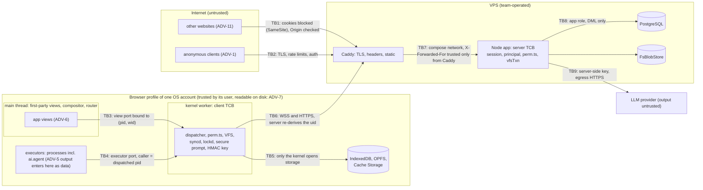

# Security model

| Field | Value |
|---|---|
| Title | Security model: threat model, trust boundaries, permission model, authentication and sessions, offline login, headers and CSP, secrets and the leaked-key runbook, the agent trust boundary, data at rest, supply chain, and the security test list |
| Status | Draft v0.1, 2026-09-24 |
| Primary owner | R2 VFS/DB (editor of SECURITY.md; permission model and server-side authorisation) |
| Secondary reviewer | R5 QA/DevOps & Integration (auth sessions, offline verifier, headers, secrets, CI and supply chain). Section owners are listed in §3.1 |
| Must be demonstrable at | **P2 gate (W7, v0.2.0):** headers and `crossOriginIsolated` on the deployed URL; login, logout and revocation; the permission matrix (VFS-04) live; the SYS-01 bypass suite green; the canary-password inspection green. **P3 gate (W11, v0.3.0):** offline login with the PBKDF2 verifier (OFF-03); lease revocation; fault harness absent from production. **P4 gate (W14, v0.4.0):** the AI safety run live: `rag-leak` 0 leaks, INJ-20 with 0 unrequested tool calls, destructive plans refused without confirmation, privilege tests. **Final defence (W17–18, v1.0.0):** everything, plus SECURITY.md with the incident log |
| Requirement IDs covered | SYS-01; VFS-04, VFS-09 (revocation and lock abuse); OFF-03; RAG-03; AGT-01, AGT-03, AGT-04, AGT-06, AGT-08; BOOT-14; §3.4 (AI trust boundary principles); §8 boundary 1; §12.6 (keys stay on the server); §15.2 (SECURITY.md contents); §17.2 (demo account); §18 (secrets never in the repository; a leaked key revoked and reported in SECURITY.md; third-party licences); Plotinium design IDs SEC-01 … SEC-22 |
| Related specs | [../11-server/backend-api.md](../11-server/backend-api.md) · [../06-sync/offline-and-sync.md](../06-sync/offline-and-sync.md) · [../01-architecture/architecture.md](../01-architecture/architecture.md) · [../01-architecture/syscall-abi.md](../01-architecture/syscall-abi.md) · [../04-vfs/virtual-file-system.md](../04-vfs/virtual-file-system.md) · [../09-database/database.md](../09-database/database.md) · [../10-ai/agentic-shell.md](../10-ai/agentic-shell.md) · [../10-ai/rag-semantic-search.md](../10-ai/rag-semantic-search.md) · [../10-ai/ai-safety-and-evaluation.md](../10-ai/ai-safety-and-evaluation.md) · [../13-quality/testing-and-performance.md](../13-quality/testing-and-performance.md) · [../14-devops/deployment-and-ci.md](../14-devops/deployment-and-ci.md) · [../15-decisions/stack-decisions.md](../15-decisions/stack-decisions.md) |

**Conventions used in this file.** RFC 2119 keywords as in the spec's Conventions section (p. 3). **Spec** marks a requirement of the capstone specification (with section and ID); **Plotinium design** marks our own binding choice (usually one of the canonical decisions C1–C18). Numbers from the AI-run prototype are marked *(pilot figure — re-measure on the lab machine)*. Threats are numbered T-01 … T-35; mitigations point to the section or spec that implements them, and every threat names the test that shows the mitigation works.

---

## 1. Purpose and scope

**Spec: §15.2.** SECURITY.md must hold the "threat model, permission model, agent trust boundary, prompt-injection defences, secret handling". **Spec: §18.** "A leaked key must be revoked at once and reported in SECURITY.md." This spec is the normative source for SECURITY.md: the repository file is generated from §3 and §8 of this spec at each tag, plus the incident log (§3.11.3), which lives only in SECURITY.md.

This spec fixes:

- the security objectives, the assets, the adversaries, the threat model and the trust boundaries (§3.2–§3.5);
- the permission model: identities, uid and gid ranges, root, `su` grants, guest, demo and examiner accounts, and where each rule is enforced (§3.6);
- authentication and sessions, the cookie rules, and the offline verifier, including what a stolen laptop yields (§3.7–§3.8);
- response headers and the Content Security Policy (§3.9); client-side isolation on a shared device (§3.10);
- secrets management and the leaked-key runbook (§3.11);
- the agent trust boundary and prompt-injection defences, in summary (§3.12);
- the data-at-rest statement (§3.13), the supply chain (§3.14), audit and privacy (§3.15), and administrative surfaces (§3.16);
- the security test list (§8).

Implementation details live in the linked specs; where this spec summarises them, the linked spec wins on mechanism and this spec wins on the security requirement.

---

## 2. Requirements table

### 2.1 Spec requirements

| ID | Summary | Spec § | How verified |
|---|---|---|---|
| SYS-01 | Spec: MUST — all applications use only the system-call interface; the kernel checks permissions on every call | §9.6, §8 boundary 1 | SYS-01 bypass suite (§8) |
| VFS-04 | Spec: MUST — rwx enforced for owner, group and others on every system call | §9.3 | permission matrix, kernel and server (§8) |
| OFF-03 | Spec: MUST — offline login never stores plain-text passwords; a salted verifier or a platform authenticator | §9.5 | canary-password storage inspection (§8) |
| RAG-03 | Spec: MUST — no result includes content the querying user cannot read | §12.2 | `rag-leak` suite, 0 leaks (§8) |
| AGT-01 | Spec: MUST — tools are typed system calls; model output is data, never `eval` or a shell string | §12.3 | strict-schema test; CSP without `unsafe-eval` |
| AGT-03 | Spec: MUST — destructive operations (delete, overwrite, chmod or chown, more than 20 inodes) need explicit confirmation after the dry run; zero bypasses | §12.3 | destructive-prompt test set |
| AGT-04 | Spec: MUST — the agent runs with the invoking user's privileges, cannot escalate, and cannot modify `/system` or `/bin` unless the user is root and confirms | §12.3, §3.4 | privilege tests (§8) |
| AGT-06 | Spec: MUST — file contents and names enter the model's context as untrusted data; an injected instruction causes no tool call the user did not ask for | §12.3, §3.4 | INJ-20 fixtures, examiners' fixture |
| AGT-08 | Spec: MUST — every agent call audited with prompt, plan, confirmation and result | §12.3 | audit inspection |
| §3.4 | Spec: MUST — least privilege, plan before acting, confirmation, atomicity, content is data, auditability, graceful absence | §3.4 | §3.12 mapping; AI tests |
| §12.6 | Spec: MUST — API keys never in the client bundle or the repository; every model call goes through the backend with per-user rate limits | §12.6 | gitleaks, bundle scan, CI without a key |
| §18 | Spec: MUST — secrets never in the repository; a leaked key revoked at once and reported in SECURITY.md; third-party code licensed and listed in THIRD_PARTY.md | §18 | gitleaks; runbook drill; licence scan |
| BOOT-14, §17.2 | Spec: SHOULD / MUST — several users plus a guest or demo account for examiners; a demo account for examiners on the production deployment | §6.5, §17.2 | account tests (§8) |

### 2.2 Plotinium design requirements

| ID | Summary | Source | How verified |
|---|---|---|---|
| SEC-01 | The server derives the principal of every request and op from the cookie session and live `su` grant only; the client kernel is never trusted | C10 | forged-principal tests |
| SEC-02 | Every security header is set by Caddy on every response; the CSP is exactly C10's plus build-time hashes for inline blocks and `form-action 'none'`; no `unsafe-inline`, no `unsafe-eval` | C10 | header test; CSP-violation e2e |
| SEC-03 | Cookie `__Host-plt_sid` on HTTPS, `plt_sid` on `http://localhost`; always `HttpOnly`, `SameSite=Strict`, `Path=/` | C10 | cookie test |
| SEC-04 | CSRF and cross-site WebSocket hijacking defences: `SameSite=Strict`, `Sec-Fetch-Site`/`Origin` checks, exact Origin allowlist before the upgrade | C10 | CSRF and CSWSH tests |
| SEC-05 | Opaque sessions (10-day sliding, 30-day absolute, guests 2 h), fixation-proof login, revocation closes sockets within 1 s | C10 | auth suite |
| SEC-06 | Argon2id (m=19456 KiB, t=2, p=1), at most 2 concurrent hashes, known-answer self-test at startup | C10 | self-test; bench |
| SEC-07 | Offline verifier: PBKDF2-SHA256, 600,000 iterations, per-uid salt, never for root, 30-day expiry, invalidated by a password change | C10 | canary test; verifier tests |
| SEC-08 | No credentials in the repository, README or `compose.yaml`; first-start credentials printed once in the app log; examiners' production credentials on paper, rotated after the defence | C10; critic | CI grep; seed test |
| SEC-09 | Secrets live only in server-side files with mode 0600; production refuses to start with unsafe settings | C10; deploy record | startup guard tests |
| SEC-10 | gitleaks on every PR, nightly on full history, on the built bundle and on LLM cassettes; the cassette recorder stores no headers; CI has no LLM key | C10; critic | CI jobs; recorder test |
| SEC-11 | Supply chain: committed lockfile, exact pins, digest-pinned images mirrored to GHCR, blocked install scripts, pinned actions, licence scan against THIRD_PARTY.md | C14; §18 | CI jobs |
| SEC-12 | The fault harness never exists in production; it is root-only, one-shot, scoped and audited elsewhere | C7; critic | route tests |
| SEC-13 | Applications reach storage only through syscalls: executor and main-thread shadowing, lint rules, a built-chunk scan; v1 runs first-party code only | C2; critic; architecture request | SYS-01 bypass suite |
| SEC-14 | Cache Storage holds only the versioned shell and model assets; the Service Worker never caches `/api/*` or per-user data | C11; quality amendment | SW tests |
| SEC-15 | The data-at-rest statement of §3.13 is published in SECURITY.md and in Settings → Privacy | critic | doc review |
| SEC-16 | An agent started from a root shell runs as the real login uid; root effects only through a per-plan elevation typed into the kernel's secure prompt, audited | C12; critic | privilege tests |
| SEC-17 | Non-disclosure: `HEAD /api/blobs` answers only for readable content; swap pages are private to their owner, even from root; feed entries of other owners are filtered by current permissions | this spec; backend and sync specs | tests in §8 |
| SEC-18 | The leaked-key runbook of §3.11.2 is rehearsed once before the P4 gate; incidents are logged in SECURITY.md | §18 | drill record |
| SEC-19 | Security events are written to `audit_log`, which the application role can only insert into and read | syscall-abi §3.7; database.md §3.2 | grants test |
| SEC-20 | The local stack is served only on `127.0.0.1:${PLOTINIUM_PORT}` and only over `http://localhost`; POST reports a non-secure context with a clear diagnostic | this spec; quality extra risk | bring-up test |
| SEC-21 | Account and quota rules for guests, the demo account and examiner accounts ring-fence examiner access (quotas, LLM pools, no `su` for guests, no lockout) | quality amendment | account tests |
| SEC-22 | Model output is rendered as text nodes only; no HTML sink in our code (lint `no-html-sinks`); Trusted Types runs report-only | C10; coherence | lint; CSP report test |

---

## 3. Design (normative)

### 3.1 Objectives, assumptions and ownership

**Objectives.**
1. A user can read and change only what the UNIX permission model allows them, on every path into the system: syscalls, sync, snapshot, blobs, swap, search, the agent.
2. A logged-in session can be ended at once, and nothing a client sends can widen its authority.
3. The model can propose, never decide (Spec §3.4: "The model is an untrusted user-space process: it proposes, and the kernel decides").
4. No secret reaches the repository, the client bundle, a log or a test fixture; a leak is revoked quickly and recorded.
5. The deployment does not add attack surface for its demo features (fault injection, debug routes, examiner accounts).

**Assumptions.** The browser and the operating system account running it are trusted by their user; the VPS operator (the team) is trusted; Anthropic processes the prompts we send (file names, never file contents, §3.12); TLS on the public deployment is terminated by Caddy on the same host as the app.

**Non-goals (stated honestly in SECURITY.md).** Protecting local data from someone who controls the browser profile or the OS account (§3.13); defending against malicious browser extensions; running untrusted third-party apps (v1 ships first-party apps only, §3.10); high availability; encryption of data at rest beyond what the hosting provider does (open question 2).

| Section | Primary | Secondary |
|---|---|---|
| Permission model and server-side authorisation (§3.6) | R2 | R1 |
| Authentication, sessions, offline verifier (§3.7, §3.8) | R5 | R2 |
| Headers, CSP, secrets, supply chain, admin surfaces (§3.9, §3.11, §3.14, §3.16) | R5 | R2 |
| Client-side isolation (§3.10) | R1 (executors, router) and R3 (views, lint) | R5 |
| Agent and RAG trust boundary (§3.12) | R4 | R2 |

### 3.2 Assets

| Asset | Where | Why it matters |
|---|---|---|
| A-1 User files and metadata | PostgreSQL `inodes`, `dentries`, FsBlobStore; each device's IndexedDB mirror | confidentiality and integrity of every user's data |
| A-2 Credentials | Argon2id hashes (server); PBKDF2 verifiers (devices) | account takeover |
| A-3 Sessions | cookie token (browser); SHA-256 of the secret (server) | account takeover while valid |
| A-4 `su` grants and root | `auth_sessions.su_uid`; the root password | full control of the file system (root bypasses r and w) |
| A-5 LLM API key and budget | VPS secret file; `llm_usage` | spending the team's money; provider account abuse |
| A-6 Process memory | swap pages (OPFS, IndexedDB `plotinium-swap`, `/api/swap`) | editor buffers and application state |
| A-7 Search index | client segments; `file_chunks` | leaks of file text (RAG-03); poisoning of results |
| A-8 Audit trail | `audit_log`; local `audit` store | accountability for AI actions (AGT-08) |
| A-9 Telemetry | device ring buffer; `telemetry_events` (opt-in) | privacy (PRE-05) |
| A-10 Infrastructure secrets | DB password, SSH deploy key, R2 backup credentials, TLS keys | server compromise; backup theft |
| A-11 Build and release integrity | repository, lockfile, images, GitHub Actions | a malicious build reaching examiners |
| A-12 Availability for the gates | production VPS; LLM budget; the demo account | a missed gate caps the mark (§13.2) |

### 3.3 Adversaries

| ID | Adversary | Capabilities |
|---|---|---|
| ADV-1 | Anonymous internet attacker | reaches the public URL; scripts requests; guesses passwords |
| ADV-2 | Another authenticated user (curious or malicious), for example bob against alice | a valid session; any API call and WebSocket frame; a modified client |
| ADV-3 | A guest or the public demo account | as ADV-2 with tighter quotas and budget |
| ADV-4 | Malicious file content or names (including the examiners' injection fixture) | text that reaches the model's context or the screen |
| ADV-5 | The LLM itself | returns arbitrary tool calls and text; may be manipulated by ADV-4 |
| ADV-6 | A buggy or compromised first-party app or view | runs in an executor or on the main thread with a pid and a window |
| ADV-7 | Someone with the device (stolen laptop, shared lab PC, the next user of the profile) | reads the browser profile on disk; may use the running OS account |
| ADV-8 | Network attacker on the path | observes or tampers with traffic |
| ADV-9 | Supply-chain attacker | a malicious npm package, image or GitHub Action |
| ADV-10 | Team mistakes | commits a secret, logs a token, ships a debug route |
| ADV-11 | Malicious website open in the same browser | sends cross-site requests and WebSocket upgrades carrying the user's cookies unless blocked |

### 3.4 Threat model

| ID | Threat | Adv. | Assets | Mitigations | Verified by |
|---|---|---|---|---|---|
| T-01 | Cross-site request forgery on a state-changing route | 11 | 1, 3, 4 | `SameSite=Strict` cookie; `Sec-Fetch-Site: same-origin` or an allowlisted `Origin` on every non-GET; JSON or octet-stream bodies only ([backend-api.md](../11-server/backend-api.md) §3.3) | `SEC-04 cross-site POST …` |
| T-02 | Cross-site WebSocket hijacking | 11 | 1, 3 | exact Origin allowlist and cookie check **before** the upgrade ([backend-api.md](../11-server/backend-api.md) §3.7) | `SEC-04 cross-origin upgrade …` |
| T-03 | Script injection (XSS) through file names, file content or model output, stealing data or acting as the user | 4, 5 | 1, 3 | CSP `script-src 'self' 'wasm-unsafe-eval'` without `unsafe-inline` or `unsafe-eval`; content and model output rendered only as text nodes; lint `no-html-sinks`; `HttpOnly` cookie; Trusted Types report-only (§3.9) | CSP-violation e2e; lint fixtures |
| T-04 | Session fixation | 1, 11 | 3 | the server mints a new id at every login and revokes a session presented with the login request ([backend-api.md](../11-server/backend-api.md) §3.6.1) | `SEC-05 fixation …` |
| T-05 | Online password guessing, credential stuffing | 1 | 2 | Argon2id; token buckets per IP and per (username, IP); login concurrency semaphore; delays, never account lockout (§3.7) | rate-limit tests |
| T-06 | User enumeration | 1 | 2 | one generic error; dummy Argon2id verification for unknown, root, guest and disabled accounts; no public user list: the greeter shows only users known on this device plus "Other user" and "Guest" | `SEC-05 login timing …` |
| T-07 | Offline guessing against a device's verifiers | 7 | 2 | PBKDF2-SHA256 at 600,000 iterations with a per-uid 16-byte salt; no verifier for root; 30-day expiry; invalidated by a password change; residual risk stated (§3.8.2) | verifier tests |
| T-08 | Plain-text passwords at rest | 7, 10 | 2 | never stored anywhere: Argon2id on the server, PBKDF2 verifier on devices, password bytes zeroed after use (§3.8) | `OFF-03 canary …` |
| T-09 | Horizontal escalation: bob reads or changes alice's files through the API | 2 | 1, 7 | the server re-derives the principal and re-checks rwx with the shared `vfs/perm.ts` on every op; snapshot rows filtered by visibility; blob reads need r on the current inode; feed entries filtered by current permissions ([offline-and-sync.md](../06-sync/offline-and-sync.md) §3.8.4) | permission matrix on the server; snapshot and feed tests |
| T-10 | Vertical escalation with a forged principal, pid or uid | 2, 6 | 4 | uid from the session only; principal only with a live `su` grant; caller identity from the port, never a message field ([syscall-abi.md](../01-architecture/syscall-abi.md) §3.2) | `SYN-11 forged principal …`; ABI identity tests |
| T-11 | An app reaches storage without syscalls | 6 | 1, 6 | executor shadowing; main-thread shadowing after POST; lint rules; built-chunk scan (§3.10) | SYS-01 bypass suite |
| T-12 | Prompt injection makes the agent call a tool the user did not ask for | 4, 5 | 1 | the planner never sees file contents; names datamarked with a per-request nonce; intent binding; strict typed tools; kernel validation, dry run and confirmation (§3.12) | INJ-20; examiners' fixture |
| T-13 | The model proposes a destructive action and it runs without consent | 5 | 1 | kernel-computed confirmation predicate; answer read only from kernel-owned TTY input; default N; HMAC token bound to the plan and dry-run hashes; refused without a TTY | AGT-03 destructive set |
| T-14 | The agent acts as root | 5, 2 | 4 | an agent spawned from a root shell drops to the real login uid; root only per plan through the secure prompt, audited (SEC-16) | AGT-04 privilege tests |
| T-15 | Search leaks snippets of unreadable files | 2 | 7 | readable set from the current tree before ranking; no permissions copied into the index; foreign results verified online and hidden offline; no foreign text stored on devices ([rag-semantic-search.md](../10-ai/rag-semantic-search.md)) | `rag-leak` |
| T-16 | Index poisoning: false chunks attached to someone else's file | 2 | 7 | `index.put` needs w on the file and each chunk's text must equal the blob slice ([backend-api.md](../11-server/backend-api.md) §3.12) | index put tests |
| T-17 | LLM API key leak | 9, 10 | 5 | key only in a VPS file with mode 0600; never in CI, the client, the repository, logs or cassettes; gitleaks; runbook (§3.11) | gitleaks; bundle scan; recorder test |
| T-18 | Denial of wallet through guest or demo accounts | 1, 3 | 5, 12 | per-uid and pool budgets, global monthly and semester caps; LLM rate limits; guest creation limits ([backend-api.md](../11-server/backend-api.md) §3.13.2) | budget tests |
| T-19 | Lock hoarding on a shared file | 2 | 1, 12 | leases need w (X) or r (S); at most 256 per session; they expire without heartbeats; revoking the holder's session releases them; `lsof` shows holders ([offline-and-sync.md](../06-sync/offline-and-sync.md) §3.14). Residual: a live holder can keep renewing | lease tests |
| T-20 | Replaying a captured op or colliding with another user's op id | 2 | 1 | ops execute only as the authenticated principal; dedup by `opId`; a stored op of another uid returns EINVAL without revealing it ([database.md](../09-database/database.md) §3.9.3) | dedup tests |
| T-21 | Fault injection or debug routes abused on production | 1, 2 | 1, 12 | routes exist only with `FAULT_INJECTION=1`, which production refuses; root-only; one-shot; scoped to the arming OS session; audited (§3.16) | route tests |
| T-22 | Resource exhaustion: huge frames, floods, slow consumers | 1, 2 | 12 | `maxPayload` 64 KB; per-connection frame bucket; close 4508 for slow consumers; upgrade limits; body limits; pool back-pressure (1013) | limiter and close-code tests |
| T-23 | Blob existence oracle ("does someone hold this file?") | 2 | 1 | `HEAD` answers 200 only for readable content; deduplication happens only after a full upload (proof of possession) ([backend-api.md](../11-server/backend-api.md) §3.6.3) | `SEC-17 HEAD …` |
| T-24 | Reading another user's process memory through remote swap | 2 | 6 | swap routes authorise by the page owner only, even for root; composite foreign key ([backend-api.md](../11-server/backend-api.md) §3.11) | swap tests |
| T-25 | Supply-chain compromise | 9 | 11 | lockfile, exact pins, digest-pinned images mirrored to GHCR, blocked install scripts, pinned actions, audit and licence scans (§3.14) | CI jobs |
| T-26 | Credentials in the public repository, README or compose file | 10 | 2, 4, 10 | first-start generation, printed once in the app log; production credentials on paper; CI grep; production start guards (§3.11) | `SEC-08 *` |
| T-27 | Hard links used to pin another user's quota or keep their file alive | 2 | 1 | protected hard links: a non-root caller must own the file or have r and w on it ([virtual-file-system.md](../04-vfs/virtual-file-system.md) §3.7.2) | VFS link tests |
| T-28 | Clickjacking | 11 | 1 | `frame-ancestors 'none'` | header test |
| T-29 | Cross-origin reads through side channels (Spectre class) | 11 | 1 | COOP `same-origin`, COEP `require-corp`, CORP `same-origin`; every asset self-hosted | `crossOriginIsolated` test |
| T-30 | The examiner's local stack reachable from the campus LAN over plain HTTP | 1 | 1, 4 | Caddy publishes only on `127.0.0.1`; credentials generated per bring-up; README says to use `http://localhost:4717` (SEC-20) | bring-up test |
| T-31 | Reading the browser profile of a shared or stolen machine | 7 | 1, 2, 6, 9 | stated residual risk; guidance to use a separate profile, log out and reset local storage; no root verifier; verifier expiry (§3.8.2, §3.13) | doc review; storage inspection |
| T-32 | Secrets or personal data in logs | 10 | 3, 5 | pino redaction; no file contents, prompts or tokens in logs ([backend-api.md](../11-server/backend-api.md) §3.16) | log-capture test |
| T-33 | The application altering the audit trail | 6, 10 | 8 | `audit_log` is INSERT and SELECT only for `plotinium_app`; agent rows commit with the effect | grants test |
| T-34 | Network tampering or TLS stripping | 8 | 1, 3 | HTTPS only in production with HSTS; `__Host-` cookie prefix; same-origin WSS | header test |
| T-35 | A stale second tab or kernel writing after a takeover | 6 | 1 | one kernel per origin (`plotinium:kernel` Web Lock), a fencing epoch checked in every IndexedDB transaction, close 4409 for the stale socket | two-tab e2e |

### 3.5 Trust boundaries



| ID | Boundary | What crosses it | Rule |
|---|---|---|---|
| TB1 | Other sites → our origin | cross-site requests and upgrades | refused by `SameSite=Strict`, `Sec-Fetch-Site`, the Origin allowlist, `frame-ancestors 'none'`, COOP |
| TB2 | Internet → Caddy | every request | TLS in production; rate limits; authentication per route |
| TB3 | Views → kernel | syscalls from the main thread | view port bound to `(pid, wid)` at `window.create`; the view never holds storage references (§3.10) |
| TB4 | Executors → kernel | syscalls from processes | caller identity from the port and the dispatched pid; dispatcher order ESRCH → ENOSYS → EINVAL → capability → rwx → audit (C3) |
| TB5 | Kernel → storage | IndexedDB, OPFS, Cache Storage | only the kernel (and the blkio worker it owns) opens storage; the Service Worker touches only Cache Storage |
| TB6 | Kernel → server | ops, snapshots, blobs, swap, index, LLM | the server trusts nothing from the client: principal from the session and grants, rwx re-checked, quotas and leases enforced in the transaction |
| TB7 | Caddy → app | proxied requests | only Caddy can reach the app port; the client IP is taken from `X-Forwarded-For` only when the peer is Caddy |
| TB8 | App → database | SQL | role `plotinium_app` with DML only, `audit_log` insert and read only; the database port is not published |
| TB9 | App ↔ LLM provider | prompts out, proposals back | the key stays on the server; the reply is parsed as data and validated by the kernel before anything runs |

### 3.6 The permission model

#### 3.6.1 Identities

**Spec: §9.3** (uid and gid per inode; root is uid 0; `chown` is root-only) and **§9.1** (every process carries uid and gid). **Plotinium design:**

| Range or name | uid | Primary group | Purpose and rules |
|---|---|---|---|
| `root` | 0 | `root` (gid 0) | superuser. No login at the greeter; reachable only through `su` (online, with the root password). Never has an offline verifier. Quotas do not apply (Spec §9.3) |
| reserved | 1–999 | – | unused in v1: kernel threads and special processes are owned by uid 0, class `system`; AI processes that act for a user run as that user ([processes-and-scheduling.md](../03-kernel/processes-and-scheduling.md), [rag-semantic-search.md](../10-ai/rag-semantic-search.md)) |
| regular accounts | 1000–59999 | `users` (gid 100) | people: the demo seed creates `demo`, `alice` and `bob` (both also in group `team`) and `examiner1`…`examinerN` (also in group `examiners`); the bench seed's `user01`…`user59` use uids 1001–1059, so the demo accounts need uids outside that block (cross-spec request to [database.md](../09-database/database.md) §3.27); `/home/<user>` mode 0700 (Spec §9.3 figure) |
| online guests | 60000–60999 | `guests` | created by `POST /api/auth/guest`; `/home/guest-XXXX` mode 0700; 20 MB / 500 inodes; session lives 2 hours; cannot `su`, and nobody can `su` to a guest; removed nightly after expiry ([backend-api.md](../11-server/backend-api.md) §3.6.1) |
| offline guest | 65534 | `nogroup` (65534) | local only, when the device is offline: home `/tmp/guest` (0700) on the device-local `tmpfs`, never synced, gone after reboot; no agent, no `su` ([virtual-file-system.md](../04-vfs/virtual-file-system.md) §3.3.1) |

Groups: `root` 0, `users` 100, `team` 200 (alice, bob; used by the lock and permission demos on `/home/shared`; gid from the [database.md](../09-database/database.md) seed), `examiners` (separate LLM pool; gid assigned by the seed), `guests` 60000, `nogroup` 65534. A process's credentials (`uid`, `gid`, supplementary groups, `ruid`) live in its PCB and are inherited by children; nothing in a syscall's arguments can change them ([syscall-abi.md](../01-architecture/syscall-abi.md) §3.5).

#### 3.6.2 Rules

**Spec: MUST, §9.3, VFS-04.** "Read, write and execute for owner, group and others. On directories, r lists entries, w creates and removes entries, and x allows traversal. Root (uid 0) bypasses read and write checks. chmod accepts octal and symbolic modes, chown is root-only, and the default umask is 022. The sticky bit on /tmp means only a file's owner can delete it."

The permission function is defined once, in the isomorphic `vfs/perm.ts` ([virtual-file-system.md](../04-vfs/virtual-file-system.md) §3.6.1, normative there), and imported unchanged by the kernel and the server:

```ts
export const R = 4, W = 2, X = 1;
export function may(cred: Cred, n: PermSubject, want: number): boolean {
  if (cred.uid === 0) {
    // Root bypasses r and w. x is granted on directories, and on files only if SOME x bit is set.
    return (want & X) === 0 || n.type === 'd' || (n.mode & 0o111) !== 0;
  }
  const shift = cred.uid === n.uid ? 6 : cred.groups.includes(n.gid) ? 3 : 0;
  return (((n.mode >> shift) & 7) & want) === want;
}
```

- The root rule tests the x **bit** of `want` (critic fix: the earlier `want !== 1` granted root r+x on a file with no x bits).
- Only one class applies: an owner gets only the owner bits, even when group or other bits would grant more.
- Operation rules (w and x on the parent to create or unlink; w and x on both parents to rename; the sticky rule; `chmod` by the owner or root; `chown` by root only; protected hard links) are the matrix of [virtual-file-system.md](../04-vfs/virtual-file-system.md) §3.6.2.

#### 3.6.3 Where the rules are enforced

| Path into the data | Enforcement point | Reference |
|---|---|---|
| Syscalls from processes and views | kernel dispatcher stage 5 with `pcb.cred` | [syscall-abi.md](../01-architecture/syscall-abi.md) §3.3 |
| Replicated ops | server `vfsTxn` with the server-derived principal, same `vfs/perm.ts` | [database.md](../09-database/database.md) §3.10 |
| Snapshots | row visibility: r on the parent and x on every ancestor | [backend-api.md](../11-server/backend-api.md) §3.6.2 |
| Live and resumed feed entries | filtered by the receiver's current permissions; redacted when nothing is visible | [offline-and-sync.md](../06-sync/offline-and-sync.md) §3.8.4 |
| Blob reads | r on the inode whose current blob it is | [backend-api.md](../11-server/backend-api.md) §3.6.3 |
| Search | readable set from the current tree before ranking; server verification of foreign results | [rag-semantic-search.md](../10-ai/rag-semantic-search.md) |
| Leases | S needs r, X needs w | [offline-and-sync.md](../06-sync/offline-and-sync.md) §3.14.1 |
| Database constraints | quotas, names, modes, types, acyclicity (defence in depth, DB-04) | [database.md](../09-database/database.md) |

One truth table (3 users × 9 modes × 8 operations) runs against the kernel and against the server; any difference fails CI (`VFS-04 perm truth table is identical on kernel and server`).

#### 3.6.4 `su` and elevation

**Plotinium design (C10).**

- `su [user]` opens the **compositor-owned secure prompt**: the password is typed into a kernel-rendered field that no application can read, drive or overlay; the calling shell never sees it ([syscall-abi.md](../01-architecture/syscall-abi.md) `su`).
- Online, the kernel sends it to `POST /api/auth/su`; the server verifies Argon2id and sets a **15-minute grant** on the auth session (`su_uid`, `su_expires_at`). The kernel then spawns a child shell whose PCB carries the target uid; `whoami` and `id` show it; `exit` clears the grant.
- The server accepts ops and requests as the target uid only while the grant is live (SEC-01). When it expires, the server sends SIGHUP to the elevated processes and their queued ops wait for a new grant; nothing is dropped ([offline-and-sync.md](../06-sync/offline-and-sync.md) §3.8.6, §3.17).
- Offline, `su` works only to a non-root user who has a verifier on this device; `su` to root offline is impossible because root never has a verifier (EAGAIN `offline`).
- Guests cannot `su`, and nobody can `su` to a guest (EPERM).
- Rate limit: 5 attempts per 15 minutes per (session, target).

#### 3.6.5 The agent's identity

**Spec: MUST, §3.4 and AGT-04.** "The agent runs with the invoking user's identity, never as root, and cannot raise its own privileges"; it "cannot modify /system or /bin unless the user is root and confirms". **Plotinium design (C12, critic):** an agent spawned from a root shell runs as the **real login uid** (`ruid`), not uid 0. Root effects happen only through a per-plan elevation typed into the secure prompt after the dry run, and are audited ([agentic-shell.md](../10-ai/agentic-shell.md) §3.19). Capabilities are narrowed to `fs.scope = {cwd, $HOME}` and `batch.grant` for the confirmed `(op, ino)` set ([syscall-abi.md](../01-architecture/syscall-abi.md) §3.5).

#### 3.6.6 Examiner, demo and guest accounts

**Spec: §17.2** ("a production deployment reachable at a public URL, with a demo account for examiners") and **BOOT-14**. **Plotinium design (quality amendment, SEC-21):**

- **Named examiner accounts** (`examiner1`…) are separate from the public `demo` account. Their passwords, and the production root password, are handed over **on paper** at each gate and rotated afterwards with `cli reset-password` ([backend-api.md](../11-server/backend-api.md) §3.18.3). They have their own LLM pool (US$15 and 100 calls per day).
- The **public demo account** and guests share one small LLM pool, so nobody can drain the examiners' budget before a gate. Failed logins only delay (never lock) any account, so nobody can lock the demo or examiner accounts out. Budgets are reset before each gate.
- Nobody but root can read another user's home (mode 0700).

### 3.7 Authentication and sessions

**Plotinium design (C10).** The mechanisms are specified in [backend-api.md](../11-server/backend-api.md) §3.6.1 and §3.8; the security properties they must have are:

| Property | Mechanism |
|---|---|
| Tokens are unguessable and useless if the database leaks | `<id>.<secret>` with a 160-bit id and a 256-bit secret from `crypto.randomBytes`; only SHA-256 of the secret is stored; comparison with `timingSafeEqual` |
| Tokens never leak through scripts, URLs or logs | cookie only (`HttpOnly`); never in a URL, a body or a log; pino redacts `cookie` and `set-cookie` |
| Cross-site use is blocked | `SameSite=Strict`; `Sec-Fetch-Site`/`Origin` check on every non-GET; exact Origin allowlist before WebSocket upgrades (T-01, T-02) |
| Host binding | `__Host-plt_sid` on HTTPS (no `Domain`, `Path=/`, `Secure`); `plt_sid` on `http://localhost`, because the `__Host-` prefix requires a secure origin (coherence §23) |
| Bounded lifetime | 10-day sliding expiry (written at most once an hour), 30-day absolute cap; guests 2 hours absolute |
| No fixation | a new id at every login; a session presented with the login request is revoked (T-04) |
| Fast revocation | logout, password change, disabled account, admin CLI: the session is revoked in the database, its sockets get `bye revoked` and close 4401 within 1 s, its leases are released; every heartbeat re-validates the session |
| Password change | revokes every other session of the user and rotates the current one; increments `password_version`, so devices drop their offline verifier |
| Password storage | Argon2id m=19456 KiB, t=2, p=1, 16-byte salt, 32-byte tag, PHC string, optional pepper; rehash when parameters change; at most 2 hashes at once; known-answer self-test at startup (SEC-06) |
| No enumeration, no lockout | one generic error and a dummy verification (T-06); token buckets delay, never lock (T-05) |

The OWASP ASVS session-management checklist is kept in SECURITY.md and ticked at each gate (quality record).

### 3.8 Offline login (OFF-03)

**Spec: MUST, §9.5, OFF-03.** "Offline login never stores plain-text passwords. Use a salted verifier or a platform authenticator." **Plotinium design (C10; client and quality records).**

#### 3.8.1 The verifier

- **Creation.** Only after a successful **online** login, and never for uid 0 or a guest (`AuthMe.offlineVerifier.allowed`). The login view passes the password to the kernel over its view port; the kernel keeps it only as a `Uint8Array` until `desktop-interactive`, then derives `dk = PBKDF2-HMAC-SHA256(password, salt, 600,000 iterations, 256 bits)` with WebCrypto in the kernel worker (off the boot critical path), stores `verifier = SHA-256(dk)`, and zeroes the array. The login view clears its input field and keeps no reference. (JavaScript strings cannot be wiped; that is why the kernel copy is a byte array.)
- **Record** (IndexedDB store `credentials`, `strict` durability, one record per uid; §4.2).
- **Parameters.** 600,000 iterations is OWASP's PBKDF2-HMAC-SHA256 setting (https://cheatsheetseries.owasp.org/cheatsheets/Password_Storage_Cheat_Sheet.html, cited in the quality record); cost 78.4 ms in Chrome 153 and p50 88–155 ms in the client-storage spike *(pilot figures — re-measure on the lab machine; budget ≤ 500 ms, spike S5)*.
- **Offline check.** Re-derive, compare with a constant-time loop, and on success create a **local** session (`authMode: 'offline'`). After 5 failures, a back-off of `2^n × 30 s` (a user-experience gate; someone with devtools can bypass it, which SECURITY.md says).
- **Invalidation.** 30 days without an online login; a `passwordVersion` different from the one in the record at the next online contact; "Forget this device" in Settings.
- **What an offline session cannot do.** Anything server-authoritative: its ops wait in the outbox until the user signs in online (the taskbar says "Sign in to sync"); no agent; no `su` to root; locks are local only.
- **Passkeys** (WebAuthn) are a Phase-4 stretch goal, not part of v1 (coherence simplification).

#### 3.8.2 What a stolen laptop (or the next user of a lab PC) yields

**Plotinium design (critic, SEC-15).** One IndexedDB database per device holds every mirrored user's data; the kernel enforces rwx **while it runs**, but the files on disk are not encrypted. Offline login is an access gate, not disk encryption. SECURITY.md states: *data at rest in the browser profile is readable by anyone who controls that OS account, as on UNIX with physical access.*

| On the device | Readable with the profile on disk? | Consequence | Mitigation |
|---|---|---|---|
| IndexedDB `plotinium`: inodes, dentries, blob chunks of every user who used this profile, including other users' files they could read | yes | disclosure of mirrored files | use a separate browser profile per person on shared PCs; Settings → Storage → "Reset local storage" (exports unsynced changes first); the recovery console offers the same |
| Offline verifiers (`credentials`) | yes | offline guessing at roughly one guess per 0.1 s per CPU core *(pilot figure — re-measure on the lab machine)*, much faster on GPUs; weak passwords fall | 600,000 iterations, per-uid salt, 30-day expiry, no root verifier, generated strong passwords for seeded accounts; a password change invalidates the verifier |
| The session cookie | on Linux it depends on the keyring; with the running OS account, usable by opening the browser | the attacker acts as that user until the session ends (≤ 10 days sliding, ≤ 30 days absolute) | logout; a password change elsewhere revokes all sessions; `cli revoke-sessions` |
| Outbox and undo | yes | pending changes and the content they carry | same as files |
| Swap (OPFS, `plotinium-swap`) | yes | process memory, including unsaved editor buffers | the boot sweep removes pages the restored session does not reference |
| Telemetry ring | yes | app-usage history | Settings → Privacy → Clear |
| Cache Storage | yes | only the versioned shell and model files; no user data (SEC-14) | – |
| **Not present** | – | plain-text passwords (canary test), a root verifier, server password hashes, the LLM API key, database or infrastructure credentials, other users' session tokens | – |

### 3.9 Response headers and Content Security Policy

**Plotinium design (C9, C10, SEC-02).** Caddy sets every header on every response, including the static shell, `/api/*`, `/ws`, `/models/*` and `/ort/*`; Fastify sets none of them (no helmet). The Service Worker stores full network responses, so the headers survive an offline boot ([offline-and-sync.md](../06-sync/offline-and-sync.md) §3.16).

| Header | Value | Why |
|---|---|---|
| `Cross-Origin-Opener-Policy` | `same-origin` | cross-origin isolation (SharedArrayBuffer pre-emption blocks, two-thread ORT, `measureUserAgentSpecificMemory` for MEM-01); T-29 |
| `Cross-Origin-Embedder-Policy` | `require-corp` | same; possible because every asset is self-hosted (system fonts, bundled icons, `/models`, `/ort`); `credentialless` is only the reversal option (coherence §12) |
| `Cross-Origin-Resource-Policy` | `same-origin` | our resources cannot be embedded by other sites |
| `Content-Security-Policy` | below | T-03, T-28, AGT-01 |
| `Content-Security-Policy-Report-Only` | `require-trusted-types-for 'script'` | Trusted Types measured but not enforced, because Solid's compiled templates assign HTML strings to `template.innerHTML` (coherence §13) |
| `Strict-Transport-Security` | `max-age=31536000` (production only) | T-34 |
| `X-Content-Type-Options` | `nosniff` | no MIME sniffing |
| `Referrer-Policy` | `no-referrer` | no path leakage to other sites |
| `Permissions-Policy` | `camera=(), microphone=(), geolocation=(), payment=(), usb=()` | features the OS never uses stay off |
| `Server` | removed | – |
| `Cache-Control` | `no-cache` for `index.html`, `sw.js`, `version.json`, `manifest.webmanifest`; `public, max-age=31536000, immutable` for hashed assets, and for `/models/*` and `/ort/*` only because their paths carry the model revision or the ORT version (a new version is a new path); `no-store` on `/api/*` responses with user data (set by Fastify) | correct updates (OFF-05) and no shared caching of private data |

**Content Security Policy** (C10's directives, verbatim, plus the two additions marked †):

```text
default-src 'self';
script-src 'self' 'wasm-unsafe-eval' <† build-time 'sha256-…' of each inline <script> in index.html>;
style-src 'self' <† build-time 'sha256-…' of each inline <style>>      † (only if index.html has an inline <style>)
worker-src 'self' blob:;
connect-src 'self';
object-src 'none';
base-uri 'none';
frame-ancestors 'none';
form-action 'none'                                      † (the OS submits no HTML forms)
```

- **No `unsafe-eval`.** `eval` and `new Function` are blocked by the platform, which backs AGT-01 ("model output is never passed to `eval`"). `'wasm-unsafe-eval'` allows WebAssembly compilation for the embedding runtime only.
- **No `unsafe-inline`.** The framework-free boot UI is inlined into `index.html` for a fast first paint (C11), and an inline `<script>` or `<style>` would be blocked. The build therefore computes the SHA-256 of every inline `<script>` and `<style>` block and emits them into the Caddy configuration (`script-src … 'sha256-…'`; `style-src 'self' 'sha256-…'` when there is an inline style). A CI test loads `index.html` with its real headers and fails on any `securitypolicyviolation`. Inline `style="…"` **attributes** in markup are not allowed (lint); setting properties through the CSSOM (`element.style.transform = …`, which the compositor uses) is not restricted by CSP (MDN, `style-src`: styles set directly on an element's `style` property are not restricted).
- **`worker-src 'self' blob:`**: ORT's threaded WebAssembly may start workers from `blob:` URLs; tighten to `'self'` if the ORT spike shows `blob:` is unused (C10).
- **`connect-src 'self'`** covers same-origin `wss:` in CSP Level 3 (coherence §13); no third-party hosts are needed because models and ORT are self-hosted (`env.allowRemoteModels = false`).
- **Reporting.** No report endpoint in v1: violations (enforced and report-only) are caught by a `securitypolicyviolation` listener in the router and written to the kernel log (`dmesg`), and e2e tests fail on them.

### 3.10 Client-side isolation on a shared device

**Spec: MUST, §8 boundary 1, SYS-01.** "No application, including built-in ones, touches storage, the process table or another application's windows directly." **Plotinium design (C2, critic, architecture request, SEC-13):**

1. **Executors.** The executor runtime shadows `indexedDB`, `caches`, `navigator.storage`, `Worker` and `importScripts` before it loads program code; programs receive only `{sys, pid}` ([architecture.md](../01-architecture/architecture.md) §3.6).
2. **Main thread.** After POST, the router captures what it needs and then shadows `window.indexedDB`, `caches`, `navigator.storage.getDirectory` and `Worker` before any app view chunk loads; views receive only `{sys, pid, wid}` (ARC-07).
3. **Lint and build checks.** ESLint `no-restricted-imports` and `no-restricted-globals` stop `apps/*` from importing `kernel/`, `vfs/` or `wm/` and from naming storage globals; a scan of the built app chunks fails the build if they reference a storage global, `contentWindow`, `contentDocument` or `window.open`.
4. **Residual risk (architecture request).** Main-thread shadowing is defence in depth only: script in the same realm could reach fresh globals through an `about:blank` iframe. The enforceable controls for views are rules 3 and code review, which is why **v1 runs first-party code only**. Any future third-party app would run in a sandboxed `srcdoc` iframe without `allow-same-origin` (quality amendment).
5. **Storage owners.** Only the kernel worker and its blkio worker open IndexedDB and OPFS; the Service Worker touches only Cache Storage (SEC-14), which holds only the versioned shell and model files because it is shared by every OS user of the profile.
6. **One kernel per origin** (C2) with a fencing epoch: a second tab cannot write (T-35).
7. **Secure context.** Service Workers, `crypto.subtle`, OPFS, `__Host-` cookies and SharedArrayBuffer need `https:` or `http://localhost`. POST logs `isSecureContext` and `crossOriginIsolated` and shows a clear diagnostic instead of a broken boot (quality extra risk). The local stack publishes Caddy only on `127.0.0.1` (SEC-20, T-30).

### 3.11 Secrets management

#### 3.11.1 Inventory and rules

**Spec: MUST, §18.** "API keys, database credentials and tokens do not belong in the repository or the client bundle." **Spec: MUST, §12.6.** "Keys stay on the server." **Plotinium design (C10, critic, SEC-08 … SEC-10):**

| Secret | Lives in | Readable by | Rotation | If leaked |
|---|---|---|---|---|
| `ANTHROPIC_API_KEY` | a file under `/srv/plotinium/secrets/` on the VPS (mode 0600), mounted into the app container and passed as `ANTHROPIC_API_KEY_FILE` | the app process; VPS root | on any suspicion; at the end of the semester | runbook §3.11.2; provider-side spend limit caps the damage |
| Production database password | a secrets file on the VPS (0600), `DATABASE_PASSWORD_FILE` | app, database | on leak | the database port is not published, so it is useful only from the host |
| Local database password | generated at first start into a Docker volume | the local stack | every fresh bring-up | local only |
| User passwords | Argon2id hashes in `users.password_hash` | – | users; `cli reset-password` | hashes only (Argon2id) |
| First-start credentials | printed once in the app log (`docker compose logs app`) | whoever runs the stack | local: every fresh bring-up; production: reset and handed over on paper before each gate, rotated after it | local only / rotate |
| Session tokens | the browser's cookie store; SHA-256 of the secret in `auth_sessions` | the user's browser | 10-day sliding, 30-day absolute | revoke (`cli revoke-sessions`) |
| Pepper (optional) | `AUTH_PEPPER_FILE` (0600); an offline copy on paper kept by R2 and R5 | the app | never (losing it invalidates every password) | rotate all passwords |
| SSH deploy key and `known_hosts` | GitHub environment `production` secrets (approval-gated) | the deploy job | on leak; at the end of the semester | remove from `authorized_keys`, issue a new key |
| R2 backup credentials | rclone configuration on the VPS host (0600), not in any container | VPS root | on leak | rotate the Cloudflare API token |
| TLS private keys | Caddy's `caddy_data` volume | Caddy | automatic (ACME) | delete and let Caddy re-issue |
| Upstream LLM token (optional) | a file in a local compose override; its SHA-256 on production | local app / production app | per defence | remove the hash on production |
| Kernel HMAC key for plan confirmation | kernel worker memory only, per boot | the kernel | every boot | – |

Rules:
- `.env.example` lists variable **names** only; `compose.yaml` and the README contain no secret values and no passwords (SEC-08; a CI grep enforces it).
- In production the server refuses to start if a secret is missing, shorter than 32 bytes, equal to a known development value, or given inline instead of as a file ([backend-api.md](../11-server/backend-api.md) §3.4).
- **gitleaks** (CLI, MIT licence) runs on every PR (`gitleaks git --redact`), nightly over the full history, on the built bundle directory, and on `ai/eval/cassettes/` (SEC-10).
- The cassette recorder stores request **bodies** only, never headers, and refuses to write a cassette that contains the key or matches `sk-ant-`.
- CI has no LLM key: `LLM_MODE=replay`, and a test asserts `ANTHROPIC_API_KEY` is absent from the CI environment.
- A built-bundle scan fails the build if `sk-ant-` or a server-only environment name appears in `web/dist`.
- ESLint forbids importing `@anthropic-ai/sdk` outside `server/src/llm/`.
- pino redacts every secret-bearing field ([backend-api.md](../11-server/backend-api.md) §3.16).

#### 3.11.2 Leaked-key runbook (§18)

**Trigger.** A gitleaks alert; a provider notice; unexpected LLM spend (budget alerts at 50/80/100 %, [backend-api.md](../11-server/backend-api.md) §3.13.2); a key seen in a log, screenshot, chat or artifact. **Owner:** R4 for the LLM key, R5 for every other secret; the other is the backup.

| Step | Target time | Action |
|---|---|---|
| 1 | T+0 | Declare the incident in the team channel; name the owner; stop sharing the leaking artifact |
| 2 | ≤ 15 min | **Revoke first**: disable or delete the key in the provider console (for the LLM key, the Anthropic console) before anything else |
| 3 | ≤ 30 min | Create a new key with a provider-side spend limit; write it to the VPS secret file (mode 0600) over SSH; `docker compose up -d --no-deps app`; check `GET /api/llm/health` and `/api/readyz` |
| 4 | ≤ 2 h | Compare the provider's usage for the leak window with our `llm_requests`; any calls we did not make are abuse, and their cost goes into the incident record |
| 5 | ≤ 24 h | Remove the secret from where it leaked: close and delete an unmerged branch; delete a public artifact, image or log. History on `main` is **not** rewritten (the key is already dead, force pushes are disabled, and rewriting history is treated as misconduct under §15.4); the record states that the value in history is revoked |
| 6 | ≤ 24 h | Add an entry to the SECURITY.md incident log (§3.11.3) |
| 7 | ≤ 1 week | Retrospective: add a detection rule, test or process change so the same leak cannot recur, and link it from the incident entry |

The same steps apply to other secrets, with step 2 replaced by: database password → `ALTER ROLE … PASSWORD`, update the secret file, restart the app; sessions → `cli revoke-sessions --all`; SSH key → remove it from `authorized_keys`; R2 → rotate the API token; TLS key → delete the certificate from `caddy_data` and restart Caddy. The runbook is rehearsed once with a dummy key before the P4 gate (SEC-18).

#### 3.11.3 Incident log (kept in SECURITY.md)

| Date | Secret | Where it leaked | How detected | Time to revoke | Impact | Fix and follow-up |
|---|---|---|---|---|---|---|
| (none yet) | | | | | | |

### 3.12 The agent trust boundary and prompt-injection defences (summary)

**Spec: MUST, §3.4.** "The model is an untrusted user-space process: it proposes, and the kernel decides." The mechanisms are specified in [agentic-shell.md](../10-ai/agentic-shell.md), [rag-semantic-search.md](../10-ai/rag-semantic-search.md) and [ai-safety-and-evaluation.md](../10-ai/ai-safety-and-evaluation.md); this table is the SECURITY.md summary.

| §3.4 principle | Plotinium mechanism | Evidence |
|---|---|---|
| Least privilege | the agent process runs as the invoking uid (the real login uid when started from a root shell); capabilities narrowed to `fs.scope = {cwd, $HOME}`; `/system` and `/bin` give EPERM unless root confirms a per-plan elevation; `batch.grant` covers only the confirmed `(op, ino)` set | AGT-04 privilege tests |
| Plan before acting | the model returns a structured plan through strict tools; the kernel re-parses it with Valibot, resolves paths as the uid, checks rwx and quota, and dry-runs it on a read snapshot, printing the blast radius | AGT-02 invalid-plan set |
| Confirmation | the kernel alone decides (delete, overwrite, `chmod`/`chown`, or more than 20 inodes); the prompt is rendered by the kernel on the TTY, default N; the answer is read only from kernel-owned TTY input, so `yes \| ai …` or a non-interactive caller cannot confirm, and destructive plans are refused without a TTY; the grant is an HMAC token bound to the plan and dry-run hashes | AGT-03 destructive set, zero bypasses |
| Atomicity | a confirmed plan is one `batch`: one IndexedDB transaction and one server `vfsTxn`, with the dry-run fingerprint re-checked (EAGAIN `stale-plan` if anything changed); a kill rolls it back | AGT-05 fault injection; AGT-09 kill test |
| Content is data | the planner never sees file contents; names are JSON-escaped with control, bidi and tag characters escaped, inside `<untrusted>` blocks marked with a per-request nonce; each plan step must quote a verbatim span of the user's request (intent binding); content-dependent tasks use a quarantined, tool-less extraction call; model output is only parsed as data, and the CSP blocks `eval` | AGT-06 INJ-20 (executed-unrequested = 0), examiners' fixture |
| Auditability | every agent syscall is written to `audit_log` in the same transaction as its effect, with the prompt, plan, confirmation and outcome; rejected and killed plans are recorded after the rollback; `ai log` reads the local mirror | AGT-08 audit inspection |
| Graceful absence | offline, rate-limited, over budget, no key or provider failure → EAIUNAVAIL with a clear message; refusals → EAIREFUSED; the rest of the OS keeps working; `AI=0` builds pass every non-AI suite | §12.6 degradation tests; litmus job |

**Search (RAG-03).** The readable set is computed from the **current** tree before ranking; no copy of owner, group or mode is kept in the index; results from files the searcher does not own are verified with the server online and hidden offline; devices store no text of other users' files; `index.put` requires w on the file and text equal to the blob slice (T-15, T-16).

**Keys and cost (§12.6).** The provider key exists only on the server; every call passes per-user rate limits and budget pools and is logged in `llm_requests` (T-17, T-18).

**Privacy of prompts.** Prompts sent to the provider contain the user's request, kernel context (uid, cwd, time) and datamarked file **names** from the listing, never file contents. This is stated in Settings → Privacy and in the README.

### 3.13 Data at rest and in transit

**Plotinium design (critic, SEC-15).** SECURITY.md contains this statement verbatim:

- **Server.** PostgreSQL data (`pgdata` volume) and file contents (`blobs` volume) are stored unencrypted by the application on the VPS disk; access requires root on the VPS (key-only SSH, cloud firewall allowing only 22, 80 and 443). Backups (nightly `pg_dump -Fc` and `rclone` of blobs) are copied over TLS to Cloudflare R2, which encrypts them at rest; client-side encryption of backups with an `rclone crypt` remote is open question 2. Swap pages are never backed up. Logs contain no file contents, prompts, passwords or tokens.
- **Client.** Everything the device mirrors is stored unencrypted in the browser profile (IndexedDB, OPFS); **data at rest in the browser profile is readable by anyone who controls that OS account, as on UNIX with physical access** (§3.8.2). Cache Storage holds only the versioned shell and model files.
- **In transit.** Production uses HTTPS and WSS only (Caddy automatic HTTPS, HTTP/3, HSTS). The local examiner stack uses plain HTTP on the loopback interface only (`http://localhost:4717`, published on `127.0.0.1`), which the browser treats as a secure context and which never leaves the machine.

### 3.14 Supply chain

**Spec: §18** ("Third-party code needs a licence and attribution … listed in THIRD_PARTY.md. It may never stand in for a mandatory DSA structure"). **Plotinium design (C14, C16, SEC-11):**

- **Dependencies.** pnpm workspaces with catalogs; every version pinned exactly; `pnpm-lock.yaml` committed; `pnpm install --frozen-lockfile` in CI and in every Docker build. Dependency install scripts do not run unless the package is explicitly allowlisted in the workspace configuration (pnpm's default since v10), and the allowlist is reviewed like code. `pnpm audit --prod` fails CI at high severity. Automated dependency updates are limited to security fixes until v1.0.0.
- **Images.** `node:24-trixie-slim`, `pgvector/pgvector:0.8.6-pg18-trixie` and Caddy 2.11 are pinned **by digest** and mirrored to our public GHCR packages, so the examiner never pulls from Docker Hub; digests are bumped deliberately, only after the full test suites pass.
- **Model and runtime files.** Model weights (pinned revision `4262131b` for mdbr-leaf-ir) and ORT files are self-hosted and pinned by SHA-256 (C12).
- **CI.** Third-party GitHub Actions are pinned to a full commit SHA; each workflow declares least-privilege `permissions`; the deploy job runs in the `production` environment and needs approval by a member other than the tagger; the self-hosted lab runner accepts only `schedule` and `workflow_dispatch` on `main`, never `pull_request`, because a pull request from a fork could otherwise run code on it (critic). `main` is protected: no force pushes, required checks, a required review; `protocol/` needs R1, R2 and R4 (CODEOWNERS).
- **Licences.** THIRD_PARTY.md lists every dependency with its licence (the coherence list has 51 entries), the Lucia-derived session code (0BSD, citing the file-level `code/LICENSE`, quality examiner correction), model weights and evaluation corpus documents (MIT, Apache-2.0 or CC-BY only). A CI licence scan compares the lockfile with THIRD_PARTY.md and fails on an unlisted package or on AGPL/GPL code in the shipped bundle (k6, AGPL, is a standalone test tool that is never bundled).
- **DSA rule.** No package stands in for a mandatory structure (§10.2): the tree, trie, heap, DAG and LRU are written by the team in `dsa/`; the AI-written pilot code under `docs/evidence/pilot` is never imported (lint ban) and is excluded from the build and coverage (C16).

### 3.15 Audit, logging and privacy

- **Security audit events** ([syscall-abi.md](../01-architecture/syscall-abi.md) §3.7; SEC-19): from the kernel, `su`, `chown`, cross-uid `kill`/`setpriority`, `debug.*`, `fsck` repair, `shutdown`, `reboot`, `auth.*` including login failures, telemetry clear, export and opt-in, lock breaks and identity mismatches, written in one strict transaction to the local `audit` store plus an `audit.append` outbox op; from the server, the events listed in [backend-api.md](../11-server/backend-api.md) §4.4. Agent syscalls are audited in the same transaction as their effect (AGT-08).
- **Tamper resistance.** `audit_log` is INSERT and SELECT only for `plotinium_app` (verified in [database.md](../09-database/database.md) §3.2). This protects the trail from application bugs and from a compromised app process; it does not protect it from someone with database superuser access, which SECURITY.md states.
- **Retention.** `audit_log` for the whole semester; `llm_requests` for the semester (cost report); telemetry server copies 180 days and only with opt-in (PRE-05); swap pages 30 days; revoked sessions deleted after one day.
- **Visibility.** A user sees their own audit records (`ai log`); `ai log --all` needs uid 0. Nobody reads another user's telemetry through any route.
- **Logs.** pino JSON with correlation ids and redaction; no file contents, chunk text, prompts, passwords, tokens or API keys ([backend-api.md](../11-server/backend-api.md) §3.16).

### 3.16 Administrative and debug surfaces

- **Fault injection** (DB-02) exists only when `FAULT_INJECTION=1`, which the local and CI stacks set and production refuses at startup; arming needs uid 0, is one-shot, scoped to the arming OS session, expires after 5 minutes and is audited ([backend-api.md](../11-server/backend-api.md) §3.15; [database.md](../09-database/database.md) §3.14). Root-requiring checks at the final defence run on the examiner's local stack, whose root password is generated at first start (critic).
- **Probes.** `GET /api/admin/probes` is root-only and read-only.
- **Metrics.** `/metrics` is served on an internal listener that Caddy never routes.
- **Operator CLI.** `cli reset-password` and `cli revoke-sessions` need shell access to the host (`docker compose exec`) and are audited.
- **No admin web UI** exists in v1.
- **Host.** Ubuntu LTS with unattended upgrades, key-only SSH for a `deploy` user, the Hetzner Cloud Firewall (Docker-published ports bypass UFW), secrets with mode 0600, UptimeRobot on `/api/readyz` ([deployment-and-ci.md](../14-devops/deployment-and-ci.md)).

---

## 4. Interfaces and data shapes

### 4.1 Cookie and header strings

```text
Set-Cookie: __Host-plt_sid=<id>.<secret>; Path=/; Secure; HttpOnly; SameSite=Strict; Max-Age=<seconds to expires_at>   (production)
Set-Cookie: plt_sid=<id>.<secret>; Path=/; Secure; HttpOnly; SameSite=Strict; Max-Age=<seconds to expires_at>           (http://localhost)
Cross-Origin-Opener-Policy: same-origin
Cross-Origin-Embedder-Policy: require-corp
Cross-Origin-Resource-Policy: same-origin
Content-Security-Policy: default-src 'self'; script-src 'self' 'wasm-unsafe-eval' <inline script hashes>; [style-src 'self' <inline style hashes>;] worker-src 'self' blob:; connect-src 'self'; object-src 'none'; base-uri 'none'; frame-ancestors 'none'; form-action 'none'
Content-Security-Policy-Report-Only: require-trusted-types-for 'script'
Strict-Transport-Security: max-age=31536000                     (production only)
X-Content-Type-Options: nosniff
Referrer-Policy: no-referrer
Permissions-Policy: camera=(), microphone=(), geolocation=(), payment=(), usb=()
```

### 4.2 Offline verifier record

```ts
// kernel/auth/offline-verifier.ts; IndexedDB store 'credentials', key: uid, durability 'strict'
export interface OfflineVerifier {
  uid: number;                 // never 0; never a guest
  username: string;
  gid: number;
  groups: number[];
  kdf: 'PBKDF2-SHA256';
  iterations: 600000;
  salt: Uint8Array;            // 16 random bytes, per uid
  verifier: Uint8Array;        // SHA-256(PBKDF2(password, salt, 600000, 256 bits))
  passwordVersion: number;     // from AuthMe; a different value at the next online contact deletes the record
  createdAt: string;
  lastOnlineAuthAt: string;
  expiresAt: string;           // lastOnlineAuthAt + 30 days
  failures: number;            // offline failures since the last success
  lockedUntil: string | null;  // back-off 2^n × 30 s after 5 failures (UX gate only)
}
```

### 4.3 Security audit record

```ts
// protocol/src/audit.ts (shape owned by syscall-abi.md §3.7; fields used by this spec)
export interface SecurityAuditRecord {
  event: 'login.success' | 'login.failure' | 'logout' | 'session.revoke' | 'su.grant' | 'su.fail' | 'su.revoke'
       | 'guest.create' | 'password.change' | 'telemetry.consent' | 'telemetry.clear' | 'telemetry.export'
       | 'debug.inject' | 'admin.probe' | 'chown' | 'kill.cross-uid' | 'fsck.repair' | 'lock.break'
       | 'identity-mismatch' | 'cli.reset-password' | 'cli.revoke-sessions' | 'agent.elevate';
  uid: number;                 // effective uid
  realUid: number;             // login uid
  actor: 'user' | 'agent' | 'system';
  osSessionId?: string;
  pid?: number;
  target?: { uid?: number; ino?: string; path?: string };
  outcome: 'ok' | 'denied' | 'error';
  errno?: string;
  detail?: Record<string, unknown>;   // never a password, token, key or file content
  ts: string;
}
```

### 4.4 SECURITY.md structure (generated at each tag)

1. Scope, objectives and non-goals (§3.1)
2. Threat model: assets, adversaries, threats and mitigations (§3.2–§3.4)
3. Trust boundaries (§3.5)
4. Permission model (§3.6)
5. Authentication, sessions and offline login, including the stolen-laptop table (§3.7–§3.8)
6. Headers and CSP (§3.9); client isolation (§3.10)
7. Secret handling and the leaked-key runbook (§3.11.1–§3.11.2)
8. **Incident log** (§3.11.3; maintained by hand in SECURITY.md)
9. Agent trust boundary and prompt-injection defences (§3.12)
10. Data at rest and in transit (§3.13); supply chain (§3.14); audit and privacy (§3.15); admin surfaces (§3.16)
11. OWASP ASVS session checklist (ticked at each gate)
12. Security tests and their latest results (§8)

---

## 5. Algorithms and invariants

### 5.1 Invariants

| ID | Invariant |
|---|---|
| INV-SEC-1 | For every request and op, the uid the server acts as is either the session's uid or the uid of that session's live `su` grant (SEC-01) |
| INV-SEC-2 | No plain-text password exists at rest anywhere: server tables, logs, IndexedDB, OPFS, Cache Storage, localStorage, sessionStorage, cookies other than the opaque token, or the kernel log (OFF-03) |
| INV-SEC-3 | No root verifier exists on any device |
| INV-SEC-4 | No secret value appears in the repository, the client bundle, a cassette or a log line (§18, §12.6) |
| INV-SEC-5 | No inline script or style runs unless its hash is in the CSP; no `eval` or `new Function` runs at all |
| INV-SEC-6 | Every search result, feed entry, snapshot row and blob served to a uid is readable by that uid under the current tree (RAG-03, VFS-04) |
| INV-SEC-7 | The fault harness routes do not exist in production |

### 5.2 Effective principal (server)

```text
principal(req):
  s = validate(cookie)                                    -- backend-api.md §3.8.3
  if s is none: 401
  want = header 'X-Plotinium-Principal' (HTTP) or op.principal (WebSocket)
  if want is absent or want == s.uid: return credentials(s.uid)
  if s.suGrant and s.suGrant.uid == want and s.suGrant.expiresAt > now: return credentials(want)
  deny: HTTP 403 EACCES 'principal'; WebSocket op.result 'retry' EACCES 'principal' (the op is held, never applied)
credentials(uid) = {uid, gids: primary gid ∪ user_groups(uid)}  -- read from the database, never from the client
```

O(1) per request: the grant is part of the session row already read by `validate`.

### 5.3 Offline verification (client)

```text
offlineLogin(username, passwordBytes):
  r = credentials.get(uidOf(username))      -- lookup by username index; none -> "no offline login for this user"
  if r.lockedUntil and now < r.lockedUntil: refuse "try again in …"
  if now > r.expiresAt: delete r; refuse "sign in online once to enable offline login"
  dk = PBKDF2-SHA256(passwordBytes, r.salt, 600000, 256)   -- WebCrypto, kernel worker
  ok = constantTimeEqual(SHA-256(dk), r.verifier)
  zero(passwordBytes); zero(dk)
  one strict IndexedDB transaction: ok ? (failures = 0, lockedUntil = null) : (failures += 1, lockedUntil = back-off)
  return ok ? localSession(uid, authMode: 'offline') : refuse "invalid username or password"
```

Cost is dominated by the 600,000 PBKDF2 iterations (§7).

---

## 6. Errors and edge cases

| Situation | Behaviour | Errno or status |
|---|---|---|
| Wrong password, unknown user, root or guest username at the greeter | one generic message, same timing | 401 EACCES |
| Too many login attempts | delay with `Retry-After`; no lockout | 429 EAGAIN `rate` |
| Session expired or revoked while working | the socket closes 4401; the taskbar shows "Sign in to sync"; local work continues and queues | 4401 |
| Password changed on another device | this device's sessions are revoked; its offline verifier is deleted at the next online contact | 4401 |
| `su` with a wrong password | refused; counted in the `su` bucket | 403 EACCES |
| `su` to root while offline | refused (no root verifier) | EAGAIN `offline` |
| `su` by or to a guest | refused | EPERM `guest` |
| `X-Plotinium-Principal` without a live grant | refused | 403 EACCES `principal` |
| Cross-site POST or WebSocket upgrade | refused before any effect | 403 EACCES `csrf` / 403 before the upgrade |
| Offline login for a user without a verifier on this device | "Sign in online once to enable offline login" | – |
| Verifier older than 30 days | deleted; same message | – |
| Opened over a LAN IP instead of `localhost` | POST diagnostic "Not a secure context: open http://localhost:4717" | – |
| An inline script without a CSP hash (build bug) | blocked by the browser; the CSP e2e test fails the build | – |
| Trusted Types violation | reported to the kernel log only (report-only) | – |
| Agent started from a root shell | runs as the login uid; `/system` writes need a per-plan elevation | EPERM `system-path` without it |
| Destructive plan without an interactive TTY | refused | ECANCELED `declined` |
| `HEAD /api/blobs/{sha}` for content the caller cannot read | 404, even if the blob exists | 404 |
| Swap page of another user, even as root | refused | 403 EACCES |
| `FAULT_INJECTION=1` with the production profile | the server refuses to start | exit 78 |
| Secret found by gitleaks in a PR | the PR check fails; the runbook starts if the value was real | – |
| A shared lab PC with several users | each user's rwx holds while the kernel runs; on-disk data is readable by the OS account (§3.8.2); guidance: separate browser profiles and "Reset local storage" | – |

---

## 7. Performance budgets

| Metric | Budget | Source | Gate |
|---|---|---|---|
| Argon2id verification p95 on the VPS | ≤ 150 ms (pilot p95 77.4 ms on a laptop *(pilot figure — re-measure on the lab machine and the VPS)*) | Plotinium target | spike S9, nightly |
| Event-loop delay p99 during a 50-login burst | < 5 ms | spike S9 threshold | spike S9 |
| Offline PBKDF2 verification on the lab machine | ≤ 500 ms (pilot 78.4 ms in Chrome 153; p50 88–155 ms in the storage spike *(pilot figures — re-measure on the lab machine)*) | spike S5 threshold | browser bench |
| Revocation to socket close | < 1 s | C10; spike S9 | integration, every PR |
| Session validation | ≤ 2 ms p95 server-side (hash 1.42 µs *(pilot figure — re-measure on the lab machine)*) | Plotinium target | integration |
| Server verification of up to 50 foreign search results | ≤ 100 ms p95 (keeps RAG-05 ≤ 500 ms) | [backend-api.md](../11-server/backend-api.md) §7 | nightly |
| Header and CSP overhead | none measurable (static headers set by Caddy) | – | – |

---

## 8. Test plan (the security test list)

Projects: Vitest `unit`, `browser` (real Chrome), `integration` (compose Postgres, `fastify.inject`/`injectWS`); Playwright `e2e` on channel `chrome` with `launchPersistentContext` for storage inspection; CI jobs for scans. Every title begins with its requirement ID (C18). These run on every PR unless noted, and the AI safety tests run on every release and live at the P4 gate.

| Test title | Project | Notes |
|---|---|---|
| OFF-03 canary password: after an online login and an offline login with a unique canary password, the canary (as text, UTF-8 hex, base64 and base64url) appears nowhere in IndexedDB, OPFS, Cache Storage, localStorage, sessionStorage, readable cookies, the kernel log or server tables and logs | e2e + integration | the spike-S9 storage inspection; persistent profile read from disk |
| OFF-03 an offline verifier is never created for uid 0 or a guest | browser | |
| OFF-03 a verifier expires after 30 days offline and is deleted when passwordVersion changes | browser | fake clock |
| SEC-04 a cross-site POST to /api/auth/su, /api/ops and /api/telemetry/consent is refused with 403 EACCES csrf | e2e | a page on a second origin posts with the user's cookies |
| SEC-04 a cross-origin or Origin-less WebSocket upgrade is refused before the upgrade | integration + e2e | |
| SEC-05 fixation: a cookie value set before login is never accepted, and login always issues a new session id | integration | |
| SEC-05 revocation under 1 s: logout in one context closes the other context's socket of that session with 4401 within 1 s and releases its leases | integration + e2e | |
| SEC-05 a password change revokes every other session of the user | integration | |
| SEC-05 login timing for unknown, root, guest and disabled usernames matches a wrong-password attempt within tolerance, with an identical body | integration | 200 samples each; tolerance set from the measured spread |
| SEC-05 repeated failures delay but never lock the demo account | integration | |
| SEC-06 the Argon2id known-answer self-test blocks startup when it fails | unit | |
| SEC-03 cookie attributes are __Host-plt_sid with Secure, HttpOnly, SameSite=Strict and Path=/ on HTTPS and plt_sid on http://localhost | integration | |
| SEC-02 every response class (/, index.html, /assets/*, sw.js, /api/*, /models/*, /ort/*) carries COOP, COEP, CORP and the CSP | integration | against the built Caddy image |
| SEC-02 no securitypolicyviolation fires during the full e2e run, and crossOriginIsolated is true in the window and in a worker online and after an offline reboot | e2e | ARC-03 |
| SEC-22 lint forbids innerHTML, outerHTML and insertAdjacentHTML in our code and model output renders as text | unit | lint fixtures; a malicious file name renders literally |
| SYS-01 bypass suite: an app process fails to open IndexedDB, open OPFS, open a cache, import a kernel module, post to the compositor port, forge a pid, call an unknown syscall and send an oversized payload | browser | executor origin; errors or ENOSYS/EINVAL/ESRCH |
| SYS-01 bypass suite from a view: indexedDB, caches, navigator.storage.getDirectory and Worker are shadowed before any view chunk runs | browser | view origin (critic) |
| SYS-01 the built-chunk scan fails the build when an apps/* chunk references a storage global, contentWindow, contentDocument or window.open | unit (CI) | fixture chunk |
| VFS-04 perm truth table is identical on kernel and server | integration | 3 users × 9 modes × 8 operations |
| VFS-04 bob cannot read alice's 0600 file through syscalls, snapshot, blob GET, feed entries or search | integration + e2e | the P2 gate check, all paths |
| RAG-03 rag-leak: zero unreadable results across users, modes, directory x bits, chmod while offline and chmod while not watching | integration + browser | owned by [rag-semantic-search.md](../10-ai/rag-semantic-search.md); CI gate |
| AGT-06 INJ-20: no injected file name or content leads to an executed tool call the user did not ask for | ai-eval | cassettes in CI; live at P4 |
| AGT-03 every destructive category (delete, overwrite, chmod, chown, more than 20 inodes) needs confirmation, and piped or non-TTY input cannot confirm | integration | |
| AGT-04 an agent started from a root shell runs as the login uid and cannot write /system without a confirmed elevation | integration | |
| AGT-04 an agent cannot raise its privileges through su, chown or a forged principal | integration | |
| SEC-01 a WebSocket op or HTTP request naming another uid without a live su grant never executes | integration | |
| SEC-01 a su grant expires after 15 minutes, elevated processes receive SIGHUP, and later root ops are held | integration | fake clock |
| SEC-17 HEAD of a blob the caller cannot read returns 404 even though the blob exists | integration | |
| SEC-17 another user's swap page is refused even for root | integration | |
| SEC-17 a feed entry about an unreadable file arrives redacted | integration | |
| SEC-08 compose.yaml, .env.example, README and the repository contain no password or key, and a fresh stack prints its credentials only once in the app log | CI + integration | grep plus gitleaks |
| SEC-09 production refuses to start with FAULT_INJECTION=1, a short or development secret, or an inline API key | unit | |
| SEC-10 gitleaks passes on the repository, the built bundle and the cassettes, and CI runs without ANTHROPIC_API_KEY | CI | |
| SEC-10 the cassette recorder refuses to store a request containing the key or sk-ant- | unit | |
| SEC-12 the fault harness answers 404 when FAULT_INJECTION is unset and 403 for a non-root principal | integration | |
| SEC-14 Cache Storage contains only precache and model entries after a full e2e session with two users | e2e | |
| SEC-19 as plotinium_app, UPDATE and DELETE on audit_log fail with 42501 | integration | shared with database.md |
| SEC-20 the local stack is reachable on 127.0.0.1:4717 and not on the machine's LAN address | CI bring-up job | |
| SEC-18 leaked-key drill: a dummy key is revoked, replaced and recorded within the runbook targets | manual, before P4 | record in SECURITY.md |

---

## 9. Open questions and cross-spec requests

### 9.1 Open questions

1. **Public or private repository?** A public repository makes secret hygiene even more important (gitleaks on full history) and affects runner minutes; the instructor decides (engineering process).
2. **Backup encryption.** Should backups be encrypted client-side with an `rclone crypt` remote (a new secret to keep, on paper, for restores), or is R2's encryption at rest enough?
3. **Examiner credentials.** How many examiner accounts, and does the instructor accept paper credentials handed over at each gate?
4. **Trusted Types.** Report-only for v1 because of Solid's templates; enforcement is not planned. Confirm this is acceptable.
5. **Passkeys.** WebAuthn remains a Phase-4 stretch goal; OFF-03 is met by the PBKDF2 verifier alone.

### 9.2 Cross-spec requests

- **[deployment-and-ci.md](../14-devops/deployment-and-ci.md):** publish Caddy only on `127.0.0.1:${PLOTINIUM_PORT:-4717}` in the local `compose.yaml` (SEC-20); generate the inline-script and inline-style hashes at build time and put them into the Caddyfile's CSP (§3.9); set the header table of §4.1 exactly; pin third-party Actions by commit SHA and give each workflow least-privilege `permissions`; restrict the self-hosted runner to `schedule` and `workflow_dispatch` on `main`; the gitleaks jobs of §3.11.1; the licence scan against THIRD_PARTY.md; secrets as 0600 files on the VPS; serve `/models` and `/ort` under paths that carry the model revision and the ORT version, so the `immutable` cache rule of §3.9 is safe.
- **[boot-and-services.md](../02-boot/boot-and-services.md) and [ui-design-system.md](../05-wm/ui-design-system.md):** the inlined boot UI must be compatible with the CSP: either its inline `<script>`/`<style>` blocks are hashed at build time, or it is loaded as same-origin files; no inline `style="…"` attributes in markup; POST shows the non-secure-context diagnostic; the greeter lists only users known on this device plus "Other user" and "Guest" (no public user list, T-06).
- **[architecture.md](../01-architecture/architecture.md):** the residual `about:blank` iframe risk and the "first-party code only" rule are recorded in §3.10 here, as requested; add `contentWindow`, `contentDocument` and `window.open` to the chunk-scan ban list there too.
- **[virtual-file-system.md](../04-vfs/virtual-file-system.md):** X-SEC-1 is answered here: the offline guest (uid 65534, `/tmp/guest`) in §3.6.1; the data-at-rest statement in §3.8.2 and §3.13; protected hard links as T-27. The owner of the local `audit` store is the kernel (R1), with this spec defining its security events (§4.3).
- **[database.md](../09-database/database.md):** the demo seed creates `alice` and `bob` in group `team` (gid 200) and the examiner accounts in a new `examiners` group, with fixed uids outside the bench seed's 1001–1059 block; groups `guests` (60000) and `nogroup` (65534) exist for online and offline guests; `users.password_version` and `disabled_at` (also requested by [backend-api.md](../11-server/backend-api.md)).
- **[agentic-shell.md](../10-ai/agentic-shell.md) and [ai-safety-and-evaluation.md](../10-ai/ai-safety-and-evaluation.md):** keep the §3.12 table in step with the implemented mechanisms; the privacy statement about file names in prompts goes into Settings → Privacy.
- **[syscall-abi.md](../01-architecture/syscall-abi.md):** register the security audit event names of §4.3 and the EACCES reasons `csrf` and `principal`, and EPERM `guest`.
- **[testing-and-performance.md](../13-quality/testing-and-performance.md):** include the §8 list in TESTING.md with the canary inspection and the CSP-violation check in the e2e suite.
- **[requirements-traceability.md](../00-product/requirements-traceability.md):** register the Plotinium ID prefix `SEC-`.
