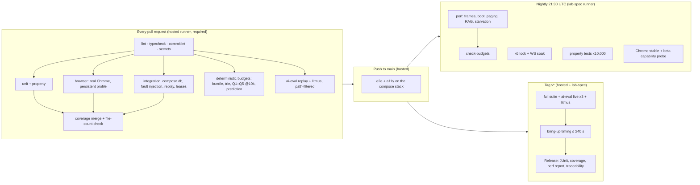

# Testing and performance

| Field | Value |
|---|---|
| Title | Plotinium testing strategy, performance budgets, fault injection and Demo Day rehearsal |
| Status | Draft v0.1, 2026-09-24 |
| Primary owner | R5 QA/DevOps & Integration (harness, CI wiring, budgets, rehearsals). Every subsystem owner writes the test cases for their subsystem. |
| Secondary reviewer | R1 Kernel/Systems Architect |
| Must be demonstrable at | **G0 Registration (W2):** Vitest `unit` and one Playwright e2e run on a pull request; `pnpm traceability` runs. **P1 defence (W4):** `TESTING.md` draft with the frame method of §3.11.3; spike evidence produced by this harness. **P2 gate (W7, v0.2.0):** frame method agreed with the instructor; bundle, boot and WM-03 budgets hard; VFS suite green on the tag; coverage gates live for every package with code. **P3 gate (W11, v0.3.0):** fault-injection suite (client and server) live; offline gate test; exactly-once replay suite; PROC-04/PROC-05/MEM-05/MEM-06/DB-05 budgets hard. **P4 gate (W14, v0.4.0):** `ai-eval` project, `rag-leak`, INJ-20 and litmus jobs; RAG-05/PRE-01/PRE-03 budgets hard. **Freeze (W16, v1.0.0-rc.1):** full 30-minute rehearsal passed. **Final defence (W17–18, v1.0.0):** Demo Day protocol, CI coverage report on the tag |
| Requirement IDs covered | §15.2 (`TESTING.md`), §15.3 (all six levels, coverage targets), §15.4 (CI passes before merge), §11.3 box (mandatory fault-injection harness), §13.2 (gates on a tagged release), §17.1 (Demo Day protocol), spec p3 (Measurement); DB-02, DB-03, DB-05 (method), BOOT-02 (throttled-network method), BOOT-10, BOOT-13, PROC-04, PROC-05, PROC-09, MEM-05, MEM-06, WM-03, WM-07, SYS-01 (bypass suite registration), SYS-03, OFF-01, OFF-02, OFF-04, OFF-05 (rehearsal), VFS-09, RAG-02, RAG-03, RAG-04, RAG-05, AGT-03, AGT-06, AGT-07, PRE-01, PRE-02, PRE-03, PRE-04; PLT-DOC-08, PLT-DEL-03, PLT-DEL-14; Plotinium design IDs TST-01 … TST-24 |
| Related specs | [../00-product/requirements-traceability.md](../00-product/requirements-traceability.md) · [../00-product/glossary.md](../00-product/glossary.md) · [../01-architecture/architecture.md](../01-architecture/architecture.md) · [../01-architecture/syscall-abi.md](../01-architecture/syscall-abi.md) · [../02-boot/boot-and-services.md](../02-boot/boot-and-services.md) · [../03-kernel/processes-and-scheduling.md](../03-kernel/processes-and-scheduling.md) · [../03-kernel/memory-and-paging.md](../03-kernel/memory-and-paging.md) · [../04-vfs/virtual-file-system.md](../04-vfs/virtual-file-system.md) · [../05-wm/window-manager.md](../05-wm/window-manager.md) · [../05-wm/ui-design-system.md](../05-wm/ui-design-system.md) · [../06-sync/offline-and-sync.md](../06-sync/offline-and-sync.md) · [../07-shell/shell-and-terminal.md](../07-shell/shell-and-terminal.md) · [../08-dsa/data-structures.md](../08-dsa/data-structures.md) · [../09-database/database.md](../09-database/database.md) · [../10-ai/rag-semantic-search.md](../10-ai/rag-semantic-search.md) · [../10-ai/agentic-shell.md](../10-ai/agentic-shell.md) · [../10-ai/predictive-prefetch.md](../10-ai/predictive-prefetch.md) · [../10-ai/ai-safety-and-evaluation.md](../10-ai/ai-safety-and-evaluation.md) · [../11-server/backend-api.md](../11-server/backend-api.md) · [../12-security/security-model.md](../12-security/security-model.md) · [../14-devops/deployment-and-ci.md](../14-devops/deployment-and-ci.md) · [../15-decisions/stack-decisions.md](../15-decisions/stack-decisions.md) · [../16-delivery/implementation-plan.md](../16-delivery/implementation-plan.md) |

**Conventions used in this file.** RFC 2119 keywords (MUST, SHOULD, MAY) as in the spec's Conventions section (p. 3). **Spec** marks an obligation copied from the capstone specification, with its section and ID. **Plotinium design** marks our own binding choice. Every number from the AI-run prototype is labelled *(pilot figure — re-measure on the lab machine)*; such numbers never count as gate evidence. Test levels are tagged as in [requirements-traceability.md §3](../00-product/requirements-traceability.md): `[U]` Vitest unit, `[B]` Vitest browser (real Chrome), `[I]` Vitest integration (Compose PostgreSQL), `[E]` Playwright e2e, `[A11Y]` Playwright accessibility, `[P]` performance (authoritative on the lab-spec machine), `[AE]` ai-eval, `[L]` lint or static check, `[M]` manual gate step with committed evidence.

---

## 1. Purpose and scope

This spec is the normative source for how Plotinium is tested and measured, and it is the draft of the repository's `TESTING.md` (spec §15.2: "Test strategy, how to run each suite, coverage, performance budgets, fault-injection design"). It fixes:

- the six test levels of spec §15.3 and the tool, project and folder that implement each (§3.1–§3.3);
- test naming and how `tools/traceability.ts` builds the requirement-to-test matrix (§3.4; the tool itself is specified in [requirements-traceability.md §4–§5](../00-product/requirements-traceability.md));
- the coverage configuration: include globs, the file-count check, thresholds and the per-package ratchet (§3.5);
- the fault-injection design on the client and the server, with its oracle (§3.6);
- property-based tests (§3.7), the e2e scenario list (§3.8), accessibility tests (§3.9) and AI evaluation in CI (§3.10);
- how performance is measured, including the exact frame metric (§3.11), the `budgets.json` format (§4.1) and the table of every numeric target (§7);
- the lab-spec runner and its security (§3.12), hosted-runner calibration (§3.13), the flakiness policy (§3.14) and the definition of done for tests (§3.15);
- the Demo Day rehearsal scripts per spec §17.1, including failure drills (§3.16).

Out of scope, linked instead: the subsystem test cases themselves (each owning spec's §8); the CI workflow files, branch protection and deployment (see [deployment-and-ci.md](../14-devops/deployment-and-ci.md)); the evaluation datasets and the LLM bake-off (see [ai-safety-and-evaluation.md §3.6–§3.8](../10-ai/ai-safety-and-evaluation.md)); the requirement catalogue and gate check (see [requirements-traceability.md](../00-product/requirements-traceability.md)).

---

## 2. Requirements table

| ID | Summary | Spec § | How verified |
|---|---|---|---|
| §15.3 Unit | Spec: MUST. Every DSA structure with its edge cases; the path resolver; the permission matrix; the shell parser; the scheduler's ordering and aging. Runs on every PR | §15.3 | Vitest `unit` project in `ci.yml` (required check); traceability rows for PROC-02, PROC-03, VFS-03, VFS-04, SYS-02 |
| §15.3 Property | Spec: SHOULD. Random VFS op sequences always leave `fsck` clean; heap invariants hold after random pushes, pops and priority changes. Every PR | §15.3 | fast-check suites in §3.7 (`*.prop.test.ts`), fixed seed on PRs |
| §15.3 Integration | Spec: MUST. System calls against the database; fault injection for every bulk operation; concurrent clients; lock leases; outbox replay. Every PR | §15.3, §11.3 box | Vitest `integration` project against `docker compose up -d --wait db` |
| §15.3 End-to-end | Spec: MUST. Browser automation: boot → login → terminal → file operations → reboot → session restored; the offline boot path. Main branch and each release | §15.3 | Playwright `e2e` project on channel `chrome` (§3.8) |
| §15.3 Performance | Spec: MUST. Boot time, frame time under load, query p95, autocomplete latency, page-in latency, each with a budget that fails the build. Nightly and each release | §15.3 | `budgets.json` + `tools/check-budgets.ts` (§4.1, §5.4) |
| §15.3 AI evaluation | Spec: MUST. Recall@5 and MRR, the agent benchmark, injection fixtures, prediction accuracy, using recorded model responses in CI. Each release | §15.3, §12.6 | Vitest `ai-eval` project (§3.10) |
| §15.3 Coverage | Spec: MUST. ≥ 70% line coverage overall and ≥ 85% on `dsa/`, `vfs/`, `kernel/`, reported by CI on every PR | §15.3, Appendix A | coverage-v8 thresholds + file-count check (§3.5) |
| §15.4 | Spec: MUST. `main` is protected: no force pushes, and CI must pass before merge | §15.4 | Required checks listed in [deployment-and-ci.md §3.8](../14-devops/deployment-and-ci.md) |
| §11.3 harness | Spec: MUST. The test build includes a hook that throws after N of M node operations; the reference test runs `rm -r` on a 1,000-node tree failing at node 500 and checks checksum, orphan probes and quota; the same for `mv`, `cp -r`, batch rename and `chmod -R`; repeated live at the final defence | §11.3 | §3.6; DB-02 tests in §8 |
| DB-02 | Spec: MUST. Every bulk VFS operation is atomic; the fault-injection suite passes with zero orphans and unchanged checksums | §11.5 | §3.6 matrix, client and server |
| DB-03 | Spec: MUST. Two clients moving overlapping subtrees at the same time always leave a consistent tree | §11.5 | Concurrency torture test (§3.6.7) |
| p3 Measurement | Spec. Numerical targets are measured on the Department's lab workstation in current stable Chrome at each gate | p3 | TST-06, TST-13 |
| PLT-DOC-08 | `TESTING.md` holds the strategy, how to run each suite, coverage, budgets, fault-injection design and the agreed frame method | §15.2 | Doc review at P2 (frame method), P3 (fault injection), FRZ (complete) |
| PLT-DEL-03 | A test and coverage report generated by CI for the tagged release | §17.2 | Release assets ([deployment-and-ci.md §3.7](../14-devops/deployment-and-ci.md)) |
| TST-01 | Plotinium design. Every test title begins with a spec ID or a registered Plotinium ID (C18); CI runs `pnpm traceability --strict` | p3 Conventions | §8 TST-01 tests |
| TST-02 | Plotinium design. Exactly six Vitest projects (`unit`, `browser`, `integration`, `bench`, `ai-eval`, `tools`) and four Playwright projects (`e2e`, `a11y`, `perf`, `bringup`); files are routed by suffix | §15.3 | Config test |
| TST-03 | Plotinium design. Coverage `include` lists every source glob; a file-count check proves the report covers every source file; thresholds switch on per package by a one-way ratchet | §15.3 | §8 TST-03 tests |
| TST-04 | Plotinium design. `tests/performance/budgets.json` is the single source of every budget; tests read their threshold from it; `check-budgets` fails the build | §15.3 | §8 TST-04 tests |
| TST-05 | Plotinium design (C13). The frame metric is the vsync-quantised duration between consecutive presented frames in a Chrome trace, plus zero LoAF entries over 50 ms attributed to our origin; raw rAF deltas are never the gate | PROC-05, WM-03 | Golden-trace parser tests |
| TST-06 | Plotinium design. Only results whose `machine` is `lab-spec` count as gate evidence; every result records machine, Chrome version and channel, commit and sample count | p3 | Result-file schema test |
| TST-07 | Plotinium design (critic). The lab-spec runner runs only workflows triggered by `schedule` or `workflow_dispatch` on `main`, never `pull_request`; it holds no secrets | §15.3 | Workflow lint |
| TST-08 | Plotinium design (C7). Fault injection is inert unless enabled; the server target needs `FAULT_INJECTION=1`, uid 0 and the `debug.fault` capability, is audited and one-shot, and the production profile refuses to start with it | §11.3, §18 | §8 TST-08 tests |
| TST-09 | Plotinium design. The fault-injection oracle checks subtree checksum, orphan inodes, parentless dentries, quota, blob refcounts and `nlink` on both client and server | §11.3 | Probe unit tests |
| TST-10 | Plotinium design. Property tests use a fixed seed on PRs and a deep random run nightly; any failing seed is pinned as a regression case | §15.3 | §8 TST-10 tests |
| TST-11 | Plotinium design (coherence). Storage tests run on disk: Vitest browser with a persistent context and Playwright `launchPersistentContext`; each test file uses unique IndexedDB and OPFS names; storage budgets run on both Chrome IndexedDB backends | §15.3 | §8 TST-11 tests |
| TST-12 | Plotinium design (critic). The offline gate test stops the server (`docker compose stop app web`) or aborts the backend routes; `setOffline` is a secondary variant; OFF-04 combines `navigator.onLine` events with heartbeats | OFF-01, OFF-04, BOOT-09 | §8 TST-12 tests |
| TST-13 | Plotinium design. Every browser run uses channel `chrome` and records the Chrome version; the full e2e and perf suites re-run on current stable within 48 h before each gate; a nightly capability probe runs on stable and beta | p3 | Result-file check |
| TST-14 | Plotinium design. axe scans in both themes with zero serious or critical violations; keyboard-only flows for boot menu, login, window switch and the confirmation prompt | WM-07, BOOT-13 | §3.9 |
| TST-15 | Plotinium design (C12). `ai-eval` replays cassettes with no API key; a cassette miss fails without touching the network; live runs happen only on release | §12.6 | §8 TST-15 tests |
| TST-16 | Plotinium design. Flakiness policy of §3.14 (quarantine within 24 h, at most 2, never for gate-relevant tests in the gate window) | §13.2 | Quarantine file check |
| TST-17 | Plotinium design. Definition of done for tests (§3.15), identical to the test part of the team's DoD | §4.4 | PR template checklist |
| TST-18 | Plotinium design. Four timed Demo Day rehearsals on machines the team does not control, each with at least two unannounced failure drills, logged | §17.1 | Rehearsal logs in `docs/evidence/defence/` |
| TST-19 | Plotinium design. Before a budget's hard date it is a ratchet: a regression of more than 10% against the last lab baseline fails the build | §15.3 | §8 TST-19 tests |
| TST-20 | Plotinium design (C16). `dsa/` suites are gated by `describe.runIf(IMPLEMENTED)`; pilot code under `docs/evidence/pilot` is never imported and is excluded from build, lint and coverage | §10.2, §18 | Lint fixture + traceability T-3 |
| TST-21 | Plotinium design. Hosted-runner performance runs are smoke checks under a calibrated CDP CPU throttle and are never gate evidence | p3 | Calibration record |
| TST-22 | Plotinium design. Test data is deterministic: seed 42 (mulberry32) for trees and corpora, frozen clock `2026-10-05T10:00:00+05:00` in AI tests, seeded datamarking nonce | §12.6 | §8 TST-22 tests |
| TST-23 | Plotinium design (coherence). Integration tests use the Compose `db` service (the examiner path); no Testcontainers and no `fake-indexeddb` | §15.3 | Dependency check |
| TST-24 | Plotinium design (C10, critic). gitleaks runs over the repository, `web/dist` and `ai/eval/cassettes`; the bundle scan finds no provider hostname or key pattern | §18, §12.6 | CI job `secrets` |

---

## 3. Design (normative)

### 3.1 Test levels mapped to spec §15.3

**Spec: MUST, §15.3** (levels, what they cover, when they run). **Plotinium design** for tools, projects and locations.

| Level (§15.3) | What it must cover (spec) | Plotinium tool and project | Where the files live | Runs (spec) | Runs (ours) |
|---|---|---|---|---|---|
| Unit | Every DSA structure with edge cases; path resolver; permission matrix; shell parser; scheduler ordering and aging | Vitest `unit` (Node; the kernel runs on the loopback host with a virtual clock) | next to the code: `<pkg>/**/*.test.ts` | every PR | every PR (required) |
| Property-based (Should) | Random VFS op sequences leave `fsck` clean; heap invariants after random pushes, pops and priority changes | fast-check 4.10.2 inside the `unit`, `browser` and `integration` projects | `<pkg>/**/*.prop.test.ts`, `tests/property/` | every PR | every PR at 100 runs per property (seed fixed); nightly at 10,000 runs (random seed, logged) |
| Integration | Syscalls against the DB; fault injection for every bulk op; concurrent clients; lock leases; outbox replay | Vitest `integration` (Node + Compose PostgreSQL 18.6) | `<pkg>/**/*.int.test.ts`, `tests/integration/`, `tests/fault-injection/` | every PR | every PR (required) |
| (browser-level unit and integration, Plotinium) | IndexedDB transactions, OPFS swap, workers, compositor, WebCrypto: code that only runs in Chrome | Vitest `browser` (real Chrome, channel `chrome`, persistent profile) | `<pkg>/**/*.browser.test.ts(x)` | – | every PR (required) |
| End-to-end | boot → login → terminal → file ops → reboot → session restored; offline boot path | Playwright `e2e` (channel `chrome`) against the Compose stack | `tests/e2e/**/*.spec.ts` | main and each release | main, each release, and nightly on the lab runner |
| (accessibility, Plotinium; WM-07, BOOT-13) | axe scans in both themes, keyboard-only flows | Playwright `a11y` with @axe-core/playwright 4.13.0 | `tests/a11y/**/*.spec.ts` | – | every PR that touches `wm/`, `apps/*/view*`, `web/`; main; release |
| Performance | Boot time, frame time under load, query p95, autocomplete latency, page-in latency, each failing the build over budget | Vitest `bench` (complexity curves, deterministic budgets); Playwright `perf` (CDP trace, boot, paging); k6 v2.3.0 (WebSocket and lock soak) | `<pkg>/**/*.bench.ts`, `tests/performance/**` | nightly and each release | deterministic budgets on every PR; everything nightly and on release on the lab-spec runner |
| AI evaluation | Recall@5 and MRR; agent benchmark; injection fixtures; prediction accuracy; recorded model responses in CI | Vitest `ai-eval` (`LLM_MODE=replay`, recorded embeddings) | `ai/eval/**/*.eval.ts` | each release | PRs touching `ai/`, `server/llm`, `server/index`, `protocol/`; every release (plus 3 live runs) |
| (clean bring-up, Plotinium; §17.1) | – | Playwright `bringup` (times `git clone` → `up --wait` → `desktop-interactive`) | `tests/bringup/` | – | weekly and on every `v*` tag ([deployment-and-ci.md §3.6](../14-devops/deployment-and-ci.md)) |



### 3.2 Vitest projects (TST-02)

**Plotinium design.** One root `vitest.config.ts` defines exactly the projects below. The Week-1 scaffold defines one Node project per package; the PR that lands the first `browser` or `integration` suite (W5) MUST replace them with this set, so that JUnit files and traceability evidence codes (`CI:unit`, `CI:browser`, …) line up with [requirements-traceability.md §4.3](../00-product/requirements-traceability.md). Package-level runs filter by path: `pnpm --filter @plotinium/vfs test` runs `vitest run --root .. --project unit vfs/`.

| Project | Environment | Include | Exclude | Parallelism | Notes |
|---|---|---|---|---|---|
| `unit` | Node 24 | `{protocol,dsa,kernel,vfs,services,wm,apps,ai,server,db}/**/*.test.{ts,tsx}` | `*.browser.test.*`, `*.int.test.*`, `*.eval.ts`, `docs/**` | threads | kernel tests use `kernel/host/loopback.ts` and a virtual clock; no network, no DB |
| `browser` | Chrome stable via `@vitest/browser-playwright` 5.0.1 | `**/*.browser.test.{ts,tsx}` | – | **file parallelism off** | `persistentContext` directory per run (disk-backed); COOP/COEP set by `server.headers` so `crossOriginIsolated` is true, CSP not applied to the orchestrator; every file derives its IndexedDB and OPFS names from its path (§3.2.1) |
| `integration` | Node 24 + Compose `db` | `**/*.int.test.ts`, `tests/integration/**/*.test.ts`, `tests/fault-injection/**/*.test.ts` | – | forks, `maxWorkers: 2` | each file creates its own database from a template (`CREATE DATABASE t_<hash> TEMPLATE plotinium_template`) and drops it in `afterAll` |
| `bench` | Node 24 (and Chrome for `*.browser.bench.ts`) | `**/*.bench.ts` | – | sequential | Vitest bench (Tinybench) for complexity curves; absolute p95 budgets use the per-op sampler (§5.1) |
| `ai-eval` | Node 24 | `ai/eval/**/*.eval.ts` | – | sequential | `LLM_MODE=replay` unless `PLT_EVAL_LIVE=1` on release; recorded embeddings keyed by `(modelKey, sha256(text))` |
| `tools` | Node 24 | `tools/**/*.test.ts` | `tools/eslint-rules/fixtures/**` | threads | repository tooling; counted separately by traceability so it never inflates product coverage |

```ts
// vitest.config.ts — normative shape from W5 (option names verified against the Vitest 5 docs)
import { playwright } from '@vitest/browser-playwright';
import { defineConfig } from 'vitest/config';

const PKGS = ['protocol', 'dsa', 'kernel', 'vfs', 'services', 'wm', 'apps', 'ai', 'server', 'db'] as const;
const SRC = `{${PKGS.join(',')}}`;
const ISOLATION_HEADERS = {
  'Cross-Origin-Opener-Policy': 'same-origin',
  'Cross-Origin-Embedder-Policy': 'require-corp',
  'Cross-Origin-Resource-Policy': 'same-origin',
};

export default defineConfig({
  server: { headers: ISOLATION_HEADERS },          // browser project matches production isolation
  test: {
    reporters: ['default', 'junit'],
    outputFile: { junit: 'test-results/junit/vitest.xml' },
    projects: [
      { extends: true, test: { name: 'unit', environment: 'node',
          include: [`${SRC}/**/*.test.{ts,tsx}`],
          exclude: ['**/*.browser.test.*', '**/*.int.test.*', '**/node_modules/**', 'docs/**'] } },
      { extends: true, test: { name: 'browser', include: [`${SRC}/**/*.browser.test.{ts,tsx}`],
          fileParallelism: false,
          browser: { enabled: true, headless: true, instances: [{ browser: 'chromium' }],
            provider: playwright({ launchOptions: { channel: 'chrome' },
                                   persistentContext: '.cache/vitest-chrome-profile' }) } } },
      { extends: true, test: { name: 'integration', environment: 'node',
          include: [`${SRC}/**/*.int.test.ts`, 'tests/integration/**/*.test.ts', 'tests/fault-injection/**/*.test.ts'],
          globalSetup: ['tests/integration/global-setup.ts'],   // waits for db, builds the template DB
          pool: 'forks', maxWorkers: 2 } },
      { extends: true, test: { name: 'bench', include: [`${SRC}/**/*.bench.ts`] } },
      { extends: true, test: { name: 'ai-eval', environment: 'node', include: ['ai/eval/**/*.eval.ts'],
          env: { LLM_MODE: process.env.PLT_EVAL_LIVE === '1' ? 'live' : 'replay' } } },
      { extends: true, test: { name: 'tools', environment: 'node', include: ['tools/**/*.test.ts'],
          exclude: ['tools/eslint-rules/fixtures/**'] } },
    ],
    coverage: { /* §3.5 */ },
  },
});
```

#### 3.2.1 Isolation rules for browser and integration tests (TST-11, TST-23)

- **Unique storage names.** A browser test file MUST open storage through `testStorageNames(import.meta.url)`, which returns `{ idb: 'plotinium-test-<sha1(path)[0..8]>', swap: 'plotinium-swap-test-<…>', opfsDir: 'test-<…>' }`, and MUST delete them in `afterAll`. Production names (`plotinium`, `plotinium-swap`, C4) are never used by a test other than the e2e suite.
- **Disk-backed.** Browser-project storage tests run in the persistent Chrome profile, so IndexedDB commits reach disk (Playwright's `newContext()` is in-memory, coherence conflict on test infrastructure). A setup assertion checks that the profile directory contains an `IndexedDB` folder after the first transaction; if not, the run aborts as an infrastructure error (exit 2, §6.2).
- **Both IndexedDB backends.** Storage performance and durability budgets (client bulk op, page-in, outbox kill-during-replay) run twice nightly: default backend, and the SQLite backend forced with `--enable-features=IdbSqliteBackingStore,IdbSqliteOnDiskRollout` (coherence). A budget passes only if both pass.
- **No fakes.** `fake-indexeddb` and Testcontainers are not dependencies (TST-23). The integration project uses `docker compose up -d --wait db` with the test override file of [deployment-and-ci.md §3.1.4](../14-devops/deployment-and-ci.md), which publishes the database on `127.0.0.1` for the test process only.

### 3.3 Playwright projects

**Plotinium design.** `playwright.config.ts` defines four projects, all with `channel: 'chrome'` (current stable; TST-13), `workers: 1`, and a JUnit reporter writing `test-results/junit/playwright-<project>.xml`.

| Project | Target | Runs | Notes |
|---|---|---|---|
| `e2e` | Compose stack at `http://localhost:${PLOTINIUM_PORT:-4717}` built from the commit | main, nightly (lab runner), release | `retries: 1` on CI (a retry marks the test flaky, §3.14); storage and offline tests use `chromium.launchPersistentContext(userDataDir, { channel: 'chrome' })` |
| `a11y` | same | PR (path filter), main, release | axe in light and dark (§3.9) |
| `perf` | same, built as a release build | nightly and release on the lab-spec runner only | headed Chrome, no CDP CPU throttle on the lab runner, GPU as on the lab machine; see §3.11 |
| `bringup` | a fresh clone | weekly and on `v*` tags | times the §17.1 bring-up; spec in [deployment-and-ci.md §3.6](../14-devops/deployment-and-ci.md) |

Shared fixtures (in `tests/support/`, R5):

- `persistentOS({ profile })`: launches a disk-backed persistent context in a fresh temp directory, boots, logs in as the named seeded user and waits for the `desktop-interactive` mark; returns `{ context, page, userDataDir }`.
- `stack.stop(services)` / `stack.start(services)`: runs `docker compose stop|start` for the listed services and waits for health (used by TST-12).
- `bootRecord(page)`: reads the current boot record through the `bootlog --json` syscall ([boot-and-services.md §8.3](../02-boot/boot-and-services.md)); tests never open IndexedDB directly.
- `probes.client(page)` and `probes.server(sql)`: the fault-injection oracle of §3.6.5.
- `envelope()`: writes `{ chrome: browser.version(), channel, hwc, dpr, refreshHz, commit, machine }` into every result file (TST-06, TST-13).

### 3.4 Naming conventions and traceability (TST-01, C18)

**Spec (p3, Conventions):** "Use these identifiers in your test names, pull-request titles and report, for example a test named `VFS-06 rejects a write that exceeds the quota without partial data`." **Plotinium design:**

1. **Title grammar.** `<ID> <behaviour in present tense>`, where `<ID>` is a spec ID (84 of them) or a Plotinium ID with a registered prefix ([requirements-traceability.md §3.13](../00-product/requirements-traceability.md)). The behaviour states the observable outcome and, for a failure case, the errno: `VFS-06 rejects a write beyond quota with EDQUOT and no partial data`. A test that proves two requirements is written twice (two titles) or split; a title never carries two IDs.
2. **`describe` blocks** MAY carry the ID too; the traceability tool reads the innermost test title only.
3. **File names** route the test to its project: `*.test.ts` (unit), `*.browser.test.ts(x)` (browser), `*.int.test.ts` (integration), `*.prop.test.ts` / `*.prop.int.test.ts` / `*.prop.browser.test.ts` (property, in the matching project), `*.bench.ts` (bench), `*.eval.ts` (ai-eval), `*.spec.ts` (Playwright).
4. **Budget IDs** in `budgets.json` start with the requirement ID too (`BOOT-10.warm`, `WM-03.drag-frame`), so the budget report can be joined with the matrix.
5. **CI.** The `lint` job runs `pnpm traceability --strict` together with the per-command check of [shell-and-terminal.md §8.2](../07-shell/shell-and-terminal.md) (every command listed there has at least one `SYS-02 <command> …` test) and the SPX spec-process checks of [../README.md](../README.md) §8: an untagged title fails the job; an unregistered prefix is a warning while this spec is Draft and an error once it is Accepted (TRC-02). On every `v*` tag the release job runs `tools/traceability.ts --gate <gate> --tag <tag>` and fails the release when `pass` is false ([requirements-traceability.md §5.2](../00-product/requirements-traceability.md)).
6. **Skipped is not verified** (traceability invariant T-3). `describe.runIf(IMPLEMENTED)` suites (C16) and quarantined tests (§3.14) report `skipped` and never verify a row.

### 3.5 Coverage (TST-03)

**Spec: MUST, §15.3.** "At least 70% line coverage overall and at least 85% on `dsa/`, `vfs/` and `kernel/`. Coverage is reported by CI on every pull request. A high coverage number from shallow tests is worth less than a smaller number from tests that check behaviour; examiners read the tests."

**Plotinium design.**

- **Provider** `@vitest/coverage-v8` 5.0.1 (AST-aware remapping). Coverage is collected by the `unit`, `browser` and `integration` projects in one run (`vitest run --coverage --project unit --project browser --project integration`) and merged by Vitest. `bench`, `ai-eval` and `tools` never contribute.
- **Include** (every source glob; since Vitest 4 only loaded files are counted otherwise, examiner review of the quality record):
  `protocol/src/**/*.ts`, `dsa/**/src/**/*.ts`, `kernel/**/*.ts`, `vfs/**/*.ts`, `services/**/*.ts`, `wm/**/*.{ts,tsx}`, `apps/**/*.{ts,tsx}`, `ai/**/*.ts`, `server/src/**/*.ts`, `db/{seed,bench}/**/*.ts`, `web/src/**/*.ts`.
- **Exclude:** test and bench files, `**/*.d.ts`, `**/*.gen.ts` (for example `server/src/db/types.gen.ts`), `**/vite.config.ts`, `ai/eval/**` (harness and datasets), `db/migrations/**` (SQL), `docs/**` (including `docs/evidence/pilot`, C16), `**/fixtures/**`. `wm/boot-ui/**` is **included** (it is inlined but still ours).
- **Thresholds** (lines; paths relative to the project root as Vitest 5 requires):

  | Scope | Threshold | Switched on |
  |---|---|---|
  | Overall | 70% | automatically once any package is gated (W5) |
  | `dsa/**` | 85% over implemented modules | the PR that flips the first `IMPLEMENTED = true` (C16); `tools/dsa-status.ts` writes the include/exclude lists so modules still at `IMPLEMENTED = false` are excluded from the gate and listed as "pending" ([data-structures.md](../08-dsa/data-structures.md)) |
  | `vfs/**` | 85% | the PR that merges the first real `vfs/` code |
  | `kernel/**` | 85% | the PR that merges the first real `kernel/` code |
  | every other package | 70% | the PR that merges its first real code |

- **Ratchet.** `GATED_PACKAGES` in `vitest.config.ts` only grows. The `lint` job compares it with `main` and fails if a package was removed or a threshold lowered (TST-03). "No tests later": a package's gate switches on in the same PR as its first real code.
- **File-count check.** `tools/coverage-filecount.ts` expands the include and exclude globs with the same matcher Vitest uses and compares the set with the file keys in `coverage/coverage-final.json`. Any source file missing from the report fails the job with its path (§5.3); pending `dsa/` modules reported by `tools/dsa-status.ts` are accounted as pending, not missing, and the release job fails if a structure due at the gate is still pending. This proves that the 70% and 85% are over every source file, not only the loaded ones.
- **Report.** `json-summary`, `lcov` and `html`. A 10-line script (`tools/coverage-summary.ts`) writes the per-package table to `$GITHUB_STEP_SUMMARY` on every PR, and the release job attaches the HTML report and `coverage-summary.json` to the GitHub Release (PLT-DEL-03).
- **Behaviour over numbers.** A nightly StrykerJS mutation run on `dsa/` MAY report a mutation score as evidence that tests assert behaviour; it is informational, not a gate.

### 3.6 Fault-injection design (DB-02, DB-03, §11.3 harness, TST-08, TST-09)

**Spec: MUST (§11.3 box).** "Your test build must include a hook that throws an error after N of M node operations. The reference test runs `rm -r` on a 1,000-node tree and fails at node 500. It then checks that the tree's checksum is unchanged, that both orphan probes return nothing, and that the user's quota usage is unchanged. The same test runs for `mv`, `cp -r`, batch rename and `chmod -R`. It is repeated live at the final defence."

**Plotinium design** (C7, coherence conflict on fault injection, critic). The two sides use different mechanisms because their execution models differ; the syscall and the oracle are shared.

#### 3.6.1 Definitions

- **Node operation.** One inode row write (insert, update or delete of an `inodes` row, including the dentry change that goes with it) on the server; one `put` or `delete` request on the `inodes` store on the client. A `mv` of one directory is one node operation (a single dentry row plus the directory inode's `ctime`), so the reference `mv` test moves 1,000 files individually in one batch rename-style operation and a directory `mv` is tested separately with `after: 1`.
- **Targets.** `client` (the IndexedDB mirror transaction), `server` (the PostgreSQL `vfsTxn`), `both` (arms both; the client fault fires first when offline, the server fault when online).
- **Ops covered:** `rm -r` (`unlink` recursive), `cp -r` (`copy`), `mv` (`rename`, single and batch of 500), batch rename (agent `batch`, 500 renames), `chmod -R`, `chown -R`, and the agent `batch` executor (AGT-05). The syscall accepts `op ∈ {unlink, rename, copy, chmod, chown, batch, any}` ([syscall-abi.md](../01-architecture/syscall-abi.md) `debug.inject`).

#### 3.6.2 Arming

`debug inject [--target client|server|both] <op> <N>` issues `debug.inject({ target, op, after: N })`. Rules (C7; [virtual-file-system.md](../04-vfs/virtual-file-system.md) "Arming"):

1. uid 0 and capability `debug.fault` only; otherwise `EPERM`.
2. Audited as a security event (`audit_log` via the outbox) before it is armed.
3. One-shot, scoped to the caller's `os_session_id`, expires after 10 minutes unused.
4. `server` and `both` need `welcome.faultInjection = true`, which the server sets only when `FAULT_INJECTION=1`. The production profile sets `FAULT_INJECTION=0`, and the server refuses to start in production if it is `1` ([deployment-and-ci.md §3.1](../14-devops/deployment-and-ci.md)). So the live DB-02 demonstration runs on the local/defence Compose stack, never on production.
5. In unit and browser tests (`NODE_ENV=test` builds with `__TEST_FLAGS__`), the harness arms the injector directly through `kernel/test/fault.ts`; the syscall path is covered separately.

#### 3.6.3 Client mechanism (IndexedDB mirror)

- The VFS transaction builder (`vfs/store/tx.ts`) is synchronous (C4) and issues every request itself. When a `FaultPlan` is armed for this op, the builder counts `inodes` requests and, in the `onsuccess` of the N-th, calls `tx.abort()`. IndexedDB then rolls back every store touched by the transaction (inodes, dentries, blobs, blob_chunks, users, undo, outbox), and `onabort` maps to `EIO` with `detail = { faultId, node: N, target: 'client' }`.
- The in-memory tree is updated only after `oncomplete` (C4), so an abort leaves it untouched; the test asserts that no kernel VFS event was emitted.
- Two-phase bulk ops (plan, then one readwrite transaction): the fault fires in the commit phase; the plan phase is read-only.

#### 3.6.4 Server mechanism (PostgreSQL)

- A `BEFORE INSERT OR UPDATE OR DELETE ... FOR EACH ROW` trigger on `inodes` (`plotinium_fault_tick`) is inert unless the transaction has `SET LOCAL plotinium.fault_after = N`. When set, it increments a transaction-local counter (`plotinium.fault_count`) and raises `P0001` with message `plotinium_fault` after the N-th row (C7). The `vfsTxn` error mapper turns it into `EIO` with the same `detail` shape and `target: 'server'`; the transaction rolls back as a whole.
- Only the root-only, audited harness endpoint can issue that `SET LOCAL`, and only when `FAULT_INJECTION=1`; it is reached through the armed `debug.inject` for that `os_session_id` ([backend-api.md](../11-server/backend-api.md), [database.md](../09-database/database.md)).
- **Synchronous result (critic).** When online, bulk ops and agent batches wait for the server's `op.result` before reporting success (C6), so `rm -r` prints `rm: cannot remove '…': Input/output error (injected fault at node 500) — rolled back` synchronously; the client's optimistic mirror transaction is reverted by the sync engine's rejection path and the oracle is run on both sides.
- **Blob store.** `FaultyBlobStore` (throws after N `put`s) wraps `FsBlobStore` in tests. Because blobs are uploaded before the DB transaction (C9), a blob fault must leave the DB unchanged and at most an unreferenced blob, which the 1-hour GC removes; the test asserts both.
- **AGT-09 debug delay.** `debug.delay({ target: 'agent-batch', stepMs, osSessionId })` runs `pg_sleep` between op groups inside the transaction, under the same `FAULT_INJECTION=1` and uid 0 rules ([agentic-shell.md](../10-ai/agentic-shell.md)); used by the AGT-09 kill test and the kill demonstration on the local stack.

#### 3.6.5 The oracle (TST-09)

Run before arming and after the failed operation, on the client (through syscalls in test builds) and on the server (SQL in `db/probes/integrity.sql`):

| Probe | Client | Server | Must be |
|---|---|---|---|
| Subtree checksum | SHA-256 over `(ino, parent, name, type, mode, uid, gid, size, version, blob)` rows of the subtree, ordered by `ino` | same over `inodes ⋈ dentries` | equal before and after |
| Orphan inodes | inodes with no dentry (except `/`) | `SELECT i.ino FROM inodes i LEFT JOIN dentries d ON d.ino = i.ino WHERE d.ino IS NULL AND i.ino <> '<root uuid>'` (spec §11.3 probe) | empty |
| Parentless dentries | dentries whose parent inode is missing | `SELECT d.* FROM dentries d LEFT JOIN inodes p ON p.ino = d.parent_ino WHERE p.ino IS NULL` (spec probe) | empty |
| Quota | `users` mirror `used_bytes`, `used_inodes` for every affected owner | `users` rows | equal before and after |
| Blob refcounts | `blobs.refcount` equals the number of referencing inodes | same | consistent |
| `nlink` | equals the number of dentries pointing at the inode | same | consistent |
| Outbox / op_log | no new outbox entry for the failed op; `undo` unchanged | no committed `op_log` row for the op (a rejection row with `EIO` only) | as stated |
| `fsck` | `fsck --checksum` clean | `fsck --server` (root) clean | clean |

The oracle is a pure function over snapshots (§5.5), unit-tested on hand-built corrupt trees so that each probe is proven to detect what it claims.

#### 3.6.6 The matrix

| Op | Tree | Fault points N | Targets | Level |
|---|---|---|---|---|
| `rm -r` | seeded `tree1000` (1,000 nodes, depth ≥ 6) | 1, 500, 999, 1000 | client, server | browser (client), integration (server), e2e (both, N = 500) |
| `cp -r` | `tree1000` into a new parent | 1, 500, 999, 1000 | client, server | same |
| `mv` batch (1,000 files) and directory `mv` (N = 1) | `tree1000` | 1, 500, 999 / 1 | client, server | same |
| batch rename (500) | 500 files | 1, 250, 499 | client, server | same |
| `chmod -R`, `chown -R` | `tree1000` | 1, 500, 999 | client, server | same |
| agent `batch` (AGT-05) | 4-step plan | step 3 | client, server | integration, e2e |
| blob upload (`cp` of files with content) | 20 files | 1, 10 | server (`FaultyBlobStore`) | integration |

A fault at `N = M` (after the last node) proves the commit path itself is atomic: the error fires after the final row, so nothing may commit. Every cell is also generated as a property (§3.7): fast-check picks `N ∈ [1, M]` and the op, with a fixed seed on PRs and 10× runs nightly.

#### 3.6.7 Concurrency and crash tests (DB-03, VFS-09, OFF-02)

- **DB-03 torture.** Two and eight clients (integration, direct `vfsTxn` calls through separate pool connections) repeatedly move overlapping subtrees (`/a/b → /c/d/`, `/c → /a/b/x/`) for 60 s; after the run the tree is acyclic, every inode is reachable from `/`, the orphan probes are empty and every failed move returned `EINVAL`, `EBUSY` or succeeded after a retry. Seeded; 1,000 iterations on PRs, 20,000 nightly.
- **Lease crash expiry (VFS-09).** An e2e test with two persistent contexts: A holds the X lease; the test kills A's renderer (`page.close({ runBeforeUnload: false })` after `context.setOffline(true)`, or SIGKILL of the browser process); B acquires within TTL + 0.5 s (demo profile TTL 15 s). A second variant hides A's tab for 6 minutes and asserts the lease is still held (coherence); it runs nightly on the lab-spec runner ([offline-and-sync.md](../06-sync/offline-and-sync.md)).
- **Exactly-once replay (OFF-02).** Integration: 5,000 queued ops replayed with `op.batch ≤ 32` and a credit window of 16 → zero disconnects, exactly one `op_log` row per `opId`; property variant drops, duplicates and reorders frames with a seeded fault injector on the WebSocket and checks the same (coherence).
- **Kill during commit.** Kill the executor mid-transaction (client) and `pg_cancel_backend` the server statement (AGT-09): the oracle holds on both sides.

### 3.7 Property-based tests (TST-10)

**Spec: SHOULD, §15.3.** **Plotinium design.** fast-check 4.10.2. Every property has at least `numRuns: 100` with `seed: 42` on PRs (reproducible; `dsa/` properties use 1,000 per [data-structures.md](../08-dsa/data-structures.md)), and `numRuns: 10_000` with a random seed nightly (`PLT_FC_PROFILE=deep`). A failing nightly seed and its shrunk counterexample are appended to `tests/property/regressions.json` by the triage PR and replayed on every PR from then on (`fc.assert(prop, { seed, path })`).

| Property | Model or invariant | Level | Owner |
|---|---|---|---|
| VFS model-based (`fc.commands`) | Random sequences of `mkdir`, `write`, `unlink`, `rename`, `symlink`, `chmod`, `chown`, `link`, `rm -r`, `cp -r` as random uids against a reference in-memory model: results and errnos match the model, and `fsck` is clean after every command (spec §15.3) | browser (real IndexedDB) and unit (in-memory store) | R2 |
| Heap | After random `push`, `pop`, `changePriority`, `remove`: heap order holds, the index map is a bijection with array positions, `pop` sequence equals a sorted reference (spec §15.3; PROC-02) | unit | R1 |
| Trie | Random insert/remove of strings (including shared prefixes, empty, unicode NFC): `complete(p, k)` equals a filtered sorted reference; removal prunes empty branches (SYS-03) | unit | R3 |
| LRU | Random `get/put/pin/unpin/evict`: order equals a reference list; `evict` never returns a pinned key; size bound holds (MEM-02) | unit | R1 |
| `hashtable` (PidTable) | Random ops against `Map`: equal contents; backward-shift delete leaves no tombstones; load factor bound holds | unit | R1 |
| DAG / Kahn | Random DAGs: output is a topological order and levels respect edges; random graphs with a planted cycle: `CycleError.path` is a real cycle (BOOT-04) | unit | R5 |
| Path resolver | Random paths with `.`, `..`, `//`, trailing `/`, symlink chains: result equals a reference resolver; `ELOOP` exactly after 40 hops (VFS-03) | unit | R2 |
| Permission matrix | For random `(uid, gid, groups, mode, type, want)`: `vfs/perm.ts` equals a reference truth table, including root's x-bit rule (critic) (VFS-04) | unit | R2 |
| Codec | Random process state (canonical JSON + ArrayBuffer segments): decode(encode(s)) is byte-identical and the checksum matches (MEM-03) | unit | R1 |
| Shell parser | Random token streams: parse(print(ast)) = ast; no input throws (SYS-02) | unit | R3 |
| Syscall dispatcher fuzz | Random envelopes from both port kinds: the dispatcher never throws, answers every id exactly once, and a rejected request changes no kernel state except audit and klog (ABI-12, INV-ABI-1/2) | unit | R1 |
| Exactly-once replay | §3.6.7 | integration | R5 |
| Fault point | §3.6.6 | browser, integration | R5 |
| Lock protocol | Random interleavings of acquire/renew/release/crash for 2–5 sessions with a virtual clock: at most one X holder; S and X never overlap; every write with a stale fence gets `EBUSY` (VFS-09) | integration | R2 |

### 3.8 End-to-end scenario list

**Spec: MUST, §15.3** ("boot → login → open the terminal → file operations → reboot → session restored; the offline boot path"). **Plotinium design.** `TESTING.md` also reproduces the security test list of [security-model.md §8](../12-security/security-model.md), which runs in these projects. All scenarios run in the `e2e` project on channel `chrome` against the Compose stack built from the commit; storage-dependent scenarios use `launchPersistentContext` (TST-11). Owners write their scenarios; R5 owns the fixtures.

| # | Scenario (title prefix) | Steps | Persistent context | Runs |
|---|---|---|---|---|
| E1 | `BOOT-01…BOOT-03, SYS-02` golden path | cold boot → login `demo` → Terminal → `mkdir`, `echo > f`, `cat`, `cp`, `mv`, `rm`, `ls -la` → `reboot` → windows, positions and z-order restored (WM-06), same session (BOOT-12) | yes | main, release, nightly |
| E2 | `OFF-01` offline boot, server stopped (gate variant, TST-12) | boot online, wait for "Offline-ready" → `stack.stop(['app','web'])` → reload served by the Service Worker → login with the offline verifier → Terminal, Files, Editor, Task Manager, Settings work → edit a file (taskbar "Offline · 1 queued") → `stack.start` → queue replays once (OFF-02) | yes | main, release |
| E3 | `OFF-01` offline boot, `setOffline` variant | as E2 with `context.setOffline(true)`; asserts OFF-04 taskbar within 2 heartbeats using `navigator.onLine` plus heartbeat | yes | release |
| E4 | `OFF-02` convergence | alice offline edits 10 files; bob online edits one of them; reconnect → a conflicted copy `name (conflict from bob, YYYY-MM-DD).ext`, server and client tree checksums equal, 0 lost, 0 duplicated | two | main, release |
| E5 | `VFS-09` two users contend | alice and bob (two persistent contexts) open `/home/shared/plan.md`; bob read-only with "Locked by alice"; crash alice; bob acquires within TTL + 0.5 s | two | main, release |
| E6 | `DB-02` fault-injected `rm -r`, both sides | as root on the local stack: `debug inject --target server rm 500`; as alice `rm -r ~/fixtures/tree1000` prints EIO synchronously; oracle on both sides | yes | main, release |
| E7 | `BOOT-04` cycle panic | test build `?bootflags=inject-cycle` (only with `__TEST_FLAGS__`) → panic screen names the cycle → recovery console → restore default manifests | yes | main |
| E8 | `BOOT-06, BOOT-08` boot menu and recovery | `reboot --menu` → Safe mode (no `ai.*`); corrupt the local DB version from `/version.json` before boot → recovery screen → reset and re-sync (outbox exported first) | yes | main |
| E9 | `BOOT-02` truthful progress | CDP `Network.setBypassServiceWorker`, `setCacheDisabled`, `emulateNetworkConditions` (Slow 4G): `aria-valuenow` at t = 500 ms is lower than without throttling ([boot-and-services.md §8.3](../02-boot/boot-and-services.md)) | yes | main |
| E10 | `WM-01…WM-06` window manager | open 10 windows, focus, z renumbering, minimise/maximise (title-bar double-click), snap, taskbar, close kills the process (WM-05) | no | main |
| E11 | `PROC-07, PROC-08` processes | `burn &`, `jobs`, `fg`, `kill`, `nice`, `renice`, `top`; Task Manager kill; killed process frees its locks | no | main |
| E12 | `MEM-03, MEM-04, MEM-07` paging | `memhog --total 512M --procs 8`; minimised window pages out; click → "Restoring…" → page-in; close the tab and reopen in a new persistent context → remote pages restore the state; checksums equal | yes | main, release |
| E13 | `SYS-01` bypass suite | the hostile program from [syscall-abi.md §8](../01-architecture/syscall-abi.md) as an executor process and as an app view: every case fails closed | no | main |
| E14 | `ARC-02` one kernel per origin | a second tab shows the takeover screen; after takeover the old kernel's stale-epoch commit is refused | yes | main |
| E15 | `ARC-03, MEM-01` isolation | `crossOriginIsolated` true in the window and in a worker, online and after an offline reboot | yes | main |
| E16 | `OFF-05` restart to update | deploy build B over build A on the test stack (hash-only difference) → "Restart to update" badge → `reboot` sends SKIP_WAITING → `uname` shows B; with two OS tabs open (critic) | yes | release |
| E17 | `RAG-02, RAG-03, RAG-06` search | save a 50 KB file; `semsearch` finds it within 30 s; bob never sees alice's 600-mode file; with `/api/index` blocked the notice and BM25 results appear | yes | release (P4+) |
| E18 | `AGT-03, AGT-08, AGT-09` agent (cassette) | `LLM_MODE=replay` fixture instruction → plan, dry run, `[y/N/e]` default N, `y` → one transaction → `ai log`; kill during `debug.delay` → rollback, audit `killed_rolled_back` | yes | release (P4+) |
| E19 | `PRE-06` predictions | demo account trace → `predict` top-3; `ps` shows `prefetch:*` at priority 39 | yes | release (P4+) |
| E20 | `ARC-06` litmus | AI-off build: `ai`, `semsearch`, `predict` → `command not found`; E1–E16 pass ([ai-safety-and-evaluation.md §3.3](../10-ai/ai-safety-and-evaluation.md)) | yes | litmus job |
| E21 | `PLT-ID-14` identity | boot screen, `uname`, About, `/system/release`, `/version.json` agree | no | main |
| E22 | `OFF-03` canary password | log in with a canary password; dump every IndexedDB database, OPFS, Cache Storage, local and session storage; the canary (UTF-8 and UTF-16) appears nowhere ([security-model.md §8](../12-security/security-model.md)) | yes | main, release |
| E23 | `SYS-01` CSP clean | every e2e scenario runs with a `securitypolicyviolation` listener; any enforced violation (and any Trusted Types report from our origin) fails the test; `index.html` is also loaded with its real headers | yes | main |
| E24 | `SYS-02` scripted session | the §3.15 session of [shell-and-terminal.md](../07-shell/shell-and-terminal.md) (pipes, redirection, jobs, history, every required command), ≤ 120 s | yes | release |
| E25 | `MEM-06` 2× workload | `memhog` at twice the budget; logs `maxOverBudgetMs`; the test fails on Playwright's page `crash` event ([memory-and-paging.md](../03-kernel/memory-and-paging.md)) | yes | nightly, release |

### 3.9 Accessibility tests (WM-07, BOOT-13, TST-14)

**Spec: SHOULD (WM-07)** WCAG 2.2 AA for contrast and keyboard operation, including a shortcut to switch windows; **MUST (BOOT-13)** the boot screen respects `prefers-reduced-motion`, exposes `role="progressbar"` with live values, announces status changes, and the boot menu works from the keyboard alone.

**Plotinium design.**
- `@axe-core/playwright` 4.13.0 with tags `wcag2a`, `wcag2aa`, `wcag21aa`, `wcag22aa`, run on: boot splash, boot menu, panic and recovery screens, login, desktop with 3 windows, Terminal, Files, Editor, Task Manager, Settings (Privacy page), the confirmation prompt and the su secure prompt — each in `data-theme="light"` and `"dark"`, and once with `reducedMotion: 'reduce'`. Gate: **zero `serious` or `critical` violations**; `moderate` are reported. The matrix is owned by [ui-design-system.md §3.11](../05-wm/ui-design-system.md).
- Keyboard-only flows (no mouse events): open the boot menu (Esc buffered from the first line), choose Safe mode; log in; switch windows with the documented shortcut; minimise/restore; answer the agent prompt `N` then `y`; close a window.
- BOOT-13: the progressbar's `aria-valuenow` changes only on completion events; announcements ≤ 1 per 750 ms except stage changes and failures ([boot-and-services.md §7](../02-boot/boot-and-services.md)).
- xterm runs with `screenReaderMode` in the a11y project.

### 3.10 AI evaluation in CI (TST-15)

**Spec: MUST, §15.3 and §12.6.** Recorded model responses in CI; fixed seeds and temperature 0 for benchmarks (see the temperature ruling in [ai-safety-and-evaluation.md §3.10](../10-ai/ai-safety-and-evaluation.md)). **Plotinium design:** the datasets, metrics, cassettes and selection rule are owned by [ai-safety-and-evaluation.md §3.6–§3.11](../10-ai/ai-safety-and-evaluation.md); this spec fixes how they run.

| Job | Trigger | What runs | Gate |
|---|---|---|---|
| `ai-eval` (replay) | PR touching `ai/`, `server/llm`, `server/index`, `protocol/`, `apps/shell`; every `v*` tag | `pnpm eval:rag` (recorded embeddings), `eval:agt` and `eval:inj` in `LLM_MODE=replay`, `eval:pre` | RAG-04 Recall@5 ≥ 0.80 (MRR reported); INJ-20 executed-unrequested = 0; AGT-40 replay passes; PRE-02 top-3 above max(MFU, MRU); ≤ 10 min |
| `rag-leak` | same | the leak fixture (3 users × modes, chmod after indexing, offline, not watching) through the client and server paths | 0 leaks (RAG-03) |
| `litmus` | PR touching `ai/`, `kernel/`, `protocol/`, `server/llm`, `server/index`, `services/`, `apps/shell`; every tag | two builds; E1–E16 and the litmus variant of the SYS-02 scripted session ([shell-and-terminal.md](../07-shell/shell-and-terminal.md)) on the AI-off build and on the AI-on build | all pass; ≤ 20 min |
| `ai-eval` (live) | `v*` tag, `workflow_dispatch` | 3 live runs of AGT-40 and INJ-20 through the production gateway key held in the `llm-eval` environment (approval required), budget cap USD 25 | reported (min/median/max); regressions against the selection rule open an issue |
| embedding drift | nightly (lab runner) | 10 fixture chunks embedded live in Chrome with ORT Web; cosine ≥ 0.999 against the recorded vectors | hard |

- **No key in CI.** A `tools` test asserts `process.env.ANTHROPIC_API_KEY` is undefined in every CI job except `ai-eval (live)`; the gateway in `LLM_MODE=replay` never constructs a network client.
- **Cassette miss** fails with `cassette miss <key> — re-record with LLM_MODE=record` and makes no network request (a test stubs `fetch` to throw).
- **Scrubbing** is part of the recorder; CI additionally runs gitleaks and a pattern check over `ai/eval/cassettes/**` (TST-24).

### 3.11 How performance is measured

#### 3.11.1 Where numbers come from (TST-06, TST-13, TST-21)

**Spec (p3, Measurement):** numerical targets are measured on the Department's lab workstation, published in Week 2, in the current stable Chrome at each gate. **Plotinium design:**

- **Authoritative:** the lab-spec runner (§3.12) or, if it is unavailable, a manual weekly run on a lab PC (`pnpm perf:lab`) whose result files are committed through a PR. Only files with `"machine": "lab-spec"` count as gate evidence ([requirements-traceability.md §4.3](../00-product/requirements-traceability.md), invariant T-5).
- **Smoke:** hosted runners run the perf project under the calibrated CDP CPU throttle (§3.13) to catch gross regressions on PRs that touch hot paths; their results carry `"machine": "hosted"` and never count.
- **Pilot figures** (`docs/evidence/pilot/`) never count and are always labelled.
- **Chrome.** Every run uses channel `chrome` and records `browser.version()`. Within 48 h before each gate, the full `e2e` and `perf` suites re-run on the then-current stable (Chrome ships stable every two weeks since M153), and the nightly capability probe (nested module workers, SAB in executors, `createSyncAccessHandle`, `crossOriginIsolated`, Web Locks) runs on stable and beta.
- **Environment record** in every result file: machine class, CPU model, `hardwareConcurrency`, RAM, OS, display refresh rate, `devicePixelRatio`, power source, Chrome version and channel, commit, build (`/version.json`), sample counts, and the IndexedDB backend.

#### 3.11.2 Harnesses

| Harness | Used for | Method |
|---|---|---|
| Vitest bench (Tinybench) | DSA complexity curves 10^3 → 10^5 (ns/op, bytes/entry); flat or log curves | interleaved runs, warm-up discarded; mean, p75, p99 and sample count committed as JSON |
| Per-op sampler (`tests/performance/sampler.ts`) | absolute p95 budgets for operations well above timer resolution (trie ≤ 1 ms, prediction ≤ 5 ms, syscall ≤ 1 ms, Q1–Q5 ≤ 10 ms, page-in) | `Float64Array` of n samples; `performance.now()` in a cross-origin-isolated page (5 µs resolution) or `process.hrtime.bigint()` in Node; nearest-rank percentiles (§5.1); n ≥ 1,000 for micro-operations, n ≥ 100 for heavy operations, warm-up 10% discarded |
| Playwright CDP trace (`tests/performance/frame/`) | WM-03, PROC-05, PRE-04, RAG frame budgets | §3.11.3 |
| Boot harness (`tests/performance/boot/`) | BOOT-10 warm, cold, cold-first | boot record `bootMs` = `desktop-interactive − t0 − userWaitMs`, definitions in [boot-and-services.md §5.7](../02-boot/boot-and-services.md); 20 runs, p95 gated |
| DB bench (`db/bench/`) | DB-05 Q1–Q5 | seed ≥ 50 users (mulberry32, seed 42) at 10k and 100k inodes; `VACUUM (ANALYZE)`; p50/p95 over 1,000 runs **before and after** indexing with `EXPLAIN (ANALYZE, BUFFERS)` captured (spec §11.4) |
| k6 v2.3.0 (`tests/performance/k6/`) | lock-grant latency, idle-socket memory, replay throughput | custom `Trend` metrics with thresholds (`'lock_grant_ms': ['p(95)<50']`); a breach exits 99 |
| Stress scripts (`apps/demo/burn`, `memhog`) | PROC-04, PROC-05, MEM-06 | real programs from `/bin`, driven through the Terminal |
| Paging harness (`tests/performance/paging/`) | MEM-05, MEM-06 | 5 MB pages filled with **incompressible** random bytes (so remote gzip cannot flatter the result), both swap tiers, both IndexedDB backends; `swapctl tier remote` forces tier 2; the MEM-06 run logs `maxOverBudgetMs` and fails on a renderer crash |
| Memory calibration (`tests/performance/calibration/`) | MEM-01 | nightly; Chrome launched with `--enable-blink-features=ForceEagerMeasureMemory` so `measureUserAgentSpecificMemory()` resolves in milliseconds; reports the accounting model's error per scenario (budget < 25%) |
| DB plan assertions (`db/bench/plans.test.ts`) | DB-05 | on a freshly migrated and seeded database (the examiner's state): expected index names present, no Seq Scan on `dentries`; every PR at 10k, nightly at 100k |

#### 3.11.3 The frame metric (TST-05; PROC-05, WM-03, PRE-04)

**Spec: MUST.** PROC-05: "With a CPU-bound workload running and 10 windows open, the p95 frame time is ≤ 16.7 ms, and no long task over 50 ms comes from OS code." WM-03: "Dragging and resizing with at least 10 windows open keeps the p95 frame time ≤ 16.7 ms." **Plotinium design (C13, critic):** the gate is **p95 frame duration ≤ 16.7 ms from a Chrome trace**, plus **zero LoAF entries longer than 50 ms attributed to our scripts**, on the lab-spec machine in Chrome stable. It is *not* raw `requestAnimationFrame` deltas and *not* "refresh interval + 1 ms" (which allows 17.67 ms at 60 Hz and fails the spec). The run procedure (machine, state, load variant, 20 s drag-and-resize script, 3 runs, median of the p95s) is fixed in [window-manager.md §8.2](../05-wm/window-manager.md); this section pins the parser.

**Trace capture.** CDP `Tracing.start` with categories `devtools.timeline`, `disabled-by-default-devtools.timeline`, `disabled-by-default-devtools.timeline.frame`, `benchmark`, `loading`; JSON output. The script window `[tStart, tEnd]` is marked by `performance.mark('perf:script:start'|'perf:script:end')`, which appear in the trace as `blink.user_timing` events.

**Frame events.** `PipelineReporter` async events (`ph` `b`/`e`), one per BeginFrame, whose args carry either `chrome_frame_reporter` or (newer Chrome) `frame_reporter`, each with `state ∈ {STATE_NO_UPDATE_DESIRED, STATE_PRESENTED_ALL, STATE_PRESENTED_PARTIAL, STATE_DROPPED}` and `frame_sequence` (field names as defined by DevTools' trace model, [devtools-frontend TraceEvents.ts](https://github.com/ChromeDevTools/devtools-frontend/blob/main/front_end/models/trace/types/TraceEvents.ts)). The parser accepts both argument names; the golden-trace test (§8) pins the exact shape observed on the Chrome stable of Week 5 and MUST be re-recorded when the nightly probe detects a Chrome major change that breaks it.

**Definition.** Within the script window, for the page's renderer compositor:
1. Order events by `frame_sequence`; drop duplicates.
2. `V` (refresh interval) = median of `ts` differences between events whose `frame_sequence` differs by exactly 1.
3. For each presented event `pᵢ` (`PRESENTED_ALL` or `PRESENTED_PARTIAL`) after the first, let `dᵢ` = number of `STATE_DROPPED` events between `pᵢ₋₁` and `pᵢ`. The frame duration is **`Dᵢ = (1 + dᵢ) · V`**. `STATE_NO_UPDATE_DESIRED` frames between them are idle, not jank, and are not counted.
4. The metric is the nearest-rank p95 of `{Dᵢ}` (§5.1). Pass if `p95 ≤ 16.7 ms`.
5. Cross-check: the raw presentation intervals (end timestamps of consecutive presented events) are also recorded. If more than 1% of them differ from `Dᵢ` by more than `0.25·V`, the run is **invalid** (variable refresh rate, trace loss) and is repeated; three invalid runs are an infrastructure failure (exit 2).

Consequences, stated for the viva: at 60 Hz (`V ≈ 16.67 ms`) a frame presented on the next vsync has `D = 16.67 ms ≤ 16.7 ms`, and one dropped vsync gives 33.3 ms; so the gate holds if and only if fewer than 5% of presented frames follow a dropped frame. At 120 Hz a single dropped vsync still gives 16.67 ms, which meets the spec's absolute 16.7 ms. Also reported (not gated): dropped-frame percentage, partial-frame percentage, and the raw-interval p95.

**LoAF attribution.** A buffered `PerformanceObserver({ type: 'long-animation-frame', buffered: true })` in the page. An entry with `duration > 50` is **ours** if any `scripts[i].sourceURL` has the page's origin (blob URLs are parsed to their inner origin; inline scripts report the document URL, which is ours). Gate: zero ours. Entries over 50 ms with no script attribution are reported as `loafUnattributed` with their `renderStart`/`styleAndLayoutStart` split; a non-zero count does not fail the gate but MUST be explained in the run notes.

**Companion measures.** ARC-04/WMD-20: `performance.measure` accumulators around compositor flush and UI event apply, p95 ≤ 4 ms per frame, exported by test builds on `window.__plt.perf`. The in-OS frame meter (rAF deltas in a ring buffer) is a live indicator for Demo Day only and is never the gate (WMD-19).

**Display slower than 59.88 Hz** (`V > 16.7 ms`): the spec's absolute target cannot be met by any renderer. The run records it, and the gate is evaluated as "≥ 95% of presented frames have `dᵢ = 0`", with the instructor informed (open question 3).

#### 3.11.4 Where each budget runs

`pr` = hosted runner on every PR (deterministic budgets only: sizes, operation counts, algorithmic latency far above noise); `main` = hosted on push to `main`; `nightly` = lab-spec runner at 21:30 UTC (02:30 PKT), skipped when `main` has not changed in 24 h; `release` = on every `v*` tag (lab-spec runner for performance); `weekly` = Sunday, including measurements against the production URL from the campus network. The table of §7 gives each budget's cadence.

#### 3.11.5 Hard gates and ratchets (TST-19)

Each budget has `hardFrom` (a week). Before it, the budget is a **ratchet**: the nightly result is compared with the last accepted lab baseline on `main`, and a regression of more than 10% fails the nightly (the budget's absolute threshold is reported but not enforced). From `hardFrom`, the absolute threshold fails the build. A nightly failure opens an issue automatically (label `perf-regression`, owner from `budgets.json`) and blocks the next tag until resolved or re-baselined by a PR approved by R5 and the budget owner.

### 3.12 The lab-spec runner and its security (TST-07)

**Plotinium design (critic; engineering process).** Performance gates need the lab-spec machine; nothing in the plan provided one, and a self-hosted runner on a repository that accepts pull requests can run attacker code (GitHub: "Self-hosted runners should almost never be used for public repositories on GitHub, because any user can open pull requests against the repository and compromise the environment", [Security hardening for GitHub Actions](https://docs.github.com/en/actions/security-for-github-actions/security-guides/security-hardening-for-github-actions)).

**Obtaining the machine (W1–W2, R5).** In order: (1) ask the Department for a lab workstation or a spare identical unit for the semester; (2) otherwise a weekly lab slot for manual runs (`pnpm perf:lab`, results committed by PR); (3) otherwise a member's desktop matched to the lab spec by the CPU score of §3.13 within ±10% and the same core count, labelled `lab-matched` (counts as evidence only if the instructor agrees; open question 2).

**Machine set-up.**
- Dedicated OS user `plt-runner` with no sudo; the machine is used for nothing else while a job runs; performance power profile, AC power, sleep and screen lock disabled, display at its native refresh rate (recorded), no other browser open.
- Google Chrome stable and beta installed system-wide and auto-updated; Docker Engine with Compose ≥ 2.24 (membership of the `docker` group is root-equivalent, which is why the triggers below are restricted).
- GitHub Actions runner registered at **organisation** level in a runner group `lab-spec` with **Workflow access: Selected workflows** = `.github/workflows/perf-lab.yml@refs/heads/main` (runner groups restricted to selected workflows need an organisation on GitHub Team, which the Education teacher plan provides; [GitHub changelog](https://github.blog/changelog/2022-03-21-github-actions-restrict-self-hosted-runner-groups-to-specific-workflows/)). Labels: `self-hosted`, `linux` or `windows`, `lab-spec`.
- Every job starts with a clean step: `git clean -ffdx`, deletion of the test Chrome profiles and of the `plotinium-perf` Compose project volumes.

**Workflow restrictions.**
- `perf-lab.yml` has only `schedule` and `workflow_dispatch` triggers, and every job has `if: github.ref == 'refs/heads/main'`. No workflow with a `pull_request`, `pull_request_target` or `push` trigger may reference the `lab-spec` label; a `tools` test lints `.github/workflows/*.yml` for this (TST-07).
- The job receives **no secrets** (no environment, `permissions: contents: read`); results leave the machine only as workflow artifacts, and a follow-up hosted job opens the evidence PR.
- Repository setting: fork pull-request workflows require approval for all outside collaborators.
- Without an organisation (personal repository), the runner is **not** registered; the manual weekly lab run is used instead.

**Outputs.** `docs/evidence/perf/<req-id>/<YYYY-MM-DD>-lab.json` per budget, plus `docs/evidence/ui/frames/<run>.json.gz` trace summaries; committed by an automated PR that R5 merges.

### 3.13 Hosted-runner calibration (TST-21)

**Plotinium design** (engineering process §5). In Week 2 `tools/cpu-score.ts` (a fixed workload in Chrome: SHA-256 of 64 MiB in 1 MiB chunks, 200k-element `Float64Array` sort ×20, 5 MB `JSON.parse`/`stringify` ×10) runs 5 times on the lab machine and on a hosted runner; `rate = max(1, t_lab / t_runner)` using median wall times, committed in `tests/performance/calibration.json`. Hosted perf smoke runs apply `Emulation.setCPUThrottlingRate(rate)` through CDP. The rate is re-measured when GitHub changes the runner image class or the lab spec changes. A hosted result is never gate evidence (TST-06).

### 3.14 Flakiness policy (TST-16)

**Plotinium design.**
- **Definition.** A test is flaky if it passes and fails on the same commit without code change (including a Playwright retry that passed).
- **Unit and browser tests** run with `retry: 0`; a flaky unit test is a bug. **Playwright** runs with `retries: 1` on CI and its flaky report is collected. **Perf budgets** use the median of runs (§3.11) and re-run once automatically on breach before failing.
- **Quarantine within 24 h.** The finder opens an issue (label `flaky`, owner = the test's subsystem owner) and adds an entry to `tests/quarantine.json` (`{ title, file, issue, owner, since, expires }`, `expires ≤ since + 7 days`). Quarantined tests still run in a non-blocking `quarantine` job so their status is visible; they report `skipped` in the blocking jobs and verify nothing (T-3).
- **Limits.** At most **2** tests in quarantine at once; an expired entry fails the `lint` job. A test whose ID is due at the next gate MUST NOT be quarantined in the 7 days before that gate, and **no gate is tagged while any gate-relevant test is quarantined** (the release job checks `quarantine.json` against the traceability gate set).
- **Weekly flake hunt.** Sunday nightly runs the `e2e` project 5 times; any test that fails once is triaged on Monday.
- **Fixes, not retries.** Root causes are fixed (unique storage names, waiting on the OS's own events such as `desktop-interactive` rather than timeouts, the virtual clock); adding sleeps or raising timeouts needs a reviewer's explicit approval in the PR.

### 3.15 Definition of done for tests (TST-17)

**Plotinium design.** Identical to the test clauses of the team's definition of done ([implementation-plan.md](../16-delivery/implementation-plan.md), PLT-TEAM-08). A change is done for testing when:

1. Every behaviour it adds or changes has a test whose title starts with the requirement ID, including the edge cases (empty, one element, duplicates, removal of root or head for DSA; each errno path for syscalls).
2. A change that crosses a boundary (syscall to DB, kernel to worker, client to server) has an integration or browser test at that boundary.
3. Coverage of every touched package did not drop, and the package's gate holds (85% on `dsa/`, `vfs/`, `kernel/`; 70% elsewhere).
4. Deterministic budgets are green on the PR; a PR touching a hot path attaches the hosted smoke result and, before merge to a gate branch point, the next nightly result.
5. A UI change passes axe with zero serious or critical issues in both themes.
6. No test is added to quarantine by the PR; no `test.only`, `it.skip` or `fixme` without an issue link (lint).
7. The test asserts behaviour, not implementation: a reviewer can name the bug each assertion would catch (review checklist).
8. The author can explain every line of the test in the viva, and the AI_USAGE entry for the PR is written.

### 3.16 Demo Day rehearsal scripts (spec §17.1, TST-18)

**Spec: §17.1.** 30 minutes, on a machine the team does not control: 0:00–0:05 clean bring-up (scored before we speak); 0:05–0:08 boot (cold boot in verbose mode, `bootlog --critical-path`, network disconnected and rebooted for offline boot and the core utilities); 0:08–0:18 system under test (CPU-bound process while dragging windows with the frame meter; a 2× memory workload with paging in the Task Manager; a fault-injected recursive delete that rolls back; two users contending for a lock; hidden AI prompts: a semantic query, an agent instruction with a destructive confirmation, a pre-fetch demonstration); 0:18–0:26 individual viva; 0:26–0:30 judges' questions. §13.2: a gate is passed only by a live demonstration on the tagged release.

**Plotinium design** (from `demo_day_readiness.md`, corrected by C7, C10 and the critic). Principles: the examiner drives and the team narrates; everything runs on tag `v1.0.0`; when something fails, the system degrades honestly and nothing is faked; every command used is a real program in `/bin` with a `man` page.

#### 3.16.1 Rehearsal schedule

| When | Where | Led by | Pass criterion |
|---|---|---|---|
| W15 | a lab PC (not a team member's) | R5 ("chaos master") | full 30 min on the stopwatch; every §17.1 item shown; ≥ 2 unannounced drills handled |
| W16 (freeze gate) | a friend's laptop or a fresh OS account | R5 | as above on `v1.0.0-rc.1`; this rehearsal is the freeze gate (§13.1) |
| W17 ×2 | lab PC and a macOS or Windows machine | R5 | as above; one run on the campus network, one on the 4G hotspot |
| T-1 | lab PC | R5 + R3 | smoke run of 0:00–0:08 and the AI segment on production |

Each rehearsal is logged in `docs/evidence/defence/rehearsal-<n>.md`: machine, network, Chrome version, stopwatch time per segment, drills injected and outcome, defects filed. A drill that was not handled cleanly becomes an issue with an owner before the next rehearsal.

#### 3.16.2 Pre-flight checklists

| When | Owner | Items |
|---|---|---|
| T-7 days | R5 | `v1.0.0` tagged; production redeployed by image digest; restore drill passed; UptimeRobot green for 7 days; the bring-up job green on 3 consecutive nights; Chrome stable re-verified within 48 h (TST-13); LLM budget ≥ USD 20 remaining; examiner accounts reset with their own budget pool; the patch tag `v1.0.1` for the OFF-05 demo built and pushed but **not deployed** (instructor agreement recorded) |
| T-1 day | all | production `.env` frozen with `FAULT_INJECTION=0` (C7) and the demo lease profile (TTL 15 s, heartbeat 5 s, C6); examiner and root credentials for production printed on paper, sealed, handed over at the start (C10), and scheduled for rotation after the defence; `demo verify` passes (tree1000 checksum, `/home/shared/plan.md` mode 664 group `team`, corpus with precomputed vectors, demo telemetry trace); one-page command sheet printed; 4G hotspot charged; laptops for notes only |
| T-1 hour | R5 + R3 | production URL opened on a phone; `/readyz` green; `/version.json` shows `1.0.0`; the instructor's answers recorded: which instance the system-under-test segment uses, whether the hidden AI prompts run on production (open question 4), whether the hash-only patch deploy is allowed |

#### 3.16.3 Script: 0:00–0:05 clean bring-up (owner R5)

```text
git clone https://github.com/<org>/plotinium.git
cd plotinium
docker compose up -d --wait
# open http://localhost:4717   (never a LAN IP: not a secure context)
# then open the production URL https://<domain>
```

Narration while images pull: the one-origin architecture and why the stack is three containers. Facts relied on: every image is public on GHCR, multi-arch and pinned by digest, so Docker Hub is never contacted; the `app` entrypoint runs migrations and the demo seed before `/readyz` turns healthy, which is what `--wait` watches; the local root and demo passwords are generated at first start and appear only in `docker compose logs app` ([deployment-and-ci.md §3.1](../14-devops/deployment-and-ci.md)); CI times this path on every tag and fails over 240 s.

| Drill | Response (never touch the examiner's machine unless asked) |
|---|---|
| Port 4717 busy | README line: `PLOTINIUM_PORT=4718 docker compose up -d --wait` |
| Docker or Compose missing or older than 2.24 | point to the README prerequisites; continue on the production URL; state honestly that the local bring-up was not achieved |
| Slow network | keep narrating; images start pulling at once; the CI and campus timings are in the release notes |
| arm64 laptop | multi-arch images; `image` + `build` fallback in `compose.yaml` |
| `--wait` times out | `docker compose logs app` names the failing step (migration, seed, argon2 self-test); the rehearsal log has the fix |
| A foreign Service Worker on `localhost:4717` from another team | POST shows "This page is not Plotinium"; open a fresh Chrome profile ([identity-and-branding.md §6](../00-product/identity-and-branding.md)) |

#### 3.16.4 Script: 0:05–0:08 boot (owner R5, narrator R3)

1. First load after bring-up is a real `cold-first` boot. Hold **V** (or Esc → Verbose) to show the timestamped log (BOOT-05).
2. Log in as `demo` (password from the paper sheet for production; from `docker compose logs app` locally).
3. `bootlog`, then `bootlog --critical-path` (BOOT-11).
4. Wait for the taskbar badge **Offline-ready** (the Service Worker registers only after desktop-interactive plus idle, C11).
5. The examiner disconnects the network (Wi-Fi off, cable out or DevTools offline) and runs `reboot`. **On the production URL** the desktop boots offline; for the local stack, cutting the network does not stop `localhost`, so the equivalent is `docker compose stop app web` then reload (rehearsed both ways).
6. Core utilities offline: `ls -la ~`, `cat`, File Explorer, edit and save in the Editor (taskbar "Offline · 1 queued"), Task Manager, Settings.
7. Reconnect: taskbar "Syncing 1 op", then "Online" (OFF-02, OFF-04).

| Drill | Response |
|---|---|
| Network cut before "Offline-ready" | reconnect, wait for the badge, retry, and explain the deferred registration that protects BOOT-10 |
| Examiner corrupts local state (BOOT-08) | recovery screen → "reset local cache and re-sync" (outbox exported first) |
| Examiner adds a manifest cycle (BOOT-04) | on the local stack: panic screen names the cycle → recovery console → restore default manifests ([boot-and-services.md §5.4](../02-boot/boot-and-services.md)) |
| Verbose key missed (warm boot is fast) | `reboot --menu` or Settings → "show boot menu on next boot" |

#### 3.16.5 Script: 0:08–0:18 system under test

Setup: two Chrome profiles side by side (profile A alice, profile B bob), laptop on AC power. **Order** (AI segment ordering, [ai-safety-and-evaluation.md §3.14](../10-ai/ai-safety-and-evaluation.md)): the hidden semantic query comes **before** the memory test.

| # | Check (Appendix A) | Instance | Examiner action (we suggest the command) | Must be visible | Req | Narrator |
|---|---|---|---|---|---|---|
| 1 | Hidden semantic query | production | `semsearch "<hidden query>"` in Terminal, then the same in Files search | ranked results with `path:line` citations and scores; bob sees none of alice's private files | RAG-03, RAG-04, RAG-06 | R4 |
| 2 | Agent with destructive confirmation | production | `ai "<hidden instruction>"` | plan, dry run with blast radius, kernel-owned `[y/N/e]` prompt defaulting to N; after `y` one transaction, txn id, `ai log` | AGT-03, AGT-05, AGT-08 | R4 |
| 3 | Pre-fetch | production | `predict`; launch the top-1 app; `predict --latency`; Task Manager | top-3 with confidence and reason; `prefetch:<app>` at priority 39; speculative pages; shorter launch | PRE-02, PRE-03, PRE-06 | R4 |
| 4 | CPU load + drag | either | `burn --ms 120000 &` ×3; `top`; `framemeter on`; drag and resize 10 windows | frame meter p95 ≤ 16.7 ms and 0 LoAF from our code; `top` shows the burn processes | PROC-05, WM-03 | R3 |
| 5 | 2× memory | either | `memhog --total 512M --procs 8`; Task Manager → Memory; `free`; `vmstat 1`; click a minimised window | accounted memory never above budget; faults and bytes out rising; "Restoring…" then the page-in time | MEM-06, MEM-03, MEM-05, MEM-07 | R1 |
| 6 | Fault-injected `rm -r` | **local stack** (C7) | `su` (local root password from `docker compose logs app`); `debug inject --target server rm 500` (examiner may choose N); `exit`; `fsck --checksum ~/fixtures/tree1000`; `rm -r ~/fixtures/tree1000` | `rm: … Input/output error (injected fault at node 500) — rolled back`, printed synchronously; checksum equal; `fsck` 0 orphans; `quota` unchanged; `fsck --server` (root) clean | DB-02 | R2 |
| 7 | Two users contend | production (or local) | both profiles open `/home/shared/plan.md` in the Editor | B read-only with "Locked by alice"; `lsof` shows the 15 s countdown; end A's renderer in Chrome's Task Manager; B acquires within the TTL | VFS-09 | R2 |
| 8 | (optional) Agent kill mid-plan | local stack with `FAULT_INJECTION=1` | `debug.delay` armed; run the recorded fixture instruction; `kill` the agent during execution | rollback, audit `killed_rolled_back`, `fsck` clean | AGT-09 | R4 |
| 9 | (if agreed) OFF-05 | production | R5 runs the `deploy` workflow for the pre-built `v1.0.1` (hash-only) | "Restart to update" badge; `reboot`; `uname` shows `1.0.1` | OFF-05 | R5 |

Item 8 needs a planner on the local stack. Without a key there, the agent prints its "unavailable — nothing was run" notice (correct behaviour, §12.6). The team then either (a) with the instructor's agreement, writes a revocable upstream token file and sets `LLM_UPSTREAM_URL` and `LLM_UPSTREAM_TOKEN_FILE` in a `compose.override.yaml` after the bring-up has been scored, then restarts `app`, so the local gateway forwards `/api/llm/*` to the production gateway ([backend-api.md §3.13.8](../11-server/backend-api.md), [deployment-and-ci.md §3.1.3](../14-devops/deployment-and-ci.md)); the token's hash is removed from the production accept list after the defence; or (b) shows the tag's CI result for `AGT-09 kill during a stretched server transaction rolls back and audits killed_rolled_back`. Open question 4.

| Drill | Response |
|---|---|
| VPS down | run items 4–8 on the local stack; the agent degrades with the §12.6 message; show the UptimeRobot history; do not attempt a rebuild during the defence (about 1 h from R2) |
| LLM down or rate-limited | "Agent unavailable — nothing was run" is correct; R4 switches the server env to the warm-standby provider (config only) and retries once |
| No second Chrome profile | an Incognito window: separate storage partition, cookies and kernel |
| Examiner machine slower than the lab spec; frame p95 over budget | show the nightly lab evidence and the LoAF attribution (ours vs others); explain that executors adapt to `hardwareConcurrency`; never change settings to hide it |
| Model still loading on the first search | BM25 results appear, labelled; focus Files search once early to page `ai.embed` in |
| Memory test ran first and evicted `ai.embed` | kill `memhog`, focus the Files search box, then type the query; RAG-05 is claimed only on the warm figure |
| Campus network blocks WSS | switch items 6–7 to the local stack; state that the transport record's campus test and reversal trigger cover this |
| Lease not released after the renderer kill | wait the TTL shown by `lsof` (this is the expiry path VFS-09 requires) |
| Local root password lost | `docker compose exec app node dist/tools/reset-password.js root` prints a new one (local stack only) |
| Paper credentials for production missing | use the local stack for root-requiring items; production needs no root for items 1–5 and 7 |

#### 3.16.6 Script: 0:18–0:26 viva and 0:26–0:30 questions

- **Preparation from W15:** weekly mock vivas where each member is questioned on a random subsystem from the question bank `docs/viva-bank.md` (about 120 questions); teach-backs weekly (PLT-TEAM-06).
- **Answer shape:** requirement → design → data structure and complexity → measured number (from the lab evidence) → failure mode → reversal trigger.
- **60-second whiteboard drills:** scheduler loop and the aging bound; page-out ordering; lock order L0–L4; the exactly-once argument; Kahn levels and the cycle path; the agent pipeline and why the model cannot confirm; the readable set built before ranking; Witten-Bell back-off; this spec's frame metric.
- **Rule:** a member who cannot explain a line says so, shows the test and explains what it proves. Never bluff.
- **Judges' questions (one reserve slide each):** the two decisions we would reverse, with data (ARCHITECTURE.md §9.1); known limitations (README); what we would do differently; why not CRDTs; why not WASM; why PostgreSQL over MongoDB or Neo4j; cost per AI command and the semester total; where Plotinium beats Puter and daedalOS (§7.3).

#### 3.16.7 Gate rehearsals (P2, P3, P4)

Each gate's script lives in [implementation-plan.md](../16-delivery/implementation-plan.md). Test-side rules: a dry run 3 days before the gate on a machine that is not a member's; the gate tag's CI JUnit, coverage and traceability report are attached to the Release; the P3 script includes the OFF-05 hash-only patch step (critic); the throttled-progress check uses DevTools "Bypass for network" plus "Disable cache", because a warm Service-Worker boot is cache-bound (critic).

---

## 4. Interfaces and data shapes

### 4.1 `tests/performance/budgets.json` (TST-04)

```ts
// tests/performance/budgets.schema.ts — Plotinium design; validated with Valibot in tools/check-budgets.ts
export type Cadence = 'pr' | 'main' | 'nightly' | 'release' | 'weekly';
export type MachineClass = 'lab-spec' | 'lab-matched' | 'hosted' | 'vps' | 'any';
export type Stat = 'p50' | 'p95' | 'p99' | 'max' | 'min' | 'median' | 'value' | 'count' | 'ratio';

export interface Budget {
  id: string;                    // '<REQ-ID>.<slug>', e.g. 'WM-03.drag-frame'; first token is a spec or registered ID
  req: string[];                 // every requirement the budget serves, e.g. ['WM-03', 'PROC-05']
  metric: string;                // one line, human readable
  stat: Stat;
  unit: 'ns' | 'us' | 'ms' | 's' | 'bytes' | 'KiB' | 'MiB' | 'count' | 'ratio' | 'percent';
  op: '<=' | '<' | '>=' | '>' | '==';
  threshold: number;             // spec target or Plotinium budget
  warn?: number;                 // opens an issue before the hard threshold trips
  source: 'spec' | 'plotinium';
  specRef?: string;              // '§6.5 BOOT-10'
  kind: 'hard' | 'ratchet' | 'report';   // 'report' is recorded but never fails the build
  hardFrom?: `W${number}`;       // before this week the budget behaves as a ratchet (§3.11.5)
  ratchetPct?: number;           // default 10
  method: string;                // key into tests/performance/methods.ts (harness + procedure)
  cadence: Cadence[];
  machine: MachineClass;         // where an authoritative result must come from
  samples: { runs: number; perRun?: number; warmupPct?: number; aggregate: 'median-of-runs' | 'pooled' };
  owner: 'R1' | 'R2' | 'R3' | 'R4' | 'R5';
  reviewer: 'R1' | 'R2' | 'R3' | 'R4' | 'R5';
  ourSpec: string;               // e.g. '05-wm/window-manager.md#7'
  params?: Record<string, number | string>;  // e.g. PROC-04 bound parameters
}

export interface BudgetFile { schema: 1; updated: string /* ISO date */; budgets: Budget[] }
```

Example entries:

```json
{
  "schema": 1,
  "updated": "2026-09-24",
  "budgets": [
    { "id": "WM-03.drag-frame", "req": ["WM-03"], "metric": "p95 frame duration (Chrome trace, §3.11.3) while dragging and resizing 10 windows",
      "stat": "p95", "unit": "ms", "op": "<=", "threshold": 16.7, "source": "spec", "specRef": "§9.4 WM-03",
      "kind": "hard", "hardFrom": "W7", "method": "frame-trace", "cadence": ["nightly", "release"], "machine": "lab-spec",
      "samples": { "runs": 3, "aggregate": "median-of-runs" }, "owner": "R3", "reviewer": "R5", "ourSpec": "05-wm/window-manager.md#7" },
    { "id": "WM-03.drag-loaf", "req": ["WM-03", "PROC-05"], "metric": "LoAF entries > 50 ms attributed to our origin during the drag script",
      "stat": "count", "unit": "count", "op": "==", "threshold": 0, "source": "spec", "specRef": "§9.1 PROC-05",
      "kind": "hard", "hardFrom": "W7", "method": "frame-trace", "cadence": ["nightly", "release"], "machine": "lab-spec",
      "samples": { "runs": 3, "aggregate": "pooled" }, "owner": "R3", "reviewer": "R5", "ourSpec": "05-wm/window-manager.md#7" },
    { "id": "PROC-04.starvation", "req": ["PROC-04"], "metric": "longest wait of the priority-39 job among 50 priority-0 CPU jobs",
      "stat": "max", "unit": "ms", "op": "<=", "threshold": 5450, "source": "spec", "specRef": "§9.1 PROC-04",
      "kind": "hard", "hardFrom": "W11", "method": "starvation", "cadence": ["nightly", "release"], "machine": "lab-spec",
      "samples": { "runs": 3, "aggregate": "pooled" }, "owner": "R1", "reviewer": "R5", "ourSpec": "03-kernel/processes-and-scheduling.md#7",
      "params": { "formula": "(p+1)*T_age + ceil((N-1)/E)*(Q+delta) + H_kill", "E": 1, "H_kill_ms": 400 } },
    { "id": "BOOT-10.boot-js", "req": ["BOOT-10"], "metric": "boot-critical main-thread JavaScript, gzip",
      "stat": "value", "unit": "KiB", "op": "<=", "threshold": 60, "warn": 55, "source": "plotinium", "specRef": "C13",
      "kind": "hard", "hardFrom": "W5", "method": "bundle-budget", "cadence": ["pr"], "machine": "any",
      "samples": { "runs": 1, "aggregate": "pooled" }, "owner": "R5", "reviewer": "R3", "ourSpec": "02-boot/boot-and-services.md#7" }
  ]
}
```

The PROC-04 threshold is the value **declared** for the measured executor count `E`; the starvation test computes the declared bound from `params` and the logged `E` with `kernel/sched/bound.ts` and asserts exactly that value (C13). 5,450 ms is the declaration for `E = 1` in [processes-and-scheduling.md §7](../03-kernel/processes-and-scheduling.md).

### 4.2 Result file (PERF evidence)

```ts
// written by every perf test to test-results/perf/<budget-id>.json; lab results are copied to
// docs/evidence/perf/<req-id>/<YYYY-MM-DD>-lab.json (requirements-traceability §4.3)
export interface PerfResult {
  budgetId: string;
  commit: string; build: string;           // git sha, version.json build
  machine: { class: MachineClass; cpu: string; hwc: number; ramGiB: number; os: string;
             refreshHz?: number; dpr?: number; power?: 'ac' | 'battery'; idbBackend?: 'leveldb' | 'sqlite' };
  chrome?: { version: string; channel: 'stable' | 'beta' };
  startedAt: string; durationMs: number;
  runs: Array<{ n: number; p50: number; p95: number; p99: number; max: number; valid: boolean; notes?: string }>;
  value: number;                            // the aggregate compared with the threshold
  verdict: 'pass' | 'fail' | 'ratchet-pass' | 'ratchet-fail' | 'invalid' | 'report';
  baseline?: { value: number; commit: string; date: string };
  extra?: Record<string, unknown>;          // e.g. { droppedPct, loafUnattributed, rawIntervalP95 }
}
```

### 4.3 Fault injection

```ts
// kernel/test/fault.ts and server/src/vfs/fault.ts share these shapes (protocol/src/debug.ts)
export type FaultOp = 'unlink' | 'rename' | 'copy' | 'chmod' | 'chown' | 'batch' | 'any';
export type FaultTarget = 'client' | 'server' | 'both';
export interface FaultPlan { faultId: string /* UUIDv7 */; op: FaultOp; after: number /* 1..100000 */;
                             target: FaultTarget; osSessionId: string; expiresAt: number }
export interface InjectedFaultDetail { faultId: string; node: number; target: 'client' | 'server'; op: FaultOp }
// Errno on the wire: { ok: false, errno: 'EIO', detail: InjectedFaultDetail }

export interface OracleSnapshot {
  checksum: string;                       // hex SHA-256 over the ordered rows of §3.6.5
  orphans: string[]; parentless: string[]; // inode ids
  quota: Record<number /* uid */, { usedBytes: number; usedInodes: number }>;
  refcountMismatches: string[]; nlinkMismatches: string[];
  outboxLen: number; undoLen: number; fsckClean: boolean;
}
export function sameState(before: OracleSnapshot, after: OracleSnapshot): { ok: boolean; diffs: string[] };
```

Server trigger (normative behaviour; DDL owned by [database.md](../09-database/database.md)):

```sql
-- migrate:up (excerpt)
CREATE FUNCTION plotinium_fault_tick() RETURNS trigger LANGUAGE plpgsql AS $$
DECLARE after_n int := nullif(current_setting('plotinium.fault_after', true), '')::int;
        n int;
BEGIN
  IF after_n IS NULL THEN RETURN COALESCE(NEW, OLD); END IF;          -- inert unless armed
  n := COALESCE(nullif(current_setting('plotinium.fault_count', true), '')::int, 0) + 1;
  PERFORM set_config('plotinium.fault_count', n::text, true);         -- transaction-local
  IF n >= after_n THEN RAISE EXCEPTION USING ERRCODE = 'P0001', MESSAGE = 'plotinium_fault', DETAIL = n::text; END IF;
  RETURN COALESCE(NEW, OLD);
END $$;
CREATE TRIGGER inodes_fault BEFORE INSERT OR UPDATE OR DELETE ON inodes
  FOR EACH ROW EXECUTE FUNCTION plotinium_fault_tick();
```

The trigger raises on the `after`-th row, before that row is written, so "fails at node 500" means 499 rows were written inside the transaction and none survive the rollback. The client counts the same way.

### 4.4 Quarantine file

```ts
// tests/quarantine.json
export interface QuarantineEntry { title: string; file: string; project: string; issue: number;
                                   owner: 'R1'|'R2'|'R3'|'R4'|'R5'; since: string; expires: string }
export type QuarantineFile = { entries: QuarantineEntry[] };   // entries.length <= 2 (TST-16)
```

### 4.5 Frame parser

```ts
// tests/performance/frame/parse.ts
export type FrameState = 'STATE_NO_UPDATE_DESIRED' | 'STATE_PRESENTED_ALL' | 'STATE_PRESENTED_PARTIAL' | 'STATE_DROPPED';
export interface FrameEvent { seq: number; ts: number /* µs */; endTs: number; state: FrameState }
export interface FrameStats { vsyncMs: number; frames: number; p95Ms: number; droppedPct: number; partialPct: number;
                              rawIntervalP95Ms: number; valid: boolean; invalidReason?: string }
export function extractFrames(traceEvents: unknown[], window: { start: number; end: number }, rendererPid: number): FrameEvent[];
export function frameStats(frames: FrameEvent[]): FrameStats;
export interface LoafSummary { over50Ours: number; over50Unattributed: number; worstOursMs: number; sources: string[] }
export function attributeLoaf(entries: PerformanceEntryList, origin: string): LoafSummary;
```

### 4.6 Commands (root `package.json`)

| Command | Runs |
|---|---|
| `pnpm test` | `unit` + `tools` |
| `pnpm test:browser` / `test:int` | `browser` / `integration` (needs `docker compose -f compose.yaml -f compose.test.yaml up -d --wait db`) |
| `pnpm test:coverage` | `unit` + `browser` + `integration` with coverage, then `tools/coverage-filecount.ts` |
| `pnpm bench` | `bench` |
| `pnpm e2e` / `a11y` / `perf` | Playwright projects against a running stack |
| `pnpm perf:lab` | the full `perf` project plus k6 and the DB bench, writing lab result files (lab machine only) |
| `pnpm eval:rag` / `eval:agt` / `eval:inj` / `eval:pre` | `ai-eval` suites ([ai-safety-and-evaluation.md §4.4](../10-ai/ai-safety-and-evaluation.md)) |
| `pnpm check-budgets [--results dir]` | compare results with `budgets.json` (§5.4) |
| `pnpm traceability [--strict] [--gate G --tag T]` | requirement matrix |
| `pnpm run ci` | the PR sequence locally |

---

## 5. Algorithms and invariants

### 5.1 Percentiles

Nearest-rank: for sorted samples `x₁ ≤ … ≤ xₙ`, `pq = x⌈q·n⌉`. So p95 of 20 boot runs is the 19th value, and p95 of fewer than 20 samples equals the maximum (stated in the result). Sorting a `Float64Array` in place: O(n log n) time, O(1) extra space. Aggregation across runs: `median-of-runs` takes the median of the per-run p95 (frame gates: 3 runs, [window-manager.md §8.2](../05-wm/window-manager.md)); `pooled` concatenates samples (counts, maxima, boot's 20 runs).

### 5.2 Frame parser (§3.11.3)

1. Filter trace events to `name === 'PipelineReporter'` from `rendererPid`, pair `b`/`e` by `id2.local`, keep those with `ts ∈ [start, end]`: O(E) for E trace events with a hash map from id to begin event.
2. Sort by `frame_sequence`, deduplicate: O(F log F).
3. `V` = median of consecutive-sequence gaps: O(F) with a selection algorithm (O(F log F) sort acceptable, F ≈ 1,200 per 20 s at 60 Hz).
4. One pass computing `dᵢ` and `Dᵢ`: O(F).
5. p95 by §5.1; raw-interval cross-check in the same pass.

Total O(E + F log F) time, O(F) memory. Invariant F-1: if every presented frame follows its predecessor on the next vsync, `p95 = V`. Invariant F-2: `droppedPct = Σdᵢ / (Σdᵢ + |P|)`.

### 5.3 Coverage file-count check

1. `S` = files matching the include globs minus the exclude globs (same `picomatch` options as Vitest).
2. `R` = keys of `coverage-final.json`, normalised to repository-relative paths.
3. Fail if `S \ R ≠ ∅` (a source file not in the report) or `R \ S ≠ ∅` (a report entry that is not a source file). O(|S| + |R|) with hash sets.

### 5.4 Budget check (`tools/check-budgets.ts`)

```text
for b in budgets:                                   # O(B + R) with a map id → result
  r ← results[b.id]
  if r is missing and cadence(b) includes this run: exit 2 (infrastructure: budget not measured)
  if b.machine = 'lab-spec' and r.machine.class ∉ {lab-spec, lab-matched(if approved)}: mark 'invalid' (never counts)
  if any run invalid more than twice: exit 2
  hard ← b.kind = 'hard' and currentWeek ≥ b.hardFrom
  if b.kind = 'report': verdict 'report'
  elif hard: verdict ← compare(r.value, b.op, b.threshold) ? 'pass' : 'fail'
  else: base ← last lab baseline on main; verdict ← regression(r.value, base, b.ratchetPct ?? 10) ? 'ratchet-fail' : 'ratchet-pass'
  if verdict ∈ {fail, ratchet-fail}: re-run once (perf only); still failing → exit 1
  if b.warn and value beyond warn: open or update the 'perf-warning' issue
write the summary table to $GITHUB_STEP_SUMMARY; exit 0
```

`regression(v, base, pct)` is `v > base·(1 + pct/100)` for `<=`/`<` budgets and `v < base·(1 − pct/100)` for `>=`/`>` budgets.

### 5.5 Oracle comparison

`sameState(before, after)` compares checksum strings, the four id sets (must be empty after), the quota maps (equal per affected uid) and queue lengths: O(k) for k affected owners and mismatches. The checksum is computed in one ordered scan: O(M log M) for M nodes if the rows must be sorted, O(M) when read from an index ordered by `ino`.

### 5.6 Invariants

- **Q-1.** No budget is both absent from `budgets.json` and asserted by a test: tests read thresholds only from the file (a lint rule bans numeric literals in `expect(...).toBeLessThanOrEqual` inside `tests/performance/**`).
- **Q-2.** Every spec numeric target in §7.1 maps to at least one budget ID or a functional test title (TST-04 check).
- **Q-3.** A lab-only budget is verified only by a `lab-spec` result (T-5).
- **Q-4.** Coverage thresholds only increase over the history of `main` (TST-03).
- **Q-5.** Fault injection is unreachable on production: the production profile sets `FAULT_INJECTION=0`, the server refuses to start with `1` in production, and `welcome.faultInjection` is false (TST-08).
- **Q-6.** Property tests on PRs are reproducible: the same commit and seed give the same verdict.
- **Q-7.** The lab runner never executes code from an unmerged branch (TST-07).

---

## 6. Errors and edge cases

### 6.1 Errno mapping asserted by the test suites

| Situation | Errno | Asserted by |
|---|---|---|
| Injected fault (client or server) | `EIO` with `detail: InjectedFaultDetail` | DB-02, AGT-05 tests |
| `debug.inject` or `debug.delay` without uid 0, without `debug.fault`, or with fault injection disabled | `EPERM` | TST-08, AGT-09 tests |
| Write beyond quota inside a bulk op | `EDQUOT`, no partial data | VFS-06 tests |
| Lock wait exceeds `lock_timeout` (55P03) or write with a stale fence | `EBUSY` | DB-03, VFS-09 tests |
| Move of a directory into its own subtree (acyclicity trigger) | `EINVAL` | DB-03, VFS tests |
| Agent killed during a stretched transaction | `ECANCELED` (op rejection), audit `killed_rolled_back` | AGT-09 tests |
| LLM unavailable / refusal | `EAIUNAVAIL` / `EAIREFUSED` | PLT-AI-03, agent tests |
| Syscall to a dead pid / unknown call / bad args | `ESRCH` / `ENOSYS` / `EINVAL` (dispatcher order C3) | ABI fuzz tests |

### 6.2 Harness failures versus test failures

`check-budgets`, `coverage-filecount` and the Playwright global setup use exit codes: **0** pass, **1** a requirement failed (a real regression), **2** infrastructure (stack not healthy, trace invalid three times, wrong machine class, missing result, Chrome version not recorded). An exit 2 never counts as a pass; the nightly workflow re-runs once and then opens an `infra` issue for R5 instead of a `perf-regression` issue.

### 6.3 Edge cases

- **Chrome updates between a nightly and a gate.** The 48-hour re-run (TST-13) is on the gate's Chrome; if the frame parser's golden test fails on a new Chrome, the parser is fixed and re-verified against a freshly recorded golden trace before the gate.
- **120 Hz or variable-refresh display.** 120 Hz is handled by §3.11.3; VRR makes runs invalid (cross-check) and the display must be set to a fixed rate.
- **Display below 59.88 Hz.** See §3.11.3 and open question 3.
- **IndexedDB SQLite backend flag removed in a future Chrome.** The second backend run is skipped with an `infra` note; the default backend still gates.
- **`setOffline` leaves WebSockets open** (measured *(pilot figure — re-measure on the lab machine)*): the gate offline test stops the server instead (TST-12).
- **Vitest browser file parallelism.** Off by design; enabling it would share one origin's IndexedDB and OPFS across files.
- **Hosted runner has no GPU.** Frame gates never run on PRs (WM §8.2 step 9).
- **`measureUserAgentSpecificMemory` resolves only at the next GC.** The MEM-01 cross-check launches Chrome with `--enable-blink-features=ForceEagerMeasureMemory`.
- **Examiner's demo machine.** Not a measurement machine: live numbers there are shown, not claimed; claims cite lab evidence.
- **Clock skew in offline tests.** The client clock is clamped by the server at commit (coherence); tests freeze the client clock only in unit tests.

---

## 7. Performance budgets

**Spec: MUST, §15.3** ("each with a budget that fails the build when exceeded") and p3 (Measurement). Every row below is an entry in `tests/performance/budgets.json` (budget ID in the first column). Cadence: `pr` / `main` / `nightly` / `release` / `weekly` (§3.11.4). Machine: `lab` = lab-spec runner or manual lab run; `any` = deterministic, any machine; `prod` = against the production URL from the campus network. Owners are the subsystem owners of C15; R5 owns the harness for all.

### 7.1 Every numeric target in the spec

| Budget ID | Metric | Target | Spec | Method | Cadence | Machine | Hard from |
|---|---|---|---|---|---|---|---|
| `BOOT-10.warm` | warm boot to `desktop-interactive`, p95 of 20 runs | ≤ 1.5 s (warn 1.2 s) | §6.5 BOOT-10 | boot harness | nightly, release | lab | W7 |
| `BOOT-10.cold` | cold boot (empty HTTP and SW caches, IndexedDB kept), p95 of 20 | ≤ 3.0 s (warn 2.5 s) | BOOT-10 | boot harness | nightly, release | lab | W7 |
| `BOOT-10.cold-first` | first visit on a fresh profile, local stack | ≤ 3.0 s; production reported | BOOT-10 (definition [boot §5.7](../02-boot/boot-and-services.md)) | boot harness | nightly (local), weekly (prod) | lab / prod | W7 |
| `BOOT-10.no-large-assets` | requests to `/models`, `/ort`, transformers, xterm, CodeMirror or app view chunks before the mark | 0 | BOOT-10 | Resource Timing | pr (browser), nightly | any | W5 |
| `BOOT-02.throttled` | progress at t = 500 ms under Slow 4G is lower than unthrottled | strictly lower | BOOT-02 | E9 | main | any | W7 |
| `PROC-05.frame` | p95 frame duration, 3 × `burn` + 10 windows | ≤ 16.7 ms | §9.1 PROC-05 | frame trace (§3.11.3) | nightly, release | lab | W11 |
| `PROC-05.loaf` | LoAF > 50 ms attributed to our origin, same run | 0 | PROC-05 | frame trace | nightly, release | lab | W11 |
| `WM-03.drag-frame` | p95 frame duration while dragging and resizing 10 windows | ≤ 16.7 ms | §9.4 WM-03 | frame trace | nightly, release | lab | W7 |
| `WM-03.drag-loaf` | LoAF > 50 ms ours, same run | 0 | WM-03, PROC-05 | frame trace | nightly, release | lab | W7 |
| `PROC-04.starvation` | longest wait, 50 × priority-0 CPU jobs + 1 × priority 39 | ≤ declared bound (5,450 ms for E = 1; asserted exactly for the logged E) | PROC-04; C13 | starvation test (safe mode, no focused window) | nightly, release | lab | W11 |
| `PROC-09.frame-256` | 256 mostly sleeping processes: frame p95 / `stat` p95 / `ps -e` | ≤ 16.7 ms / ≤ 1 ms / ≤ 100 ms | PROC-09 (Should) | load test | nightly | lab | W11 |
| `MEM-01.default-budget` | default memory budget; reclaim start | 256 MB; 85% | MEM-01; C13 | unit | pr | any | W10 |
| `MEM-05.local` | 5 MB state page-in p95 from local swap (OPFS; IndexedDB fallback also measured) | ≤ 300 ms | §9.2 MEM-05 | browser perf, both IDB backends | nightly, release | lab | W11 |
| `MEM-05.remote` | 5 MB page-in p95 from remote swap, incompressible pages | ≤ 2 s | MEM-05 | lab machine → production URL; local stack as ratchet | weekly, release (prod); nightly (local) | prod | W11 |
| `MEM-06.over-budget` | time accounted memory spends above budget with a 2× workload | spec ≤ 1 s; ours 0 ms (reservation admission) | MEM-06; C13 | `memhog --total 512M --procs 8`; tab never crashes | nightly, release | lab | W11 |
| `MEM-03.byte-identical` | state after page-out and page-in | checksum equal (0 mismatches) | MEM-03 | codec + paging test | pr, nightly | any | W10 |
| `VFS-03.eloop` | symlink hops before ELOOP | exactly 40 | VFS-03 | unit + property | pr | any | W7 |
| `VFS-08.limits` | nesting / name / path | ≥ 32 levels / 255 bytes / 4,096 bytes | VFS-08 | unit (boundary) | pr | any | W7 |
| `VFS-09.crash-expiry` | crashed holder's lease released after last renewal | ≤ TTL + 0.5 s (TTL 30 s; 15 s demo) | VFS-09; C6 | E5 | main, release | any | W11 |
| `SYS-03.trie-p95` | trie prefix lookup p95 at 10^4 and 10^5 entries | ≤ 1 ms (a hard limit that fails on any runner, [data-structures §7.2](../08-dsa/data-structures.md)) | §9.6 SYS-03 | per-op sampler | pr, nightly | any (pr), lab | W7 |
| `DB-02.orphans` | orphans after every fault-injected bulk op | 0 (checksums unchanged) | §11.3, DB-02 | §3.6 matrix | pr | any | W11 |
| `DB-05.q1`…`DB-05.q5` | Q1 resolve depth 8; Q2 list 500 entries sorted; Q3 prefix search in one user's files; Q4 user's files modified in 7 days, newest 50; Q5 `du` of a 1,000-node subtree; p95 over 1,000 runs | ≤ 10 ms each at 100k (≥ 10k on PRs touching `db/`) | §11.4, DB-05 | DB bench with EXPLAIN (ANALYZE, BUFFERS) before and after indexing | pr (10k), nightly (100k), release | any (pr), lab | W11 |
| `RAG-02.freshness` | create, modify, rename, delete of a 50 KB text file reflected | ≤ 30 s | §12.2 RAG-02 | typing-simulator browser test | nightly | lab | W14 |
| `RAG-03.leaks` | results the querying user cannot read | 0 | RAG-03 | `rag-leak` | pr (path), release | any | W14 |
| `RAG-04.recall5` | Recall@5 on our evaluation set (≥ 200 docs, ≥ 30 queries); MRR reported | ≥ 0.80 | RAG-04, §12.2 | `eval:rag` | pr (path), release | any | W14 |
| `RAG-05.retrieval` | retrieval p95 over ≥ 10,000 chunks, warm model | ≤ 500 ms (cold reload reported separately) | RAG-05; C13 | ai-eval bench in Chrome | nightly, release | lab | W14 |
| `AGT-03.threshold` | plan size that forces confirmation; bypasses | > 20 inodes; 0 bypasses | AGT-03 | agent tests | pr | any | W14 |
| `AGT-06.injection` | tool calls triggered by injected content | 0 | AGT-06 | `eval:inj` | pr (path), release | any | W14 |
| `AGT-07.benchmark` | examiners' 20 / our AGT-40 | ≥ 16 of 20 / median ≥ 36 of 40 (min ≥ 34) | AGT-07; selection rule | `eval:agt` (replay on PR, 3 live on release) | release | any | W14 |
| `PRE-01.predict` | one prediction, p95, in an executor | ≤ 5 ms (internal ≤ 0.1 ms) | §12.4 PRE-01 | per-op sampler | pr | any | W14 |
| `PRE-02.top3` | top-3 accuracy vs the better of MFU and MRU on the held-out 30% (trace ≥ 500 launches) | strictly higher | PRE-02 | `eval:pre` | pr (path), release | any | W14 |
| `PRE-03.latency-cut` | median launch-latency reduction on correct predictions | ≥ 30% | PRE-03 | lab harness | release | lab | W14 |
| `PRE-04.frame` | frame p95 with 10 windows while a `prefetch:*` job runs; LoAF ours | ≤ 16.7 ms; 0 | PRE-04 | frame trace | nightly | lab | W14 |
| `OFF-02.exactly-once` | lost / duplicated ops after replay | 0 / 0 | OFF-01/02, Appendix A | E2, E4, 5,000-op replay | pr (int), main | any | W11 |
| `OPS-05.bringup` | clean clone to running system | ≤ 3 commands, ≤ 5 min (CI fails > 240 s) | §17.1 | `bringup` project | weekly, release | hosted + campus | W5 |
| `TST-03.coverage` | line coverage overall / on `dsa`, `vfs`, `kernel` | ≥ 70% / ≥ 85% | §15.3 | coverage (§3.5) | pr | any | per package (ratchet) |
| `ARC-04.main-thread` | kernel and compositor work on the main thread per frame (Fig. 8.1 label "at most 4 ms of work per frame") | ≤ 4 ms p95 | Fig. 8.1 | accumulators in the drag run | nightly | lab | W7 |

### 7.2 Plotinium internal budgets (consolidated from the owning specs)

| Budget ID | Metric | Target | Owning spec | Cadence | Machine |
|---|---|---|---|---|---|
| `BOOT-10.boot-js` | boot-critical main-thread JS, gzip | ≤ 60 KB (warn 55) | C13; [boot §7](../02-boot/boot-and-services.md) | pr | any |
| `BOOT-10.kernel-bundle` | kernel worker bundle, gzip | ≤ 100 KB until re-baselined at W7 | [boot §7](../02-boot/boot-and-services.md) | pr | any |
| `DSN-10.tokens` / `DSN-10.boot-ui` | inlined `tokens.css` / inlined boot-ui | ≤ 4 KB / ≤ 5 KB gzip | [ui-design-system §7](../05-wm/ui-design-system.md) | pr | any |
| `SVC-01.dag-build` | DAG build + validation, 18 manifests | ≤ 1 ms | [boot §7](../02-boot/boot-and-services.md) | pr | any |
| `SVC-12.app-dag` | app start-up closure of 32 nodes; memo hit | ≤ 1 ms; ≤ 20 µs | boot §7 | nightly | lab |
| `BOOT-12.shutdown` | `shutdown -r now` to reload (no slow acks); worst case | ≤ 1.5 s; ≤ 8 s | boot §7 | main, release | any |
| `WMD-20.event-apply` | UI event apply (store updates from one kernel batch), p95 | ≤ 3 ms | [window-manager §7](../05-wm/window-manager.md) | nightly | lab |
| `PROC-05.stat-rtt` | `stat` round trip from an executor with UI load, p95 | ≤ 1 ms (pilot 0.13–0.17 ms) *(pilot figure — re-measure on the lab machine)* | [syscall-abi §7](../01-architecture/syscall-abi.md) | nightly | lab |
| `SYS-01.dispatch-stages` | dispatcher stages 0–6 excluding the handler, p95 | ≤ 20 µs | syscall-abi §7 | pr | any |
| `SYS-01.readdir-1000` | `readdir` page of 1,000: kernel handler / main-thread decode, p95 | ≤ 5 ms / ≤ 2 ms | syscall-abi §7 | nightly | lab |
| `AGT-03.confirm-prompt` | `ai.agent.confirm` prompt visible | ≤ 100 ms | syscall-abi §7 | main | any |
| `SYS-01.bypass-suite` | bypass suite wall time | ≤ 60 s | syscall-abi §7 | pr | any |
| `PROC-03.dispatch-overhead` | frame received → next dispatch posted, p99 | ≤ 0.5 ms | [processes §7](../03-kernel/processes-and-scheduling.md) | nightly | lab |
| `PROC-05.kernel-task` | kernel synchronous work per task, p99 | ≤ 4 ms | processes §7 | nightly | lab |
| `PROC-03.preempt` | READY interactive → RUNNING while a background slice runs, p95 | ≤ 1 ms with SAB | processes §7 | nightly | lab |
| `PROC-05.keypress` | keypress to paint with `burn` sharing the executor, p95 | ≤ 50 ms | processes §7, WM §7 | nightly | lab |
| `PROC-02.heap` | heap push/pop/changeKey; O(log n) curve 10^3 → 10^5 | ≤ 2 µs p95 at 10^4 (pilot 92–198 ns) *(pilot figure — re-measure on the lab machine)* | processes §7 | pr (curve), nightly | any / lab |
| `PROC-01.pidtable` | PidTable get/set/delete; flat curve | ≤ 1 µs p95 at 10^5 (pilot 61–397 ns) *(pilot figure — re-measure on the lab machine)* | processes §7 | pr, nightly | any / lab |
| `PROC-04.aging-tick` | aging tick at 256 READY | ≤ 0.1 ms | processes §7 | pr | any |
| `PROC-07.kill-path` | kill → `proc.exit`, SIGTERM grace excluded, p95 | ≤ 50 ms | processes §7 | main | any |
| `PROC-06.spawn` | executor spawn p95; cached cli spawn to READY p95 | ≤ 25 ms (pilot 8.5–22 ms) *(pilot figure — re-measure on the lab machine)*; ≤ 20 ms | processes §7 | nightly | lab |
| `PROC-08.snapshot` | `proc.snapshot` at 256 processes | ≤ 1 ms | processes §7 | pr | any |
| `DSA-GEN-09.memory` | every `dsa/` structure at 10^5 entries (bytes/entry reported at 10^3, 10^4, 10^5) | ≤ 32 MB — hard limit, fails on any runner | [data-structures §7.2](../08-dsa/data-structures.md) | pr (10^3, 10^4), nightly (all sizes) | any |
| `DSA-GEN-03.shape` | shape assertion t(10^5)/t(10^3) per structure, against the limits of data-structures §7.2 (e.g. trie ≤ 3×, heap ≤ 3×, LRU flat) | per structure | [data-structures §7.2](../08-dsa/data-structures.md) | pr (10^3 vs 10^4), nightly (all sizes) | any (shape), lab (absolute) |
| `WM-03.flush` | compositor flush, 10 windows moving, p95 | ≤ 1 ms | WM §7 | nightly | lab |
| `WM-02.focus` | `focus()` incl. renumber and chrome update | ≤ 1 ms script | WM §7 | pr | any |
| `WM-05.restoring-paint` | click on a minimised window → "Restoring…" painted | next frame (≤ 16.7 ms) | WM §7 | main | any |
| `WM-01.open` | window open (chunk cached) → chrome painted; content | ≤ 1 frame; ≤ 100 ms | WM §7 | main | any |
| `WM-07.switch` | keyboard window switch → focused window visible | ≤ 50 ms | WM §7 | main | any |
| `WM-06.layout-persist` | layout persist (one relaxed transaction) | ≤ 5 ms | WM §7 | pr (browser) | any |
| `WMD-19.meter` | frame meter overhead per frame | ≤ 0.1 ms | WM §7 | nightly | lab |
| `PROC-08.taskmgr-ui` | Task Manager at 256 processes, 10 Hz: UI script per frame | ≤ 1 ms | ui-design-system §7 | nightly | lab |
| `VFS-07.files-1000` | File Explorer, 1,000-entry directory: first page painted after reply | ≤ 50 ms | ui-design-system §7 | nightly | lab |
| `WM-07.theme-switch` | theme switch incl. xterm and CodeMirror | ≤ 16 ms script | ui-design-system §7 | main | any |
| `VFS-07.bulk-1000` | client bulk op on 1,000 nodes, p95 | ≤ 500 ms | engineering process §5; [VFS §7](../04-vfs/virtual-file-system.md) | nightly (both IDB backends) | lab |
| `VFS-01.mount` | storage + vfs mount at boot, warm | ≤ 250 ms (pilot lazy mount p95 ≤ 15 ms) *(pilot figure — re-measure on the lab machine)* | boot §5.7, VFS §7 | nightly | lab |
| `VFS-09.lock-grant` | server lock-grant latency, 50 clients, p95 | ≤ 50 ms | [offline-and-sync §7](../06-sync/offline-and-sync.md); k6 | nightly, release | lab |
| `OFF-02.replay-5000` | 5,000-op replay: disconnects / duplicates; duration on the lab LAN; event-loop p99 during it | 0 / 0; ≤ 120 s (recorded); ≤ 20 ms | offline-and-sync; coherence | pr (int), nightly | any / lab |
| `OFF-04.offline-indicator` | taskbar shows offline after the `offline` event / after a silent loss (server killed without FIN) | ≤ 1 s / ≤ `DEAD_MAN_MS` + 1 s = 26 s | [offline-and-sync §7](../06-sync/offline-and-sync.md) | main | any |
| `OFF-03.pbkdf2` | offline verifier PBKDF2-SHA256 600k in Chrome, p95 | ≤ 500 ms (pilot 78 ms) *(pilot figure — re-measure on the lab machine)* | [security-model](../12-security/security-model.md) | nightly | lab |
| `SRV-01.ws-idle` | memory per idle WebSocket (k6, 2,000 sockets) | ≤ 16 KB (pilot 6.8 KB) *(pilot figure — re-measure on the lab machine)* | [backend-api](../11-server/backend-api.md) | nightly | lab |
| `SRV-01.event-loop` | server event-loop delay p99 under the 50-client soak | ≤ 20 ms | backend-api | nightly | lab |
| `SRV-08.argon2-burst` | event-loop p99 during a 50-login burst; revocation closes the WS | < 5 ms; < 1 s | security-model | nightly | lab |
| `RAG-05.split` | embed ≤ 150 ms · readable set ≤ 20 ms · scan ≤ 50 ms · resolve + snippets ≤ 50 ms (p95) | as listed | [rag §7](../10-ai/rag-semantic-search.md) | nightly | lab |
| `RAG-05.indexer-active` | retrieval p95 while the indexer is active | ≤ 500 ms | rag §7 | nightly | lab |
| `RAG-05.cold-reload` | first query after `ai.embed` eviction | reported; target ≤ 2 s; never presented as RAG-05 | rag §7; C13 | release | lab |
| `RAG-01.frame` | frame p95 while indexing, 10 windows; LoAF ours | ≤ 16.7 ms; 0 | rag §7 | nightly | lab |
| `RAG-05.embed-memory` | `ai.embed` resident | ≤ 120 MiB | rag §7 | release | lab |
| `RAG-04.drift` | cosine of live vs recorded embeddings | ≥ 0.999 | [ai-safety §3.6](../10-ai/ai-safety-and-evaluation.md) | nightly | lab |
| `AGT-07.time-to-plan` | time to plan, all turns, p95, from the production VPS | ≤ 15 s (reversal 20 s) | [agentic-shell §7](../10-ai/agentic-shell.md) | release | vps |
| `AGT-02.dry-run-100` / `AGT-02.dry-run-10k` | validate + dry run, ≤ 100 / 10,000 inodes, p95 | ≤ 100 ms / ≤ 1 s | agentic-shell §7 | pr / nightly | any / lab |
| `AGT-05.commit-100` | commit online, ≤ 100 inodes, p95 | ≤ 1 s | agentic-shell §7 | pr (int) | any |
| `AGT-09.kill-revert` | kill during server transaction → client reverted | ≤ 2 s | agentic-shell §7 | pr (int) | any |
| `SRV-13.gateway-overhead` | gateway overhead excluding the provider, p95 | ≤ 50 ms | agentic-shell §7 | pr (int) | any |
| `AGT-09.frame` | frame p95 while the agent plans and executes; LoAF ours | ≤ 16.7 ms; 0 | agentic-shell §7 | nightly | lab |
| `AIS-06.cost` | cost per completed command | reported; reversal above USD 0.10 | agentic-shell §7 | release | vps |
| `PRE-01.update` | model update per launch, p95 | ≤ 1 ms | [predictive-prefetch §7](../10-ai/predictive-prefetch.md) | pr | any |
| `PRE-01.memory` | model with 32 apps / telemetry ring of 4,096 events | ≤ 1 MB / ≤ 512 KB | predictive-prefetch §7 | pr | any |
| `PRE-04.boot-unchanged` | boot time with stage-6 pre-fetch | unchanged vs pre-fetch off (within noise, ratchet 10%) | predictive-prefetch §7 | nightly | lab |

Further internal budgets from the owning specs (their §7 is authoritative; every row is entered in `budgets.json`):

| Budget ID | Metric | Target | Owning spec | Cadence | Machine |
|---|---|---|---|---|---|
| `DB-02.bulk-server` | server transaction p95 for `rm -r`, `cp -r`, `chmod -R`, `chown -R` of 1,000 nodes / batch rename of 1,000 | ≤ 150 ms / ≤ 100 ms | [database §7](../09-database/database.md) | nightly | lab |
| `DB-03.moves` | `mv` p95 with 2 clients / cross-directory moves p95 with 8 adversarial clients | ≤ 20 ms / ≤ 200 ms | database §7 | nightly | lab |
| `DB-03.retries` | `40P01` share (12-user workload) / `40P01` + `55P03` share at 50 clients | < 1% / < 5% | database §7 | nightly | lab |
| `DB-05.p99` | Q1–Q5 p99 through Kysely + pg | ≤ 5 ms | database §7 (ORM reversal c) | nightly | lab |
| `DB-02.fault-hook` | inert fault trigger cost on the `tree1000` `rm -r` statement | ≤ 10% | database §7 | nightly | lab |
| `DBD-12.checksum-100k` / `DB-05.seed-100k` / `DB-01.migration-job` | canonical checksum at 100k / seed of 100k / migration round-trip job | ≤ 2 s / ≤ 60 s / ≤ 90 s | database §7 | nightly / nightly / pr | any |
| `DB-01.backup` | dump at 100k; restore RTO; RPO | ≤ 60 s; ≤ 10 min; 24 h | database §7, [deployment-and-ci §3.14](../14-devops/deployment-and-ci.md) | weekly drill | hosted |
| `RAG-05.server-exact` | exact server vector search at 10k chunks, p95 | ≤ 250 ms (above it: HNSW) | database §7 | nightly | lab |
| `MEM-05.page-out` | 5 MB page-out to tier 1 (write, flush, read back, verify, rename), p95 | ≤ 100 ms OPFS; ≤ 200 ms IndexedDB | [memory-and-paging §7](../03-kernel/memory-and-paging.md) | nightly (both IDB backends) | lab |
| `MEM-06.reservation-wait` | blocked reservation wait with a 2× workload, p95 | ≤ 3 s (reported) | memory-and-paging §7 | nightly | lab |
| `MEM-02.lru` | LRU touch/evict, flat from 10^3 to 10^5 | ≤ 1 µs p95 at 10^5 | memory-and-paging §7 | pr (shape), nightly | any / lab |
| `MEM-03.codec` | codec encode + hash / decode of a 1 MiB state, p95 | ≤ 10 ms / ≤ 10 ms | memory-and-paging §7 | pr | any |
| `MEM-01.calibration` | accounting-model error against `measureUserAgentSpecificMemory` | < 25% in every scenario | memory-and-paging §7 | nightly | lab |
| `WM-05.restoring-progress` | "Restoring" progress update interval during a page-in | ≤ 100 ms | memory-and-paging §7 | main | any |
| `MEM-06.thrashing` | thrashing guard on after the fault rate crosses 20/s | ≤ 6 s | memory-and-paging §7 | main | any |
| `MEM-07.commands` | `free`, one `vmstat` line, `pmap` | ≤ 50 ms each | memory-and-paging §7 | main | any |
| `VFS-09.lock-grant-campus` | lock-grant latency p95 end to end from the LGU lab network | ≤ 200 ms | [offline-and-sync §7](../06-sync/offline-and-sync.md); transport reversal (b) | W3 spike, then weekly | prod |
| `SYN-02.grant-under-bulk` | server lock-grant p95 while a 1,000-node `rm -r` runs on the same connection | ≤ 50 ms | offline-and-sync §7 | pr (int) | any |
| `OFF-05.reconnect` | reconnect after a deploy (close 1012) to LIVE, p95 | ≤ 3 s | offline-and-sync §7; deploy rehearsal | release rehearsal | prod |
| `SYN-07.online-rm` | online `rm -r` of 1,000 nodes end to end with synchronous commit, p95 | ≤ 500 ms + one RTT | offline-and-sync §7 | nightly | lab |
| `OFF-02.json-parse` | JSON parse per frame | ≤ 1 ms (above: msgpackr, transport reversal d) | offline-and-sync §7 | release | lab |
| `SYS-02.keystroke-echo` | keystroke to echo in the Terminal, p95: idle / with 3 × `burn` | ≤ 16 ms / ≤ 50 ms | [shell-and-terminal §7](../07-shell/shell-and-terminal.md) | nightly | lab |
| `SYS-03.tab` | `Tab` to candidates shown, p95 | ≤ 50 ms | shell §7 | nightly | lab |
| `SYS-02.true-exit` | trivial command from `Enter` to process exit, p95 | ≤ 5 ms | shell §7 | pr (browser) | any |
| `SHL-03.output-flood` | `yes \| head -n 100000` | completes ≤ 2 s; 0 LoAF > 50 ms from our origin | shell §7 | nightly | lab |
| `SYS-02.first-prompt` / `SYS-02.history-append` / `SYS-02.man` | first prompt after a Terminal opens / history append / `man ls` | ≤ 300 ms / ≤ 5 ms / ≤ 100 ms | shell §7 | main | any |
| `SHL-11.completion-fresh` / `SYS-03.path-index` | VFS change visible to completion when idle / `path` index build per 10k entries | ≤ 100 ms / ≤ 200 ms | shell §7 | pr (int) / nightly | any / lab |
| `SYS-02.session` | the SYS-02 scripted session | ≤ 120 s in CI | shell §7 | release | any |

### 7.3 CI and infrastructure budgets

| Budget ID | Metric | Target | Cadence |
|---|---|---|---|
| `OPS-17.pr-wall` | PR pipeline wall time | ≤ 10 min (reversal: adopt Turborepo caching) | pr |
| `OPS-17.main-wall` | main pipeline incl. e2e | ≤ 15 min | main |
| `AIS-04.ci-time` | `ai-eval` replay on a PR | ≤ 10 min | pr (path) |
| `ARC-06.ci-time` | litmus job | ≤ 20 min | pr (path), release |
| `OPS-17.minutes` | billed Actions minutes per month (private repository only) | ≤ 80% of the allowance by W6 | weekly report |
| `TST-16.flake-rate` | e2e flake rate over the weekly 5× run | ≤ 1 flaky test per week | weekly |
| `AIS-05.eval-budget` | live eval per release / bake-off total | ≤ USD 25 each | release, W3 |

---

## 8. Test plan

Every title begins with its requirement ID (C18). These are the tests of the test infrastructure and the cross-cutting suites this spec owns; subsystem tests are listed in each owning spec's §8.

### 8.1 Traceability, projects and coverage

| Title | Level | Runs |
|---|---|---|
| `TST-01 traceability --strict fails on a test title that does not begin with a requirement ID` | U (`tools`) | PR |
| `TST-01 traceability maps the unit, browser, integration, bench, ai-eval, e2e, a11y and perf JUnit files to evidence codes` | U | PR |
| `TST-02 every test file is routed to exactly one project by its suffix` | U | PR |
| `TST-02 the browser project runs Chrome stable with file parallelism off and a persistent profile` | U (config) | PR |
| `TST-03 coverage file count equals the number of source files under the include globs` | L | PR |
| `TST-03 an untested source file lowers coverage instead of disappearing from the report` | U (fixture repo) | PR |
| `TST-03 removing a package from GATED_PACKAGES or lowering a threshold fails lint` | L | PR |
| `TST-20 dsa suites report skipped while IMPLEMENTED is false and verify no requirement` | U | PR |
| `TST-20 importing docs/evidence/pilot fails lint` | L | PR |
| `TST-03 dsa modules with IMPLEMENTED false are excluded from the dsa gate and counted as pending, not missing` | U (`tools`) | PR |
| `DSA-GEN-01 a lint fixture importing a package from dsa/heap/src fails dsa/no-external-imports` | L | PR |

### 8.2 Budgets and performance harness

| Title | Level | Runs |
|---|---|---|
| `TST-04 check-budgets exits 1 when a hard budget is exceeded` | U | PR |
| `TST-04 check-budgets exits 2 when a lab-only budget has only a hosted result` | U | PR |
| `TST-04 every budget id begins with a requirement ID and every §7.1 spec target has a budget or a functional test` | U | PR |
| `TST-04 performance tests read thresholds from budgets.json and contain no numeric threshold literals` | L | PR |
| `TST-05 frame parser returns p95 of one vsync and 0 dropped frames on the golden 60 Hz trace` | U | PR |
| `TST-05 frame parser counts one dropped vsync as a 33.3 ms frame at 60 Hz and as 16.7 ms at 120 Hz` | U | PR |
| `TST-05 frame parser excludes no-update-desired vsyncs from frame durations` | U | PR |
| `TST-05 frame parser accepts both chrome_frame_reporter and frame_reporter argument names` | U | PR |
| `TST-05 frame parser marks a variable-refresh trace invalid` | U | PR |
| `TST-05 LoAF filter attributes an entry to our origin when any script sourceURL is same-origin, including blob URLs` | U | PR |
| `TST-06 a result file without machine, Chrome version or commit is rejected` | U | PR |
| `TST-19 a 12% regression against the lab baseline fails a ratchet budget and a 9% regression passes` | U | PR |
| `TST-21 calibration rate is 1 when the hosted runner is slower than the lab machine` | U | PR |
| `TST-13 every Playwright and Vitest browser run records the Chrome version and channel` | E | main |
| `MEM-06 the 2x workload harness logs maxOverBudgetMs and fails on a renderer crash event` | E | nightly |
| `MEM-05 the paging harness fills pages with incompressible bytes` | U | PR |
| `DB-05 plan assertions pass on a freshly migrated and seeded database with no Seq Scan on dentries` | I | PR (10k), nightly (100k) |

### 8.3 Fault injection and integrity (DB-02, DB-03, TST-08, TST-09)

| Title | Level | Runs |
|---|---|---|
| `DB-02 rm -r of a 1,000-node tree with a server fault at node 500 rolls back with zero orphans and unchanged checksum and quota` | I | PR |
| `DB-02 rm -r of a 1,000-node tree with a client fault at node 500 aborts the IndexedDB transaction and leaves every store unchanged` | B | PR |
| `DB-02 cp -r with a fault at node 1, 500, 999 and 1000 leaves the destination absent and quota unchanged` | I, B | PR |
| `DB-02 mv of 1,000 files with a fault at node 500 leaves every file in its source directory` | I, B | PR |
| `DB-02 batch rename of 500 files with a fault at node 250 renames none` | I, B | PR |
| `DB-02 chmod -R and chown -R with a fault at node 500 leave every mode and owner unchanged` | I, B | PR |
| `DB-02 a blob store fault during cp leaves the database unchanged and at most unreferenced blobs that GC removes` | I | PR |
| `DB-02 a random bulk op with a random fault point always leaves the oracle unchanged` (property) | I, B | PR, nightly |
| `DB-02 online rm -r with an injected server fault prints EIO synchronously and reverts the client mirror` | E | main |
| `DB-03 two and eight clients moving overlapping subtrees leave an acyclic tree with every inode reachable` | I | PR, nightly |
| `TST-08 debug.inject returns EPERM for a non-root uid and when fault injection is disabled` | I | PR |
| `TST-08 the server refuses to start with FAULT_INJECTION=1 in the production profile` | I | PR |
| `TST-08 the fault trigger is inert when plotinium.fault_after is unset` | I | PR |
| `TST-08 an armed fault expires unused after 10 minutes and fires at most once` | I | PR |
| `TST-09 each oracle probe detects its planted corruption on a hand-built tree` | U | PR |

### 8.4 Offline, storage, replay and locks

| Title | Level | Runs |
|---|---|---|
| `TST-11 browser storage tests write IndexedDB to disk in the persistent profile` | B | PR |
| `TST-11 two browser test files never share an IndexedDB or OPFS name` | U | PR |
| `TST-12 the offline gate test fails if the backend is still reachable` | E | main |
| `OFF-01 with the app and web containers stopped the desktop boots from the Service Worker and the core utilities work` | E | main, release |
| `OFF-02 replaying 5,000 queued ops completes with zero disconnects and one op_log row per opId` | I | PR |
| `OFF-02 dropped, duplicated and reordered frames still apply every op exactly once` (property) | I | PR, nightly |
| `VFS-09 a crashed holder's lease expires within TTL plus 0.5 s and the other user acquires it` | E | main |
| `VFS-09 a lease held by a tab hidden for 6 minutes is still held` | E | nightly (lab runner) |

### 8.5 Accessibility, AI evaluation, secrets, determinism, process

| Title | Level | Runs |
|---|---|---|
| `WM-07 axe reports zero serious or critical violations on every screen in light and dark themes` | A11Y | PR (path), main |
| `BOOT-13 the boot menu is operable with the keyboard alone and the progressbar announces at most once per 750 ms` | A11Y | PR (path) |
| `TST-14 the agent confirmation prompt and the su prompt pass axe and can be answered by keyboard` | A11Y | main |
| `TST-15 ai-eval fails with cassette miss and makes no network request when a cassette is absent` | U | PR |
| `TST-15 no CI job except ai-eval live has ANTHROPIC_API_KEY in its environment` | U | PR |
| `TST-24 gitleaks finds no secret in the repository, web/dist or ai/eval/cassettes` | L | PR |
| `TST-24 the built bundle contains no provider hostname, SDK or key pattern` | L | PR |
| `SYS-01 an e2e run fails when the page raises any securitypolicyviolation` | E | main |
| `OFF-03 a canary password appears in no IndexedDB, OPFS, Cache Storage, local or session storage after login` | E | main |
| `TST-22 two runs of the seed script produce identical tree checksums` | I | PR |
| `TST-22 AI tests run with the frozen clock and the seeded datamarking nonce` | U | PR |
| `TST-23 the workspace has no fake-indexeddb or Testcontainers dependency` | L | PR |
| `TST-07 no workflow with a pull_request or push trigger targets the lab-spec runner` | L | PR |
| `TST-16 an expired quarantine entry fails lint and a third entry is rejected` | L | PR |
| `TST-16 the release job refuses to tag while a gate-relevant test is quarantined` | U | PR |
| `TST-18 each rehearsal log records machine, network, Chrome version, segment times and drills` | M | W15–W17 |

---

## 9. Open questions and cross-spec requests

### 9.1 Open questions

1. **Instructor (before P2).** Is the trace-based frame metric of §3.11.3 (vsync-quantised presented-frame durations plus zero LoAF over 50 ms from our origin) accepted as the PROC-05 and WM-03 measurement, with the in-OS frame meter as a live indicator only? (Same question as [window-manager.md §9.1](../05-wm/window-manager.md) item 2.)
2. **Department (W1–W2).** Can we have a lab workstation (or an identical spare) for a self-hosted runner, or a weekly lab slot? If neither, may a member's machine matched by CPU score (`lab-matched`) count as evidence?
3. **Lab spec (W2).** Display refresh rate, GPU rasterisation, core count and OS of the lab workstation. If the display runs below 59.88 Hz, how does the instructor want the 16.7 ms target read?
4. **Instructor (W15).** Which instance runs the 0:08–0:18 segment; may the hidden AI prompts run on production; may a revocable upstream token ([backend-api.md §3.13.8](../11-server/backend-api.md)) be placed on the examiner's local stack after the bring-up has been scored, for the AGT-09 kill demonstration; may a hash-only patch tag (`v1.0.1`) be deployed during the demo for OFF-05?
5. **Team (W5).** Is Vitest 5's coverage merge of the browser project with Node projects stable on our config? Fallback: collect browser coverage separately and merge with `nyc merge`-style tooling in `tools/coverage-summary.ts`.

### 9.2 Cross-spec requests

- **[../00-product/requirements-traceability.md](../00-product/requirements-traceability.md):** (1) register the prefixes `TST-nn` (this file), `OPS-nn` ([deployment-and-ci.md](../14-devops/deployment-and-ci.md)) and `DEC-nn` ([stack-decisions.md](../15-decisions/stack-decisions.md)); (2) add `a11y`, `perf` and `bringup` to the `project` values of `TestRef` and to the `ci` evidence grammar; (3) confirm that budget IDs of the form `<REQ-ID>.<slug>` may be cited as `PERF:<REQ-ID>` evidence (one PERF directory per requirement, several budgets per directory).
- **[../05-wm/window-manager.md](../05-wm/window-manager.md):** replace "the duration of a frame is the interval between consecutive presented frames" in §8.2 step 6 with a pointer to the pinned definition in §3.11.3 here (vsync-quantised, dropped frames counted, no-update frames excluded), so the two texts cannot drift.
- **[../03-kernel/processes-and-scheduling.md](../03-kernel/processes-and-scheduling.md):** expose `kernel/sched/bound.ts` (`declaredBound({p, T_age, N, E, Q, delta, H_kill})`) so the PROC-04 test and `budgets.json` compute the same declared value.
- **[../04-vfs/virtual-file-system.md](../04-vfs/virtual-file-system.md)** and **[../09-database/database.md](../09-database/database.md):** adopt the "node operation" definition of §3.6.1 (an inode row write) and the trigger semantics of §4.3 (raise on the N-th row before it is written); provide `db/probes/integrity.sql` with the probes of §3.6.5 including refcount and `nlink`.
- **[../06-sync/offline-and-sync.md](../06-sync/offline-and-sync.md):** publish your §7 budgets (lock grant, replay throughput, offline-indicator latency) so they can be entered in `budgets.json` under the IDs of §7.2.
- **[../11-server/backend-api.md](../11-server/backend-api.md):** confirm that the SRV-02 production guard (`PLOTINIUM_ENV=production` refuses `FAULT_INJECTION=1`) and the §3.15 harness (root-only, audited, one-shot, scoped to `os_session_id`) are what the TST-08 tests of §8.3 exercise, and that `hello`/`welcome` carries `faultInjection` for the client's `debug.inject` check.
- **[../10-ai/ai-safety-and-evaluation.md](../10-ai/ai-safety-and-evaluation.md):** §3.14 says the AGT-09 kill demonstration runs on the local defence profile, where there is no key; add the option of [backend-api.md §3.13.8](../11-server/backend-api.md) upstream forwarding (instructor permitting) or the CI-evidence fallback of §3.16.5 item 8 here.
- **[../16-delivery/implementation-plan.md](../16-delivery/implementation-plan.md):** schedule the W5 migration of the scaffold's per-package Vitest projects to the six projects of §3.2; the W2 CPU calibration; the four rehearsals of §3.16.1; and copy §3.15 verbatim into the definition of done.
- **[../12-security/security-model.md](../12-security/security-model.md):** record the lab runner's trust model (§3.12) and that production credentials exist only on paper (C10).
- **Handled here from other specs' requests:** the §7 budgets of the database, memory, sync, shell, DSA, boot, kernel, WM, UI and AI specs (§7.2); the MEM-05 incompressible pages, the MEM-06 `maxOverBudgetMs` and crash rule, and the nightly calibration (§3.11.2); the nightly 6-minute hidden-tab test (§3.6.7); the SYS-02 session per release and its litmus variant (§3.8 E24, §3.10); the per-command SYS-02 check and the SPX checks in the `lint` job (§3.4); `tools/dsa-status.ts` in coverage (§3.5); the security test list, canary inspection and CSP-violation check (§3.8 E22, E23); the migration round trip, codegen verify, plan assertions, weekly restore drill and nightly bench100k ([deployment-and-ci.md §3.7](../14-devops/deployment-and-ci.md)). Owners of those specs: confirm the budget IDs chosen in §7.
