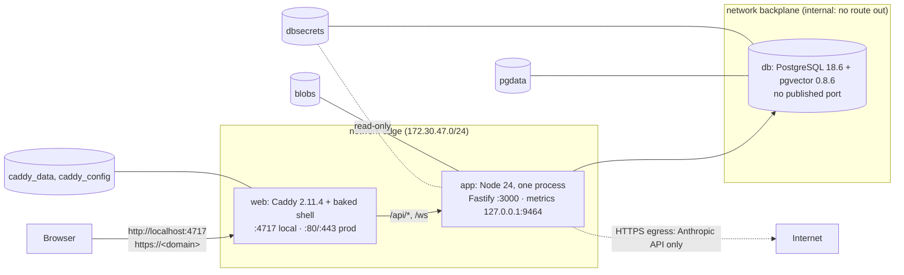
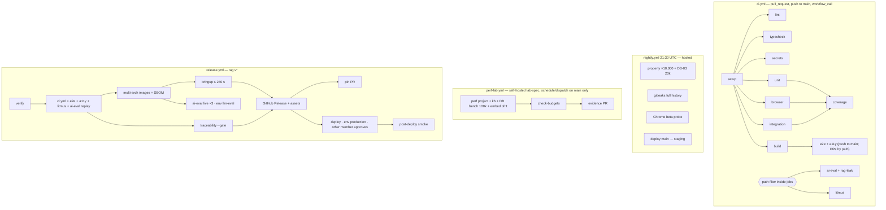

# Deployment and CI

| Field | Value |
|---|---|
| Title | Plotinium deployment, images, CI/CD, repository governance, hosting, backups and monitoring |
| Status | Draft v0.1, 2026-09-24 |
| Primary owner | R5 QA/DevOps & Integration |
| Secondary reviewer | R2 VFS/Database (database service, migrations, backups); R1 reviews `.github/` and `ops/` changes per CODEOWNERS |
| Must be demonstrable at | **G0 Registration (W2):** repository with CI skeleton running on a pull request, branch protection, CODEOWNERS, instructor added as collaborator. **P1 defence (W4):** deployment record defended; S8 bring-up and region measurements. **P2 gate (W7, v0.2.0):** production URL boots over HTTPS; `v0.2.0` deployed by the release pipeline; three-command bring-up timed in CI. **P3 gate (W11, v0.3.0):** backups and a passed restore drill; OFF-05 hash-only patch deploy during the gate; demo lease profile. **P4 gate (W14, v0.4.0):** self-hosted models on production; litmus build side by side. **Freeze (W16, v1.0.0-rc.1).** **Final defence (W17–18, v1.0.0):** examiner bring-up ≤ 3 commands and ≤ 5 minutes; production URL with examiner accounts on paper |
| Requirement IDs covered | §14.2 (Deployment: WebSocket support, cost, reproducibility, bring-up in a few commands), §17.1 (clean bring-up), §17.2 (production deployment at a public URL with a demo account; CI test and coverage report for the tag), §13.1–§13.2 (tagged releases per phase), §15.1 (layout), §15.4 (protected `main`, reviews, CI before merge), §18 (secrets), §12.6 (keys stay on the server), DB-01 (backup and restore procedure, migrations in CI), OFF-05, BOOT-09, BOOT-10 (caching and asset rules), MEM-01 (cross-origin isolation headers), MEM-04, MEM-05 (same-origin swap), VFS-09 (WebSocket through the proxy, demo lease profile); PLT-DEL-02, PLT-DEL-03, PLT-DOC-01, PLT-DOC-12, PLT-DOC-13, PLT-TEAM-03, PLT-TEAM-04, PLT-TEAM-13, PLT-ID-15; Plotinium design IDs OPS-01 … OPS-22 |
| Related specs | [../00-product/requirements-traceability.md](../00-product/requirements-traceability.md) · [../00-product/identity-and-branding.md](../00-product/identity-and-branding.md) · [../01-architecture/architecture.md](../01-architecture/architecture.md) · [../02-boot/boot-and-services.md](../02-boot/boot-and-services.md) · [../06-sync/offline-and-sync.md](../06-sync/offline-and-sync.md) · [../09-database/database.md](../09-database/database.md) · [../10-ai/rag-semantic-search.md](../10-ai/rag-semantic-search.md) · [../10-ai/ai-safety-and-evaluation.md](../10-ai/ai-safety-and-evaluation.md) · [../11-server/backend-api.md](../11-server/backend-api.md) · [../12-security/security-model.md](../12-security/security-model.md) · [../13-quality/testing-and-performance.md](../13-quality/testing-and-performance.md) · [../15-decisions/stack-decisions.md](../15-decisions/stack-decisions.md) · [../16-delivery/implementation-plan.md](../16-delivery/implementation-plan.md) |

**Conventions used in this file.** RFC 2119 keywords as in the spec's Conventions section (p. 3). **Spec** marks an obligation from the capstone specification; **Plotinium design** marks our own binding choice. Every number from the AI-run prototype or the research is labelled *(pilot figure — re-measure on the lab machine)*; sizes and prices quoted from registries or vendors carry their source and date. `<org>` stands for the GitHub organisation that owns the repository and `<domain>` for the production domain; both are fixed in Week 1.

---

## 1. Purpose and scope

This spec fixes how Plotinium is built, packaged, started, released, deployed, backed up and watched, and how the repository is governed. It covers:

- the three Compose files and the three services `web`, `app`, `db`, with volumes, networks, health checks and environment (§3.1);
- the Caddyfile: routes, all security headers, caching, `lb_try_duration`, `stream_close_delay` (§3.2);
- the Dockerfile targets and the image supply chain on public GHCR, multi-arch and digest-pinned, with mirrors (§3.3–§3.4);
- build artefacts the other specs rely on: build identity, `boot-manifest.json`, `__TEST_FLAGS__`, self-hosted models (§3.5);
- the examiner bring-up in three commands and its timing job (§3.6);
- the CI workflows job by job for pull requests, `main`, nightly and release (§3.7);
- branch protection, CODEOWNERS and secrets (§3.8–§3.9);
- release tagging per phase, the production deploy procedure, rollback and the OFF-05 demo deploy (§3.10–§3.11);
- VPS provisioning, provider fallback, backups and the restore-drill runbook, monitoring, cost (§3.12–§3.16).

Out of scope, linked instead: the server's configuration schema and startup (see [backend-api.md §3.4, §3.18](../11-server/backend-api.md)); PostgreSQL settings, migrations and the backup procedure's SQL (see [database.md §3.24–§3.30](../09-database/database.md)); the Service Worker's update protocol (see [offline-and-sync.md](../06-sync/offline-and-sync.md)); test levels, budgets and rehearsal scripts (see [testing-and-performance.md](../13-quality/testing-and-performance.md)); the security controls themselves (see [security-model.md](../12-security/security-model.md)).

---

## 2. Requirements table

| ID | Summary | Spec § | How verified |
|---|---|---|---|
| §17.1 | Spec: MUST. An examiner clones the repository and starts the system with our documented commands, three or fewer, finishing within five minutes, on a machine we do not control; then opens the production URL | §17.1, Appendix A | `bringup` job on every tag and weekly (§3.6); four rehearsals |
| §17.2 | Spec: MUST. A production deployment reachable at a public URL, with a demo account for examiners; a CI test and coverage report for the tagged release | §17.2 | UptimeRobot history; release assets (§3.7.5) |
| §14.2 Deployment | Spec: MUST (defended decision). WebSocket support, cost, reproducibility, bring-up in a few commands | §14.2 | D12 in [stack-decisions.md](../15-decisions/stack-decisions.md); §3.1–§3.6 |
| §13.2 | Spec: MUST. A gate is passed only by a live demonstration on the tagged release | §13.2 | Tags per phase (§3.10); release pipeline deploys the tag |
| §15.4 | Spec: MUST. All work through reviewed PRs; `main` protected, no force pushes, CI passes before merge; issue board with owners | §15.4 | Branch ruleset export in `docs/evidence/gates/g0/` (§3.8) |
| §18 | Spec: MUST. API keys, database credentials and tokens never in the repository or the client bundle; a leaked key is revoked at once and reported in SECURITY.md | §18 | gitleaks on PRs, history, `web/dist`, cassettes; no default secrets (§3.9) |
| §12.6 | Spec: MUST. Keys stay on the server; every model call goes through our backend | §12.6 | Key only in the production secrets directory; bundle scan (§3.7.1) |
| DB-01 | Spec: MUST. Versioned migrations with rollback; documented backup-and-restore procedure | §11.5 | Migration round trip on PRs; nightly backup; weekly restore drill (§3.14) |
| OFF-05 | Spec: SHOULD. Versioned shell updates install in the background and activate on the next boot; verified by deploying a new version during the demo | §9.5 | Hash-only patch deploy at P3 and on Demo Day (§3.11.4) |
| MEM-01 (headers) | `measureUserAgentSpecificMemory()` needs cross-origin isolation | §9.2 | Caddy headers (§3.2); `ARC-03` e2e online and offline |
| PLT-DEL-02 | Production deployment with examiner accounts, credentials on paper (C10) | §17.2 | T-1 checklist ([testing-and-performance.md §3.16.2](../13-quality/testing-and-performance.md)) |
| PLT-DEL-03 | CI test and coverage report for the tagged release | §17.2 | Release assets |
| PLT-TEAM-03, PLT-TEAM-04 | Primary owner and secondary reviewer per subsystem; PR approval by another member; no direct pushes | §4.2, §15.4 | CODEOWNERS; ruleset |
| PLT-ID-15 | A release is built from a clean tree whose tag equals the root `package.json` version | §5.2 | `release.yml` verify job |
| OPS-01 | Plotinium design (C14). One `compose.yaml` serves the examiner, CI and production; production adds only `compose.prod.yaml` | §14.2 | Compose config test |
| OPS-02 | Plotinium design (C9, C14; SEC-20). Exactly three services (`web`, `app`, `db`); only `web` publishes ports, on `127.0.0.1` in `compose.yaml` and on 80/443 in production; `db` has no published port and sits on an internal network | §14.2, §18 | Compose config test; LAN-reachability test |
| OPS-03 | Plotinium design (C10). No credential in the repository, `compose.yaml`, `.env.example` or README; database passwords and user passwords are generated at first start; production credentials exist only on paper and in the host secrets directory | §18 | gitleaks; config test; SRV-20 |
| OPS-04 | Plotinium design (C14). Every image is on public GHCR, multi-arch (amd64, arm64); third-party bases are mirrored to GHCR and pinned by digest; `main`'s `compose.yaml` pins the latest release's image digests | §17.1 | `bringup` job without `docker login` and with Docker Hub blocked |
| OPS-05 | Plotinium design (C14). The bring-up is exactly `git clone`, `cd plotinium`, `docker compose up -d --wait`, then `http://localhost:4717`; CI fails a release above 240 s | §17.1 | `bringup` job |
| OPS-06 | Plotinium design (C9, C10). Caddy owns static files and every security header; Fastify serves only `/api/*` and `/ws` | §8, §9.2 | header assertion e2e |
| OPS-07 | Plotinium design. Releases: `v0.2.0` (P2), `v0.3.0` (P3), `v0.4.0` (P4), `v1.0.0-rc.N` (W16–17), `v1.0.0` (final); patches `vX.Y.Z+1` for fixes after a gate | §13.1 | tag ruleset; release notes |
| OPS-08 | Plotinium design. Production deploys only a released tag, by image digest, through an approval-gated job run by a member other than the tagger, after a pre-deploy backup; migrations are expand-only; rollback is the previous tag | §13.2 | deploy log; rollback drill |
| OPS-09 | Plotinium design (C7). `FAULT_INJECTION=1` only in `compose.yaml` (local, examiner, defence, CI); `compose.prod.yaml` forces `0` and the server refuses to start otherwise (SRV-02) | §18 | config test; SRV-02 test |
| OPS-10 | Plotinium design. Third-party GitHub Actions are pinned by commit SHA; gitleaks and k6 binaries are checksum-verified | §18 | workflow lint |
| OPS-11 | Plotinium design (critic). The lab-spec self-hosted runner accepts only `schedule` and `workflow_dispatch` jobs on `main` (details in [testing-and-performance.md §3.12](../13-quality/testing-and-performance.md)) | §15.3 | workflow lint (TST-07) |
| OPS-12 | Plotinium design. The VPS is provisioned from `ops/cloud-init.yaml`: deploy user, key-only SSH, Docker, cloud firewall 22/80/443 tcp and 443 udp, BBR and `tcp_slow_start_after_idle=0` | §14.2 | provisioning checklist; rebuild drill |
| OPS-13 | Plotinium design. Provider order: Hetzner CX33 (FSN or NBG) → OVHcloud VPS-2 after 72 h without a CX33 → Contabo or DigitalOcean; ceiling €15 per month | §14.2 | purchase log; cost table |
| OPS-14 | Plotinium design (C14, DBD-12). Nightly `pg_dump -Fc` with a snapshot manifest and `rclone copy` of dumps and blobs to Cloudflare R2; 7 daily + 4 weekly; weekly restore drill from R2 | DB-01 | drill results in `docs/evidence/deploy/` |
| OPS-15 | Plotinium design (C14). UptimeRobot checks `/api/readyz` every 5 minutes with alerts to all five members; a deep smoke check every 6 hours | §17.2 | UptimeRobot history |
| OPS-16 | Plotinium design (critic). OFF-05 is shown by deploying a hash-only patch tag; `reboot` activates it | OFF-05 | e2e E16; gate scripts |
| OPS-17 | Plotinium design. The CI workflows and required checks of §3.7–§3.8; PR pipeline ≤ 10 min | §15.3, §15.4 | CI timing |
| OPS-18 | Plotinium design (C9). pino JSON logs rotated by Docker's `local` driver (10 MB × 5); metrics on an internal listener only | §12.6 | config test |
| OPS-19 | Plotinium design. Build artefacts: one build identity from `SOURCE_DATE_EPOCH`, `boot-manifest.json`, self-hosted `/models` and `/ort` with sha256 pins; `__TEST_FLAGS__` only in CI test builds | BOOT-02, BOOT-10, §5 | build checks |
| OPS-20 | Plotinium design. Licence scan: every dependency in the lockfile has a THIRD_PARTY.md row; no AGPL or GPL code in the shipped bundle | §18 | `licences` job |
| OPS-21 | Plotinium design (C11). Service Worker update flow: new builds install in the background and wait; `reboot` sends SKIP_WAITING and reloads on `controllerchange`; `/api/*` and `/ws` never cached | OFF-05 | e2e E16 |
| OPS-22 | Plotinium design. A staging project on the same VPS (`staging.<domain>`) SHOULD receive `main` nightly so merged work is demoable on a deployed build before its tag | §13.2 | staging smoke |

---

## 3. Design (normative)

### 3.1 The Compose stack

**Plotinium design (C9, C14; coherence deployment resolution).** One stack of three long-lived services. There is no one-shot init service: the `app` entrypoint runs migrations and the seed before the server starts, and `app`'s health check passes only after that, so `docker compose up -d --wait` watches only long-lived services.



#### 3.1.1 `compose.yaml` (examiner, CI and local; the local/defence profile)

```yaml
# compose.yaml — Plotinium (C14). The ONLY file an examiner needs.
# No credential appears in this file: passwords are generated at first start (C10, OPS-03).
name: plotinium

x-logging: &logging
  driver: local
  options: { max-size: "10m", max-file: "5" }

services:
  db:
    image: ghcr.io/<org>/plotinium-db@sha256:<pinned by the release PR>   # §3.4
    build: { context: ., target: db }
    command:
      - postgres
      - -c
      - shared_preload_libraries=pg_stat_statements,auto_explain
      - -c
      - shared_buffers=256MB
      - -c
      - effective_cache_size=1GB
      - -c
      - work_mem=8MB
      - -c
      - maintenance_work_mem=128MB
      - -c
      - max_connections=50
      - -c
      - random_page_cost=1.1
      - -c
      - jit=off
      - -c
      - idle_in_transaction_session_timeout=10s
      - -c
      - pg_stat_statements.track=top
      - -c
      - auto_explain.log_min_duration=10ms
      - -c
      - track_io_timing=on
      - -c
      - log_lock_waits=on
      - -c
      - lc_messages=C
      - -c
      - timezone=UTC
    environment:
      POSTGRES_USER: plotinium_owner          # bootstrap superuser; owns every object (database.md §3.2)
      POSTGRES_DB: plotinium
      POSTGRES_INITDB_ARGS: "--locale-provider=builtin --builtin-locale=C.UTF-8"
      # POSTGRES_PASSWORD_FILE is exported by the image's wrapper after it generates the secret (§3.3)
    volumes:
      - pgdata:/var/lib/postgresql             # PG18 layout: PGDATA=/var/lib/postgresql/18/docker (database.md §3.24)
      - dbsecrets:/run/plotinium               # generated owner_password and app_password
    networks: [backplane]
    shm_size: 256mb
    healthcheck:
      test: ["CMD-SHELL", "pg_isready -U plotinium_owner -d plotinium"]
      interval: 2s
      timeout: 3s
      retries: 60
      start_period: 30s
    stop_grace_period: 30s
    logging: *logging

  app:
    image: ghcr.io/<org>/plotinium-app@sha256:<pinned by the release PR>
    build: { context: ., target: app }
    environment:
      PLOTINIUM_ENV: ${PLOTINIUM_ENV:-local}             # CI e2e exports ci (replay only)
      PLOTINIUM_PORT: ${PLOTINIUM_PORT:-4717}           # builds APP_ORIGIN http://localhost:<port>
      DATABASE_URL: postgres://plotinium_app@db:5432/plotinium
      DATABASE_PASSWORD_FILE: /run/plotinium/app_password
      OWNER_DATABASE_URL: postgres://plotinium_owner@db:5432/plotinium   # entrypoint only (dbmate, seed)
      OWNER_PASSWORD_FILE: /run/plotinium/owner_password
      TRUST_PROXY_CIDRS: 172.30.47.0/24
      BLOB_DIR: /var/lib/plotinium/blobs
      FAULT_INJECTION: "1"                              # local/defence profile only (C7, OPS-09)
      LEASE_TTL_MS: ${LEASE_TTL_MS:-15000}              # demo lease profile (C6); heartbeat TTL/3
      LLM_MODE: ${LLM_MODE:-live}                       # no key here → the gateway reports no-key and AI degrades
      AI: ${AI:-1}                                      # AI=0 for the litmus build
    volumes:
      - dbsecrets:/run/plotinium:ro
      - blobs:/var/lib/plotinium/blobs
    networks: [edge, backplane]
    depends_on:
      db: { condition: service_healthy }
    healthcheck:
      test: ["CMD", "node", "-e", "fetch('http://127.0.0.1:3000/api/readyz').then(r=>process.exit(r.ok?0:1),()=>process.exit(1))"]
      interval: 2s
      timeout: 3s
      retries: 60
      start_period: 120s                                # migrations + seed with precomputed vectors
    stop_grace_period: 15s                              # SHUTDOWN_GRACE_MS 10 s + margin (backend-api §3.17)
    logging: *logging

  web:
    image: ghcr.io/<org>/plotinium-web@sha256:<pinned by the release PR>
    build: { context: ., target: web }
    environment:
      SITE_ADDRESS: ":4717"                              # plain HTTP on localhost (a secure context)
    ports:
      - "127.0.0.1:${PLOTINIUM_PORT:-4717}:4717"         # loopback only: never reachable from the LAN (SEC-20)
    volumes:
      - caddy_data:/data                                 # certificates survive container recreation
      - caddy_config:/config
    networks:
      edge: { ipv4_address: 172.30.47.10 }
    depends_on:
      app: { condition: service_healthy }
    healthcheck:
      test: ["CMD", "wget", "-qO-", "http://127.0.0.1:8081/health"]
      interval: 2s
      timeout: 3s
      retries: 30
    logging: *logging

networks:
  edge:
    ipam: { config: [{ subnet: 172.30.47.0/24 }] }       # TRUST_PROXY_CIDRS (backend-api §3.4)
  backplane:
    internal: true                                       # db unreachable from the host and the internet

volumes:
  pgdata: {}
  dbsecrets: {}
  blobs: {}
  caddy_data: {}
  caddy_config: {}
```

Rules:

- **Image plus build.** Each service has both `image` and `build`. With no `pull_policy`, Compose tries to pull the image and builds from source only if it cannot be found, so an examiner on an unexpected platform still gets a working stack (compose build specification; confirmed in S8). The Dockerfile's bases are GHCR mirrors, so even a source build never contacts Docker Hub.
- **Digest pins on `main`.** The release pipeline opens a `chore(release): pin vX.Y.Z image digests` PR that replaces the three `@sha256:` placeholders with the digests it pushed (§3.7.5). The tagged commit itself carries the previous release's pins; the code is identical, and the examiner clones `main`. `docker compose up -d --wait --build` builds the working tree instead (developers, CI e2e).
- **Health gating.** `db` healthy → `app` starts; `app` healthy only when `/api/readyz` is 200 (after migrations, seed, self-tests; [backend-api.md §3.18](../11-server/backend-api.md)) → `web` starts. `--wait` returns when all three are healthy, or exits non-zero if one becomes unhealthy.
- **Passwords.** The `db` image's wrapper generates `owner_password` and `app_password` (32 random bytes, hex) into `dbsecrets` at first start; the init hook creates role `plotinium_app` with the second (database.md §4.1). The app entrypoint reads the owner password only to run dbmate and the seed, then `exec`s the server with it removed from the environment. User passwords are generated by the seed and printed once in `docker compose logs app` (SRV-20).
- **Reset.** `docker compose down -v` deletes every volume, including the generated secrets.

#### 3.1.2 `compose.prod.yaml` (production override)

```yaml
# compose.prod.yaml — used only on the VPS: docker compose -f compose.yaml -f compose.prod.yaml ...
# Requires Compose ≥ 2.24.4 for !override. Every ${VAR:?} fails fast if unset.
services:
  db:
    image: ${PLOTINIUM_DB_IMAGE:?set by deploy.sh from images.lock.json}
    restart: unless-stopped
    mem_limit: 2g

  app:
    image: ${PLOTINIUM_APP_IMAGE:?set by deploy.sh}
    restart: unless-stopped
    mem_limit: 1536m
    environment:
      PLOTINIUM_ENV: production                     # production guards (backend-api §3.4)
      APP_ORIGIN: https://${PLOTINIUM_DOMAIN:?}
      FAULT_INJECTION: "0"                          # never on production (C7); the server refuses "1"
      LEASE_TTL_MS: ${LEASE_TTL_MS:-30000}          # 15000 only in the frozen Demo-Day .env
      LLM_MODE: live
      ANTHROPIC_API_KEY_FILE: /run/secrets/anthropic_api_key
      LLM_UPSTREAM_ACCEPT_FILE: /run/secrets/llm_upstream_accept
      LLM_BUDGET_USD_MONTH: ${LLM_BUDGET_USD_MONTH:-50}
      LLM_BUDGET_USD_TOTAL: ${LLM_BUDGET_USD_TOTAL:-250}
    secrets: [anthropic_api_key, llm_upstream_accept]

  web:
    image: ${PLOTINIUM_WEB_IMAGE:?set by deploy.sh}
    restart: unless-stopped
    mem_limit: 256m
    environment:
      SITE_ADDRESS: ${PLOTINIUM_DOMAIN:?}           # automatic HTTPS, HTTP→HTTPS redirect, HTTP/3
    ports: !override
      - "80:80"
      - "443:443"
      - "443:443/udp"
    volumes:
      - ./ops/caddy/prod.d:/etc/caddy/prod.d:ro     # production-only headers (HSTS)

secrets:
  anthropic_api_key: { file: /srv/plotinium/secrets/anthropic_api_key }       # mode 0400, owner uid 1000
  llm_upstream_accept: { file: /srv/plotinium/secrets/llm_upstream_accept }   # SHA-256 per line; may be empty
```

`/srv/plotinium/.env` (mode 0600, never committed) holds only non-secret settings: `PLOTINIUM_DOMAIN`, the budget values and, on the day before the defence, `LEASE_TTL_MS=15000`. `/srv/plotinium/.env.images` (written by `deploy.sh`) holds the three image references by digest.

#### 3.1.3 `compose.override.yaml` (local, gitignored)

Compose reads `compose.override.yaml` automatically when present. It is listed in `.gitignore` and is used only for local extras, never for the scored bring-up:
- the MAY upstream forwarding of [backend-api.md §3.13.8](../11-server/backend-api.md) (`LLM_UPSTREAM_URL`, `LLM_UPSTREAM_TOKEN_FILE` pointing at a file outside the repository), used on Demo Day only with the instructor's agreement ([testing-and-performance.md §3.16.5](../13-quality/testing-and-performance.md));
- a developer's `ANTHROPIC_API_KEY_FILE` with `LLM_MODE=record` and `LLM_RECORD_BUDGET_USD`.

#### 3.1.4 `compose.test.yaml` (CI and developers' integration tests)

```yaml
# docker compose -f compose.yaml -f compose.test.yaml up -d --wait db
services:
  db:
    ports: ["127.0.0.1:${PLOTINIUM_DB_PORT:-55432}:5432"]   # loopback only
    command: !override [postgres, -c, "shared_preload_libraries=pg_stat_statements,auto_explain",
                        -c, "auto_explain.log_min_duration=10ms", -c, "auto_explain.log_analyze=on",
                        -c, "random_page_cost=1.1", -c, "jit=off", -c, "fsync=on"]
networks:
  backplane:
    internal: false          # allows the loopback port mapping for the test process
```

The Vitest `integration` global setup reads the owner password with `docker compose exec -T db cat /run/plotinium/owner_password` and creates per-file databases from a template (testing-and-performance.md §3.2). `auto_explain.log_analyze` is on only here and in the nightly benchmark (database.md §3.24).

#### 3.1.5 `compose.staging.yaml` (OPS-22, SHOULD)

A second Compose project (`-p plotinium-staging`) on the VPS, built from the `edge` images of `main`. Its `web` publishes only `127.0.0.1:4718:4717` (never public), so members reach it through an SSH tunnel (`ssh -L 4718:localhost:4718 deploy@<host>`, then `http://localhost:4718`, a secure context) and no extra DNS name or certificate is needed. Staging has its own volumes, `PLOTINIUM_ENV=local`, `FAULT_INJECTION=0`, no LLM key (AI degrades) and `mem_limit`s of 1 GB (db) and 768 MB (app). `nightly.yml` deploys it with `deploy.sh --project staging edge@<digest> --no-backup`; it is wiped weekly. If S8's RSS measurements leave less than 1.5 GB of headroom on the VPS, staging is dropped and OPS-22 is recorded as not met.

### 3.2 The Caddyfile

**Plotinium design (C9, C10, C11; coherence header resolution).** Caddy 2.11.4 serves the static shell and sets **every** security header; Fastify serves only `/api/*` and `/ws` and sets none of them. One origin serves the shell, `/api`, `/ws`, `/models` and `/ort`, which keeps cross-origin isolation, `connect-src 'self'` and the host-only `__Host-` cookie simple.

```caddyfile
# Caddyfile — baked into the web image with the shell (dist/) at /srv.
{
	# Admin API on localhost inside the container only (never published), so a header hot-fix can be
	# applied with `docker compose exec web caddy reload --config /etc/caddy/Caddyfile`.
	# No trusted_proxies: nothing sits in front of Caddy, so a client's X-Forwarded-For is never trusted.
	admin localhost:2019
}

(isolation_headers) {
	# The header set of security-model.md §4.1, exactly.
	header {
		Cross-Origin-Opener-Policy "same-origin"
		Cross-Origin-Embedder-Policy "require-corp"
		Cross-Origin-Resource-Policy "same-origin"
		Content-Security-Policy-Report-Only "require-trusted-types-for 'script'"
		X-Content-Type-Options "nosniff"
		Referrer-Policy "no-referrer"
		Permissions-Policy "camera=(), microphone=(), geolocation=(), payment=(), usb=()"
		-Server
	}
	# Content-Security-Policy, generated at build time by tools/csp-hash.ts with the SHA-256 of every
	# inline <script> and <style> in index.html (security-model.md §3.9). Baked into the web image.
	import /etc/caddy/csp.caddy
	# Production-only headers (Strict-Transport-Security). compose.prod.yaml mounts ops/caddy/prod.d;
	# locally the glob matches nothing, which Caddy accepts ("an empty glob pattern is not an error").
	import /etc/caddy/prod.d/*.caddy
}

{$SITE_ADDRESS::4717} {
	import isolation_headers
	encode zstd gzip

	# Backend: exactly /api/* and /ws (OPS-06). /metrics is on another listener and never routed.
	handle /ws {
		reverse_proxy app:3000 {
			lb_try_duration 15s          # hold the upgrade while app restarts during a deploy
			lb_try_interval 250ms
			stream_close_delay 5m        # keep WebSockets open across a config reload
		}
	}
	handle /api/* {
		reverse_proxy app:3000 {
			lb_try_duration 15s
			lb_try_interval 250ms
		}
	}

	# Immutable assets: hashed file names under /assets; /models/<lock-id>/… and /ort/<ort-version>/…
	# carry the model revision and the ORT version in the path (security-model.md §3.9).
	# Never fall back to index.html for these.
	@immutable path /assets/* /models/* /ort/*
	handle @immutable {
		header Cache-Control "public, max-age=31536000, immutable"
		root * /srv
		file_server {
			precompressed br gzip
		}
	}

	# Files that must be revalidated on every boot (OFF-05, identity check).
	@fresh path / /index.html /sw.js /version.json /boot-manifest.json /manifest.webmanifest
	header @fresh Cache-Control "no-cache"

	handle {
		root * /srv
		try_files {path} /index.html
		file_server {
			precompressed br gzip
		}
	}
}

# Container health (not published; OPS-02).
:8081 {
	respond /health "ok" 200
}
```

Notes:

- **CSP.** The policy is owned by [security-model.md §3.9 and §4.1](../12-security/security-model.md): C10's directives verbatim (`default-src 'self'; script-src 'self' 'wasm-unsafe-eval'; worker-src 'self' blob:; connect-src 'self'; object-src 'none'; base-uri 'none'; frame-ancestors 'none'`) plus two additions: the build-time `'sha256-…'` of each inline `<script>` (and a `style-src 'self' 'sha256-…'` only if `index.html` has an inline `<style>`), and `form-action 'none'`. There is no `'unsafe-inline'` and no `'unsafe-eval'` (which backs AGT-01 at the platform level); inline `style="…"` attributes are banned by lint, while CSSOM writes such as the compositor's `element.style.transform` are not restricted by CSP. `tools/csp-hash.ts` parses the built `index.html`, hashes every inline block (the framework-free boot-ui, C11) and writes `/etc/caddy/csp.caddy` containing the single `header Content-Security-Policy "…"` line, so the hashes always match the baked page (OPS-19). In CSP3, `connect-src 'self'` also covers same-origin `ws:`/`wss:` (coherence).
- **Strict-Transport-Security** is sent in production only, from `ops/caddy/prod.d/hsts.caddy` (`header Strict-Transport-Security "max-age=31536000"`), mounted by `compose.prod.yaml`.
- **Trusted Types** are Report-Only (coherence): Solid's compiled templates assign HTML strings to `template.innerHTML`. Violations reach the page's `securitypolicyviolation` listener and are logged to klog; there is no report endpoint.
- **CORP `same-origin`** on every response (C10). If a later decision runs untrusted apps in sandboxed opaque-origin iframes, `/assets/*` would need `cross-origin` (deploy examiner review); that is a reversal item, not v1.
- **Precompression.** The web build writes `.br` and `.gz` next to every file over 1 KiB under `/assets` and the shell (`tools/precompress.ts`, node:zlib). `/models/*.onnx` are served with `br`/`gzip` only if smaller.
- **Service Worker caching.** `sw.js` and `index.html` are `no-cache`; hashed assets are immutable (offline-and-sync request). The SW treats `/api/*` and `/ws` as network-only and never precaches `/ort`, `/models` or the Transformers.js chunk (C11).
- **Local vs production.** `SITE_ADDRESS=":4717"` serves plain HTTP on a port published on `127.0.0.1` only (SEC-20): `http://localhost` is a secure context, a LAN IP is not, and the examiner's stack is not reachable from the campus LAN. In production `SITE_ADDRESS=<domain>` turns on automatic HTTPS with ACME, the HTTP→HTTPS redirect and HTTP/3; certificates live in `caddy_data`, so recreating the container does not re-issue them (Let's Encrypt allows 5 duplicate certificates per 7 days; deploy examiner review).
- **Timeouts.** Caddy has no default stream timeout for WebSockets ([Caddy reverse_proxy docs](https://caddyserver.com/docs/caddyfile/directives/reverse_proxy)); `lb_try_duration` defaults to 0 (retries off), hence the explicit 15 s. `stream_close_delay` only helps on a config reload; a container recreation drops sockets and clients resume (§3.11.3).

### 3.3 Dockerfile targets

**Plotinium design.** One multi-stage `Dockerfile` at the root. Every `FROM` names a GHCR mirror by digest (§3.4).

| Target | Base | Contents | User | Notes |
|---|---|---|---|---|
| `deps` | `ghcr.io/<org>/mirror/node:24-trixie-slim@sha256:…` | `pnpm@12.5.1` (`npm i -g`), `pnpm fetch` on the lockfile | root | cache layer keyed by `pnpm-lock.yaml` |
| `build` | `deps` | `pnpm install --frozen-lockfile --offline`; `pnpm -r build` with `SOURCE_DATE_EPOCH`, `BUILD_VERSION`, `BUILD_SHA`, `BUILD_DATE` build args; `tools/fetch-models.ts` verifies `/models` against `web/models.lock.json` (sha256); ORT files copied from `onnxruntime-web` in the lockfile; `tools/precompress.ts`; `tools/csp-hash.ts` | root | `PLT_TEST_BUILD=1` (CI e2e only) turns on `__TEST_FLAGS__` |
| `web` | `ghcr.io/<org>/mirror/caddy:2.11.4-alpine@sha256:…` | `Caddyfile`, the generated `csp.caddy` → `/etc/caddy/`; `web/dist` → `/srv` (shell, `/assets`, `/models/<lock-id>/`, `/ort/<ort-version>/`, `version.json`, `boot-manifest.json`) | caddy default | EXPOSE 4717 80 443 443/udp 8081 |
| `app` | `ghcr.io/<org>/mirror/node:24-trixie-slim@sha256:…` | `pnpm deploy --prod --filter @plotinium/server /app` (server `dist/`, production `node_modules` including `dbmate` and its platform binary), `db/migrations`, `server/docker-entrypoint.sh` | `node` (uid 1000) | the official image bundles OpenSSL 3.5.x, which `crypto.argon2` needs (SRV-17 self-test) |
| `db` | `ghcr.io/<org>/mirror/pgvector:0.8.6-pg18-trixie@sha256:…` | `ops/db/entrypoint.sh` as `ENTRYPOINT` (secret generation, then `exec docker-entrypoint.sh "$@"`), `ops/db/initdb.d/10-app-role.sh` → `/docker-entrypoint-initdb.d/`; `CMD` stays `postgres` (Compose passes the `-c` flags) | root → `postgres` (uid 999) via the official entrypoint | adds nothing to PostgreSQL itself |

`server/docker-entrypoint.sh` (normative behaviour):

```sh
#!/bin/sh
set -eu
owner_pw=$(cat "$OWNER_PASSWORD_FILE")
# dbmate reads DATABASE_URL; the owner URL is set for this one command only (an env prefix, not argv,
# so the password is not visible in the container's process list).
DATABASE_URL="postgres://plotinium_owner:${owner_pw}@db:5432/plotinium?sslmode=disable" \
  dbmate --migrations-dir /app/db/migrations --wait --wait-timeout 60s --no-dump-schema up
unset owner_pw
node /app/server/dist/seed.js --demo      # idempotent; connects as owner via OWNER_DATABASE_URL + OWNER_PASSWORD_FILE;
                                          # prints first-start credentials once
unset OWNER_DATABASE_URL OWNER_PASSWORD_FILE
exec node /app/server/dist/main.js        # runs as plotinium_app (DATABASE_URL + DATABASE_PASSWORD_FILE)
```

`ops/db/entrypoint.sh` (normative behaviour):

```sh
#!/bin/sh
set -eu
d=/run/plotinium
umask 077
for f in owner_password app_password; do
  [ -s "$d/$f" ] || head -c 32 /dev/urandom | od -An -tx1 | tr -d ' \n' > "$d/$f"   # 64 hex chars
done
chown 999:1000 "$d/owner_password" "$d/app_password"   # postgres reads as owner; the app's node user (gid 1000) as group
chmod 0440 "$d/owner_password" "$d/app_password"
export POSTGRES_PASSWORD_FILE="$d/owner_password"
exec docker-entrypoint.sh "$@"
```

`ops/db/initdb.d/10-app-role.sh` runs once on an empty data directory, as `postgres`: `CREATE ROLE plotinium_app LOGIN PASSWORD :'pw'` with `pw` read from `/run/plotinium/app_password` (database.md §4.1). The uid/gid values (999 for `postgres` in the Debian-based PostgreSQL image, 1000 for `node`) are asserted by a build test; if an upstream image changes them the build fails instead of the bring-up.

### 3.4 Image publishing on GHCR

**Plotinium design (C14, deploy examiner review; OPS-04).**

- **Our images:** `ghcr.io/<org>/plotinium-web`, `plotinium-app`, `plotinium-db`. Tags per release: `X.Y.Z`, `X.Y`, `sha-<12>`; plus `edge` from `main` (amd64 only, for staging). A version tag is **never overwritten**: the release job fails if `X.Y.Z` already exists.
- **Multi-arch:** `linux/amd64` and `linux/arm64` manifest lists built with Buildx. On a public repository the arm64 half builds natively on GitHub's arm64 hosted runner where available; otherwise under QEMU. The `app` image has no native addons (Argon2id is `node:crypto`; `pg` is pure JavaScript; dbmate ships per-platform binaries through npm optional dependencies).
- **Supply chain:** `docker/build-push-action` with `provenance: mode=max` and `sbom: true`; the release attaches the SBOMs. Digests are written to `images.lock.json` (a release asset) and pinned into `compose.yaml` by the pin PR.
- **Mirrors (third-party):** `ghcr.io/<org>/mirror/pgvector:0.8.6-pg18-trixie`, `mirror/caddy:2.11.4-alpine`, `mirror/node:24-trixie-slim`, `mirror/dbmate:2.36.0` (for the CI schema dump, database.md §3.25), copied by `mirror-images.yml` with `docker buildx imagetools create --tag <mirror> <upstream>@sha256:<digest>`, which preserves the multi-arch index. The upstream digests are recorded in `ops/mirrors.lock.json`. A digest is bumped deliberately in its own PR, only after the Q1–Q5, fault-injection and concurrency suites pass on the new one (database.md §3.24).
- **Visibility:** every package is set **public** once by R5 (GHCR packages start private); the `bringup` job pulls anonymously, which proves it on every release. GHCR storage and bandwidth for public packages are free ([GitHub Packages billing](https://docs.github.com/en/billing/concepts/product-billing/github-packages), research deploy record).
- **Size budget:** total compressed pull ≤ 450 MB (warn 400 MB). Registry sizes on 2026-09-23: pgvector trixie 164.0 MB, node 24 trixie-slim 82.5 MB sharing a 29.8 MB Debian base with it, caddy alpine 23.9 MB (deploy record, Docker Hub API); plus two pinned embedding models (about 23 MB each) and ORT WASM (about 27 MB) in the web image *(pilot figure — re-measure on the lab machine)*. The `bringup` job reports MB pulled.

### 3.5 Build artefacts other specs rely on (OPS-19)

| Artefact | Producer | Consumer | Rule |
|---|---|---|---|
| Build identity (`version`, `build`, `buildDate`, `codename`, `abi`) | `web/vite.config.ts` `computeIdentity` from the tag or `package.json`, `git rev-parse`, `SOURCE_DATE_EPOCH = git log -1 --format=%ct` | boot screen, `uname`, About, `/system/release`, `/version.json`, `/api/readyz` | one identity per build ([identity-and-branding.md §4.2](../00-product/identity-and-branding.md), PLT-ID-14) |
| `web/dist/boot-manifest.json` | Vite plugin `web/plugins/boot-manifest.ts`: per boot target the critical assets with **decoded** sizes | boot-ui truthful progress (SVC-15) | checked on every PR by `tools/check-boot-truth.ts` ([boot-and-services.md §5.5](../02-boot/boot-and-services.md)) |
| Bundle budgets | `tools/bundle-budget.ts` over the Vite manifest | CI | boot-critical main-thread JS ≤ 60 KB gzip; kernel worker ≤ 100 KB gzip until re-baselined at W7; `tokens.css` ≤ 4 KB; inlined boot-ui ≤ 5 KB |
| `/models/<lock-id>/…`, `/ort/<ort-version>/…` | `tools/fetch-models.ts` with `web/models.lock.json` (URL at a pinned Hugging Face revision, sha256, size) for `mdbr-leaf-ir` q8 (rev `4262131b`) and `Xenova/bge-small-en-v1.5` q8; ORT files from the lockfile's onnxruntime-web; `<lock-id>` is the first 12 hex characters of the SHA-256 of `models.lock.json`, so a new model revision is a new path | `ai.embed` (`localModelPath = '/models/<lock-id>/'`, `wasmPaths` object under `/ort/<ort-version>/`; the build injects both; [rag-semantic-search.md §3.7](../10-ai/rag-semantic-search.md)) | baked into the web image, same origin, `immutable` only because the path is versioned ([security-model.md §3.9](../12-security/security-model.md)), excluded from the SW precache |
| `__TEST_FLAGS__` | Vite `define`, true only with `PLT_TEST_BUILD=1` | e2e-only URL flags such as `?bootflags=inject-cycle` | release builds never set it; the release job greps `web/dist` for the flag-handler marker and fails if present |
| `__AI__` | Vite `define`, false in the litmus build | AI seams (ARC-06) | the litmus job builds both |
| CSP with inline hashes | `tools/csp-hash.ts` → `csp.caddy` | Caddy (`import /etc/caddy/csp.caddy`) | recomputed every build from the built `index.html`; e2e fails on any `securitypolicyviolation` ([security-model.md §3.9](../12-security/security-model.md)) |

### 3.6 The examiner bring-up and its CI timing job (§17.1, OPS-04, OPS-05)

**Spec: MUST, §17.1.** Three or fewer documented commands; running within five minutes; then the production URL. **Plotinium design.**

The README section (verbatim; no credentials, C10):

```text
git clone https://github.com/<org>/plotinium.git
cd plotinium
docker compose up -d --wait
```
Then open **http://localhost:4717** in Google Chrome (use `localhost`, not a LAN IP: the OS needs a secure context). Port taken? `PLOTINIUM_PORT=4718 docker compose up -d --wait`. First-start passwords: `docker compose logs app`. Reset: `docker compose down -v`. Prerequisites: Docker Engine or Docker Desktop with Compose 2.24 or newer, on amd64 or arm64; about 1.5 GB of free RAM and 2 GB of disk. Production: **https://&lt;domain&gt;** (examiner accounts are handed over on paper).

**Why the distinctive port.** Other teams' stacks on `localhost:8080` leave Service Workers, IndexedDB and OPFS data on that origin; port 4717 gives Plotinium its own origin, and POST checks `/version.json` for our identity ([identity-and-branding.md §6](../00-product/identity-and-branding.md)).

**The `bringup` job** (`bringup.yml`: weekly schedule, `workflow_dispatch`, and `workflow_call` from `release.yml` after the pin PR's digests exist):

1. Fresh `ubuntu-24.04` hosted runner; `rm -f ~/.docker/config.json` (no `docker login`); append `127.0.0.1 registry-1.docker.io auth.docker.io index.docker.io production.cloudflare.docker.com` to `/etc/hosts` (Docker Hub blocked); assert `docker pull hello-world` fails.
2. `t0`; `git clone --depth 1 --branch <ref>` from the public URL; `cd plotinium`; `docker compose up -d --wait`; `t1`.
3. Playwright (`bringup` project, channel `chrome`, fresh persistent context) opens `http://localhost:4717` and waits for the `desktop-interactive` mark after logging in with the password read from `docker compose logs app`; `t2`.
4. Record `t1 − t0`, `t2 − t0`, MB pulled (`docker system df` delta), image digests; fail if `t2 − t0 > 240 s` (80% of the 300 s limit) or any image came from a non-GHCR registry.
5. Repeat on `ubuntu-24.04-arm` where available (arm64 path).

The same script runs by hand from the lab network in S8 and before each gate (5 runs; a reversal trigger fires if 2 of 5 exceed 240 s, D12).

### 3.7 CI workflows (OPS-17)

**Plotinium design.** GitHub Actions. Every third-party action is pinned by commit SHA with the version in a comment (OPS-10): `actions/checkout` v7.0.1, `actions/setup-node` v7.0.0, `pnpm/action-setup` v6.1.0, `actions/cache` v6.1.0, `actions/upload-artifact` v7.0.1, `docker/setup-buildx-action` v4.4.1, `docker/login-action` v4.6.0, `docker/metadata-action` v6.2.0, `docker/build-push-action` v7.4.0, `grafana/setup-k6-action` (lab runner only). gitleaks v8.30.1 and k6 v2.3.0 binaries are downloaded with checksum verification (the gitleaks Action needs a licence for organisation repositories; the CLI does not). Default `permissions: contents: read`; jobs raise only what they need.



#### 3.7.1 `ci.yml` (every pull request; required)

`concurrency: { group: ci-${{ github.ref }}, cancel-in-progress: true }` for pull requests. Path filters run **inside** jobs (a `changes` step), so a required check always reports and skipped work reports success.

| Job | Steps | Target time |
|---|---|---|
| `setup` (composite, reused) | checkout; `pnpm/action-setup` 12.5.1; `setup-node` 24 with the pnpm cache; `pnpm install --frozen-lockfile` | 1 min |
| `lint` | `prettier --check`; `eslint . --max-warnings 0` (incl. `no-yieldless-loop-in-generator`, `no-await-in-idb-builder`, `no-html-sinks`, `dsa/no-external-imports`, import boundaries, pilot-import ban, no inline `style=` attributes); commitlint over the PR's commits (`<type>(<scope>): … (<IDs>)`, ID required for `feat`/`fix`); `pnpm traceability --strict` including the per-command SYS-02 check of [shell-and-terminal.md §8.2](../07-shell/shell-and-terminal.md); the SPX spec-process checks of [../README.md §8](../README.md); the decision-record checks of [stack-decisions.md §5.4](../15-decisions/stack-decisions.md); quarantine-file check; coverage-ratchet check; a grep that `compose*.yaml`, `.env.example` and `README.md` contain no secret values (SEC-08); workflow lint (TST-07, action SHA pins, least-privilege `permissions`); `freeze-policy` after the W16 freeze date (label `freeze-fix` and 2 approvals) | 2 min |
| `typecheck` | `tsc -b --noEmit` with `@typescript/native` 7.0.2 (C14) | 1 min |
| `secrets` | `gitleaks git --redact --log-opts=<base>..<head>`; `gitleaks dir ai/eval/cassettes`; cassette pattern check (`sk-ant-`, `x-api-key`, `authorization`) | 1 min |
| `unit` | Vitest `unit` + `tools` projects (property tests at 100 runs, seed 42) with coverage blob report | 3 min |
| `browser` | `playwright install chrome` (Google Chrome stable); Vitest `browser` project, persistent profile, coverage blob report; records the Chrome version | 4 min |
| `integration` | `docker compose -f compose.yaml -f compose.test.yaml up -d --wait db`; migration round trip (`tools/ci/migrate-roundtrip.sh`: up, N × rollback, empty-schema assertion, up, explicit `dbmate dump` via the mirrored dbmate image, `\restrict` normalisation, `git diff --exit-code db/schema.sql`, newest-migration up/down/up, `kysely-codegen --verify`; ≤ 90 s, database.md §3.25); Vitest `integration` (fault-injection matrix, DB-03, leases, replay, auth suite); DB-05 Q1–Q5 at 10k on PRs touching `db/` or `server/` | 6 min |
| `coverage` | `vitest --merge-reports` of the three blob reports with coverage; thresholds; `tools/coverage-filecount.ts`; per-package table to the job summary | 1 min |
| `build` | `pnpm -r build` (release mode); `tools/bundle-budget.ts`; `tools/check-boot-truth.ts`; built-chunk boundary scan (no `indexedDB`, `caches`, `navigator.storage` in app chunks); bundle scan (gitleaks `dir web/dist`, provider hostnames, `@anthropic-ai/sdk`, key patterns); `__TEST_FLAGS__` absent; Vitest `bench` deterministic budgets (trie, prediction, heap and PidTable curves at PR sizes); `check-budgets --cadence pr` | 4 min |
| `licences` | lockfile vs THIRD_PARTY.md rows; fail on unknown licence or AGPL/GPL in a bundled package; `pnpm audit --prod --audit-level high` | 1 min |
| `ai-eval` (path: `ai/`, `server/llm`, `server/index`, `protocol/`, `apps/shell`) | Vitest `ai-eval` in replay; `rag-leak`; key-absence test | ≤ 10 min |
| `litmus` (path: `ai/`, `kernel/`, `protocol/`, `server/llm`, `server/index`, `services/`) | both builds; non-AI e2e on each ([ai-safety-and-evaluation.md §3.3](../10-ai/ai-safety-and-evaluation.md)) | ≤ 20 min |
| `a11y` (path: `wm/`, `apps/*/view*`, `web/`) | stack built with `--build`; Playwright `a11y` | 6 min |

**Required checks on `main`:** `lint`, `typecheck`, `secrets`, `unit`, `browser`, `integration`, `coverage`, `build`, `licences`, `ai-eval`, `litmus`, `a11y` (the last three report success when their paths are untouched). PR wall time target ≤ 10 min with jobs in parallel (reversal: Turborepo caching, D12).

#### 3.7.2 Push to `main`

`ci.yml` runs again on the merge result, plus:
- `e2e`: `docker compose -f compose.yaml up -d --wait --build` with `PLT_TEST_BUILD=1`; Playwright `e2e` project (scenarios E1–E21 of [testing-and-performance.md §3.8](../13-quality/testing-and-performance.md), including the server-stop offline gate test); JUnit and traces on failure only (3-day retention);
- `a11y` unconditionally;
- `images-edge`: amd64 `edge` images for staging.

A red `main` is fixed or reverted within 4 working hours; the ruleset's "require branches up to date" is off to save minutes, so this policy is the backstop.

#### 3.7.3 `nightly.yml` (hosted) and `perf-lab.yml` (self-hosted)

`nightly.yml`: `schedule: '30 21 * * *'` (02:30 PKT) and `workflow_dispatch`; skipped when `main` has not changed in 24 h, except Sundays.
- property tests at 10,000 runs with random seeds; DB-03 torture at 20,000 iterations;
- `bench100k`: seed 100k inodes, then Q1–Q5 before/after indexing with EXPLAIN plans, and **plan assertions on the freshly migrated and seeded database** (index names present, no Seq Scan on `dentries`) ([database.md §3.28](../09-database/database.md)); this job runs on the lab runner when available, otherwise on a hosted runner as a regression check;
- `gitleaks git` over the full history;
- Chrome **beta** capability probe (nested module workers, SharedArrayBuffer in executors, `createSyncAccessHandle`, `crossOriginIsolated` online and offline, Web Locks) and the same on stable;
- Sunday: the `e2e` project 5 times (flake hunt, TST-16) and `bringup`;
- `smoke-prod.yml` (`0 */6 * * *`): opens `https://<domain>`, checks `/api/readyz` and `/version.json`, logs in as a guest and waits for `desktop-interactive` (deep smoke, OPS-15);
- `restore-drill.yml` (weekly and `workflow_dispatch` before each gate; §3.14.3);
- staging deploy of `main` (OPS-22).

`perf-lab.yml`: `schedule` and `workflow_dispatch` only, `if: github.ref == 'refs/heads/main'`, `runs-on: [self-hosted, lab-spec]`, no secrets, `permissions: contents: read`. Runs the Playwright `perf` project, k6 soak and lock contention, the DB benchmark at 100k inodes with EXPLAIN plans, the embedding drift check, `check-budgets --cadence nightly --machine lab-spec`, and uploads result files; a follow-up hosted job opens the evidence PR ([testing-and-performance.md §3.12](../13-quality/testing-and-performance.md)).

#### 3.7.4 Docs build

`docs.yml` (path `docs/report/**`, `docs/slides/**`, and every `v*` tag): Typst compiles the report and slides to PDF; the report job checks 20–30 pages; Mermaid diagrams render on GitHub, no extra tool.

#### 3.7.5 `release.yml` (tag `v*`)

1. **verify** (PLT-ID-15; identity request): the tag matches `^v\d+\.\d+\.\d+(-rc\.\d+)?$`; it equals the root `package.json` `version`; the tree is clean (`git status --porcelain` empty after checkout and install); `SOURCE_DATE_EPOCH` = the tag commit's committer time; `CHANGELOG.md` has a section for the version; the tag commit is on `main`.
2. **suite:** `ci.yml` via `workflow_call`, plus `e2e`, `a11y`, `litmus`, `ai-eval` (replay), unconditionally.
3. **perf evidence:** `perf-lab.yml` cannot run on a tag (OPS-11), so the job requires a passing lab result for the tagged commit, or for a commit whose tree equals it, dated within 7 days; otherwise it fails with "dispatch perf-lab on main at <sha>".
4. **images:** build and push multi-arch `web`, `app`, `db` with provenance and SBOM; refuse an existing `X.Y.Z`; write `images.lock.json`.
5. **bringup** (`workflow_call`, pulling the new digests) ≤ 240 s.
6. **ai-eval live:** 3 runs of AGT-40 and INJ-20 through the `llm-eval` environment (its own key with a provider-side spend cap; approval required); results attached; cost ≤ USD 25.
7. **traceability:** `tools/traceability.ts --gate <gate> --tag <tag>`; fails the release when `pass` is false (requirements-traceability request).
8. **GitHub Release:** notes from the CHANGELOG section plus generated notes; assets: every project's JUnit XML, `coverage-summary.json` and the HTML coverage report (PLT-DEL-03), the lab performance report, `traceability.json`/`.md`, `images.lock.json`, SBOMs, the AI evaluation report, and for `v1.0.0` the report and slides PDFs.
9. **pin PR:** `chore(release): pin vX.Y.Z image digests` into `compose.yaml` (needs a second member's approval like any PR).
10. **deploy:** `deploy.yml` via `workflow_call` in environment `production` (required reviewer, "prevent self-review" on, so a member other than the tagger approves), running `ops/deploy.sh vX.Y.Z` over SSH with a pinned `known_hosts` (§3.11).
11. **post-deploy smoke:** `smoke-prod.yml` plus `/version.json.version == X.Y.Z`.

### 3.8 Branch protection and CODEOWNERS (§15.4, PLT-TEAM-03/04)

**Spec: MUST, §15.4 and §4.2.** **Plotinium design.** A repository ruleset on `main` (exported to `docs/evidence/gates/g0/ruleset-main.json`):

| Rule | Setting |
|---|---|
| Restrict deletions, block force pushes | on |
| Require a pull request | on; 1 approval; dismiss stale approvals on push; require review from Code Owners; require approval of the most recent push by someone other than its author; require conversation resolution |
| Require status checks | the list in §3.7.1; "require branches to be up to date" off (see §3.7.2) |
| Require linear history | on; merge method **rebase and merge** only (keeps per-author commits for §16.4 evidence; squash off) |
| Bypass list | empty (nobody, including admins) |
| Tag ruleset on `v*` | only R5 and one named deputy may create; no update, no deletion |
| After the freeze (W16) | the `freeze-policy` check (§3.7.1) requires label `freeze-fix` and 2 approvals |

Branch protection and rulesets on a **private** repository need GitHub Pro or Team; a public repository has them on Free (research deploy record). The instructor is added as a collaborator with read access in Week 1 (G0).

`.github/CODEOWNERS` (roles from C15; each line lists the primary owner's team then the secondary reviewer's team; `<org>/r1` … `<org>/r5` are one-member teams, so the file does not change if a handle changes):

```text
# Default: R5 with R1
*                                   @<org>/r5 @<org>/r1
/protocol/                          @<org>/r1 @<org>/r2 @<org>/r4
/kernel/                            @<org>/r1 @<org>/r5
/kernel/core/mm/  /kernel/blkio/    @<org>/r1 @<org>/r2
/vfs/                               @<org>/r2 @<org>/r1
/vfs/sync/  /vfs/locks/             @<org>/r5 @<org>/r2
/services/  /wm/boot-ui/            @<org>/r5 @<org>/r3
/wm/                                @<org>/r3 @<org>/r1
/apps/terminal/  /apps/shell/       @<org>/r3 @<org>/r4
/apps/coreutils/                    @<org>/r2 @<org>/r3
/apps/coreutils/proc/ /apps/coreutils/mem/   @<org>/r1 @<org>/r3
/apps/files/ /apps/editor/ /apps/taskmgr/ /apps/settings/   @<org>/r3 @<org>/r1
/apps/demo/                         @<org>/r1 @<org>/r5
/ai/                                @<org>/r4 @<org>/r2
/ai/embed/  /ai/predictor/          @<org>/r4 @<org>/r1
/ai/search/                         @<org>/r3 @<org>/r4
/server/                            @<org>/r2 @<org>/r5
/server/src/storage/ /server/src/swap/       @<org>/r1 @<org>/r2
/server/src/gateway/ /server/src/ratelimit.ts   @<org>/r5 @<org>/r2
/server/src/llm/                    @<org>/r4 @<org>/r2
/server/src/index/                  @<org>/r2 @<org>/r4
/db/                                @<org>/r2 @<org>/r5
/dsa/heap/ /dsa/lru/ /dsa/hashtable/         @<org>/r1 @<org>/r2
/dsa/tree/                          @<org>/r2 @<org>/r3
/dsa/trie/ /dsa/zorder/             @<org>/r3 @<org>/r5
/dsa/dag/ /dsa/ringbuffer/          @<org>/r5 @<org>/r1
/dsa/bloom/                         @<org>/r4 @<org>/r1
/web/                               @<org>/r5 @<org>/r3
/.github/ /ops/ /tools/ /tests/     @<org>/r5 @<org>/r1
/compose*.yaml /Dockerfile /Caddyfile   @<org>/r5 @<org>/r2
/specs/13-quality/ /specs/14-devops/ /specs/15-decisions/   @<org>/r5 @<org>/r1
```

The exact `apps/coreutils` sub-paths follow the layout fixed in [shell-and-terminal.md](../07-shell/shell-and-terminal.md); the file is regenerated from the ownership matrix of [implementation-plan.md](../16-delivery/implementation-plan.md) by `tools/codeowners.ts`, and a `lint` check fails if it drifts.

### 3.9 Secrets (§18, §12.6; OPS-03)

**Spec: MUST, §18.** "API keys, database credentials and tokens do not belong in the repository or the client bundle. A leaked key must be revoked at once and reported in SECURITY.md." **Plotinium design.**

| Secret | Where it lives | Who can read it | Rotation |
|---|---|---|---|
| Anthropic API key (production) | `/srv/plotinium/secrets/anthropic_api_key` (0400, uid 1000) → Compose secret → `ANTHROPIC_API_KEY_FILE` | the `app` container | on leak; before the final defence if shared |
| Anthropic API key (evaluation) | GitHub environment `llm-eval` secret `ANTHROPIC_API_KEY_EVAL`; separate key with a provider-side spend cap | `release.yml` ai-eval live job after approval | per semester |
| Upstream accept list | `/srv/plotinium/secrets/llm_upstream_accept` (SHA-256 hashes) | `app` | the token is revoked after the defence |
| Database passwords (owner, app) | generated into the `dbsecrets` volume on every stack, including production | `db` (owner), `app` (read-only) | `ops/rotate-db-passwords.sh` (ALTER ROLE + file swap + app restart) |
| User passwords (local) | generated by the seed, Argon2id hashes only, printed once in `docker compose logs app` | operator of that machine | `cli.js reset-password` |
| Production root and examiner passwords | generated with `cli.js reset-password` on the VPS, printed **on paper**, sealed | examiners at the defence | rotated right after the defence |
| Deploy SSH key | GitHub environment `production`: `DEPLOY_SSH_KEY`, `DEPLOY_KNOWN_HOSTS`, `DEPLOY_HOST`, `DEPLOY_USER` | the `deploy` job after approval | per semester and on member change |
| Ops health key | repository secret `OPS_HEALTH_SSH_KEY`, restricted in `authorized_keys` with `command="/srv/plotinium/ops/health-report.sh",no-pty,no-port-forwarding` | `smoke-prod.yml` | per semester |
| R2 backup credentials (read/write) | `/srv/plotinium/secrets/rclone.conf` (0600, root) | `ops/backup.sh` on the host | per semester |
| R2 drill credentials (read-only token) | GitHub environment `backup-drill` secrets `R2_RO_*` (no approval; scoped to the bucket, read-only) | `restore-drill.yml` | per semester |
| GHCR push | `GITHUB_TOKEN` with `packages: write` in the release job only | release job | automatic |
| Hetzner API token | a member's local `HCLOUD_TOKEN`, never in the repository or GitHub | R5 during provisioning | after provisioning |

Rules: `.env` and `compose.override.yaml` are gitignored; `.env.example` lists variable **names** only; CI runs `LLM_MODE=replay` with no key and a test asserts the key is absent; gitleaks runs on every PR, over the full history nightly, on `web/dist` and on cassettes; the server refuses production start-up with a missing, short or known development secret (SRV-02). **Leak runbook** (SECURITY.md): revoke at the provider → rotate → redeploy → add the incident row (what, where, detected, revoked at, redeployed at) within 24 h.

### 3.10 Release tagging per phase (OPS-07)

| Tag | Week | Gate | Rule |
|---|---|---|---|
| `v0.2.0` | W7 | Phase 2 | first production deploy by the pipeline |
| `v0.3.0` | W11 | Phase 3 | includes the OFF-05 hash-only patch step at the gate (`v0.3.1`) |
| `v0.4.0` | W14 | Phase 4 | litmus build shown side by side (`PLOTINIUM_PORT=4718` for the AI-off build) |
| `v1.0.0-rc.N` | W16–W17 | Freeze | only `freeze-fix` PRs after rc.1 |
| `v1.0.0` | W18 (early in the week) | Final | production `.env` frozen after deploy |
| `vX.Y.Z+1` | any time | – | a fix after a gate; a hash-only patch for the OFF-05 demonstration only with the instructor's agreement |

The tag is created from `main` the day before a gate, after the feature cut-off 3 days before it; R5 then opens the `chore(release)` PR that moves `package.json` to the next version ([identity-and-branding.md §3.7](../00-product/identity-and-branding.md)). CHANGELOG entries are grouped by requirement ID (PLT-DOC-12).

### 3.11 Production deploy, rollback and the OFF-05 demo (OPS-08, OPS-16, OPS-21)

#### 3.11.1 `ops/deploy.sh <tag> [--project prod|staging] [--no-backup]`

Runs on the VPS as user `deploy`, under `flock /srv/plotinium/.deploy.lock`. For `--project staging` the argument is `edge@sha256:<digest>` of `main`, steps 1–2 use `main` at that commit and the `edge` digests, and step 3 is skipped:

1. `git -C /srv/plotinium fetch --tags --force && git checkout --detach <tag>` (Compose files and ops scripts come from the tag).
2. Download `images.lock.json` from the tag's GitHub Release (public asset); write `.env.images` with `PLOTINIUM_{WEB,APP,DB}_IMAGE=ghcr.io/<org>/plotinium-*@sha256:…`. Refuse if any reference is not a digest.
3. Unless `--no-backup`: `ops/backup.sh --label pre-<tag>` (snapshot dump + manifest + `rclone copy`, database.md §3.30).
4. `docker compose -f compose.yaml -f compose.prod.yaml --env-file .env --env-file .env.images pull`.
5. `… up -d --wait --wait-timeout 240` — recreates the changed services in dependency order (`db` if its image changed, then `app`, then `web`) in one pass, so clients see one gap. The new `app` entrypoint applies pending migrations, which MUST be expand-only (additive; destructive changes ship in the release after the code stops using them). Recreating `web` installs the new shell; `caddy_data` keeps certificates.
6. Smoke: `curl -fsS https://<domain>/api/readyz`; `/version.json` `version` equals the tag; `/sw.js` served with `no-cache`.
7. On any failure in 5 or 6: automatic rollback to the previous successful tag (`deploy.sh <prev> --no-backup`) and a non-zero exit, which marks the GitHub deployment failed.
8. `docker image prune -f --filter "until=168h"`; append to `/srv/plotinium/deploys.log`.

#### 3.11.2 Rollback

`deploy.yml` with `workflow_dispatch` input `tag=<previous>` (approval required). Images are immutable and migrations are expand-only, so the previous `app` runs on the newer schema; `down` migrations are never run on production (they exist for DB-01 and CI). The previous build's startup check must accept a schema that is ahead of it when every newer migration is marked backward-compatible (cross-spec request to backend-api). A rollback drill runs once before P2 and once before the freeze.

#### 3.11.3 Deploy gap

Recreating `app` drops every WebSocket (close 1012) for about 2–5 s, and recreating `web` briefly refuses connections. Clients resume by per-owner feed sequence, the outbox replays exactly once, and leases survive because they live in the `locks` table with TTL 30 s (15 s demo) and heartbeats at TTL/3 ([offline-and-sync.md](../06-sync/offline-and-sync.md)). Rehearsal target (coherence): **0 lost ops, 0 lost leases, WebSocket resume p95 < 3 s**, measured with 20 scripted lease holders while `deploy.sh` runs twice; not "0 failed HTTP requests".

#### 3.11.4 OFF-05 during a gate or the demo

**Spec: SHOULD, OFF-05** ("Deploy a new version during the demo"). **Plotinium design (critic).**
1. At T-1, R5 tags `vX.Y.Z+1` whose only change is the version and a CHANGELOG line (a hash-only patch; instructor agreement recorded). `release.yml` runs to the `deploy` job and **waits for approval**.
2. During the demo, a member other than the tagger approves the pending deployment (about 60–90 s to healthy).
3. The open desktop's `update` service sees a newer `/version.json`, the new Service Worker installs in the background and waits; the taskbar shows **Restart to update**.
4. `reboot` flushes state, notifies every OS tab over BroadcastChannel, posts `SKIP_WAITING` to `registration.waiting`, and reloads on `controllerchange` (a plain reload would not activate a waiting worker; deploy examiner review). `uname` shows the new build.
5. e2e E16 covers this with two OS tabs on every release.

### 3.12 VPS provisioning (OPS-12)

**Plotinium design.** Ubuntu 24.04 LTS, provisioned only from `ops/cloud-init.yaml` (applied with `hcloud server create --user-data-from-file`) so any member can rebuild it:

- **Users:** `deploy` (SSH key of each member, `docker` group, no password, no sudo); root login disabled; `PasswordAuthentication no`; `AllowUsers deploy`; `MaxStartups 10:30:60`.
- **Packages:** Docker Engine and the Compose plugin from Docker's apt repository (Compose ≥ 2.24.4), `rclone`, `jq`, `git`, `unattended-upgrades` (security updates, automatic reboot disabled in gate weeks).
- **Docker daemon** (`/etc/docker/daemon.json`): `"log-driver": "local"`, `"live-restore": true`.
- **Kernel** (`/etc/sysctl.d/90-plotinium.conf`): `net.core.default_qdisc=fq`, `net.ipv4.tcp_congestion_control=bbr`, `net.ipv4.tcp_slow_start_after_idle=0` (keep-alive connections keep their congestion window for MEM-05 remote page-in; deploy examiner review), `net.core.rmem_max=7500000`, `net.core.wmem_max=7500000` (UDP buffers for HTTP/3).
- **Swap file** 2 GB, `vm.swappiness=10` (protects Postgres from an OOM kill during an HNSW build).
- **Directories:** `/srv/plotinium` (owner `deploy`), `/srv/plotinium/secrets` (0700), `/var/backups/plotinium`.
- **Timers** (systemd): `plotinium-backup.timer` at 21:00 UTC (02:00 PKT); `plotinium-prune.timer` weekly.
- **Firewall:** the Hetzner Cloud Firewall (outside the VM, because Docker-published ports bypass UFW): inbound 22/tcp, 80/tcp, 443/tcp, 443/udp, ICMP; everything else dropped. A CI config test asserts that `compose.prod.yaml` publishes only 80 and 443.
- **DNS and TLS:** a GitHub Student Pack `.me` or `.tech` domain, A and AAAA records to the VPS; Caddy ACME.
- **Buy early, never recreate.** Running servers keep the price they were bought at; a rescale counts as a new order (deploy examiner review).

### 3.13 Provider order and region (OPS-13)

**Plotinium design (deploy amendment).** Decided at purchase time in Weeks 1–2:

1. **Hetzner CX33** (4 vCPU, 8 GB, 80 GB; €8.49 + €0.50 IPv4 per month since 15 June 2026) in Falkenstein or Nuremberg, bought with `ops/buy-server.sh` (an `hcloud server create` retry every 10 s for up to an hour, repeated), because the CX line was "not available" from 2 to 8 September 2026 and restocks briefly (deploy examiner review).
2. If no CX33 can be ordered within 72 h: **OVHcloud VPS-2** (4 vCore, 8 GB, 75 GB, about US$8.50 with IPv4).
3. Last resort: Contabo Cloud VPS 10 or DigitalOcean.

Region: from S8 measurements from the LGU lab (WebSocket RTT p50/p95 over 1,000 echoes; 5 MB download throughput with and without gzip): FSN or NBG by default, Singapore (a CPX plan at Hetzner, or OVH) if it measures better, never Helsinki. Size: a 2 vCPU / 4 GB plan instead if S8 measures peak stack RSS below 2.5 GB with the 100k-inode seed and an HNSW build. Ceiling: €15 per month. Oracle Always Free is not a fallback for gates (idle reclamation; D12).

### 3.14 Backups and the restore drill (DB-01, OPS-14)

**Spec: MUST, DB-01** ("a documented backup-and-restore procedure"). **Plotinium design.** The SQL steps are owned by [database.md §3.30](../09-database/database.md); this section owns scheduling, storage and the runbook.

#### 3.14.1 Backup

- `ops/backup.sh` (systemd timer 02:00 PKT, and before every deploy): exported-snapshot `pg_dump -Fc` inside the `db` container as `plotinium_owner`, manifest (tree checksum, counts, schema version, image digests, blob list), then **`rclone copy`** (never `sync`) of the dump, the manifest and the blob directory to the Cloudflare R2 bucket `plotinium-backups` (EU jurisdiction). The remote is append-only for blobs, so the local 14-day blob GC can never remove a blob a retained dump references.
- Retention: 7 daily + 4 weekly dumps; the weekly prune deletes remote blobs only when absent from every retained manifest. Swap pages are not backed up.
- A backup failure exits non-zero and writes `/srv/plotinium/state/backup-last.json`; `health-report.sh` reports its age, and the 6-hourly smoke job fails if it is older than 26 h.
- R2 free tier covers 10 GB-month; the dump of 100k inodes with vectors was 43 MB *(pilot figure — re-measure on the lab machine)*.

#### 3.14.2 Restore (`ops/restore.sh <manifest>`; RPO 24 h, RTO ≤ 10 min for the database)

As in database.md §3.30: stop `app`; fetch and verify the dump's SHA-256; drop and recreate the database; `pg_restore -j 2 --exit-on-error`; copy missing blobs; verify the tree checksum, probes P1–P9 and blob presence; `VACUUM (ANALYZE)`; start `app`. If the `dbsecrets` volume was lost with the host, the restore generates new passwords and `ALTER ROLE`s both roles before starting `app`.

#### 3.14.3 Drill runbook

| Drill | When | Where | Pass |
|---|---|---|---|
| Database restore | weekly (`restore-drill.yml`) and before every gate | hosted runner: downloads the latest manifest and dump from R2 with the read-only token, restores into the Compose `db`, runs the verify step; the job uploads no artifact and deletes the workspace (the dump holds only team, demo and examiner accounts) | checksum equal, probes empty, RTO recorded; result JSON (no data) committed to `docs/evidence/deploy/restore-<date>.json` by PR; a failure blocks the next tag |
| Full host rebuild | once before P2, once before the freeze | a new hourly VPS from `cloud-init.yaml`, `deploy.sh <current tag>`, `restore.sh` | `/api/readyz` green within 30 min; result in `docs/evidence/deploy/` |
| Rollback | once before P2, once before the freeze | production | previous tag healthy, smoke passes |
| Deploy under load | W16 | production with 20 scripted lease holders | 0 lost ops, 0 lost leases, resume p95 < 3 s |

### 3.15 Monitoring and observability (OPS-15, OPS-18)

- **UptimeRobot** (free plan): an HTTPS keyword monitor on `https://<domain>/api/readyz` (keyword `"status":"ok"`) every 5 minutes, and one on `/version.json`; alert contacts are all five members; the public status page is linked from the README. Its history is the P2–P5 availability evidence (PLT-DEL-02). A 5-minute Actions cron would cost about 8,600 billed minutes a month on a private repository (coherence), hence the external monitor.
- **Deep smoke** every 6 h (`smoke-prod.yml`): shell loads, guest reaches `desktop-interactive`, `/api/readyz` detail, `health-report.sh` over the forced-command key (disk free > 15%, backup age < 26 h, certificate expiry > 14 days, container restarts in the last 6 h).
- **Logs:** pino JSON to stdout with the fields and redaction of [backend-api.md §3.16](../11-server/backend-api.md); Docker `local` driver, 10 MB × 5 per container; read with `docker compose logs app | pino-pretty` (dev dependency only).
- **Metrics:** prom-client on `127.0.0.1:9464` inside `app`, never routed by Caddy; read with `docker compose exec app node dist/cli.js metrics`. The Prometheus/Grafana `ops` profile is a reversal option only (D12 trigger: a production incident that takes more than 2 h to diagnose from logs).
- **Client side:** LoAF, errors and the kernel log stay in the kernel ring buffer (`dmesg`, `bootlog`, Task Manager); nothing leaves the device without the Settings opt-in (PRE-05 spirit).

### 3.16 Cost and caps

**Plotinium design (coherence cost section).** Prices as recorded in the research on 2026-09-23.

| Item | Typical per month | Cap / note |
|---|---|---|
| VPS (Hetzner CX33 + IPv4) | €8.99 ≈ US$10.5 | ceiling €15; OVH VPS-2 ≈ US$8.50 |
| LLM gateway (Claude Opus 5.5 at effort medium, about 560 plan calls including batch-priced evals; ≈ US$0.04 warm / 0.06 cold per call) | US$22–33 | hard caps in the gateway: US$50 per month, US$250 per semester; alerts at 50%, 80%, 100% |
| LLM bake-off (Week 3, one-off) | ≈ US$25 | ≤ US$25 |
| Domain (.me / .tech, Student Pack year 1) | US$0 | – |
| Cloudflare R2 backups (≤ 10 GB) | US$0 | – |
| GitHub Actions and GHCR | US$0 on a public repository or with the Student Pack Pro / Teacher Team allowance | private on Free: 2,000 min/month, overage US$0.006/min |
| UptimeRobot, embeddings, predictor | US$0 | local or free |
| **Team total** | **≈ US$35–45 (US$7–9 per student)** | worst case ≈ US$67; semester (Oct–Feb) ≈ US$175–225 |

Ask Anthropic for its academic programme and use new-account credits; the budget report comes from `llm_requests` ([ai-safety-and-evaluation.md §3.12](../10-ai/ai-safety-and-evaluation.md)).

### 3.17 Repository visibility and CI minutes

Ask the instructor in Week 1 (open question 1). **Public** repository: free standard runners and unlimited minutes, rulesets on Free, anonymous GHCR pulls; the self-hosted runner then needs the organisation runner group restricted to `perf-lab.yml` (OPS-11). **Private**: GitHub Pro (Student Pack, personal owner) or a teacher's GitHub Team organisation (3,000 minutes); projection ≈ 2,570 minutes a month (≈ 11 per PR run × 150, ≈ 8 × 60 main pushes, ≈ 20 × 22 nightlies; pilot figure — re-measure on the lab machine; the S11 skeleton gives the real per-PR minutes); cancel-in-progress, in-job path filters, traces only on failure; reversal when usage passes 80% by Week 6.

---

## 4. Interfaces and data shapes

### 4.1 `images.lock.json` (release asset) and `ops/mirrors.lock.json`

```ts
export interface ImagesLock {
  version: string;                         // "0.3.0"
  sourceDateEpoch: number;
  gitSha: string;
  images: Record<'web' | 'app' | 'db', { ref: string; digest: `sha256:${string}`; platforms: ('linux/amd64' | 'linux/arm64')[] }>;
  bases: Record<string, `sha256:${string}`>; // mirror digests used by the Dockerfile
}
export interface MirrorsLock {
  mirrors: Array<{ upstream: string; digest: `sha256:${string}`; mirror: string; copiedAt: string; reason: string }>;
}
```

### 4.2 `web/models.lock.json`

```ts
export interface ModelsLock {
  files: Array<{ path: `/models/${string}` | `/ort/${string}`; source: string /* URL with pinned revision, or npm:<pkg>@<ver>/<file> */;
                 sha256: string; bytes: number }>;
}
```

### 4.3 Deploy record (`/srv/plotinium/deploys.log`, one JSON line per deploy)

```ts
export interface DeployRecord { at: string; tag: string; project: 'prod' | 'staging'; by: string /* GitHub actor */;
  approvedBy: string; images: ImagesLock['images']; backup?: string /* manifest file */; result: 'ok' | 'rolled-back' | 'failed';
  durations: { backup: number; pull: number; up: number; smoke: number } }
```

### 4.4 `health-report.sh` output

```ts
export interface HealthReport { at: string; diskFreePct: number; backupAgeHours: number; certDaysLeft: number;
  restarts6h: Record<'web' | 'app' | 'db', number>; composeVersion: string; images: Record<string, string> }
```

### 4.5 Environment variables set by this spec (the server's full schema is in backend-api §3.4)

| Variable | `compose.yaml` (local, examiner, CI) | `compose.prod.yaml` |
|---|---|---|
| `PLOTINIUM_ENV` | `local` | `production` |
| `PLOTINIUM_PORT` | `${PLOTINIUM_PORT:-4717}` | unused (80/443) |
| `APP_ORIGIN` | derived `http://localhost:<port>` | `https://${PLOTINIUM_DOMAIN}` |
| `DATABASE_URL`, `DATABASE_PASSWORD_FILE` | `postgres://plotinium_app@db:5432/plotinium`, `/run/plotinium/app_password` | same |
| `OWNER_DATABASE_URL`, `OWNER_PASSWORD_FILE` | entrypoint only | same |
| `TRUST_PROXY_CIDRS` | `172.30.47.0/24` | same |
| `FAULT_INJECTION` | `1` | `0` |
| `LEASE_TTL_MS` | `15000` (demo profile) | `30000`; `15000` in the frozen Demo-Day `.env` |
| `LLM_MODE` | `live` (no key → degraded); `replay` in CI jobs | `live` |
| `ANTHROPIC_API_KEY_FILE` | unset | `/run/secrets/anthropic_api_key` |
| `AI` | `1`; `0` for the litmus build | `1` |
| `SITE_ADDRESS` (web) | `:4717` | `${PLOTINIUM_DOMAIN}` |

---

## 5. Algorithms and invariants

### 5.1 Deploy state machine

```mermaid
stateDiagram-v2
  [*] --> Locked: flock
  Locked --> Checkout: git checkout --detach tag
  Checkout --> Resolve: images.lock.json → .env.images (digests only)
  Resolve --> Backup: backup.sh (unless --no-backup)
  Backup --> Pull
  Pull --> Up: up --wait (db → app → web; expand-only migrations)
  Up --> Smoke: readyz, version.json == tag
  Smoke --> Done: prune, log
  Up --> Rollback: unhealthy
  Smoke --> Rollback: mismatch
  Rollback --> Failed: deploy.sh prev --no-backup, exit 1
  Done --> [*]
  Failed --> [*]
```

### 5.2 Invariants

- **D-1 (OPS-02).** In every merged Compose configuration, only `web` has `ports` (bound to `127.0.0.1` except in `compose.prod.yaml`); `db` is attached only to `backplane`, which is `internal` except in `compose.test.yaml` where its port is bound to `127.0.0.1`.
- **D-2 (OPS-09, C7).** `docker compose -f compose.yaml -f compose.prod.yaml config` yields `FAULT_INJECTION: "0"` and `PLOTINIUM_ENV: production`; the server refuses any other combination (SRV-02).
- **D-3 (OPS-03).** No file in the repository matches the gitleaks rules or contains a value accepted as a password; `compose.yaml` contains no `PASSWORD` value, only `*_FILE` paths.
- **D-4 (OPS-04).** Every `FROM` in the Dockerfile and every production image reference is a digest; the examiner path never resolves a Docker Hub name.
- **D-5 (OPS-08).** Production runs only images listed in a published `images.lock.json` of a `v*` tag.
- **D-6.** Migrations applied to production are never rolled back with `down`; every production migration is expand-only, so the previous release can run on the newer schema.
- **D-7 (OPS-11).** The self-hosted runner executes only `perf-lab.yml` jobs from `main`.
- **D-8.** A backup's dump and manifest describe the same snapshot (database.md §3.30).

### 5.3 Complexity notes

The bring-up is dominated by image pulls (network, O(total bytes)) and the seed (O(inodes) inserts plus precomputed vectors); the seed is idempotent, so a second `up` costs one existence check. Blob backup with `rclone copy` is incremental: O(new blobs), because content-addressed names never change.

---

## 6. Errors and edge cases

| Situation | Behaviour | Recovery |
|---|---|---|
| Port 4717 in use on the examiner's machine | Compose fails to bind | `PLOTINIUM_PORT=4718 docker compose up -d --wait` (README) |
| Compose older than 2.24 | `compose.yaml` itself uses no newer syntax; the override files need 2.24.4 for `!override` | README prerequisite; the production host and CI pin a newer Compose |
| No GHCR image for the platform, or GHCR unreachable | Compose builds from source (image + build); bases come from GHCR mirrors | slow path; narrated during the defence |
| Docker Hub rate limit behind the university NAT | not reachable by design (D-4) | – |
| `--wait` fails | the unhealthy service is named; `docker compose logs app` shows migration, seed or self-test failure (exit 70/78 from the server) | rehearsal log fixes |
| Opened at a LAN IP | not a secure context: POST shows the Unsupported screen (boot spec) | open `http://localhost:4717` |
| A foreign Service Worker on the same origin | POST's identity check shows "This page is not Plotinium" | fresh Chrome profile |
| `dbsecrets` volume lost but `pgdata` kept | the wrapper generates new passwords; roles still have the old ones; `app` fails authentication | `ops/rotate-db-passwords.sh` (ALTER ROLE with the new files) |
| Certificate issuance fails (DNS not yet propagated, rate limit) | Caddy retries with back-off; HTTP still answers | wait; `caddy_data` prevents repeated issuance across recreations |
| Disk above 85% | smoke job fails; prune images; check blob GC and dump retention | `docker image prune`, retention |
| Backup older than 26 h | smoke job fails; issue opened | run `backup.sh`, check `rclone.conf` |
| Restore drill mismatch | next tag blocked | investigate before any release |
| Deploy: new app unhealthy | automatic rollback to the previous tag | fix forward with a patch tag |
| Deploy during a gate drops WebSockets | clients resume; leases held by the database | the §3.11.3 target |
| Hetzner capacity unavailable | 72 h rule → OVH VPS-2 | provider list |
| VPS down in a gate week | UptimeRobot alerts within 5 min; run the gate on the local stack while rebuilding from R2 (≤ 30 min drill target) | rebuild drill |
| LLM key leaked | revoke, rotate, redeploy, record in SECURITY.md within 24 h | leak runbook |
| arm64 examiner laptop | multi-arch images | – |
| GitHub Actions minutes exhausted (private repository) | CI stops | public repository or Pro/Team allowance; reversal trigger at 80% |

No errno is introduced by this spec; server-side failures surface through the errno mapping of [backend-api.md §3.5](../11-server/backend-api.md).

---

## 7. Performance budgets

Entered in `tests/performance/budgets.json` with the IDs below ([testing-and-performance.md §4.1](../13-quality/testing-and-performance.md)).

| Budget ID | Metric | Target | Cadence |
|---|---|---|---|
| `OPS-05.bringup` | `git clone` → `desktop-interactive`, fresh runner, no login, Docker Hub blocked | ≤ 240 s (spec limit 300 s) | weekly, every tag |
| `OPS-04.pull-size` | compressed bytes pulled by the bring-up | ≤ 450 MB (warn 400 MB) | every tag |
| `OPS-17.pr-wall` / `OPS-17.main-wall` | CI wall time | ≤ 10 min / ≤ 15 min | pr / main |
| `OPS-17.release-wall` | tag to deployed, excluding approval waits | ≤ 45 min | every tag |
| `OPS-08.deploy-gap` | WebSocket resume p95 during a deploy; lost ops; lost leases | < 3 s; 0; 0 | W16 drill, before each gate |
| `OPS-14.rto-db` | database restore RTO | ≤ 10 min | weekly drill |
| `OPS-14.rebuild` | full host rebuild to `/api/readyz` green | ≤ 30 min | before P2 and freeze |
| `OPS-14.backup-age` | age of the newest successful backup | ≤ 26 h | every 6 h |
| `OPS-15.detect` | time for an outage to reach every member | ≤ 5 min (UptimeRobot interval) | continuous |
| `OPS-13.cost` | monthly VPS bill / LLM spend | ≤ €15 / ≤ US$50 | monthly |
| `VFS-09.proxy-idle` | WebSocket idle survival through Caddy for 30 min with heartbeats | no disconnect | S8, release |
| `MEM-05.remote` | 5 MB remote page-in from the lab network against production | ≤ 2 s p95 (target ≤ 1.2 s) | weekly, release |

---

## 8. Test plan

Every title begins with its requirement ID (C18).

| Title | Level | Runs |
|---|---|---|
| `OPS-01 docker compose config merges compose.yaml with compose.prod.yaml without errors and without unset variables` | L | PR |
| `OPS-02 only the web service publishes ports in every merged Compose configuration` | L | PR |
| `OPS-02 the db service cannot be reached from the host in the default configuration` | I | main |
| `OPS-03 compose.yaml, .env.example and README contain no password or token values` | L | PR |
| `OPS-02 the local stack answers on 127.0.0.1:4717 and not on the machine's LAN address` | E (`bringup`) | weekly, tag |
| `OPS-06 the Content-Security-Policy served with index.html equals the security-model §4.1 policy with the hashes of the built page` | E | main |
| `OPS-03 two fresh stacks generate different database passwords and the app connects as plotinium_app` | I | main |
| `OPS-03 the first start prints each generated user password exactly once in the app log` | I | main |
| `OPS-04 every FROM line and every production image reference is a digest` | L | PR |
| `OPS-04 the bring-up succeeds with no docker login and Docker Hub blocked` | E (`bringup`) | weekly, tag |
| `OPS-05 clean clone to desktop-interactive takes at most 240 seconds on a fresh runner` | E (`bringup`) | weekly, tag |
| `OPS-06 every response carries COOP, COEP, CORP and the CSP, and Fastify sets none of them` | E | main |
| `OPS-06 no route other than /api/* and /ws reaches the app container` | E | main |
| `OPS-06 /assets, /models and /ort are immutable and /sw.js, /index.html, /version.json are no-cache` | E | main |
| `OPS-06 the inlined boot script's hash in the CSP matches index.html and boot raises no CSP violation` | E | main |
| `OPS-07 the release verify job rejects a tag that differs from package.json or a dirty tree` | U | PR |
| `OPS-08 deploy.sh refuses an image reference that is not a digest` | U | PR |
| `OPS-08 a failed smoke after deploy rolls back to the previous tag` | M | before P2, freeze |
| `OPS-09 compose.prod.yaml resolves FAULT_INJECTION to 0 and PLOTINIUM_ENV to production` | L | PR |
| `OPS-10 every third-party action in .github/workflows is pinned by a 40-character commit SHA` | L | PR |
| `OPS-11 no workflow with a pull_request or push trigger targets the lab-spec runner` | L | PR |
| `OPS-14 the weekly restore of the latest R2 backup reproduces the manifest checksum with empty probes` | I | weekly |
| `OPS-14 backup.sh uses rclone copy and never rclone sync` | L | PR |
| `OPS-16 a hash-only patch deploy shows Restart to update and reboot activates it in every OS tab` | E | release |
| `OPS-17 the required-check list in the ruleset equals the ci.yml job list` | L | weekly |
| `OPS-19 a release build contains no __TEST_FLAGS__ handler` | L | tag |
| `OPS-19 every file under /models and /ort matches web/models.lock.json` | L | PR (build) |
| `OPS-20 every lockfile package has a THIRD_PARTY.md row and no AGPL or GPL package is bundled` | L | PR |
| `OPS-21 /api/* and /ws responses are never stored in Cache Storage` | E | main |
| `OPS-22 staging serves the build of the latest main commit` | E | nightly |
| `DB-01 migration round trip of up, N rollbacks and up leaves db/schema.sql unchanged` | I | PR |
| `MEM-01 crossOriginIsolated is true in the window and in a worker behind Caddy, online and after an offline reboot` | E | main |

---

## 9. Open questions and cross-spec requests

### 9.1 Open questions

1. **Instructor (W1).** May the repository be public? This decides free runners and minutes, rulesets on Free and the self-hosted runner's exposure; otherwise GitHub Pro or a teacher's Team organisation.
2. **Instructor (W1).** Is a Student Pack domain acceptable as the production URL, and who owns the Hetzner or OVH account (a member's card must pass verification)?
3. **Team (W2).** Who funds about US$35–45 a month, and in what split?
4. **Lab (W2).** Lab network bandwidth and RTT to FSN/NBG and Singapore (S8); the examiners' defence machine OS, architecture and Docker/Compose version.
5. **Instructor (W15).** Is a hash-only patch tag after the freeze allowed for the OFF-05 demonstration, and may a revocable upstream token be placed on the examiner's local stack (backend-api §3.13.8)?
6. **Team (W5).** Staging (OPS-22) needs about 1.8 GB RAM on the VPS; keep it only if S8's RSS measurements leave headroom.

### 9.2 Cross-spec requests

- **[../09-database/database.md](../09-database/database.md):** align connection-variable names with [backend-api.md §3.4](../11-server/backend-api.md), which owns the server's configuration: the server uses `DATABASE_URL` (role `plotinium_app`) plus `DATABASE_PASSWORD_FILE`; dbmate, the seed, backups and the bench harness use `OWNER_DATABASE_URL` plus `OWNER_PASSWORD_FILE` (this spec §4.5), instead of `DATABASE_URL` (owner) and `APP_DATABASE_URL`. Confirm the init hook of §3.3 (`CREATE ROLE plotinium_app LOGIN PASSWORD` from the generated file) satisfies §4.1. Mark migrations that are backward-compatible (expand-only) so rollback is safe (§3.11.2).
- **[../11-server/backend-api.md](../11-server/backend-api.md):** (1) accept `OWNER_*` being present in the container environment of the entrypoint only (it is unset before `exec`); (2) relax the SRV-17 "newest applied migration equals the build's" self-test so that a rollback runs when every newer applied migration is marked backward-compatible; (3) `health-report.sh` needs no server change, but `/api/readyz` SHOULD include `checks.disk` so UptimeRobot sees a nearly full blob volume.
- **[../12-security/security-model.md](../12-security/security-model.md):** your §9.2 requests are implemented here: loopback-only publishing (SEC-20, §3.1.1), the §4.1 header set with build-time inline hashes (§3.2), SHA-pinned Actions with least-privilege permissions (§3.7), the lab-runner restrictions (OPS-11), gitleaks jobs, licence scan, 0600 secret files and versioned `/models` and `/ort` paths (§3.5). Confirm that `Strict-Transport-Security` delivered from the production-only `prod.d` import satisfies "production only", and that the Anthropic key file may be `0400` owned by the container's uid 1000 (it must be readable by the `node` user). Your §3.11.1 lists the production database password as a hand-made VPS secrets file; here it is generated at first start into the `dbsecrets` volume on every stack, production included (as [backend-api.md §3.4](../11-server/backend-api.md) specifies), so no human ever handles it — please align the table.
- **[../10-ai/rag-semantic-search.md](../10-ai/rag-semantic-search.md):** configure Transformers.js with `localModelPath = '/models/<lock-id>/'` and `wasmPaths` under `/ort/<ort-version>/`, both injected at build time (§3.5), so the `immutable` caching rule of the security spec is safe.
- **[../02-boot/boot-and-services.md](../02-boot/boot-and-services.md):** confirm the inlined boot-ui is one `<script>` block whose SHA-256 can be pinned in the CSP, and that the Vite module-preload polyfill is disabled (Chrome only), so no other inline script exists.
- **[../06-sync/offline-and-sync.md](../06-sync/offline-and-sync.md):** the update flow of §3.11.4 step 4 (BroadcastChannel to every OS tab, `SKIP_WAITING`, reload on `controllerchange`) is the implementation of your OFF-05 section; confirm resume behaviour for close code 1012 during deploys.
- **[../00-product/requirements-traceability.md](../00-product/requirements-traceability.md):** register the prefix `OPS-nn`; evidence paths `docs/evidence/deploy/` for drills and `docs/evidence/gates/g0/ruleset-main.json`.
- **[../00-product/identity-and-branding.md](../00-product/identity-and-branding.md):** the verify job of §3.7.5 implements PLT-ID-15 and the `SOURCE_DATE_EPOCH` rule; confirm `/version.json` is served `no-cache` (§3.2).
- **[../10-ai/rag-semantic-search.md](../10-ai/rag-semantic-search.md):** supply the exact file list, revisions and sha256 values for `web/models.lock.json` (both models and ORT files) by W10.
- **[../16-delivery/implementation-plan.md](../16-delivery/implementation-plan.md):** schedule W1 repository visibility question, organisation teams `r1`–`r5`, ruleset and CODEOWNERS (G0); W1–W2 VPS purchase loop and domain; W2 S8 bring-up and region runs; W5 compose stack and Caddy on the VPS; W6 tag-to-deploy pipeline; W8–W10 backups and the first restore drill; before P2 and the freeze the rebuild and rollback drills; W16 deploy-under-load rehearsal.
- **Repository hygiene (this spec's own change, R5):** add `compose.override.yaml` to `.gitignore`; keep `* text=auto eol=lf` in `.gitattributes` so shell scripts keep LF on Windows clones.
