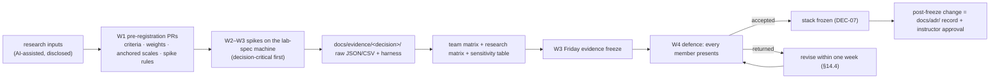

# Stack decisions (draft of STACK_DECISION.md)

| Field | Value |
|---|---|
| Title | Plotinium technology-stack decision records, in the §14.1 format, with the pre-registration procedure and the sensitivity-analysis template |
| Status | Draft v0.1, 2026-09-24 |
| Primary owner | R5 QA/DevOps & Integration (editor of `STACK_DECISION.md`). Each record is written, presented and defended by its owner: D1 R3; D2a, D2b R1; D3, D4 R5 with R2; D5, D6 R2; D7 R2 with R5; D8, D9, D10, D11 R4; D12, D14 R5; D13 R5 with R2 (auth moved to R5 by C15) |
| Secondary reviewer | Every record owner reviews every other record; R1 is the named second reviewer of this file |
| Must be demonstrable at | **W1:** pre-registration PRs merged (criteria, weights, anchored scales, spike pass rules) before any team measurement. **W3 (Friday):** evidence freeze; every pilot figure replaced by a lab-spec measurement or a cited benchmark, with sensitivity tables. **P1 defence (W4):** `STACK_DECISION.md` frozen and presented; any member defends any record (§14.4). **Each later gate:** reversal-trigger status reported. **W16:** "two decisions we would reverse" chosen with data for ARCHITECTURE.md |
| Requirement IDs covered | §14.1 (record structure), §14.2 (decisions that must be defended), §14.3 (standard of justification), §14.4 (defence session, stack freeze, changes after freeze), §4.3 (open stack, arbitrary choices penalised), §12.6 (model choice justified on quality, latency, cost, privacy, offline), §15.2 (`STACK_DECISION.md`), §16.1–§16.2 (Tech Stack Justification, 10%), §18 (AI-assistance disclosure); PLT-DOC-03, PLT-AI-01; Plotinium design IDs DEC-01 … DEC-10 |
| Related specs | [../00-product/requirements-traceability.md](../00-product/requirements-traceability.md) · [../01-architecture/architecture.md](../01-architecture/architecture.md) · [../01-architecture/syscall-abi.md](../01-architecture/syscall-abi.md) · [../02-boot/boot-and-services.md](../02-boot/boot-and-services.md) · [../03-kernel/processes-and-scheduling.md](../03-kernel/processes-and-scheduling.md) · [../03-kernel/memory-and-paging.md](../03-kernel/memory-and-paging.md) · [../04-vfs/virtual-file-system.md](../04-vfs/virtual-file-system.md) · [../05-wm/window-manager.md](../05-wm/window-manager.md) · [../05-wm/ui-design-system.md](../05-wm/ui-design-system.md) · [../06-sync/offline-and-sync.md](../06-sync/offline-and-sync.md) · [../07-shell/shell-and-terminal.md](../07-shell/shell-and-terminal.md) · [../08-dsa/data-structures.md](../08-dsa/data-structures.md) · [../09-database/database.md](../09-database/database.md) · [../10-ai/rag-semantic-search.md](../10-ai/rag-semantic-search.md) · [../10-ai/agentic-shell.md](../10-ai/agentic-shell.md) · [../10-ai/predictive-prefetch.md](../10-ai/predictive-prefetch.md) · [../10-ai/ai-safety-and-evaluation.md](../10-ai/ai-safety-and-evaluation.md) · [../11-server/backend-api.md](../11-server/backend-api.md) · [../12-security/security-model.md](../12-security/security-model.md) · [../13-quality/testing-and-performance.md](../13-quality/testing-and-performance.md) · [../14-devops/deployment-and-ci.md](../14-devops/deployment-and-ci.md) · [../16-delivery/implementation-plan.md](../16-delivery/implementation-plan.md) |

**Conventions used in this file.** RFC 2119 keywords as in the spec's Conventions section (p. 3). **Spec** marks an obligation from the capstone specification; **Plotinium design** marks our own binding choice. Every number that came from the AI-run prototype is labelled *(pilot figure — re-measure on the lab machine)*; such numbers are placeholders that MUST be replaced before the Week-4 defence (DEC-05). Vendor or third-party figures are labelled *(cited)* with their source. Versions are the npm/registry versions recorded by the research on 2026-09-23 and pinned exactly in `pnpm-workspace.yaml`.

**Where the scores come from.** The option sets, criteria, weights, scores and evidence below come from the AI-assisted research inputs (`docs/research/decisions/*.json`), with the examiner amendments, the coherence resolutions and the critic's fixes applied in that order of precedence; the result is the canonical stack C1–C18. Because those scores existed before the team's pre-registration, they are **not** the team's decision matrix. The team MUST re-commit its own criteria and weights in a pre-registration PR before re-measuring (§3.2), and the published `STACK_DECISION.md` shows the team's matrix, the research matrix and the sensitivity table side by side. This is disclosed in `AI_USAGE.md` and in `STACK_DECISION.md` (§18; critic).

---

## 1. Purpose and scope

**Spec (§14, §15.2).** "Write one decision record for each major decision, and keep them all in STACK_DECISION.md." Each record contains: (1) context and ranked constraints; (2) at least three genuine candidates, including one expected to lose; (3) criteria and weights declared before scoring; (4) evidence for each claim that affects the outcome (a prototype, a measurement or a cited benchmark; "opinions are not evidence"); (5) the decision and its consequences, including what was given up and the risks accepted with mitigations; (6) a reversal trigger. The technology-stack justification carries 10% of the marks directly (§16.1), and any member may be asked about any decision (§14.4).

This file is the working draft of `STACK_DECISION.md`. It fixes:

- the process: pre-registration, evidence rules, sensitivity analysis, freeze and post-freeze changes (§3.1–§3.4);
- one record per decision, D1–D14 (§3.5–§3.19), covering every row of spec §14.2 plus four decisions the team adds (D2b placement and IPC, D6 query layer and migrations, D13 auth and security, D14 test toolchain);
- the frozen stack at a glance (§3.20) and the running list of reversal candidates for ARCHITECTURE.md (§3.21).

Out of scope: the designs that implement each decision (the linked subsystem specs), the gate evidence (see [requirements-traceability.md](../00-product/requirements-traceability.md)) and the measurement harness (see [testing-and-performance.md](../13-quality/testing-and-performance.md)).

**Mapping to spec §14.2.**

| §14.2 decision | Record(s) | What the defence must address (spec) |
|---|---|---|
| UI framework | D1 | rendering cost of many windows; isolating updates so one window's change does not re-render others; bundle size against the boot budget |
| Kernel and DSA language | D2a (and D2b for placement/IPC) | raw performance against the cost of crossing the JS–WASM boundary; debugging; team skills |
| Backend runtime | D3 | concurrency model for thousands of long-lived WebSockets; library ecosystem; memory per connection |
| Real-time transport | D4 | two-way process and lock events; latency; idle cost; reconnection and message ordering |
| Primary database | D5 (and D6 for the query layer) | ACID guarantees for bulk tree operations; recursive queries; indexing; how permissions are modelled |
| Client storage | D7 | transactions against raw throughput; quota and eviction behaviour; use from workers |
| Vector store | D8 | scale and latency; keeping vectors next to metadata so permissions can be filtered |
| AI models | D9 (embedding), D10 (LLM), D11 (predictor) | quality, cost per request, latency, privacy, offline behaviour |
| Deployment | D12 | WebSocket support, cost, reproducibility, bring-up in a few commands |
| (added) | D13 auth and security, D14 test toolchain | – |

---

## 2. Requirements table

| ID | Summary | Spec § | How verified |
|---|---|---|---|
| §14.1 | Spec: MUST. Each record has the six parts: context and ranked constraints; ≥ 3 genuine candidates including an expected loser; criteria and weights declared before scoring; evidence per outcome-relevant claim; decision and consequences; reversal trigger | §14.1 | DEC-01, DEC-03 lint of `STACK_DECISION.md` |
| §14.2 | Spec: MUST. Every decision in the §14.2 table is defended | §14.2 | Mapping table in §1; PLT-DOC-03 review |
| §14.3 | Spec. The standard expected: quantified constraints, measured evidence from our own prototype, honest risks, a concrete reversal trigger | §14.3 | Rehearsal cross-examination; §3.3 evidence rules |
| §14.4 | Spec: MUST. 15 + 10 minute defence; every member presents; any member may be asked about any decision; stack frozen after acceptance; later change needs a new record and the instructor's approval | §14.4 | Rehearsals (W4); DEC-06, DEC-07 |
| §4.3 | Spec: MUST. Each major choice defended in writing against the WebOS constraints; "we already knew it" is a legitimate factor but never the whole justification | §4.3 | Team-skill weights ≤ 15 in every record (DEC-02 review) |
| §12.6 | Spec: MUST. Choice of model justified on quality, latency, cost, privacy and offline behaviour | §12.6 | D9, D10 criteria; PLT-AI-01 |
| §18 | Spec: MUST. AI assistance disclosed; submitted work defensible in the viva | §18 | DEC-08; `AI_USAGE.md` entry for the research inputs |
| PLT-DOC-03 | `STACK_DECISION.md` holds the records of §14 and discloses the AI-assisted research inputs | §15.2 | Doc review at P1 |
| PLT-AI-01 | `STACK_DECISION.md` has an embedding-model and an LLM record with all five §12.6 criteria scored | §12.6 | `PLT-AI-01` lint test |
| DEC-01 | Plotinium design. Every record uses the template of §4.1, in the order of §14.1 | §14.1 | Lint |
| DEC-02 | Plotinium design (critic). Criteria, weights (summing to 100), anchored scales and spike pass rules are committed in a pre-registration PR before any team evidence for that record is committed | §14.1 item 3 | Git-timestamp check (§5.4) |
| DEC-03 | Plotinium design. Each record scores ≥ 3 options and names the expected loser; an option excluded by a hard constraint before scoring is listed as "screened out" with the reason and does not count toward the three | §14.1 item 2 | Lint |
| DEC-04 | Plotinium design (examiner reviews). Each record carries the sensitivity table of §4.3; a record whose rank-reversal distance is below 10 weight points is labelled **fragile** and names the decision-critical spike | §14.1 item 3 | Lint + review |
| DEC-05 | Plotinium design. Pilot figures are labelled and replaced by lab-spec measurements or cited benchmarks before the W4 freeze; every gate-critical figure cites a committed evidence file | §14.1 item 4, spec p3 | Lint of labels; evidence paths exist |
| DEC-06 | Plotinium design. Every member presents at least one record and answers questions on any record in two rehearsals before W4 | §14.4 | Rehearsal log |
| DEC-07 | Plotinium design. After acceptance at W4, a change to a frozen choice (major version, component or reversal) needs a new record in `docs/adr/` and the instructor's written approval | §14.4 | ADR index; PR checklist |
| DEC-08 | Plotinium design (critic). `STACK_DECISION.md` and `AI_USAGE.md` disclose that the first research round, the examiner reviews and the pilots were AI-assisted, what was accepted, rejected and why | §18 | Doc review |
| DEC-09 | Plotinium design. Every reversal trigger names a measurable signal (a `budgets.json` entry, a monitored metric or a dated event) and an owner who checks it at each gate | §14.1 item 6 | §3.22 trigger table; gate checklist |
| DEC-10 | Plotinium design. Every record cites the requirement IDs it serves | p3 Conventions | Lint |

---

## 3. Design (normative)

### 3.1 How `STACK_DECISION.md` is produced



**Plotinium design.** The owner of each record drafts it from this spec, runs its spike, fills the team matrix and presents it. R5 edits `STACK_DECISION.md` into one document with a table of contents, the frozen-stack table (§3.20) and the disclosure paragraph (DEC-08). Evidence files live in `docs/evidence/<decision>/` with their harness; pilot evidence stays in `docs/evidence/pilot/` and is never cited as the team's own (C16).

### 3.2 Pre-registration procedure (DEC-02)

**Spec (§14.1 item 3):** "A weighted decision matrix whose criteria are not reverse-engineered from the winner." **Plotinium design (critic):**

1. **Branch and file.** For each record the owner opens a PR `prereg/<Dn>` adding `docs/decisions/prereg/<Dn>.md` (format in §4.2). It contains: the ranked constraints with the spec clause behind each; the options, including the expected loser; the criteria, each with a one-line justification traced to a spec clause; the weights, summing to 100, with no criterion for team familiarity above 15 (§4.3); the **anchored scale** for every criterion (what a 1, 3 and 5 mean in measurable terms, for example "5 = uses under 25% of the budget"); the spike protocol (machine, Chrome channel, sample size, interleaving, pass rules); and the planned sensitivity checks.
2. **Independence from the research scores.** The research matrices were visible before pre-registration, so each weight MUST be justified from the spec's constraints and rubric (for example "WM-03 and PROC-05 are Must requirements and OS & Process Engineering is 25% of the marks"), not from the research weights. Where the team's weights equal the research weights, the PR says so and gives the independent reason. Both matrices are published.
3. **Review.** Two approvals: the record owner's secondary reviewer and one other member. Neither may be the author.
4. **Merge before evidence.** The PR is merged before the first commit that adds a file under `docs/evidence/<decision>/`. The CI check of §5.4 compares the merge timestamp with the earliest evidence commit and fails the `lint` job if the order is wrong.
5. **Calendar.** All pre-registration PRs merge by Friday of Week 1 ([implementation-plan.md](../16-delivery/implementation-plan.md)).
6. **Changes after pre-registration.** A criterion or weight may change only in a new PR that states the reason, is merged before the evidence it would affect, and is listed in the record's "pre-registration history". Changing a weight after seeing a result is allowed only if the record shows the result under both the old and the new weights.
7. **Spike scope (critic).** Weeks 1–3 cannot hold every spike. Decision-critical spikes run on the lab machine: S0 (capability probe), S1b (Solid skills kata), the core of S4 (Q1–Q5, fault injection, DB-03 torture), S5 M1/M2 (swap device, atomic bulk ops), S6 (embedding bake-off and eval), a reduced S7 (LLM bake-off). Confirmatory records use cited benchmarks, which §14.1 item 4 explicitly allows, and say so.

### 3.3 Evidence rules (DEC-05)

**Plotinium design** (spikes strategy; testing spec):
- **Machine.** The Week-2 published lab-spec machine in current stable Chrome (spec p3), channel `chrome`, version logged. Storage measurements use a disk-backed profile (`launchPersistentContext`), never Playwright's in-memory `newContext()` (the research's client-storage figures were taken in memory and are invalid on disk; D7).
- **Sampling.** Interleave variants; discard warm-up; n ≥ 1,000 samples for latency percentiles (n ≥ 100 for heavy operations); report p50, p95, p99 (nearest rank); record machine load; add a 4× CDP CPU-throttle run where relevant (never for the frame gate).
- **Files.** Raw JSON or CSV plus the harness (`pnpm bench:<x>`) and a results table in `docs/evidence/<decision>/`; EXPLAIN plans for database claims.
- **The loser is measured.** Each record measures at least one option the team expects to lose, so the comparison is the team's own.
- **Cited evidence.** A cited benchmark names its source, date, and whether it is a vendor benchmark; it is used only for confirmatory claims.
- **Labels.** Until replaced, every pilot number keeps the label *(pilot figure — re-measure on the lab machine)*. The W3 evidence freeze replaces all of them in the records that decide the stack.

### 3.4 Freeze and changes after the freeze (DEC-07)

**Spec (§14.4):** "The stack is then frozen; changing it later needs a new decision record and the instructor's approval." **Plotinium design:** frozen means the component and its major version, and every decision stated in a record. Patch updates of pinned dependencies are allowed through normal PRs; minor updates are merged by hand after reading the release notes; major updates, component swaps and reversals need `docs/adr/NNNN-<slug>.md` in this template plus the instructor's written approval, recorded in the ADR. Two changes are pre-declared in the records so that they are not post-freeze surprises: the move to Node 26 LTS before v0.2.0 (D3; needs the instructor's pre-approval at the defence) and the named fallbacks of the decision-critical spikes (D1 → React, D4 → SSE+POST adapter, D7 swap device, D9 → bge-small, D10 → bake-off winner and warm standby).

---

### 3.5 D1 — UI framework (with styling, terminal renderer and editor)

**Owner** R3 · **reviewer** R1 · **status** provisional until the S1b skills spike (W2) · **serves** WM-01…WM-07, BOOT-01, BOOT-05, BOOT-06, BOOT-08, BOOT-10, BOOT-13, PROC-05, PROC-08, SYS-02, SYS-03, OFF-01

**1. Context and ranked constraints**
1. Main-thread frame budget and update isolation: WM-03 and PROC-05 (p95 frame ≤ 16.7 ms with 10 windows, with and without a CPU-bound workload; no OS long task over 50 ms); Fig. 8.1's ≤ 4 ms of kernel work per frame; §14.2 asks that one window's change does not re-render others.
2. Boot budget BOOT-10 (warm ≤ 1.5 s, cold ≤ 3.0 s on the lab machine); framework bytes and parse time are on the critical path; BOOT-02 truthful progress and BOOT-13 accessible boot screen.
3. The compositor is the only writer of window geometry (WM-01) and uses pointer capture plus `translate3d` batched per animation frame; OS state lives in workers and reaches views as event streams.
4. Team skills and defensibility: five students who know JS/TS and some React; every member is examined on the whole system.
5. Accessibility and app breadth: WCAG 2.2 AA (WM-07), BOOT-13; five built-in apps that work offline (OFF-01).
6. Stability over the frozen window; licence and attribution (§18).
7. Testability (coverage, performance budgets that fail the build).
8. Cost: free and open source.

**2. Options**

| Option | Version (2026-09-23) | Note |
|---|---|---|
| **SolidJS 1.9** (chosen, provisional) | solid-js 1.9.15; vite-plugin-solid 2.11.14 | fine-grained signals, components run once; 2.0 is at RC with breaking changes, so 1.9 is pinned |
| React 19.3 + React Compiler 1.0 (named fallback) | react 19.3.0; babel-plugin-react-compiler 1.0.0 | largest ecosystem and team familiarity; per-window `useSyncExternalStore` stores for isolation |
| Preact 10 + @preact/signals | preact 10.29.8; @preact/signals 2.11.2 | React-like API at a fraction of the size |
| Svelte 5 (runes) | svelte 5.57.1 | stable, compile-time a11y warnings |
| Vue 3.5 (Vapor in 3.6 RC) | vue 3.5.43; 3.6.0-rc.9 | Vapor recommended only for partial use while in RC |
| Lit 3 / Web Components (**expected loser**) | lit 3.3.3 | weakest team fit and app-level component ecosystem |

**3. Criteria and weights** (research; the team MUST re-commit its own weights in `prereg/D1` before re-measuring)

| Criterion | Weight | Why |
|---|---|---|
| C1 Update isolation and main-thread cost per update | 25 | §14.2 names isolation; WM-03/PROC-05 are Musts; OS & Process is 25% of the marks |
| C2 Boot-path cost (framework bytes, parse/eval) | 20 | BOOT-10; §14.2 names bundle size against the boot budget |
| C3 Fit with an imperative compositor and kernel-owned state | 10 | WM-01; state arrives from workers |
| C4 Team familiarity and defensibility | 15 | 18 weeks; every member examined (capped per §4.3) |
| C5 Ecosystem and accessibility for built-in apps | 15 | WM-07, BOOT-13, five apps |
| C6 Stability over the frozen window | 10 | stack frozen at W4 |
| C7 Testability and tooling | 5 | coverage and budgets in CI |

**4. Scores (research; 1–5 per criterion, total on 0–100)**

| Option | C1 | C2 | C3 | C4 | C5 | C6 | C7 | Total | Budget-anchored total (examiner) |
|---|---|---|---|---|---|---|---|---|---|
| SolidJS 1.9 | 5 | 5 | 5 | 3 | 3 | 3 | 4 | **83** | 83 |
| Preact 10 + Signals | 4 | 5 | 4 | 4 | 3 | 4 | 4 | 81 | 86 |
| React 19.3 + Compiler | 3 | 3 | 4 | 5 | 5 | 5 | 5 | 80 | **89** |
| Svelte 5 | 4 | 4 | 4 | 3 | 4 | 5 | 4 | 79 | 88 |
| Vue 3.5 / Vapor | 4 | 4 | 4 | 3 | 4 | 4 | 4 | 77 | 86 |
| Lit 3 | 5 | 5 | 4 | 2 | 2 | 4 | 3 | 76 | – |

Sensitivity (research and examiner): moving 5 weight points from C1 to C4 makes React win 82 to 81; scoring C1/C2 as the share of budget used ("5 = under 25% of budget") ranks React first. The top three are within the resolution of a 1–5 scale. **This record is fragile (DEC-04); the S1b skills spike decides.**

**5. Evidence**
- Same 10-window desktop (150 rows each, one shared compositor), Vite 8.3: boot-chunk JS gzip vanilla 1.5 KB, Solid 7.3, Lit 8.2, Preact 9.2, Svelte 14.7, Vue Vapor 19.5, Vue 24.8, React + Compiler 69.3 KB *(pilot figure — re-measure on the lab machine)*.
- Cold/warm P50 to `desktop-interactive` (10 Mbps/40 ms, 4× throttle): Solid 252/195 ms, React + Compiler 364/204 ms *(pilot figure — re-measure on the lab machine)*.
- Script time per one-window update (10×150 | 20×400): Solid 0.04 | 0.02 ms; React with per-window stores 0.70 | 0.73 ms, zero sibling re-renders in both. Full main-thread task time differs by less than 2× (Solid 1.57 | 1.59 ms, React 2.84 | 3.46 ms) and sits inside harness noise; both metrics are reported *(pilot figure — re-measure on the lab machine)*.
- With the compositor writing `translate3d` directly, every variant held the frame target with 2.7–4.2 ms of main-thread work per frame; under 10 busy workers even vanilla JS reached 33–50 ms p95, so under PROC-05 the lever is worker scheduling, not the framework *(pilot figure — re-measure on the lab machine)*.
- js-framework-benchmark, Chrome 150: Solid 1.11 vs React 19.2 hooks 1.80 (geometric mean against vanilla) *(cited: krausest.github.io, 2026)*.
- **Team spikes that replace these:** S1 (same-workload benchmark on the lab machine, 15 interleaved runs, frame metric of [testing-and-performance.md §3.11.3](../13-quality/testing-and-performance.md)) and **S1b**: every member builds the Task-Manager kata (256 rows at 10 Hz over a MessageChannel, sortable, kill/renice, keyboard-complete) in Solid with their normal AI-assistant workflow, against a React baseline.

**6. Decision and consequences.** SolidJS 1.9.15, pinned exactly, for the desktop shell, window chrome, login and app views, **provisional**: keep Solid only if (a) at least 4 of 5 members finish the kata within 1.5× their React time, (b) code review finds at most 3 reactivity bugs per member that lint missed, and (c) on the lab machine the kata plus 10 windows keeps UI script ≤ 1 ms per frame; otherwise switch to React 19.3 + Compiler 1.0 with per-window stores before the W4 freeze. Layering rules (C11): `wm/compositor.ts` is framework-free and the sole writer of geometry and z-index; the boot-ui (boot screen, boot menu, panic, recovery console) is framework-free and inlined, so recovery works if the Solid chunk fails; kernel events arrive as at most one batch per frame. Build: Vite 8.3.0 with vite-plugin-solid 2.11.14 (Babel 7 through babel-preset-solid; no root Babel 8). Lint: eslint-plugin-solid 0.18.0 with `solid/reactivity`, `solid/no-destructure` and `solid/components-return-once` at error and `--max-warnings 0`. Frame gate: C13 (trace frame durations, not "refresh + 1 ms"; the UI examiner's metric is superseded by the critic). **Given up:** React's ecosystem (React Aria, Radix) and the team's React habits; being on Solid's newest major; one declarative model for geometry (the compositor–view contract is explicit instead).

**Sub-decision D1.a — styling.** Native CSS: one `tokens.css` (custom properties, `light-dark()`, `data-theme`, reduced-motion tokens) plus CSS Modules and `@layer`; system font stacks; lucide-solid 1.47.0 icons; team-made SVG identity. Options: native CSS (chosen), Tailwind 4.3 (its `@theme` tokens are CSS variables, so adoption later is cheap), CSS-in-JS such as styled-components (**expected loser**: runtime cost on the main thread, and the boot screen must be styled before any JS runs). Deciding facts: zero runtime cost; the inlined boot screen uses the same tokens; no cross-origin fonts, which keeps COEP `require-corp` simple (C10). No numeric sub-matrix exists in the research; the team scores it in `prereg/D1` with the criteria boot-path cost, runtime cost, token sharing with the boot-ui, and team familiarity.

**Sub-decision D1.b — terminal renderer** (critic: at least three candidates).

| Option | Facts | Verdict |
|---|---|---|
| **xterm.js 6.0** as the TTY device only (DOM renderer, addon-fit 0.11.0; addon-webgl 0.19.0 only if the throughput test fails) | 82 KB gz, 113 KB with webgl + fit; 3.65 MB heap at 5,000 lines of scrollback *(pilot figure — re-measure on the lab machine)*; `screenReaderMode`; cursor addressing and alternate screen for `top` | chosen; the line discipline, lexer/parser, pipes and trie completion are ours (C11) |
| Hand-rolled DOM terminal | smallest; but `top` and full-screen tools need cursor addressing and the alternate screen, and a11y would be ours to build | runner-up for size only |
| hterm (ChromiumOS libapps) | mature VT emulator; distributed from the libapps repository rather than a maintained npm package, so pinning and bundling are ours | third candidate, scored in `prereg/D1` |
| Own canvas renderer (**expected loser**) | fast paint, but no DOM for screen readers (WM-07) and a large build effort | rejected |

Spike (W3): keystroke-to-echo p95 < 16 ms, `yes | head -n 100000` without LoAF > 50 ms, SYS-03 trie p95 ≤ 1 ms at 10^4 entries.

**Sub-decision D1.c — editor.** CodeMirror 6 (view 6.43.13, state 6.7.6, commands 6.11.1, language 6.12.4, lang-markdown 6.5.2, lang-javascript 6.2.5), lazy-loaded; saves carry `expectedVersion` so a conflict becomes a conflicted copy (VFS-10). Options: CodeMirror 6 — 87–203 KB gz, 3.86 MB heap with a 5,000-line document, about 150 ms load; Monaco 0.56 — 754 KB gz core, 8.0 MB heap, about 790 ms load, its own workers; bare `<textarea>` (**expected loser**: no highlighting, weak undo and large-file behaviour) *(all pilot figures — re-measure on the lab machine)*. Spike: open a 1 MB file in both CodeMirror and Monaco core; time to first edit, heap, gz bytes.

**7. Risks and mitigations**

| Risk | Mitigation |
|---|---|
| Solid reactivity pitfalls (destructured props, reads outside tracking scopes, early returns) cause silent missed updates; AI assistants produce React idioms | Solid rules at error with `--max-warnings 0`; S1b kata with peer review; prompts state "Solid 1.9, no 2.0 APIs"; rejected suggestions logged in AI_USAGE.md |
| Solid 2.0 goes stable and libraries drop 1.x | exact pins; Solid-specific libraries limited to lucide-solid (and Ark UI only if the a11y spike needs it); xterm and CodeMirror are framework-agnostic |
| Smaller accessible-primitives ecosystem | WAI-ARIA APG patterns built by hand; axe in both themes on every screen (zero serious or critical) |
| Framework and compositor both write geometry | lint ban on style bindings for transform/left/top/width/height/z-index; compositor unit tests |
| Lazy chunks inflate boot or break offline | xterm and CodeMirror never in the boot chunk; bundle-budget gate (≤ 60 KB gzip boot-critical JS) |
| Only one member can explain Solid | every member completes the kata and owns one app view |

**8. Reversal triggers.** Before W4: the S1b rule above. After the freeze: a lab-machine trace attributes more than 2 ms per frame to the Solid runtime in the WM-03 or PROC-05 test; the boot-critical chunk cannot stay under 60 KB gzip because of the framework; a Solid 1.9 defect blocks a Must requirement with no patch or workaround within 2 weeks; a dependency we rely on drops 1.x support in a way that blocks a Must.

---

### 3.6 D2a — Kernel and DSA language

**Owner** R1 · **reviewer** R5 · **serves** PROC-01…PROC-09, MEM-01…MEM-08, SYS-01, SYS-03, §10 (DSA), BOOT-03

**1. Context and ranked constraints** (examiner: the language record is separated from placement)
1. Hand-written DSA with provable complexity (§10): heap, trie, tree, DAG with Kahn's algorithm, LRU, each under `dsa/` with tests and a micro-benchmark; SYS-03 p95 ≤ 1 ms at ≥ 10^4 entries; PROC-02 O(log n); MEM-02 O(1).
2. Testability: ≥ 85% coverage on `dsa/`, `kernel/`, `vfs/` reported on every PR.
3. Debuggability and viva defensibility: every member explains the kernel.
4. Team skills and 18-week delivery risk (Phase 2 at W7).
5. Raw performance against the cost of crossing the JS–WASM boundary (§14.2).
6. Boot budget: bundle and instantiate cost on the critical path (BOOT-10).
7. Memory per structure within the 256 MB budget (MEM-01, MEM-06).

**2. Options**

| Option | Version | Note |
|---|---|---|
| **Strict TypeScript** (chosen) | TypeScript 7.0.2 (type-check gate) with the 6.0 API for tooling (C14) | large structures as struct-of-arrays typed arrays |
| Rust → WASM (wasm-bindgen) | wasm-bindgen 0.2.128; wasm-pack 0.15.0 | fastest numeric code; a second toolchain and coverage story; no member assumed to know Rust |
| AssemblyScript | 0.28.20 (pre-1.0) | TS-like syntax with different semantics and its own runtime |
| Go → WASM (**expected loser**) | measured with gc 1.22 + `syscall/js`; current go1.27.1, TinyGo 0.42.0 | examiner: the option must be named "Go (gc, syscall/js)" or re-measured with TinyGo 0.42 / Go 1.27 |

**3. Criteria and weights.** The research scored one 8-criterion matrix for language and placement together (C1 main-thread responsiveness 20, C2 fine-grained op performance incl. JS↔WASM cost 10, C3 testability and coverage 15, C4 debuggability and viva defensibility 15, C5 team skills and delivery risk 15, C6 platform capability fit 10, C7 boot budget 10, C8 multi-tab consistency 5). For the language record the placement-only criteria (C1, C6, C8) do not discriminate, so the language-relevant subset is C2 10, C3 15, C4 15, C5 15, C7 10 (renormalised over 65). The team MUST re-commit its own D2a weights in `prereg/D2a` before re-measuring.

**4. Scores (research; 1–5)**

| Option | C2 | C3 | C4 | C5 | C7 | Language subset (derived) | Full 8-criterion total (research) | Equal weights (examiner) |
|---|---|---|---|---|---|---|---|---|
| TypeScript (in a kernel worker) | 4 | 5 | 4 | 5 | 5 | **4.62** | **4.70** | 4.63 |
| AssemblyScript | 4 | 2 | 2 | 3 | 4 | 2.85 | 3.45 | 3.50 |
| Rust → WASM | 5 | 2 | 2 | 1 | 4 | 2.54 | 3.25 | 3.38 |
| Go → WASM | 1 | 2 | 2 | 1 | 1 | 1.46 | 2.05 | 2.13 |

The subset column is derived arithmetic on the research scores, not new scoring. Sensitivity (examiner): Rust beats TypeScript only under a pure-performance weighting (C1 30 / C2 50 / C7 20: 4.8 vs 4.5).

**5. Evidence**
- Binary heap pop+push pair, n = 256 … 10^5: idiomatic TS object heap 570–1,453 ns; struct-of-arrays TS heap 92–198 ns; hand-written WAT heap 65–128 ns; empty JS→WASM call 4.4–5.2 ns *(pilot figure — re-measure on the lab machine)*.
- Trie `complete(prefix, 20)`: p95 30–50 µs, flat from 10^3 to 10^5; marshalling the prefix and 20 results through WASM memory alone costs 5–15 µs p95 *(pilot figure — re-measure on the lab machine)*.
- Memory (examiner): a Map-per-node trie uses 225 bytes per node, 492.7 MB at 10^5 path entries; a struct-of-arrays TS trie holds the same in 24 MB used with completion p95 34 µs *(pilot figure — re-measure on the lab machine)*. The fix stays in TypeScript.
- Go (gc 1.22, `syscall/js`): 1.56 MB WASM (456 KB gzip), 130–208 ms instantiate, 20–26 µs per JS→Go call *(pilot figure — re-measure on the lab machine)*; not representative of TinyGo 0.42.
- PidTable (open addressing, Fibonacci hashing, backward-shift delete): 61–397 ns/op vs Map 142–975 ns/op, 200,000-op differential test passed *(pilot figure — re-measure on the lab machine)*.
- TypeScript 7.0 GA on 2026-07-08 without a stable programmatic API until 7.1; typescript-eslint 8.70.1 needs TypeScript < 6.1 *(cited: InfoQ, npm)*.
- **Team spike that replaces these:** S2 M2 and M3 (heap, trie, LRU, PidTable in idiomatic TS, struct-of-arrays TS and a WASM heap at n = 256…10^5, ns/op and bytes/entry) on the lab machine.

**6. Decision and consequences.** The kernel and all of `dsa/` are strict TypeScript. Large structures (trie, LRU list, ready heap, page tables) use struct-of-arrays typed arrays written from first principles; every `dsa/` benchmark reports bytes per entry next to ns per op. Tooling per C14: `typescript` = `npm:@typescript/typescript6@6.0.2` (API for typescript-eslint and editors), `@typescript/native` = `npm:typescript@7.0.2` as the type-check gate; `tsconfig` avoids options removed in 7.0. The DSA are written by their owners (C16); pilot code under `docs/evidence/pilot` is never imported. **Given up:** WASM's 5–10× faster numeric kernels in isolation, and Rust's memory-safety story.

**7. Risks and mitigations**

| Risk | Mitigation |
|---|---|
| Two type-checkers disagree (TS 7 gate, TS 6 API for lint) | TS 7 is the single gate; a weekly job also runs TS 6; divergence for more than a week pins everything to 6.0 by ADR |
| A structure misses its time or memory budget in TS | struct-of-arrays rewrite first; then the reversal trigger |
| Micro-benchmark noise (5 µs timer resolution, frequency scaling) | batch timing; n ≥ 1,000; lab machine |

**8. Reversal triggers.** After a struct-of-arrays rewrite, a `dsa/` structure still misses its budget (trie completion p95 > 1 ms at 10^5; heap push/pop p95 > 5 µs at 10^5; LRU touch/evict p95 > 5 µs at 10^5) or exceeds 32 MB at 10^5 entries: port that one module to Rust → WASM behind the same interface (with cargo-llvm-cov in CI). If two or more members are already fluent in Rust, the same single-module rule applies.

---

### 3.7 D2b — Kernel placement, threads and IPC

**Owner** R1 · **reviewer** R5 · **serves** boundary 1 and 2 (§8), SYS-01, PROC-05, PROC-07, PROC-09, WM-03, MEM-01, MEM-05, OFF-01, OFF-02, AGT-01, AGT-02, AGT-08

**1. Context and ranked constraints**
1. Main-thread responsiveness (boundary 2, PROC-05, WM-03): the main thread only renders and dispatches; ≤ 4 ms of OS work per frame.
2. Typed syscall boundary (boundary 1, SYS-01, AGT-01): `{id, call, args}` → `{id, ok, value | errno}`; permissions checked on every call; identity never from the message.
3. Platform capabilities: OPFS sync access handles (swap, MEM-05), nested workers the kernel owns and terminates (PROC-05), SharedArrayBuffer for pre-emption, cross-origin isolation for `measureUserAgentSpecificMemory` (MEM-01).
4. Robustness: runaway processes are terminated and respawned; kill frees descriptors and locks (PROC-07); ≥ 256 processes (PROC-09).
5. One local writer of the shared stores (OFF-01, OFF-02).
6. Debuggability and boot cost.

**2. Options**

| Option | Note |
|---|---|
| **Dedicated kernel worker owning nested executor workers** (chosen) | kernel core transport-agnostic; host adapters for worker, main thread and a Node loopback |
| Kernel on the main thread (the spec's reference layout; runner-up) | simplest debugging; queues behind rendering |
| Kernel in a SharedWorker (**expected loser**) | one kernel for all tabs; measured without a Worker constructor, sync handles or isolation |

IPC sub-options: hand-written envelope with Valibot schemas (chosen); Comlink (hides the envelope the spec requires the kernel to validate and audit; last release 2024-11-07); Zod 4; TypeBox; ArkType.

**3. Criteria and weights** (research subset for placement: C1 main-thread responsiveness 20, C4 debuggability 15, C6 platform capability fit 10, C7 boot budget 10, C8 multi-tab consistency and fault containment 5; renormalised over 60). The team MUST re-commit its own D2b weights in `prereg/D2b` before re-measuring.

**4. Scores (research; 1–5)**

| Option | C1 | C4 | C6 | C7 | C8 | Placement subset (derived) | Full total (research) |
|---|---|---|---|---|---|---|---|
| Dedicated kernel worker | 5 | 4 | 5 | 5 | 4 | **4.67** | **4.70** |
| Main-thread kernel | 2 | 5 | 2 | 5 | 3 | 3.33 | 3.75 |
| SharedWorker kernel | 4 | 2 | 1 | 5 | 5 | 3.25 | 3.10 |

Examiner caveats: B's C6 = 2 partly assumes swap I/O could not move to a worker; A's C7 = 5 ignores the worker spawn on the boot path. Neither changes the ranking.

IPC schema libraries (pilot, 8-variant syscall union, esbuild minify + gzip, Node 24): Valibot 1.5.0 2,535 B, 925 ns valid / 1,510 ns invalid, no `Function` constructor; zod 4.6.5 27,200 B, 398 ns with JIT but 3,700 ns jitless (required under a no-eval CSP); zod/mini 7,832 B, 981 ns; ArkType 2.2.3 47,266 B, 64 ns valid / 5,051 ns invalid, builds validators with `new Function`; TypeBox 1.3.34 Compile 42,063 B, 32 ns (`new Function`), `Value.Check` 18.5 µs *(pilot figure — re-measure on the lab machine)*.

**5. Evidence**
- `stat` round trip, open loop: main-thread kernel idle p95 180–350 µs, rising to p95 9.3–9.5 ms while the UI does 10 ms of work per frame; worker kernel p95 125–165 µs under the same load *(pilot figure — re-measure on the lab machine)*. The 10 ms/frame load is synthetic; the M1 spike uses a real 10-window drag.
- A du-style walk over a 100,000-node tree took p95 7.0–14.8 ms, above the 4 ms per-frame allowance *(pilot figure — re-measure on the lab machine)*.
- Nested worker ready p50 6.0–7.7 ms, p95 8.5–22 ms; `terminate()` of a spinning worker returns in about 0.01 ms *(pilot figure — re-measure on the lab machine)*.
- OPFS sync-handle 5 MB page-in with SHA-256 verification p95 35–56 ms (MEM-05 limit 300 ms) *(pilot figure — re-measure on the lab machine)*.
- SharedWorker in Chrome 153 with COOP/COEP: no Worker constructor, no `createSyncAccessHandle`, `crossOriginIsolated` false *(pilot figure — re-measure on the lab machine)*.
- SAB control word: Atomics ping-pong 8.0–9.4 µs round trip; a pre-emption check at a yield point about 8 ns; 5 MB transfer 0.05 ms p50 vs structured clone 6.9–9.3 ms *(pilot figure — re-measure on the lab machine)*.
- `persist()`, Service Worker registration and `measureUserAgentSpecificMemory()` are not available in dedicated workers (examiner, MDN) *(cited)*.
- **Team spikes:** S0 capability probe (stable and beta; `http://localhost` vs LAN IP) and S2 M1, M4–M7 on the lab machine.

**6. Decision and consequences** (C2, C3). The kernel runs in **one** dedicated module worker (`kernel.worker.ts`); exactly one kernel per origin (Web Lock `plotinium:kernel` plus a fencing epoch in IndexedDB `meta`; a second tab shows a takeover screen). Processes run on nested executor workers; isolation is separated from concurrency: executors can be dedicated per uid or to the agent, while a run-token semaphore limits concurrently running slices to `clamp(hwc − 2 − (embedActive ? ortThreads : 0), 1, 6)` (critic: the earlier `clamp(hwc − 2, 2, 8)` pool could not satisfy placement on 4-thread machines). The only other special workers are `blkio` (OPFS swap) and `ai.embed`; `syncd` and `lockd` are kernel services with pids. The main thread renders and dispatches only (compositor, boot-ui, kernel-link router making the Window-only calls, frame meter) within 4 ms of OS script per frame, and shadows `window.indexedDB`, `caches`, `navigator.storage.getDirectory` and `Worker` before any app view chunk loads. IPC: the envelope of C3, identity from the port, dispatcher order ESRCH > ENOSYS > EINVAL > capability > rwx > audit > handler, Valibot as the only schema library, `@valibot/to-json-schema` server-side only for strict LLM tool schemas. Cross-origin isolation: COOP same-origin, COEP **require-corp**, CORP same-origin with every asset self-hosted (C10; the kernel record's `credentialless` is superseded by coherence). **Given up:** single-threaded simplicity (window syscalls take two hops and the kernel mirrors window ownership); a multi-tab kernel; Comlink's convenience; memory isolation between processes that share an executor (placement rules compensate).

**7. Risks and mitigations**

| Risk | Mitigation |
|---|---|
| Compositor and kernel ownership mirror diverge | single-authority rule; sequence numbers on every message; model-based test of random spawn/kill/close/focus |
| Isolation lost offline or on a proxy | Service Worker stores full Responses; e2e asserts `crossOriginIsolated` online and offline; without isolation, pre-emption falls back to messages and bootlog says so |
| `terminate()` kills co-resident processes | placement by uid and agent/user; a process that overruns twice gets its own executor; collateral victims exit 137 with reason `collateral` |
| Kernel worker becomes a bottleneck | heavy commands run in executors; bulk ops are two-phase (pre-emptible plan, single non-pre-emptible IndexedDB transaction); busy fraction shown in `top` |
| Generator model misused (loops without yield) | ESLint `no-yieldless-loop-in-generator`; watchdog |
| New Chrome stable regresses nested workers, SAB or sync handles | nightly capability probe on stable and beta |

**8. Reversal triggers.** (1) Under PROC-05 stress, kernel-worker syscall RTT p95 > 2 ms, or the kernel worker is busy > 50% of any 1 s window at 256 processes: split VFS and sync into a second worker, then consider the main-thread layout. (3) Window syscall round trips exceed p95 16.7 ms or the ownership mirror diverges irreparably: move window ownership into a main-thread shim. (4) Cross-origin isolation cannot be kept on the production host or offline: drop the SAB control block. (5) Syscall-heavy tools spend > 50% of their time in the IPC hop even with batched calls: add a SAB ring-buffer fast path for `stat`/`readdir`. (7) A Chrome stable removes or regresses nested workers, SAB in workers or sync access handles. (8) Two-phase bulk operations cannot pass fault injection with one IndexedDB transaction: reopen together with D7.

---

### 3.8 D3 — Backend runtime and HTTP/WebSocket framework

**Owner** R5 with R2 · **reviewer** R1 · **serves** VFS-09, VFS-10, OFF-02, OFF-03, AGT-09, §12.6, §14.2 (backend runtime)

**1. Context and ranked constraints**
1. Multi-user consistency with the server as the authority: locks, quotas, op-log replay, one transaction per operation with retry, broadcast only after commit.
2. Team delivery and defence (JS/TS team; every member examined).
3. One source of truth for protocol types shared with the browser kernel (syscall ABI, errno, WebSocket messages, AI tool schemas; AGT-01); shared `vfs/perm.ts`.
4. Real-time capacity: thousands of long-lived WebSockets, about 20 events/s per client in bursts (§14.3); memory per connection (§14.2).
5. Library coverage: PostgreSQL with explicit transactions and pgvector; streaming blobs and swap; Argon2id; an official LLM SDK; cookie sessions.
6. Testing and observability (coverage on every PR; integration tests against real PostgreSQL).
7. Deployment footprint and a three-command bring-up.

**2. Options**

| Option | Version |
|---|---|
| **Node.js 24 LTS + Fastify 5 + @fastify/websocket (ws)** (chosen) | node 24.21.0; fastify 5.12.5; @fastify/websocket 11.3.1; ws 8.21.3 |
| Node.js 24 + Hono 4 | hono 4.13.8; @hono/node-ws 1.3.1 |
| Bun 1.4 + Bun.serve (runner-up) | bun 1.4.2 (first release after a Zig-to-Rust rewrite; no support policy) |
| Deno 2.9 LTS + Hono | deno 2.9.7 (LTS to 2027-01-31) |
| Go 1.27 + coder/websocket + pgx | go1.27.1 |
| Rust + Axum 0.8 | axum 0.8.9; no official Anthropic Rust SDK |
| Python 3.14 + FastAPI (**expected loser**) | fastapi 0.141.1; no shared types with the TS client |

**3. Criteria and weights** (research; the team MUST re-commit its own weights in `prereg/D3` before re-measuring)

| Criterion | Weight |
|---|---|
| C1 Team skill and viva defensibility | 15 |
| C2 Shared types and code with the TS kernel | 15 |
| C3 Library ecosystem for the required components | 15 |
| C4 WebSocket concurrency model and memory per connection (examiner: split into a measured memory criterion and a concurrency criterion at pre-registration) | 15 |
| C5 Maturity, support window, compatibility risk | 15 |
| C6 Testing and observability tooling | 10 |
| C7 Raw throughput and latency headroom | 10 |
| C8 Deployment footprint | 5 |

**4. Scores (research; 1–5, total on 0–100)**

| Option | C1 | C2 | C3 | C4 | C5 | C6 | C7 | C8 | Total |
|---|---|---|---|---|---|---|---|---|---|
| Node 24 + Fastify 5 | 5 | 5 | 5 | 4 | 5 | 5 | 3 | 3 | **91** |
| Node 24 + Hono 4 | 5 | 5 | 4 | 4 | 4 | 4 | 3 | 3 | 83 |
| Bun 1.4 | 4 | 5 | 4 | 5 | 2 | 3 | 5 | 4 | 80 |
| Deno 2.9 LTS | 4 | 5 | 3 | 4 | 4 | 4 | 4 | 4 | 80 |
| Go 1.27 | 2 | 2 | 4 | 5 | 5 | 4 | 5 | 5 | 77 |
| Rust + Axum | 1 | 2 | 3 | 5 | 4 | 3 | 5 | 5 | 66 |
| Python + FastAPI | 3 | 1 | 4 | 2 | 4 | 4 | 2 | 3 | 57 |

Sensitivity (examiner): with C1 = C2 = 10 and C4 = 25, Node 89, Go 83, Bun 81, Hono 81, Deno 79. Bun wins only if maturity and testing fall to 5% each (Bun 90, Node 87). Go wins only if team skill and shared types fall to 5% each and throughput rises to 20% (Go 89, Node 85). Node's C5 should be 4 (maintenance LTS from 2026-10-20); the ranking does not change.

**5. Evidence**
- Node 24 is Active LTS (24.21.0), maintenance from 2026-10-20, security fixes to 2028-04-30; Node 26 becomes LTS on 2026-10-28 *(cited: nodejs.org, endoflife.date)*.
- `crypto.argon2` since 24.7.0; it needs Node built against OpenSSL ≥ 3.2 (official images bundle 3.5.x; distribution builds on 3.0 throw `ERR_CRYPTO_ARGON2_NOT_SUPPORTED`) *(cited: Node docs and source)*.
- Fastify's own benchmark: Fastify 97,595 req/s, Hono 88,525, Express 59,651 *(cited, vendor)*; plain Node WebSocket servers hold about 3.6 KB RSS per connection *(cited, third-party)*; ws measured 6.8 KB RSS per idle connection in our transport pilot *(pilot figure — re-measure on the lab machine)*.
- Bun 1.4 has no defined support policy; `node:async_hooks` is mostly stubs and the OpenTelemetry Fastify issue #26536 is open *(cited)*.
- Argon2id (m = 19456, t = 2, p = 1): p50 52.8 ms, p95 77.4 ms; 16 concurrent hashes 530 ms with event-loop delay max 1.3 ms *(pilot figure — re-measure on the lab machine)*.
- **Team spikes:** S3 P1a (transport soak through Fastify, not bare ws: 5,000 idle sockets, then 1,000 at 20 msg/s; Node vs Bun vs Go), P1b (leases in PostgreSQL, 50 contending clients), P3 (type sharing), P4/S9 (Argon2 burst with page-in p95 during the burst), on the production-size VPS.

**6. Decision and consequences** (C9, coherence). Node.js 24 LTS, image `node:24-trixie-slim` pinned by digest (glibc, so the uWebSockets.js reversal remains possible; shares the Debian base with the PostgreSQL image); CI also runs the server suite on Node 26, and the team asks the instructor at the defence to pre-approve a move to Node 26 LTS before v0.2.0. **One** process, a modular monolith of Fastify 5 plugins (auth gateway, sessions and `su`, sync engine, lock manager, FsBlobStore, swap API, index API, LLM gateway, metrics). Caddy owns static files and all security headers; Fastify serves only `/api/*` and `/ws` (no helmet, no `@fastify/static`). No Redis, no LISTEN/NOTIFY; broadcasts in-process after COMMIT. Valibot in a `preValidation` hook (no TypeBox, no type provider). Own token-bucket limiter keyed through `dsa/lru` (no `@fastify/rate-limit`, no `rate-limiter-flexible`). A ~20-line SIGTERM handler replaces `close-with-grace` and `@fastify/under-pressure`. At most 2 concurrent Argon2 hashes; a known-answer self-test at startup. pino and prom-client. **Given up:** Bun's claimed WebSocket throughput and built-ins; Go/Rust multi-core and small static images; horizontal scale (single point of failure, mitigated by resumable sessions and durable leases).

**7. Risks and mitigations**

| Risk | Mitigation |
|---|---|
| CPU work blocks the event loop and lock latency spikes | async crypto only; argon2 semaphore of 2; bulk bytes over HTTPS; event-loop p99 budget ≤ 20 ms nightly |
| A single process is a single point of failure | reconnect with full-jitter back-off; resume by per-owner feed; leases in PostgreSQL survive restarts |
| Node 24 maintenance / Node 26 timing around the freeze | pre-declared move (above); otherwise stay on 24 (security fixes to 2028) |
| Fastify 6 lands mid-semester | pin 5.12.x; minors merged by hand |
| Official image missing Argon2 support | pinned official image; startup self-test fails fast |

**8. Reversal triggers.** More than 32 KB system memory per idle socket at 5,000 sockets; server lock-grant p95 > 50 ms or event-loop delay p99 > 50 ms at 1,000 clients × 20 msg/s attributable to the runtime or transport (P1a); a need for more than one server process. First response: uWebSockets.js as a separate listener that Caddy routes `/ws` to (glibc image); if the database is the bottleneck (P1b), fix batching, indexes and pool size instead; if the runtime still fails, re-run P1a against current Bun and Go and submit an ADR. Also: `pg` + pgvector, the blob store or the LLM SDK breaks on Node 24 with no fix within 7 days.

---

### 3.9 D4 — Real-time transport and sync protocol

**Owner** R5 with R2 · **reviewer** R1 · **serves** VFS-09, VFS-10, OFF-02, OFF-04, AGT-09, RAG-02, §14.2 (real-time transport), §14.3

**1. Context and ranked constraints**
1. Multi-user correctness: S/X leases with EBUSY and crash expiry (VFS-09); version-detected conflicts kept as conflicted copies (VFS-10); exactly-once outbox replay (OFF-02); server as the authority.
2. Server push of lock grants, change broadcasts and process events at up to about 20 messages/s per client; team target lock-grant p95 ≤ 200 ms with 50 clients from the campus network (the spec's own example trigger).
3. Local-first boot: `sync` and `lockd` are non-critical and never block boot (BOOT-07, BOOT-09, BOOT-10); OFF-04 indicator.
4. Off the main thread (boundary 2).
5. Network robustness on a network we do not control (proxies, blocked Upgrade, idle timeouts, background-tab throttling).
6. Memory and idle cost per connection on one VPS.
7. Team skills; every member explains the protocol.

**2. Options**

| Option | Version |
|---|---|
| **Raw WebSocket (wss) + own JSON protocol v1** (chosen) | browser-native WebSocket; ws 8.21.3 |
| Socket.IO v4 (runner-up) | socket.io 4.8.3 (at-most-once by default) |
| SSE + HTTP POST over HTTP/2 (pre-designed fallback adapter) | native |
| Long polling (1 s short polling as baseline; **expected loser**) | native |
| WebTransport (HTTP/3) | Chrome 97+; Node server side immature |
| WebRTC data channels (**expected loser**) | needs signalling and STUN/TURN |

**3. Criteria and weights** (research; the team MUST re-commit its own weights in `prereg/D4` before re-measuring): C1 server push + bidirectional ordering 20; C2 push latency 15; C3 control over delivery and resume semantics 15; C4 network robustness 15; C5 server memory and idle cost 10; C6 client footprint and worker fit 10; C7 implementation effort, maturity, team skills 10; C8 operational simplicity 5.

**4. Scores (research; 1–5, total on 0–100)**

| Option | C1 | C2 | C3 | C4 | C5 | C6 | C7 | C8 | Total | Honest rescore (examiner) |
|---|---|---|---|---|---|---|---|---|---|---|
| Raw WebSocket + own protocol | 5 | 5 | 5 | 3 | 5 | 5 | 4 | 5 | **92** | **92** |
| Socket.IO v4 | 5 | 5 | 3 | 5 | 3 | 3 | 4 | 4 | 83 | 87 (C5, C6 → 4; C2 equal) |
| SSE + POST | 3 | 4 | 4 | 4 | 4 | 5 | 4 | 3 | 77 | 80 |
| Long polling | 2 | 3 | 3 | 5 | 3 | 5 | 3 | 4 | 67 | – |
| WebTransport | 5 | 4 | 4 | 1 | 2 | 4 | 1 | 1 | 62 | – |
| WebRTC | 4 | 4 | 3 | 2 | 2 | 3 | 1 | 1 | 56 | – |

Sensitivity (examiner): doubling the weight of C4 (network robustness) flips the ranking to Socket.IO, 88.7 vs 87.8. **This record is fragile (DEC-04); the S3 campus-network test is decision-critical and its reversal trigger is binding.**

**5. Evidence**
- Loopback, n = 200: server-event-to-receipt ws p50 0.26 / p95 0.52 ms; Socket.IO 0.39 / 0.72; SSE 1.12 / 1.71; long polling 0.79 / 1.31; 1 s short polling p50 475.7 / p95 925.4 ms *(pilot figure — re-measure on the lab machine)*. Loopback excludes RTT, so only polling is really separated; the spike measures lock-grant latency on the VPS.
- Memory per idle connection at 3,000 connections: ws 6.8 KB RSS, Socket.IO 27.3 KB *(pilot figure — re-measure on the lab machine)*; socket.io-client adds 13.5 KB gzip.
- JSON vs MessagePack: a 5-change event 825 B vs 615/413 B; round trip 5.0 µs vs 6.7 µs *(pilot figure — re-measure on the lab machine)*.
- Socket.IO is at-most-once by default and its connection-state recovery "will not always be successful" *(cited: socket.io docs)*; Chrome's intensive throttling and Energy Saver freezing affect hidden tabs *(cited: Chrome blog)*; fencing tokens protect against paused holders *(cited: Kleppmann)*.
- **Team spike:** S3 — lock-grant latency (release in context A → grant in context B, same machine clock, 1,000 samples per transport) from the LGU lab network and 4G; idle cost for 1 h; VFS-09 crash test; background-tab heartbeat test; exactly-once property test with `routeWebSocket` faults.

**6. Decision and consequences** (C6, coherence, critic). Raw WSS on `/ws`, same origin, JSON protocol v1. Client ops carry `opId` (UUIDv7), a per-session `cseq`, a **Lamport counter** (no HLC; coherence) and base inode versions or a subtree digest. Separate op lane and control lane (heartbeats, `lock.*`, `proc.signal`, `watch`). `maxPayload` 64 KB; envelopes over 60 KB go to `POST /api/ops/{opId}`. Replay in `op.batch` of ≤ 32 ops with a credit window of 16; the limiter throttles with `retryAfterMs` and never disconnects during replay. S/X leases, TTL 30 s (15 s demo profile), heartbeat at TTL/3 from the kernel worker, fencing token on every grant; a stale fence gets EBUSY; pongs prove only socket liveness; a clean close releases leases, an abnormal close holds them to the TTL. The resume feed is keyed **per affected owner** (critic): `feed(owner_uid, owner_seq, op_id)` written in the transaction under each owner's L1 lock; the client resumes each owner it mirrors; past the retention horizon, `GET /api/sync/snapshot`. Online, bulk ops and agent batches wait for the server's `op.result` so an injected fault prints EIO synchronously. A content-version mismatch creates `name (conflict from <user>, <YYYY-MM-DD>).ext`. No CRDT library. One kernel per origin, so there are no per-tab sessions or outbox partitions (coherence). **Given up:** a built-in fallback for Upgrade-blocking networks (the SSE+POST adapter is pre-designed); automatic merging of concurrent edits; HTTP/3; 25–50% frame compactness; multi-instance fan-out.

**7. Risks and mitigations**

| Risk | Mitigation |
|---|---|
| Campus or examiner network blocks or drops the Upgrade | wss on 443 only; S3 campus test; transport-agnostic envelope and the SSE+POST adapter; the OS works offline regardless |
| Hidden-tab throttling or freezing stops heartbeats | heartbeats from the kernel worker; the main thread forwards `visibilitychange`/resume so leases are re-verified at once; fencing; a lost lease makes the Editor read-only |
| Protocol bugs (lost or duplicated ops, wrong cursor) | op_log dedup in the transaction; gap-free per-owner seq under the owner's row lock; fast-check with dropped, duplicated and reordered frames on every PR |
| Proxy idle timeouts | server ping 20 s, client heartbeat 10 s, dead after 25 s silent |
| Slow consumer | coalescing above 256 KB buffered; close 4508 above 4 MB and resume from the feed |

**8. Reversal triggers.** (a) wss fails in more than 1 of 20 connection attempts, or drops more than once per 10 idle minutes, from the LGU lab network, campus Wi-Fi or the examiner network: build the SSE (Last-Event-ID = feed seq) + POST adapter; if that fails, Socket.IO. (b) Lock-grant p95 > 200 ms with 50 clients at 20 msg/s from campus and the socket layer is the bottleneck: Bun's native WebSocket, uWebSockets.js only after checking its native binaries. (c) RSS > 50 KB per idle connection at 1,000 connections. (d) Socket traffic > 50 KB/s per client or JSON.parse > 1 ms per frame on the lab machine: msgpackr with records. (e) Worker heartbeats drift beyond 2× the interval in a tab hidden for 10 minutes: shorten the heartbeat, lengthen the TTL, re-verify on resume — never a Service Worker (Chrome terminates idle page Service Workers after about 30 s). (f) Co-editing becomes a requirement: evaluate Yjs for the Editor only.

---

### 3.10 D5 — Primary database, tree representation and isolation level

**Owner** R2 · **reviewer** R5 · **serves** DB-01…DB-05, VFS-06…VFS-11, RAG-03, AGT-05, AGT-08, §11.2–§11.4, §14.2 (primary database)

**1. Context and ranked constraints**
1. Integrity of bulk tree operations (§11 grades it above all): one transaction per `rm -r`, `cp -r`, `mv`, batch rename, `chmod -R`, `chown -R`, with the quota; the DB-02 fault-injection test in CI and live.
2. Constraints enforced by the database (DB-04): foreign keys, `UNIQUE(parent_ino, name)`, checks on type and mode; quota inside the transaction.
3. Multi-user consistency (DB-03): declared isolation level with retry; overlapping subtree moves stay consistent; EINVAL for a move into its own subtree; leases; exactly-once replay.
4. Query performance (DB-05): Q1–Q5 p95 ≤ 10 ms at ≥ 10k inodes (100k recommended), before/after indexing, EXPLAIN plans.
5. Vectors next to metadata so the permission filter uses the current rwx (RAG-03).
6. Operability: migrations with rollback, backup and restore (DB-01), clean bring-up in ≤ 5 minutes.
7. Cost and licence; team skills (TS and some SQL).

**2. Options**

| Option | Version |
|---|---|
| **PostgreSQL 18 + pgvector** (chosen) | PostgreSQL 18.6; pgvector 0.8.6 |
| SQLite + Litestream (runner-up) | SQLite 3.53.4; Litestream 0.5.x; sqlite-vec 0.1.9 |
| MySQL (InnoDB) 9.7 LTS / 8.4 LTS | 9.7.2 current (examiner); 8.4.11 |
| MongoDB 8 (**expected loser**) | 8.3; mongot 1.70.1 |
| Neo4j Community — **screened out** before scoring | only property-uniqueness constraints in Community, so DB-04 fails outright; not counted toward the three |

**3. Criteria and weights** (research; the team MUST re-commit its own weights in `prereg/D5` before re-measuring): C1 integrity (atomic bulk ops + DB-enforced constraints) 25; C2 concurrency control for moves, quota and versions 15; C3 query and index toolkit for Q1–Q5 20; C4 vectors next to metadata with a query-time permission filter 10; C5 operability (migrations, backup, bring-up, footprint) 15; C6 team skills and ecosystem 10; C7 cost and licence 5.

**4. Scores (research; 1–5, total on 0–100)**

| Option | C1 | C2 | C3 | C4 | C5 | C6 | C7 | Total | Honest rescore (examiner) |
|---|---|---|---|---|---|---|---|---|---|
| PostgreSQL 18 + pgvector | 5 | 5 | 5 | 5 | 4 | 4 | 5 | **95** | 95 |
| SQLite + Litestream | 4 | 3 | 4 | 2 | 3 | 4 | 5 | 71 | 76 (C4 → 3: exact KNN allowed but vec0 has no FKs; C5 → 4) |
| MySQL 9.7 / 8.4 | 4 | 3 | 3 | 1 | 3 | 4 | 4 | 64 | – |
| MongoDB 8 | 2 | 2 | 3 | 3 | 2 | 4 | 3 | 51 | – |

Sensitivity (examiner): equal weights give PostgreSQL about 94 vs SQLite 71; the most generous SQLite re-score (4, 4, 4, 4, 5, 5, 5) reaches only 86 vs 95. The stronger reasons SQLite loses are that §11.4 asks for a hash index and a pattern operator class, vec0 tables cannot carry foreign keys, and `SELECT … FOR UPDATE` row-lock semantics match §11.3 rule 2 literally; the "single writer" argument is weak because a 1,000-node `rm -r` takes about 33 ms.

**5. Evidence** (99,370 inodes, 61 users, PostgreSQL 18.6 capped at 2 vCPU / 1 GB)
- Q1–Q5 p50/p95 after indexing: Q1 0.16/0.22, Q2 1.05/1.62, Q3 0.29/0.37, Q4 0.16/0.20, Q5 1.70/1.87 ms; before indexing Q1 65/83, Q2 6.4/8.7, Q3 5.1/5.6, Q4 7.0/8.5, Q5 91/245 ms *(pilot figure — re-measure on the lab machine)*.
- Planner flip: on a freshly loaded table after `ANALYZE` only, the Q5 subtree walk was Seq Scan + Hash Join at 14.0 ms; after `VACUUM (ANALYZE)` an Index Only Scan with 0 heap fetches at 1.24 ms *(pilot figure — re-measure on the lab machine)*.
- DB-02: `rm -r`, `chmod -R`, `cp -r` (1,000 nodes, fault at 500), batch rename (500, fault at 250), `mv`: checksum unchanged 5/5, 0 orphans, quota unchanged *(pilot figure — re-measure on the lab machine)*.
- DB-03, concurrent directory moves: READ COMMITTED without a rename lock detached 40 directories into a cycle with 2 clients; SERIALIZABLE + retry 389 retries per 2,000 moves (2 clients); READ COMMITTED + advisory rename lock 0 corruption, p95 10.6 ms (2 clients) / 101 ms (8 adversarial) *(pilot figure — re-measure on the lab machine)*.
- Mixed 12-user workload: SERIALIZABLE had 82–116% retries on a compact (fresh) `users` table; READ COMMITTED 0 retries, 0 drift *(pilot figure — re-measure on the lab machine)*.
- Case folding: under `COLLATE "C"`, `lower(name) LIKE 'ärger%'` found 1 of 1,668 files; under `pg_c_utf8` all 1,668, using the same index *(pilot figure — re-measure on the lab machine)*.
- Backup: `pg_dump -Fc` 43 MB in 11.5 s; `pg_restore -j2` 3.2 s; checksum identical *(pilot figure — re-measure on the lab machine)*.
- **Team spike:** the core of S4 on the lab machine (seed ≥ 50 users at 10k and 100k; Q1–Q5 before/after with EXPLAIN (ANALYZE, BUFFERS); fault at node 1/500/999/1000 for every bulk op; DB-03 torture with 2 and 8 clients; the same seed in SQLite as the measured loser).

**6. Decision and consequences** (C7). PostgreSQL 18.6 + pgvector 0.8.6, image `pgvector/pgvector:0.8.6-pg18-trixie` pinned by digest and mirrored to public GHCR; the volume mounts at `/var/lib/postgresql`; `initdb --locale-provider=builtin --builtin-locale=C.UTF-8`. Adjacency list: `dentries` PK `(parent_ino, name)` INCLUDE `(ino, d_type)`, separate from `inodes`, composite FK forcing the parent to be a directory; `name` COLLATE `pg_c_utf8` with `CHECK (name IS NFC NORMALIZED)`. **READ COMMITTED with the canonical lock order** L0 op_log insert ON CONFLICT DO NOTHING → L1 `users` rows FOR UPDATE in uid order (quota and per-owner feed seq) → L2 `pg_advisory_xact_lock` for cross-parent directory moves → L3 directory inodes FOR UPDATE in ino order (plan, lock, re-plan) → L4 file-version compare-and-swap; acyclicity enforced by a `BEFORE UPDATE OF parent_ino` trigger (EINVAL); `lock_timeout` 2 s → EBUSY; retry 40001/40P01/55P03 up to 5 times with full jitter. The CHECK constraints of C7 (type, mode, symlink target, name length and characters, `nlink ≥ 0`, `used ≤ quota` for non-root); `locks` with `EXCLUDE USING gist (ino WITH =, mode WITH <>)`. UUIDv7 inode ids everywhere (C5). `VACUUM (ANALYZE)` after seeding; `random_page_cost=1.1`; `pg_stat_statements` and `auto_explain`. **Examiner corrections applied** (database request): the image is pinned by digest (the `-pg18` tags are rebuilt on every minor release); the volume mounts at `/var/lib/postgresql` (the old `/data` path makes the PG18 container exit 1); `name` uses `pg_c_utf8`, not `"C"`; seeds end with `VACUUM (ANALYZE)`; S/X leases are enforced by `EXCLUDE USING gist`. **Given up:** SQLite's zero-ops story; SERIALIZABLE's correct-by-construction guarantee for invariants beyond constraints (the lock protocol and the acyclicity trigger carry them); constant-time `du` (a recursive CTE instead of a hot aggregate row); parallel cross-directory moves (serialised by the rename lock); managed hosting.

**7. Risks and mitigations**

| Risk | Mitigation |
|---|---|
| A code path forgets or mis-orders a lock | one `vfsTxn` + `lockPlan()`; the acyclicity trigger as a database invariant; DB-03 torture and fsck probes on every PR |
| Deadlocks between multi-owner operations | canonical order; `lock_timeout`; bounded retry |
| Planner flips on a fresh examiner database | `VACUUM (ANALYZE)` in the seed; plan assertions in CI on a freshly migrated database |
| Mutable image tag becomes 18.7 silently | digest pin; deliberate bumps after the suites pass |
| Filtered HNSW returns fewer than k rows | exact search while it meets RAG-05; `iterative_scan` if HNSW is added |

**8. Reversal triggers.** Any consistency violation under READ COMMITTED in the torture/fsck suite that one added lock cannot fix within a sprint, or deadlock retries > 1% of mutations in the 12-user workload: SERIALIZABLE + retry with set-based bulk statements. Q5 p95 > 10 ms at 100k after tuning: a transactional per-directory size cache for large directories; Q1 or the ancestor check > 10 ms: evaluate a closure table. Permission-filtered retrieval p95 > 500 ms at 10k chunks with HNSW, or Recall@5 < 0.80 because of pgvector: vectors to a separate store with metadata kept here. The host cannot give PostgreSQL about 300 MB, or the bring-up of the container exceeds 5 minutes: SQLite + Litestream. More than one API replica or about 80 active connections: PgBouncer ≥ 1.26.0 in transaction mode.

---

### 3.11 D6 — Query layer and migrations

**Owner** R2 · **reviewer** R5 · **serves** DB-01, DB-02, DB-03, DB-05, RAG-03, RAG-05

**1. Context and ranked constraints**
1. Transaction and locking control: per-transaction isolation, `FOR UPDATE`, savepoints, SQLSTATE access for retry, `SET LOCAL`, fault injection inside the transaction (§11.3 rules 1–7).
2. Versioned migrations, each with a rollback script, from scratch (DB-01); reproducible "before indexing" state (DB-05).
3. PostgreSQL feature reach: `WITH RECURSIVE`, CHECK, expression and operator-class indexes, hash index, pgvector operators with permission filters.
4. Type safety for five people's handlers.
5. Runtime overhead within the 10 ms budget; stability through the freeze; learnability (the SQL that runs is visible).

**2. Options**

| Option | Version |
|---|---|
| **Kysely + kysely-codegen + node-postgres (pg) + dbmate** (chosen) | kysely 0.29.6 (pinned exactly); kysely-codegen 0.20.0; pg 8.23.0; dbmate 2.36.0 |
| Raw SQL: postgres.js (+ pgTyped/sqlc) + dbmate (runner-up) | postgres 3.4.9 |
| Drizzle ORM + drizzle-kit | drizzle-orm 0.45.3; drizzle-kit 0.31.11 |
| MikroORM 7 | 7.2.1 |
| TypeORM (**expected loser**) | 1.1.1 |
| Prisma 7/8 | @prisma/client 7.10.0; CLI 8.0.0-rc.15 |

**3. Criteria and weights** (research; the team MUST re-commit its own weights in `prereg/D6` before re-measuring): C1 transaction and locking control 25; C2 migrations with rollback 15; C3 PostgreSQL feature reach 20; C4 type safety 10; C5 runtime overhead and footprint 10; C6 stability through the freeze 10; C7 learnability and viva defensibility 10.

**4. Scores (research; 1–5, total on 0–100)**

| Option | C1 | C2 | C3 | C4 | C5 | C6 | C7 | Total | Amended |
|---|---|---|---|---|---|---|---|---|---|
| Kysely + pg + dbmate | 5 | 5 | 5 | 4 | 5 | 4 | 4 | 94 | **92** (C5 → 4) |
| Raw postgres.js + dbmate | 5 | 5 | 5 | 2 | 5 | 4 | 3 | 88 | 88 |
| Drizzle + drizzle-kit | 5 | 2 | 3 | 5 | 5 | 3 | 4 | 77 | 86 with dbmate |
| MikroORM 7 | 4 | 5 | 3 | 4 | 3 | 4 | 2 | 73 | – |
| TypeORM | 3 | 5 | 3 | 2 | 2 | 3 | 3 | 62 | – |
| Prisma | 2 | 2 | 2 | 4 | 3 | 2 | 3 | 48 | – |

Sensitivity (examiner): giving every option dbmate (all C2 = 5) yields Kysely 94, raw 88, Drizzle 86, MikroORM 73; the winner is robust.

**Migration-runner sub-matrix** (examiner: the runner needs its own options). Screening on DB-01's must-haves; the team scores the survivors in `prereg/D6`.

| Runner | Down migration in the same readable file | Plain SQL (the DDL in DATABASE.md) | Transactional per migration | Explicit schema dump for CI diff | Verdict |
|---|---|---|---|---|---|
| **dbmate 2.36.0** | yes (`-- migrate:down`) | yes | yes (opt out per file) | yes (`dbmate dump`; auto-dump skips silently without `pg_dump`) | chosen |
| node-pg-migrate 9 | yes (paired up/down SQL) | yes | yes | no (use `pg_dump`) | reversal target |
| Kysely Migrator | yes (TypeScript up/down) | no (TypeScript) | yes | no | viable; rejected for readability of the DDL history |
| drizzle-kit (**expected loser**) | no down command | generated SQL | yes | – | fails DB-01 |

**5. Evidence**
- Q2 (500-entry directory) at the default `random_page_cost=4` chose Hash Join + Seq Scan at 11.7 ms; at 1.1 a Nested Loop at 0.5–1.8 ms: the plan dominates, not the ORM *(pilot figure — re-measure on the lab machine)*.
- Kysely overhead over raw pg on a quiet host 0.05–0.35 ms; query compile about 10 µs; a repeatable Q2 p99 tail of 8–9 ms through Kysely + pg vs 1.8 ms raw *(pilot figure — re-measure on the lab machine)*.
- SERIALIZABLE + `FOR UPDATE` waits and then fails with 40001, it does not turn aborts into waits; 10 users writing plus 2 workers doing a 300-node `cp -r`: 91–97% of `cp -r` attempts aborted under SERIALIZABLE, 0 under READ COMMITTED with the lock protocol *(pilot figure — re-measure on the lab machine)*.
- Bulk `rm -r` of 1,000 nodes as per-node statements 366 ms vs set-based SQL 33 ms *(pilot figure — re-measure on the lab machine)*.
- `dbmate rollback` rolls back one migration (no `--all`); Drizzle has no `WITH RECURSIVE` builder (issue #209) and no down command; Prisma has no `FOR UPDATE` in its query API *(cited)*.
- **Team spike:** part of S4 — six access paths through Q1–Q5 at 100k (raw pg, prepared pg, postgres.js, Kysely + pg, Kysely + postgres.js, Drizzle) with parameters from the seeded generator, before/after, 3 repeats, p50/p95/p99.

**6. Decision and consequences** (C8, coherence). Kysely 0.29.6 pinned exactly on `pg` through `PostgresDialect`; hot paths in hand-written `sql`` `; types from kysely-codegen with `--verify` in CI; `int8` parsed to Number behind a safe-integer guard (BigInt would break JSON on the wire); pgvector 0.3.0 helpers. Migrations: plain-SQL dbmate files with `-- migrate:up` / `-- migrate:down`; dbmate is a production dependency of the server package and runs from the app entrypoint (`dbmate --wait --no-dump-schema up`); CI runs up, N × rollback, up, explicit `dbmate dump` with the mirrored dbmate image (pg_dump 18.6), `\restrict` normalisation and `git diff --exit-code db/schema.sql`; the DB-05 "before" state comes from `db/bench/perf-indexes.{up,down}.sql`. Bulk operations are set-based SQL; fault injection is the GUC-gated row-counting trigger (C7). Isolation is D5's READ COMMITTED protocol (the ORM record's SERIALIZABLE proposal is superseded by coherence). **Given up:** generated down migrations (every down script is hand-written and tested); Drizzle's and Prisma's schema DSLs and relation APIs; a 1.0-semver dependency (Kysely 0.x, pinned).

**7. Risks and mitigations**

| Risk | Mitigation |
|---|---|
| A hand-written down script is wrong | the CI round trip on every PR; up/down/up of the newest migration |
| Kysely 0.30 changes types | exact pin; no upgrade before v1.0.0 without an ADR |
| `sql`` ` fragments bypass type checks | fragments in `db/sql/*.ts` with explicit return types and integration tests; lint ban on `sql.raw` |
| The schema dump passes without testing anything (missing `pg_dump`) | explicit `dbmate dump` via the image; the job fails if `schema.sql` is not rewritten |

**8. Reversal triggers.** The ORM record's trigger 4 (SERIALIZABLE retries above 5% of mutations) is superseded by D5's READ COMMITTED decision and its own reversal trigger ([database.md §3.7](../09-database/database.md)). At 100k on the lab machine, a Q1–Q5 p95 through Kysely + pg more than 1 ms above raw, or above 5 ms, or a p99 above 5 ms: switch the dialect to kysely-postgres-js (one file), then raw postgres.js for hot paths. More than 30% of call sites become raw `sql`` `: move to the runner-up. A Kysely bug blocks a DB requirement for more than a week: runner-up. dbmate cannot run the round trip: node-pg-migrate 9 (mechanical port).

---

### 3.12 D7 — Client storage and the offline shell

**Owner** R2 with R5 · **reviewer** R1 · **serves** §11.3 rule 5, DB-02 (client mirror), VFS-06, OFF-01, OFF-02, OFF-03, OFF-05, MEM-03, MEM-05, MEM-06, BOOT-09, BOOT-10, WM-06

**1. Context and ranked constraints**
1. Atomic client mirror: each user-visible VFS operation is **one** local transaction over every affected store, including quota, undo and the outbox op; the fault-injection harness; a unique `[parent, name]` index.
2. Boot budget: `storage` and `vfs` are critical services on the boot path (BOOT-10, BOOT-09).
3. Offline durability with exactly-once replay (OFF-01, OFF-02); eviction prevented or detected.
4. Tier-1 swap throughput: MEM-05 page-in ≤ 300 ms; MEM-06 page-out throughput to stay under the budget.
5. Worker-only use (boundary 2); the main thread never touches storage (boundary 1).
6. The DSA rule: our tree, dentry hash maps and LRU stay the real engine.
7. Multi-tab behaviour; offline login without plaintext (OFF-03); versioned shell updates (OFF-05).

**2. Options**

| Option | Version |
|---|---|
| **Native IndexedDB** (raw `tx()` builder for writes; idb 8.0.3 for read-only helpers) (chosen) | IndexedDB in Chrome stable; idb 8.0.3 (1.59 KB gzip) |
| Dexie 4 over IndexedDB (runner-up) | dexie 4.4.6 (30.8 KB gzip) |
| IndexedDB metadata + OPFS for blobs and swap | OPFS `FileSystemSyncAccessHandle` |
| SQLite-WASM with `opfs-sahpool` | @sqlite.org/sqlite-wasm 3.53.4 (≈ 564 KB gzip) |
| PGlite | 0.5.8 (≈ 5.4 MB gzip) |
| RxDB (**expected loser**; disqualified: no multi-document transactions) | 17.5.0 |

**3. Criteria and weights** (research; the team MUST re-commit its own weights in `prereg/D7` before re-measuring): atomic multi-store transactions and integrity 25; boot-path cost 20; bulk-op and swap performance 10; worker and multi-tab behaviour 10; durability and eviction control 10; explainability and DSA-rule fit 10; team skill fit 5; licence, cost and maintenance 5; testability 5.

**4. Scores (research; 1–5, weighted mean)**

| Option | Atomic | Boot | Perf | Workers | Durability | Explain | Skill | Licence | Test | Total |
|---|---|---|---|---|---|---|---|---|---|---|
| Native IndexedDB | 4 | 5 | 4 | 5 | 5 | 5 | 4 | 4 | 5 | **4.55** |
| Dexie 4 | 4 | 4 | 4 | 5 | 4 | 3 | 5 | 5 | 5 | 4.15 |
| IDB + OPFS | 3 | 5 | 4 | 3 | 4 | 4 | 4 | 4 | 3 | 3.80 (4.25 rescored consistently) |
| SQLite-WASM | 5 | 2 | 5 | 2 | 4 | 3 | 4 | 5 | 4 | 3.70 |
| PGlite | 5 | 1 | 3 | 2 | 3 | 2 | 4 | 4 | 4 | 3.05 |
| RxDB | 1 | 3 | 3 | 4 | 3 | 2 | 3 | 2 | 4 | 2.50 |

The examiner rescored IDB + OPFS to 4.25 (atomicity 4, swap performance 5, multi-tab 4) and recommended a separate swap mini-matrix, because swap has no cross-store atomicity need. **Sub-decision D7.a — tier-1 swap device** (from disk-backed measurements): OPFS sync handle in a `blkio` worker (chosen) vs the IndexedDB database `plotinium-swap` (fallback) vs the Cache API (rejected: no transactions, evicted with the origin).

**Sub-decision D7.b — Service Worker** (research mini-matrix: correct versioned precache and cleanup 35; lifecycle control, waiting until reboot 25; viva explainability 20; build and manifest integration 10; moving parts 10): vite-plugin-pwa `injectManifest` with a hand-written `sw.ts` 4.60 (chosen); fully hand-written reading the Vite manifest 4.00 (fallback); Workbox `generateSW` 3.45.

**Sub-decision D7.c — offline login verifier** (research mini-matrix: meets OFF-03 and OWASP 35; cracking resistance beyond the guidance 15; works on shared lab PCs without enrolment 20; login latency 15; moving parts 15): PBKDF2-SHA256 600k via WebCrypto 4.70 (chosen); Argon2id via hash-wasm 4.40; WebAuthn platform authenticator 3.95. Owned in detail by D13.

**5. Evidence**
- **The research's IndexedDB and OPFS figures were taken in Playwright's in-memory context and are invalid on disk** (examiner). Disk-backed reruns: OPFS page-out 2.4–3.8× faster and page-in 1.3–1.55× faster than IndexedDB on both Chrome backends; strict durability on a small transaction p50 1.1–1.5 ms vs relaxed 0.2 ms *(pilot figure — re-measure on the lab machine)*.
- Lazy boot load of 3 levels (130 entries) p95 8.9–15.1 ms vs a full 10k scan 118–242 ms; `ensureLoaded` of a 1,000-node subtree p95 30–36 ms; end-to-end cold `rm -r` p95 96–112 ms *(pilot figure — re-measure on the lab machine)*.
- A small readwrite transaction issued during an 11k-row readonly scan committed after the scan at 76–120 ms *(pilot figure — re-measure on the lab machine)*; scans are chunked.
- SQLite-WASM start-up 88–254 ms WASM init + 28–133 ms VFS open *(pilot figure — re-measure on the lab machine)*.
- Chrome's SQLite IndexedDB backend is "Proposed" for M156 via a Finch rollout; current stable profiles use LevelDB *(cited: chromestatus, examiner)*.
- Mixing idb promise calls with raw request callbacks silently committed an empty transaction in the prototype, and the "unchanged" probe still passed — hence positive assertions and one raw write path *(pilot figure — re-measure on the lab machine)*.
- **Team spike:** S5 M1 (swap device, 5 and 8 MB), M2 (atomic bulk ops ×100 with fault at node 500), M3 (storage+vfs boot at 10k/100k), M4 (outbox kill during replay ×20), M8 (PBKDF2 on the lab machine), M9 (SW waits until reboot), on both IndexedDB backends with `launchPersistentContext`.

**6. Decision and consequences** (C4, C11). One IndexedDB database `plotinium` per device (not per uid; critic), opened only by the kernel worker, with the stores of C4; every user-visible mutation is exactly one readwrite transaction across every affected store; durability strict for outbox, credentials and users, relaxed for session autosave and telemetry; synchronous transaction builders (lint-enforced); the in-memory tree updates only after `oncomplete`; lazy directory loading; chunked read-only scans; a fencing epoch checked in every readwrite transaction. Swap tier 1: OPFS in the `blkio` worker (write `.tmp`, flush, read back and verify SHA-256, rename, then release), falling back to `plotinium-swap`; tier 2 write-behind to the server. Offline shell: vite-plugin-pwa 1.3.0 `injectManifest` with a hand-written `sw.ts` on workbox-precaching/routing 7.4.1, registered after desktop-interactive plus idle, no `skipWaiting` on install, `reboot` sends SKIP_WAITING; `/api/*` and `/ws` network-only; `/ort`, `/models` and the transformers chunk never precached. **Given up:** client-side SQL, foreign keys and CHECKs (the store layer, fsck and the server enforce them); about 2× faster bulk operations from SQLite-WASM; Dexie's ergonomics; one fewer worker (`blkio` exists for swap).

**7. Risks and mitigations**

| Risk | Mitigation |
|---|---|
| IndexedDB auto-commits when a builder awaits a non-IDB promise | synchronous builders; `no-await-in-idb-builder` lint rule; plan, hash and check before opening the transaction |
| Wrapper misuse commits an empty transaction | raw `tx()` for all writes; tests assert both the negative and the positive outcome |
| Eviction under storage pressure | `persist()` probe on the main thread; eviction detected by a missing `meta.deviceId`; outbox exported before any reset |
| OPFS crash windows (orphan `.tmp`, unpublished page) | write-verify-rename order; boot sweep; crash suite |
| Engine change to the SQLite backend mid-project | every storage budget runs on both backends; a > 2× regression reopens the matrix |

**8. Reversal triggers.** (1) The crash suite shows an OPFS checksum mismatch or an orphan the sweep cannot reclaim, or OPFS page-out is less than 1.5× faster than IndexedDB on the lab machine: swap returns to the IndexedDB device. (2) An end-to-end 1,000-node `rm -r`/`cp -r`/`mv`/`chmod -R` including `ensureLoaded` exceeds 500 ms, the 500-file rename exceeds 1 s, or storage+vfs warm boot exceeds 250 ms: metadata to SQLite-WASM (`opfs-sahpool`, same outbox format). (3) More than two partial commits in a phase trace back to wrapper misuse: Dexie. (4) vite-plugin-pwa cannot keep a new version waiting until reboot: the hand-written Service Worker. (5) The SQLite IndexedDB backend makes any budget more than 2× worse: re-run the matrix.

---

### 3.13 D8 — Vector store

**Owner** R4 · **reviewer** R2 · **serves** RAG-01…RAG-06, DB-02, §12.5 (coupling map: "Database: file_chunks with vector index")

**1. Context and ranked constraints**
1. RAG-03: zero leaks, filtered by the user's current rwx at query time; vectors next to the authoritative inode metadata and deleted in the same transaction as the file (DB-02).
2. Offline and local-first (OFF-01, RAG-06, §12.6 graceful degradation).
3. Multi-user durability: a fresh machine at the final defence must search ≥ 10,000 chunks without re-embedding (§17.1, RAG-05).
4. Latency: RAG-05 p95 ≤ 500 ms over ≥ 10k chunks; RAG-02 within 30 s.
5. Few moving parts; every member defends it.

**2. Options**

| Option | Note |
|---|---|
| **Own exact client index + pgvector `file_chunks`** (chosen) | client default path online and offline; PostgreSQL copy authoritative |
| Own client index only (runner-up) | simpler; every device re-embeds |
| pgvector only | no semantic search offline |
| sqlite-vec in SQLite-WASM | exact KNN; no foreign keys on vec0 |
| Qdrant 1.19 | stale ACL copies; no atomic delete with the VFS |
| LanceDB 0.39 | no browser build |
| Chroma 3.5 (**expected loser**) | a second datastore with copied permissions |

**3. Criteria and weights** (research sub-matrix (b), weights fixed before scoring; the team MUST re-commit its own weights in `prereg/D8` before re-measuring): current-permission filtering 25; atomic with VFS operations 20; offline 20; multi-user durability 15; latency 10; moving parts 10.

**4. Scores (research sub-matrix (b); 1–5, weighted mean)**

| Option | Total |
|---|---|
| pgvector + own client index | **4.90** |
| Own client index only | 4.20 |
| pgvector only | 4.10 |
| sqlite-vec in SQLite-WASM | 3.55 |
| Qdrant | 2.60 |
| LanceDB | 2.20 |
| Chroma | 2.10 |

Stack-level matrix of the RAG record (model + store together; criteria permission safety 15, CPU latency 15, retrieval quality 15, coupling depth 15, memory and boot 10, offline 10, cost and privacy 10, moving parts 10): local-first hybrid 4.25, client-only 4.05, server model + pgvector only 3.75, heavy in-browser model 3.50, hosted API + Qdrant 2.65. After the examiner's corrections (memory 4 → 3 for both, moving parts 3 → 2 for the hybrid) it is 4.05 vs 3.95, and 4.10 for client-only if its re-embedding penalty is removed from CPU latency. **Fragile (DEC-04).** The record therefore rests on three reasons from the spec, stated explicitly (examiner): (1) §17.1 — a fresh browser on a machine we do not control must search a ≥ 10k-chunk corpus without re-embedding (20 minutes to 2 hours on client WASM); (2) §12.5 lists "Database: file_chunks with vector index" for RAG and §11.1 defines `file_chunks.embedding`; (3) vectors are deleted by cascade inside the same PostgreSQL transaction as `rm -r` (DB-02).

**5. Evidence**
- Exact top-5 scan in plain JS, 384-d float32, two-thirds of files permitted, own bounded min-heap: 10k chunks p95 3.2 ms (14.6 MB); 50k p95 13.9 ms (73 MB); 100k p95 28.1 ms (146 MB) *(pilot figure — re-measure on the lab machine)*.
- pgvector, 20,000 synthetic 384-d chunks with a permission-filtered top-10: exact p95 86 ms; HNSW p95 12 ms but recall 0.23 on uniformly random (adversarial) vectors, so recall must be measured on real embeddings *(pilot figure — re-measure on the lab machine)*.
- pgvector HNSW filtering happens after the index scan; `hnsw.iterative_scan` fixes short results *(cited: pgvector README)*.
- **Team spike:** S6 vector benchmark at 10k/50k/100k (client exact scan with the readable set; pgvector exact vs HNSW with `iterative_scan`), with EXPLAIN plans and recall against exact.

**6. Decision and consequences** (C12). Two layers. **Client:** our own exact index, Float32Array segments of 1,024 rows that the pager manages; the readable set (r on the file, x on every ancestor, for at least one link) is computed from the **current** tree before ranking; `dsa/heap` gives the top-k; chunk records carry `inode_version`. Online, results from inodes the querying uid does not own are re-verified with `POST /api/index/verify`; offline, foreign-owned results are hidden (critic). Our own BM25 is the fallback; our own Bloom filter covers content hashes. **Server:** `file_chunks` (C7 columns, FK to `inodes` ON DELETE CASCADE, no owner or mode copied) is authoritative; exact scan until a measurement demands HNSW; seeds load precomputed vectors. **Given up:** a single copy of the vectors (a sync op and hydration exist); ANN on the client (exact only, about 30k resident chunks at float32 before int8 is needed).

**7. Risks and mitigations**

| Risk | Mitigation |
|---|---|
| Leak through stale client permissions | current-tree readable set; server verify for foreign-owned results; hide offline; `rag-leak` suite with chmod-while-offline and chmod-while-not-watching |
| Vector poisoning by a client | `index.put` only from a uid with w on the file; text, hash, dimension and norm verified before the transaction |
| Index memory crowds the budget | segments are pageable; int8 with rescoring above 30k chunks |

**8. Reversal triggers.** Client `semsearch` p95 > 350 ms or resident index > 40 MB at the target corpus: int8 with rescoring, then the server pgvector as the online path. pgvector exact p95 > 100 ms at 100k chunks: HNSW (m = 16, ef_construction = 64) with `iterative_scan`; if filtered HNSW recall@10 < 0.95 against exact, back to exact with a readable-set prefilter. The `index.put` sync work threatens the Phase-4 gate: client-only plus a static, versioned precomputed seed index.

---

### 3.14 D9 — Embedding model and runtime

**Owner** R4 · **reviewer** R1 · **serves** RAG-01, RAG-02, RAG-04, RAG-05, RAG-06, MEM-01, MEM-06, BOOT-10, §12.6 (quality, latency, cost, privacy, offline)

**1. Context and ranked constraints**
1. RAG-04: Recall@5 ≥ 0.80 on our set (≥ 200 docs, ≥ 30 queries) and on the examiners' hidden set.
2. RAG-02 and RAG-05 on a modest, probably CPU-only lab machine; WebGPU cannot be assumed.
3. MEM-01/MEM-06: the model page fits the 256 MB accounted budget and can be evicted; BOOT-10: weights load only after the desktop is interactive.
4. Offline and private: file contents do not leave infrastructure we control (§12.6); graceful degradation to keyword search.
5. Cost: no per-request cost; licence compatible with redistribution.

**2. Options**

| Option | Size / licence | Note |
|---|---|---|
| **MongoDB/mdbr-leaf-ir q8** (rev 4262131b) (chosen) | 23 MB; Apache-2.0 | 22.6M parameters; fused MultiHeadAttention in its ONNX |
| Snowflake arctic-embed-xs q8 | 23 MB; Apache-2.0 | |
| Xenova/bge-small-en-v1.5 q8 (fallback) | 34 MB; MIT | same uncased WordPiece vocabulary and query prefix as leaf |
| arctic-embed-s q8 | 34 MB; Apache-2.0 | |
| all-MiniLM-L6-v2 (**expected loser**) | 23 MB | truncates at 256 word pieces, below the ~400-token chunks |
| nomic-embed-text-v1.5 q8 | 137 MB | |
| EmbeddingGemma-300m q4 (**expected loser**) | 197 MB; Gemma Terms (not OSI) | nearly the whole memory budget |
| granite-embedding-small-r2 — screened out | no ONNX/Transformers.js path | |
| Hosted API (text-embedding-3-small, Gemini Embedding 2) — scored at stack level (2.65) | $0.02 / $0.20 per 1M tokens | no offline indexing; contents leave our infrastructure |

**3. Criteria and weights** (research sub-matrix (a), fixed before scoring; the team MUST re-commit its own weights in `prereg/D9` before re-measuring): quality 30; CPU latency 25; memory 20; context ≥ 480 tokens 10; licence 10; maturity 5. The examiner notes maturity at 5% looks convenient for a 2025 research model; the choice is justified by measured speed, not by the vendor's BEIR figure.

**4. Scores (research sub-matrix (a); 1–5, weighted mean)**

| Option | Total |
|---|---|
| mdbr-leaf-ir q8 | **4.70** |
| arctic-embed-xs q8 | 4.10 |
| bge-small-en-v1.5 q8 | 3.75 |
| arctic-embed-s q8 | 3.70 |
| all-MiniLM-L6-v2 | 3.15 |
| nomic-embed-text-v1.5 q8 | 3.05 |
| EmbeddingGemma-300m q4 | 2.85 |

**5. Evidence**
- Quiet re-run on the same CPU (examiner; the research's committed evidence file lacked the 2-thread rows it quoted): 2 threads, leaf 123 ms/chunk p50 (152 p95) vs bge-small 262 ms (287); 1 thread 210 vs 425 ms; a 50 KB code file indexed in 5.9 s vs 11.9 s *(pilot figure — re-measure on the lab machine)*.
- ORT WASM linear memory for leaf q8: 36 MiB after session creation, 83 MiB after one 512-token inference, 397 MiB after a single 8×512 batch; WebAssembly memory never shrinks and `session.release()` frees nothing *(pilot figure — re-measure on the lab machine)*.
- BEIR average nDCG@10: leaf 53.55, bge-small 51.65, arctic-xs 50.15, text-embedding-3-small 51.08, MiniLM-L6 41.95, BM25 41.14 *(cited, vendor-reported on the model card)*.
- Transformers.js 4.3.0 pins onnxruntime-web 1.31.0-dev; `useWasmCache` works only when `wasmPaths` is an object with `wasm` and `mjs` keys *(cited: package source, examiner)*.
- Chrome WebGPU on Linux is on by default only for some GPUs; Windows since Chrome 113 *(cited: gpuweb implementation status)*.
- **Team spike:** S6 in Chrome on the lab machine and the weakest team laptop: leaf, bge-small, arctic-xs (MiniLM as the loser, EmbeddingGemma memory only), threads 1/2 (4 where available), WebGPU if present; load time, per-chunk p50/p95 at 128–512 tokens, 50 KB indexing time, `measureUserAgentSpecificMemory`, frame p95 during indexing; pilot eval of 60 docs / 15 queries for 768 vs 384 dimensions, vector vs BM25 vs hybrid.

**6. Decision and consequences** (C12). mdbr-leaf-ir q8 at revision 4262131b, MRL-truncated to 384 dimensions and renormalised, with the query prefix; fallback Xenova/bge-small-en-v1.5 q8 (switch is configuration plus a background re-index). Transformers.js 4.3.0 on the ORT WASM backend in the `ai.embed` worker: batch size 1, ≤ 512 tokens, `numThreads = hwc ≥ 8 ? 2 : 1` (C12; ORT threads are subtracted from the run tokens, D2b); declared to the pager as one evictable page of about 100 MiB; eviction is `worker.terminate()`. Self-hosted weights and ORT (`allowRemoteModels = false`, `localModelPath = '/models/'`, `wasmPaths` as an object); nothing fetched before desktop-interactive; `/ort` and `/models` never precached. Rollback for an ORT regression: a pnpm override to stable onnxruntime-web 1.30.0 (not Transformers.js 4.2.0, which pins an older dev build). **Given up:** top-tier embedding quality (about 2 BEIR points below the best hosted models); multilingual retrieval (English-only models); guaranteed GPU speed; a first-run download of about 50 MB.

**7. Risks and mitigations**

| Risk | Mitigation |
|---|---|
| A single batched call permanently inflates WASM memory | batch 1 and max 512 tokens enforced in the Embedder with a unit test |
| Young research model regresses or underperforms | revision pin; Embedder interface; bge-small pinned; eval switch rule |
| The memory test evicts the model before the demo query | Demo-Day ordering puts the semantic query first, or focuses search to page it in; RAG-05 claimed on the warm figure only |
| Hidden set contains Urdu or Roman-Urdu | ask at the W4 defence; trigger 6 |

**8. Reversal triggers.** (1) leaf's Recall@5 < 0.80, or more than 0.03 below bge-small's: switch to bge-small or store 768-d. (2) On the lab machine the 2-thread per-chunk p50 > 350 ms, or a 50 KB code file takes > 15 s at 100% duty: bulk indexing on the server with the same ONNX. (6) Examiners confirm non-English documents: reopen the model choice. (7) `ai.embed` resident > 120 MiB at batch 1: 256-token chunks, or client query embedding only. (8) First query after eviction p95 > 2 s: pin the model while Files or Terminal has focus.

---

### 3.15 D10 — LLM for the agentic shell

**Owner** R4 · **reviewer** R2 · **serves** AGT-01…AGT-10, RAG optional answer, §12.6, PLT-AI-01…PLT-AI-04

**1. Context and ranked constraints**
1. AGT-07: ≥ 16/20 on the examiners' hidden benchmark (multi-step pipelines, relative dates, globs, clarifying questions); the one property kernel code cannot make up for.
2. Safety invariants hold whatever the model outputs (AGT-02…AGT-06, AGT-09) — the model only proposes.
3. Typed tools (AGT-01): strict JSON schemas generated from the Valibot syscall registry.
4. §12.6: keys on the server, per-user rate limits, token and cost logging, budget cap, reported total cost.
5. Interactive latency: team budget p95 time-to-plan ≤ 15 s from the production VPS.
6. Privacy of names and metadata; graceful absence; reproducible tests (fixed seeds and temperature 0, see §3.15.4).

**2. Options**

| Option | Price per 1M tokens (in / out) |
|---|---|
| **Claude via our gateway** — provisional `claude-opus-5-5` at effort medium; same-provider fallback `claude-opus-5` | $4 / $20 (cache reads $0.20); Opus 5 $5 / $25 |
| Google Gemini 3.8 Flash (challenger) | $0.75 / $3.75 until 2026-12-31, then $1.50 / $7.50 |
| OpenAI GPT-6 Sol | $2 / $10 |
| Local Qwen3 8B on Ollama (**expected loser**) | no API cost; CPU tokens/s |
| `claude-sonnet-4-6` at temperature 0 (critic: the §12.6-literal fallback) | $3 / $15 |
| WebLLM in the browser — screened out | multi-GB weights break MEM-01 and BOOT-10; function calling marked WIP |
| `claude-haiku-4-5` — evaluation baseline only | retirement commitment ends 2026-10-15, before the final defence |

**3. Criteria and weights** (research; the team MUST re-commit its own weights in `prereg/D10` before the bake-off): C1 plan quality on AGT-style tasks 30; C2 schema-valid typed tool calls 15; C3 injection robustness and API safety features 12; C4 cost against a student budget 13; C5 interactive latency 8; C6 privacy 7; C7 offline behaviour 3; C8 reproducibility in CI 5; C9 integration effort and bring-up 7.

**4. Scores (research; 1–5, total on 0–100)**

| Option | C1 | C2 | C3 | C4 | C5 | C6 | C7 | C8 | C9 | Total | Corrected (examiner) |
|---|---|---|---|---|---|---|---|---|---|---|---|
| Claude (scored as Opus 5) | 5 | 5 | 4 | 2 | 3 | 4 | 3 | 3 | 5 | 82.0 | 78.8 (C5 from measured speed) |
| Gemini 3.8 Flash | 4 | 4 | 4 | 5 | 4 | 3 | 3 | 3 | 4 | 79.6 | 82.6 with C2 → 5; 84.2 with C5 too |
| GPT-6 Sol | 4 | 5 | 4 | 3 | 3 | 4 | 3 | 3 | 4 | 77.2 | – |
| Qwen3 8B on Ollama | 2 | 3 | 2 | 3 | 1 | 5 | 3 | 5 | 2 | 51.8 | – |

The examiner found every questionable score favoured Claude; corrected, the candidates are within about two points. **The matrix does not decide this record: the pre-registered Week-3 bake-off does** (C12; [ai-safety-and-evaluation.md §3.8](../10-ai/ai-safety-and-evaluation.md)). After the bake-off, the measured table (AGT-40 min/median/max, clarification accuracy, schema violations, INJ-20, time-to-plan p50/p95 from the VPS, measured USD per completed task) **replaces these estimated scores** before the Week-4 defence (ai-safety cross-spec request).

**4.1 The selection rule** (quoted verbatim from [ai-safety-and-evaluation.md §3.8](../10-ai/ai-safety-and-evaluation.md)):

> A configuration qualifies if all of these hold: AGT-40 median at least 36/40 and minimum at least 34/40; at least 7 of the 8 ambiguous items answered with `ask_clarification`; INJ-20 executed-unrequested steps = 0 and proposed-unrequested steps at most 1; zero schema violations; p95 time-to-plan measured from the production VPS at most 15 s. Among qualifying configurations, choose the lowest measured USD per completed task, priced at the rates in force at the final defence (Gemini at its 1 January 2027 price). A more expensive configuration wins only if its AGT-40 median is at least 2 tasks higher.

Bake-off candidates, 3 live runs each through one harness with server-side fallbacks disabled: `claude-opus-5-5` (low, medium), `claude-opus-5` (medium), `claude-sonnet-5` (medium), `claude-sonnet-4-6` (temperature 0), `gemini-3.8-flash` (paid key, validated mode), `gpt-6-sol` (low, medium), `qwen3:8b` on Ollama (expected loser); `claude-haiku-4-5` as a baseline only. Budget ≤ USD 25.

**5. Evidence**
- Prices, the HTTP 400 on `temperature` for Opus 5.5, Opus 5 and Sonnet 5, and the 400 on forced `tool_choice` for Opus 5.5 *(cited: Claude API reference, verified 2026-09-24)*; Opus 5 is listed as legacy with retirement not before 2027-07-24 *(cited)*.
- Speed: Opus 5 (high) about 54 output tokens/s, about 19.8 s to first answer token; Opus 5.5 (medium) about 75 tok/s; Gemini 3.8 Flash about 276–305 tok/s *(cited: Artificial Analysis via the examiner)*. At about 2,000 output tokens, Opus 5 (high) needs about 40 s per plan, which breaks the 15 s budget.
- Intelligence Index: Opus 5.5 (medium) 51, Opus 5 (high) 48, Gemini 3.8 Flash (high) 41 *(cited: Artificial Analysis via the examiner)*.
- BFCL V4 multi-turn / missing-parameter (previous generation): Claude Opus 4.5 68.38 / 58.00; Gemini 3 Pro Preview 63.12 / 56.50; Qwen3-8B 41.75 / 40.00 *(cited: gorilla.cs.berkeley.edu)*.
- Estimated cost per `ai` command (4k cached prefix, 1.5k input, about 1.5–2k output): Opus 5.5 about $0.047–0.066 *(estimate — replaced by measured usage)*; Claude's tokenizer yields about 30% more tokens for the same text, so providers are compared on measured usage.
- **Team spike:** S7 (reduced per the critic): gateway spike, fixture VFS, AGT-40 and INJ-20, the candidates above, 3 runs each.

**6. Decision and consequences** (C12, coherence, critic). Claude through our server-side LLM gateway, provisionally `claude-opus-5-5` at effort medium set explicitly, `claude-opus-5` as the same-provider fallback; the bake-off decides the final configuration by the selection rule. The model only proposes: strict tools (`tool_choice` auto, `disable_parallel_tool_use`), an observation loop of at most 6 turns with read-only tools executed by the kernel, mutating tools buffered into one plan, intent binding, datamarked names with a per-request nonce, the planner never sees file contents; the kernel validates, dry-runs, decides confirmation (delete, overwrite, chmod/chown, > 20 inodes; default N; HMAC token; kernel-owned TTY input only), executes one transaction as the caller's uid (an agent spawned from a root shell drops to the real login uid), audits and offers `ai undo`. Gateway: key only in the server secrets file; our own token bucket; reserve the budget in a short transaction, call the provider outside any transaction, settle; every call logged in `llm_requests` with requested and served model; `stop_reason` refusal → EAIREFUSED; caps US$50 per month and US$250 per semester; examiner pool US$15/day and 100 calls/day. CI replays cassettes with no key. The runner-up's adapter ships behind an environment switch as a warm standby. **Given up:** an agent that works offline; zero token cost; the lowest price (Gemini is several times cheaper per command); bit-exact reproducibility via temperature 0 unless the instructor requires it; provider neutrality beyond one adapter.

**6.1 Temperature 0 (§12.6).** Before the Week-4 defence, R4 requests the instructor's written agreement that cassettes in CI, fixed seeds, a frozen clock and three live runs with min/median/max satisfy §12.6 for models that reject temperature; the answer is committed and cited here. If refused, only configurations that accept temperature 0 are eligible ([ai-safety-and-evaluation.md §3.10](../10-ai/ai-safety-and-evaluation.md)).

**7. Risks and mitigations**

| Risk | Mitigation |
|---|---|
| Opus 5.5 is days old and regresses or over-refuses | Opus 5 kept in the bake-off; refusal-regression fixtures; fallbacks with the served model logged |
| Budget caps block examiners mid-benchmark | separate examiner accounts and pool; preflight fails below USD 20 remaining; rehearsal of a 20-item run on production at W16 |
| Injection gets past prompt-level defences | safety rests on the architecture (datamarking, spans, capability narrowing, kernel confirmation); INJ-20 on every release |
| Cassette misses in CI | seeded nonce and frozen clock in test mode; a miss fails loudly |
| Provider outage during a gate | warm standby switch by configuration |

**8. Reversal triggers** ([ai-safety-and-evaluation.md §3.8](../10-ai/ai-safety-and-evaluation.md)): AGT-40 median below 36/40 on a re-run; any INJ-20 executed-unrequested syscall (fix the architecture first, then re-evaluate the model); p95 time-to-plan above 20 s; measured cost per command above $0.10 or a Week-10 burn rate projecting past the cap; provider unavailable more than 4 h in the two weeks before a gate (switch to the warm standby) or more than 48 h at any time; the chosen model deprecated before the final defence.

---

### 3.16 D11 — Predictor model (Subsystem C)

**Owner** R4 · **reviewer** R1 · **serves** PRE-01…PRE-06, §12.4, §3.2 (all four AI-native properties for C)

**1. Context and ranked constraints**
1. PRE-01: trains and runs locally in a worker; one prediction ≤ 5 ms.
2. PRE-02: top-3 accuracy beats the better of MFU and MRU on the held-out trace; "Justify any model more complex than a Markov chain by showing that it beats one" (§12.4).
3. Data efficiency (small real traces); incremental updates after each launch (§12.4 Learning).
4. Explainability (the `predict` command shows a reason); telemetry stays on the device (PRE-05).
5. Build effort; the DSA rule (our own ring buffer).

**2. Options:** interpolated Markov-2 with Witten-Bell back-off (chosen); Markov-1; categorical naive Bayes (challenger); kNN over context vectors; logistic regression; tiny neural network (**expected loser**).

**3. Criteria and weights** (research sub-matrix (c), fixed before scoring; the team MUST re-commit its own weights in `prereg/D11` before re-measuring): accuracy against baselines 35; latency and training cost 20; data efficiency 20; incremental learning 10; explainability 10; effort 5.

**4. Scores (research sub-matrix (c); 1–5, weighted mean)**

| Option | Total |
|---|---|
| Interpolated Markov-2 (Witten-Bell) | **4.40** |
| Markov-1 | 4.30 |
| Categorical naive Bayes | 4.30 |
| kNN | 3.55 |
| Logistic regression | 3.45 |
| Tiny neural network | 2.45 |

The top three are within the scale's resolution; the spec's burden of proof (a more complex model must beat Markov) breaks the tie.

**5. Evidence.** No measured accuracy exists yet; the research argues from the spec and from the model's properties (O(1) updates, sub-millisecond prediction). **Team spike:** S6 predictor pilot — MFU, MRU, Markov-1, interpolated Markov-2 and naive Bayes on a seeded 3-persona trace (1,000 events) plus real launches from each member; 70/30 chronological split and a prequential curve; prediction latency p95 in a worker (pass ≤ 0.1 ms). From W9, at least 500 real launches from team dogfooding.

**6. Decision and consequences** (C12). A hand-written Witten-Bell interpolated Markov-2 chain backing off to Markov-1, then time-bucket MFU, then global MFU; MFU until 50 launches. It runs as an ordinary process on an executor (`ai.predictor`; C2), reading an on-device telemetry ring buffer (`dsa/ringbuffer`) that can be viewed, cleared and exported in Settings → Privacy, with opt-in sync (`POST /api/telemetry`). `prefetch:*` jobs run at priority 39, only after ≥ 2 s idle, with confidence ≥ θ and free memory; their pages are speculative and evicted first; the top-1 prediction gives an LRU residency hint; the session service pre-fetches the top-k apps after desktop-interactive. Naive Bayes ships only if it beats Markov's top-3 by at least 2 points on the chronological held-out split. **Given up:** more expressive models (logistic regression, kNN, networks) unless both Markov and naive Bayes fail PRE-02.

**7. Risks and mitigations**

| Risk | Mitigation |
|---|---|
| Real traces are too small or too regular to beat max(MFU, MRU) | 500+ real launches from W7–W9; naive Bayes challenger built; tuned time buckets and decay on a validation slice |
| Pre-fetch slows the foreground (PRE-04) | idle-only, priority 39, speculative pages, frame budget with a `prefetch:*` job running |

**8. Reversal trigger.** Interpolated Markov misses PRE-02 on the held-out 30%: adopt naive Bayes if it clears PRE-02 by at least 2 points; otherwise report to the instructor with the measured curves.

---

### 3.17 D12 — Deployment, object storage and reverse proxy (with CI/CD and observability)

**Owner** R5 · **reviewer** R2 · **serves** §14.2 (deployment), §17.1, §17.2, §13.2, DB-01, MEM-01, MEM-04, MEM-05, OFF-05, VFS-09

**1. Context and ranked constraints**
1. §17.1 clean bring-up is scored before the team speaks: ≤ 3 commands, ≤ 5 minutes, on a machine we do not control.
2. The production URL must be up at every gate; an unmet gate caps the mark (§13.2).
3. WebSocket-first backend: no platform sleep, idle kills or proxy timeouts; ordered, exactly-once reconnection.
4. Database co-location and session features (row locks, advisory locks, pgvector); DB-05 targets.
5. Backend object storage for blobs and remote swap (MEM-04); 5 MB remote page-in ≤ 2 s from Lahore (MEM-05), limited by bandwidth rather than RTT.
6. Cross-origin isolation on every response, versioned Service Worker shell, offline boot.
7. CI on every PR, e2e on main and releases, nightly budgets that fail the build.
8. Cost on a student budget; few moving parts; secrets never in the repository.

**2. Options**

| Option | Note |
|---|---|
| **Docker Compose on one VPS** (Hetzner CX33, fallback OVHcloud VPS-2) (chosen) | one descriptor for examiner, CI and production |
| Oracle Cloud Always Free (Ampere A1) with the same Compose (runner-up; disaster-recovery target only) | free; idle reclamation; allowance halved without notice in June 2026 |
| PaaS: Fly.io + Neon + Cloudflare R2 | three vendors; network hop to the database; scale-to-zero |
| Kubernetes (k3s + Helm) (**expected loser**) | control-plane overhead; a second descriptor for examiners |

Object storage: own **FsBlobStore** (chosen by coherence), Garage v2.4.1 (reversal), SeaweedFS, RustFS 1.0, Cloudflare R2 as primary, MinIO CE (**expected loser**: archived April 2026). Reverse proxy: **Caddy 2.11** (chosen), Traefik 3.7, Nginx 1.30 + certbot. CI: **GitHub Actions** (chosen) vs GitLab CI; Turborepo remote cache only if PR time exceeds 10 minutes. Observability: **lean in-house** (pino, prom-client, in-OS ring buffers, UptimeRobot), + Sentry, + self-hosted Prometheus/Grafana/GlitchTip, full OpenTelemetry (**expected loser**).

**3. Criteria and weights** (research; the team MUST re-commit its own weights in `prereg/D12` before re-measuring; the examiner asks that the top criterion be split into "examiner bring-up" and "production parity", because every option must ship a Compose file for examiners): clean bring-up and dev/CI/prod parity 25; production availability at gates 20; WebSocket and long-lived connections 15; semester cost 15; database co-location and session features 15; operational simplicity and viva defensibility 10.

**4. Scores (research; 1–5, weighted mean)**

| Hosting option | Bring-up/parity | Availability | WebSocket | Cost | DB co-location | Simplicity | Total |
|---|---|---|---|---|---|---|---|
| Compose on one VPS | 5 | 4 | 5 | 4 | 5 | 4 | **4.55** |
| Oracle Always Free + Compose | 5 | 1 | 5 | 5 | 5 | 3 | 4.00 |
| Fly.io + Neon + R2 | 2 | 3 | 4 | 3 | 2 | 4 | 2.85 |
| k3s + Helm | 1 | 4 | 4 | 3 | 4 | 1 | 2.80 |

Oracle overtakes only if its availability is scored like a paid VPS (examiner sensitivity).

| Object storage (weights: maintenance and licence 25, bring-up fit 25, VPS footprint 15, S3 features needed 15, cost 10, durability/backup path 10) | Research total | Honest rescore (examiner) |
|---|---|---|
| Garage v2.4.1 | 4.40 | 4.40 |
| FsBlobStore (own) | 4.25 | **4.55–4.65** (v1 uses no S3-only feature; rclone copies a directory as well as a bucket) |
| SeaweedFS | 4.00 | – |
| RustFS 1.0 | 3.90 | – |
| Cloudflare R2 (primary) | 3.75 | – |
| MinIO CE | 3.40 | – |

| Reverse proxy (weights: auto TLS + HTTP/3 20, WebSocket without idle kill and surviving reload 25, config simplicity 25, headers + precompressed static 15, footprint 15) | Total |
|---|---|
| Caddy 2.11 | **4.85** |
| Traefik 3.7 | 3.55 |
| Nginx 1.30 + certbot | 3.40 |

| Observability (weights: graded/diagnostic evidence 30, footprint and bring-up impact 20, privacy and team access 20, setup effort 20, cost 10) | Total |
|---|---|
| Lean in-house | **4.40** |
| + Sentry | 4.20 |
| + Prometheus/Grafana/GlitchTip | 3.80 |
| Full OpenTelemetry | 3.40 |

**5. Evidence**
- Hetzner CX33 €8.49 + €0.50 IPv4 per month (15 June 2026 prices); the CX line was "not available" from 2 to 8 September 2026; OVHcloud VPS-2 about US$8.50 with IPv4 *(cited, deploy record and examiner)*.
- Average ping from Lahore: Dubai 54 ms, Singapore 103, Nuremberg 142, Frankfurt 149, Helsinki 224 *(cited: WonderNetwork)*; 5 MB at 15.5 Mbps (Pakistan's 2024 fixed-broadband median) is about 2.6 s before RTT *(cited, examiner)*.
- Compressed images: pgvector 0.8.6-pg18-trixie 164.0 MB, node:24-trixie-slim 82.5 MB (sharing a 29.8 MB Debian base), caddy:2.11.4-alpine 23.9 MB *(cited: Docker Hub API, 2026-09-23)*.
- Caddy's reverse proxy has no default stream timeout; `lb_try_duration` defaults to 0 *(cited: [Caddy docs](https://caddyserver.com/docs/caddyfile/directives/reverse_proxy))*; Nginx closes idle proxied WebSockets after 60 s by default *(cited)*.
- MinIO CE archived on 2026-04-25 *(cited)*; Docker Hub anonymous limit 100 pulls per 6 h per IP *(cited)*.
- GitHub-hosted runners are free for public repositories; private repositories get 2,000 minutes on Free *(cited: GitHub docs)*; projection about 2,570 minutes per month *(pilot figure — re-measure on the lab machine)*.
- **Team spike:** S8 — clean bring-up timed 5× on a lab PC, home broadband and a fresh runner; WebSocket echo RTT and 5 MB swap transfer (with and without gzip) to hourly VMs in FSN/NBG and Singapore from the lab; 30-minute idle survival; restore RTO at 100k inodes; CI minutes per PR.

**6. Decision and consequences** (C14, coherence, deploy amendment). One `compose.yaml` for examiner, CI and production, plus `compose.prod.yaml`; **three** services: `web` (Caddy 2.11.4 with the baked shell, `caddy_data`/`caddy_config` volumes), `app` (Node; entrypoint runs `dbmate --wait --no-dump-schema up`, the demo seed, then the server), `db` (PostgreSQL). No one-shot init service; no Garage container (FsBlobStore on a volume behind the `BlobStore` interface; Garage stays the reversal, justified by "recognisable backend object storage and a like-for-like S3 path to R2" if the instructor asks for an object-storage service). Caddy owns static files and every header. Images on public GHCR, multi-arch, third-party bases mirrored and pinned by digest; bring-up `git clone`, `cd plotinium`, `docker compose up -d --wait`, then `http://localhost:4717`; CI fails a release above 240 s with Docker Hub blocked and no login. Host: Hetzner CX33 in FSN/NBG bought early and never recreated, falling back to OVHcloud VPS-2 after 72 h; ceiling €15/month. Nightly `pg_dump -Fc` plus `rclone copy` of dumps and blobs to Cloudflare R2, weekly restore drill; UptimeRobot on `/api/readyz` every 5 minutes. Full design in [deployment-and-ci.md](../14-devops/deployment-and-ci.md). **Given up:** managed PostgreSQL (point-in-time recovery, failover); high availability; zero cost (about US$10.5 per month for the VPS); edge caching near Lahore; S3 versioning and presigned transfers; dashboards by default.

**7. Risks and mitigations**

| Risk | Mitigation |
|---|---|
| No CX33 can be ordered, or the VPS is lost in a gate week | ordered provider list; API retry loop; R2 backups; rebuild drill ≤ 30 min; the local stack as a hot standby |
| Bring-up exceeds 5 minutes on the examiner's network | public GHCR, small shared bases, models only in the web image; weekly timing job |
| Another team's Service Worker on the same localhost origin | distinctive port 4717; POST identity check |
| Deploy drops WebSockets | clients resume by feed; leases in the database; target 0 lost ops and leases, not 0 failed HTTP requests |
| Docker-published ports bypass UFW | Hetzner Cloud Firewall outside the VM; only `web` publishes |
| Secrets leak | secrets files on the host only; gitleaks; production refuses known development values |

**8. Reversal triggers.** Clean bring-up on the lab network > 240 s in 2 of 5 runs. From the lab, lock-grant p95 > 250 ms or 5 MB remote page-in p95 > 1.5 s after compression: move the region or shrink the swap page. No CX33 within 72 h: OVH VPS-2. The external monitor records an outage > 1 h in a gate week, or the bill passes €15: rebuild on the next provider. The blob store fails a required operation or a restore drill finds a missing blob: Garage or RustFS behind the same interface. PR CI > 10 min or minutes > 80% of the allowance by W6: Turborepo caching or trimmed jobs. A production incident takes > 2 h to diagnose from logs: the Prometheus/Grafana `ops` profile. The SKIP_WAITING rehearsal fails: drop OFF-05 (a Should) with a written justification.

---

### 3.18 D13 — Authentication and security model

**Owner** R5 with R2 (auth sessions and the offline verifier moved to R5 by C15) · **reviewer** R4 · **serves** OFF-03, BOOT-14, SYS-01, AGT-04, VFS-03, VFS-09, MEM-01, §12.6, §18

**1. Context and ranked constraints**
1. Offline login without plaintext (OFF-03); the whole boot, login and core-utility path works offline (OFF-01, BOOT-09).
2. The server re-derives the uid for every replayed op; `su`, root and guest semantics; permissions on every syscall (SYS-01).
3. Revocation reaches open WebSockets at once; leases tied to sessions.
4. Cross-origin isolation for `measureUserAgentSpecificMemory` and SharedArrayBuffer that survives an offline, Service-Worker-served boot.
5. Keys never in the bundle or repository; per-user limits and a budget cap (§12.6, §18).
6. Viva defensibility and build effort; free tools.

**2. Options**

| Option | Version |
|---|---|
| **Hand-rolled opaque sessions adapted from the Lucia reference + node:crypto Argon2id + WebCrypto PBKDF2 offline verifier** (chosen) | Lucia `code/auth_session.ts` (0BSD); Node 24 `crypto.argon2` |
| Better Auth (runner-up) | better-auth 1.7.5 |
| JWT access tokens + rotating refresh (jose), scored in its best form (HttpOnly cookie) | jose 6.2.12 |
| Auth.js v5 Credentials (**expected loser**) | next-auth 5.0.0-beta.32 (maintenance mode) |

**3. Criteria and weights** (research; the team MUST re-commit its own weights in `prereg/D13` before re-measuring): a1 OS identity-model fit 25; a2 revocation and WebSocket control 15; a3 security correctness by default 20; a4 viva defensibility 15; a5 fits DB-01 migration discipline 10; a6 build effort in 18 weeks 10; a7 2026 maintenance health 5.

**4. Scores (research; 1–5, weighted mean)**

| Option | a1 | a2 | a3 | a4 | a5 | a6 | a7 | Total | Honest rescore (examiner) |
|---|---|---|---|---|---|---|---|---|---|
| Hand-rolled opaque sessions | 5 | 5 | 4 | 5 | 5 | 3 | 4 | 4.55 | **4.30** (a3 → 3, a7 → 3) |
| Better Auth 1.7.5 | 3 | 4 | 4 | 3 | 2 | 4 | 5 | 3.45 | 3.55 (a5 → 3) |
| JWT + refresh (jose) | 4 | 2 | 2 | 4 | 5 | 2 | 4 | 3.20 | about 3.3 (best form) |
| Auth.js v5 Credentials | 2 | 2 | 2 | 3 | 3 | 3 | 1 | 2.30 | 2.30 |

Sensitivity (examiner): equal weights 4.14 vs 3.71; an effort-heavy weighting (build effort 25%, maintenance 10%) 3.90 vs 3.75. The ranking holds; the margin shrinks when effort dominates. Offline-verifier mini-matrix: see D7.c (PBKDF2 4.70, Argon2id-WASM 4.40, WebAuthn 3.95).

**5. Evidence**
- Argon2id m = 19456 KiB, t = 2, p = 1: p50 52.8 ms, p95 77.4 ms (n = 30); 16 concurrent hashes 530 ms wall, event-loop delay max 1.3 ms *(pilot figure — re-measure on the lab machine)*.
- PBKDF2-SHA256 600k: 78.4 ms in Chrome (Vitest browser mode) *(pilot figure — re-measure on the lab machine)*.
- Session validation (SHA-256 of a 32-byte secret + `timingSafeEqual`) 1.42 µs *(pilot figure — re-measure on the lab machine)*.
- With COOP/COEP/CSP and a cache-first Service Worker, `crossOriginIsolated` stayed true after `setOffline(true)` and reload; an open WebSocket stayed OPEN with no close event while frames stopped *(pilot figure — re-measure on the lab machine)*.
- OWASP: Argon2id m = 19 MiB, t = 2, p = 1; PBKDF2-HMAC-SHA256 600,000 iterations *(cited: OWASP cheat sheet)*; `crypto.argon2` needs OpenSSL ≥ 3.2 *(cited)*; the Lucia reference uses Node 25 base64 APIs, so it is adapted with Buffer base64url *(cited, examiner)*; `__Host-` cookies need HTTPS (the localhost exemption covers only `Secure`) *(cited: MDN, coherence)*.
- **Team spike:** S9 — Argon2 p50/p95 over 100 hashes on the lab machine and the VPS; k6 login at 20 VUs; event-loop p99 during a 50-login burst; logout in context A closes the WebSocket in context B (< 1 s); canary-password storage inspection e2e.

**6. Decision and consequences** (C10). Opaque sessions, token `<id>.<secret>`, only SHA-256(secret) stored; cookie `__Host-plt_sid` in production and `plt_sid` on `http://localhost`, always HttpOnly, SameSite=Strict, Path=/ (Strict deliberately instead of the reference's Lax); `Sec-Fetch-Site` check on non-GET; Origin allowlist on the WebSocket upgrade; 10-day sliding and 30-day absolute expiry; guests 2 h. Argon2id through `node:crypto` with at most 2 concurrent hashes and a known-answer self-test at startup. Offline login: PBKDF2-SHA256 600k verifier per uid, never for root. `su`: 15-minute server grants, password typed into the compositor-owned secure prompt. The server re-derives the uid for every op. Guest and demo accounts; **no credentials in the README or `compose.yaml`**: generated at first start and printed only in the app logs; examiners get production credentials on paper. Headers: COOP same-origin, COEP require-corp, CORP same-origin; the CSP of C10 plus build-time hashes of inline scripts and styles and `form-action 'none'`, with no `'unsafe-inline'` ([security-model.md §3.9](../12-security/security-model.md), served by Caddy as in [deployment-and-ci.md §3.2](../14-devops/deployment-and-ci.md)); Trusted Types Report-Only (Solid templates use `innerHTML`); everything self-hosted. gitleaks in CI and over cassettes; the cassette recorder never writes request headers. **Given up:** Better Auth's ready-made flows (reset, verification, OAuth; OAuth popups conflict with COOP anyway); a memory-hard offline verifier; stateless JWT scaling; we own every bug in about 250 lines of session code.

**7. Risks and mitigations**

| Risk | Mitigation |
|---|---|
| Bugs in hand-rolled session code (CSRF, fixation, timing, missed revocation) | line-by-line adaptation with attribution; dedicated auth security suite (fixation, cross-site POST, cross-origin WS, logout closes sockets < 1 s, password-change revocation, no enumeration, 429s); second reviewer on every auth PR |
| Stolen profile's verifier brute-forced | 600k iterations, per-user salt, 30-day expiry, invalidated on password change, never for root; SECURITY.md states offline login is an access gate, not disk encryption |
| Production image lacks Argon2 support | official pinned image; startup self-test |
| Public demo account locked or AI budget drained before a gate | per-username limit adds delay but never locks; separate examiner pool; budgets reset before gates |
| Opened at a LAN IP (not a secure context) | README says `http://localhost:4717`; POST shows the Unsupported screen |

**8. Reversal triggers.** By the end of Week 5 the hand-rolled module fails the auth security suite, or a reviewer finds a session vulnerability not fixable within a day, or OAuth/SSO becomes a requirement: Better Auth (keeping our `users` table as the uid source). PBKDF2-600k exceeds 500 ms p95 on the lab machine while Argon2id-WASM is faster, or the threat model requires a memory-hard KDF: Argon2id-WASM. A required asset cannot be self-hosted: COEP `credentialless` for that deployment. The Argon2 self-test fails in the production image. The backend stops being a single process: revocation through LISTEN/NOTIFY and database-backed buckets.

---

### 3.19 D14 — Test and benchmark toolchain (with repository tooling)

**Owner** R5 · **reviewer** R1 · **serves** §15.3, §15.4, DB-02, DB-03, OFF-01, OFF-02, VFS-09, WM-07, AGT-06, AGT-07, PROC-05, WM-03, BOOT-10, SYS-03, DB-05, MEM-05, RAG-05, PRE-01

**1. Context and ranked constraints**
1. Real-Chrome coverage of every §15.3 level: IndexedDB transactions, OPFS, workers, the Service Worker, WebCrypto; offline boot; frame time under load; two users contending; WebSocket load.
2. Gates that fail the build: performance budgets and coverage (70% overall, 85% on `dsa/`, `vfs/`, `kernel/`) on every PR.
3. Measurement fidelity (complexity curves, p95 budgets, per-message WebSocket latency).
4. Fewest tools and one configuration (the rubric penalises arbitrary technology); TypeScript/ESM natively.
5. Team familiarity (capped) and 2026 maintenance health.

**2. Options**

| Option | Version |
|---|---|
| **T1: Vitest 5 (node + browser + bench + coverage-v8) + Playwright + fast-check + k6 (+ gitleaks)** (chosen) | vitest 5.0.1 (fallback 4.1.11); @playwright/test 1.63.0; fast-check 4.10.2; k6 v2.3.0 |
| T4: Web Test Runner 1.0 + Mocha, or Playwright Test only with monocart coverage (examiner: the genuine third option) | – |
| T3: bun test + Playwright + mitata + autocannon | bun 1.4.2 |
| T2: Jest 30 + Playwright + tinybench + Artillery (**expected loser**) | jest 30.5.2; artillery 2.0.34 |

**3. Criteria and weights** (research; the team MUST re-commit its own weights in `prereg/D14` before re-measuring): b1 real-Chrome coverage of all §15.3 levels 30; b2 gates that fail the build 20; b3 measurement fidelity 15; b4 fewest tools / one config 20; b5 team familiarity 10; b6 maintenance health 5.

**4. Scores (research; 1–5, weighted mean)**

| Option | b1 | b2 | b3 | b4 | b5 | b6 | Total |
|---|---|---|---|---|---|---|---|
| T1 Vitest 5 + Playwright + fast-check + k6 | 5 | 5 | 4 | 4 | 4 | 4 | **4.50** |
| T3 bun test + Playwright + mitata + autocannon | 2 | 2 | 3 | 4 | 3 | 3 | 2.70 |
| T2 Jest 30 + Artillery | 2 | 3 | 2 | 2 | 5 | 4 | 2.60 |
| T4 Web Test Runner / Playwright-only | not scored in the research; scored by the team in `prereg/D14` | | | | | | – |

Examiner: T2 and T3 both lack real-browser unit testing, so both lose the 30% criterion by construction; T4 must be scored so that the comparison is genuine.

**5. Evidence**
- Vitest browser mode ran real IndexedDB, OPFS, workers and PBKDF2; a fault injected after 500 of 1,000 deletes left all dentries and the quota unchanged *(pilot figure — re-measure on the lab machine)*; the examiner notes the research contexts were in memory, so storage tests must use a persistent profile.
- A glob coverage threshold `dsa/**` failed the run with exit code 1 *(pilot figure — re-measure on the lab machine)*; since Vitest 4 only loaded files count unless `coverage.include` is set *(cited, examiner)*.
- Vitest bench on a toy trie: mean `complete()` 1.28 / 1.27 / 1.26 µs at 10^3 / 10^4 / 10^5 entries (about 780k samples each); per-op `performance.now()` sampling of the same op showed 4–34 µs from timer overhead and JIT warm-up *(pilot figure — re-measure on the lab machine)*.
- k6 threshold breaches exit 99 and custom Trends carry per-message latency; Artillery's WebSocket engine reports only counters; autocannon is HTTP-only *(cited)*.
- Playwright `setOffline` leaves existing WebSockets open *(pilot figure — re-measure on the lab machine)*, hence the server-stop offline gate test.
- Playwright 1.63 bundles Chrome for Testing 153.0.8010.12, not current stable; Chrome ships stable every two weeks from M153 *(cited, examiner)*.
- **Team spike:** S11 — the skeleton in CI by Registration (unit, browser, integration projects; coverage globs; one Playwright e2e; a k6 smoke; a bundle budget; gitleaks; the TS alias pair), PR wall time and flake rate over 20 reruns.

**6. Decision and consequences** (C14, coherence). Vitest 5 projects `unit`, `browser` (real Chrome channel, persistent profile), `integration` (Compose PostgreSQL; no Testcontainers, no fake-indexeddb), `bench`, `ai-eval`; coverage-v8 with include globs, a file-count check and thresholds 70% / 85%; Playwright on channel `chrome` with `launchPersistentContext` for storage tests; fast-check; k6; axe; our own per-op sampler and `budgets.json`; LLM record/replay at the gateway. Details in [testing-and-performance.md](../13-quality/testing-and-performance.md). **Given up:** Jest's familiarity; an all-npm toolchain (k6 is a Go binary, AGPL, used as a tool only); mitata's statistics; native p95 in the bench fixture (our sampler instead); Vitest 4's longer track record.

**Sub-decision D14.b — repository tooling** (research deploy record matrices; coherence overrides noted):

| Tool | Research ranking | Frozen choice | Why |
|---|---|---|---|
| Package manager (weights: strictness 30, speed/cache 20, workspace features 20, runtime independence 15, maturity 15) | pnpm 12.5.1 4.70; Bun workspaces 3.55; npm workspaces 2.90 (expected loser) | **pnpm 12.5.1** with catalogs and exact pins (fallback 11.27.1, same lockfile) | no phantom dependencies; `--filter "...[origin/main]"` |
| Lint and format (weights: works with TS 7 today 30, speed 20, single tool 20, rules for our risks 20, maturity 10) | Biome 2.5 4.70; Oxlint + tsgolint 4.40; ESLint 10 + typescript-eslint + Prettier 2.90 | **ESLint 10.11 flat config + typescript-eslint 8.70.1 + eslint-plugin-solid 0.18.0 + Prettier 3.9** (coherence) | Biome cannot run eslint-plugin-solid's reactivity rules, the main mitigation for D1, nor our local kernel/IndexedDB rules; the "works with TS 7" criterion is satisfied by the alias pair; the research matrix is shown with this override stated |
| TypeScript (weights: ecosystem compatibility 35, type-check speed 25, longevity 25, stability 15) | 7.0.2 4.15; 6.0.3 3.75; 5.9.3 3.50 | **alias pair**: `typescript` = `@typescript/typescript6@6.0.2` (API for tooling), `@typescript/native` = `typescript@7.0.2` (the gate) | Microsoft's documented setup; typescript-eslint's peer range < 6.1 |

**7. Risks and mitigations**

| Risk | Mitigation |
|---|---|
| Vitest 5 is weeks old | exact pins; a tested 4.1.11 fallback config (project inheritance and coverage matching changed in 5) |
| Budgets flaky on shared runners | deterministic budgets only on PRs; frame and boot budgets nightly on the lab-spec runner; median of runs |
| Coverage inflated by unloaded files | include globs and the file-count check |
| CI minutes run out on a private repository | public repository or Pro/Team allowance; cancel-in-progress; path filters inside jobs |

**8. Reversal triggers.** A blocking Vitest 5 bug in browser mode, bench or coverage unfixed for more than 7 days before a gate: Vitest 4.1.11. k6 cannot hold 2,000 idle sockets from a 4 GB machine under 70% generator CPU: a Node `ws` load script. The WebSocket limiter disconnects during any outbox-replay test. Billed CI minutes exceed 80% of the allowance by Week 6: move nightly perf to the self-hosted runner. typescript-eslint widens its peer range to TS 7: drop the alias pair by ADR.

---

### 3.20 The frozen stack at a glance

| Component | Choice | Version (pinned) | Record |
|---|---|---|---|
| UI | SolidJS (provisional until S1b; fallback React 19.3 + Compiler 1.0) | solid-js 1.9.15 | D1 |
| Build and SW | Vite + vite-plugin-solid + vite-plugin-pwa (injectManifest), workbox-precaching/routing | vite 8.3.0; vite-plugin-solid 2.11.14; vite-plugin-pwa 1.3.0; workbox 7.4.1 | D1, D7 |
| Styling and icons | native CSS tokens; lucide-solid | lucide-solid 1.47.0 | D1 |
| Terminal / editor | xterm.js (TTY device only) / CodeMirror 6 | @xterm/xterm 6.0.0, addon-fit 0.11.0 / @codemirror/view 6.43.13 … | D1 |
| Kernel language | strict TypeScript; TS 7 gate + TS 6 API | @typescript/native = typescript 7.0.2; typescript = @typescript/typescript6 6.0.2 | D2a, D14 |
| Kernel placement and IPC | one kernel worker, nested executors, run tokens; Valibot envelope | valibot 1.5.0; @valibot/to-json-schema 1.8.0 (server) | D2b |
| Backend | Node 24 LTS, Fastify 5, @fastify/websocket (ws), @fastify/cookie | node 24.21.x (node:24-trixie-slim by digest); fastify 5.12.5; @fastify/websocket 11.3.1; ws 8.21.3; @fastify/cookie 11.1.2 | D3 |
| Transport | raw WSS, JSON protocol v1 | – (own) | D4 |
| Database | PostgreSQL + pgvector | 18.6 + 0.8.6 (pgvector/pgvector:0.8.6-pg18-trixie by digest) | D5 |
| Query layer and migrations | Kysely on pg; kysely-codegen; dbmate | kysely 0.29.6; pg 8.23.0; kysely-codegen 0.20.0; dbmate 2.36.0; pgvector (npm) 0.3.0 | D6 |
| Client storage | native IndexedDB (raw writes, idb for reads); OPFS swap in `blkio` | idb 8.0.3 | D7 |
| Vector store | own exact client index + pgvector `file_chunks` | – | D8 |
| Embedding | mdbr-leaf-ir q8 (rev 4262131b) → 384-d; fallback bge-small-en-v1.5 q8 | @huggingface/transformers 4.3.0 | D9 |
| LLM | Claude via our gateway, provisional claude-opus-5-5 (medium); bake-off decides | @anthropic-ai/sdk 0.128.0 | D10 |
| Predictor | Witten-Bell interpolated Markov-2 (own code) | – | D11 |
| Deployment | Compose (web, app, db) on Hetzner CX33 → OVH VPS-2; Caddy; FsBlobStore; R2 backups; UptimeRobot; GitHub Actions; GHCR | caddy 2.11.4; Compose ≥ 2.24 | D12 |
| Auth | hand-rolled opaque sessions; node:crypto Argon2id; PBKDF2 verifier | Node 24 built-ins | D13 |
| Tests | Vitest projects, Playwright (channel chrome), fast-check, k6, axe, gitleaks | vitest 5.0.1; @playwright/test 1.63.0; fast-check 4.10.2; k6 2.3.0; @axe-core/playwright 4.13.0; gitleaks 8.30.1 | D14 |
| Repository tooling | pnpm workspaces; ESLint 10 + typescript-eslint + eslint-plugin-solid; Prettier | pnpm 12.5.1; eslint 10.11.0; typescript-eslint 8.70.1; eslint-plugin-solid 0.18.0; prettier 3.9.9 | D14 |
| Observability | pino; prom-client (internal) | pino 10.3.1; prom-client 15.1.3 | D12 |

### 3.21 Candidates for "two decisions we would reverse" (ARCHITECTURE.md, §15.2)

**Spec (§15.2):** ARCHITECTURE.md names the two decisions the team would reverse with hindsight. **Plotinium design:** the fragile records are tracked from Week 5 with the evidence that would decide them; the final two are chosen with data in Week 16 ([architecture.md §9.1](../01-architecture/architecture.md)). Current candidates: D1 (Solid vs React, decided by S1b and later reactivity-bug counts), D4 (raw WebSocket vs Socket.IO, decided by the campus network), D8 (hybrid vs client-only vector store, decided by the `index.put` sync effort), D10 (Claude vs Gemini, decided by the bake-off and cost), D7.a (OPFS swap vs IndexedDB swap, decided by the crash suite).

### 3.22 Reversal-trigger monitoring (DEC-09)

| Record | Signal | Where it is measured | Checked by, when |
|---|---|---|---|
| D1 | Solid runtime > 2 ms/frame; boot JS > 60 KB gzip | `WM-03.drag-frame` trace attribution; `BOOT-10.boot-js` | R3, nightly and each gate |
| D2a | `dsa/` p95 or bytes/entry over budget after the SoA rewrite | `PROC-02.heap`, `SYS-03.trie-p95`, `DSA-GEN-03.shape`, `DSA-GEN-09.memory` | R1, nightly |
| D2b | syscall RTT p95 > 2 ms under PROC-05; kernel busy > 50% | `PROC-05.stat-rtt`; kernel busy metric in `top` | R1, nightly |
| D3 | memory per idle socket; lock-grant p95; event-loop p99 | `SRV-01.ws-idle`, `VFS-09.lock-grant`, `SRV-01.event-loop` | R5, nightly |
| D4 | wss failures on campus; lock-grant p95 from campus | S3 campus test; weekly production measurement | R5, W3 and before each gate |
| D5, D6 | torture/fsck violations; Q1–Q5 p95/p99; retries | `DB-05.q*`; DB-03 torture; `plotinium_db_tx_retries_total` | R2, every PR and nightly |
| D7 | OPFS crash-suite result; bulk op p95; storage+vfs boot | `VFS-07.bulk-1000`, `VFS-01.mount`, crash suite | R2, nightly |
| D8, D9 | Recall@5; retrieval p95; `ai.embed` resident; client index size | `RAG-04.recall5`, `RAG-05.retrieval`, `RAG-05.embed-memory` | R4, release and nightly |
| D10 | AGT-40 median; INJ-20; time-to-plan; cost per command | `AGT-07.benchmark`, `AGT-06.injection`, `AGT-07.time-to-plan`, `AIS-06.cost` | R4, each release |
| D11 | PRE-02 on the held-out split | `PRE-02.top3` | R4, release |
| D12 | bring-up time; outage duration; bill; CI minutes | `OPS-05.bringup`, UptimeRobot, invoices, `OPS-17.minutes` | R5, weekly |
| D13 | auth suite by W5; PBKDF2 p95 | auth integration suite; `OFF-03.pbkdf2` | R5, W5 and nightly |
| D14 | Vitest blocking bugs; k6 capacity; CI minutes | issue tracker; k6 soak; billing | R5, weekly |

### 3.23 Canonical decisions C1–C18 (full text)

**Plotinium design.** C1–C18 are the binding result of applying the precedence rule (spec MUSTs > critic fixes > coherence resolutions > examiner amendments > original records) to the research inputs. They are recorded here in full, next to the records that justify them ([../README.md](../README.md) §3.9 only summarises them). A change to any of them after the W4 freeze is a DEC-07 change (ADR plus the instructor's approval).

| C | Canonical decision (full text) | Records |
|---|---|---|
| C1 | **Identity.** The name is 'Plotinium', coined from plutonium (Pu, element 94). Describe it as the element (dense, energetic), never in weapons terms, to stay within §5.1's decent/professional and no-political rules. npm scope @plotinium. Web Lock names 'plotinium:*'. IndexedDB database 'plotinium' plus 'plotinium-swap' as the swap fallback. Local port 4717, overridable with PLOTINIUM_PORT. Versions: 0.1.0 now; tags v0.2.0 (P2), v0.3.0 (P3), v0.4.0 (P4), v1.0.0 (final). | D12 |
| C2 | **Threads.** The kernel runs in ONE dedicated module worker (kernel.worker.ts), with exactly one kernel per origin (Web Lock 'plotinium:kernel' plus a fencing epoch in IndexedDB meta; a second tab shows a takeover screen). Processes run on nested executor workers. Separate isolation from concurrency: executors can be dedicated per uid or to the agent, while a run-token semaphore limits concurrently running slices to clamp(hwc-2-(embedActive?ortThreads:0),1,6). The only other special workers are blkio (OPFS swap) and ai.embed (ORT, one evictable page of about 100 MiB). syncd and lockd are kernel services with pids. ai.search, ai.indexer, ai.predictor, ai.agent and prefetch:* are ordinary processes on executors. The main thread renders and dispatches only: the compositor, boot-ui, the kernel-link router (which makes the Window-only calls storage.persist(), SW registration and measureUserAgentSpecificMemory) and the frame meter, within 4 ms of OS script per frame. After POST, the main thread shadows window.indexedDB, caches, navigator.storage.getDirectory and Worker before any app view chunk loads. | D2b |
| C3 | **Syscall ABI.** Envelope {id, call, args} -> {id, ok, value \| errno} over MessagePorts. Caller identity comes from the PORT (executor port plus dispatched pid, or a view port bound to (pid, wid)), never from message fields. Dispatcher order: ESRCH > ENOSYS > schema EINVAL > capability > rwx > audit > handler. Valibot is the ONLY schema library, in protocol/; @valibot/to-json-schema is used server-side only to emit strict LLM tool schemas. Spec errnos: ENOENT EEXIST ENOTDIR EISDIR ENOTEMPTY EINVAL EACCES EPERM ELOOP EDQUOT EBUSY ENAMETOOLONG. Extra errnos we allow: ESRCH ENOSYS EIO EAGAIN ECANCELED ETIMEDOUT EBADF EMFILE ENOTTY EPIPE EXDEV EAIUNAVAIL EAIREFUSED. Anything else must be requested in cross_spec_requests. | D2b |
| C4 | **Client storage.** ONE IndexedDB database 'plotinium' per device, not per uid; the kernel enforces rwx. Stores: inodes, dentries (key [parent,name]), blobs, blob_chunks, users (quota mirror), groups, outbox, undo, meta, os_sessions, credentials, telemetry (per uid), bootlog. Every user-visible mutation is exactly ONE readwrite transaction across every affected store, including quota, undo and the outbox op. Durability is 'strict' for outbox, credentials and users, and 'relaxed' for session autosave and telemetry. Transaction builders are synchronous (no await inside; lint-enforced). The in-memory tree updates only after oncomplete. Directories load lazily. Swap tier 1 is OPFS FileSystemSyncAccessHandle in the blkio worker, falling back to IndexedDB 'plotinium-swap'. Tier 2 is the server (/api/swap) with WRITE-BEHIND: when online, every page-out is also uploaded and the local copy is kept as a cache. | D7 |
| C5 | **IDs.** Every inode id is a UUIDv7, in both client and server (PG18 uuidv7() is the server default). Well-known fixed UUIDs for /, /bin, /system, /system/services, /system/log, /system/branding, /root, /home, /tmp and /mnt are defined in protocol/ and used by both client mkfs and the server seed. /home/<user> is created only on the server when the user is created. | D5, D7 |
| C6 | **Transport.** Raw WSS on /ws, JSON protocol v1. Client ops carry opId (UUIDv7), a per-session cseq, a Lamport counter (NO HLC) and base inode versions (or a subtree digest for subtree ops). There is an ordered op lane and a control lane (heartbeats, lock.*, proc.signal, watch). maxPayload is 64 KB; ops larger than 60 KB go to POST /api/ops/{opId}. Every backend route lives under /api/* (auth, sync/snapshot, ops, blobs, swap, index, llm, telemetry), plus /ws. Replay uses op.batch of at most 32 ops with a credit window of 16; the limiter throttles with retryAfterMs and never disconnects while replaying. Leases are S/X with TTL 30 s (15 s in the demo profile), a heartbeat at TTL/3 from the kernel worker, and a fencing token on every grant. A write with a stale fence gets EBUSY. Pongs only prove socket liveness. The resume feed is keyed PER AFFECTED OWNER: feed(owner_uid, owner_seq, op_id) is written inside the transaction under each affected owner's L1 lock, and the client resumes each owner it mirrors. Past the retention horizon it uses GET /api/sync/snapshot. When online, bulk ops and agent batches wait for the server's op.result before reporting success, so an injected fault prints EIO synchronously. A version mismatch on a content write creates a conflicted copy 'name (conflict from <user>, <YYYY-MM-DD>).ext' and never silently overwrites. No CRDT library. | D4 |
| C7 | **Database.** PostgreSQL 18.6 + pgvector 0.8.6, image pgvector/pgvector:0.8.6-pg18-trixie pinned by digest and mirrored to GHCR. The volume mounts at /var/lib/postgresql. initdb args: --locale-provider=builtin --builtin-locale=C.UTF-8. The tree is an adjacency list: dentries PK (parent_ino, name) INCLUDE (ino, d_type), separate from inodes, with a composite FK that forces the parent to be a directory. name is COLLATE pg_c_utf8 with CHECK (name IS NFC NORMALIZED). Isolation is READ COMMITTED with the canonical lock order: L0 INSERT op_log ON CONFLICT DO NOTHING; L1 users rows FOR UPDATE in uid order (quota plus per-owner feed seq); L2 pg_advisory_xact_lock for cross-parent directory moves only; L3 directory inodes FOR UPDATE in ino order (plan, lock, re-plan for rm -r / cp -r / chmod -R / chown -R); L4 file inode version compare-and-swap. A BEFORE UPDATE OF parent_ino trigger enforces acyclicity (EINVAL). lock_timeout 2s maps to EBUSY. vfsTxn retries 40001/40P01/55P03 up to 5 times with full jitter. Bulk ops are set-based SQL. Fault injection uses a GUC-gated (plotinium.fault_after) row-counting trigger that raises P0001, reachable only through a root-only audited harness when FAULT_INJECTION=1, and never on production. CHECK constraints: type IN ('f','d','l'); mode BETWEEN 0 AND 4095; (type='l') = (symlink_target IS NOT NULL); octet_length(name) BETWEEN 1 AND 255 with no '/' and not '.' or '..'; nlink >= 0; used <= quota for non-root. locks: PK (ino, os_session_id), mode, fence, lease_expires_at, EXCLUDE USING gist (ino WITH =, mode WITH <>) via btree_gist, partial UNIQUE (ino) WHERE mode='X'. Tables: users, groups, user_groups, inodes, dentries, blobs, locks, op_log, feed, auth_sessions, os_sessions, swap_pages (owner_uid, os_session_id, pid, page_id), file_chunks (ino uuid FK ON DELETE CASCADE, inode_version, seq, byte and line offsets, text, content_hash, model_key, embedding vector(384); no copied owner or mode), telemetry_events, audit_log, llm_requests, llm_usage. VACUUM (ANALYZE) runs after seeding. random_page_cost=1.1, pg_stat_statements and auto_explain are enabled. | D5 |
| C8 | **Query layer.** Kysely 0.29.6, pinned exactly, on node-postgres (pg). kysely-codegen with --verify in CI. Migrations are plain-SQL dbmate files, each with '-- migrate:up' and '-- migrate:down'. CI rolls back N times, runs up, dumps and diffs db/schema.sql. The DB-05 'before indexes' state comes from separate perf-index up/down scripts. | D6 |
| C9 | **Server.** Node.js 24 LTS (node:24-trixie-slim pinned by digest; CI also runs Node 26), ONE process as a modular monolith of Fastify 5 plugins: auth gateway, sessions and su, sync engine, lock manager, FsBlobStore (content-addressed, SHA-256 tee, atomic rename; blobs uploaded before the DB transaction; GC after 1 h for never-referenced and 14 days for dereferenced blobs), swap API, index API, LLM gateway, metrics. Caddy owns static files and ALL security headers; Fastify serves only /api/* and /ws. No helmet, no @fastify/static, no Redis, no LISTEN/NOTIFY; broadcasts happen in-process after COMMIT. Rate limiting is our own token bucket with keys bounded by dsa/lru. The LLM budget reserves in a short transaction, calls the provider outside any transaction, then settles; each call is logged to llm_requests. Logs via pino with reqId/uid/osSessionId/opId/pid; metrics via prom-client on an internal /metrics. | D3, D12 |
| C10 | **Auth and security.** Hand-rolled opaque sessions adapted from the Lucia reference (0BSD; Buffer base64url). The token is <id>.<secret>, and only SHA-256(secret) is stored. Cookie: '__Host-plt_sid' in production, 'plt_sid' on http://localhost; always HttpOnly, SameSite=Strict, Path=/. Expiry is a 10-day sliding window with a 30-day absolute cap; guests get 2 h. Passwords use node:crypto Argon2id (m=19456, t=2, p=1), at most 2 concurrent hashes, with a known-answer self-test at startup. Offline login uses a PBKDF2-SHA256 600k verifier per uid, never for root. su grants last 15 min and are typed into a compositor-owned secure prompt. The server re-derives the uid for every op. Guest and demo accounts exist. NO credentials in the README or compose.yaml: they are generated at first start and printed only in the app logs, and examiners get theirs on paper. Headers: COOP same-origin, COEP require-corp, CORP same-origin; CSP default-src 'self'; script-src 'self' 'wasm-unsafe-eval'; worker-src 'self' blob:; connect-src 'self'; object-src 'none'; base-uri 'none'; frame-ancestors 'none'. Trusted Types report-only. Everything is self-hosted (system fonts, /models, /ort). gitleaks runs in CI and over LLM cassettes; auth headers are scrubbed in the cassette recorder. | D13 |
| C11 | **UI.** SolidJS 1.9.15, pinned, PROVISIONAL: the Week-2 S1b kata can switch it to React 19.3 + Compiler 1.0 with per-window stores. wm/compositor.ts is framework-free and the SOLE writer of window geometry and z-index, using pointer capture and translate3d batched per rAF, and z renumbered 1..n. It pushes only coarse events into Solid. boot-ui (boot screen, boot menu, panic, recovery console) is framework-free and inlined. xterm.js is the TTY device only; the line discipline, lexer/parser and completion are ours. CodeMirror 6 is lazy-loaded. One tokens.css with light and dark themes plus reduced-motion tokens. lucide-solid icons. Double-clicking a title bar maximises. Vite 8 + vite-plugin-solid + vite-plugin-pwa (injectManifest, hand-written sw.ts using workbox-precaching and workbox-routing). The Service Worker registers after desktop-interactive plus idle. /ort, /models and the transformers chunk are never precached. | D1, D7 |
| C12 | **AI.** Build all three subsystems: A (RAG) and B (agent) deep, C (pre-fetch) lean but complete. EACH subsystem must show all four AI-native properties: sees via the kernel, acts via typed syscalls, is scheduled as a process, and informs the OS. A: mdbr-leaf-ir q8 (revision 4262131b) MRL-truncated to 384 dims with a query prefix; fallback Xenova/bge-small-en-v1.5 q8. Runs on Transformers.js 4.3 over ORT WASM in the ai.embed worker, batch size 1, at most 512 tokens, numThreads = hwc>=8 ? 2 : 1. Self-hosted weights (allowRemoteModels=false; wasmPaths as an OBJECT). Our own exact client index (Float32Array segments of 1,024 rows, pageable) with the readable set (r on the file, x on every ancestor) computed from the CURRENT tree before ranking. pgvector file_chunks is authoritative. Online, results from inodes the querying uid does not own are re-verified with POST /api/index/verify; offline, foreign-owned results are hidden. Our own BM25 is the fallback; our own Bloom filter covers content hashes. B: an observation loop of at most 6 turns with read-only tools (readdir, stat, find with -name/-mtime/-size/-type, grep -l/-c run by the kernel as the uid, du, wc) that execute immediately and return datamarked results. Mutating tools are buffered into one plan: validate, then dry run, then confirmation decided by the kernel (delete, overwrite, chmod/chown, or more than 20 inodes; default N; an HMAC token bound to the plan and dry-run hashes; read ONLY from kernel-owned TTY input; destructive plans are refused without a TTY), then execute as ONE transaction as the caller's uid, then audit, then optional ai undo. Strict tools; tool_choice auto; intent binding (each step quotes a verbatim span of the request); names datamarked with a per-request nonce; the planner never sees file contents. An agent spawned from a root shell drops to the real login uid. The LLM is Claude through the server gateway: provisionally claude-opus-5-5 at effort medium, with claude-opus-5 as the same-provider fallback. The Week-3 bake-off (AGT-40, INJ-20, 3 runs each, cheapest qualifying configuration) decides. CI uses cassettes with no key. Get the instructor's written sign-off on the temperature-0 rule; if refused, include a model that accepts temperature. C: a Witten-Bell interpolated Markov-2 model, backing off to Markov-1, then time-bucket MFU, then global MFU (MFU until 50 launches). Telemetry sits in an on-device ring buffer that can be viewed, cleared and exported in Settings > Privacy, with opt-in sync via POST /api/telemetry. prefetch:* jobs run at priority 39, only when idle for at least 2 s, confidence is at least θ and memory is free; their pages are speculative and evicted first. The top-1 prediction gives an LRU residency hint. The session service pre-fetches the top-k apps after desktop-interactive (boot stage 6). Litmus CI job: build with __AI__=false and server AI=0; everything non-AI must still pass. | D8, D9, D10, D11 |
| C13 | **Performance gates.** Frame p95 <= 16.7 ms, measured as frame durations from a Chrome trace (NOT raw rAF deltas and NOT refresh+1 ms), plus zero LoAF entries over 50 ms attributed to our scripts, on the lab-spec machine in Chrome stable. Boot: warm <= 1.5 s and cold <= 3.0 s to desktop-interactive; boot-critical main-thread JS <= 60 KB gzip. MEM-06: RESERVATION-based admission (mem.alloc, declare and page-in block until reclaim frees space) with reclaim starting at 85%. PROC-04 bound: W <= (p+1)*T_age + ceil((N-1)/E)*(Q+delta) + H_kill with H_kill about 400 ms; the test asserts exactly the declared value. RAG-05 is measured with a warm model, with cold-reload latency reported separately. | D1, D2b, D14 |
| C14 | **Tooling.** pnpm workspaces with catalogs, exact pins. TypeScript: 'typescript' = npm:@typescript/typescript6@6.0.2 for tooling, and @typescript/native = npm:typescript@7.0.2 as the type-check gate (fall back if verification fails). ESLint 10 flat config + typescript-eslint + eslint-plugin-solid (reactivity rules as errors, --max-warnings 0) + local rules (no-yieldless-loop-in-generator, no-await-in-idb-builder, no-html-sinks, and import boundaries: apps/* may import only protocol and the sys client). Prettier. Vitest 5 projects: unit, browser (real Chrome channel), integration, bench, ai-eval; coverage-v8 with include globs, 70% overall and 85% on dsa/kernel/vfs. Playwright on channel 'chrome' with launchPersistentContext for storage tests. fast-check, k6, axe. GitHub Actions; images on public GHCR pinned by digest. Docker Compose services: web (Caddy 2.11 plus the baked shell, with caddy_data and caddy_config volumes), app (Node; the entrypoint runs 'dbmate --wait --no-dump-schema up', then the demo seed, then the server), db (Postgres). Bring-up: git clone; cd plotinium; docker compose up -d --wait; then open http://localhost:4717. Host: Hetzner CX33, falling back to OVHcloud VPS-2. Nightly pg_dump -Fc plus rclone of blobs to Cloudflare R2, with a weekly restore drill. Monitoring: UptimeRobot. Report and slides in Typst; diagrams in Mermaid. | D12, D14 |
| C15 | **Roles (rebalanced).** R1 Kernel: process table, scheduler, executors, watchdog, syscall dispatcher/IPC, memory manager, LRU pager, swap; second subsystem: server swap/blob store and /api/swap, the process and memory commands (ps top kill nice renice jobs bg fg free vmstat pmap), and AI scheduling hooks. R2 VFS/DB: VFS, IndexedDB store, schema, vfsTxn, lock protocol, sync engine, lock manager; second subsystem: the file coreutils (ls cd pwd mkdir rmdir touch cat cp mv rm ln find tree stat chmod chown du df quota grep) and the AI backend (file_chunks, index API, agent sys.batch executor, audit). R3 WM/UI: boot-ui, login, desktop, compositor, taskbar, Terminal UI, app views, a11y, frame rate; second subsystem: the shell lexer/parser/executor and the BM25 keyword search plus citations for RAG. R4 AI: embedding pipeline, indexer, vector search, agent, predictor, eval sets, AI safety; second subsystem: the LLM gateway. R5 QA/DevOps: service manager and boot orchestration, Service Worker and updates, CI/CD, performance and fault-injection harness, deploy, backups, observability; second subsystem: the syncd client (outbox replay) plus auth sessions and the offline verifier. Every path has a primary owner and a secondary reviewer. | record owners |
| C16 | **DSA rule.** The tree, trie, binary heap, DAG + Kahn topological sort and the LRU list (plus our extra-credit hash table PidTable, ring buffer, Bloom filter and z-order list) are written BY THE TEAM from first principles in dsa/, each with tests and a micro-benchmark. In the repo, each structure ships its interface, complete tests and benchmark, with 'export const IMPLEMENTED = false'. Tests are gated with describe.runIf(IMPLEMENTED) until the owner implements the structure. Pilot code under docs/evidence/pilot is never imported and is excluded from the build, lint and coverage. | D2a |
| C17 | **Services** (18 manifests; name / requires / critical): kernel / - / yes; sched / kernel / yes; storage / kernel / yes; wm / kernel / yes; mm / sched,storage / yes; vfs / storage / yes; login / vfs,wm / yes; session / login,mm / yes; desktop / session,wm / yes; auth / login / no; sync / auth,vfs / no; lockd / sync / no; ai.runtime / sched,mm / no; ai.indexer / ai.runtime,vfs,session / no; ai.predictor / sched,storage,login / no; ai.agent / vfs,sched,sync / no; complete / vfs,desktop / no; update / desktop / no. That is 7 levels, and the critical path is kernel > storage > vfs > login > session > desktop. The same dsa/dag also resolves application start-up dependencies from /bin/<app>.json manifests in sys.spawn. Boot menu: hold Esc, 'reboot --menu', or a Settings flag. | D2b |
| C18 | **Test naming.** Test titles begin with the requirement ID; tools/traceability.ts builds the matrix from them. | D14 |


---

## 4. Interfaces and data shapes

### 4.1 Record template (DEC-01)

```markdown
### Dn — <decision title>

**Owner** Rx · **reviewer** Ry · **status** <draft | pre-registered | evidence-frozen | frozen | reversed by ADR-NNNN>
· **serves** <requirement IDs>

**1. Context and ranked constraints** — numbered, most important first, each citing a spec clause and number.
**2. Options** — table: option | version | note; ≥ 3 scored; the expected loser marked; screened-out options listed with the reason.
**3. Criteria and weights** — table: criterion | weight | why (spec clause); weights sum to 100; team familiarity ≤ 15;
    link to docs/decisions/prereg/Dn.md and its merge commit.
**4. Scores** — team matrix (from our measurements) and research matrix; the anchored scale used; totals; sensitivity table (§4.3).
**5. Evidence** — one bullet per outcome-relevant claim: value, unit, machine class, n, percentile, evidence file path;
    pilot figures labelled; cited figures with source and date; the spike that produced it.
**6. Decision and consequences** — what we chose (exact versions); what we gave up.
**7. Risks and mitigations** — table.
**8. Reversal triggers** — each with a measurable signal, threshold and the action; mapped in §3.22.
**Pre-registration history** — list of prereg PRs with dates.
```

### 4.2 Pre-registration file (`docs/decisions/prereg/<Dn>.md`)

```ts
// Front matter parsed by tools/decisions/check.ts (DEC-02); the body is free Markdown.
export interface PreRegistration {
  record: string;                         // 'D4'
  owner: 'R1' | 'R2' | 'R3' | 'R4' | 'R5';
  reviewers: string[];                    // two GitHub handles, neither the author
  constraints: { rank: number; text: string; spec: string }[];
  options: { name: string; version?: string; expectedLoser?: boolean; screenedOut?: string }[];
  criteria: {
    id: string; name: string; weight: number;            // weights sum to 100
    spec: string;                                         // clause that justifies the criterion
    anchors: { 1: string; 3: string; 5: string };         // measurable meaning of the scale
    measuredBy?: string;                                  // spike measurement or cited source
  }[];
  spikes: { id: string; machine: 'lab-spec' | 'vps' | 'lab-matched'; n: number;
            passRules: string[]; evidenceDir: string }[]; // e.g. 'docs/evidence/transport/'
  sensitivity: ('equal-weights' | 'plus-minus-10' | 'drop-top' | 'scale-anchored' | 'rank-reversal-distance')[];
  researchWeightsDiffer: boolean;         // and, in the body, the independent reason for each weight
}
```

### 4.3 Sensitivity-analysis template (DEC-04)

Every record carries this table, computed by `tools/decisions/sensitivity.ts` from the team matrix:

| Weighting | Rank 1 (score) | Rank 2 (score) | Rank 3 (score) | Winner changes? |
|---|---|---|---|---|
| Declared weights (pre-registered) | | | | – |
| Equal weights | | | | |
| Each criterion +10 points (others scaled down proportionally), one row per criterion | | | | |
| Each criterion −10 points (others scaled up), one row per criterion | | | | |
| Top-weighted criterion removed | | | | |
| Team-familiarity criterion removed (§4.3: never the whole justification) | | | | |
| Scale anchored to budget headroom (where the criterion has a numeric budget) | | | | |
| **Rank-reversal distance**: the smallest total weight shift (in points) that makes rank 2 beat rank 1 | | | | |

Rules: a rank-reversal distance below 10 points labels the record **fragile**, names the decision-critical spike that decides it, and states the fallback in advance (D1, D4, D8, D10 today). A winner that changes under "team familiarity removed" is not defensible under §4.3 and MUST be revisited before the freeze.

### 4.4 Evidence layout

```
docs/decisions/prereg/<Dn>.md            pre-registration (merged before evidence)
docs/evidence/<decision>/<spike>/         raw JSON/CSV, harness entry point, README (machine, Chrome, n, date)
docs/evidence/<decision>/results.md       tables quoted in STACK_DECISION.md
docs/adr/NNNN-<slug>.md                   post-freeze records (same template + instructor approval)
docs/evidence/pilot/                      AI-run pilot; never cited as the team's evidence (C16)
```

Decision → evidence directory: D1 `ui/`, D2a/D2b `kernel/`, D3/D4 `transport/`, D5/D6 `db/`, D7 `client-storage/`, D8/D9/D11 `rag/`, D10 `llm-eval/`, D12 `deploy/`, D13 `auth/`, D14 `toolchain/`.

### 4.5 `docs/adr/0000-template.md` (post-freeze records; SPX-07, DEC-07)

```markdown
# ADR-NNNN — <title>

| Field | Value |
|---|---|
| Status | proposed / approved / rejected / superseded by ADR-MMMM |
| Date | YYYY-MM-DD |
| Supersedes | <record Dn section or spec section> |
| Owner / reviewer | Rx / Ry |
| **Instructor approval** | <name>, <YYYY-MM-DD>, <link to the written approval (email or Classroom post, archived under docs/decisions/approvals/)> |

**1. Context and ranked constraints**
**2. Options** (at least three genuine candidates, including the current choice and one expected to lose)
**3. Criteria and weights** (declared before scoring; link to the pre-registration commit)
**4. Evidence** (measurements on the lab-spec machine or cited benchmarks; evidence paths)
**5. Decision and consequences** (what changes, what is given up, migration and rollback plan)
**6. Reversal trigger**
```

The PR that merges an ADR also marks the superseded spec sections "Superseded by ADR-NNNN", and the SPX-07 check fails a PR that changes a normative line of a frozen spec without a linked, approved ADR ([../README.md](../README.md) §3.6).

---

## 5. Algorithms and invariants

### 5.1 Weighted score

For option o with scores s(o, c) ∈ {1,…,5} on the anchored scale and weights w(c) summing to 100: `total(o) = Σ_c w(c) · s(o, c) / 100` (range 1–5), reported also as `20 · total(o)` on 0–100. Records keep the scale the research used (1–5 mean or 0–100) so the numbers can be checked; the team matrix uses the same convention. Ties within 0.1 (1–5) or 2 points (0–100) are reported as ties: the resolution of an integer 1–5 scale cannot separate them.

### 5.2 Sensitivity computation

For each perturbation p (equal weights; ±10 points on one criterion with proportional rescaling of the others so the sum stays 100; removal of one criterion with renormalisation), recompute all totals and the ranking: O(P · O · C) for P perturbations, O options and C criteria (tiny).

**Rank-reversal distance** between options a (rank 1) and b (rank 2), with totals on the 1–5 scale: the smallest number of weight points x that must be **moved** between criteria (weights stay non-negative and keep summing to 100) so that b ties or beats a. Let `d(c) = s(a,c) − s(b,c)`. Moving one point from criterion c⁺ to criterion c⁻ changes `total(a) − total(b)` by `(d(c⁻) − d(c⁺)) / 100`, so the cheapest move takes weight from the criterion where a leads most (`c⁺ = argmax d`) and gives it to the criterion where b leads most (`c⁻ = argmin d`): `x = 100 · (total(a) − total(b)) / (d(c⁺) − d(c⁻))`, capped at `w(c⁺)`. If the cap is reached, continue with the next-best donor. This greedy order is optimal because the objective is linear in the weights (the same argument as the fractional knapsack). If `d(c⁺) = d(c⁻)`, no reweighting reverses the ranking and the distance is reported as infinite. Worked example: two criteria with weights 60/40, a scores (5, 2), b scores (3, 4): totals 3.8 and 3.4, d = (2, −2), x = 100 · 0.4 / 4 = 10 points (weights 50/50 tie the options).

### 5.3 Derived sub-matrices

When a research matrix covers two decisions (D2a/D2b), the derived sub-matrix keeps only the criteria that discriminate for that decision and renormalises their weights to sum to 1; the derived totals are labelled "derived" and are not new scoring.

### 5.4 Pre-registration order check (DEC-02)

`tools/decisions/check.ts` runs in the `lint` job: for each `docs/decisions/prereg/<Dn>.md`, `t_prereg` = the committer time of the merge commit that added it (from `git log --diff-filter=A --format=%ct`); for each file under the record's evidence directories, `t_evidence` = the committer time of the commit that first added it. The check fails if any `t_evidence < t_prereg`, listing the files. It also verifies that weights sum to 100, every criterion has three anchors, familiarity weights are ≤ 15, and the record lists ≥ 3 scored options with one expected loser. O(F) git lookups for F evidence files, cached.

### 5.5 Invariants

- **S-1.** No record states a figure without a label or an evidence path (DEC-05).
- **S-2.** A frozen record changes only through an ADR with the instructor's approval (DEC-07).
- **S-3.** Every fragile record names its decision-critical spike and its fallback before the spike runs.
- **S-4.** Canonical decisions C1–C18 are consistent with the records; where a research record disagrees, the record's text states the override and its source (coherence, critic or spec).

---

## 6. Errors and edge cases

| Situation | Handling |
|---|---|
| A spike fails its pre-registered pass rule | the named fallback is adopted before the defence and the record says so; no weight changes to rescue the favourite |
| The lab machine is unavailable in Weeks 2–3 | measure on a `lab-matched` machine (CPU score within ±10%, same core count) and label it; re-measure on the lab machine before the first gate; confirmatory claims use cited benchmarks |
| Results are within the scale's resolution | report a tie; decide by the pre-registered tie-break (the decision-critical spike, then the lower-risk option) |
| A version moves between research and pinning (for example Rolldown 1.2.10) | pin the version the lockfile resolves and record it; the record quotes the pinned version, not "current" |
| The instructor returns the stack at the defence | revise within one week (§14.4); the revision reuses this template and re-runs only the affected sensitivity tables |
| A post-freeze reversal trigger fires | open an ADR with the evidence and the proposed change; implement only after the instructor's written approval |
| A canonical-decision change is requested by another spec (for example adding an errno to C3) | recorded as a proposal in §9, decided by the team before the W4 freeze; after the freeze it needs an ADR |

No errno applies to this spec.

---

## 7. Performance budgets

This spec defines no runtime budgets. The budgets that act as reversal triggers are the `budgets.json` entries listed in §3.22, measured as defined in [testing-and-performance.md §7](../13-quality/testing-and-performance.md). Process budgets: all pre-registration PRs merged by Friday of Week 1; evidence freeze Friday of Week 3; the rehearsal presentation of each record ≤ 3 minutes (15-minute defence, five speakers).

---

## 8. Test plan

Every title begins with its requirement ID (C18). These are checks on the documents and the process; the technical claims are verified by the spikes and the owning specs' tests.

| Title | Level | Runs |
|---|---|---|
| `DEC-01 every record in STACK_DECISION.md has the eight template sections in the §14.1 order` | L | PR (docs job) |
| `DEC-02 every pre-registration merge commit predates every evidence file of its record` | L | PR |
| `DEC-02 every pre-registration has weights summing to 100, three anchors per criterion and familiarity at most 15` | L | PR |
| `DEC-03 every record scores at least three options and marks at least one expected loser` | L | PR |
| `DEC-04 every record has a sensitivity table with equal weights, plus-minus 10 rows and a rank-reversal distance` | L | PR |
| `DEC-04 sensitivity.ts returns a rank-reversal distance of 10 points for the worked example of §5.2` | U (`tools`) | PR |
| `DEC-05 STACK_DECISION.md at the P1 tag contains no unlabelled pilot figure and every gate-critical figure cites an existing evidence file` | L | P1 tag |
| `DEC-06 the rehearsal log shows every member presenting a record and answering on another` | M | W4 |
| `DEC-07 a change to a frozen dependency's major version fails CI unless an ADR with an instructor-approval line references it` | L | PR |
| `DEC-08 STACK_DECISION.md and AI_USAGE.md contain the research-inputs disclosure` | L | PR |
| `DEC-09 every reversal trigger in §3.22 names a budgets.json entry, a metric or a dated event` | L | PR |
| `DEC-10 every record lists the requirement IDs it serves and each ID is a spec or registered ID` | L | PR |
| `PLT-AI-01 STACK_DECISION.md has an embedding-model and an LLM record with all five criteria scored` | L | P1 tag |

---

## 9. Open questions and cross-spec requests

### 9.1 Open questions

1. **Instructor (before W4).** Is the temperature-0 equivalence of §3.15 (6.1) accepted in writing? If not, only temperature-capable configurations are eligible in D10.
2. **Instructor (at the defence).** Pre-approval of a move to Node 26 LTS before v0.2.0 (D3), and of the named fallbacks of the fragile records (D1 React, D4 SSE+POST adapter, D7 swap device, D9 bge-small, D10 bake-off winner and warm standby) so they are not post-freeze changes.
3. **Instructor (at the defence).** Does a backend content-addressed blob store on a volume (FsBlobStore) satisfy the reference architecture's "object storage", or is an S3-compatible service expected (then Garage, D12)?
4. **Instructor (W4).** Which languages does the hidden RAG set use (D9 trigger 6)?
5. **Team (W1).** Is anyone fluent in Rust (D2a single-module rule)? Which terminal candidate is the third scored option (hterm or an own canvas renderer; D1.b)?
6. **Team (W1).** Adopt the `ENOMEM` proposal from [syscall-abi.md §9](../01-architecture/syscall-abi.md) into the canonical errno set (C3)? It is a canonical-decision change, so it is decided by the team before the W4 freeze; until then the ABI returns `EINVAL` with `detail.reason = 'exceeds-budget'`.

### 9.2 Cross-spec requests

- **[../00-product/requirements-traceability.md](../00-product/requirements-traceability.md):** register the prefix `DEC-nn`; add `docs/decisions/prereg/` and `docs/adr/` as `DOC:` evidence locations.
- **[../10-ai/ai-safety-and-evaluation.md](../10-ai/ai-safety-and-evaluation.md):** after the Week-3 bake-off, send the measured table (per configuration: AGT-40 min/median/max, clarifications x/8, schema violations, INJ-20 proposed/executed, time-to-plan p50/p95 from the VPS and from Lahore, measured USD per completed task, cache hit) so D10 §4 is replaced; the selection rule is already quoted verbatim in D10 §4.1, and D8 states the three real separators as requested.
- **[../01-architecture/syscall-abi.md](../01-architecture/syscall-abi.md):** the `ENOMEM` request is recorded as open question 6; keep the interim `EINVAL` mapping until the team decides.
- **[../01-architecture/architecture.md](../01-architecture/architecture.md):** use §3.21 as the candidate list for "two decisions we would reverse" and cite the record numbers D1–D14.
- **[../16-delivery/implementation-plan.md](../16-delivery/implementation-plan.md):** schedule the pre-registration PRs (W1, merged by Friday), the time-boxed decision-critical spikes (S0, S1b, core S4, S5 M1/M2, S6, reduced S7) in W2–W3, the evidence freeze (Friday W3), two defence rehearsals with cross-examination (W4), and the record owners of §0 (D13 now R5 with R2 per C15).
- **[../05-wm/window-manager.md](../05-wm/window-manager.md):** the UI record's rAF-delta frame metric ("refresh interval + 1 ms") is superseded by C13; D1 cites [testing-and-performance.md §3.11.3](../13-quality/testing-and-performance.md) as the method.
- **[../12-security/security-model.md](../12-security/security-model.md):** D13 summarises the decision; the controls, threat model, CSP (§3.9) and secret handling are yours, and D13 follows them.
- **[../README.md](../README.md):** owner and reviewer of this file confirmed as planned (R5 editor, each record by its owner, all record owners review); the full text of C1–C18 is now in §3.23 and the ADR template in §4.5 (your SPX-07 request).
- **[../09-database/database.md](../09-database/database.md):** your two requests are recorded in D5 (examiner corrections) and D6 (trigger 4 superseded).

---

## Addendum — D15 Typography (UI and monospace faces)

**Owner** R3 · **reviewer** R5 · **status** draft (AI-assisted evaluation, 2026-09-27; the team re-scores it in `prereg/D15`) · **serves** DSN-27, DSN-22, C10, C11, BOOT-10, DSN-13 · **full record** [docs/design/fonts/DECISION.md](../../docs/design/fonts/DECISION.md)

**1. Context and ranked constraints.**
1. Self-hosted only: C10, the CSP and COEP rule out the Google Fonts CDN. Candidates come from the installed `@fontsource` packages, OFL-1.1.
2. A macOS SF feel without Apple fonts (DSN-22).
3. Legible at 11–13 px at 1x on Linux Chrome.
4. Small, because every woff2 is precached by the Service Worker (C11). Fonts are not boot-critical JS (BOOT-10).
5. The Terminal's glyphs: box drawing `─│├└` and tabular columns.

**2. Options.**
- UI: Inter 4 variable with opsz (72.9 KB Latin); Inter with wght only (48.3 KB, shipped until now); Inter Tight (44.9 KB); Geist (29.4 KB); Google Sans Flex with opsz (119.9 KB).
- Mono: JetBrains Mono (40.4 KB variable; 3 static files shipped until now); Geist Mono (23.1 KB + 5.8 KB box drawing); Google Sans Code (34.5 KB + 6.4 KB + 17.4 KB).
- Expected losers: Inter Tight and Google Sans Code.

**3. Criteria and weights** (anchored 1–5 scales in the full record):
- SF feel 30
- 11–13 px legibility at 1x 25
- variable axes 15
- glyphs (tnum, l/I/1, 0/O; mono: own box drawing) 10
- Latin woff2 size 15
- licence 5

**4. Scores (weighted mean).**
- UI: Inter 4 opsz **4.35**; Inter wght 4.05; Geist 3.95; Google Sans Flex 3.15; Inter Tight 3.00.
- Mono: Geist Mono **4.45**; JetBrains Mono 3.85; Google Sans Code 3.25.
- Sensitivity:
  - The UI winner is **fragile**: the rank-reversal distance is 7.5 points. Size +10 ties Inter 4 with Geist; removing the SF criterion ties it with Inter wght. The criterion that decides it is opsz against 24.6 KB.
  - The mono winner is robust (20 points).

**5. Evidence.** Screenshots: `docs/design/polish/fonts/`, from the specimen page `docs/design/fonts/specimen/` at 1x and 2x, light and dark, and from the real UI before and after. Measured on Chrome 153, Linux:
- The Inter 4 Display cut (opsz) draws the 120 px clock and the 22–36 px headlines tighter and finer, like SF Pro Display.
- Inter Tight merges `rn` into `m` at 11 px.
- The fontsource Inter build has no `cv`/`ss` features, so `'cv11','ss01'` were no-ops.
- JetBrains Mono from fontsource has no box-drawing glyphs; Geist Mono ships them.
- The production CSP blocked xterm's run-time `<style>`, so the Terminal rendered in Inter with no colours. Fixed with constructable stylesheets.
- Font bytes emitted fell from 367.3 KB (13 files) to 249.9 KB (5 files).

**6. Decision and consequences.**
- The faces: Inter 4 variable (opsz 14–32, wght 100–900) and Geist Mono variable (wght 100–900), both `@fontsource-variable` 5.3.0, Latin and Latin Extended only (plus Geist Mono's box-drawing subset), `font-display: swap`.
- The tokens:
  - `--pl-font-features: normal`;
  - an SF-like tracking scale: +0.005em at 11 px, none at 12–16 px, −0.008em at 20–22 px, −0.01em at 28–36 px, −0.02em at 64 px and up;
  - `font-optical-sizing: auto`;
  - tabular figures for tables and meters.
- No font preload: it did not help and it broke the dev server's asset path.
- Given up: 24.6 KB per first load against the wght-only Inter; JetBrains Mono's taller x-height; Google Sans Flex's extra axes.

**7. Risks and mitigations.**
- The opsz file costs more bytes: it is precached offline, and the fallback is a one-line swap to the wght file.
- Geist Mono is lighter at 13 px: 14 px is the Terminal default.
- Chrome logs CSP violations when xterm writes its `<style>`: the styles are mirrored, so nothing breaks.

**8. Reversal triggers.**
- A lab-machine measurement shows the opsz file delays the first login frame by more than 50 ms against the wght file: switch to Inter wght.
- A legibility complaint about Geist Mono at 13–14 px on a 1x display: switch to JetBrains Mono variable.
- xterm gains a CSP-safe renderer: remove the style mirror.
- A non-Latin script needs the brand face: add that subset.

**9. Revision 2026-09-30 (the second trigger fired: UI-004).** At 12–14 px on a 1x screen Geist Mono draws `r` like `ɪ` (`drwxr-xr-x` reads `drwxɪ-xɪ-x`), at every weight and in both themes. Re-scored with that evidence, c2 falls from 4 to 1 for Geist Mono: **JetBrains Mono 3.85**, Geist Mono 3.70, Google Sans Code 3.25 (fragile, 0.15 apart, but c2 is a hard constraint). The mono role is now JetBrains Mono variable (`@fontsource-variable/jetbrains-mono` 5.3.0, wght 100–800, Latin and Latin Extended, contextual alternates off). Box drawing falls back to the system mono face. The UI face is unchanged. Full record: DECISION.md §0.
