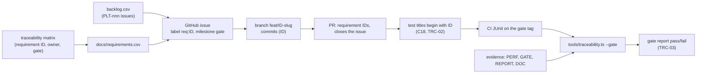

# Implementation plan

| Field | Value |
|---|---|
| Title | Plotinium implementation plan: goals, calendar, phases and milestones, critical path, capacity, roles, gate scripts, definitions of ready and done, process, scope cuts, risks, AI-assisted work and deployment |
| Status | Draft v0.1, 2026-09-25 |
| Primary owner | R5 QA/DevOps & Integration Engineer (secretary; keeps the plan, the board and the rituals) |
| Secondary reviewer | R1 Kernel / Systems Architect |
| Must be demonstrable at | **G0 Registration (W2):** ownership matrix, definition of done, rituals and escalation copied into `TEAM_CONTRACT.md`; board seeded; W2 exit checklist of [sprint-01](./sprint-01.md) signed. **P1 defence (W4):** work breakdown ([backlog](./backlog.md)), risk register, P1 script; stack-freeze date recorded here. **P2 (W7), P3 (W11), P4 (W14):** the gate script of §3.7 run live on the tag after a dry run 3 days earlier; production redeployed from the tag. **FRZ (W16):** freeze rehearsal. **P5 (W17–18):** Demo Day protocol, final production deploy. |
| Requirement IDs covered | Spec §4.1–§4.4 (team, roles, contract), §13.1–§13.2 (phases, gates, recovery, freeze), §14.4 (defence, freeze), §15.4 (process), §16.4 (individual moderation), §17.1–§17.2 (Demo Day, final deliverables), §18 (AI disclosure, integrity); PLT-TEAM-01..14, PLT-DOC-10, PLT-DOC-11, the schedule of PLT-DEL-01..16 and of every gate list in [traceability §3.4](../00-product/requirements-traceability.md); Plotinium design IDs PLN-01 … PLN-16 (§2) |
| Related specs | [Spec index](../README.md) · [Requirements traceability](../00-product/requirements-traceability.md) · [Backlog](./backlog.md) · [Sprint 01](./sprint-01.md) · [Identity and branding](../00-product/identity-and-branding.md) · [Architecture](../01-architecture/architecture.md) · [Data structures](../08-dsa/data-structures.md) · [AI safety and evaluation](../10-ai/ai-safety-and-evaluation.md) · [Testing and performance](../13-quality/testing-and-performance.md) · [Deployment and CI](../14-devops/deployment-and-ci.md) · [Stack decisions](../15-decisions/stack-decisions.md) |

---

## 1. Purpose and scope

This plan turns the specification set into a schedule that five students can execute at about 13 hours a week each, from Week 1 to the final defence in Weeks 17–18, and defend in the viva. It fixes:

- the goals and the calendar relative to Week 1 (§3.1–§3.2), the phases, milestones and critical path (§3.3–§3.4), the capacity model and the per-phase, per-role breakdown (§3.5–§3.6);
- the live demonstration script for every gate (§3.7);
- the definitions of ready and done, the branching, pull-request and review rules, the requirement-ID flow and the weekly rituals (§3.8–§3.11);
- the ownership matrix that drives `.github/CODEOWNERS` (§3.12), the ordered scope-cut list (§3.13) and the risk summary (§3.14);
- what the AI-assisted work has already produced and what the team owns and must explain in the viva (§3.15);
- the deployment track, from the first public deploy at P2 to the final production deploy, and the resources the team must provide (§3.16).

The work itself is itemised in [backlog.md](./backlog.md) (216 issues, 652.5 estimated hours); Weeks 1–2 are planned day by day in [sprint-01.md](./sprint-01.md). The designs are in the subsystem specs; this plan only schedules them.

**Source precedence** ([README §3.3](../README.md)): the capstone specification, then the canonical decisions C1–C18, then the owning specs. The research inputs in `docs/research/strategy/` (phase plan, role matrix, spikes, risk register) are inputs to this plan; where they disagree with `docs/research/critic.json`, the critic's fixes are applied: time-boxed decision-critical spikes, the server sync-engine skeleton in W6–W7, the lock manager in W8, W11 for hardening only, and the rebalanced roles of C15.

## 2. Requirements table

| ID | Summary | Spec § | How verified |
|---|---|---|---|
| §13.1 | Spec: MUST. Six phases with fixed deliverables and gates: registration (W2), architecture and defence (W4), VFS and window manager (W7), scheduler and persistence (W11), AI layer (W14), final defence (W17–18) | §13.1 | Gate scripts §3.7; traceability gate lists |
| §13.2 | Spec: MUST. A gate is passed only by a live demonstration on the tagged release; a missed gate leads to a recovery plan within one week; features merged after the freeze are reverted before judging | §13.2 | Tags per phase (§3.16); recovery rule (§6); freeze policy (§3.9) |
| §4.1–§4.4 | Spec: MUST. Five members, one primary role each, a secondary reviewer for every subsystem, every PR approved by another member, code in at least two subsystems each, the six-item team contract | §4.1–§4.4 | §3.12; `TEAM_CONTRACT.md`; CODEOWNERS; equity report |
| §15.4 | Spec: MUST / SHOULD. Protected `main`, reviewed PRs, CI before merge, an issue board with an owner for every issue; small commits citing requirement IDs | §15.4 | Ruleset export; §3.9; board |
| §16.4, §18 | Spec: MUST. Marks moderated individually (viva, history, peer assessment); AI assistance disclosed; every member can defend what they submitted | §16.4, §18 | §3.15; `AI_USAGE.md`; mock vivas |
| §17.1, §17.2 | Spec: MUST. Demo Day protocol; final deliverables | §17.1–§17.2 | §3.7.7; PLT-DEL issues in the backlog |
| PLN-01 | Plotinium design. The calendar is relative to Week 1: the Monday of week n is W1 + 7·(n − 1) days plus one week per university break before it; gate dates are taken from Google Classroom when announced | p2, §13 | §3.2 table filled at G0 |
| PLN-02 | Plotinium design. Every gate: feature cut-off 3 days before, dry run the same day on a machine that is not a member's, tag the day before, production redeployed from the tag (from P2), the script of §3.7 run live on the tag | §13.2 | Gate evidence folder; deploy log |
| PLN-03 | Plotinium design. The critical path and the zero-slack issues (§3.4) are reviewed at every Monday planning; a slipped critical issue is escalated the same day | — | Monday note |
| PLN-04 | Plotinium design. Capacity model of §3.5: 13 h per member per week, W8 at 40%; planned issue load at most 90% of focus capacity over the semester and at most 115% of focus capacity plus surge in any phase | — | Load table in [backlog §3.2](./backlog.md) |
| PLN-05 | Plotinium design. Every requirement ID of the traceability matrix appears in at least one backlog issue | — | Coverage check ([backlog §8](./backlog.md)) |
| PLN-06 | Plotinium design. Every issue satisfies the definition of ready (§3.8.1) | — | Backlog lint |
| PLN-07 | Plotinium design. The definition of done of §3.8.2 is copied verbatim into `TEAM_CONTRACT.md` and contains the test clauses of TST-17 | §4.4 | Docs check |
| PLN-08 | Plotinium design. Branching, commit, PR, review and merge rules of §3.9 | §15.4 | Ruleset; commitlint; PR template |
| PLN-09 | Plotinium design. Requirement-ID flow of §3.10: issue → branch and commits → PR → test title → CI JUnit → evidence → gate report | p3, C18 | `tools/traceability.ts` |
| PLN-10 | Plotinium design. The weekly rituals and teach-back rotation of §3.11 | §4.4, §16.4 | Monday notes; rehearsal logs |
| PLN-11 | Plotinium design. The ordered scope-cut list of §3.13; a gate Must is never cut; a Should is cut only with a decision record before its gate | p3, §13.2 | Board; `docs/adr/` |
| PLN-12 | Plotinium design. AI-assisted work is disclosed and owned as in §3.15; every AI-drafted file reaches `main` only through a PR by a member who can explain every line | §18 | `AI_USAGE.md`; PR template; mock vivas |
| PLN-13 | Plotinium design. Deployment track of §3.16: first public deploy at P2 (W7), a production deploy from every phase tag, the final deploy of `v1.0.0` early in W18; every team-provided resource has a named owner | §17.2 | Deploy log; UptimeRobot |
| PLN-14 | Plotinium design. Loans: a task done outside the owner's C15 area is reviewed by that area's primary owner and changes no ownership | §4.2 | [backlog §3.2](./backlog.md) |
| PLN-15 | Plotinium design. The W2 exit checklist of [sprint-01](./sprint-01.md) is the G0 gate check | §13.1 | Signed checklist in `docs/evidence/gates/g0/` |
| PLN-16 | Plotinium design. Four timed Demo Day rehearsals (W15, W16, W17 ×2) plus a dry run before every gate, each logged | §17.1 | `docs/evidence/defence/rehearsal-<n>.md` |

## 3. Design (normative)

### 3.1 Goals

| # | Goal | Measure | By |
|---|---|---|---|
| G1 | Pass every gate first time on a tagged release | Traceability gate report `pass: true` on `v0.2.0`, `v0.3.0`, `v0.4.0`, `v1.0.0` | W7, W11, W14, W18 |
| G2 | Meet every Must and Should requirement (77 Must, 5 Should); build both May items only if their decision point is green | Gate lists of [traceability §3.4](../00-product/requirements-traceability.md) | P5 |
| G3 | Every numeric target measured on the lab-spec machine, never on a laptop | `PERF:<ID>` files with `machine: lab-spec` | each gate |
| G4 | All three AI subsystems integrated with the four AI-native properties each and the full coupling map | AI.md; 12 AIN and 18 CPL tests green | P4 |
| G5 | Clean examiner bring-up in three commands and under five minutes, on a machine we do not control | `bringup` job ≤ 240 s; four rehearsals | P2 onward |
| G6 | Every member can explain the whole system, the code they submitted and the AI-assisted parts they own | Mock-viva scores; "explain your PR" rule | P1 and P5 |
| G7 | Equitable, visible contribution: each member 15–25% of non-generated lines and at least 15% of reviews | Weekly equity report | from W5 |
| G8 | A public production deployment from P2 onward with nothing secret in the repository | Deploy log; gitleaks; UptimeRobot | W7–W18 |

### 3.2 Calendar relative to Week 1

Weeks are teaching weeks. The exact gate dates come from Google Classroom (spec §13); until they are announced every date below is computed from the Monday of Week 1 (PLN-01). A university break is not a week number: it shifts every later week by seven days.

**Fill in at G0:** Monday of W1 = `____-__-__` · breaks = `____` · stack-freeze date (P1 accepted) = `____-__-__` · final defence slot = `____-__-__`.

| Week | Monday (= W1 + 7·(n−1) days) | Example only, W1 = 2026-09-28, no breaks | Phase | Gate or milestone | Tag |
|---|---|---|---|---|---|
| W1 | W1 | 2026-09-28 | 0 | M0 pre-registration merged by Friday; registration form submitted | — |
| W2 | W1 + 7 | 2026-10-05 | 0 | **G0 registration** | — |
| W3 | W1 + 14 | 2026-10-12 | 1 | M1 evidence freeze (Friday) | — |
| W4 | W1 + 21 | 2026-10-19 | 1 | **P1 defence**; stack frozen when accepted (revision within one week) | — |
| W5 | W1 + 28 | 2026-10-26 | 2 | M2 walking skeleton on staging | — |
| W6 | W1 + 35 | 2026-11-02 | 2 | M3 server op pipeline and release pipeline rehearsed on staging | — |
| W7 | W1 + 42 | 2026-11-09 | 2 | **P2**; first public production deploy | `v0.2.0` |
| W8 | W1 + 49 | 2026-11-16 | 3 | Mid-term examinations (40% capacity); M4 lock manager | — |
| W9 | W1 + 56 | 2026-11-23 | 3 | Peer assessment 1 (instructor's date) | — |
| W10 | W1 + 63 | 2026-11-30 | 3 | M5 P3 feature cut-off (Friday) | — |
| W11 | W1 + 70 | 2026-12-07 | 3 | **P3** (hardening week); OFF-05 patch during the gate | `v0.3.0`, `v0.3.1` |
| W12 | W1 + 77 | 2026-12-14 | 4 | M6 Week-12 AI checkpoint | — |
| W13 | W1 + 84 | 2026-12-21 | 4 | — | — |
| W14 | W1 + 91 | 2026-12-28 | 4 | **P4** | `v0.4.0` |
| W15 | W1 + 98 | 2027-01-04 | H | M7 bug bash; first full rehearsal | — |
| W16 | W1 + 105 | 2027-01-11 | H | **FRZ** feature freeze; freeze rehearsal is the gate | `v1.0.0-rc.1` |
| W17 | W1 + 112 | 2027-01-18 | 5 | Report, video, slides, two rehearsals; peer assessment 2 | `v1.0.0-rc.N` |
| W18 | W1 + 119 | 2027-01-25 | 5 | **P5 final defence** | `v1.0.0` (early in the week) |

**Gate-relative dates** (PLN-02), with D the gate day: D − 3 feature cut-off and dry run on a machine that is not a member's; D − 1 tag, release pipeline, production deploy (from P2), re-run of the e2e and perf suites on the current Chrome stable (TST-13); D live demonstration on the tag; D + 1 to D + 5 retrospective and, if a gate was missed, the recovery plan (§6).

### 3.3 Phases and milestones

| Phase | Weeks | Goal | Milestones (exit criteria) |
|---|---|---|---|
| 0 Registration | W1–W2 | Team, name, contract, repository, CI; every decision pre-registered; AI-generated code reviewed by its owners | **M0 (W1 Fri):** org, repository, ruleset and CI running; all 14 pre-registration PRs merged; registration form submitted. **G0 (W2):** the W2 exit checklist of [sprint-01](./sprint-01.md) |
| 1 Architecture and defence | W3–W4 | Team evidence for every decision record; the Phase 1 dossier; the first team-written structures | **M1 (W3 Fri):** evidence freeze with sensitivity tables; `dsa/heap`, `dsa/dag`, `dsa/zorder` flipped. **P1 (W4):** 15 + 10 minute defence, every member presents; `dsa/tree`, `dsa/ringbuffer` flipped; protocol ABI v1 frozen; boot-ui v1 visual ready |
| 2 VFS and window manager | W5–W7 | Walking skeleton to `v0.2.0`: VFS-01..08, WM-01..07, boot v1, login, Terminal with file commands and trie completion, the server op pipeline, the first public deploy | **M2 (W5):** walking skeleton on staging: boot → kernel → stub login → desktop, `echo hi \| cat` through syscalls; trie and hash table flipped. **M3 (W6):** server `vfsTxn` and op pipeline skeleton; release pipeline rehearsed on staging. **P2 (W7):** `v0.2.0` public |
| 3 Scheduler and persistence | W8–W11 | PROC, MEM, DB, OFF, VFS-09..11, boot v2; W8 at 40%; W11 hardening only | **M4 (W8):** lock manager against protocol mocks; migrations round trip. **M5 (W10 Fri):** every P3 Must merged (feature cut-off). **P3 (W11):** `v0.3.0` and the OFF-05 patch `v0.3.1` |
| 4 AI layer | W12–W14 | RAG, agent and pre-fetch integrated with all coupling cells; evaluations, safety, cost | **M6 (W12):** AI checkpoint: A answers `semsearch`, B reaches a dry run, C pre-fetches; descoping rule applied. **P4 (W14):** `v0.4.0`, AI.md complete |
| Hardening and freeze | W15–W16 | Bug bash, lab-machine evidence, documents complete, first two rehearsals | **M7 (W15):** bug list triaged; first full rehearsal. **FRZ (W16):** `v1.0.0-rc.1`; only `freeze-fix` PRs afterwards |
| 5 Final defence | W17–W18 | Report, video, slides, mock vivas, final deploy, Demo Day | **M8 (W17):** report, video and slides merged; two rehearsals. **P5 (W18):** `v1.0.0` deployed early in the week; Demo Day |

What each gate must show is fixed by [traceability §3.4](../00-product/requirements-traceability.md); what the examiner sees is scripted in §3.7.

### 3.4 Critical path and dependency graph

The backlog's dependency graph is acyclic (216 issues). Weighted by hours, the longest dependency chain to Demo Day runs from a pre-registration PR through the onboarding review, the protocol freeze and the kernel (worker, dispatcher, process model, scheduler bands) into the RAG pipeline, AI.md and the final documents: PLT-007 → PLT-014 → PLT-047 → PLT-057 → PLT-058 → PLT-069 → PLT-070 → PLT-112 → PLT-153 → PLT-161 → PLT-174 → PLT-188 → PLT-203 → PLT-202 → PLT-204 → PLT-207 → PLT-215 → PLT-216 (55.5 h of sequential work). In calendar terms the critical path is:

1. **Weeks 1–4:** repository and CI (PLT-003, PLT-004, PLT-020) → pre-registration PRs merged by Friday of W1 (PLT-005–PLT-009) → decision-critical spikes (PLT-010, PLT-022, PLT-016 with the S1b kata, PLT-027, PLT-028, PLT-030, PLT-023) → evidence freeze (PLT-032) → records and defence (PLT-046) → stack frozen.
2. **Weeks 4–7:** protocol ABI v1 (PLT-047) → kernel worker and dispatcher (PLT-057, PLT-058) → process model (PLT-069) → VFS permissions and file commands (PLT-072, PLT-074, PLT-092) → VFS suite and the e2e path (PLT-091, PLT-105) → P2 dry run (PLT-106) → `v0.2.0` (PLT-103). In parallel and nearly critical: compositor (PLT-063) → frame evidence (PLT-098); server `vfsTxn` → op pipeline (PLT-076, PLT-093).
3. **Weeks 7–11:** op pipeline → lock manager in W8 (PLT-108) → lock client and outbox replay in W9 (PLT-119, PLT-118) → boot v2, bootlog and shutdown in W10 (PLT-134, PLT-136) → P3 evidence in W11 (PLT-158). In parallel: bands and aging (PLT-112) → LRU pager and remote swap (PLT-128, PLT-130) → frame and memory evidence (PLT-145, PLT-146).
4. **Weeks 10–14:** embedding worker (PLT-142) → indexer in W11 (PLT-153) → semantic search and agent validation (PLT-161, PLT-165) → W12 checkpoint (PLT-168) → confirmation and batch (PLT-175, PLT-176) → evaluations (PLT-174, PLT-185) → AI.md (PLT-188) → P4 dry run (PLT-191).
5. **Weeks 15–18:** documents complete (PLT-203) → `v1.0.0-rc.1` (PLT-202) → rehearsals (PLT-204, PLT-207) → `v1.0.0` (PLT-215) → Demo Day (PLT-216).

**Zero-slack issues.** 70 issues have a dependant scheduled in the same week; a slip in any of them moves its dependant. They are listed in the [backlog week index](./backlog.md) and read out at every Monday planning (PLN-03). The riskiest are the W5–W7 kernel chain (R1), the W7 file-command chain (R2) and the W9–W10 sync chain (R2, R5).

```mermaid
flowchart LR
  subgraph W1_4["W1–W4 · registration and defence"]
    ORG["org, repo, ruleset, CI"] --> PRE["pre-registration PRs<br/>merged Fri W1"]
    PRE --> SPK["decision-critical spikes<br/>S0 · S1/S1b · S4 · S5 · S6 · S7"]
    SPK --> EF["M1 evidence freeze<br/>Fri W3"]
    EF --> P1["P1 defence W4<br/>stack frozen"]
    DSA1["dsa: heap, DAG, z-order W3<br/>tree, ring buffer W4"]
  end
  subgraph W5_7["W5–W7 · VFS and window manager"]
    ABI["protocol ABI v1"] --> KW["kernel worker + dispatcher W5"]
    KW --> KP["process model + executors W6"]
    KP --> VFS["VFS core, perms, quotas W5–W6"]
    VFS --> CU["file commands + shell W6–W7"]
    CMP["compositor, taskbar, boot-ui v1"] --> P2
    CU --> P2["P2 W7 · v0.2.0<br/>first public deploy"]
    TX["server vfsTxn W6"] --> OP["op pipeline skeleton W7"]
    OP --> P2
    DEP["VPS, compose, GHCR, release pipeline"] --> P2
  end
  subgraph W8_11["W8–W11 · scheduler and persistence"]
    LM["lock manager W8<br/>(against protocol mocks)"] --> LC["lock client + outbox replay W9"]
    LC --> OFFB["offline boot, boot v2, shutdown W10"]
    SCH["bands, aging, watchdog W9"] --> MM["LRU pager + remote swap W10"]
    OFFB --> P3["P3 W11 · v0.3.0<br/>hardening only"]
    MM --> P3
    DBF["bulk SQL, fault matrix, indexes W9–W11"] --> P3
  end
  subgraph W12_14["W10–W14 · AI layer"]
    GW["LLM gateway W10"] --> AG["agent: catalogue, planner, validator W11–W12"]
    EMB["ai.embed W10"] --> IDX["indexer W11"] --> SS["semsearch W12"]
    AG --> CK["W12 checkpoint"]
    SS --> CK
    PF["predictor + prefetch jobs W8–W12"] --> CK
    CK --> EV["evaluations, safety, AI.md W13–W14"] --> P4["P4 W14 · v0.4.0"]
  end
  subgraph W15_18["W15–W18 · freeze and defence"]
    BB["bug bash + rehearsal 1 W15"] --> FRZ["FRZ W16 · v1.0.0-rc.1"]
    FRZ --> R17["2 rehearsals, report, video W17"] --> P5["P5 · v1.0.0 · Demo Day"]
  end
  P1 --> ABI
  OP --> LM
  DSA1 --> KW
  DSA1 --> VFS
  P2 --> LM
  P2 --> SCH
  P3 --> CK
  P4 --> BB
```



### 3.5 Capacity

**Assumptions** (PLN-04): five members at 13 hours a week each; W8 (mid-term examinations) at 40%, that is 5.2 hours. Rituals take 2 h a week per member (1 h in W8); reviewing takes 0.5 h a week in W1–W2, 1.5 h a week afterwards and 0.5 h in W8. What remains is **focus capacity** for backlog issues.

| Phase | Weeks | Gross h per member | Rituals | Reviews | Focus per member | Team focus | Planned issue hours | Load |
|---|---|---|---|---|---|---|---|---|
| 0–1 | W1–W4 | 52 | 8 | 4 | 40 | 200 | 166 | 83% |
| 2 | W5–W7 | 39 | 6 | 4.5 | 28.5 | 142.5 | 160 | 112% |
| 3 | W8–W11 | 44.2 | 7 | 5 | 32.2 | 161 | 163.5 | 102% |
| 4 | W12–W14 | 39 | 6 | 4.5 | 28.5 | 142.5 | 82 | 58% |
| Hardening | W15–W16 | 26 | 4 | 3 | 19 | 95 | 46.5 | 49% |
| 5 | W17–W18 | 26 | 4 | 3 | 19 | 95 | 34.5 | 36% |
| **Semester** | W1–W18 | 226.2 | 35 | 24 | 167.2 | 836 | 652.5 | 78% |

**Reading the table.** Over the semester the plan uses about four fifths of the focus capacity, within the 90% ceiling of PLN-04. The load is deliberately front-heavy: Phases 2 and 3 carry the most Must requirements and every AI subsystem needs them, so they run above 100% of baseline focus. They are covered by:

1. **Pull-forwards into W3–W4** (already in the backlog): `dsa/heap`, `dsa/dag`, `dsa/zorder`, `dsa/tree`, `dsa/ringbuffer`, the identity kit and boot-ui v1, all independent of the framework decision.
2. **Surge weeks.** In the two weeks before each gate's feature cut-off (W6–W7, W9–W10, W12–W13, W15–W16) each member may plan up to 2 extra hours a week, agreed in `TEAM_CONTRACT.md`; the week after each gate is planned at no more than 80%. With surge, Phase 2 is at 98% and Phase 3 at 90% of team capacity.
3. **Loans** (PLN-14): R4, whose AI work starts in W10, takes tooling, File Explorer, shell and test tasks in Phases 2 and 3.
4. **Buffer.** Phases 4 to 5 are planned at about half load for R1, R2, R3 and R5. That slack (about 170 h) absorbs Phase 2–3 carry-over, rehearsal defects and the Week-12 re-plan; it is not free time to add features (§3.13).
5. **AI-assisted drafts.** 75 issues start from an AI-assisted draft (`ai-draft` in the backlog). Their estimates cover review, tests, measurement and ownership, not writing from scratch. If a draft does not exist when the issue starts, the issue is re-estimated at Monday planning, and if the phase then exceeds 115% of focus plus surge, the scope-cut list applies.

**Planned load by role and phase** (from the backlog; percentages of the member's focus capacity for the phase):

| Role | Phases 0–1 (W1–W4) | Phase 2 (W5–W7) | Phase 3 (W8–W11) | Phase 4 (W12–W14) | Hardening and freeze (W15–W16) | Phase 5 (W17–W18) | Semester |
|---|---|---|---|---|---|---|---|
| R1 | 32.5 h (81%) | 32 h (112%) | 35 h (109%) | 14 h (49%) | 13.5 h (71%) | 8.5 h (45%) | 135.5 h (81%) |
| R2 | 37 h (92%) | 32.5 h (114%) | 28.5 h (89%) | 13.5 h (47%) | 5 h (26%) | 3 h (16%) | 119.5 h (71%) |
| R3 | 33 h (82%) | 33 h (116%) | 32 h (99%) | 14.5 h (51%) | 6.5 h (34%) | 9 h (47%) | 128 h (77%) |
| R4 | 28 h (70%) | 31.5 h (111%) | 34.5 h (107%) | 25.5 h (89%) | 5 h (26%) | 2.5 h (13%) | 127 h (76%) |
| R5 | 35.5 h (89%) | 31 h (109%) | 33.5 h (104%) | 14.5 h (51%) | 16.5 h (87%) | 11.5 h (61%) | 142.5 h (85%) |
| Focus capacity per member | 40 h | 28.5 h (+4 surge) | 32.2 h (+4 surge) | 28.5 h (+4 surge) | 19 h (+4 surge) | 19 h | 167.2 h |
| Team | 166 h (83%) | 160 h (112%) | 163.5 h (102%) | 82 h (58%) | 46.5 h (49%) | 34.5 h (36%) | 652.5 h (78%) |

**Rule** (PLN-04): if a member's planned load for the next two weeks exceeds 115% of focus plus surge, Monday planning re-assigns work to the secondary reviewer of that area or applies the next item of the scope-cut list; the decision is written in the Monday note.

### 3.6 Per-phase, per-role breakdown

Generated from [backlog.csv](./backlog.csv) (issue key and short title; details, estimates and acceptance criteria in the backlog). "On loan" tasks are marked in the backlog.

**Phases 0–1 (W1–W4).**

| Week | R1 Kernel | R2 VFS/DB | R3 WM/UI | R4 AI | R5 QA/DevOps |
|---|---|---|---|---|---|
| W1 | PLT-005 Pre-register D2a and D2b<br>PLT-010 S0 capability probe on Chrome stable and beta (… | PLT-006 Pre-register D5, D6 and D7<br>PLT-011 S4 setup | PLT-001 Vote the tagline, commit docs/identity/identity…<br>PLT-007 Pre-register D1 (UI framework) including the S1… | PLT-008 Pre-register D8, D9, D10 and D11 with the singl…<br>PLT-012 Write AGT-40 v0 and INJ-20 v0 with the fixture… | PLT-002 Send the Week-1 instructor questions and log th…<br>PLT-003 Create the GitHub organisation, one-member team…<br>PLT-004 Main-branch ruleset, tag ruleset and CODEOWNERS…<br>PLT-009 Pre-register D3, D4, D12, D13 and D14 |
| W2 | PLT-014 Onboarding (R1)<br>PLT-026 Lab-spec runner (schedule and workflow_dispatch… | PLT-015 Onboarding (R2)<br>PLT-021 Seed the GitHub board from backlog.csv and docs…<br>PLT-024 S8 clean bring-up timing (lab PC, home broadban… | PLT-016 Onboarding (R3)<br>PLT-022 S1 framework benchmark | PLT-017 Onboarding (R4)<br>PLT-019 Complete AI_USAGE.md row 1<br>PLT-023 S7 reduced LLM bake-off | PLT-013 Complete, sign and merge TEAM_CONTRACT.md (the…<br>PLT-018 Onboarding (R5)<br>PLT-020 CI green on the first PR (format, lint, typeche…<br>PLT-025 Buy the VPS (Hetzner CX33 retry loop, OVH VPS-2… |
| W3 | PLT-028 S5 M1<br>PLT-034 DSA.md draft<br>PLT-035 Implement dsa/heap (binary min-heap with index… | PLT-027 S4 core<br>PLT-029 S5 M2<br>PLT-031 S3-lite | PLT-033 S10 Puter and daedalOS measurements (each membe…<br>PLT-037 Implement dsa/zorder (O(1) raise, 1..n renumber…<br>PLT-038 Identity kit | PLT-030 S6 embedding bake-off and pilot retrieval evalu… | PLT-032 Evidence freeze (Friday W3) with sensitivity ta…<br>PLT-036 Implement dsa/dag (Kahn levels, cycle path, rev… |
| W4 | PLT-039 Write and present records D2a and D2b<br>PLT-044 ARCHITECTURE.md for P1<br>PLT-047 Freeze the protocol ABI v1 after the defence | PLT-040 Write and present records D4 (transport, with R…<br>PLT-045 DATABASE.md for P1<br>PLT-048 Implement dsa/tree (n-ary tree, O(d) resolve, O… | PLT-041 Write and present record D1 with the S1b outcome<br>PLT-046 P1 slides (Typst) and two defence rehearsals wi…<br>PLT-050 Inlined boot-ui v1 | PLT-042 Write and present D8, D9, D10 and D11 | PLT-043 Write D3, D12, D13 and D14<br>PLT-049 Implement dsa/ringbuffer and flip IMPLEMENTED<br>PLT-051 Provision the VPS from ops/cloud-init.yaml |

**Phase 2 (W5–W7).**

| Week | R1 Kernel | R2 VFS/DB | R3 WM/UI | R4 AI | R5 QA/DevOps |
|---|---|---|---|---|---|
| W5 | PLT-056 Implement dsa/hashtable (open addressing, linea…<br>PLT-057 Kernel worker boot, host bindings and exactly o…<br>PLT-058 Syscall dispatcher | PLT-059 Inode tree on dsa/tree, one IndexedDB database…<br>PLT-060 IndexedDB store<br>PLT-061 All remaining migrations with down scripts | PLT-055 Implement dsa/trie (struct-of-arrays radix trie…<br>PLT-063 Compositor core<br>PLT-064 Shell executor over the AI-drafted lexer and pa… | PLT-052 tools/spec-lint in the lint job<br>PLT-054 tools/traceability.ts gate mode<br>PLT-065 SECURITY.md draft | PLT-053 Migrate the per-package Vitest projects to the…<br>PLT-062 svcmgr v1 and truthful progress<br>PLT-066 Compose stack with Caddy on the VPS |
| W6 | PLT-069 Process model and executor pool<br>PLT-070 Basic scheduler on dsa/heap with round-robin an…<br>PLT-071 Pipes over kernel ring buffers, event bus, wind… | PLT-072 Permission matrix on every call (chmod, chown,…<br>PLT-073 Quotas inside the transaction<br>PLT-074 File commands ls, cd, pwd, mkdir, rmdir, touch…<br>PLT-075 Identity and VFS-core migrations on the product…<br>PLT-076 Server vfsTxn and lockPlan | PLT-077 Window operations and the live taskbar<br>PLT-078 Desktop, launcher and window chrome built from…<br>PLT-079 Login screen with several users plus Guest and…<br>PLT-080 Terminal view | PLT-067 tools/equity.ts<br>PLT-068 Licence scan of the lockfile against THIRD_PART…<br>PLT-081 Line discipline in kernel/core/tty<br>PLT-082 history, help and man<br>PLT-086 axe in CI for both themes | PLT-083 Auth sessions<br>PLT-084 Multi-arch images on public GHCR pinned by digest<br>PLT-085 release.yml → deploy.yml with approval by a mem… |
| W7 | PLT-087 SYS-01 bypass suite (8 cases from executor and…<br>PLT-088 uname, /system/release and one build identity f…<br>PLT-089 sys.spawn resolves /bin/&lt;app&gt;.json requires wit…<br>PLT-104 Performance harness (budgets.json, trace parser… | PLT-090 Two-phase bulk operations cp -r, mv and rm -r w…<br>PLT-091 VFS test suite complete for the P2 gate<br>PLT-092 File commands cp, mv, rm, ln, find, tree, stat,…<br>PLT-093 Sync-engine skeleton | PLT-096 Layout persistence and window–process coupling<br>PLT-098 Frame meter and the WM-03 drag and resize trace…<br>PLT-099 Accessibility audit 1 | PLT-097 File Explorer through syscalls<br>PLT-100 complete service on dsa/trie (cmd, path, flag,…<br>PLT-101 SYS-02 scripted terminal session for the P2 fil…<br>PLT-102 Server hardening for the first public deploy<br>PLT-105 e2e boot → login → terminal → file operations →… | PLT-094 syncd client skeleton<br>PLT-095 Minimal reboot for P2<br>PLT-103 Tag v0.2.0 and the first public production deploy<br>PLT-106 P2 dry run 3 days before the gate |

**Phase 3 (W8–W11).**

| Week | R1 Kernel | R2 VFS/DB | R3 WM/UI | R4 AI | R5 QA/DevOps |
|---|---|---|---|---|---|
| W8 | PLT-107 Written proof of the PROC-04 aging bound | PLT-108 Lock manager | — | PLT-109 Witten-Bell Markov-2 predictor as pure code wit… | — |
| W9 | PLT-110 Implement dsa/lru (Map + typed-array doubly lin…<br>PLT-112 Priority bands, quanta, aging, SAB pre-emption,…<br>PLT-114 Memory accounting, budget and soft limits<br>PLT-125 /api/blobs on the FsBlobStore (R1 second subsys… | PLT-115 Set-based bulk SQL, the acyclicity trigger and…<br>PLT-116 Fault-injection matrix<br>PLT-117 Sync engine | PLT-113 Signals, process groups, sessions and job-contr…<br>PLT-122 Update flow<br>PLT-123 Task Manager (processes, memory tab, kill, reni… | PLT-111 Implement dsa/bloom with a declared false-posit…<br>PLT-124 Text Editor (CodeMirror 6, lazy) with expectedV…<br>PLT-126 Fault-injection oracle on both sides and the pr… | PLT-118 Outbox replay with op.batch and a credit window<br>PLT-119 lockd client<br>PLT-120 Offline login with the PBKDF2 verifier (never f…<br>PLT-121 Service Worker precache of the versioned shell,… |
| W10 | PLT-127 Process commands (ps, top, kill, nice, renice,…<br>PLT-128 LRU pager<br>PLT-130 Remote swap | PLT-131 Mirroring states (offline EAGAIN, never a false…<br>PLT-132 fsck invariants I1–I14 with repairs and lost+found<br>PLT-133 VFS-09 lease tests | PLT-129 free, vmstat, pmap and swapctl<br>PLT-137 Boot menu (Esc buffered, reboot --menu, Setting…<br>PLT-138 "Restoring…" window state with real byte progress<br>PLT-139 Taskbar tray<br>PLT-140 Job control in the shell | PLT-142 ai.embed worker with self-hosted weights, decla…<br>PLT-143 LLM gateway<br>PLT-144 k6 lock soak (50 clients) and rate-limit values… | PLT-134 Boot v2 orchestration<br>PLT-135 bootlog (--critical-path), svcctl and debug inj…<br>PLT-136 shutdown and reboot<br>PLT-141 su grants through the secure prompt with a 15-m… |
| W11 | PLT-145 Starvation test and the PROC-05 frame gate unde…<br>PLT-146 MEM-05 and MEM-06 on the lab machine | PLT-147 Q1–Q5 indexes, benchmark at 100k inodes with EX… | PLT-148 Offline e2e<br>PLT-149 Boot evidence<br>PLT-150 Accessibility audit 2<br>PLT-151 SYS-02 scripted session for the P3 process, mem… | PLT-152 RAG corpus of at least 200 documents and 30 que…<br>PLT-153 Indexer process<br>PLT-154 Tool catalogue in protocol (one syscall schema…<br>PLT-155 Telemetry ring on dsa/ringbuffer | PLT-156 Nightly backups to Cloudflare R2 and the first…<br>PLT-157 Tag v0.3.0, deploy<br>PLT-158 P3 dry run |

**Phase 4 (W12–W14).**

| Week | R1 Kernel | R2 VFS/DB | R3 WM/UI | R4 AI | R5 QA/DevOps |
|---|---|---|---|---|---|
| W12 | PLT-163 AI scheduling hooks<br>PLT-166 prefetch | PLT-160 file_chunks, index put, pull and search with th… | PLT-159 Files semantic search with citations<br>PLT-162 BM25 keyword index, snippets and citations | PLT-161 Vector search (Float32 segments, heap top-k, Bl…<br>PLT-164 Planner client with the observation loop<br>PLT-165 Validator and intent binding<br>PLT-168 Commit the descoping rule in AI.md before W12,… | PLT-167 ai-eval CI project replaying cassettes with no key |
| W13 | PLT-170 Memory-mapped files sys.mmap and msync (MAY<br>PLT-178 ai.agent as a real process (PRI 20, BLOCKED on net<br>PLT-181 Trust-boundary mapping with named tests | PLT-173 rag-leak suite<br>PLT-176 sys.batch server executor in one vfsTxn with fi… | PLT-169 Interval tree for window hit-testing (MAY<br>PLT-172 Secure prompt and confirmation sheet<br>PLT-179 predict command with confidence and a reason | PLT-174 RAG evaluation and latency<br>PLT-175 Dry run and the kernel confirmation predicate (… | PLT-171 After desktop-interactive the session service p…<br>PLT-177 Agent identity<br>PLT-180 Pre-fetch evaluation<br>PLT-182 Self-hosted models and ORT on production with s… |
| W14 | PLT-187 PRE-03 launch-latency cut and the PRE-04 frame… | PLT-184 SECURITY.md<br>PLT-186 ai undo &lt;txn&gt; (MAY | PLT-183 Accessibility audit 3 | PLT-185 Agent evaluation and safety<br>PLT-188 AI.md complete<br>PLT-189 Cost report from llm_requests | PLT-190 Tag v0.4.0 and deploy<br>PLT-191 P4 dry run |

**Hardening and freeze (W15–W16).**

| Week | R1 Kernel | R2 VFS/DB | R3 WM/UI | R4 AI | R5 QA/DevOps |
|---|---|---|---|---|---|
| W15 | PLT-192 Re-run every DSA benchmark on the lab machine<br>PLT-193 Lab-machine re-run of every PERF budget for the…<br>PLT-194 Hardening (R1)<br>PLT-201 ARCHITECTURE.md | PLT-195 Hardening (R2) | PLT-196 Hardening (R3) | PLT-197 Hardening (R4) | PLT-198 Hardening (R5)<br>PLT-199 Bug bash<br>PLT-200 First full 30-minute rehearsal on a lab PC with… |
| W16 | PLT-205 Mock vivas W15–W18 | — | PLT-206 README complete | — | PLT-202 Tag v1.0.0-rc.1 (feature freeze)<br>PLT-203 All §15.2 documents complete and consistent wit…<br>PLT-204 Freeze-gate rehearsal on a machine the team doe… |

**Phase 5 (W17–W18).**

| Week | R1 Kernel | R2 VFS/DB | R3 WM/UI | R4 AI | R5 QA/DevOps |
|---|---|---|---|---|---|
| W17 | PLT-208 Technical report 20–30 pages (Typst, built in CI)<br>PLT-211 Report chapters 3 (architecture), 4 (processes,… | PLT-212 Report chapters 4 (VFS) and 6 (database design,… | PLT-210 Report chapters 2 (identity and distinctive ide…<br>PLT-214 Demonstration video (5–7 minutes, no narration… | PLT-213 Report chapter 7 | PLT-207 Two W17 rehearsals<br>PLT-209 Report chapters 1 (introduction), 4 (boot, offl… |
| W18 | — | — | — | — | PLT-215 Tag v1.0.0 early in W18<br>PLT-216 T-7, T-1 and T-1-hour checklists |


### 3.7 Gate demonstration scripts

Every script runs on the tagged release, on the production URL unless it says "local stack", with the examiner driving where possible and the named member narrating. A step that needs root uses the production root credentials handed over on paper (C10). Fault injection runs only on the local stack with `FAULT_INJECTION=1` (C7). Each step names the requirement and the Appendix A line it proves; evidence goes to `docs/evidence/gates/<gate>/`.

#### 3.7.1 G0 registration (W2)

The W2 exit checklist of [sprint-01 §3.4](./sprint-01.md) (PLN-15): five members and roles confirmed (PLT-TEAM-01, PLT-TEAM-02); registration form with Plotinium, the alternative Tabium and the tagline, signed, scan in `docs/registration.pdf` (PLT-ID-01, PLT-DOC-14); `TEAM_CONTRACT.md` merged through a PR approved by all five (PLT-DOC-11); repository reachable, instructor added, ruleset on `main`, CI green on a pull request (§15.4).

#### 3.7.2 P1 architecture defence (W4, 15 minutes plus 10 minutes of questions)

Every member presents about three minutes and answers questions on any decision record (§14.4, DEC-06). Each speaker shows, for their records, the pre-registered criteria and weights, at least three options including the expected loser, the team's own lab measurements, the sensitivity table, the risks and the reversal trigger.

| Time | Speaker | Content | Records |
|---|---|---|---|
| 0:00–3:00 | R5 | Context and container diagrams; deployment, bring-up in three commands, CI and test toolchain; auth and security model | D3, D12, D13, D14 |
| 3:00–6:00 | R1 | Kernel placement and language, threads and IPC, executors and run tokens; scheduler and pager; the DSA blueprint | D2a, D2b |
| 6:00–9:00 | R2 | Database, tree representation, READ COMMITTED with the L0–L4 lock order, fault injection; client storage; transport | D4, D5, D6, D7 |
| 9:00–12:00 | R3 | UI framework and the S1b kata outcome; framework-free compositor and boot-ui; identity and the boot screen | D1 |
| 12:00–15:00 | R4 | RAG, agent and predictor; embedding bake-off; the single LLM selection rule and the temperature-0 ruling | D8, D9, D10, D11 |
| 15:00–25:00 | all | Questions; anyone may be asked about any record | all |

Preparation: two rehearsals with cross-examination in W4 (PLT-046); flashcards for D1–D14; `ARCHITECTURE.md`, `DATABASE.md`, `DSA.md`, `BOOT.md`, the AI.md plan, the two-page benchmark analysis, the risk register and this backlog ready as the dossier.

#### 3.7.3 P2 VFS and window manager (W7, `v0.2.0`)

| # | Step (examiner drives on the production URL) | Proves | Narrator |
|---|---|---|---|
| 1 | Open the URL in a fresh profile. The boot screen shows the logo, "Plotinium", the version and the build hash before any script runs. In DevTools tick "Disable cache" and Application → Service Workers → "Bypass for network", set Slow 4G and reload: the bar visibly slows and never moves without an event | BOOT-01, BOOT-02, BOOT-13; A2, A3 | R3 |
| 2 | The login screen lists several users plus Guest and Demo; sign in as `demo` | BOOT-14 | R3 |
| 3 | Settings → About and `uname -a` show the same name, version, build hash and date | PLT-ID-07, PLT-ID-09, PLT-ID-14; A2 | R1 |
| 4 | Open 10 windows (5 Terminals, 3 File Explorers, 2 Settings); frame meter on; drag and resize them: p95 ≤ 16.7 ms and no long animation frame over 50 ms from our origin. Snap to a half, maximise by title-bar double-click, switch windows from the keyboard | WM-01..WM-04, WM-07; A17 | R3 |
| 5 | Show the CI run of `v0.2.0`: VFS suite green and the coverage summary | VFS-01..08; A31 | R5 |
| 6 | As `bob`, `cat /home/alice/notes.md` gives EACCES; as `alice`, `chmod 644 notes.md`; bob can now read it; `ls -la /` shows the standard hierarchy and `/tmp` as `rwxrwxrwt`. In a second browser, bob's attempt to write alice's file is refused by the server as well | VFS-02, VFS-04, SYS-01 | R2 |
| 7 | `quota`; write past it: EDQUOT, `du` shows no partial file; `df` | VFS-06; A14 | R2 |
| 8 | `ln -s a b; ln -s b a; cat a` gives ELOOP; create and enter a 32-level path with `mkdir -p`, then `pwd` | VFS-03, VFS-05, VFS-08; A13, A15 | R2 |
| 9 | File Explorer: create, rename, copy, move, delete, properties; Terminal: `cp -r`, `mv`, `rm -r`, `find`, `stat`, `tree`, pipes and redirection | VFS-07, SYS-02 | R4 |
| 10 | Tab completion live; `complete --bench` over a 10,000-entry directory prints p95 ≤ 1 ms | SYS-03; A19 | R3 |
| 11 | `reboot`: services stop in reverse order and the window layout is restored | WM-06 | R5 |
| 12 | Show the timed `bringup` job of the tag (≤ 240 s, no `docker login`) | §17.1; A30 | R5 |

#### 3.7.4 P3 scheduler and persistence (W11, `v0.3.0`)

| # | Step | Proves | Narrator |
|---|---|---|---|
| 1 | `burn --ms 120000 &` three times, then `top`; drag 10 windows with the frame meter: p95 ≤ 16.7 ms, no LoAF over 50 ms from our code. `sched bound` prints the declared bound; show the starvation test output against it | PROC-03..PROC-06, PROC-08; A8, A9 | R1 |
| 2 | `memhog --total 512M --procs 8`; Task Manager → Memory shows faults and bytes out; `free`; `vmstat 1`; restore a minimised window: "Restoring…" with real progress and the page-in time printed | MEM-01..MEM-03, MEM-06, MEM-07, WM-05; A10–A12 | R1 |
| 3 | Close the tab, open the URL in a new browser profile, sign in: the window's process restores its state from remote swap; show the MEM-05 report (local and remote) | MEM-04, MEM-05; A11 | R1 |
| 4 | Local stack with `FAULT_INJECTION=1`: as root `debug inject rm 500`; as alice `rm -r ~/fixtures/tree1000` prints EIO before the prompt returns; `fsck` reports 0 orphans; checksum and `quota` unchanged on client and server | DB-02; A20 | R2 |
| 5 | Wait for "Offline-ready"; cut the network (production) or `docker compose stop app web` (local); `reboot`: the desktop comes up; Terminal, Files, Editor, Task Manager and Settings work; the taskbar shows "Offline · n queued"; reconnect: the ops replay exactly once and the client and server tree checksums match | BOOT-09, OFF-01..OFF-04; A6, A18 | R5 |
| 6 | Two machines (fallback: two Chrome profiles, if the instructor agreed), alice and bob open `/home/shared/plan.md`: alice holds X, bob is read-only; end alice's renderer from Chrome's Task Manager; `lsof` shows the countdown; bob is granted within the lease time | VFS-09, VFS-10; A16 | R2 |
| 7 | Hold Esc during boot (or `reboot --menu`): Verbose, then `bootlog --critical-path`; show Safe mode; as root `svcctl require auth lockd`, `reboot`: the panic screen names `auth → sync → lockd → auth`; recover from the boot menu | BOOT-03..BOOT-08, BOOT-11; A5, A7 | R5 |
| 8 | OFF-05: a member other than the tagger approves the pending deploy of the hash-only patch `v0.3.1`; the taskbar shows "Restart to update"; `reboot`; `uname` shows the new build | OFF-05 | R5 |
| 9 | Show the Q1–Q5 report with EXPLAIN plans, the restore-drill report and the BOOT-10 lab measurements | DB-01, DB-05, BOOT-10; A4, A21 | R2 |

#### 3.7.5 P4 AI layer (W14, `v0.4.0`)

Order matters (critic): the semantic query runs before any memory-pressure step, with the model warmed by focusing a search box, so RAG-05 is judged on a warm model.

| # | Step | Proves | Narrator |
|---|---|---|---|
| 1 | `ps` shows `ai.indexer` (PRI 32, NI 10), `ai.search` and `prefetch:*`. Save a 50 KB Markdown file; `semsearch` finds it within 30 s | RAG-01, RAG-02 | R4 |
| 2 | The examiner types a hidden semantic query in the Terminal and in Files: results carry `path:line` citations; bob searching for alice's mode-600 file gets nothing; show the `rag-leak` suite output | RAG-03, RAG-04, RAG-06; A22, A23 | R4 |
| 3 | The examiner gives an agent instruction: the plan and dry run appear with the blast radius; the kernel prompt defaults to N; after `y` one transaction commits; `ai log` shows prompt, plan, confirmation and result | AGT-01..AGT-05, AGT-08; A26 | R4 |
| 4 | Local stack: kill the agent during an audited, stretched server transaction: it rolls back, the audit says `killed_rolled_back`, `fsck` is clean | AGT-09 | R2 |
| 5 | Safety live: the examiners' injection fixture triggers no tool call; `yes \| ai …` cannot confirm a destructive plan; a plan touching `/system` is refused without a live grant | AGT-03, AGT-04, AGT-06; A26, A27 | R4 |
| 6 | `predict` shows the top 3 with confidence; `predict --latency` compares launches with and without pre-fetch; Task Manager shows speculative pages | PRE-01..PRE-06; A28, A29 | R1 |
| 7 | Litmus: the AI-off build runs side by side on port 4718; every non-AI feature works and `ai`, `semsearch` and `predict` are "command not found" | ARC-06, AIS-01 | R5 |
| 8 | AI.md: the four properties per subsystem, the coupling map with a named passing test per cell, evaluation results (Recall@5 and MRR, AGT-40, INJ-20, pre-fetch against MFU and MRU), the cost report | AIN-*, CPL-*, AIS-09, AIS-12 | R4 |

#### 3.7.6 FRZ (W16, `v1.0.0-rc.1`)

The full 30-minute Demo Day script of §3.7.7 on `v1.0.0-rc.1`, on a machine the team does not control, with at least two unannounced failure drills, logged in `docs/evidence/defence/rehearsal-2.md` (PLT-204). This rehearsal is the freeze gate (§13.1). All documents are complete (PLT-203); after the tag only `freeze-fix` PRs with two approvals merge.

#### 3.7.7 P5 Demo Day (W17–18, `v1.0.0`)

The protocol of spec §17.1 on a machine the team does not control; detailed scripts, drills and pre-flight checklists are normative in [testing-and-performance §3.16](../13-quality/testing-and-performance.md).

| Time | Segment | What happens | Lead |
|---|---|---|---|
| 0:00–0:05 | Clean bring-up | The examiner runs `git clone …`, `cd plotinium`, `docker compose up -d --wait`, opens `http://localhost:4717`, then the production URL (A30) | R5 |
| 0:05–0:08 | Boot | Cold boot in verbose mode; `bootlog --critical-path`; network cut and `reboot` for the offline boot and the core utilities (A4–A7) | R5, narrator R3 |
| 0:08–0:18 | System under test | CPU load while dragging windows with the frame meter (A8, A9); 2× memory workload with paging in the Task Manager (A10–A12); fault-injected `rm -r` on the local stack (A20); two users contending for a lock (A16); hidden AI prompts in the order of §3.7.5: semantic query, agent instruction with a destructive confirmation, pre-fetch (A22–A29); the OFF-05 patch if agreed | all, by subsystem |
| 0:18–0:26 | Individual viva | Each member is questioned on a subsystem chosen by the examiners | all |
| 0:26–0:30 | Judges' questions | Architecture, trade-offs, limitations, the two decisions we would reverse | R1 leads |

### 3.8 Definitions of ready and done

#### 3.8.1 Definition of ready (issues; PLN-06)

An issue may enter "Ready" on the board only when it has:

1. at least one requirement ID (spec ID or registered Plotinium prefix) or a `§` obligation, and a link to the spec section it implements;
2. acceptance criteria written as test titles that begin with the requirement ID, or as named evidence files (`GATE:`, `PERF:`, `REPORT:`, `DOC:`);
3. one owner role and a different reviewer role; a loan names the area owner as reviewer (PLN-14);
4. an estimate of at most 6 hours of owner time (larger work is split), the target week and the gate milestone;
5. its dependencies listed, each done or scheduled no later than its own week;
6. its baseline stated (`new`, `scaffold`, `ai-draft`); an `ai-draft` issue links the draft;
7. for a `dsa/` structure: the owner confirms they will write it from first principles and will not open the pilot code under `docs/evidence/pilot/` while doing so (C16).

#### 3.8.2 Definition of done (tasks; PLN-07, PLT-TEAM-08)

Copied verbatim into `TEAM_CONTRACT.md` §2. A task is done when all of these hold:

1. The code is merged to `main` through a reviewed pull request, with CI green.
2. Tests cover the behaviour, including edge cases. Test titles begin with the requirement ID. Integration tests exist if the change crosses a boundary (syscall to database, kernel to worker).
3. Coverage on the touched package has not dropped, and stays at or above 85% on `dsa/`, `vfs/` and `kernel/` once that package is gated.
4. Performance budgets are green, and a UI change passes axe with zero serious or critical issues in both themes.
5. Documentation is updated: the relevant section of ARCHITECTURE, DSA, DATABASE, AI, BOOT, TESTING or SECURITY, `man` pages for new commands, and a CHANGELOG entry if users will notice the change.
6. The feature is demonstrable on the deployed build, not only on a laptop.
7. The author can explain every line, and the AI_USAGE entry is written.

**Test clauses** (verbatim from [testing-and-performance §3.15](../13-quality/testing-and-performance.md), TST-17). A change is done for testing when:

1. Every behaviour it adds or changes has a test whose title starts with the requirement ID, including the edge cases (empty, one element, duplicates, removal of root or head for DSA; each errno path for syscalls).
2. A change that crosses a boundary (syscall to DB, kernel to worker, client to server) has an integration or browser test at that boundary.
3. Coverage of every touched package did not drop, and the package's gate holds (85% on `dsa/`, `vfs/`, `kernel/`; 70% elsewhere).
4. Deterministic budgets are green on the PR; a PR touching a hot path attaches the hosted smoke result and, before merge to a gate branch point, the next nightly result.
5. A UI change passes axe with zero serious or critical issues in both themes.
6. No test is added to quarantine by the PR; no `test.only`, `it.skip` or `fixme` without an issue link (lint).
7. The test asserts behaviour, not implementation: a reviewer can name the bug each assertion would catch (review checklist).
8. The author can explain every line of the test in the viva, and the AI_USAGE entry for the PR is written.

**Done for an issue** additionally means its acceptance criteria are ticked with links to the passing test run or the evidence file. **Done for a `dsa/` structure** additionally means `IMPLEMENTED = true`, the benchmark JSON committed, the `DSA.md` entry filled, the named non-owner reviewer's approval, and a teach-back given (§3.11).

### 3.9 Branching, pull-request and review rules (PLN-08)

- **Trunk-based.** `main` is the only long-lived branch; it is protected by the ruleset of [deployment-and-ci §3.8](../14-devops/deployment-and-ci.md): no deletion, no force push, pull request required, one approval from a code owner who is not the author, stale approvals dismissed, the most recent push approved by someone else, conversations resolved, required status checks, linear history, **rebase and merge only** (squash is off because it hides per-author commits), empty bypass list.
- **Branches** `<type>/<REQ-ID>-<slug>`, for example `feat/VFS-06-quota-in-txn`; they live at most 3 days. Larger work is split into stacked PRs or hidden behind a Settings → Developer flag.
- **Commits** `<type>(<scope>): <imperative summary> (<REQ-IDs>)`; types `feat fix test docs perf refactor chore ci build`; scopes are package names. commitlint requires a requirement ID on `feat` and `fix`. Pair work carries `Co-authored-by:` trailers. History is never rewritten to change authorship.
- **Pull requests** use the template: requirement IDs, spec link, the issue (`Closes #n`), what and why, test titles, performance impact, documents touched, AI disclosure and the author checklist ("I can explain every line"). At most 400 changed lines excluding tests, fixtures and generated files.
- **Review.** CODEOWNERS requests the secondary reviewer automatically (§3.12). Reviews are due within 24 hours on weekdays and within 4 hours in gate weeks. The reviewer uses the checklist of the PR template and may ask the author to explain any line; if the author cannot, the PR does not merge ("explain your PR"). Review comments are kept as process evidence.
- **Extra approvals.** `protocol/` changes: R1, R2 and R4. Pre-registration PRs: the record owner's secondary reviewer and one other member, neither the author. A `dsa/` flag flip: the structure's named non-owner reviewer ([data-structures §3.3](../08-dsa/data-structures.md)). A spec change: owner and reviewer before the stack freeze; after it, a `docs/adr/` record with the instructor's written approval ([README §3.6](../README.md)). A new runtime dependency: R5 and a THIRD_PARTY.md row. A migration: a working `down` and the CI round trip. A loan: the area's primary owner.
- **Merge.** The author merges after approval and green CI. **Tags** are created only by R5 or the deputy R1, from `main`, the day before a gate. **Production deploys** are approved in the `production` environment by a member other than the tagger.
- **After the freeze (W16).** Only `fix:` PRs labelled `freeze-fix` with two approvals merge; anything else merged after the freeze is reverted before judging (§13.2).
- **AI assistance.** Each PR discloses its AI use; an AI-assisted PR adds an `AI_USAGE.md` row with what was accepted and rejected and why (§3.15).
- **The scaffold import.** The first commit imports the AI-assisted scaffold, specs and research as `chore: import AI-assisted scaffold, specs and research (see AI_USAGE.md #1)`. It is excluded from the equity report and from every member's line count (§3.17). Later AI-drafted code enters `main` only through a PR by the member who owns it after the review of §3.15.

### 3.10 Requirement-ID flow (PLN-09)



Worked example (VFS-06, quota): the traceability row names R2/R1 and gate P2 → issue PLT-073 carries `req:VFS-06` and milestone P2 → branch `feat/VFS-06-quota-in-txn`, commit `feat(vfs): check quota inside the write transaction (VFS-06)` → PR lists VFS-06 and closes the issue → the test `VFS-06 rejects a write beyond quota with EDQUOT and no partial data` passes on `v0.2.0` → the gate step "quota" is recorded as `docs/evidence/gates/p2/VFS-06.webm` → `traceability.ts --gate P2 --tag v0.2.0` marks VFS-06 verified.

### 3.11 Weekly rituals (PLN-10)

| Ritual | When | Length | Who | Output |
|---|---|---|---|---|
| Planning | Monday | 60 min | all | Monday note: board, zero-slack issues (PLN-03), load for the next two weeks (PLN-04), risk review (§3.14), equity report, decisions |
| Written stand-up | Monday, Wednesday, Friday | 5 min each | all | Done, next, blocked, in the team channel |
| Demo on the deployed build | Friday | 15 min | all | Each member shows what they merged, on staging or production |
| Teach-back | weekly | 30 min | owner and shadow | The owner explains a subsystem or a structure; the shadow re-explains it the next week |
| Gate dry run | 3 days before each gate | 60 min | all, R5 leads | Appendix A lines of the gate checked; defects filed |
| Retrospective | after each gate | 45 min | all | Three changes for the next phase |
| Mock viva | weekly from W15 | 45 min | all | Each member questioned on a random subsystem from `docs/viva-bank.md` |
| Peer assessment | the instructor's dates (about W9 and W17) | — | each member | Confidential, as the instructor asks |

**W8 (mid-terms).** Capacity is 40%. Stand-ups continue; the Monday planning is 30 minutes; the only planned critical-path work is the lock manager (PLT-108, built against protocol-schema mocks so it needs nobody else) and a few small tasks (the PROC-04 proof, the predictor model); nothing merges on a critical path in the 48 hours before a member's examination.

**Teach-back rotation.** Viva shadows follow the role matrix: R1 studies R2's database and sync, R2 studies R4's agent, R3 studies R1's scheduler and pager, R4 studies R5's boot and offline, R5 studies R3's compositor and UI. Every `dsa/` structure gets a teach-back in the week its flag flips: heap, DAG and z-order (W3), tree and ring buffer (W4), trie and hash table (W5), LRU and Bloom filter (W9). From W9 the rotation also covers the canonical decisions C1–C18, two a week.

### 3.12 Ownership matrix

Roles follow C15. This matrix is the source from which `tools/codeowners.ts` regenerates `.github/CODEOWNERS` ([deployment-and-ci §3.8](../14-devops/deployment-and-ci.md)); loans (PLN-14) never change it.

| Role | Primary subsystem (§4.1) | Second subsystem (writes code) | DSA owned | Root documents | Decision records | Viva shadow |
|---|---|---|---|---|---|---|
| R1 Kernel / Systems Architect | process table, scheduler, executors, watchdog, dispatcher and IPC, memory manager, LRU pager, swap | server blob and swap store (`/api/blobs`, `/api/swap`); `ps top kill nice renice jobs bg fg free vmstat pmap uptime`; AI scheduling hooks | heap, hash table, LRU | ARCHITECTURE.md; DSA.md (editor); report editor | D2a, D2b | R2 |
| R2 VFS / Database Engineer | VFS, IndexedDB store, schema, `vfsTxn`, lock protocol, sync engine, lock manager | file commands `ls cd pwd mkdir rmdir touch cat cp mv rm ln find tree stat chmod chown du df quota grep fsck lsof`; AI backend (`file_chunks`, index API, `sys.batch`, audit) | n-ary tree | DATABASE.md; SECURITY.md | D4 (with R5), D5, D6, D7 | R4 |
| R3 WM / UI Subsystem Lead | boot-ui, login, desktop, compositor, taskbar, Terminal UI, app views, accessibility, frame rate | shell lexer, parser and executor; BM25 keyword search and citations | trie, z-order list, interval tree (May) | README.md; identity kit; slides and video | D1 | R1 |
| R4 AI Pipeline Specialist | embedding pipeline, indexer, vector search, agent, predictor, evaluation sets, AI safety | LLM gateway | Bloom filter; vector index; telemetry model | AI.md; AI_USAGE.md (curator) | D8, D9, D10, D11 | R5 |
| R5 QA / DevOps & Integration | service manager and boot orchestration, Service Worker and updates, CI/CD, performance and fault-injection harness, deployment, backups, observability | `syncd` client; auth sessions, `su`, `whoami`, `id` and the offline verifier | DAG with topological sort, ring buffer | BOOT.md; TESTING.md; CHANGELOG.md; THIRD_PARTY.md; TEAM_CONTRACT.md (secretary); STACK_DECISION.md (editor) | D3, D12, D13, D14 | R3 |

**Paths** (primary owner / secondary reviewer):

| Path | Owner / reviewer | Path | Owner / reviewer |
|---|---|---|---|
| `protocol/` | R1 / R2 and R4 (two approvals) | `wm/` | R3 / R1 |
| `kernel/` (proc, sched, ipc, runtime, tty) | R1 / R5 | `wm/src/boot-ui/` | R3 / R5 |
| `kernel/src/core/mm/`, `kernel/src/blkio/` | R1 / R2 | `services/` | R5 / R3 |
| `vfs/` | R2 / R1 | `apps/terminal/`, `apps/shell/` | R3 / R4 |
| `vfs/src/sync/` | R5 / R2 | `apps/coreutils/` (file commands) | R2 / R3 |
| `vfs/src/locks/` | R2 / R5 | `apps/coreutils/` process and memory commands | R1 / R3 |
| `db/`, `server/` (default), `server/src/{vfs,sync,locks,index}` | R2 / R5 (`index`: R4) | `apps/files`, `editor`, `taskmgr`, `settings` | R3 / R1 |
| `server/src/storage/`, `server/src/swap/` | R1 / R2 | `apps/demo/` | R1 / R5 |
| `server/src/gateway/`, `server/src/ratelimit/` | R5 / R2 | `ai/` (default, indexer, agent) | R4 / R2 |
| `server/src/llm/` | R4 / R2 | `ai/src/embed/`, `ai/src/predictor/` | R4 / R1 |
| `ui/` | R3 / R5 | `ai/src/search/` | R4 / R3 (BM25 and citations: R3 / R4) |
| `web/` | R5 / R3 | `.github/`, `ops/`, `tools/`, `tests/`, compose files, Dockerfile | R5 / R1 |
| `dsa/tree` | R2 / R1 | `dsa/trie` | R3 / R4 |
| `dsa/heap` | R1 / R3 | `dsa/dag` | R5 / R2 |
| `dsa/lru` | R1 / R5 | `dsa/hashtable` | R1 / R3 |
| `dsa/ringbuffer` | R5 / R1 | `dsa/bloom` | R4 / R2 |
| `dsa/zorder` | R3 / R5 | `dsa/interval` (May) | R3 / R1 |
| `specs/<area>/` | the spec's primary owner / its secondary reviewer | root documents | as in the Root documents column |

The `dsa/` reviewers are those of [data-structures §3.3](../08-dsa/data-structures.md), which owns them; the current `.github/CODEOWNERS` and the block in [deployment-and-ci §3.8](../14-devops/deployment-and-ci.md) differ and are corrected by PLT-004 (cross-spec request, §9).

### 3.13 Ordered scope-cut list (PLN-11)

Cut from the top when a phase exceeds 115% of focus plus surge, when a gate Must has no merged PR 7 days before its gate, or at the Week-12 AI checkpoint. **Never cut a Must due at a gate.** A Should (BOOT-14, PROC-09, VFS-11, WM-07, OFF-05) is cut only with a written justification in `docs/adr/` before its gate (spec p3); none is planned. The AI items keep the order of the pre-registered descoping rule ([AI safety §3.13](../10-ai/ai-safety-and-evaluation.md), AIS-10); a whole AI subsystem is dropped only after every extra is gone, and C (pre-fetch) is never dropped.

| # | Cut | Requirement | Saves | Decision point |
|---|---|---|---|---|
| 1 | Interval tree for window hit-testing | DSA-IVT-01 (May, extra) | 3 h (PLT-169) | W13 |
| 2 | Optional LLM answer on top of RAG results | none (extra) | never scheduled | only if ahead |
| 3 | Hybrid RRF ranking (keep vector ranking plus the BM25 fallback) | none (extra) | about 2 h inside PLT-161 | W12 checkpoint |
| 4 | Naive-Bayes predictor challenger | none (extra) | never scheduled | W12 checkpoint |
| 5 | Memory-mapped files `mmap`/`msync` | MEM-08 (May) | 3 h (PLT-170) | built only if P3 is green by W10 |
| 6 | Nightly staging deploy of `main` on the VPS (merged work is then shown locally until its tag) | OPS-22 (Plotinium Should) | about 1 h and 1.8 GB RAM | W5 |
| 7 | `ai undo` | AGT-10 (May) | 2.5 h (PLT-186) | W12 checkpoint |
| 8 | HNSW vector index (keep the exact scan) | none | never scheduled | — |
| 9 | WebGPU embeddings | none | never scheduled | — |
| 10 | Passkeys as a platform authenticator (keep the PBKDF2 verifier, which meets OFF-03) | none | never scheduled | — |
| 11 | Mutation testing on `dsa/` | none | never scheduled | — |
| 12 | Pre-fetch of the top-k apps at boot (AIN-C4 stays proven by the residency-hint test) | SVC-13 | 1.5 h (PLT-171) | W13 |
| 13 | Bloom-filter fast path in front of the index (extra credit) | DSA-BLOOM-01 | 3 h (PLT-111) | W9 |
| 14 | Nightly k6 soak (keep the 50-client lock test on each release) | VFS-09 evidence depth | about 1 h a week | W10 |

### 3.14 Risk summary

Scores are likelihood × impact on 1–5 scales. The full register with contingencies is `docs/risk-register.md` (PLT-032), reviewed every Monday; the first twelve come from the research register, updated for the critic's fixes; R13–R16 are risks of this plan.

| # | Risk | L×I | Trigger (measurable) | Mitigation in this plan | Owner |
|---|---|---|---|---|---|
| R1 | A member stops contributing or is overloaded | 3×5 = 15 | < 2 merged PRs in 2 weeks; 2 missed stand-ups; outside the equity band 2 weeks | Contract ladder; secondary reviewer takes over; loans; cut list | R5 |
| R2 | Scope overload leaves a gate unmet (mark capped at 80%) | 4×5 = 20 | Phase load > 115% with surge; a gate Must without a merged PR 7 days before the gate | Pull-forwards, surge weeks, loans, W11 hardening only, §3.13 | R5 |
| R3 | Frame budget fails under CPU load on the lab machine | 3×4 = 12 | Nightly frame p95 > 16.7 ms or a LoAF > 50 ms from our code | Run tokens, compositor as single writer, interactive hint; lab runs from W6 | R1 |
| R4 | Boot budget exceeded as the bundle grows | 3×4 = 12 | Boot-critical JS > 55 KB gzip (warn) or > 60 KB (fail) | Framework-free boot-ui; lazy chunks; budget from W5 | R3 |
| R5 | DB integrity or deadlocks under concurrency | 2×5 = 10 | Any orphan in the property run; > 5% of mutations hitting 40P01 | `lockPlan()`, acyclicity trigger, retries; torture tests W9 | R2 |
| R6 | Sync bugs: lost or duplicated ops, leases lost by throttled tabs | 3×5 = 15 | Duplicate `op_log` row; replay test disconnects; hidden-tab lease test fails | Sync skeleton in W6–W7 and lock manager in W8 (critic); S3-lite in W3 | R5 |
| R7 | Campus network or image pulls break the bring-up | 3×5 = 15 | > 1 failed wss in 20 on campus; bring-up > 240 s | GHCR by digest; weekly timed bring-up; SSE adapter record | R5 |
| R8 | LLM provider fails us (cost, outage, quality, temperature ruling) | 3×4 = 12 | No configuration qualifies; > 50% of the cap spent before W12 | One selection rule, standby model, cassettes, caps; ruling asked in W1 | R4 |
| R9 | An AI safety failure appears live | 2×5 = 10 | `rag-leak` > 0; INJ-20 executed-unrequested > 0 | Architectural defences; safety suites in CI from W12 | R4 |
| R10 | Embedding cost on the lab machine | 3×3 = 9 | `ai.embed` > 120 MiB; 50 KB indexed in > 20 s | Batch 1, ORT 1 thread, model as one evictable page | R4 |
| R11 | A Chrome release breaks a platform feature | 2×4 = 8 | Nightly capability probe red on stable or beta | S0 probe kept nightly; fallbacks; suites re-run 48 h before gates | R1 |
| R12 | Hosting: no stock, outage, data loss | 2×4 = 8 | No server ordered within 72 h; outage > 1 h in a gate week; drill fails | Buy in W2; OVH fallback; nightly backups to R2; weekly drill | R5 |
| R13 | **The team cannot explain AI-drafted code in the viva** (individual marks, §16.4) | 3×5 = 15 | A member cannot explain a merged file; mock-viva score below the bar | Owner review of every AI draft (§3.15), "explain your PR", teach-backs, mock vivas from W15 | R4 (AI_USAGE curator) |
| R14 | **An AI draft is missing or wrong when its issue starts**, so estimates double | 3×4 = 12 | An `ai-draft` issue re-estimated ×2 twice in a phase | Monday re-plan; buffer in P4–P5; cut list | R5 |
| R15 | **Ownership drift** between CODEOWNERS, specs and the contract | 2×3 = 6 | `TRC-05` lint fails | One matrix (§3.12) regenerates CODEOWNERS | R5 |
| R16 | **The scaffold import distorts contribution evidence** | 2×4 = 8 | The equity report counts the import commit | Import commit labelled and excluded (§3.17); AI_USAGE row 1 | R5 |

### 3.15 AI-assisted work versus what the team owns (PLN-12)

This section is also recorded in [`AI_USAGE.md`](../../AI_USAGE.md) ("What the AI-assisted work produced and what the team owns").

#### 3.15.1 What the AI-assisted work has already produced

Snapshot of 2026-09-25, before Week 1. Parallel AI-assisted agents were still writing when it was taken, so the numbers are approximate and are re-measured at the W2 review (PLT-019).

| Area | What exists | Size (approx.) | Status | What the owner must do | Owner |
|---|---|---|---|---|---|
| Research inputs | Decision records per layer, examiner reviews, coherence pass, critic, strategy notes (`docs/research/`) | 30 files | Input, not decision of record | Re-derive every weight from the spec in the pre-registration PRs; defend each record with the team's own measurements | each record owner |
| Pilot prototypes | Benchmarks and harnesses (`docs/evidence/pilot/`) | about 340 files | Evidence only; excluded from build, lint and coverage; never imported | Re-run decision-critical measurements on the lab machine; label or replace every pilot figure | record owners |
| Specifications | The index and about 25 subsystem specs (`specs/`, outside `16-delivery`), including the macOS visual-language and UI implementation guides that the UI workflow is adding | about 28,000 lines | Draft v0.1, normative after the owners accept them | Each owner reads, corrects and accepts their specs before the stack freeze | spec owners |
| Repository scaffold | Workspace, exact pins, TypeScript and ESLint configuration, local lint rules with fixtures, CI and nightly workflows, CODEOWNERS, PR and issue templates, root-document templates | tools about 2,000 lines | Adopted through the review of PLT-018 | Understand every rule and workflow; fix what is wrong | R5, R1 |
| `protocol/` | Syscall, errno, event, WebSocket and agent-tool schemas with tests and fixtures | about 8,400 lines, 10 test files | `ai-draft` | Review against the ABI spec; freeze ABI v1 in W4 | R1 |
| `server/`, `db/` | Fastify app, config, rate limiter, Argon2id, blob store, `vfsTxn`, errno mapping; six migrations, `schema.sql`, seed, benchmark queries, probes | about 8,100 + 3,000 lines | `ai-draft` | Review, test against the compose database, measure Q1–Q5 | R2 (server storage and swap: R1; gateway: R5; LLM: R4) |
| `vfs/` | Path, permissions, names, digest, store records and more | about 6,600 lines | `ai-draft` | Review against the VFS spec; permission matrix; coverage ≥ 85% | R2 (sync client: R5) |
| `apps/` | Shell lexer, parser and glob; coreutils library and commands; 46 man pages | about 14,000 lines | `ai-draft` | Review; golden-output tests; own the commands in the §3.12 split | R3 (shell), R2 and R1 (commands) |
| `ai/` | Indexer modules (chunker, extractor, hashing, tokens) and utilities | about 7,300 lines | `ai-draft` | Review against the RAG spec; evaluation | R4 |
| `ui/` | Tokens, motion, fonts, icons and the macOS-inspired component library (UI workflow) with Google Stitch screens (`docs/design/stitch`, 24 screens) | about 9,900 lines | `ai-draft` | Check against the UI design system and WCAG 2.2 AA; adopt | R3 |
| `tests/`, `tools/` | Fixtures, oracle and percentile helpers, one e2e spec; traceability and bundle-budget tools | about 5,800 + 2,000 lines | `ai-draft` | Adopt; migrate to the six Vitest projects | R5 |
| `dsa/` | Interfaces, shared helpers, tests and benchmarks for every structure, all with `IMPLEMENTED = false` | about 5,700 lines | `scaffold` only | **Write every implementation yourself** | each structure owner |
| `kernel/`, `services/`, `wm/`, `web/` | Stubs; kernel, services and web drafts follow once the protocol is stable; no draft yet for the compositor | small | stubs | Kernel and services drafts reviewed like the others; the compositor, boot-ui and app views are written by R3 (and R4 on loan) | R1, R5, R3 |
| Delivery documents | This plan, the backlog and sprint 01 | 3 files | Draft | The team adopts, corrects and owns them at the first Monday planning | R5 |

#### 3.15.2 What only the team produces

- **The mandatory data structures.** Tree, trie, heap, DAG with topological sort and LRU (plus the hash table, ring buffer, Bloom filter, z-order list and interval tree) are written by their owners from first principles; an assistant may review them or suggest test cases, and that use is recorded (§10.2, C16).
- **The decisions.** Pre-registered criteria and weights justified from the spec, the team's lab measurements, the scores and the sensitivity tables, and the defence (§14.1, DEC-02).
- **Measurements** on the lab-spec machine; no pilot figure is gate evidence.
- **Evaluation data written by people:** RAG queries by non-authors, AGT-40 expected plans, INJ-20 cases, the telemetry traces (AIS-04).
- **The registration form, the contract, the signatures, the individual contribution statement and the peer assessments.**
- **The gate demonstrations, the viva answers and the explanations of every merged line.**

#### 3.15.3 Adopting AI-drafted code and preparing the viva

Every AI-drafted file reaches `main` only through a PR opened by the member who owns it (§3.12). Before approving, owner and reviewer check: conformance to the owning spec section by section; tests whose titles begin with the requirement ID and that fail when the behaviour is broken; errno mapping; no dead code or speculative abstraction; boundaries (the lint rules and the built-chunk scan); and whether the code is simple enough to explain. Findings are issues labelled `ai-review`; what was accepted, changed and rejected goes into `AI_USAGE.md`.

Each member must be able to explain, without notes, at least the following in the viva, whoever drafted the code:

| Role | Must explain |
|---|---|
| R1 | the dispatcher order and identity from the port; run tokens versus isolation executors; the PROC-04 bound and its proof; SAB pre-emption and the watchdog; reservation-based memory admission and reclaim at 85%; the page codec and verify-before-release; remote swap write-behind; the heap, hash table and LRU they wrote |
| R2 | the adjacency-list tree and the acyclicity trigger; READ COMMITTED with the L0–L4 lock order and retries; set-based bulk SQL and the fault trigger; the per-owner feed and exactly-once replay; leases with fencing; the readable-set query; the n-ary tree they wrote |
| R3 | the compositor as the single writer of geometry and the rAF batch; the frame metric (trace durations and LoAF); the shell grammar and expansion order; the radix trie and its bounds; the boot screen's truthful progress; WCAG 2.2 AA checks |
| R4 | the four AI-native properties for each subsystem and the coupling map; datamarking and intent binding; the confirmation predicate; readable set before ranking; the Witten-Bell Markov-2 predictor; the evaluation method and the LLM selection rule; the Bloom filter they wrote |
| R5 | the service DAG, Kahn levels and the critical path; the no-timer progress model; the Service Worker update flow; the outbox and replay protocol; offline login and why root has no verifier; the CI gates, secrets handling and the deploy and rollback path; the DAG and ring buffer they wrote |
| all | the whole-system data flows 1–6 of [architecture §5](../01-architecture/architecture.md), every canonical decision C1–C18, and every PR they authored |

### 3.16 Deployment track (PLN-13)

The design is normative in [deployment-and-ci](../14-devops/deployment-and-ci.md); this section schedules it and names who provides what.

#### 3.16.1 Timeline

| Week | Deployment step | Issue |
|---|---|---|
| W1 | Instructor asked about repository visibility and the domain; GitHub organisation, teams, repository and rulesets | PLT-002, PLT-003, PLT-004 |
| W2 | VPS purchase loop (Hetzner CX33; OVH VPS-2 after 72 h); Student Pack domain and DNS; S8 bring-up timing and region RTT | PLT-025, PLT-024 |
| W4 | VPS provisioned from `ops/cloud-init.yaml` (deploy user, key-only SSH, firewall, secrets directory) | PLT-051 |
| W5 | Compose stack with Caddy on the VPS as a **private staging** project bound to `127.0.0.1` and reached only through an SSH tunnel (`http://localhost` stays a secure context); the walking skeleton runs there | PLT-066 |
| W6 | Multi-arch images on public GHCR by digest; the timed clean bring-up job (≤ 240 s, no `docker login`, weekly and per tag); `release.yml` → `deploy.yml` with approval by a member other than the tagger; pipeline rehearsed by deploying `main`'s `edge` digest to staging | PLT-084, PLT-085 |
| **W7** | **First public deploy:** tag `v0.2.0` the day before P2, production deploy through the pipeline, public DNS, UptimeRobot, README live URL; rollback drill before the gate | PLT-103 |
| W9–W11 | Nightly `pg_dump` and blobs to Cloudflare R2; first restore drill, then weekly | PLT-156 |
| **W11** | Tag `v0.3.0`, production deploy; the hash-only patch `v0.3.1` deployed during the P3 gate for OFF-05 | PLT-157 |
| W13 | Self-hosted models and ORT on production with sha256 pins | PLT-182 |
| **W14** | Tag `v0.4.0`, production deploy; litmus build side by side | PLT-190 |
| **W16** | Tag `v1.0.0-rc.1`, production deploy; deploy-under-load rehearsal (0 lost ops, 0 lost leases, resume p95 < 3 s); second rollback drill | PLT-202 |
| W17 | `v1.0.0-rc.N` as needed, each deployed; T-7 checklist | PLT-207 |
| **W18** | **Final production deploy:** tag `v1.0.0` early in the week, deploy, freeze the production `.env` (`FAULT_INJECTION=0`, demo lease profile), examiner and root credentials printed on paper and sealed; `v1.0.1` built and pushed but not deployed (OFF-05 on Demo Day if the instructor agrees) | PLT-215, PLT-216 |

Every production deploy follows `ops/deploy.sh`: a pre-deploy backup, images by digest from the tag's `images.lock.json`, expand-only migrations, smoke checks (`/api/readyz`, `/version.json` equal to the tag, `/sw.js` served `no-cache`), automatic rollback to the previous tag on failure, and a line in `deploys.log`. Rotation after the defence: every credential printed on paper and the Anthropic keys.

#### 3.16.2 What the team must provide

| Item | Needed by | Owner | Notes |
|---|---|---|---|
| Five GitHub accounts with two-factor authentication; GitHub Student Developer Pack for each member | W1 | each member | The Pack gives GitHub Pro and a free `.me` or `.tech` domain for a year |
| GitHub organisation, one-member teams `r1`–`r5`, repository `plotinium` (public if the instructor agrees; otherwise private with GitHub Pro or a teacher's Team plan) | W1 | R5 (organisation owner), R1 deputy owner | Rulesets on a private repository need Pro or Team (deployment-and-ci §3.17) |
| Instructor added as collaborator (read) | W1 | R5 | Screenshot in `docs/evidence/gates/g0/` |
| Branch and tag rulesets; CODEOWNERS with real handles | W1 | R5 | Export `ruleset-main.json` |
| GHCR: public packages for the organisation; `packages: write` only in the release job | W6 | R5 | Base images mirrored and pinned by digest |
| GitHub environments `production` (required reviewers: all five members, with "prevent self-review" on, so the tagger cannot approve their own deploy), `llm-eval`, `backup-drill`; repository secret `OPS_HEALTH_SSH_KEY` | W6, W12, W10 | R5 | Secrets never in the repository (§18) |
| VPS: Hetzner CX33 in Falkenstein or Nuremberg (OVH VPS-2 fallback after 72 h; ceiling €15 a month), bought early and never recreated | W2 | R5 buys; the paying member holds the account | A member's card must pass verification; start in W1 |
| Domain and DNS (A and AAAA records); TLS by Caddy | W2 (domain), W7 (public records) | R5 | Student Pack domain if the instructor accepts it |
| SSH public key of every member for the `deploy` user | W4 | each member; R5 installs | Key-only SSH |
| Cloudflare R2 bucket, a read/write token on the host, a read-only token for the drill | W9 | R5 (R2 reviews) | Backups 7 daily and 4 weekly |
| UptimeRobot monitor on `/api/readyz`, alerts to all five | W7 | R5 | History is P5 evidence |
| Anthropic API: a bake-off key (≤ US$25, W2–W3), a production key (server secret file), an evaluation key with a provider-side spend cap (`llm-eval`); caps US$50 a month and US$250 a semester; academic-programme request | W2, W10, W12 | R4 owns the account and keys; R5 installs them | Never in the client bundle, the repository or cassettes |
| Lab-spec machine: a self-hosted runner (schedule and workflow_dispatch only) or a weekly lab slot | W2 | R1 asks the department | Otherwise a member's PC matched by CPU score |
| Funding of about US$35–45 a month for the team (about US$7–9 each) | W2 decision | all; recorded in a TEAM_CONTRACT annex | VPS, LLM, domain year 1 free |
| Second machine for the two-user lock demonstration; 4G hotspot for Demo Day | W11, W17 | R2 (machine), R5 (hotspot) | Two Chrome profiles as the fallback |
| Examiner, demo and root credentials for production, printed on paper and sealed | T-1 | R5 with R2 | Rotated right after the defence |

### 3.17 Contribution evidence and equity

`tools/equity.ts` (PLT-067) posts every Monday: commits, non-generated lines by package, PRs authored and reviewed per member, and co-author trailers. Excluded: generated files, lockfiles, fixtures, the scaffold import commit and any later commit whose message starts with `chore(import):`. Target band: 15–25% of non-generated lines and at least 15% of reviews per member. Two weeks outside the band put the member on the Monday agenda under the contract's ladder. Loans count for the member who did the work. Merges are rebase-only so per-author commits survive (§16.4). The signed individual contribution statement (report chapter 10) must agree with this report.

### 3.18 Questions for the instructor

Sent in W1 (PLT-002); answers are logged with dates in `docs/evidence/gates/g0/instructor-answers.md`.

| # | Question | Needed by | Asked by | Source |
|---|---|---|---|---|
| Q1 | The exact gate dates, and the published lab-spec machine | W1 | R5 | traceability Q1, README Q1 |
| Q2 | May the repository be public? | W1 | R5 | deployment-and-ci Q1 |
| Q3 | Is a Student Pack domain acceptable as the production URL; who may own the hosting account? | W1 | R5 | deployment-and-ci Q2 |
| Q4 | Written confirmation that "Plotinium" (coined from plutonium, element 94; not a person's name) is acceptable, with Tabium as the alternative | W1 | R3 | identity Q2 |
| Q5 | Do recorded cassettes with fixed seeds, a frozen clock and three live runs satisfy §12.6's temperature-0 rule, since the provisional models reject the temperature parameter? | before W4 | R4 | traceability Q2, AIS-07 |
| Q6 | Do the hidden AI prompts run on the production URL (the local stack has no model key)? | before P4 | R4 | traceability Q4 |
| Q7 | Is a fault-injected `rm -r` on the local compose stack acceptable for the Demo Day line (fault injection is never enabled in production)? | before P3 | R2 | traceability Q3 |
| Q8 | Are two browser profiles on one machine an acceptable fallback for "two users on two machines"? | before P3 | R2 | traceability Q5 |
| Q9 | May we deploy a hash-only patch tag after the freeze to show OFF-05, and place a revocable upstream token on the examiner's local stack? | before FRZ | R5 | traceability Q6, deployment-and-ci Q5 |
| Q10 | Pre-approval to move to Node 26 LTS before `v0.2.0` | before W4 | R5 | stack-decisions §3.4 |
| Q11 | Can the department provide a lab-spec machine for a self-hosted runner, or a weekly lab slot? | W2 | R1 | critic; testing §3.12 |
| Q12 | Is the `specs/` folder submitted with the Phase 1 dossier, or only the root documents? | before W4 | R5 | README Q2 |
| Q13 | Agreement on the frame-measurement method (trace frame durations plus LoAF) before P2 | before W7 | R3 | testing §3.11.3 |
| Q14 | May the generated traceability matrix go into the report as an appendix, given the 30-page ceiling? | W15 | R5 | traceability Q7 |
| Q15 | Confirmation that the disclosed AI-assisted research, specifications, scaffold and drafts (AI_USAGE.md) are acceptable under §18, and how they will be weighed against the team-written parts | W1 | R4 | this plan, §3.15 |

## 4. Interfaces and data shapes

### 4.1 Gate evidence layout

```text
docs/evidence/
├── gates/<g0|p1|p2|p3|p4|frz|p5>/
│   ├── appendix-a.md          signed Appendix A lines for the gate (TRC-04)
│   ├── traceability.json/.md  tools/traceability.ts --gate <G> --tag <tag>
│   ├── <REQ-ID>.<png|webm|txt|json.gz|md>   GATE: evidence per requirement
│   ├── dry-run.md             the D − 3 dry run: machine, Chrome version, defects
│   └── instructor-answers.md  (g0) answers to §3.18 with dates
├── defence/rehearsal-<n>.md   the four rehearsals (TST-18, PLN-16)
├── deploy/                    rollback, rebuild and restore drills; deploy-under-load rehearsal
├── perf/<REQ-ID>/<YYYY-MM-DD>-lab.json   PERF: evidence (lab-spec machine only)
└── reports/<name>.md          REPORT: evidence
```

### 4.2 Monday note (`docs/meetings/<YYYY-MM-DD>.md`)

| Part | Content |
|---|---|
| Heading | `Monday planning, W<n> (<date>)`; members present; secretary R5 |
| Board | done last week; in progress; blocked (issue, owner, days blocked) |
| Zero-slack | issues due this week with a same-week dependant (PLN-03) |
| Load | the next two weeks per member, as % of focus plus surge (PLN-04) |
| Risks | triggers fired; owners' notes (§3.14) |
| Equity | band per member; ladder steps, if any (§3.17) |
| Decisions | what was decided, by whom, under which contract rule |
| Actions | owner, action, due date |

### 4.3 Branch and commit grammar

```abnf
branch   = type "/" req-id "-" slug          ; feat/VFS-06-quota-in-txn
commit   = type "(" scope "):" SP summary SP "(" req-id *("," SP req-id) ")"
type     = "feat" / "fix" / "test" / "docs" / "perf" / "refactor" / "chore" / "ci" / "build"
scope    = "protocol" / "dsa" / "kernel" / "vfs" / "services" / "wm" / "apps" / "ui" / "ai" / "server" / "db" / "web" / "ops" / "specs"
req-id   = <spec ID or registered Plotinium ID, traceability §4.1>
```

### 4.4 Plan sections copied into `TEAM_CONTRACT.md`

| Contract section (§4.4 item) | Source in this plan |
|---|---|
| 1 Roles and secondary review | §3.12 ownership matrix |
| 2 Definition of done | §3.8.2, verbatim (PLN-07) |
| 3 Meetings, communication, reply times | §3.11 rituals; replies within 24 h on weekdays, 4 h in gate weeks |
| 4 Disagreements | majority vote, the area's primary owner breaks ties, instructor after 48 h; after the freeze an ADR with approval ([README §3.6](../README.md)) |
| 5 A member stops contributing | ladder of the contract; triggers of risk R1 and §3.17 |
| 6 Individual moderation | the signed acknowledgement (§16.4) |
| Annex (proposed) | surge-week agreement (§3.5) and the funding split (§3.16.2) |

## 5. Algorithms and invariants

- **Calendar (PLN-01).** `monday(n) = monday(1) + 7·(n − 1) + 7·breaksBefore(n)` days. Gate-relative dates as in §3.2.
- **Critical path (PLN-03).** Kahn's algorithm over the backlog dependencies gives a topological order (O(V + E)); the longest hour-weighted path is computed by relaxing each issue's predecessors in that order. Zero-slack issues are those with a dependant in the same week. Both are recomputed whenever `backlog.csv` changes.
- **Load (PLN-04).** For role r and phase p: `load(r, p) = Σ estimate(i)` over issues owned by r whose week is in p; compared with `focus(p) + surge(p)`. Week-level peaks above about 11.5 h are flagged.
- **Invariants.** I-1: every gate Must of [traceability §3.4](../00-product/requirements-traceability.md) has at least one issue whose gate is no later than the requirement's gate. I-2: no issue after the W16 freeze adds a feature (only `fix:`, evidence, documents, rehearsals). I-3: W11 contains no new P3 feature (hardening only). I-4: no `dsa/` issue is `ai-draft`. I-5: every production deploy is of a tag, by digest, approved by a member other than the tagger. I-6: every role owns at least one issue in at least two subsystems in each of P2 and P3 (PLT-TEAM-05).

## 6. Errors and edge cases

| Case | Rule |
|---|---|
| A gate is missed | Within one week, a written recovery plan agreed with the instructor (§13.2): the unmet requirement IDs, the owner, the date of the re-demonstration, and what is cut (§3.13) to pay for it. A gate still unmet at the next phase caps the mark at 80% (two unmet: 70%), so recovery work outranks new features. |
| The P1 stack is returned for revision | Revise within one week (§14.4); the freeze date moves; Phase 2 starts on the parts not affected (DSA, identity, VFS core). |
| The instructor rejects the name | Switch to Tabium in one PR before P1 ([identity §3.3](../00-product/identity-and-branding.md)); after P1 only with written approval (PLT-ID-17). |
| A decision-critical spike fails its rule | The record's pre-written fallback applies before the defence (React for S1b, IndexedDB swap for S5, bge-small for S6, SSE for S3, the standby model for S7). |
| No lab-spec machine is available | A member's PC matched by CPU score runs the evidence; hosted numbers are never evidence; the instructor is told (Q11). |
| A member is absent for more than a week | The secondary reviewer takes the critical issues; the ladder of the contract applies; the equity report shows the change honestly. |
| An AI draft is missing or unusable | Re-estimate at Monday planning; if the phase exceeds 115% of focus plus surge, apply the cut list (risk R14). |
| Mid-term week overruns (W8) | Only the lock manager is planned on a critical path; if it slips, it moves to W9 and the syncd client work in W9 starts against protocol mocks. |
| Chrome stable breaks a feature before a gate | Suites re-run within 48 h of each gate; capability fallbacks; a new record only if the design must change. |
| A secret leaks | Revoke, rotate, redeploy, record in SECURITY.md within 24 hours; the drill runs before P4. |
| The examiner's machine is slower than the lab spec | The lab evidence is authoritative; LoAF attribution is shown; nothing is tuned to hide a miss. |

## 7. Performance budgets

Process budgets (Plotinium design): PR pipeline ≤ 10 minutes (OPS-17); review within 24 hours on weekdays and 4 hours in gate weeks; WIP ≤ 2 issues per member; branches ≤ 3 days; PRs ≤ 400 changed lines; issues ≤ 6 hours; clean bring-up ≤ 240 s; restore RTO ≤ 10 minutes; production smoke within 5 minutes of a deploy; a gate tag deployed within 24 hours before its gate. Capacity budgets: §3.5. Product budgets: [traceability §7](../00-product/requirements-traceability.md).

## 8. Test plan

| Test title | Level | Runs |
|---|---|---|
| `PLN-02 every gate tag has a GitHub Release with JUnit, coverage and traceability assets and a deploy record` | release | each gate tag |
| `PLN-04 no member's planned load for the next two weeks exceeds 115% of focus plus surge without a recorded decision` | manual | every Monday |
| `PLN-05 every requirement ID of the traceability matrix appears in backlog.md` | docs check | PRs touching the traceability or delivery specs |
| `PLN-06 every backlog row has owner different from reviewer, an estimate of at most 6 h and dependencies scheduled no later than the row` | docs check | PRs touching `specs/16-delivery/**` |
| `PLN-07 the definition of done in TEAM_CONTRACT.md equals implementation-plan section 3.8.2` | docs check | PRs touching either file |
| `PLN-08 a feat or fix commit without a requirement ID fails commitlint` | lint | every PR |
| `PLN-12 the equity report excludes the scaffold import commit and generated files` | unit | every PR touching `tools/equity.ts` |
| `PLN-13 production /version.json equals the latest gate tag within 24 hours of the tag` | smoke | after each deploy |
| `PLN-15 the W2 exit checklist is committed and signed by all five` | manual | G0 |
| `PLN-16 a dry-run log exists 3 days before every gate and a rehearsal log for each of the four rehearsals` | manual | each gate |

## 9. Open questions and cross-spec requests

**Open questions**
- Q1 (team, W1): the assignment of people to roles R1–R5, recorded in `TEAM_CONTRACT.md` and on the registration form.
- Q2 (team, W2): the surge-week agreement and the funding split, as a TEAM_CONTRACT annex (§4.4).
- Q3 (R5, W1): the questions for the instructor in §3.18.

**Cross-spec requests**
- To [README](../README.md) §3.1: set this file's status to Draft v0.1 (R5 / R1), [backlog](./backlog.md) to Draft v0.1 (R5 / R2) and [sprint-01](./sprint-01.md) to Draft v0.1 (R5 / R1; all five members approve it). Record the stack-freeze date here when P1 is accepted (your §9 request).
- To [requirements-traceability](../00-product/requirements-traceability.md): register the prefix `PLN-nn`; state that `PLT-###` issue keys are not requirement IDs; the Puter and daedalOS analysis moves from R5 to R3 (R5 reviews) to balance Weeks 1–3; `whoami`, `id` and `su` are confirmed under R5 (C15); the timed bring-up job of A30 starts in W6 (PLT-084), not W5; resolve your `reboot` request as follows: a minimal `reboot` (reverse-order stop, layout saved, reload) ships at P2 (PLT-095), the full BOOT-12 shutdown at P3 (PLT-136).
- To [identity-and-branding](../00-product/identity-and-branding.md): the registration form is filled and submitted in W1 by R3 with R5 reviewing and committing the scan (PLT-001); the "Reviews" column of §3.13 should add the `dsa/` reviews of [data-structures §3.3](../08-dsa/data-structures.md) (R3 reviews heap and hash table, R4 the trie, R5 the LRU and z-order list, R1 the tree and ring buffer, R2 the DAG and Bloom filter); Q1–Q4 of your §9 are scheduled in W1 (§3.18 Q4).
- To [data-structures](../08-dsa/data-structures.md): implement-by weeks per this plan (heap, DAG, z-order W3; tree, ring buffer W4; trie, hash table W5; LRU and Bloom filter W9; interval tree W13, optional); teach-backs scheduled in the flip week (§3.11).
- To [deployment-and-ci](../14-devops/deployment-and-ci.md): your schedule is adopted in §3.16.1; adopt the private staging project behind an SSH tunnel before P2 (the first public deploy is P2); align your CODEOWNERS block's `dsa/` reviewers with [data-structures §3.3](../08-dsa/data-structures.md); R1 is the tag deputy.
- To [testing-and-performance](../13-quality/testing-and-performance.md): §3.8.2 copies your §3.15 verbatim; the W5 migration to six Vitest projects is PLT-053; the W2 CPU calibration is PLT-026; the four rehearsals are PLT-200, PLT-204 and PLT-207 (two runs); adopt the `PLN-*` titles in the docs checks.
- To [stack-decisions](../15-decisions/stack-decisions.md): pre-registration PRs merge by Friday of W1 (PLT-005–PLT-009); decision-critical spikes in W1–W3; evidence freeze Friday W3; two rehearsals in W4; D4 is presented by R2 with R5; S2, S3 (except the campus test), S8 and S9 are confirmatory with cited benchmarks.
- To [offline-and-sync](../06-sync/offline-and-sync.md) and [backend-api](../11-server/backend-api.md): server op-pipeline skeleton W6–W7 (PLT-076, PLT-093), client skeleton W7 (PLT-094), lock manager W8 against protocol-schema mocks (PLT-108), replay and lock client W9, W11 hardening only.
- To [ai-safety-and-evaluation](../10-ai/ai-safety-and-evaluation.md): LLM bake-off runs in W2 and selection at the W3 evidence freeze (PLT-023); temperature ruling asked in W1 (Q5); corpus 200/30 by W11 and 300/50 by W13 (PLT-152); descoping rule committed in W11 and checkpoint in W12 (PLT-168); AI.md and the cost report in W14 (PLT-188, PLT-189).
- To [boot-and-services](../02-boot/boot-and-services.md): `svcmgr` v1 and truthful progress W5 (PLT-062); boot v2 by W10 (PLT-134); the app start-up DAG with `sys.spawn` in W7 (PLT-089).
- To `TEAM_CONTRACT.md` (R5): copy §3.8.2 verbatim; change the definition of ready's estimate from S/M/L to hours (at most 6); add the annex of §4.4; refer to the change process of [README §3.6](../README.md).
