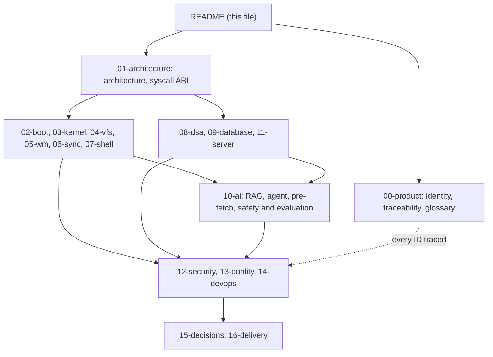
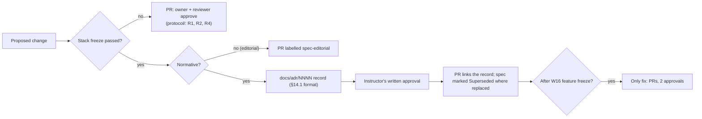

# Plotinium specifications

| Field | Value |
|---|---|
| Title | Plotinium specification set: index, reading guide, precedence, conventions and change process |
| Status | Draft v0.1, 2026-09-24 |
| Primary owner | R5 QA/DevOps & Integration Engineer (keeps the index and runs the docs checks) |
| Secondary reviewer | R1 Kernel / Systems Architect (lead editor of `ARCHITECTURE.md`) |
| Must be demonstrable at | **G0 Registration (W2):** the index and conventions exist and the docs checks run on pull requests. **P1 architecture defence (W4):** every spec needed for the defence is at least Draft; the stack freeze starts the change process of §3.6. Kept current to **v1.0.0** (W17–18). |
| Requirement IDs covered | Spec p2–p3 (conventions: RFC 2119 keywords, requirement identifiers, test naming, measurement), §14.4 (changing the frozen stack), §15.1 (subsystem boundaries visible in the layout), §15.2 (required documents); Plotinium design IDs SPX-01..SPX-09. The full requirement-to-spec map is [requirements-traceability.md](./00-product/requirements-traceability.md). |
| Related specs | [Requirements traceability](./00-product/requirements-traceability.md) · [Glossary](./00-product/glossary.md) · [Identity and branding](./00-product/identity-and-branding.md) · [Architecture](./01-architecture/architecture.md) · [Stack decisions](./15-decisions/stack-decisions.md) · [Implementation plan](./16-delivery/implementation-plan.md) · [Testing and performance](./13-quality/testing-and-performance.md) |

---

## 1. Purpose and scope

These specifications turn the capstone specification (*AI-Native Web-Based Operating System, Capstone Project Specification*, v1.0, September 2026, Lahore Garrison University) into an implementable design for **Plotinium**, the operating system our five-member team builds and defends between Week 1 and Week 18.

They are written for the five engineers who implement the system and answer for it in the viva. Every file is normative for its subsystem: code follows the spec, and when the code needs to differ, the spec is changed first (§3.6).

This README is the entry point. It lists every spec file with its owner and phase (§3.1), explains how to read them (§3.2), fixes which source wins when two disagree (§3.3), defines the status legend (§3.4) and the writing conventions (§3.5), sets the change process (§3.6), and shows how the specs map onto the code tree (§3.7) and onto the root documents that §15.2 requires (§3.8). It also summarises the eighteen canonical decisions every spec follows (§3.9).

Out of scope here: the requirements themselves (see [requirements-traceability.md](./00-product/requirements-traceability.md)) and the week-by-week schedule (see [implementation-plan.md](./16-delivery/implementation-plan.md)).

## 2. Requirements table

| ID | Summary | Spec § | How verified |
|---|---|---|---|
| SPX-01 | Plotinium design. Every spec file starts with the header block of §4.1 and then has sections 1–9 in the order of §4.2. | p2–p3 (conventions) | `SPX-01` docs check |
| SPX-02 | Spec: MUST (p3). Requirement keywords follow RFC 2119. Plotinium design: every normative statement is marked either "Spec: MUST/SHOULD/MAY, §x, ID" or "Plotinium design". | p3 | Review checklist; docs check warns on an unmarked MUST |
| SPX-03 | Spec: MUST (p3). Every test that verifies a requirement has a title that begins with the requirement ID (C18). | p3 | `tools/traceability.ts` (TRC-02) |
| SPX-04 | Plotinium design. Every number taken from the AI-run pilot carries the label *pilot figure — re-measure on the lab machine*; gate evidence comes only from the lab-spec machine (spec p3, Measurement). | p3 | Docs check for numbers citing `docs/evidence/pilot`; review |
| SPX-05 | Plotinium design. Every relative link between specs resolves, and every requirement ID cited is a spec ID or a registered Plotinium prefix. | — | `SPX-05` docs check |
| SPX-06 | Plotinium design. The index in §3.1 matches the header block (title, owner, reviewer) of every spec file. | §4.2 | `SPX-06` docs check |
| SPX-07 | Spec: MUST (§14.4). After the stack freeze at the Phase 1 defence, a normative change needs a new decision record in `docs/adr/` and the instructor's approval (§3.6). | §14.4 | `SPX-07` check: a PR changing a normative line of a Frozen spec must link an ADR with a recorded approval |
| SPX-08 | Spec: MUST (§15.2). The root documents stay consistent with the specs they are built from (§3.8) and are up to date with the code on `v1.0.0` (§17.2). | §15.2, §17.2 | Document review at each gate (PLT-DOC rows of the traceability spec) |
| SPX-09 | Plotinium design. Diagrams are Mermaid in the Markdown, so GitHub renders them and they are versioned with the text. | C14 | Review |

## 3. Design (normative)

### 3.1 Index of spec files

The header block of each file is authoritative for its owner and reviewer; this table is checked against the headers (SPX-06). "Phase" gives the first gate at which the file's content must be demonstrable and the gate by which it must be complete. Gate codes: G0 registration (W2), P1 architecture defence (W4), P2 (W7, `v0.2.0`), P3 (W11, `v0.3.0`), P4 (W14, `v0.4.0`), FRZ feature freeze (W16, `v1.0.0-rc.N`), P5 final defence (W17–18, `v1.0.0`). Weeks are indicative; exact dates come from Google Classroom.

| Path | Title | Primary owner | Reviewer | Phase | Status |
|---|---|---|---|---|---|
| [README.md](./README.md) | Plotinium specification set (this file) | R5 | R1 | G0 → P5 | Draft v0.1 |
| [00-product/identity-and-branding.md](./00-product/identity-and-branding.md) | Identity and branding: name, tagline, wordmark, logo, versions, kernel identifier, registration | R3 | R5 | G0 (name, form) → P2 (identity kit) | Draft v0.1 |
| [00-product/requirements-traceability.md](./00-product/requirements-traceability.md) | Requirements traceability (master checklist) | R5 | R1 | G0 → every gate → P5 | Draft v0.1 |
| [00-product/glossary.md](./00-product/glossary.md) | Glossary: Appendix B terms and Plotinium terms | R4 | R5 | P1 → P5 | Draft v0.1 |
| [01-architecture/architecture.md](./01-architecture/architecture.md) | Architecture: layers, boundaries, threads, origin, data flows | R1 | R5 | P1 (paper) → P4 (all walk-throughs live) | Draft v0.1 |
| [01-architecture/syscall-abi.md](./01-architecture/syscall-abi.md) | System-call ABI: envelope, identity by port, dispatcher, call catalogue, errnos, capabilities | R1 | R2 (R4 co-approves `ai.*`; `protocol/` changes need R1, R2 and R4) | P1 (paper) → P2 | Draft v0.1 |
| [02-boot/boot-and-services.md](./02-boot/boot-and-services.md) | Boot sequence, service manager and shutdown | R5 | R3 | P1 (paper) → P2 (boot v1) → P3 (boot v2) | Draft v0.1 |
| [03-kernel/processes-and-scheduling.md](./03-kernel/processes-and-scheduling.md) | Processes, scheduling and job control | R1 | R5 | P2 → P3 | Draft v0.1 |
| [03-kernel/memory-and-paging.md](./03-kernel/memory-and-paging.md) | Memory manager and paging | R1 | R2 | P3 → P4 (AI pages) | Draft v0.1 |
| [04-vfs/virtual-file-system.md](./04-vfs/virtual-file-system.md) | Virtual file system | R2 | R1 (client sync and lock sections: R5 primary, R2 reviewer) | P2 → P3 → P4 (agent `batch`) | Draft v0.1 |
| [05-wm/window-manager.md](./05-wm/window-manager.md) | Window manager: compositor, registry, focus and z-order, taskbar, coupling, secure prompt | R3 | R1 | P2 → P3 → P4 | Draft v0.1 |
| [05-wm/ui-design-system.md](./05-wm/ui-design-system.md) | UI design system: `tokens.css`, screens, WCAG 2.2 AA | R3 | R5 | P2 → P3 | Draft v0.1 |
| [06-sync/offline-and-sync.md](./06-sync/offline-and-sync.md) | Offline execution, synchronisation and distributed locks | R5 (client) and R2 (server sections) | R2 reviews client sections; R5 reviews server sections | P2 (op pipeline skeleton) → P3 | Draft v0.1 |
| [07-shell/shell-and-terminal.md](./07-shell/shell-and-terminal.md) | Shell and terminal | R3 | R4 (each command section reviewed by its command owner) | P2 → P3 → P4 (AI commands) | Draft v0.1 |
| [08-dsa/data-structures.md](./08-dsa/data-structures.md) | Data structures and algorithms (`dsa/`) | R1 (editor; each structure has its own owner) | R5 | P1 (`DSA.md` draft) → P4 | Draft v0.1 |
| [09-database/database.md](./09-database/database.md) | Database: schema, migrations, `vfsTxn`, lock order, indexes, integrity | R2 | R5 | P1 (ERD, DDL) → P3 | Draft v0.1 |
| [10-ai/rag-semantic-search.md](./10-ai/rag-semantic-search.md) | Subsystem A: RAG semantic search | R4 | R2 | W12 checkpoint → P4 | Draft v0.1 |
| [10-ai/agentic-shell.md](./10-ai/agentic-shell.md) | Subsystem B: agentic shell | R4 | R2 | W12 checkpoint → P4 | Draft v0.1 |
| [10-ai/predictive-prefetch.md](./10-ai/predictive-prefetch.md) | Subsystem C: predictive pre-fetch | R4 | R1 | W12 checkpoint → P4 | Draft v0.1 |
| [10-ai/ai-safety-and-evaluation.md](./10-ai/ai-safety-and-evaluation.md) | AI safety, coupling map and evaluation | R4 | R5 | W3 bake-off, P1 → P4 | Draft v0.1 |
| [11-server/backend-api.md](./11-server/backend-api.md) | Backend API and server runtime | R2 (editor; plugin owners listed inside) | R5 | P2 → P3 → P4 | Draft v0.1 |
| [12-security/security-model.md](./12-security/security-model.md) | Security model: threat model, permissions, auth, agent trust boundary, secrets | R2 (planned) | R4 (planned) | P2 → P4 | Planned |
| [13-quality/testing-and-performance.md](./13-quality/testing-and-performance.md) | Testing and performance | R5 | R1 | G0 → P2 (frame method) → P5 | Draft v0.1 |
| [14-devops/deployment-and-ci.md](./14-devops/deployment-and-ci.md) | Deployment and CI | R5 (planned) | R2 (planned) | G0 (CI skeleton) → P2 (deploy) → P5 | Planned |
| [15-decisions/stack-decisions.md](./15-decisions/stack-decisions.md) | Stack decisions (`STACK_DECISION.md` records) | R5 editor (planned); each record by its owner | all record owners | P1 (frozen at the defence) | Planned |
| [16-delivery/implementation-plan.md](./16-delivery/implementation-plan.md) | Implementation plan: phases, roles, ownership, team contract, risks | R5 (planned) | R1 (planned) | G0 → P5 | Planned |
| [16-delivery/backlog.md](./16-delivery/backlog.md) | Backlog: work breakdown with an owner for every task | R5 (planned) | R2 (planned) | P1 | Planned |
| [16-delivery/sprint-01.md](./16-delivery/sprint-01.md) | Sprint 01 | R5 (planned) | all (planned) | G0 | Planned |

**Topic ownership.** When two specs describe the same thing, the one whose title names the topic owns it (for example, the errno set belongs to the system-call ABI, the lock order to the database spec, the frame-measurement method to the testing spec). Architecture wins on structure (which component owns what, what crosses which boundary) and the owning spec wins on detail.



### 3.2 How to read the specs

1. **Everyone, first:** this README, then the [glossary](./00-product/glossary.md), then [architecture.md](./01-architecture/architecture.md) §3 and its six data-flow walk-throughs (§5). The spec asks every member to be able to explain the whole system (§4.2, §16.4).
2. **Then your own subsystem** (the rows where you are primary owner in §3.1), then the subsystem you review.
3. **Before each gate:** the gate list in [requirements-traceability.md §3.4](./00-product/requirements-traceability.md) and the Appendix A checklist in §3.8 of the same file.
4. **Inside a spec:** §2 says what must hold and how it is verified; §3 is the design; §4 has the exact types, SQL and message shapes; §5 the algorithms, invariants and complexity; §6 the errors and their errnos; §7 the budgets; §8 the test titles; §9 what is still open and what the spec asks of other specs.

### 3.3 Source precedence

When two sources disagree, the higher one wins:

1. **The capstone specification PDF**, in particular its MUST requirements. It changes only by a numbered written amendment posted on Google Classroom (spec p2).
2. **The canonical decisions C1–C18** (§3.9), which already apply the research precedence below and are binding for every spec.
3. **The spec file that owns the topic** (§3.1, topic ownership).
4. **Any other spec file.**
5. **The research inputs** in `docs/research/`, in their own order: `critic.json` fixes > `coherence.json` resolutions > examiner amendments inside `decisions/*.json` > the original decision records and `strategy/*.md`. They are inputs, not decisions of record; they are AI-assisted and disclosed in `AI_USAGE.md`.

Two further rules:
- **Code follows the specs.** If the code has to differ, the spec changes first through §3.6; a PR that implements something different from its spec is not merged.
- **Root documents follow the specs.** `ARCHITECTURE.md`, `DATABASE.md` and the others (§3.8) are written from the specs and the code; if a root document and a spec disagree, the spec wins and the root document is corrected.

A conflict discovered between two specs is recorded as a cross-spec request in both files' §9 and resolved in one PR that changes both.

### 3.4 Status legend

| Status | Meaning | How it changes |
|---|---|---|
| Planned | Listed in the index; the file does not exist yet | Its owner writes it |
| Draft v0.x | Being written; may change freely | PR approved by the owner and the reviewer |
| Review | A PR proposes it for acceptance | Owner and reviewer approve; open questions that block implementation are closed |
| Accepted | Merged and agreed before the stack freeze; implementation may start | PR approved by the owner and the reviewer (§3.6) |
| Frozen | The stack freeze has passed (Phase 1 defence accepted) | Normative changes only through a decision record and instructor approval (§3.6) |
| Superseded by ADR-NNNN | A section or file replaced by a decision record | Kept for history, marked in place |

Requirement-level status (planned, verified at a gate, and so on) is tracked in the traceability spec, not here.

### 3.5 Conventions

- **Requirement identifiers.** Spec IDs are the 84 identifiers of the capstone specification (BOOT, PROC, MEM, VFS, WM, OFF, SYS, DB, RAG, AGT, PRE); they are never renumbered. Our own normative choices carry **Plotinium design IDs** whose prefix is registered in [requirements-traceability.md §3.13](./00-product/requirements-traceability.md) (for example `ARC-02`, `PVFS-09`, `DSA-TRIE-02`, `AIN-A2`). A new prefix is registered by a PR to that table.
- **Keywords.** MUST, SHOULD and MAY follow RFC 2119 as in the spec's conventions (p3): Must is mandatory for passing a gate; Should is expected unless a different choice is justified in writing; May is optional and earns credit when done well.
- **Marking.** A statement copied from the capstone specification is written "**Spec: MUST, §9.3, VFS-06.**"; a choice of ours is written "**Plotinium design.**", with the canonical decision it follows (C1–C18) where there is one. RFC 2119 words inside a Plotinium design statement bind the team, not the examiners.
- **Test naming** (spec p3, C18). Every test title begins with its requirement ID, then states the behaviour: `VFS-06 rejects a write beyond quota with EDQUOT and no partial data`. `tools/traceability.ts` builds the requirement-to-test matrix from these titles, and the gate check fails on a title whose first token is not a known ID (TRC-02).
- **Numbers.** A number from the AI-run pilot is labelled *pilot figure — re-measure on the lab machine*. Targets are measured on the Department's lab-spec machine in the current stable Chrome at each gate (spec p3). A budget from the spec is quoted with its ID; a budget of our own is marked Plotinium design.
- **Errnos.** Only the errno set of C3 is used; a spec that needs another errno sends a cross-spec request to [syscall-abi.md](./01-architecture/syscall-abi.md).
- **Terms.** Words are used as the [glossary](./00-product/glossary.md) defines them; overloaded words are qualified (glossary §3.14).
- **Diagrams** are Mermaid inside the Markdown. **Links** between specs are relative. **Dates** are ISO 8601; weeks are W1–W18.
- **Style.** Plain, precise English for engineers; no marketing and no filler. Each file is written for someone who must implement it and defend it in the viva.

### 3.6 Change process

**Before the stack freeze** (until the Phase 1 defence at W4 is accepted; if the defence is returned for revision, until the revised stack is accepted, at most one week later, §14.4):
- A spec changes by pull request, approved by the spec's primary owner and its secondary reviewer (a PR by the owner needs the reviewer). Changes to `protocol/` need R1, R2 and R4 ([syscall-abi.md](./01-architecture/syscall-abi.md)).
- A change to a canonical decision (C1–C18) changes [stack-decisions.md](./15-decisions/stack-decisions.md) and every affected spec in the same PR.

**After the stack freeze** (spec §14.4: "The stack is then frozen; changing it later needs a new decision record and the instructor's approval"):
- A **normative** change to a spec needs a new decision record `docs/adr/NNNN-<slug>.md` in the §14.1 format (context and constraints; at least three genuine options; criteria and weights declared before scoring; evidence; decision and consequences; reversal trigger) **plus the instructor's written approval**, recorded in the record before the PR merges. The PR links the record, and the changed spec sections say "Superseded by ADR-NNNN" where they were replaced (SPX-07).
- An **editorial** change needs only the normal PR review and the label `spec-editorial`: typo, broken link, exact section numbers replacing topic references, a clearer sentence with the same meaning, a test title adopted from "(proposed)", or a new test that verifies an existing requirement.
- A parameter that a spec explicitly marks as configurable may be tuned by PR within the limits that spec states; the spec's targets themselves cannot be loosened this way.

**After the feature freeze** (W16, `v1.0.0-rc.1`; spec §13.2): only bug fixes are merged (`fix:` PRs with the `freeze-fix` label and two approvals). Features merged after the freeze are reverted before judging. Specs change only editorially or through the ADR route above.

**Also:**
- A **spec amendment** posted on Google Classroom is applied to the traceability spec within 2 working days (TRC-08) and to every affected spec in the same week.
- **The OS name** can change after Phase 1 only with the instructor's written approval (§5.1; [identity-and-branding.md](./00-product/identity-and-branding.md) PLT-ID-17).



### 3.7 From specs to code

The code is one pnpm workspace at the repository root ([architecture.md §3.7](./01-architecture/architecture.md)); the subsystem boundaries are visible in the directory structure (spec §15.1). `.github/CODEOWNERS` assigns each path its primary owner and secondary reviewer from these specs.

| Spec | Main code paths |
|---|---|
| 00-product | `docs/identity/`, `README.md`, `tools/traceability.ts`, `docs/requirements.csv` |
| 01-architecture | `protocol/` (schemas, errnos, ABI version), `kernel/core/ipc`, the import-boundary lint rules |
| 02-boot | `services/` (manifests, `svcmgr`), `wm/boot-ui/`, `web/index.html` |
| 03-kernel | `kernel/core/{proc,sched,mm}`, `kernel/runtime`, `kernel/blkio`, `apps/demo` (`burn`, `memhog`), the server swap store |
| 04-vfs | `vfs/` (tree, path, perm, quota, store, ops, fsck) |
| 05-wm | `wm/compositor`, `wm/shell`, `wm/tokens`, `wm/frame-meter`, `apps/*/view.tsx` |
| 06-sync | `vfs/sync`, `vfs/locks`, `web/sw.ts`, `server/src/sync`, `server/src/locks` |
| 07-shell | `apps/terminal`, `apps/shell`, `apps/coreutils`, `apps/bin/` (manifests and man pages) |
| 08-dsa | `dsa/` (one module per structure, each with `tests/` and `bench/`) |
| 09-database | `db/` (migrations, `schema.sql`, seed, bench, probes), `server/src/vfs` (`vfsTxn`, `lockPlan`) |
| 10-ai | `ai/embed`, `ai/indexer`, `ai/search`, `ai/agent`, `ai/predictor`, `ai/eval` |
| 11-server | `server/` |
| 12-security | `server/src/gateway`, `vfs/perm.ts`, the Caddyfile headers |
| 13-quality | `tests/`, `vitest.config.ts`, `playwright.config.ts`, `tests/performance/budgets.json`, `tools/` |
| 14-devops | `.github/workflows/`, `ops/`, `compose.yaml`, `compose.prod.yaml`, `Caddyfile`, `Dockerfile` |
| 15-decisions | `STACK_DECISION.md`, `docs/adr/`, `docs/evidence/` |
| 16-delivery | `TEAM_CONTRACT.md`, `.github/CODEOWNERS`, the issue board |

Pilot code in `docs/evidence/pilot/` is evidence only: it is never imported and is excluded from build, lint and coverage (C16).

### 3.8 Specs and the root documents of §15.2

**Spec: MUST, §15.2.** The repository contains the documents below. They are the graded, examiner-facing deliverables; the specs are the team's normative design. Each root document is written from the specs listed (condensed, with measured results filled in) and must not contradict them (SPX-08). Owners and due gates are fixed in [requirements-traceability.md §3.6](./00-product/requirements-traceability.md) (PLT-DOC rows).

| Root document | Required contents (spec §15.2 unless noted) | Built from |
|---|---|---|
| `README.md` | What the system is, its name and tagline, the live URL, bring-up in three commands or fewer, what works, known limitations stated honestly | [identity-and-branding](./00-product/identity-and-branding.md), [deployment-and-ci](./14-devops/deployment-and-ci.md) |
| `ARCHITECTURE.md` | Diagrams, module boundaries, the system-call protocol, data flows, the two decisions we would reverse with hindsight | [architecture](./01-architecture/architecture.md), [syscall-abi](./01-architecture/syscall-abi.md) |
| `STACK_DECISION.md` | The decision records of §14 | [stack-decisions](./15-decisions/stack-decisions.md) |
| `DSA.md` | Every mandatory structure: location, operations, complexity, proving test and benchmark | [data-structures](./08-dsa/data-structures.md) |
| `DATABASE.md` | ERD, tree representation, transaction design, isolation level, indexes, benchmark results with query plans | [database](./09-database/database.md) |
| `AI.md` | Subsystems chosen, models and why, the coupling map (§12.5), evaluation results, safety controls, cost report | [rag-semantic-search](./10-ai/rag-semantic-search.md), [agentic-shell](./10-ai/agentic-shell.md), [predictive-prefetch](./10-ai/predictive-prefetch.md), [ai-safety-and-evaluation](./10-ai/ai-safety-and-evaluation.md) |
| `BOOT.md` | Boot stages, the service DAG, critical and degradable services, boot-time budget and the measured critical path | [boot-and-services](./02-boot/boot-and-services.md) |
| `TESTING.md` | Test strategy, how to run each suite, coverage, performance budgets, fault-injection design | [testing-and-performance](./13-quality/testing-and-performance.md) |
| `SECURITY.md` | Threat model, permission model, agent trust boundary, prompt-injection defences, secret handling | [security-model](./12-security/security-model.md) |
| `AI_USAGE.md` | Disclosure of AI coding assistance (§18): tools, what was asked, what was accepted, what was rejected and why, including the AI-assisted research inputs | [implementation-plan](./16-delivery/implementation-plan.md) (process) |
| `TEAM_CONTRACT.md` | The six §4.4 items | [implementation-plan](./16-delivery/implementation-plan.md) |
| `CHANGELOG.md` | Changes per release, by requirement ID (§15.1 layout) | [deployment-and-ci](./14-devops/deployment-and-ci.md) |
| `THIRD_PARTY.md` | Every third-party library and asset with its licence (§18) | [stack-decisions](./15-decisions/stack-decisions.md) and the CI licence scan |

### 3.9 The canonical decisions (C1–C18)

The specs cite these by number. The full text of each decision is kept with its record in [stack-decisions.md](./15-decisions/stack-decisions.md) and is applied in the files named below; the one-line summaries here are for navigation and do not replace it.

| # | Decision (summary) | Applied mainly in |
|---|---|---|
| C1 | Name **Plotinium**, coined from plutonium (Pu, element 94), described only as the element; npm scope `@plotinium`; Web Locks `plotinium:*`; IndexedDB `plotinium` and `plotinium-swap`; port 4717 (`PLOTINIUM_PORT`); version 0.1.0, tags v0.2.0, v0.3.0, v0.4.0, v1.0.0 | [identity-and-branding](./00-product/identity-and-branding.md) |
| C2 | One kernel worker per origin (Web Lock plus fencing epoch); executors separate isolation from concurrency; run tokens clamp(hwc − 2 − (embedActive ? ortThreads : 0), 1, 6); special workers only kernel, blkio, ai.embed; the main thread renders and dispatches | [architecture](./01-architecture/architecture.md), [processes-and-scheduling](./03-kernel/processes-and-scheduling.md) |
| C3 | Syscall envelope `{id, call, args}` → `{id, ok, value \| errno}`; identity from the port; fixed dispatcher order; Valibot only; the errno set | [syscall-abi](./01-architecture/syscall-abi.md) |
| C4 | One IndexedDB database per device; one readwrite transaction per user-visible mutation; strict or relaxed durability by store; synchronous transaction builders; OPFS tier-1 swap with IndexedDB fallback; write-behind tier-2 swap | [virtual-file-system](./04-vfs/virtual-file-system.md), [memory-and-paging](./03-kernel/memory-and-paging.md) |
| C5 | UUIDv7 inode ids everywhere; fixed well-known ids for system paths shared by client `mkfs` and the server seed | [virtual-file-system](./04-vfs/virtual-file-system.md), [database](./09-database/database.md) |
| C6 | Raw WSS protocol v1; op lane and control lane; opId, cseq, Lamport counter (no HLC); batched replay with credits; S/X leases with fencing; per-owner resume feed; synchronous commit for bulk ops online; conflicted copies; no CRDT library | [offline-and-sync](./06-sync/offline-and-sync.md) |
| C7 | PostgreSQL 18.6 + pgvector 0.8.6; adjacency-list tree; READ COMMITTED with lock order L0–L4; acyclicity trigger; retries; set-based bulk SQL; GUC-gated fault injection never on production; CHECK constraints; the table list | [database](./09-database/database.md) |
| C8 | Kysely 0.29.6 on node-postgres; kysely-codegen `--verify`; dbmate plain-SQL up/down migrations with a CI round trip; perf-index scripts | [database](./09-database/database.md) |
| C9 | Node.js 24 LTS, one Fastify 5 process as a modular monolith; Caddy owns static files and headers; FsBlobStore; own token-bucket rate limiter; LLM budget reserve and settle | [backend-api](./11-server/backend-api.md) |
| C10 | Opaque sessions, `__Host-plt_sid` / `plt_sid`; Argon2id; PBKDF2 offline verifier (never for root); `su` grants via the secure prompt; no credentials in the README or `compose.yaml`; COOP/COEP/CORP and CSP; everything self-hosted; gitleaks | [security-model](./12-security/security-model.md) |
| C11 | SolidJS 1.9.15 (provisional; React fallback after the Week-2 kata); framework-free compositor and boot-ui; xterm.js as the TTY device only; CodeMirror 6 lazy; one `tokens.css`; Vite 8 with a hand-written Service Worker registered after desktop-interactive | [window-manager](./05-wm/window-manager.md), [ui-design-system](./05-wm/ui-design-system.md) |
| C12 | All three AI subsystems, each showing all four AI-native properties; local embeddings; readable set before ranking; observation-loop agent with kernel-decided confirmation; Witten-Bell Markov-2 predictor; LLM via the server gateway; litmus build | the `10-ai/` specs |
| C13 | Frame p95 ≤ 16.7 ms from Chrome-trace frame durations plus zero LoAF > 50 ms from our scripts; boot ≤ 1.5 s warm and ≤ 3.0 s cold; boot-critical JS ≤ 60 KB gzip; reservation-based memory admission, reclaim at 85%; the PROC-04 bound; RAG-05 with a warm model | [testing-and-performance](./13-quality/testing-and-performance.md) |
| C14 | pnpm workspaces with exact pins; TypeScript 6 tooling and TypeScript 7 type check; ESLint 10 with our local rules; Vitest and Playwright; coverage 70% overall and 85% on `dsa/`, `vfs/`, `kernel/`; GitHub Actions; Docker Compose bring-up in three commands; Hetzner host; backups; Typst report and slides | [testing-and-performance](./13-quality/testing-and-performance.md), [deployment-and-ci](./14-devops/deployment-and-ci.md) |
| C15 | Rebalanced roles R1–R5, each with a second subsystem; a primary owner and secondary reviewer for every path | [implementation-plan](./16-delivery/implementation-plan.md), [requirements-traceability](./00-product/requirements-traceability.md) |
| C16 | Mandatory structures written by the team in `dsa/`, shipped with tests and benchmarks behind `IMPLEMENTED = false`; pilot code never imported | [data-structures](./08-dsa/data-structures.md) |
| C17 | 18 service manifests in 7 levels; critical path kernel > storage > vfs > login > session > desktop; the same DAG resolves app start-up dependencies; boot menu by Esc, `reboot --menu` or a Settings flag | [boot-and-services](./02-boot/boot-and-services.md) |
| C18 | Test titles begin with the requirement ID; `tools/traceability.ts` builds the matrix | [requirements-traceability](./00-product/requirements-traceability.md), [testing-and-performance](./13-quality/testing-and-performance.md) |

## 4. Interfaces and data shapes

### 4.1 Header block (every spec file)

```markdown
# <Short title>

| Field | Value |
|---|---|
| Title | <full title> |
| Status | Draft v0.1, 2026-09-24 |
| Primary owner | <R1–R5 and role name> |
| Secondary reviewer | <a different role> |
| Must be demonstrable at | <gate or phase, with what is shown> |
| Requirement IDs covered | <spec IDs and Plotinium design IDs> |
| Related specs | <relative links> |
```

### 4.2 Section order (every spec file)

`## 1. Purpose and scope` · `## 2. Requirements table` (ID | summary | spec § | how verified) · `## 3. Design (normative)` · `## 4. Interfaces and data shapes` · `## 5. Algorithms and invariants` · `## 6. Errors and edge cases` (with the errno mapping) · `## 7. Performance budgets` · `## 8. Test plan` · `## 9. Open questions and cross-spec requests`.

### 4.3 Docs-check configuration

```ts
// tools/spec-lint/config.ts — Plotinium design (run by the docs checks of the CI lint job)
export interface SpecLintConfig {
  root: 'specs';
  headerFields: readonly ['Title', 'Status', 'Primary owner', 'Secondary reviewer',
    'Must be demonstrable at', 'Requirement IDs covered', 'Related specs'];
  sections: readonly string[];            // §4.2, matched by number and leading words
  indexFile: 'specs/README.md';           // §3.1, compared with every header (SPX-06)
  pilotPath: 'docs/evidence/pilot';       // numbers citing it need the pilot label (SPX-04)
  statusValues: readonly ['Planned', 'Draft', 'Review', 'Accepted', 'Frozen', 'Superseded'];
}
```

A header whose "Must be demonstrable" field is named "Must be demonstrable" without "at" is accepted as the same field (some AI specs use the shorter form).

## 5. Algorithms and invariants

- **Link and ID check (SPX-05).** Parse every Markdown file under `specs/`, collect relative links and requirement-ID tokens; each link target must exist (and each `#anchor` must match a heading slug); each ID token must match a spec ID or a registered prefix (the grammar in [requirements-traceability.md §4.1](./00-product/requirements-traceability.md)). O(total characters).
- **Index check (SPX-06).** For each row of §3.1 whose status is not Planned, read the target file's header block and compare the primary owner's and reviewer's leading role codes. O(files).
- **Freeze check (SPX-07).** For a PR after the stack freeze, compute the changed lines of files whose status is Frozen; if any changed line lies in §2–§7 and the PR has no `spec-editorial` label, the PR body must link a `docs/adr/` record that contains an "Instructor approval" line with a date.
- **Invariant R-1.** Every spec file of the planned tree appears exactly once in §3.1.
- **Invariant R-2.** No spec cites a canonical decision number outside C1–C18.

## 6. Errors and edge cases

| Case | Rule |
|---|---|
| Two specs disagree | Topic ownership (§3.1) decides for now; both files record a cross-spec request in §9; one PR fixes both. |
| A spec contradicts a canonical decision | The canonical decision wins; the spec is corrected. If the decision itself is wrong, the change process of §3.6 applies to the decision. |
| A spec contradicts the capstone specification | The capstone specification wins; the spec is corrected at once and the error is noted in the PR. |
| The capstone specification is amended | §3.6: traceability within 2 working days, affected specs within the week. |
| A file listed in §3.1 does not exist | Status Planned; links to it are allowed and the link check reports them as warnings, not errors, until the file's owner creates it. |
| The owner in a header differs from §3.1 | The header wins; §3.1 is corrected in the same PR (SPX-06). |
| A research input contradicts a spec | The spec wins (research inputs are not decisions of record); if the input reveals a real problem, the change process applies. |
| A number is used without the pilot label although it came from the pilot | The docs check flags it; the author adds the label or replaces the number with a lab measurement. |

This README defines no errnos; the errno set and mappings are in [syscall-abi.md](./01-architecture/syscall-abi.md).

## 7. Performance budgets

None for the README itself. All numeric targets are collected in [requirements-traceability.md §7](./00-product/requirements-traceability.md) and enforced from `tests/performance/budgets.json` ([testing-and-performance.md](./13-quality/testing-and-performance.md)).

## 8. Test plan

| Test title | Level | Runs |
|---|---|---|
| `SPX-01 every spec file has the seven header fields and sections 1 to 9 in order` | docs check | every PR touching `specs/**` |
| `SPX-03 a test title whose first token is not a requirement ID fails the traceability job` | unit | every PR |
| `SPX-04 a number citing docs/evidence/pilot without the pilot label is reported` | docs check | every PR touching `specs/**` or `docs/**` |
| `SPX-05 every relative link in specs resolves and every cited ID is a spec ID or a registered prefix` | docs check | every PR touching `specs/**` |
| `SPX-06 the README index matches the owner and reviewer in every spec header` | docs check | every PR touching `specs/**` |
| `SPX-07 a normative change to a Frozen spec without a linked ADR carrying an instructor approval fails the check` | docs check | every PR after the stack freeze |

## 9. Open questions and cross-spec requests

**Open questions**
- Q1 (R5, W1): the exact gate dates on Google Classroom, to replace the indicative weeks in §3.1.
- Q2 (R5, W4): does the instructor want the `specs/` folder submitted with the Phase 1 dossier, or only the root documents of §15.2? The plan assumes only the root documents are graded and the specs are supporting material.
- Q3 (team, W4): who writes each root document from its specs, and when? Proposed: the spec's primary owner, at the gate named in the traceability spec's PLT-DOC rows.

**Cross-spec requests**
- To every spec author: keep the header block of §4.1 exactly (field names included) so the docs checks can parse it; use the "Must be demonstrable at" field name.
- To [12-security/security-model.md](./12-security/security-model.md), [14-devops/deployment-and-ci.md](./14-devops/deployment-and-ci.md), [15-decisions/stack-decisions.md](./15-decisions/stack-decisions.md) and the three [16-delivery](./16-delivery/implementation-plan.md) files: confirm or correct the planned owner and reviewer in §3.1 when the file is written.
- To [13-quality/testing-and-performance.md](./13-quality/testing-and-performance.md): run the SPX checks of §8 in the CI `lint` job next to `pnpm traceability`.
- To [15-decisions/stack-decisions.md](./15-decisions/stack-decisions.md): record the full text of C1–C18 next to their decision records (§3.9 only summarises them); provide `docs/adr/0000-template.md` with the six §14.1 parts and an "Instructor approval" line (name, date, link to the written approval), used by SPX-07.
- To [16-delivery/implementation-plan.md](./16-delivery/implementation-plan.md): reference this change process in `TEAM_CONTRACT.md`, and record the date of the stack freeze when the Phase 1 defence is accepted.
